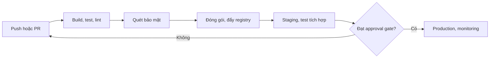
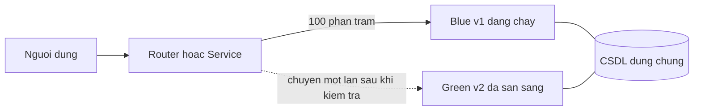
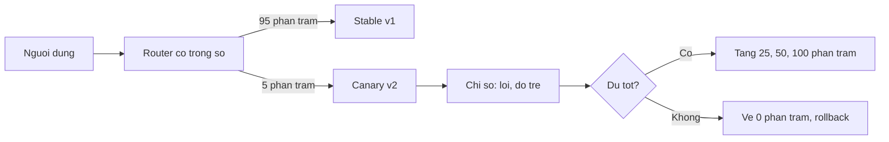
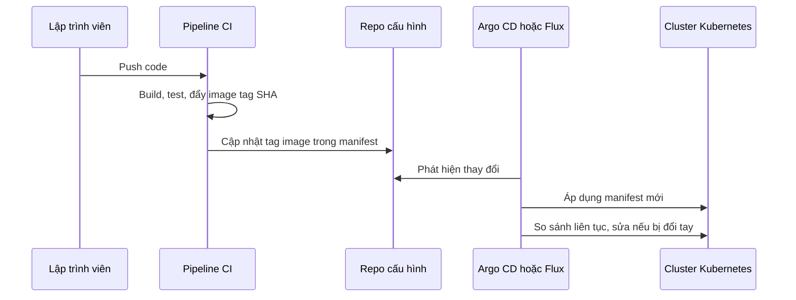

# CI/CD

## CI/CD là gì?

**CI (Continuous Integration)** nghĩa là mỗi lần có người push code, một server tự build và chạy test. **CD (Continuous Delivery/Deployment)** là phần tiếp theo: bản đã qua test được đưa tới các môi trường một cách tự động. Hai biến thể của CD khác nhau ở một điểm: *delivery* dừng lại chờ một người bấm duyệt trước khi lên production, còn *deployment* tự lên production luôn khi mọi gate đều xanh. Toàn bộ chuỗi các bước tự động đó gọi là **pipeline**.

**Nền tảng:** CI/CD tồn tại để làm thay đổi nhỏ, kiểm tra tự động ngay và phát hành thường xuyên, nhờ đó mỗi lần phát hành đều nhỏ, ít rủi ro và dễ rollback. Mọi thiết kế pipeline (quality gate, build một lần, rollback) phục vụ mục tiêu này.

**Tóm tắt:**

- CI tự build và test mỗi lần push; Continuous Delivery dừng chờ người duyệt trước production, Continuous Deployment tự lên production khi mọi gate đều xanh.
- Mục tiêu cốt lõi là thay đổi nhỏ, kiểm tra tự động ngay và phát hành thường xuyên, để mỗi lần phát hành nhỏ, ít rủi ro và dễ rollback.
- Build một lần, deploy mọi nơi: cùng một artifact (image tag bằng commit SHA) đi qua mọi môi trường, chỉ khác cấu hình.
- Rolling, Blue-Green, Canary và feature flag đánh đổi giữa chi phí tài nguyên, tốc độ rollback và độ phức tạp.
- Mọi chiến lược deploy đều có lúc bản cũ và bản mới cùng chạy với một DB, nên migration phải tương thích ngược (mở rộng trước, thu hẹp sau).
- Pipeline phải nhanh (dưới khoảng 10 phút), đáng tin (không flaky test), tái lập được và là code trong repo.
- GitOps là mô hình kéo: Git là nguồn sự thật, controller trong cluster tự sync và sửa drift, rollback bằng `git revert`.

## Vấn đề nó giải quyết

Không có CI thì lỗi tích hợp chỉ lòi ra khi mọi người gộp code vào cuối tuần, và ai cũng nói "máy tôi chạy được". Deploy bằng tay thì chậm, dễ quên bước, và vì ai cũng sợ release nên release dồn lại thành một cục lớn, mà cục càng lớn càng rủi ro, càng khiến người ta sợ hơn. CI/CD phá vòng luẩn quẩn này: thay đổi nhỏ, kiểm tra tự động ngay, phát hành thường xuyên nên mỗi lần đều nhỏ và dễ rollback.

## Khi nào dùng, khi nào chưa cần

Dùng khi dự án có từ hai người trở lên hoặc release thường xuyên. Dự án thử nghiệm một người có thể chỉ cần CI đơn giản (build và test), chưa cần CD đầy đủ với nhiều môi trường. Cách làm: dựng pipeline gồm build, test, quét bảo mật, đóng gói, deploy; mỗi giai đoạn có quality gate và fail là dừng; deploy bằng chiến lược giảm rủi ro như rolling, blue-green, canary, và luôn có đường rollback.

## Các khái niệm cần biết

- **Runner / agent**: máy (hoặc container) thực sự chạy các bước của pipeline. Pipeline chạy chậm hay chập chờn thường do runner.
- **Artifact**: sản phẩm của bước build (file JAR, image Docker). Nguyên tắc là build một lần rồi dùng lại ở mọi môi trường.
- **Quality gate**: điều kiện bắt buộc để đi tiếp, ví dụ test xanh, không lỗ hổng nghiêm trọng, độ phủ tối thiểu.
- **Flaky test**: test lúc qua lúc hỏng dù code không đổi (do thời gian, thứ tự chạy, mạng). Nó làm mọi người quen với việc "chạy lại cho xanh" và bỏ qua lỗi thật.
- **Rollback**: đưa hệ thống về phiên bản trước khi bản mới có lỗi.
- **Migration DB tương thích ngược**: thay đổi schema sao cho cả bản code cũ lẫn mới cùng chạy được, để rollback không làm hỏng dữ liệu (mở rộng trước, thu hẹp sau).
- **GitOps**: dùng Git làm nguồn sự thật cho state deploy (xem mục GitOps).
- **DORA metrics**: bốn chỉ số đo hiệu quả phát hành (xem cuối bài).

## Pipeline điển hình

Sơ đồ cho thấy hành trình của một thay đổi từ lúc push đến production. Hai điểm cần để ý: bước nào fail thì dừng và trả về cho người viết, và approval gate trước production là chỗ phân biệt Delivery với Deployment.



Nguyên tắc: **build một lần, deploy mọi nơi**: cùng một artifact đi qua mọi môi trường, chỉ khác cấu hình. Không build lại cho production, vì build lại có thể cho ra kết quả khác (dependency đổi version) và bản bạn đã test ở staging không còn là bản chạy ở production.

## Thuật ngữ

Ba cụm từ hay bị lẫn lộn, khác nhau ở mức độ tự động hóa:

| | Ý nghĩa |
|---|---|
| Continuous Integration | Gộp mã thường xuyên, mỗi lần gộp tự build và test |
| Continuous Delivery | Luôn sẵn sàng phát hành; **bấm nút** để deploy |
| Continuous Deployment | Qua mọi gate thì **tự động** lên production |

**Phải thuộc:** Continuous Integration: gộp mã thường xuyên, mỗi lần tự build và test. Continuous Delivery: luôn sẵn sàng phát hành, cần người bấm duyệt trước production. Continuous Deployment: qua mọi gate là tự lên production. Nguyên tắc: build một lần, dùng cùng một artifact cho mọi môi trường, chỉ đổi cấu hình.

## Deployment strategy

Vấn đề đặt ra: thay phiên bản đang chạy bằng bản mới mà người dùng không bị gián đoạn, và nếu bản mới có lỗi thì lùi được nhanh. Có bốn cách phổ biến, mỗi cách đánh đổi giữa chi phí tài nguyên, tốc độ rollback và độ phức tạp.

| Chiến lược | Cách làm | Ưu | Nhược |
|---|---|---|---|
| **Rolling** | Thay dần từng instance | Không cần tài nguyên gấp đôi | Hai phiên bản chạy parallel tạm thời |
| **Blue-Green** | Hai môi trường giống nhau, chuyển lưu lượng một lần | Rollback tức thì | Tốn gấp đôi tài nguyên; DB dùng chung cần tương thích |
| **Canary** | Cho một phần nhỏ lưu lượng vào bản mới, quan sát rồi tăng dần | Rủi ro thấp, dựa trên số liệu | Cần quan sát và tự động hóa tốt |
| **Feature flag** | Đưa code lên nhưng tắt, bật dần cho người dùng | Tách "deploy" khỏi "phát hành" | Nợ kỹ thuật flag cũ |

**Phải thuộc:** Rolling thay dần từng instance (không tốn gấp đôi tài nguyên, hai phiên bản chạy parallel tạm thời); Blue-Green chuyển lưu lượng một lần (rollback tức thì, tốn gấp đôi tài nguyên); Canary cho một phần nhỏ lưu lượng vào bản mới rồi tăng dần theo số liệu; feature flag tách "deploy" khỏi "phát hành".

Cách chọn nhanh: dịch vụ nhỏ, chịu được hai phiên bản chạy lẫn nhau thì rolling là đủ; cần rollback tức thì cho thay đổi lớn và có ngân sách thì blue-green; có số liệu quan sát tốt và lượng người dùng đủ lớn để so sánh thì canary; muốn tách việc đưa code lên khỏi việc bật tính năng cho người dùng thì dùng feature flag. Tránh canary khi lưu lượng quá thấp, vì 5% của vài request không đủ cho kết luận thống kê.

**Nền tảng:** Deploy luôn có lúc bản cũ và bản mới cùng tồn tại (và cùng dùng một DB), nên migration phải tương thích ngược: mở rộng schema trước, chuyển code, thu hẹp sau. Đây là điều kiện để rollback an toàn.

Mọi chiến lược đều đòi hỏi **migration DB tương thích ngược** (xem [Migration an toàn](/go?p=02-Database%2Fhard%2Flt-06-luu-tru-chon-db.md)) và khả năng **rollback** nhanh.

**Suy luận:** Không có cách nào thay mọi instance và đổi schema DB trong cùng một khoảnh khắc, nên luôn có một khoảng thời gian bản cũ và bản mới cùng chạy và cùng đọc ghi một DB. Rolling cho thấy điều này rõ nhất, nhưng Blue-Green và Canary cũng vậy vì hai môi trường dùng chung DB. Nếu migration đổi tên cột hay xóa cột ngay, bản cũ đang chạy sẽ lỗi ngay lập tức; còn nếu bạn rollback code sau khi dữ liệu đã được bản mới ghi theo định dạng mới, bản cũ có thể đọc sai hoặc làm hỏng dữ liệu đó. Từ đó suy ra quy tắc mở rộng rồi thu hẹp: thêm cột hoặc bảng mới trước (cả hai bản đều chạy được), chuyển code sang dùng cấu trúc mới, và chỉ xóa cấu trúc cũ ở một lần phát hành sau khi chắc chắn không còn rollback về bản cũ. Điểm dễ nhầm là tưởng blue-green cho rollback tức thì "tự động an toàn": traffic quay về Blue chỉ mất một giây, nhưng DB thì không quay lui được, nên rollback thật sự chỉ an toàn khi schema tương thích với cả hai bản. Cũng vì thế canary 5% vẫn có thể phá dữ liệu của toàn bộ hệ thống nếu migration không tương thích. Khi review thay đổi có migration, hãy hỏi "bản trước còn chạy được với schema này không", tách migration phá hủy sang release riêng, và coi feature flag là cách tách việc đưa code lên khỏi việc bật hành vi mới.

## Chất lượng của pipeline

Một pipeline chậm hoặc hay đỏ vô cớ sẽ bị mọi người né tránh, và khi đó nó mất tác dụng. Năm tiêu chí giữ cho pipeline đáng tin:

- **Nhanh:** pipeline dưới ~10 phút cho phản hồi tức thì (cache dependency, chạy parallel, test theo lớp).
- **Đáng tin:** test chập chờn (flaky) làm mất niềm tin; cách ly và sửa ngay.
- **Có quality gate:** độ phủ tối thiểu hợp lý, không lỗ hổng nghiêm trọng, đạt kiểm tra kiến trúc.
- **Tái lập:** pin version công cụ và dependency, build trong môi trường sạch.
- **Pipeline là code** (YAML trong repo): được review và có lịch sử.

## Công cụ

GitHub Actions, GitLab CI, Jenkins, CircleCI, Argo CD / Flux (GitOps), Tekton. Ví dụ GitHub Actions rút gọn:

```yaml
name: ci
on: [push, pull_request]
jobs:
  build:
    runs-on: ubuntu-latest
    steps:
      - uses: actions/checkout@v4
      - uses: actions/setup-java@v4
        with: { distribution: temurin, java-version: 21, cache: maven }
      - run: ./mvnw -B verify
```

### Workflow hoàn chỉnh cho dự án Java

Bốn job nối bằng `needs`: build/test, đóng gói image, deploy staging, deploy production (cú pháp YAML đã kiểm bằng parser; chưa chạy trên GitHub thật).

```yaml
name: ci-cd
on:
  push:
    branches: [main]
  pull_request:

permissions:
  contents: read
  packages: write

env:
  IMAGE: ghcr.io/${{ github.repository }}   # ghcr yêu cầu tên viết thường

jobs:
  build-test:
    runs-on: ubuntu-latest
    steps:
      - uses: actions/checkout@v4
      - uses: actions/setup-java@v4
        with:
          distribution: temurin
          java-version: 21
          cache: maven            # cache ~/.m2 theo hash của pom.xml
      - run: ./mvnw -B verify      # compile + unit test + integration test
      - uses: actions/upload-artifact@v4
        if: always()
        with:
          name: test-reports
          path: target/surefire-reports

  docker:
    needs: build-test
    if: github.ref == 'refs/heads/main'      # PR chỉ build và test, không đẩy image
    runs-on: ubuntu-latest
    steps:
      - uses: actions/checkout@v4
      - uses: docker/setup-buildx-action@v3
      - uses: docker/login-action@v3
        with:
          registry: ghcr.io
          username: ${{ github.actor }}
          password: ${{ secrets.GITHUB_TOKEN }}
      - uses: docker/build-push-action@v6
        with:
          context: .
          push: true
          tags: ${{ env.IMAGE }}:${{ github.sha }}   # gắn mã commit, không dùng latest
          cache-from: type=gha
          cache-to: type=gha,mode=max

  deploy-staging:
    needs: docker
    runs-on: ubuntu-latest
    environment: staging
    steps:
      - uses: actions/checkout@v4
      - name: Cấu hình kubectl
        run: |
          echo "${{ secrets.KUBECONFIG_STAGING }}" | base64 -d > "$RUNNER_TEMP/kubeconfig"
          echo "KUBECONFIG=$RUNNER_TEMP/kubeconfig" >> "$GITHUB_ENV"
      - name: Cập nhật image
        run: |
          kubectl set image deployment/myapp app=${{ env.IMAGE }}:${{ github.sha }} -n staging
          kubectl rollout status deployment/myapp -n staging --timeout=180s

  deploy-prod:
    needs: deploy-staging
    runs-on: ubuntu-latest
    environment: production        # bật "required reviewers" để có cổng duyệt tay
    steps:
      - uses: actions/checkout@v4
      - name: Cấu hình kubectl
        run: |
          echo "${{ secrets.KUBECONFIG_PROD }}" | base64 -d > "$RUNNER_TEMP/kubeconfig"
          echo "KUBECONFIG=$RUNNER_TEMP/kubeconfig" >> "$GITHUB_ENV"
      - name: Cập nhật image
        run: |
          kubectl set image deployment/myapp app=${{ env.IMAGE }}:${{ github.sha }} -n prod
          kubectl rollout status deployment/myapp -n prod --timeout=180s
```

Điểm cần giải thích khi phỏng vấn:

| Phần | Vai trò |
|---|---|
| `cache: maven` | Cache key theo hash `pom.xml`; pom đổi thì tải lại, không đổi thì bỏ qua bước tải dependency |
| `needs` | Tạo thứ tự và gate: job trước fail thì job sau không chạy |
| `if: github.ref == ...` | Chỉ nhánh `main` mới đóng gói và deploy |
| Tag bằng `github.sha` | Image bất biến, truy được về commit; "build một lần": production dùng đúng image đã qua staging |
| `rollout status` | Fail khi pod mới không sẵn sàng (readiness) trong thời gian chờ, làm job đỏ |
| `environment: production` | Gắn bí mật theo môi trường và quy tắc duyệt tay |
| Rollback | `kubectl rollout undo deployment/myapp -n prod` hoặc deploy lại SHA cũ |

### Blue-Green và Canary



Blue-Green: dựng Green parallel, kiểm thử bằng lưu lượng thử, rồi đổi router một lần; sự cố thì đổi ngược về Blue. Vì cả hai dùng chung DB, migration phải tương thích với cả v1 và v2 (mở rộng trước, thu hẹp sau).



Canary: tăng tỷ lệ theo bậc, mỗi bậc so sánh tỷ lệ lỗi và độ trễ với bản ổn định; tự động rollback khi vượt ngưỡng. Công cụ thường dùng: Argo Rollouts, Flagger, hoặc trọng số của ingress/service mesh.

## GitOps

State mong muốn của hạ tầng và ứng dụng nằm trong Git; một controller (Argo CD, Flux) chạy trong cluster liên tục sync cluster với Git. **Phải thuộc:** GitOps: Git là nguồn sự thật của state deploy; controller trong cluster (Argo CD, Flux) kéo cấu hình từ Git và tự sửa khi có drift. Rollback bằng `git revert`.

Khác với mô hình "đẩy" (pipeline giữ credential của cluster rồi chạy `kubectl`), GitOps là mô hình "kéo": cluster tự kéo cấu hình về, nên không cần đưa thông tin đăng nhập cluster ra CI. Lợi ích: kiểm toán bằng lịch sử Git, rollback bằng `git revert`, ít truy cập trực tiếp vào cluster, và tự sửa khi ai đó đổi tay (drift).



Đọc sơ đồ: CI chỉ dừng ở việc đẩy image và sửa repo cấu hình. Việc đưa thay đổi vào cluster là của controller trong cluster, tách biệt quyền của CI và quyền vào cluster.

## Điều cần nhớ

- Bí mật trong CI dùng kho bí mật của nền tảng, che khỏi log, phạm vi tối thiểu.
- Đo chỉ số phát hành (DORA): tần suất deploy, thời gian từ commit đến production, tỷ lệ thay đổi lỗi, thời gian khôi phục (bộ chỉ số DORA gần đây có điều chỉnh tên gọi và thêm chỉ số thứ năm về làm lại; kiểm tra lại theo báo cáo DORA mới nhất).
- Deploy nhỏ và thường xuyên an toàn hơn deploy lớn và hiếm.

