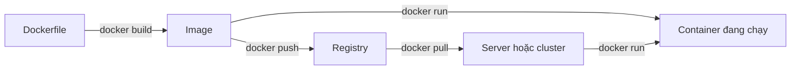
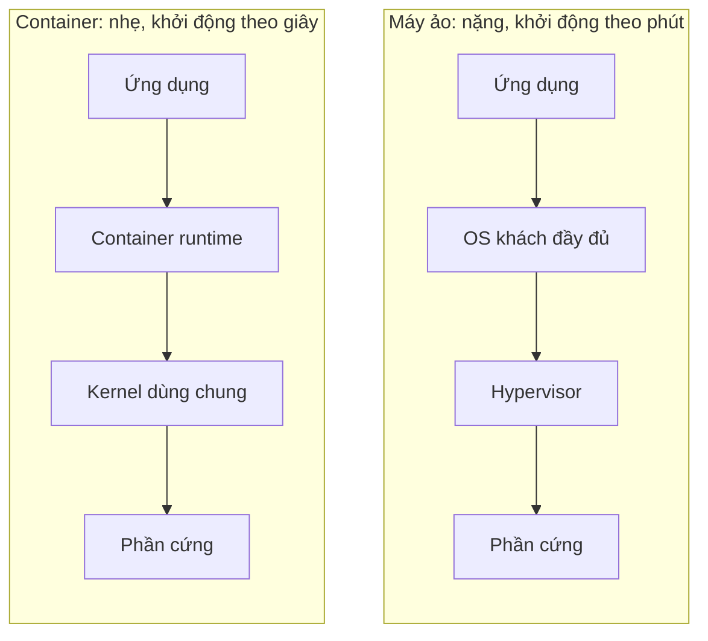

# Docker và Container

## Container là gì?

Container là cái hộp chứa ứng dụng cùng đúng thư viện và cấu hình nó cần, chạy cô lập với phần còn lại của máy. Hãy nghĩ đến container vận chuyển đường biển: hàng bên trong khác nhau, nhưng cái vỏ chuẩn hóa nên tàu, cảng, xe đầu kéo nào cũng chở được. Docker là công cụ phổ biến nhất để tạo và chạy container. Khác máy ảo ở chỗ container dùng chung kernel của server, nên nhẹ và khởi động trong vài giây thay vì vài phút.

**Tóm tắt:**

- Container không phải máy ảo mà là một process Linux bị cô lập: namespace cô lập cái nhìn, cgroup giới hạn tài nguyên, mọi container dùng chung kernel.
- Image là các layer chỉ đọc xếp chồng, container thêm một layer ghi mỏng; process chính kết thúc thì container dừng.
- Multi-stage build tách giai đoạn build (JDK, Maven) khỏi giai đoạn chạy (JRE chỉ chép JAR) để image nhỏ, ít bề mặt tấn công và không chứa mã nguồn.
- Một layer bị vô hiệu cache thì mọi layer phía sau build lại, nên đặt thứ ít đổi lên trước (copy `pom.xml` và tải dependency trước, mã nguồn sau).
- File system của container là tạm thời: dữ liệu cần giữ phải nằm trong volume, và cấu hình đi vào từ bên ngoài để cùng một image chạy mọi môi trường.
- Image an toàn thì không chạy bằng root, pin version ảnh nền (tránh `latest`), không nhét secret, có `.dockerignore` và được quét lỗ hổng.
- `EXPOSE` chỉ là ghi chú, `depends_on` chỉ đợi container khởi động chứ không đợi dịch vụ sẵn sàng; container chia sẻ kernel nên không phải ranh giới an ninh cho code không tin cậy.

## Vấn đề nó giải quyết

Câu "máy tôi chạy được mà" xuất hiện vì mỗi máy một phiên bản Java, một bộ thư viện, một cấu hình khác nhau. Khi bạn đóng ứng dụng thành **image** thì dev, CI và production chạy cùng một thứ y hệt. Người mới vào dự án cũng chỉ cần một lệnh để có đủ môi trường (ứng dụng, DB, Redis) thay vì đọc tài liệu cài đặt dài cả trang.

## Khi nào dùng, khi nào không

Dùng cho gần như mọi deploy hiện đại, để có môi trường dev đồng nhất, và để chạy DB hoặc Redis cục bộ khi test. Không dùng container làm ranh giới an ninh cho code không tin cậy (ví dụ chạy mã người lạ gửi lên): container chia sẻ kernel nên một lỗ hổng kernel có thể phá vỡ cô lập; khi đó máy ảo an toàn hơn. Cách làm: viết `Dockerfile` để build image, `docker run` để chạy, gắn volume để giữ dữ liệu, nối mạng giữa các container. Giữ image nhỏ (base image gọn, multi-stage build), không chạy bằng root, không nhét secret vào image.

## Các khái niệm cần biết

- **Image**: bản đóng gói chỉ đọc gồm hệ file, thư viện và lệnh khởi động. Giống bản cài đặt hay "khuôn bánh".
- **Container**: một lần chạy cụ thể của image (cái bánh làm ra từ khuôn); thực chất chỉ là một process bị cô lập.
- **Registry**: kho lưu và phân phối image (Docker Hub, GHCR, ECR). `docker push` đẩy lên, `docker pull` kéo về.
- **Layer**: mỗi lệnh trong Dockerfile tạo một layer; image là chồng các layer, được cache và chia sẻ giữa các image.
- **Tag và digest**: tag là nhãn dễ đọc (`myapp:1.0`) và có thể bị gắn lại sang image khác; digest là hash nội dung (`@sha256:...`), cố định tuyệt đối.
- **Volume / bind mount**: nơi lưu dữ liệu nằm ngoài lifecycle container. Volume do Docker quản lý; bind mount ánh xạ thẳng một thư mục của server.
- **Multi-stage build**: dùng nhiều `FROM` trong một Dockerfile, giai đoạn build có đủ công cụ, giai đoạn chạy chỉ chép kết quả sang. Dùng để image nhỏ và không chứa mã nguồn hay Maven.
- **ENTRYPOINT**: lệnh chính mà container chạy khi khởi động; container sống bao lâu thì process này sống bấy lâu.
- **EXPOSE**: chỉ là ghi chú về port ứng dụng nghe, **không** mở port ra ngoài; muốn mở phải dùng `-p`.



Đọc sơ đồ: bạn viết Dockerfile, build thành image một lần, đẩy lên registry, rồi bất kỳ máy nào kéo về cũng chạy ra container giống hệt nhau.

## Container khác máy ảo



Container không phải một công nghệ ảo hóa riêng mà là sự kết hợp hai tính năng của kernel Linux:

- **Namespace:** cô lập cái nhìn (process, mạng, hệ thống file, người dùng). Bên trong container, process của bạn thấy mình là PID 1 và không thấy process của container khác.
- **cgroup (control group):** giới hạn tài nguyên (CPU, RAM). Vượt giới hạn memory thì process bị kernel giết (`OOMKilled`).
- **Image:** các layer chỉ đọc xếp chồng; container thêm một layer ghi mỏng bên trên. Container là process, **không** phải VM.

**Nền tảng:** Container không phải máy ảo mà là một process Linux bị cô lập: namespace cô lập cái nhìn (process, mạng, hệ thống file), cgroup giới hạn tài nguyên (CPU, RAM), và mọi container dùng chung kernel của server. Image là các layer chỉ đọc, container thêm một layer ghi mỏng bên trên.

Vì chỉ là process, khi process chính kết thúc thì container dừng. Đó là lý do một container thường chỉ làm một việc, và là lý do chạy `docker run ubuntu` mà không có lệnh gì thì nó thoát ngay.

**Suy luận:** Vì container chỉ là một process của kernel được bọc trong namespace và cgroup, nó không mang theo kernel riêng như máy ảo. Từ đó suy ra hai mặt. Mặt tốt: không phải boot một hệ điều hành, nên khởi động trong vài giây, tốn ít memory, và mật độ chạy trên một máy cao hơn nhiều. Mặt đánh đổi: mọi container phụ thuộc cùng một kernel, nên một lỗ hổng kernel hay một cấu hình quá quyền (`--privileged`, mount socket Docker) có thể phá vỡ cô lập, và bạn không thể chạy container Linux trên kernel Windows mà không có một máy ảo ở giữa. Cũng vì chỉ là process nên vòng đời của container gắn chặt với process chính (PID 1): nếu nó thoát thì container dừng, nếu nó không xử lý SIGTERM thì `docker stop` phải chờ rồi SIGKILL, và nếu bạn chạy nhiều process trong một container thì không ai giám sát cái nào chết. Điểm dễ nhầm là tưởng dữ liệu "trong container" là bền: layer ghi mỏng sống cùng container nên xóa container là mất, vì vậy dữ liệu phải ra volume. Tương tự, giới hạn của cgroup làm process bị kernel giết (`OOMKilled`) chứ không chậm đi, nên heap JVM phải đặt dưới giới hạn memory của container. Khi review Dockerfile, hãy kiểm tra có một process chính xử lý SIGTERM, dữ liệu nằm trong volume, và giới hạn memory khớp với cấu hình JVM.

## Dockerfile nhiều giai đoạn cho Spring Boot

Vấn đề: nếu build ngay trong một image duy nhất, image cuối chứa cả Maven, JDK, mã nguồn và cache `~/.m2` (hàng trăm MB không cần khi chạy, lại tăng bề mặt tấn công). Cách giải quyết là multi-stage: giai đoạn đầu build ra file JAR, giai đoạn sau chỉ lấy JAR đó bỏ vào image chạy gọn nhẹ. Hãy xem ví dụ sau.

```dockerfile
# Giai đoạn build
FROM maven:3.9-eclipse-temurin-21 AS build
WORKDIR /app
COPY pom.xml .
# layer dependency được cache khi pom không đổi
RUN mvn -B dependency:go-offline
COPY src ./src
RUN mvn -B package -DskipTests

# Giai đoạn chạy: image nhỏ
FROM eclipse-temurin:21-jre
RUN useradd -r -u 1001 app
WORKDIR /app
COPY --from=build /app/target/app.jar app.jar
USER app
EXPOSE 8080
ENTRYPOINT ["java", "-XX:MaxRAMPercentage=65", "-jar", "app.jar"]
```

Đọc Dockerfile: `FROM ... AS build` mở giai đoạn build; `COPY pom.xml` rồi `go-offline` tải dependency trước khi chép mã nguồn để tận dụng cache; `COPY --from=build` lấy JAR từ giai đoạn trước; `USER app` hạ quyền xuống người dùng thường; `-XX:MaxRAMPercentage=65` bảo JVM chỉ dùng tối đa 65% memory của container làm heap, chừa chỗ cho metaspace, thread và buffer ngoài heap. Con số 65 hợp với container nhỏ; cách tính ngân sách memory và khi nào nâng lên 75 nằm ở [Memory JVM và GC](/go?p=01-Spring-Boot%2Fhard%2Flt-23-jvm-memory-gc.md).

**Phải thuộc:** Dockerfile tốt cho Java: multi-stage (build bằng JDK và Maven, chạy bằng JRE chỉ chép JAR), không chạy bằng root (`USER`), pin version ảnh nền (tránh `latest`), không nhét secret vào image, có `.dockerignore`. `EXPOSE` chỉ là ghi chú, muốn mở port phải dùng `-p host:container`.

Thực hành tốt:

- Thứ tự lệnh: thứ **ít đổi nhất lên trước** để tận dụng cache layer.
- Multi-stage: công cụ build không nằm trong image chạy.
- Ảnh nền nhỏ và tin cậy; pin version (tránh `latest`).
- **Không chạy bằng root**; không đưa bí mật vào image hoặc build arg.
- `.dockerignore` để loại `target/`, `.git`, file nhạy cảm.
- Một process chính mỗi container; log ra `stdout/stderr`.

### Cache layer và kích thước image

Mỗi lệnh `RUN`, `COPY`, `ADD` tạo một layer. Docker dùng lại layer cache nếu lệnh và nội dung đầu vào không đổi; **một layer bị vô hiệu thì mọi layer phía sau cũng build lại**.

| Thứ tự | Kết quả khi chỉ sửa một file trong `src/` |
|---|---|
| `COPY . .` rồi `RUN mvn package` | Layer `COPY` đổi, tải lại toàn bộ dependency: chậm |
| `COPY pom.xml` rồi `RUN mvn dependency:go-offline` rồi `COPY src` | Hai layer đầu dùng cache, chỉ build lại từ `COPY src`: nhanh |

**Phải thuộc:** Mỗi lệnh `RUN`, `COPY`, `ADD` tạo một layer; một layer bị vô hiệu cache thì mọi layer phía sau build lại. Vì vậy quy tắc là **ít đổi lên trước, hay đổi xuống sau** (copy `pom.xml` và tải dependency trước, copy mã nguồn sau).

Quy tắc nhớ: **ít đổi lên trước, hay đổi xuống sau**. Gộp các lệnh dọn dẹp cùng layer với lệnh tạo ra rác (`apt-get install ... && rm -rf /var/lib/apt/lists/*`), vì xóa ở layer sau không làm layer trước nhỏ đi.

So sánh kích thước (số liệu minh họa, thay đổi theo phiên bản và ứng dụng):

| Cách đóng gói | Kích thước ước lượng |
|---|---|
| Một giai đoạn trên `maven:3.9-eclipse-temurin-21` (có Maven, JDK, mã nguồn, `~/.m2`) | khoảng 700 MB đến 1 GB |
| Multi-stage, chạy trên `eclipse-temurin:21-jre` | khoảng 250 đến 350 MB |
| Thêm `jlink` (JRE rút gọn) hoặc ảnh distroless | nhỏ hơn nữa, tùy các module JDK cần dùng |
| Spring Boot layered jar | kích thước gần như không đổi, nhưng layer dependency được cache và đẩy riêng khỏi layer mã của bạn; Dockerfile và lệnh theo phiên bản Boot xem [Docker và Kubernetes cho Spring Boot](/go?p=01-Spring-Boot%2Fhard%2Flt-29-docker-kubernetes.md) |

Xem từng layer bằng `docker history myapp:1.0` hoặc `docker image ls`.

## Lệnh thường dùng

Sáu lệnh dưới đây bao phủ phần lớn công việc hằng ngày: build, chạy, xem log, vào trong container để gỡ lỗi, theo dõi tài nguyên, và dựng nhiều container cục bộ.

```bash
docker build -t myapp:1.0 .
docker run -d --name app -p 8080:8080 -e SPRING_PROFILES_ACTIVE=prod myapp:1.0
docker logs -f app
docker exec -it app sh
docker ps / docker stats
docker compose up -d                # nhiều container cục bộ
```

## Mạng, dữ liệu và cấu hình

Ba nguyên tắc cần nhớ: container nói chuyện với nhau qua tên, dữ liệu quan trọng không được nằm trong container, và cấu hình đi vào từ bên ngoài. Vi phạm điều thứ hai là lỗi kinh điển: xóa container là mất sạch dữ liệu DB.

| Chủ đề | Điều cần biết |
|---|---|
| Mạng | Bridge mặc định; container cùng mạng gọi nhau bằng **tên service**; `-p host:container` công bố port |
| Dữ liệu | Hệ thống file container **tạm thời**; dữ liệu cần giữ dùng **volume** hoặc bind mount |
| Cấu hình | Biến môi trường, file mount, secret; cùng image chạy mọi môi trường |
| Tài nguyên | `--memory`, `--cpus`; JVM nhận biết giới hạn container |

**Phải thuộc:** Hệ thống file của container là tạm thời: dữ liệu cần giữ phải nằm trong volume (hoặc bind mount). Container cùng mạng gọi nhau bằng tên service; cấu hình đi vào qua biến môi trường hoặc file mount, cùng một image chạy mọi môi trường.

## Docker Compose cho môi trường dev

Docker Compose mô tả nhiều container và quan hệ giữa chúng trong một file YAML, rồi `docker compose up` dựng tất cả. Dùng cho dev và test cục bộ; còn production nhiều máy thì cần orchestrator như Kubernetes (xem [Kubernetes vận hành](/go?p=04-DevOps%2Fhard%2Flt-06-kubernetes-van-hanh.md)). Ví dụ dưới chạy ứng dụng cùng Postgres với dữ liệu giữ trong volume `pgdata`.

```yaml
services:
  app:
    build: .
    ports: ["8080:8080"]
    environment:
      SPRING_DATASOURCE_URL: jdbc:postgresql://db:5432/app
    depends_on: [db]
  db:
    image: postgres:16
    environment: { POSTGRES_PASSWORD: dev }
    volumes: [pgdata:/var/lib/postgresql/data]
volumes: { pgdata: {} }
```

### Healthcheck và depends_on

`depends_on: [db]` chỉ đảm bảo **container** `db` đã khởi động, không đảm bảo Postgres sẵn sàng nhận kết nối. Muốn đợi thật sự thì dùng healthcheck và `condition: service_healthy`:

```yaml
services:
  app:
    build: .
    ports: ["8080:8080"]
    environment:
      SPRING_DATASOURCE_URL: jdbc:postgresql://db:5432/app
      SPRING_DATASOURCE_USERNAME: app
      SPRING_DATASOURCE_PASSWORD: dev
    depends_on:
      db:
        condition: service_healthy
    healthcheck:
      test: ["CMD", "wget", "-qO-", "http://localhost:8080/actuator/health"]
      interval: 10s
      timeout: 3s
      retries: 5
      start_period: 40s        # thời gian khởi động không tính vào số lần thất bại
  db:
    image: postgres:16
    environment:
      POSTGRES_USER: app
      POSTGRES_PASSWORD: dev
      POSTGRES_DB: app
    healthcheck:
      test: ["CMD-SHELL", "pg_isready -U app -d app"]
      interval: 5s
      timeout: 3s
      retries: 10
    volumes: [pgdata:/var/lib/postgresql/data]
volumes: { pgdata: {} }
```

Status trong `docker compose ps` là `starting`, `healthy` hoặc `unhealthy`. Lưu ý image `eclipse-temurin` có thể không có sẵn `wget` hoặc `curl`; kiểm tra hoặc cài thêm, nếu không healthcheck sẽ luôn fail. Ứng dụng vẫn nên có cơ chế thử kết nối lại, vì DB có thể khởi động lại bất cứ lúc nào.

## Bảo mật container

- Quét lỗ hổng image (Trivy, Grype) trong CI; cập nhật ảnh nền.
- Hệ thống file chỉ đọc, bỏ quyền Linux thừa (`--cap-drop`), không `--privileged`.
- Ký image và dùng registry tin cậy.

## Điều cần nhớ

- Container chết là bình thường: ứng dụng phải **stateless**, khởi động nhanh, tắt êm khi nhận SIGTERM.
- Hết memory: container bị `OOMKilled`; đặt heap JVM dưới giới hạn (xem [Spring: JVM và GC](/go?p=01-Spring-Boot%2Fhard%2Flt-23-jvm-memory-gc.md)).
- Đừng lưu dữ liệu trong layer ghi của container.
- Đọc tiếp: probe, tắt êm và manifest cho Spring Boot ở [Docker và Kubernetes cho Spring Boot](/go?p=01-Spring-Boot%2Fhard%2Flt-29-docker-kubernetes.md); ví dụ đóng gói cả SPA, Nginx và CI ở [Fullstack: đóng gói và deploy](/go?p=12-Fullstack%2Flt-05-dong-goi-deploy-docker-nginx-ci.md).

