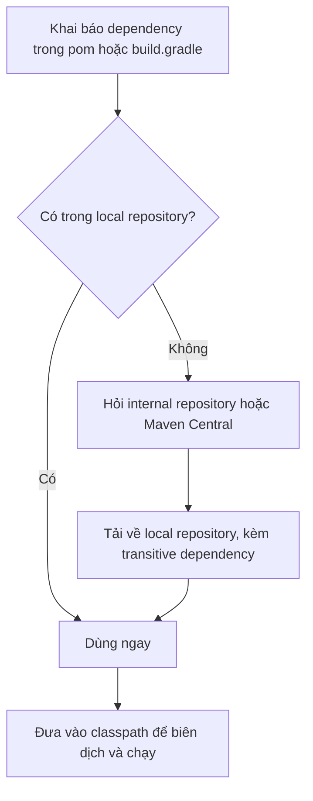
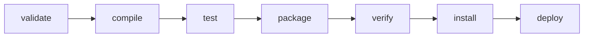
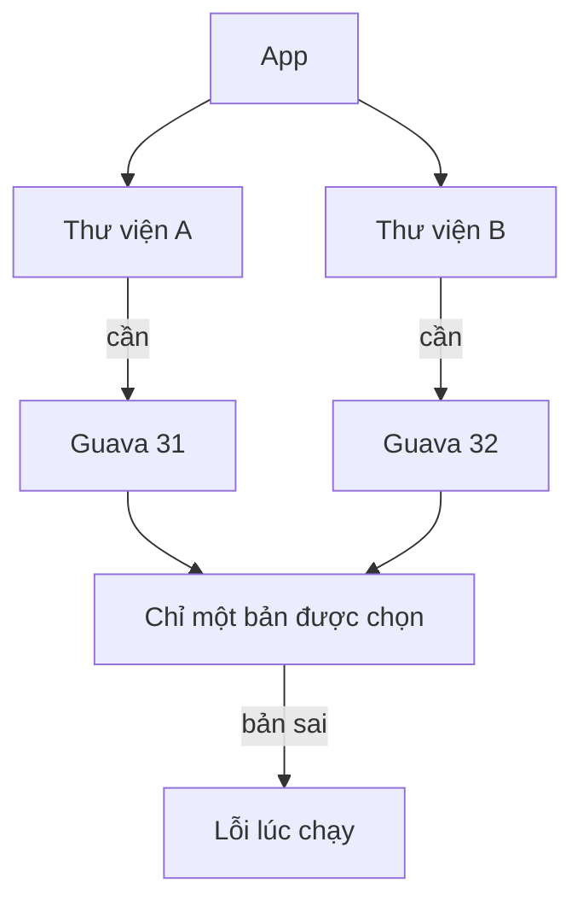

# Maven, Gradle và quản lý dependency

## Maven và Gradle là gì?

Maven và Gradle là công cụ build cho Java. Bạn mô tả dự án (tên, phiên bản, cần thư viện nào) trong một file (`pom.xml` của Maven, `build.gradle(.kts)` của Gradle), và công cụ lo phần còn lại: biên dịch, chạy test, đóng gói ra file jar/war, và tự tải các thư viện dự án cần cùng những thư viện mà các thư viện đó cần.

**Tóm tắt:**

- Mỗi thư viện được định danh bằng coordinates `groupId:artifactId:version`; công cụ build tự kéo cả transitive dependency về local repository.
- Trên classpath chỉ có một bản cho mỗi thư viện, nên xung đột version là vấn đề cốt lõi, và lỗi chỉ lộ lúc chạy dưới dạng `NoSuchMethodError` hoặc `NoClassDefFoundError`.
- Maven chọn bản gần gốc nhất (cùng độ sâu thì bản khai báo trước thắng), Gradle chọn bản cao nhất; xem bằng `mvn dependency:tree`, sửa bằng BOM, `dependencyManagement` hoặc `<exclusions>`.
- Lifecycle Maven: validate, compile, test, package, verify, install, deploy; chạy một pha thì chạy mọi pha trước nó, và `install` khác `deploy`.
- Scope quyết định dependency có mặt lúc compile, runtime hay test: `compile`, `provided`, `runtime`, `test`, tương ứng `implementation`, `compileOnly`, `runtimeOnly`, `testImplementation` ở Gradle.
- BOM cố định các version đã được kiểm chứng chạy cùng nhau; `SNAPSHOT` và khoảng version lỏng làm build không tái lập được.
- Dùng wrapper (`mvnw`, `gradlew`), enforcer rule `dependencyConvergence`, internal repository và quét lỗ hổng để quản lý dependency ở quy mô tổ chức.

## Vấn đề nó giải quyết

Hãy tưởng tượng tự tải jar bằng tay: mỗi máy một phiên bản, build ra kết quả khác nhau, người mới vào dự án mất nửa ngày gom đủ jar. Tệ hơn, khi hai thư viện kéo về hai phiên bản khác nhau của cùng một thư viện thứ ba, bạn chỉ biết khi chạy, dưới dạng lỗi như `NoSuchMethodError`. Có công cụ build thì dev và CI dùng một lệnh giống nhau, phiên bản được khai báo rõ ràng, và xung đột có thể được xem và xử lý có hệ thống.

## Khi nào chọn cái nào

Mọi dự án Java/JVM đều cần một trong hai. Chọn Maven nếu muốn cấu hình chuẩn hóa, ít tùy biến, cả đội dễ đọc nhau. Chọn Gradle nếu cần build linh hoạt hoặc nhanh hơn cho dự án lớn nhiều module (nhờ incremental build và cache). Đổi lại Gradle có đường cong học cao hơn và script build dễ phức tạp hóa. Để dùng tốt, bạn cần nắm lifecycle build (`compile`, `test`, `package`, `install`), scope của dependency, cách xem dependency tree (`mvn dependency:tree`) để gỡ xung đột phiên bản, và dùng BOM để cố định version thống nhất.

## Các khái niệm cần biết

- **Coordinates (GAV)**: mỗi thư viện được định danh bằng `groupId:artifactId:version`, ví dụ `com.google.guava:guava:32.1.0-jre`. Đây là "địa chỉ" để công cụ tìm đúng file.
- **Repository**: nơi chứa artifact. Có local repository trên máy (`~/.m2`), kho trung tâm (Maven Central) và internal repository của công ty. Công cụ tìm ở cục bộ trước, thiếu mới tải về.
- **Transitive dependency**: thư viện mà thư viện bạn dùng lại cần. Bạn khai báo một dòng nhưng thực tế kéo về cả cây.
- **BOM (Bill of Materials)**: một pom chỉ chứa danh sách phiên bản đã được kiểm chứng chạy cùng nhau (như `spring-boot-dependencies`). Import vào thì bạn khỏi ghi phiên bản cho từng thư viện.
- **Goal và plugin (Maven)**: phase của lifecycle chỉ là mốc; việc thật do plugin goal làm (ví dụ `compiler:compile` gắn vào phase `compile`).
- **SNAPSHOT**: phiên bản đang phát triển, nội dung có thể đổi bất kỳ lúc nào dù số phiên bản giữ nguyên. Hệ quả: build hôm nay khác build hôm qua.
- **Wrapper (`mvnw`, `gradlew`)**: script nhỏ tải đúng phiên bản công cụ đã ghim trong dự án, nên không ai phải cài tay.
- **Incremental build và build cache (Gradle)**: chỉ làm lại phần có đầu vào thay đổi, và dùng lại kết quả đã build ở lần trước hoặc từ máy khác.



**Nền tảng:** Công cụ build quản lý thư viện qua coordinates (`groupId:artifactId:version`) và tự kéo cả transitive dependency. Hệ quả là trên classpath chỉ có một bản cho mỗi thư viện, nên xung đột phiên bản là vấn đề cốt lõi của quản lý dependency.

Đọc sơ đồ: công cụ không tải lại những gì đã có, nên lần build đầu chậm còn các lần sau nhanh. Nếu CI không giữ cache `~/.m2`, mỗi lần build lại tải lại từ đầu.

## Maven: lifecycle và pom.xml



Chạy một pha thì chạy mọi pha trước đó: `mvn package` đã gồm compile và test. Cấu trúc chuẩn: `src/main/java`, `src/main/resources`, `src/test/java`. Cần phân biệt `install` (chép artifact vào local repository để dự án khác trên máy dùng) với `deploy` (đẩy lên remote repository dùng chung); nhầm hai thứ này là lý do hay gặp của "tôi đã build rồi mà đồng nghiệp không thấy".

**Phải thuộc:** Lifecycle Maven theo thứ tự: validate, compile, test, package, verify, install, deploy; chạy một pha thì chạy mọi pha trước nó. `install` chép artifact vào local repository `~/.m2`, `deploy` đẩy lên remote repository dùng chung.

Đoạn `pom.xml` dưới đây là mẫu cho dự án Spring Boot: import BOM để pin version, rồi khai báo dependency mà không cần ghi version.

```xml
<dependencyManagement>
  <dependencies>
    <dependency>
      <groupId>org.springframework.boot</groupId>
      <artifactId>spring-boot-dependencies</artifactId>
      <version>3.3.0</version>
      <type>pom</type><scope>import</scope>      <!-- BOM: cố định version thống nhất -->
    </dependency>
  </dependencies>
</dependencyManagement>
<dependencies>
  <dependency>
    <groupId>org.springframework.boot</groupId>
    <artifactId>spring-boot-starter-web</artifactId>   <!-- phiên bản lấy từ BOM -->
  </dependency>
</dependencies>
```

## Scope

Không phải thư viện nào cũng cần ở mọi giai đoạn. Scope nói cho Maven biết một dependency được dùng lúc biên dịch, lúc chạy hay chỉ lúc test, từ đó quyết định nó có nằm trong jar cuối cùng hay không. Chọn sai scope thì hoặc jar phình to (kéo cả JUnit vào production), hoặc thiếu class lúc chạy.

| Scope | Có lúc biên dịch | Có lúc chạy | Có trong test | Ví dụ |
|---|---|---|---|---|
| `compile` (mặc định) | Có | Có | Có | Thư viện nghiệp vụ |
| `provided` | Có | Không (container cấp) | Có | Servlet API |
| `runtime` | Không | Có | Có | JDBC driver |
| `test` | Không | Không | Có | JUnit, Mockito |

**Phải thuộc:** Scope Maven: `compile` (mặc định, có ở mọi nơi), `provided` (có khi biên dịch, môi trường chạy cấp, không đóng vào jar), `runtime` (chỉ cần lúc chạy, ví dụ JDBC driver), `test` (chỉ cho test). Tương ứng Gradle: `implementation`, `compileOnly`, `runtimeOnly`, `testImplementation`.

## Transitive dependency và xung đột phiên bản

Vấn đề đặt ra: ứng dụng dùng thư viện A và B, A cần Guava 31 còn B cần Guava 32. Trên classpath chỉ có thể có một bản Guava, nên công cụ build phải chọn một. Nếu chọn bản không đáp ứng đủ cho thư viện còn lại, lỗi chỉ lộ ra lúc chạy khi đường code đó được gọi, có khi vài tuần sau deploy.



Cách đối phó gồm bốn việc: xem cây, hiểu luật chọn, ép phiên bản, nhận ra triệu chứng.

- Xem dependency tree: `mvn dependency:tree` (Gradle: `./gradlew dependencies`).
- Maven "gần nhất thắng"; Gradle mặc định chọn **phiên bản cao nhất**.
- Giải quyết: ép phiên bản qua `dependencyManagement`/BOM, `<exclusions>`, hoặc cập nhật thư viện gây xung đột.
- Triệu chứng điển hình: `NoSuchMethodError`, `NoClassDefFoundError`, `LinkageError` (xem [Class Loading](/go?p=08-Java%2FJava-Core%2Fhard%2Flt-16-jvm-architecture-classloading.md)).

**Phải thuộc:** Khi xung đột phiên bản, Maven chọn bản có đường đi gần gốc nhất (cùng độ sâu thì bản khai báo trước thắng), Gradle chọn bản cao nhất. Triệu chứng là `NoSuchMethodError` hoặc `NoClassDefFoundError` lúc chạy; xem bằng `mvn dependency:tree`, sửa bằng `dependencyManagement`/BOM hoặc `<exclusions>`.

**Suy luận:** JVM nạp class theo tên từ classpath và gặp bản đầu tiên thì dừng, nên hai phiên bản của cùng một thư viện không thể sống chung trong một class loader: chỉ một bản được dùng. Vì thế công cụ build buộc phải có một luật để chọn, và luật đó chỉ dựa trên cấu trúc cây khai báo (độ sâu, thứ tự) chứ không biết thư viện nào thật sự cần API nào. Từ đó suy ra hệ quả khó chịu: lúc build mọi thứ biên dịch xong, vì thư viện A được biên dịch với Guava 31 và B với Guava 32 riêng rẽ, nhưng lúc chạy chỉ một bản có mặt, và nếu B gọi một method chỉ có ở bản 32 thì lỗi `NoSuchMethodError` chỉ nổ ra khi đường code đó được chạy, có khi vài tuần sau deploy. Điểm dễ nhầm là tin rằng "build xanh nghĩa là dependency ổn" và rằng Maven với Gradle cho cùng kết quả: một cây giống hệt vẫn có thể được giải khác nhau vì Maven ưu tiên gần gốc còn Gradle ưu tiên bản cao nhất. Cách đáng tin duy nhất là làm xung đột lộ ra sớm và có chủ ý: nhìn `dependency:tree` khi nâng version, cố định version qua BOM hoặc `dependencyManagement` thay vì để luật mặc định tự quyết, và bật `dependencyConvergence` trong CI để build fail ngay khi có hai version cho cùng một thư viện.

### Đọc `dependency:tree` và gỡ xung đột (output minh họa)

```text
$ mvn dependency:tree -Dverbose -Dincludes=com.google.guava
[INFO] com.acme:app:jar:1.0
[INFO] +- com.acme:lib-a:jar:2.1:compile
[INFO] |  \- com.google.guava:guava:jar:31.0-jre:compile
[INFO] \- com.acme:lib-b:jar:1.7:compile
[INFO]    \- (com.google.guava:guava:jar:32.1.0-jre:compile - omitted for conflict with 31.0-jre)
```

Cách đọc: `-Dverbose` hiện cả nút bị loại; dòng trong ngoặc kèm `omitted for conflict` nghĩa là `lib-b` muốn Guava 32 nhưng bản 31 được chọn. Maven chọn theo **độ sâu gần nhất**; ở đây cả hai cùng sâu bằng nhau nên bản **khai báo trước** thắng. Kết quả: `lib-b` chạy với Guava cũ hơn mức nó cần và có thể ném `NoSuchMethodError`.

Cách xử lý theo thứ tự ưu tiên:

```xml
<!-- 1. Ép phiên bản duy nhất trong dependencyManagement (hoặc khai báo trực tiếp trong app: gần nhất thắng) -->
<dependencyManagement>
  <dependencies>
    <dependency>
      <groupId>com.google.guava</groupId>
      <artifactId>guava</artifactId>
      <version>32.1.0-jre</version>
    </dependency>
  </dependencies>
</dependencyManagement>

<!-- 2. Loại transitive dependency không cần -->
<dependency>
  <groupId>com.acme</groupId>
  <artifactId>lib-a</artifactId>
  <version>2.1</version>
  <exclusions>
    <exclusion><groupId>com.google.guava</groupId><artifactId>guava</artifactId></exclusion>
  </exclusions>
</dependency>
```

Gradle: `./gradlew dependencyInsight --dependency guava` cho biết vì sao bản đó được chọn; ép bằng `constraints { implementation("com.google.guava:guava:32.1.0-jre") }`. Plugin `maven-enforcer-plugin` với rule `dependencyConvergence` làm build **fail** ngay khi có xung đột thay vì để lộ lúc chạy.

Với Spring Boot, đa số phiên bản đã được BOM cố định; muốn đổi một thư viện do Boot quản lý, ghi đè property (ví dụ `<jackson-bom.version>`) thay vì khai báo lẻ, và chạy lại test.

### Scope trong thực tế

- `provided`: có khi biên dịch, **không** được đóng vào jar/war. Dùng cho thứ môi trường chạy cấp sẵn (Servlet API trên Tomcat ngoài, Lombok).
- `runtime`: code của bạn không `import` trực tiếp nhưng cần lúc chạy (JDBC driver). Khai báo `compile` cũng chạy được, nhưng `runtime` ngăn lỡ dùng class của driver trong mã nghiệp vụ.
- Scope quyết định cả transitive dependency: một lib `test` của lib khác không bao giờ truyền sang app của bạn.

## Gradle

Build viết bằng Groovy hoặc Kotlin DSL (script thật sự là code nên linh hoạt hơn XML của Maven), có **build cache** và **incremental build** nên nhanh hơn trên dự án lớn. Ví dụ tương đương với pom Maven phía trên:

```kotlin
plugins { java; id("org.springframework.boot") version "3.3.0" }
dependencies {
    implementation("org.springframework.boot:spring-boot-starter-web")
    runtimeOnly("org.postgresql:postgresql")
    testImplementation("org.springframework.boot:spring-boot-starter-test")
}
```

Các cấu hình dependency của Gradle tương ứng với scope của Maven: `implementation` (dùng khi biên dịch và chạy nhưng không lộ ra cho module dùng lại module này, nên đổi nó không buộc module khác biên dịch lại), `api` (lộ ra, dùng khi kiểu của thư viện xuất hiện trong API công khai của module, cần plugin `java-library`), `compileOnly` (giống `provided`), `runtimeOnly` (giống `runtime`), `testImplementation` (giống `test`). Luôn dùng **wrapper** (`./gradlew`, `./mvnw`) để mọi người cùng phiên bản công cụ.

## Quản lý dependency trong tổ chức

Khi có nhiều dự án và nhiều module, vấn đề chuyển từ "chạy được không" sang "nhất quán, an toàn và tái lập được không". Bảng dưới liệt kê việc cần làm và cách làm.

| Việc | Cách |
|---|---|
| Version thống nhất nhiều module | BOM / `dependencyManagement` / version catalog (Gradle) |
| Internal repository | Nexus, Artifactory làm proxy và lưu artifact riêng |
| Dự án nhiều module | Multi-module: module `core`, `api`, `app`; dependency một chiều |
| Phát hiện lỗ hổng | OWASP Dependency-Check, Dependabot/Renovate, SBOM |
| Cố định để build tái lập | Không dùng `LATEST`, `SNAPSHOT` hoặc khoảng phiên bản lỏng ở production |

## Điều cần nhớ

- Mỗi dependency là một khoản nợ: cập nhật, giấy phép, bảo mật. Thêm có cân nhắc.
- `SNAPSHOT` thay đổi theo thời gian: không dùng cho phát hành.
- Semantic versioning: `MAJOR` có thay đổi phá vỡ, `MINOR` thêm tính năng tương thích, `PATCH` sửa lỗi.
- Build chậm: bật cache, chạy parallel, bỏ test không cần ở bước phụ.

