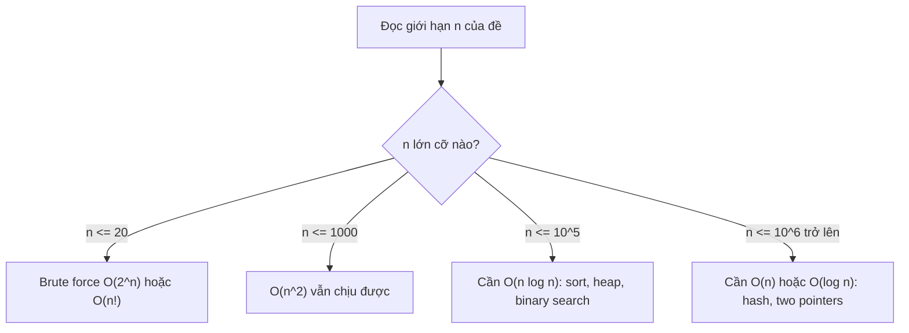
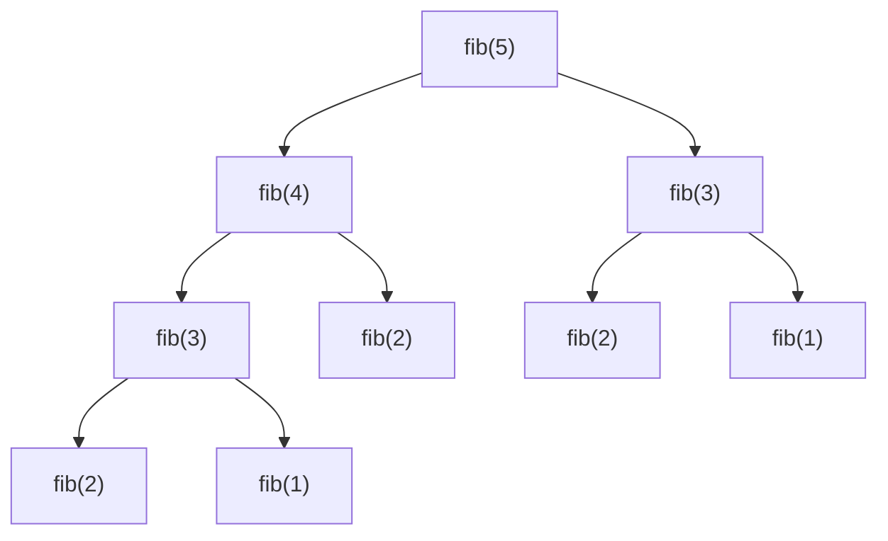
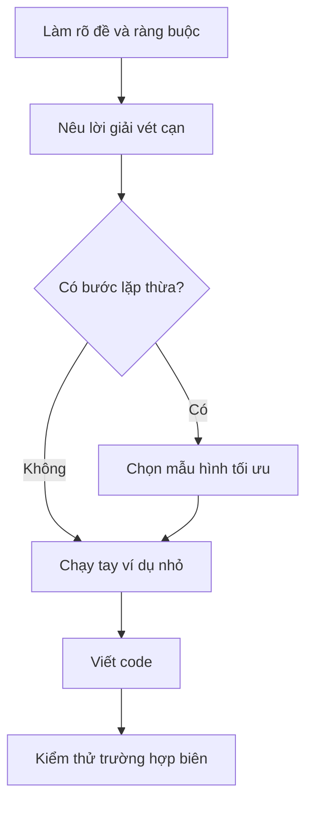

# Big-O và tư duy giải bài thuật toán

## Big-O là gì?

Big-O là cách nói "code này chậm đi bao nhiêu khi dữ liệu to lên". Bạn không đo bằng giây mà mô tả **tốc độ tăng** của số thao tác theo kích thước đầu vào `n`. Nếu một đoạn code là O(n), dữ liệu gấp đôi thì thời gian gấp đôi. Nếu là O(n²), dữ liệu gấp đôi thì thời gian chậm gấp bốn. Hãy hình dung việc tìm một người trong danh sách: duyệt từng tên là O(n), còn mở danh bạ theo thứ tự chữ cái rồi chia đôi liên tục là O(log n).

**Tóm tắt:**

- Big-O mô tả tốc độ tăng của số thao tác theo `n`, không phải thời gian đo bằng giây.
- Bỏ hằng số và số hạng nhỏ, chỉ giữ số hạng tăng nhanh nhất: 3n² + 5n + 7 thành O(n²).
- Thứ tự tăng: O(1) < O(log n) < O(n) < O(n log n) < O(n²) < O(2ⁿ) < O(n!).
- Máy làm khoảng 10^8 thao tác mỗi giây, nên giới hạn `n` của đề cho biết độ phức tạp cần đạt.
- Vòng lặp lồng nhau thì nhân, nối tiếp thì cộng, chia đôi mỗi bước thì O(log n).
- Hàm thư viện cũng có giá: `contains` trên `ArrayList` hay `s += c` là vòng lặp ẩn.
- Fibonacci ngây thơ là hàm mũ vì tính lặp bài con; memoization đưa về O(n).
- Cách đổi memory lấy thời gian (hash, memoization, sort trước) là chìa khóa của đa số bài.

## Vấn đề nó giải quyết

Đo bằng giây thì phụ thuộc máy, ngôn ngữ và cả việc máy đang bận gì. Đáng sợ hơn, code chạy ngon với 100 phần tử có thể treo với 1 triệu phần tử, và bạn chỉ phát hiện ra khi hệ thống đã lên production hoặc khi bị quá thời gian (Time Limit Exceeded) trong buổi phỏng vấn. Big-O cho bạn biết trước lời giải nào sẽ "sập" khi `n` lớn, khỏi phải chạy thử mới biết.

## Cách tính, khi nào dùng và khi nào không

Cách làm là đếm số thao tác theo `n`, bỏ hằng số và các số hạng nhỏ, giữ số hạng tăng nhanh nhất (ví dụ 3n² + 5n + 7 chỉ còn O(n²)). Đừng quên tính cả **bộ nhớ phụ** (độ phức tạp không gian), không chỉ thời gian.

Dùng Big-O khi so hai cách giải, khi ước lượng xem giới hạn của đề có chịu nổi không, hoặc khi chọn cấu trúc dữ liệu cho hệ thống thật. Không dùng nó để kết luận với `n` rất nhỏ: lúc đó hằng số mới là thứ quyết định, và một thuật toán O(n²) đơn giản có thể nhanh hơn một thuật toán O(n log n) phức tạp. Big-O cũng không nói gì về chi phí I/O hay mạng, những thứ thường chiếm thời gian chính trong ứng dụng thật.

**Nền tảng:** Big-O mô tả **tốc độ tăng** của số thao tác (hoặc bộ nhớ) theo kích thước đầu vào `n`, không phải thời gian đo bằng giây. Vì vậy ta bỏ hằng số và số hạng nhỏ, chỉ giữ số hạng tăng nhanh nhất. Đây là công cụ để biết trước một lời giải có chịu nổi dữ liệu lớn hay không, trước khi viết code.

## Các khái niệm cần biết

- **`n`**: kích thước đầu vào (số phần tử mảng, độ dài chuỗi). Với đồ thị có hai đại lượng là `V` (đỉnh) và `E` (cạnh).
- **Trường hợp tốt nhất, trung bình, xấu nhất (best, average, worst case)**: cùng một thuật toán có thể chạy nhanh hay chậm tùy dữ liệu. Khi nói "O(...)" mà không nói gì thêm, người ta thường hiểu là trường hợp xấu nhất, vì đó là mức bạn có thể đảm bảo. Ví dụ quicksort trung bình O(n log n) nhưng xấu nhất O(n²).
- **Khấu hao (amortized)**: chi phí trung bình trên một chuỗi thao tác, khi thỉnh thoảng mới có một thao tác đắt. Quan trọng vì nó giải thích vì sao `ArrayList.add` vẫn được coi là O(1) (xem mục trace bên dưới).
- **"tb" (trung bình)** trong bảng bên dưới: `HashMap` là O(1) trung bình, nghĩa là bình thường rất nhanh nhưng nếu nhiều key va chạm cùng một ô thì có thể chậm hơn.
- **Độ phức tạp không gian**: lượng bộ nhớ phụ thuật toán cần thêm ngoài đầu vào, tính cả độ sâu stack của đệ quy.
- **JIT (Just-In-Time compiler)**: compiler của JVM dịch dần đoạn code "hot" sang mã máy lúc chạy. Vì vậy lượt đo đầu tiên thường chậm hơn các lượt sau và kết quả đo thời gian dao động.

## Các mức tăng thường gặp

| Độ phức tạp | Tên | Ví dụ | `n = 10^6` khoảng |
|---|---|---|---|
| O(1) | Hằng | Tra `HashMap`, truy cập mảng | tức thì |
| O(log n) | Logarit | Binary search, cây cân bằng | khoảng 20 bước |
| O(n) | Tuyến tính | Duyệt mảng | 10^6 |
| O(n log n) | | Sort hiệu quả | khoảng 2×10^7 |
| O(n²) | Bình phương | Hai vòng lặp lồng nhau | 10^12: **quá chậm** |
| O(2ⁿ), O(n!) | Hàm mũ, giai thừa | Brute force tập con, hoán vị | chỉ dùng với `n` rất nhỏ |

Quy tắc ước lượng: máy làm khoảng 10^8 thao tác đơn giản mỗi giây. Nhìn giới hạn `n` của đề để đoán độ phức tạp cần đạt: `n ≤ 20` thì brute force, `n ≤ 10^3` thì O(n²), `n ≤ 10^5` thì O(n log n), `n ≤ 10^6` thì O(n). Con số này là cách đọc "gợi ý ẩn" trong đề: nếu đề cho `n` tới 10^5 mà bạn viết hai vòng lặp lồng nhau (10^10 thao tác), bạn sẽ bị quá thời gian.

**Phải thuộc:** Thứ tự tăng: O(1) < O(log n) < O(n) < O(n log n) < O(n²) < O(2ⁿ) < O(n!). Máy làm khoảng 10^8 thao tác đơn giản mỗi giây, nên đề có `n` đến 10^5 cần O(n log n) hoặc tốt hơn, `n` đến 10^3 chịu được O(n²), `n` khoảng 20 mới được brute force hàm mũ. Vòng lặp lồng nhau thì nhân, hai vòng nối tiếp thì cộng, mỗi bước chia đôi dữ liệu là O(log n).



Đọc sơ đồ: bạn đi từ giới hạn của đề đến mức độ phức tạp tối đa được phép, rồi chọn kỹ thuật phù hợp với mức đó. Đây là bước đầu tiên nên làm trước khi nghĩ đến code.

## Cách phân tích

- Vòng lặp lồng nhau: nhân. Hai vòng lặp nối tiếp: cộng, lấy số lớn hơn.
- Mỗi bước chia đôi dữ liệu: O(log n).
- **Khấu hao (amortized):** `ArrayList.add` là O(1) khấu hao dù đôi lúc phải sao chép mảng O(n).
- **Không gian:** tính cả bộ nhớ phụ và độ sâu stack đệ quy.
- Phân biệt trường hợp tốt nhất, trung bình, xấu nhất (quicksort xấu nhất O(n²)).

## Đọc độ phức tạp từ code

| Đoạn code | Độ phức tạp | Lý do |
|---|---|---|
| `for i in 0..n` rồi `for j in 0..n` | O(n²) | n × n lần chạy thân vòng |
| `for i in 0..n`, `for j in i+1..n` | O(n²) | tổng n/2 · (n-1), vẫn bậc hai |
| `for i in 0..n`, trong đó `for j` chạy hằng số 3 lần | O(n) | 3n, bỏ hằng số |
| `while (n > 1) n /= 2` | O(log n) | mỗi lượt giảm nửa |
| `for i in 0..n`, trong đó `list.contains(x)` trên `ArrayList` | O(n²) | `contains` ẩn một vòng O(n) |
| `for i in 0..n`, trong đó `set.contains(x)` trên `HashSet` | O(n) | tra O(1) trung bình |
| `s += c` trong vòng lặp n lần | O(n²) | mỗi lần tạo chuỗi mới, sao chép |
| `for i in 0..n`, `for j = 1; j < n; j *= 2` | O(n log n) | vòng trong chạy log n lần |

Thủ thuật: **hàm thư viện cũng có giá**. Một dòng `list.remove(0)`, `str.substring`, `list.contains` đều có thể là một vòng ẩn.

## Ví dụ: cùng bài, hai độ phức tạp

Bài: mảng có phần tử trùng không?

```java
// O(n^2) thời gian, O(1) bộ nhớ
static boolean hasDupSlow(int[] a) {
    for (int i = 0; i < a.length; i++)
        for (int j = i + 1; j < a.length; j++)
            if (a[i] == a[j]) return true;
    return false;
}

// O(n) thời gian, O(n) bộ nhớ: đổi bộ nhớ lấy thời gian
static boolean hasDupFast(int[] a) {
    Set<Integer> seen = new HashSet<>();
    for (int x : a) if (!seen.add(x)) return true;   // add trả false nếu đã có
    return false;
}
```

Với `n = 10^5` và không có phần tử trùng (xấu nhất), bản chậm làm khoảng 5×10^9 phép so sánh, bản nhanh làm 10^5 lần `add`. Đo thực tế bằng `System.nanoTime()` quanh lời gọi; kết quả dao động theo máy và JIT (lượt chạy đầu chưa được biên dịch tối ưu), vì vậy hãy lặp vài lần và so **xu hướng khi `n` gấp đôi**: bản O(n²) tăng khoảng 4 lần, bản O(n) tăng khoảng 2 lần.

## Đệ quy: đếm số lời gọi

Fibonacci ngây thơ `fib(n) = fib(n-1) + fib(n-2)`. Đếm số lần hàm được gọi (đã chạy, kết quả xác định):

| n | 5 | 10 | 15 | 20 | 25 |
|---|---|---|---|---|---|
| Số call | 15 | 177 | 1973 | 21891 | 242785 |

Mỗi lần `n` tăng 5, số call nhân khoảng 11 (gần 1,618⁵, tức O(φⁿ), thường nói gọn là hàm mũ). Cây gọi có `fib(3)` bị tính lặp nhiều lần; memoization đưa về O(n).



Đọc sơ đồ (đã rút gọn các nhánh dưới cùng): `fib(3)` xuất hiện ở hai nhánh khác nhau và `fib(2)` xuất hiện nhiều lần. Mỗi lần xuất hiện lại là một lần tính lại hoàn toàn, nên số node bùng nổ theo cấp số nhân. Nếu lưu kết quả của từng `fib(k)` lần đầu tính (memoization), mỗi `k` chỉ tính một lần.

**Suy luận:** Vì cây gọi của fib(n) tách thành hai nhánh mà hai nhánh đó chồng lên nhau (fib(n-2) nằm trong cả hai), số node không cộng dồn mà nhân lên theo hệ số khoảng 1,618 mỗi bậc, nên thời gian là hàm mũ dù mỗi node chỉ tốn O(1). Gốc của sự bùng nổ là các bài con trùng nhau, không phải bản thân đệ quy. Vì vậy memoization chỉ cần bảo đảm mỗi `k` tính đúng một lần: số bài con khác nhau là n, mỗi bài tốn O(1), tổng O(n), còn memory tăng lên O(n) cho bảng cộng độ sâu stack. Điểm dễ nhầm là cho rằng đệ quy luôn chậm: duyệt cây nhị phân cũng đệ quy hai nhánh nhưng các nhánh không chồng nhau nên chỉ O(n). Khi review, hãy hỏi "cùng tham số có được gọi lại không" trước khi kết luận độ phức tạp.

Quy tắc: **độ phức tạp thời gian của đệ quy = số node của cây gọi × chi phí mỗi node**; bộ nhớ = độ sâu cây.

**Phải thuộc:** Thời gian của đệ quy bằng số node của cây gọi nhân chi phí mỗi node; bộ nhớ bằng độ sâu cây. Fibonacci ngây thơ là hàm mũ vì tính lặp các bài con; memoization đưa về O(n). `ArrayList.add` là O(1) khấu hao, `HashMap` là O(1) trung bình, quicksort xấu nhất O(n²).

## Khấu hao: trace `ArrayList.add`

Dung lượng ban đầu 1, mỗi lần đầy thì nhân đôi và sao chép toàn bộ:

| Lần thêm thứ | 1 | 2 | 3 | 5 | 9 | 17 |
|---|---|---|---|---|---|---|
| Sao chép | 0 | 1 | 2 | 4 | 8 | 16 |

Tổng chi phí sao chép khi thêm `n` phần tử là 1 + 2 + 4 + ... < 2n, nên trung bình mỗi lần `add` là O(1) dù có lần đơn lẻ tốn O(n). (Số liệu minh họa theo mô hình nhân đôi; `ArrayList` thật tăng khoảng 1,5 lần, kết luận O(1) khấu hao không đổi.)

**Suy luận:** Khấu hao đúng vì ArrayList nhân dung lượng chứ không cộng thêm hằng số: mỗi lần mở rộng gấp đôi, nên lần copy đắt (n phần tử) chỉ xảy ra sau khoảng n lần add rẻ, và tổng copy là 1 + 2 + 4 + ... < 2n. Chia đều cho n lần add thì mỗi lần chỉ gánh O(1). Nếu mỗi lần chỉ tăng thêm một hằng số k, tổng copy thành n²/k và kết luận sụp đổ, đây là điểm dễ nhầm. Hệ quả: O(1) khấu hao là bảo đảm về tổng, không phải về từng lần, nên với hệ thống cần độ trễ ổn định (real-time) thì một lần add đắt vẫn có thể gây giật; khi biết trước kích thước, hãy cấp sẵn capacity.

## Bẫy hay gặp

- **Tràn `int`**: `100_000 * 100_000` cho `1410065408` (đã chạy), còn `(long) 100_000 * 100_000` cho `10000000000`. Cast sang `long` trước khi nhân.
- Bỏ quên chi phí bộ nhớ: bản `HashSet` ở trên dùng O(n) bộ nhớ, nếu đề cấm thì phải sắp xếp trước (O(n log n), O(1) hoặc O(log n) bộ nhớ phụ tùy cách sắp).
- Nhầm `n` của đề: đồ thị có hai đại lượng `V` và `E`, chuỗi có `n` và `m`; ghi rõ biến khi nêu độ phức tạp.

Luyện tập: [bộ bài tập thuật toán](/go?p=00-Roadmap%2Fbai-tap-thuat-toan.md).

## Độ phức tạp của cấu trúc có sẵn trong Java

| Cấu trúc | Truy cập | Tìm | Thêm | Xóa |
|---|---|---|---|---|
| `ArrayList` | O(1) | O(n) | O(1) cuối, O(n) giữa | O(n) |
| `LinkedList` | O(n) | O(n) | O(1) nếu có vị trí | O(1) nếu có vị trí |
| `HashMap/HashSet` | | O(1) tb | O(1) tb | O(1) tb |
| `TreeMap/TreeSet` | | O(log n) | O(log n) | O(log n) |
| `ArrayDeque` | | | O(1) hai đầu | O(1) hai đầu |
| `PriorityQueue` | peek O(1) | O(n) | O(log n) | O(log n) |

## Quy trình xử lý một bài phỏng vấn



Làm rõ đề gồm: ràng buộc n, giá trị, trùng lặp, đầu vào rỗng, số âm. Mẫu hình tối ưu thường là hash, hai con trỏ, heap, DP; sau khi viết code, phân tích lại độ phức tạp.

## Điều cần nhớ

- Nói to suy nghĩ; người phỏng vấn đánh giá cách tiếp cận nhiều hơn đáp án.
- Luôn bắt đầu từ lời giải đúng (dù chậm) rồi mới tối ưu.
- Trường hợp biên hay gặp: mảng rỗng, một phần tử, giá trị trùng, số âm, tràn `int`.
- Cách đổi thời gian lấy bộ nhớ (hash map, bảng ghi nhớ, sắp xếp trước) là chìa khóa của đa số bài.

