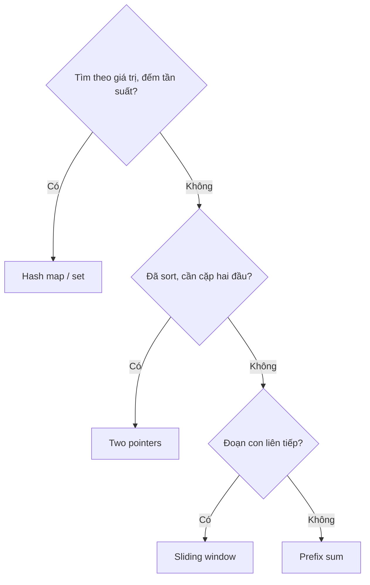
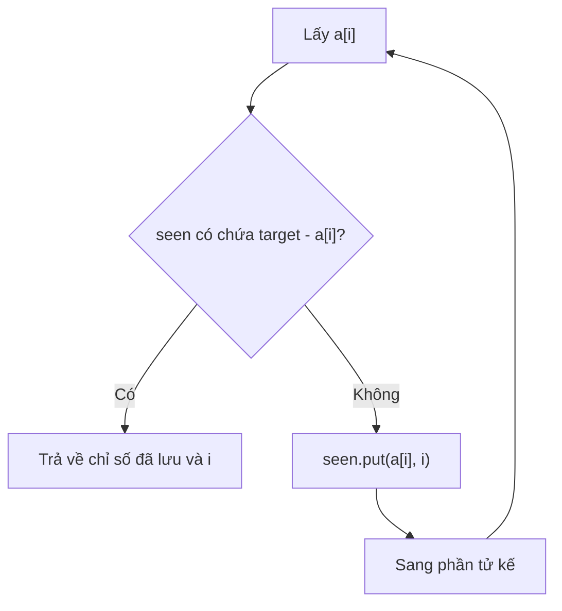
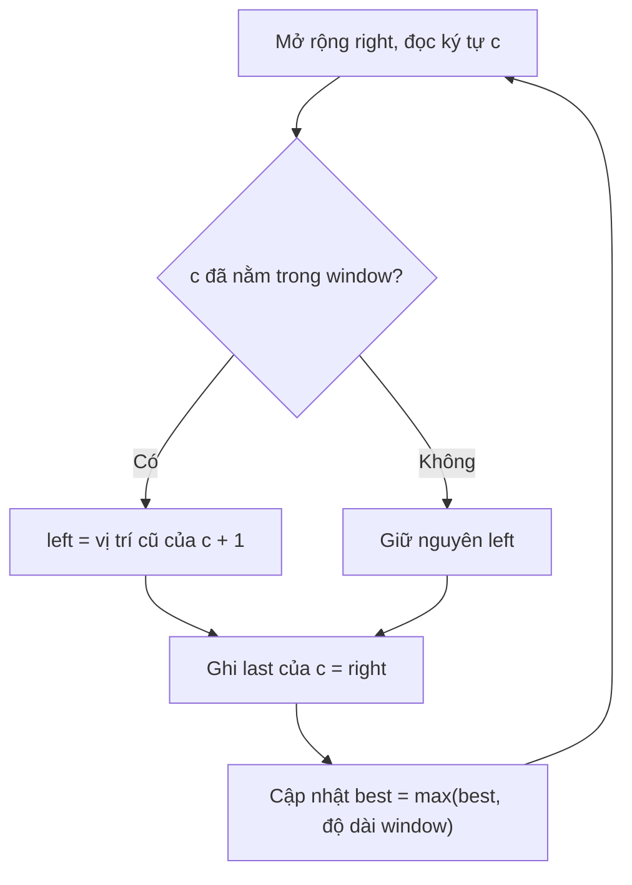

# Mảng, chuỗi và Hash: các mẫu hình cơ bản

## Bốn khuôn giải bạn cần nắm

Phần lớn bài mảng và chuỗi trong phỏng vấn không đòi thuật toán cao siêu. Chúng được giải bằng một trong vài **khuôn** quen thuộc: hash map, two pointers, sliding window và prefix sum. Học khuôn giống học nước đi cơ bản trong cờ vua: gặp đề, bạn nhận ra dấu hiệu và biết nên lôi khuôn nào ra, thay vì nghĩ lại từ đầu.

**Tóm tắt:**

- Phần lớn bài mảng và chuỗi giải bằng một trong bốn khuôn: hash map, two pointers, sliding window, prefix sum.
- Cả bốn cùng một ý: không duyệt lại những gì đã biết, đưa O(n²) xuống O(n), thường bằng cách đổi memory lấy thời gian.
- Đếm tần suất, tìm cặp, kiểm tra tồn tại thì hash map hoặc set.
- Mảng đã sort và cần cặp hai đầu thì two pointers, O(n) và O(1) memory.
- Đoạn con liên tiếp tối ưu độ dài thì sliding window, nhưng sai khi có số âm.
- Tổng đoạn bằng k (kể cả số âm) dùng prefix sum cộng hash map, nhớ khởi tạo `cnt[0] = 1`.
- Bẫy thường gặp: tra `seen` trước khi `put`, kiểm tra `last.get(c) >= left`, tràn `int`.

## Vấn đề các khuôn này giải quyết

Cách ngây thơ cho hầu hết các bài này là hai vòng `for` lồng nhau, tức O(n²). Với mảng vài trăm nghìn phần tử, đó là 10^10 thao tác và chương trình bị quá thời gian. Điểm chung của bốn khuôn là **tránh việc duyệt lại** những gì đã biết: hash map nhớ những phần tử đã gặp, two pointers tận dụng thứ tự, sliding window tái sử dụng kết quả của window trước, prefix sum tính sẵn tổng một lần. Nhờ vậy đa số bài giảm được xuống O(n).

**Nền tảng:** Cả bốn khuôn (hash map, two pointers, sliding window, prefix sum) cùng một ý: không tìm lại từ đầu mỗi lần, mà tận dụng thứ đã biết (đã lưu trong hash map, đã loại trừ nhờ thứ tự, đã tính sẵn trong prefix) để đưa O(n²) xuống O(n). Thường là đổi memory lấy thời gian.

## Khi nào dùng khuôn nào

Hãy đọc đề tìm từ khóa dấu hiệu. Đề nói "đoạn con liên tiếp" thì nghĩ tới sliding window hoặc prefix sum. Đề nói "cặp phần tử", "đếm tần suất" hay "tổng bằng k" thì nghĩ tới hash map. Nếu mảng **đã sort** (hoặc sort được mà không phá yêu cầu đề), two pointers thường gọn hơn hash map vì không tốn memory phụ. Ngược lại, nếu đề cần giữ nguyên thứ tự hoặc chỉ số gốc mà dữ liệu chưa sort, hãy dùng hash map thay vì sort.

**Phải thuộc:** Chọn khuôn theo dấu hiệu: đếm tần suất, tìm cặp hoặc kiểm tra tồn tại thì hash map/set; mảng đã sort, cặp hai đầu thì two pointers; đoạn con liên tiếp tối ưu độ dài thì sliding window; nhiều truy vấn tổng đoạn, hoặc tổng đoạn bằng k (có số âm) thì prefix sum cộng hash map.

## Các khái niệm cần biết

- **Hash map**: cấu trúc lưu cặp key và value, tra theo key trong O(1) trung bình. Bên trong, key được biến thành một con số (hash) để biết nên đặt vào ô nào. Dùng khi cần trả lời nhanh "phần tử này đã gặp chưa" hoặc "đã gặp bao nhiêu lần". Hệ quả khi dùng sai: tra trong `List` thay vì `Map` biến O(n) thành O(n²).
- **Hash set**: như hash map nhưng chỉ lưu key, dùng để kiểm tra tồn tại. `set.add(x)` trả `false` nếu đã có.
- **Đoạn con (subarray, substring)**: dãy phần tử **liên tiếp** của mảng hoặc chuỗi. Khác với **dãy con (subsequence)** được phép bỏ qua phần tử.
- **Two pointers**: dùng hai chỉ số cùng di chuyển trên mảng, thường từ hai đầu vào giữa hoặc cùng chiều. Hợp lệ khi di chuyển một pointer cho phép loại bỏ chắc chắn một nhóm khả năng.
- **Sliding window**: một đoạn `[left, right]` mở rộng bên phải và thu hẹp bên trái khi vi phạm điều kiện. Dùng cho bài tối ưu độ dài hoặc tổng của đoạn liên tiếp.
- **Prefix sum**: mảng `prefix` lưu tổng các phần tử từ đầu đến vị trí hiện tại, để tính tổng bất kỳ đoạn nào bằng một phép trừ.
- **Anagram**: hai chuỗi có cùng các ký tự với cùng số lần, chỉ khác thứ tự (listen và silent).
- **Palindrome**: chuỗi đọc xuôi ngược giống nhau (level).

## Chọn mẫu theo dấu hiệu



Nhánh cuối (prefix sum) dùng cho bài tính tổng nhiều đoạn con hoặc truy vấn khoảng. Sơ đồ chỉ là gợi ý ban đầu: bài thật thường kết hợp hai khuôn (ví dụ prefix sum cộng hash map ở phần sau).

## Hash map: Two Sum

Đề bài: cho mảng và số `target`, tìm hai chỉ số có tổng giá trị bằng `target`. Vấn đề đặt ra là với mỗi `a[i]`, ta cần biết `target - a[i]` có nằm ở đâu đó trong mảng không. Cách giải quyết là vừa duyệt vừa ghi nhớ các giá trị đã gặp vào hash map, nên mỗi lần "tìm" chỉ còn O(1).



```java
int[] twoSum(int[] a, int target) {
    Map<Integer, Integer> seen = new HashMap<>();          // giá trị -> chỉ số
    for (int i = 0; i < a.length; i++) {
        Integer j = seen.get(target - a[i]);
        if (j != null) return new int[]{j, i};
        seen.put(a[i], i);
    }
    return new int[0];
}
// O(n) thời gian, O(n) memory, thay cho O(n²)
```

## Two pointers

Hãy dùng khi mảng đã có thứ tự và bạn cần tìm cặp thỏa điều kiện; không dùng khi dữ liệu không thể sort hoặc phải giữ chỉ số gốc. Mảng đã sort, cặp có tổng bằng `k`: một pointer ở đầu, một ở cuối; tổng nhỏ quá thì dịch trái sang phải, lớn quá thì dịch phải sang trái. O(n). Còn dùng để: loại phần tử trùng tại chỗ, đảo mảng, kiểm tra palindrome, gộp hai mảng đã sort, "container with most water".

## Sliding window

Chuỗi con dài nhất không có ký tự lặp:

```java
int longestUnique(String s) {
    Map<Character, Integer> last = new HashMap<>();
    int best = 0, left = 0;
    for (int right = 0; right < s.length(); right++) {
        char c = s.charAt(right);
        if (last.containsKey(c) && last.get(c) >= left) left = last.get(c) + 1;
        last.put(c, right);
        best = Math.max(best, right - left + 1);
    }
    return best;
}
```

Ý tưởng: giữ một window `[left, right]` luôn hợp lệ (không có ký tự lặp). Mỗi bước mở rộng `right` thêm một ký tự; nếu ký tự đó đã nằm trong window thì đẩy `left` qua vị trí lần trước của nó.



Hai kiểu: sliding window độ dài **cố định** (trung bình trượt) và **thay đổi** (mở rộng bên phải, thu hẹp bên trái khi vi phạm điều kiện). Mỗi phần tử vào và ra tối đa một lần nên O(n).

**Suy luận:** Sliding window chỉ đúng khi mở rộng window luôn làm "mức vi phạm" tăng và thu hẹp luôn làm nó giảm (tính đơn điệu). Với chuỗi không lặp hay tổng các số dương, điều này đúng, nên khi vi phạm ta biết chắc chỉ cần đẩy `left` mà không cần thử lại các `left` nhỏ hơn, từ đó mỗi phần tử vào và ra một lần và tổng là O(n). Khi mảng có số âm, thêm một phần tử có thể làm tổng giảm, nên thu hẹp window không còn bảo đảm điều kiện cải thiện và có thể bỏ sót đáp án. Đó là điểm dễ nhầm vì code sliding window vẫn chạy ra kết quả trông hợp lý. Hệ quả: gặp số âm thì chuyển sang prefix sum cộng hash map, và trước khi chọn khuôn hãy tự hỏi "di chuyển một đầu có loại bỏ chắc chắn được khả năng nào không".

## Prefix sum

Vấn đề: có nhiều truy vấn "tổng đoạn `[l, r]`", mỗi lần cộng lại từ đầu là O(n). Cách giải quyết là tính sẵn một lần, rồi trả lời mỗi truy vấn bằng phép trừ. Ví dụ `a = [3, 1, 4]` có `prefix = [0, 3, 4, 8]`, tổng đoạn chỉ số 1 đến 2 là `prefix[3] - prefix[1] = 5`. `prefix[i]` là tổng `i` phần tử đầu; tổng đoạn `[l, r]` bằng `prefix[r+1] - prefix[l]`, trả lời O(1) sau khi tiền xử lý O(n). Kết hợp hash map đếm **số đoạn con có tổng bằng k**: duyệt và đếm số lần đã gặp `prefix - k`.

## Bài giải mẫu có trace

### Two Sum: từ brute force đến hash map

- Brute force: thử mọi cặp `(i, j)`, O(n²).
- Nhận xét: với `a[i]` cố định, chỉ cần biết `target - a[i]` đã xuất hiện chưa. Đổi "tìm" từ O(n) sang O(1) bằng hash map.

Trace `a = [2, 7, 11, 15]`, `target = 9`:

| i | a[i] | cần tìm `target - a[i]` | `seen` trước bước | Kết quả |
|---|---|---|---|---|
| 0 | 2 | 7 | {} | không thấy, lưu `2 → 0` |
| 1 | 7 | 2 | {2→0} | thấy chỉ số 0, trả `[0, 1]` |

Bẫy: tra `seen` **trước** khi `put` để không ghép một phần tử với chính nó (`a = [3, 2]`, `target = 6` không được trả `[0, 0]`). Trùng giá trị (`[3, 3]`, 6) vẫn đúng vì lần thứ hai tra thấy lần đầu. Mảng rỗng hoặc không có đáp án thì trả mảng rỗng.

### Two pointers trên mảng đã sort

```java
int[] twoSumSorted(int[] a, int target) {
    int l = 0, r = a.length - 1;
    while (l < r) {
        int s = a[l] + a[r];
        if (s == target) return new int[]{l, r};
        if (s < target) l++;          // tổng nhỏ quá: cần số lớn hơn
        else r--;                     // tổng lớn quá: cần số nhỏ hơn
    }
    return new int[]{-1, -1};
}
```

Trace `a = [1, 3, 4, 6, 8, 11]`, `target = 10` (đã chạy, kết quả `[2, 3]`):

| Bước | l | r | a[l] + a[r] | So với 10 | Hành động |
|---|---|---|---|---|---|
| 1 | 0 | 5 | 12 | lớn | `r--` |
| 2 | 0 | 4 | 9 | nhỏ | `l++` |
| 3 | 1 | 4 | 11 | lớn | `r--` |
| 4 | 1 | 3 | 9 | nhỏ | `l++` |
| 5 | 2 | 3 | 10 | bằng | trả `[2, 3]` |

Vì sao đúng: khi `a[l] + a[r]` lớn hơn `target`, `a[r]` ghép với mọi `a[l']` với `l' >= l` đều quá lớn, nên loại `a[r]` an toàn. O(n) thời gian, O(1) memory (chưa tính sort O(n log n) nếu mảng chưa có thứ tự).

### Sliding window: trace chuỗi con không lặp

Dùng code `longestUnique` ở trên, input `"abcabcbb"` (đã chạy, đáp án 3):

| right | ký tự | `left` sau bước | Cửa sổ | Độ dài | best |
|---|---|---|---|---|---|
| 0 | a | 0 | a | 1 | 1 |
| 1 | b | 0 | ab | 2 | 2 |
| 2 | c | 0 | abc | 3 | 3 |
| 3 | a | 1 | bca | 3 | 3 |
| 4 | b | 2 | cab | 3 | 3 |
| 5 | c | 3 | abc | 3 | 3 |
| 6 | b | 5 | cb | 2 | 3 |
| 7 | b | 7 | b | 1 | 3 |

Điều kiện `last.get(c) >= left` là bẫy then chốt: lần cuối thấy `c` có thể nằm **bên trái window** (đã bị cắt), khi đó không được nhảy `left` lùi lại. Ví dụ `"abba"`: ở `right = 3`, `last['a'] = 0 < left = 2`, giữ nguyên `left`; thiếu điều kiện này sẽ ra `left = 1` và đáp án sai.

### Prefix sum + hash map: đếm đoạn con có tổng k

Ý tưởng: tổng đoạn `(i, j]` bằng `prefix[j] - prefix[i]`; muốn bằng `k` thì cần `prefix[i] = prefix[j] - k`. Với mỗi `j`, đếm số lần `prefix - k` đã xuất hiện.

```java
int subarraySum(int[] a, int k) {
    Map<Integer, Integer> cnt = new HashMap<>();
    cnt.put(0, 1);                    // tiền tố rỗng, để tính đoạn bắt đầu từ chỉ số 0
    int prefix = 0, res = 0;
    for (int x : a) {
        prefix += x;
        res += cnt.getOrDefault(prefix - k, 0);
        cnt.merge(prefix, 1, Integer::sum);
    }
    return res;
}
```

Trace `a = [1, 2, 3, -3, 3]`, `k = 3` (đã chạy, kết quả 5):

| x | prefix | cần `prefix - 3` | Số lần đã thấy | res |
|---|---|---|---|---|
| 1 | 1 | -2 | 0 | 0 |
| 2 | 3 | 0 | 1 | 1 (đoạn `[1,2]`) |
| 3 | 6 | 3 | 1 | 2 (đoạn `[3]`) |
| -3 | 3 | 0 | 1 | 3 (đoạn `[1,2,3,-3]`) |
| 3 | 6 | 3 | 2 | 5 (hai đoạn kết thúc ở đây: `[3,-3,3]` và `[3]`) |

Bẫy: quên `cnt.put(0, 1)` làm mất mọi đoạn bắt đầu từ đầu mảng. Cách này đúng cả khi có số âm, khác sliding window.

**Phải thuộc:** Prefix sum: `sum(l..r) = prefix[r] - prefix[l-1]`. Đếm đoạn con có tổng `k`: với mỗi vị trí, cộng số lần `prefix - k` đã xuất hiện, và khởi tạo `cnt[0] = 1`. Cách này đúng cả khi có số âm; sliding window thì không. Sliding window mỗi phần tử vào và ra tối đa một lần nên O(n); với bài chuỗi con không lặp phải kiểm tra `last.get(c) >= left`.

### Mảng đếm: anagram

```java
boolean isAnagram(String s, String t) {
    if (s.length() != t.length()) return false;
    int[] c = new int[26];                       // chỉ chữ thường a-z
    for (int i = 0; i < s.length(); i++) { c[s.charAt(i) - 'a']++; c[t.charAt(i) - 'a']--; }
    for (int v : c) if (v != 0) return false;
    return true;
}
```

`isAnagram("listen", "silent")` là `true`, `isAnagram("rat", "car")` là `false` (đã chạy). O(n), memory O(26). Nếu có Unicode thì dùng `HashMap<Character, Integer>`.

Luyện tập: [bộ bài tập thuật toán](/go?p=00-Roadmap%2Fbai-tap-thuat-toan.md).

## Các kỹ thuật hay đi kèm

| Kỹ thuật | Dùng cho |
|---|---|
| Sort trước | Gom nhóm, khoảng (interval), tìm trùng |
| Mảng đếm kích thước 26 hoặc 256 | Đếm ký tự, anagram, nhanh hơn hash map |
| Bit mask | Tập con nhỏ, XOR tìm phần tử lẻ |
| `StringBuilder` | Dựng chuỗi trong vòng lặp (chuỗi bất biến) |

## Điều cần nhớ

- Two pointers đòi hỏi dữ liệu có thứ tự hoặc cấu trúc đối xứng; không sort được thì nghĩ tới hash map.
- Sliding window với giá trị **âm** thường không đúng; chuyển sang prefix sum + hash map.
- Chú ý tràn `int` khi cộng tổng lớn: dùng `long`.
- Chuỗi trong Java là bất biến: nối trong vòng lặp là O(n²).

