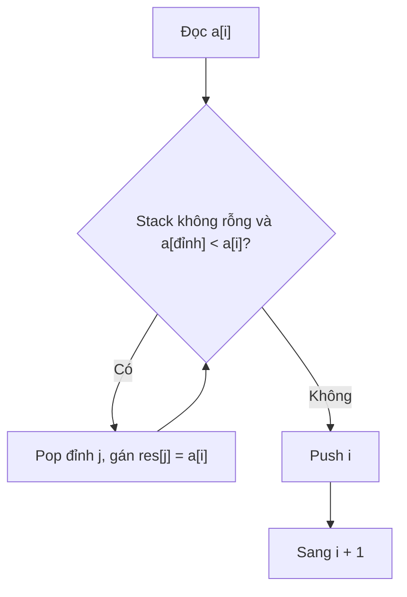
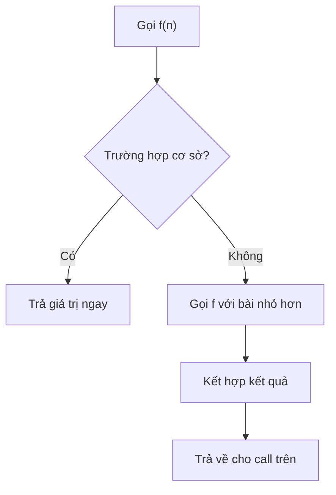
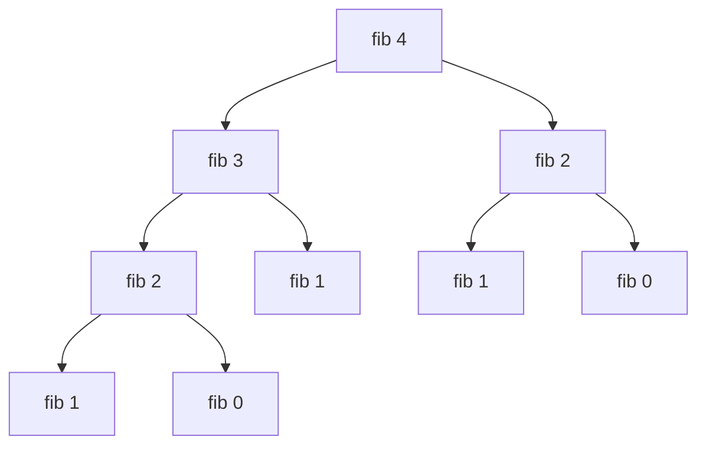

# Stack, Queue, Linked List và Đệ quy

## Bốn công cụ nền tảng

Bài này nói về bốn thứ xuất hiện khắp nơi trong thuật toán. **Stack** giống chồng đĩa: đĩa nào bỏ lên sau thì được lấy ra trước. **Queue** giống hàng chờ ở quầy: ai đến trước được phục vụ trước. **Linked list** là một chuỗi node, mỗi node giữ dữ liệu và trỏ tới node kế. **Đệ quy** là hàm tự gọi lại chính nó để giải một phiên bản nhỏ hơn của cùng bài toán.

**Tóm tắt:**

- Stack và queue khác nhau ở đúng một điều: thứ tự lấy ra, LIFO cho stack và FIFO cho queue.
- Chọn sai thứ tự là sai thuật toán: BFS dùng queue, DFS dùng stack hoặc đệ quy.
- Trong Java dùng `ArrayDeque` cho cả hai, không dùng class `Stack` cũ.
- Monotonic stack tìm phần tử lớn hơn kế tiếp trong O(n) vì mỗi chỉ số push và pop tối đa một lần.
- Linked list: chèn xóa O(1) khi đã có vị trí, truy cập O(k); các kỹ thuật chính là dummy head, đảo tại chỗ, fast và slow pointer.
- Đệ quy cần base case, bài con nhỏ hơn và cách kết hợp; thiếu base case thì `StackOverflowError`.
- Java không tối ưu tail recursion; đệ quy sâu thì viết lại bằng vòng lặp và stack tự quản lý.
- Đệ quy tính lặp bài con thì thêm memoization để đưa hàm mũ về O(n).

## Vì sao chúng quan trọng

Duyệt cây, duyệt đồ thị, kiểm tra ngoặc, tính năng undo đều chạy trên mấy thứ này. Vấn đề là chỉ cần chọn sai thứ tự lấy phần tử ra thì kết quả sai theo. Ví dụ bạn muốn duyệt đồ thị theo từng lớp (BFS) nhưng lại dùng stack, thì thuật toán của bạn âm thầm thành duyệt sâu (DFS) và cho đáp án sai cho bài tìm đường ngắn nhất.

## Khi nào dùng cái nào

Hãy tự hỏi "phần tử nào cần được lấy ra trước". Nếu là phần tử **mới nhất** (LIFO, last in first out), dùng stack: ngoặc hợp lệ, undo, "phần tử lớn hơn kế tiếp". Nếu là phần tử **cũ nhất** (FIFO, first in first out), dùng queue: BFS, xử lý theo thứ tự đến. Đệ quy hợp khi bài tự chia được thành bài con giống hệt; khi bắt đầu viết, hãy xác định trường hợp dừng trước rồi mới viết bước gọi lại. Không nên dùng đệ quy khi độ sâu có thể lên hàng chục nghìn hoặc hơn (ví dụ danh sách 10^5 node), vì sẽ gặp `StackOverflowError`; lúc đó viết lại bằng vòng lặp.

**Nền tảng:** Stack và queue khác nhau ở một điều duy nhất: thứ tự lấy ra. Stack lấy phần tử mới nhất (LIFO), queue lấy phần tử cũ nhất (FIFO). Chọn sai thứ tự là sai thuật toán, ví dụ duyệt đồ thị theo chiều sâu (DFS) dùng stack hoặc đệ quy, theo chiều rộng (BFS) dùng queue. Đệ quy thực chất cũng chạy trên call stack.

## Các khái niệm cần biết

- **LIFO / FIFO**: hai quy tắc thứ tự lấy ra, như trên.
- **Deque (double-ended queue)**: queue hai đầu, thêm và lấy được cả hai phía. Vì vậy một `Deque` đóng vai được cả stack lẫn queue.
- **Monotonic stack**: stack mà ta luôn giữ các giá trị theo một chiều (tăng hoặc giảm từ đáy lên đỉnh) bằng cách pop những phần tử vi phạm trước khi push. Dùng để tìm phần tử lớn hơn hoặc nhỏ hơn kế tiếp trong O(n).
- **Trường hợp cơ sở (base case)**: tình huống đủ nhỏ để trả kết quả ngay, không gọi đệ quy nữa. Thiếu nó thì hàm gọi mãi đến khi tràn stack.
- **Call stack**: vùng memory của JVM dùng để lưu mỗi gọi hàm (tham số, biến cục bộ). Đệ quy sâu làm nó đầy và gây `StackOverflowError`.
- **Đệ quy đuôi (tail recursion)**: đệ quy mà call là việc cuối cùng của hàm. Một số ngôn ngữ biến nó thành vòng lặp, Java thì không.
- **Memoization**: lưu kết quả của các call đã tính để lần sau trả ngay, tránh tính lặp.
- **Dummy head**: một node phụ đặt trước đầu danh sách để xóa hoặc chèn ở đầu không cần xử lý riêng.
- **Thuật toán Floyd (fast và slow pointer)**: một pointer đi 2 bước, một pointer đi 1 bước; dùng để phát hiện vòng hoặc tìm phần tử giữa của linked list mà không cần memory phụ.

## Stack (LIFO) và Queue (FIFO)

Trong Java dùng `ArrayDeque` cho cả hai (không dùng class `Stack` cũ):

```java
Deque<Integer> stack = new ArrayDeque<>();
stack.push(1); stack.pop(); stack.peek();

Queue<Integer> queue = new ArrayDeque<>();
queue.offer(1); queue.poll(); queue.peek();
```

`push` và `pop` làm việc ở đầu stack, còn `offer` thêm vào cuối queue và `poll` lấy từ đầu queue. `peek` chỉ xem phần tử kế mà không lấy ra. Đừng dùng class `Stack` cũ vì nó kế thừa `Vector` và bị synchronized không cần thiết (chậm hơn).

**Phải thuộc:** Trong Java dùng `ArrayDeque` làm cả stack (`push`, `pop`, `peek`) lẫn queue (`offer`, `poll`, `peek`); không dùng class `Stack` cũ (kế thừa `Vector`, bị synchronized). Cần lấy phần tử nhỏ hoặc lớn nhất thì dùng `PriorityQueue`. Ngoặc hợp lệ, undo, "phần tử lớn hơn kế tiếp" là dấu hiệu của stack.

Ngoặc hợp lệ: gặp ngoặc mở thì đẩy vào, gặp ngoặc đóng thì lấy ra và kiểm tra khớp; cuối cùng stack phải rỗng. O(n). Lý do stack hợp ở đây: ngoặc mở gần nhất phải được đóng trước, chính là quy tắc "mới nhất ra trước".

## Monotonic stack

Giữ stack luôn đơn điệu để tìm "phần tử lớn hơn kế tiếp" trong O(n):

```java
int[] nextGreater(int[] a) {
    int[] res = new int[a.length];
    Arrays.fill(res, -1);
    Deque<Integer> st = new ArrayDeque<>();            // lưu chỉ số
    for (int i = 0; i < a.length; i++) {
        while (!st.isEmpty() && a[st.peek()] < a[i]) res[st.pop()] = a[i];
        st.push(i);
    }
    return res;
}
```



Đọc sơ đồ: stack chứa các chỉ số "đang chờ" một số lớn hơn mình. Khi `a[i]` đến, mọi phần tử ở đỉnh nhỏ hơn nó đều tìm được đáp án và rời stack; xong `i` vào chờ. Không dùng khi cần phần tử lớn hơn **ở bên trái** mà không đảo chiều duyệt.

**Suy luận:** Monotonic stack đạt O(n) dù có vòng `while` lồng trong vòng `for`, vì mỗi chỉ số chỉ được push một lần và do đó pop tối đa một lần: tổng số lần pop không thể vượt quá tổng số lần push, nên tổng công việc là 2n chứ không phải n². Stack giữ đúng các chỉ số "chưa có đáp án" và chúng luôn không tăng từ đáy lên đỉnh, vì nếu một phần tử nhỏ hơn đỉnh thì nó chưa thể là đáp án của ai, còn nếu lớn hơn thì đỉnh vừa tìm được đáp án và bị loại. Điểm dễ nhầm là đếm theo "vòng trong nhân vòng ngoài" rồi kết luận O(n²), hoặc quên rằng điều kiện `<` hay `<=` quyết định cách xử lý số bằng nhau. Khi thiết kế, hãy hỏi mỗi phần tử rời khỏi cấu trúc bao nhiêu lần, đó mới là cách đếm đúng cho các bài amortized.

Mỗi phần tử vào và ra tối đa một lần. Dùng cho: nhiệt độ hằng ngày, hình chữ nhật lớn nhất trong biểu đồ, trapping rain water.

## Linked list

Linked list lưu dữ liệu trong các node rời nhau nối bằng tham chiếu `next`, nên chèn hoặc xóa khi đã có vị trí chỉ là đổi vài pointer (O(1)), nhưng truy cập phần tử thứ `k` phải đi từ đầu (O(k)). Trong bài thuật toán, nó chủ yếu xuất hiện như một bài thao tác pointer, còn trong code thật `ArrayList` hầu như luôn nhanh hơn. Bốn kỹ thuật thường gặp:

| Kỹ thuật | Dùng cho |
|---|---|
| **Fast/slow pointer** | Tìm phần tử giữa, phát hiện vòng (Floyd) |
| Dummy head | Tránh xử lý riêng cho đầu danh sách khi xóa/chèn |
| Đảo ngược tại chỗ | Giữ `prev`, `curr`, `next`; O(n) thời gian, O(1) memory |
| Merge hai danh sách đã sort | So sánh hai đầu, nối nhỏ hơn |

```java
ListNode reverse(ListNode head) {
    ListNode prev = null;
    while (head != null) {
        ListNode next = head.next;
        head.next = prev;
        prev = head;
        head = next;
    }
    return prev;
}
```

## Đệ quy

Ví dụ đời thường: bạn hỏi "tôi đứng thứ mấy trong hàng?", người đứng trước hỏi tiếp người trước họ, cứ thế đến người đầu hàng trả lời "thứ 1", rồi mỗi người cộng thêm 1 và trả lại cho người sau. Người đầu hàng chính là trường hợp cơ sở. Luồng xử lý như sau.



Ba bước khi nghĩ: (1) trường hợp cơ sở, (2) bài toán nhỏ hơn là gì, (3) kết hợp thế nào. Tin rằng call đệ quy **đúng** rồi mới ghép.

- Mỗi call chiếm một khung trên stack; đệ quy quá sâu gây `StackOverflowError`. Mặc định vài nghìn đến vài chục nghìn tầng.
- Đệ quy trùng lặp (Fibonacci ngây thơ cỡ O(2ⁿ), chặt hơn là O(φⁿ)) → **memoization** hoặc quy hoạch động.
- Java **không** tối ưu đệ quy đuôi; bài sâu thì chuyển sang vòng lặp với stack tự quản lý.
- Độ phức tạp đệ quy tính bằng số node của cây đệ quy.

**Suy luận:** Đệ quy chạy được vì mỗi call được cấp một khung riêng trên call stack, giữ tham số và biến cục bộ của nó, nên call con có thể chạy xong rồi trả về đúng chỗ call cha đang chờ. Chính cơ chế này đặt ra giới hạn: stack có kích thước cố định, nên độ sâu đệ quy chứ không phải tổng số call mới quyết định có tràn hay không. Vì vậy duyệt danh sách 10^5 node bằng đệ quy tràn dù chỉ có O(n) call, còn duyệt cây cân bằng 10^5 node chỉ sâu khoảng 17 tầng thì an toàn. Java không biến tail recursion thành vòng lặp nên viết dạng đuôi không giúp gì. Hệ quả khi review: ước lượng độ sâu tối đa theo dữ liệu xấu nhất (cây lệch thành danh sách), và nếu có thể lên hàng chục nghìn thì chuyển sang vòng lặp cùng `ArrayDeque`.

**Phải thuộc:** Mọi hàm đệ quy cần ba thứ: trường hợp cơ sở, bài toán nhỏ hơn, cách kết hợp kết quả. Thiếu trường hợp cơ sở thì `StackOverflowError`; Java không tối ưu đệ quy đuôi; đệ quy tính lặp thì thêm memoization. Linked list: đảo ngược cần lưu `next` trước khi sửa `head.next`, phát hiện vòng bằng hai fast và slow pointer (Floyd), dùng dummy head để khỏi xử lý riêng đầu danh sách.

## Bài giải mẫu có trace

### Ngoặc hợp lệ

```java
boolean valid(String s) {
    Deque<Character> st = new ArrayDeque<>();
    for (char c : s.toCharArray()) {
        if (c == '(' || c == '[' || c == '{') st.push(c);
        else {
            if (st.isEmpty()) return false;               // đóng mà chưa mở
            char o = st.pop();
            if ((c == ')' && o != '(') || (c == ']' && o != '[') || (c == '}' && o != '{')) return false;
        }
    }
    return st.isEmpty();                                   // còn ngoặc mở thừa thì sai
}
```

Đã chạy: `"([]{})"` đúng; `"(]"`, `"(("`, `")"` đều sai. Ba lý do sai tương ứng ba chỗ `return false`: không khớp loại, mở thừa, đóng thừa. Chuỗi rỗng là hợp lệ.

### Monotonic stack: phần tử lớn hơn kế tiếp

Hướng nghĩ: brute force với mỗi `i` quét sang phải, O(n²). Nhận xét: phần tử còn "chờ" câu trả lời luôn có giá trị không tăng từ đáy lên đỉnh stack, nên khi `a[i]` lớn hơn đỉnh thì đỉnh vừa tìm ra đáp án.

Trace `nextGreater` trên `a = [2, 1, 2, 4, 3]` (stack lưu chỉ số, liệt kê đỉnh trước):

| i | a[i] | Pop (gán đáp án) | Stack sau bước | res |
|---|---|---|---|---|
| 0 | 2 | không | [0] | [-1,-1,-1,-1,-1] |
| 1 | 1 | không (2 < 1 sai) | [1, 0] | không đổi |
| 2 | 2 | pop 1: `res[1]=2` | [2, 0] | [-1,2,-1,-1,-1] |
| 3 | 4 | pop 2: `res[2]=4`; pop 0: `res[0]=4` | [3] | [4,2,4,-1,-1] |
| 4 | 3 | không | [4, 3] | [4,2,4,-1,-1] |

Kết quả `[4, 2, 4, -1, -1]` (đã chạy). Phần tử còn trong stack khi hết mảng giữ `-1`. Bẫy: điều kiện `<` nghiêm ngặt, hai số bằng nhau không coi là "lớn hơn". Biến thể "số ngày chờ nhiệt độ cao hơn" chỉ đổi gán thành `res[j] = i - j`; với `[73,74,75,71,69,72,76,73]` ra `[1,1,4,2,1,1,0,0]` (đã chạy). Mỗi chỉ số push và pop tối đa một lần nên O(n).

### Đảo danh sách liên kết

Trace `reverse` trên `1 -> 2 -> 3`:

| Vòng | `head` đầu vòng | `next` | Sau `head.next = prev` | `prev` mới |
|---|---|---|---|---|
| 1 | 1 | 2 | `1 -> null` | 1 |
| 2 | 2 | 3 | `2 -> 1` | 2 |
| 3 | 3 | null | `3 -> 2` | 3 |

Hết vòng `head == null`, trả `prev = 3`, danh sách là `3 -> 2 -> 1` (đã chạy). Bẫy: phải lưu `next` **trước** khi sửa `head.next`, nếu không mất phần còn lại. Danh sách rỗng hoặc một node trả về chính nó. O(n) thời gian, O(1) memory.

### Phát hiện vòng (Floyd)

```java
boolean hasCycle(ListNode head) {
    ListNode slow = head, fast = head;
    while (fast != null && fast.next != null) {      // kiểm tra cả fast và fast.next
        slow = slow.next;
        fast = fast.next.next;
        // so sánh tham chiếu, không so giá trị
        if (slow == fast) return true;
    }
    return false;
}
```

Hãy hình dung hai người chạy trên đường đua: nếu đường là vòng tròn, người nhanh sớm muộn sẽ "vượt vòng" và gặp lại người chậm; nếu là đường thẳng, người nhanh về đích (`null`) trước. Fast pointer đi 2 bước, chậm đi 1: nếu có vòng thì khoảng cách giữa hai pointer giảm 1 mỗi lượt khi cả hai ở trong vòng, nên chắc chắn gặp nhau. O(n), memory O(1) (hơn cách dùng `HashSet` O(n) memory). Đã chạy: danh sách `1,2,3,4` nối `4` về `2` cho `true`, danh sách `1,2,3` cho `false`.

### Cây gọi đệ quy và memoization

Cây gọi của `fib(4)` ngây thơ (9 node, `fib(2)` và `fib(1)` bị gọi lặp):



(`fib(5)` ngây thơ là 15 call.) Khi thêm bảng memoization `Map<Integer, Long>`, mỗi `fib(k)` chỉ được tính một lần: `fib(5)` còn 9 call (đã chạy), vì call thứ hai tới `fib(2)` và `fib(3)` trả ngay từ bảng. Tổng quát số call là O(n) thay vì hàm mũ.

Bẫy khi viết đệ quy: thiếu hoặc sai trường hợp cơ sở gây `StackOverflowError`; sửa object dùng chung (danh sách, mảng) mà quên hoàn tác; memoization nhưng key không đủ thông tin state.

Luyện tập: [bộ bài tập thuật toán](/go?p=00-Roadmap%2Fbai-tap-thuat-toan.md).

## Điều cần nhớ

- Cần thao tác hai đầu thì dùng `Deque`; lấy phần tử nhỏ/lớn nhất thì dùng `PriorityQueue`.
- Xóa phần tử khi duyệt linked list: để ý pointer `prev` và trường hợp xóa đầu.
- Mọi đệ quy đều viết lại được bằng vòng lặp + stack.

