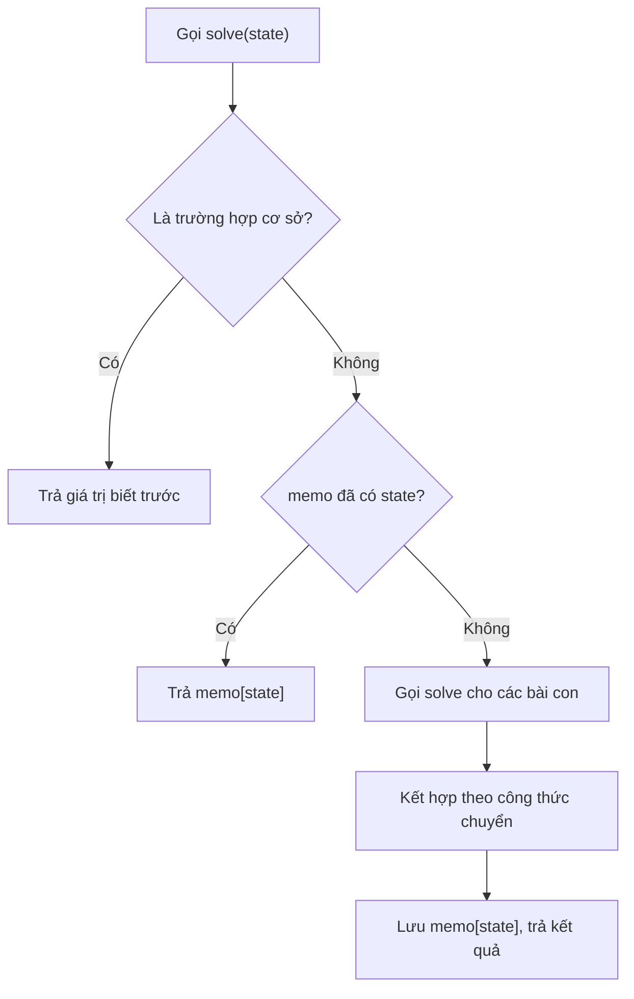
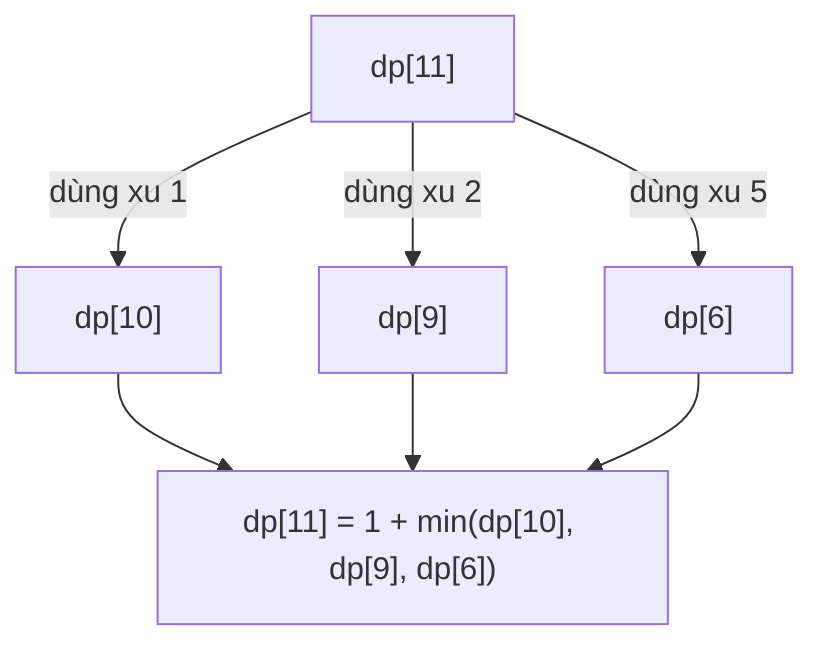
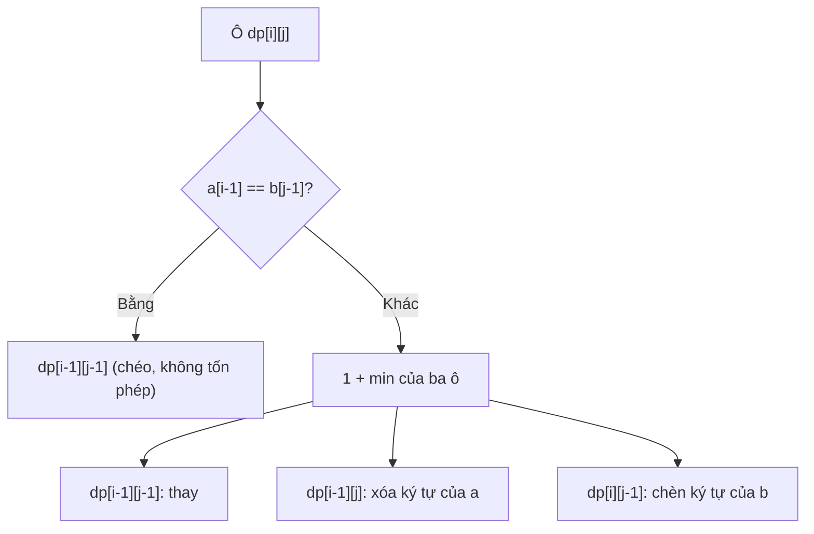

# Quy hoạch động (Dynamic Programming)

## Quy hoạch động là gì?

Quy hoạch động (Dynamic Programming, viết tắt DP) là cách giải bài toán lớn bằng cách chia thành các bài con, giải **mỗi bài con đúng một lần**, ghi kết quả lại rồi lấy ra dùng khi cần thay vì tính lại. Hãy nghĩ đến việc tính Fibonacci: để có `fib(6)` bạn cần `fib(5)` và `fib(4)`, nhưng `fib(5)` lại cần `fib(4)` một lần nữa. Nếu bạn viết `fib(4)` ra giấy ngay lần đầu tính, những lần sau chỉ cần nhìn giấy.

**Tóm tắt:**

- DP giải mỗi bài con đúng một lần rồi lưu lại, biến thời gian hàm mũ của đệ quy thuần thành đa thức.
- Chỉ có lợi khi có hai tính chất: bài toán con chồng lấn và cấu trúc con tối ưu.
- Quy trình 5 bước: state, transition, base case, thứ tự tính, vị trí đáp án; khó nhất là chọn state.
- Top-down là đệ quy cộng memoization, bottom-up là tabulation bằng vòng lặp; cả hai cùng công thức chuyển.
- Đổi tiền: `dp[a] = min(dp[a - c] + 1)`; greedy có thể sai (xu `{1, 3, 4}` đổi 6).
- LCS và edit distance dùng `dp[i][j]` trên tiền tố hai chuỗi, O(n·m), giữ hai hàng nếu chỉ cần giá trị.
- Knapsack 0/1 dùng một mảng thì duyệt dung lượng giảm dần; duyệt tăng dần thành knapsack không giới hạn.
- Bẫy hay gặp: cộng 1 vào `Integer.MAX_VALUE` gây tràn, quên base case, state thiếu thông tin.

## Vấn đề nó giải quyết

Đệ quy thuần thường gọi cùng một bài con hàng nghìn, hàng triệu lần, nên thời gian phình theo hàm mũ; với `n = 50` chương trình đã như treo. Khi lưu kết quả, số bài con khác nhau chỉ là đa thức (ví dụ `n` hoặc `n × m`), và mỗi bài con chỉ tốn một lần tính. Nhờ vậy cùng một công thức đệ quy có thể từ không chạy nổi thành chạy trong tích tắc.

## Khi nào dùng, khi nào không

Dùng DP khi đề hỏi giá trị nhỏ nhất hoặc lớn nhất, đếm số cách, hay "có làm được không", **và** các bài con bị lặp lại. Không dùng khi các bài con không lặp (lưu lại cũng vô ích, đó là chia để trị bình thường như merge sort). Cũng không dùng khi một chiến lược greedy chứng minh được là đúng, vì greedy gọn và nhanh hơn (xem bài [Backtracking và greedy](/go?p=05-Algorithms%2Fhard%2Flt-08-backtracking-greedy.md)). Bài viết này đi theo cách: định nghĩa trạng thái (`dp[i]` nghĩa là gì), viết công thức chuyển từ trạng thái nhỏ lên lớn, đặt trường hợp cơ sở, rồi cài theo top-down hoặc bottom-up.

**Nền tảng:** DP chỉ có lợi khi bài toán có hai tính chất: bài toán con chồng lấn (cùng một bài con bị gặp lại nhiều lần) và cấu trúc con tối ưu (lời giải tối ưu ghép từ lời giải tối ưu của bài con). Ý tưởng cốt lõi là mỗi bài con chỉ tính đúng một lần rồi lưu lại, biến thời gian hàm mũ của đệ quy thuần thành đa thức.

## Các khái niệm cần biết

- **Bài toán con chồng lấn (overlapping subproblems)**: các bài con bị gặp lại nhiều lần trong cây đệ quy. Đây là điều kiện để lưu kết quả có lợi.
- **Cấu trúc con tối ưu (optimal substructure)**: lời giải tối ưu của bài lớn được ghép từ lời giải tối ưu của các bài con. Nếu không đúng, công thức chuyển sẽ cho đáp án sai.
- **State**: bộ tham số xác định duy nhất một bài con, ví dụ `i` hoặc cặp `(i, j)`. Chọn thiếu thông tin thì công thức không đủ dữ kiện, chọn thừa thì bảng quá lớn.
- **Transition**: cách tính một trạng thái từ các trạng thái nhỏ hơn.
- **Memoization**: lưu kết quả của đệ quy vào mảng hoặc map, lần gọi sau trả ngay. Là cách làm của top-down.
- **Tabulation**: điền bảng bằng vòng lặp từ trạng thái nhỏ lên lớn. Là cách làm của bottom-up.
- **Subsequence và substring**: dãy con được bỏ qua phần tử nhưng giữ thứ tự, chuỗi con phải liền nhau.
- **Knapsack**: có các vật với trọng lượng và giá trị, túi chứa tối đa một trọng lượng, chọn vật để tổng giá trị lớn nhất. Biến thể 0/1 cho mỗi vật dùng một lần, biến thể không giới hạn cho dùng nhiều lần.

## Nhận biết

Hai tính chất cần có: **bài toán con chồng lấn** và **cấu trúc con tối ưu** (lời giải tối ưu chứa lời giải tối ưu của bài con). Dấu hiệu đề: "số cách", "tối thiểu/tối đa", "có thể không", chuỗi hoặc dãy, lựa chọn mỗi bước dẫn tới bước nhỏ hơn.

## Quy trình 5 bước

| Bước | Câu hỏi cần trả lời |
|---|---|
| 1. Trạng thái | `dp[i]` hoặc `dp[i][j]` biểu diễn điều gì? |
| 2. Công thức chuyển | `dp[i]` tính từ các `dp` nhỏ hơn thế nào? |
| 3. Trường hợp cơ sở | Giá trị nhỏ nhất biết trước là gì? |
| 4. Thứ tự tính | Từ nhỏ đến lớn, hay đệ quy có nhớ? |
| 5. Đáp án | Nằm ở đâu, có giảm được memory không? |

**Phải thuộc:** Quy trình 5 bước của DP: định nghĩa trạng thái, công thức chuyển, trường hợp cơ sở, thứ tự tính, vị trí đáp án. Top-down là đệ quy cộng memoization, bottom-up là lập bảng bằng vòng lặp; cả hai cùng công thức chuyển. Khó nhất là chọn trạng thái; nếu công thức chuyển rối thì trạng thái chưa đủ thông tin.

## Top-down và bottom-up

Có hai cách cài cùng một công thức. Top-down bắt đầu từ bài lớn, đệ quy xuống bài con và nhớ kết quả; bottom-up bắt đầu từ bài nhỏ nhất và điền dần lên. Hãy xem luồng của top-down.



Chọn top-down khi chỉ một phần nhỏ trạng thái thực sự cần tính hoặc công thức khó xác định thứ tự. Chọn bottom-up khi cần tối ưu memory hoặc độ sâu đệ quy lớn (tránh `StackOverflowError`).

| | Top-down (đệ quy + nhớ) | Bottom-up (bảng) |
|---|---|---|
| Cách viết | Gần với công thức, chỉ tính trạng thái cần | Vòng lặp, kiểm soát thứ tự |
| Rủi ro | Tràn stack khi sâu | Phải tự xác định thứ tự |
| Tối ưu memory | Khó | Dễ (giữ vài hàng cuối) |

## Ví dụ: Leo cầu thang / đổi tiền

```java
// Số đồng xu tối thiểu để đổi amount
int coinChange(int[] coins, int amount) {
    int[] dp = new int[amount + 1];
    Arrays.fill(dp, Integer.MAX_VALUE);
    dp[0] = 0;
    for (int a = 1; a <= amount; a++)
        for (int c : coins)
            if (a >= c && dp[a - c] != Integer.MAX_VALUE)
                dp[a] = Math.min(dp[a], dp[a - c] + 1);
    return dp[amount] == Integer.MAX_VALUE ? -1 : dp[amount];
}
```

Trạng thái `dp[a]` = số xu ít nhất để đổi `a`. O(amount × số loại xu).

Vấn đề: đổi `amount = 11` với xu `{1, 2, 5}` thì nên chọn xu nào trước? Cách giải quyết là không đoán, mà thử từng xu cuối cùng và dựa vào đáp án của số tiền nhỏ hơn. Sơ đồ dưới cho thấy `dp[11]` phụ thuộc vào ba ô nhỏ hơn.



Mỗi ô chỉ phụ thuộc ô có chỉ số nhỏ hơn, vì vậy điền từ `dp[0]` lên `dp[amount]` là hợp lệ.

## Bài giải mẫu có bảng DP

### Đổi tiền: bảng và bản top-down

Hướng nghĩ: brute force thử mọi dãy xu, hàm mũ. Greedy (chọn xu lớn nhất) sai với hệ `{1, 3, 4}` đổi 6: greedy ra `4+1+1` (3 xu), tối ưu là `3+3` (2 xu). Nhận xét: đổi `a` bằng cách chọn xu cuối `c` rồi đổi `a - c`, nên `dp[a] = 1 + min(dp[a - c])` với mọi xu `c <= a`.

Bảng `dp` của `coins = [1, 2, 5]`, `amount = 11` (đã chạy):

| a | 0 | 1 | 2 | 3 | 4 | 5 | 6 | 7 | 8 | 9 | 10 | 11 |
|---|---|---|---|---|---|---|---|---|---|---|---|---|
| dp[a] | 0 | 1 | 1 | 2 | 2 | 1 | 2 | 2 | 3 | 3 | 2 | 3 |

Tính tay `dp[11]`: thử xu 1 cho `dp[10] + 1 = 3`, xu 2 cho `dp[9] + 1 = 4`, xu 5 cho `dp[6] + 1 = 3`; lấy min là 3 (`5+5+1`). Với `coins = [2]`, `amount = 3` thì `dp[3]` không bao giờ được cập nhật, vẫn là "vô cực" nên trả -1 (đã chạy). Bẫy: không được cộng 1 vào `Integer.MAX_VALUE` (tràn thành số âm), nên có kiểm tra `dp[a - c] != Integer.MAX_VALUE`.

Bản top-down (đệ quy có nhớ), cùng công thức:

```java
// memo[a] == 0 nghĩa là chưa tính
int coinMemo(int[] coins, int a, int[] memo) {
    if (a == 0) return 0;
    if (a < 0) return -1;
    if (memo[a] != 0) return memo[a];
    int best = Integer.MAX_VALUE;
    for (int c : coins) {
        int r = coinMemo(coins, a - c, memo);
        if (r >= 0) best = Math.min(best, r + 1);
    }
    // -1: không đổi được, cũng được nhớ
    memo[a] = best == Integer.MAX_VALUE ? -1 : best;
    return memo[a];
}
```

Với `amount = 11` hàm trả 3 và chỉ có 34 call (đã chạy), thay vì một cây hàm mũ. Cả hai bản O(amount × số loại xu).

### LCS: dãy con chung dài nhất

Định nghĩa: `dp[i][j]` = độ dài LCS của `a[0..i)` và `b[0..j)`. Chuyển: nếu `a[i-1] == b[j-1]` thì `dp[i-1][j-1] + 1`, ngược lại `max(dp[i-1][j], dp[i][j-1])`. Hàng và cột 0 bằng 0 (chuỗi rỗng).

```java
int lcs(String a, String b) {
    int n = a.length(), m = b.length();
    int[][] dp = new int[n + 1][m + 1];
    for (int i = 1; i <= n; i++)
        for (int j = 1; j <= m; j++)
            dp[i][j] = a.charAt(i - 1) == b.charAt(j - 1)
                ? dp[i - 1][j - 1] + 1
                : Math.max(dp[i - 1][j], dp[i][j - 1]);
    return dp[n][m];
}
```

Bảng cho `a = "abcde"`, `b = "ace"` (đã chạy, đáp án 3):

| | "" | a | c | e |
|---|---|---|---|---|
| **""** | 0 | 0 | 0 | 0 |
| **a** | 0 | 1 | 1 | 1 |
| **b** | 0 | 1 | 1 | 1 |
| **c** | 0 | 1 | 2 | 2 |
| **d** | 0 | 1 | 2 | 2 |
| **e** | 0 | 1 | 2 | 3 |

Truy vết đáp án: từ ô góc dưới phải, nếu hai ký tự bằng thì nhận ký tự và đi chéo lên; ngược lại đi theo ô lớn hơn (lên hoặc sang trái). Ra `ace` (đã chạy). O(n·m) thời gian; chỉ cần đáp án độ dài thì giữ hai hàng, memory O(m). Subsequence khác substring: phần tử không cần liền nhau. LCS dùng khi so sánh hai dãy (công cụ diff, so khớp DNA); nếu đề đòi chuỗi con liền nhau thì công thức khác (ô không khớp phải về 0).

### Edit distance

`dp[i][j]` = số phép (thay, xóa, chèn) ít nhất biến `a[0..i)` thành `b[0..j)`; hàng đầu `dp[0][j] = j` (chèn j ký tự), cột đầu `dp[i][0] = i` (xóa i ký tự). Bảng cho `"horse"` thành `"ros"` (đã chạy, đáp án 3):

| | "" | r | o | s |
|---|---|---|---|---|
| **""** | 0 | 1 | 2 | 3 |
| **h** | 1 | 1 | 2 | 3 |
| **o** | 2 | 2 | 1 | 2 |
| **r** | 3 | 2 | 2 | 2 |
| **s** | 4 | 3 | 3 | 2 |
| **e** | 5 | 4 | 4 | 3 |

Ví dụ ô `(o, o)` = 1: hai ký tự bằng nhau nên lấy ô chéo `dp[1][1] = 1`. Ô `(h, r)` = 1: ký tự khác nhau nên `1 + min(chéo 0, trên 1, trái 1) = 1` (thay h bằng r). Ba hướng ứng với: chéo là thay, trên là xóa ký tự của `a`, trái là chèn ký tự của `b`.

**Phải thuộc:** Công thức mẫu. Đổi tiền: `dp[a] = min(dp[a - c] + 1)` với `dp[0] = 0`, greedy có thể sai (xu `{1, 3, 4}` đổi 6). LCS: bằng nhau thì `dp[i-1][j-1] + 1`, khác thì `max(dp[i-1][j], dp[i][j-1])`. Edit distance: bằng nhau thì `dp[i-1][j-1]`, khác thì `1 + min(thay, xóa, chèn)`. Knapsack 0/1 dùng một mảng thì duyệt dung lượng **giảm dần** để mỗi vật dùng một lần.



Edit distance dùng khi cần đo mức độ khác nhau của hai chuỗi (gợi ý sửa lỗi chính tả, so khớp gần đúng). Không dùng khi chuỗi rất dài mà chỉ cần biết "có bằng nhau không", vì so sánh trực tiếp O(n) là đủ.

### Knapsack 0/1: vì sao duyệt dung lượng giảm dần

Vật có `trọng lượng = [1, 3, 4]`, `giá trị = [15, 20, 30]`, sức chứa 4. `dp[c]` = giá trị lớn nhất với sức chứa `c`.

```java
int knapsack(int[] w, int[] v, int cap) {
    int[] dp = new int[cap + 1];
    for (int i = 0; i < w.length; i++)
        // giảm dần: mỗi vật dùng tối đa một lần
        for (int c = cap; c >= w[i]; c--)
            dp[c] = Math.max(dp[c], dp[c - w[i]] + v[i]);
    return dp[cap];
}
```

Mảng `dp[0..4]` sau từng vật (đã chạy):

| Sau vật | dp[0..4] |
|---|---|
| 0 (w=1, v=15) | 0, 15, 15, 15, 15 |
| 1 (w=3, v=20) | 0, 15, 15, 20, 35 |
| 2 (w=4, v=30) | 0, 15, 15, 20, 35 |

Đáp án 35 (vật 0 và vật 1). Nếu đổi sang duyệt **tăng dần** (`c` từ `w[i]` lên `cap`), `dp[c - w[i]]` đã bao gồm chính vật `i` nên vật được dùng nhiều lần, thành knapsack không giới hạn: kết quả sai thành 60 (lấy vật 0 bốn lần, đã chạy). Duyệt tăng dần chỉ đúng khi đề cho phép dùng vật nhiều lần (như đổi tiền).

**Suy luận:** Khi nén bảng hai chiều `dp[i][c]` xuống một mảng, ô `dp[c]` phải mang nghĩa "giá trị tốt nhất khi mới xét tới vật trước đó" ở lúc ta đọc `dp[c - w]`. Nếu duyệt `c` tăng dần thì khi tới `c`, ô `c - w` đã bị ghi đè bởi chính vòng của vật `i` này, tức là nó đã tính cả vật `i`; cộng thêm `v[i]` lần nữa nghĩa là dùng vật hai lần. Duyệt giảm dần đảo ngược thứ tự: ô `c - w` nhỏ hơn `c` nên chưa bị ghi đè, vẫn giữ giá trị của hàng trước, nên mỗi vật chỉ vào một lần. Điểm dễ nhầm là hai đoạn code chỉ khác chiều vòng lặp, chạy đều không lỗi và đúng với test nhỏ, nhưng một bên là 0/1 còn một bên là không giới hạn. Hệ quả: đọc đề xem vật dùng một lần hay nhiều lần trước, rồi mới chọn chiều duyệt, và kiểm tra bằng một ca nhỏ như bảng trace ở trên.

**Suy luận:** Với cách chọn state, luật chung cũng suy ra từ cơ chế: DP đúng khi state chứa đủ thông tin để các lựa chọn sau không phụ thuộc vào cách đã đi tới nó. Nếu transition cần nhớ thêm một điều kiện (ví dụ vừa dùng vật nào, còn mấy lượt), điều kiện đó phải thành một chiều của state, nếu không hai đường đi khác nhau bị gộp nhầm vào một ô và đáp án sai âm thầm. Ngược lại thêm chiều thừa làm bảng phình to mà không đổi đáp án, nên hãy hỏi "bỏ chiều này thì còn đúng không" trước khi giữ nó.

Luyện tập: [bộ bài tập thuật toán](/go?p=00-Roadmap%2Fbai-tap-thuat-toan.md).

## Các họ bài kinh điển

| Họ | Trạng thái | Ví dụ |
|---|---|---|
| Dãy 1 chiều | `dp[i]` | Leo cầu thang, cướp nhà (house robber), dãy con tăng dài nhất |
| Knapsack | `dp[i][w]` | Chia tập có tổng bằng nhau, tổng tập con, đổi tiền |
| Hai chuỗi | `dp[i][j]` trên tiền tố hai chuỗi | LCS, edit distance |
| Lưới | `dp[r][c]` | Số đường đi, đường đi có tổng nhỏ nhất |
| Khoảng | `dp[l][r]` | Palindrome con, nhân ma trận, bóng bay |
| Bitmask | `dp[mask]` | Người bán hàng rong với n nhỏ |

Edit distance: `dp[i][j]` = chi phí biến `a[0..i)` thành `b[0..j)`; nếu hai ký tự cuối bằng nhau thì bằng `dp[i-1][j-1]`, ngược lại `1 + min(thay, xóa, chèn)`.

## Điều cần nhớ

- Khó nhất là **chọn trạng thái**; nếu công thức chuyển rối, trạng thái chưa đủ thông tin hoặc thừa.
- Giảm memory: nếu `dp[i]` chỉ cần `dp[i-1]`, giữ một hàng hoặc hai biến.
- Với knapsack 0/1 dùng một mảng, duyệt `w` **giảm dần** để mỗi vật dùng một lần.
- Dãy con tăng dài nhất có lời giải O(n log n) bằng binary search.
- Khi thử nghiệm, viết lời giải brute force để đối chiếu với DP trên dữ liệu nhỏ.

