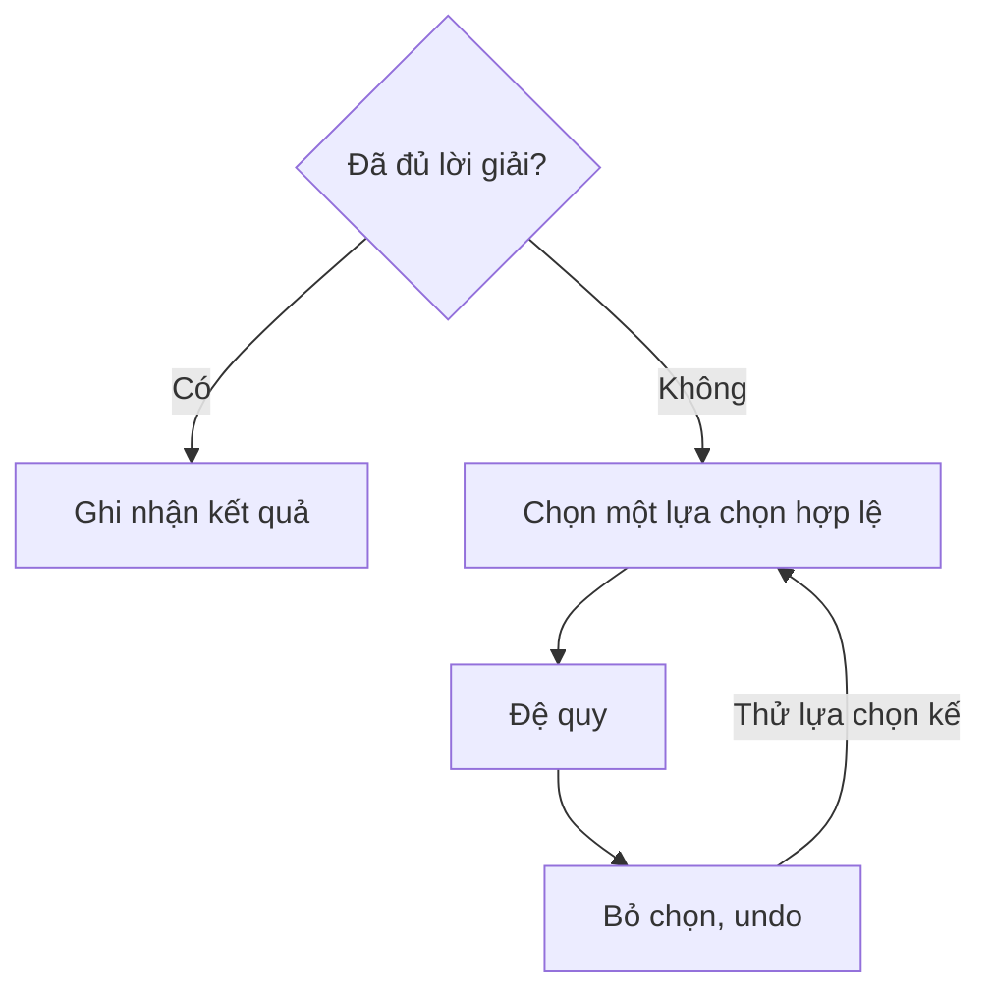
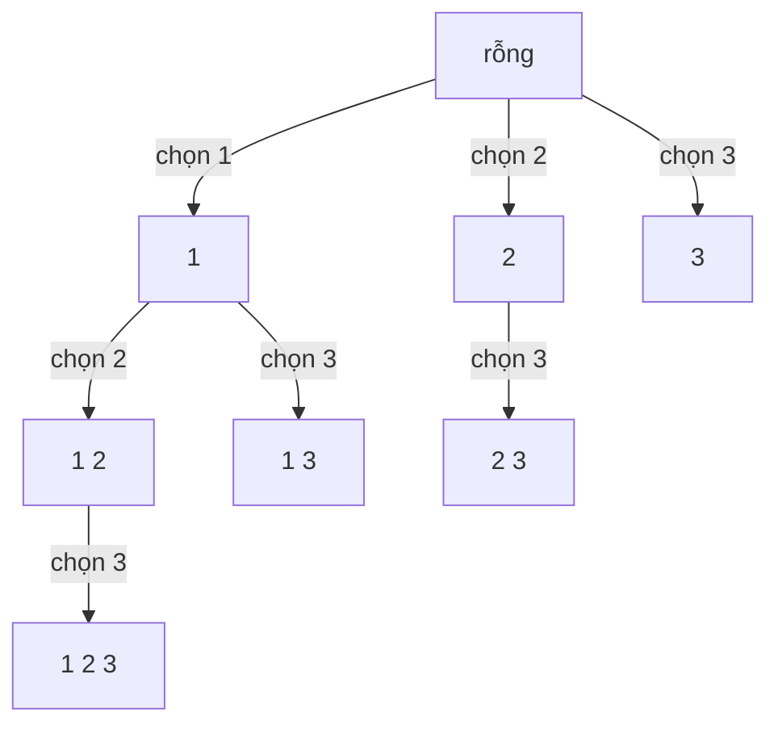
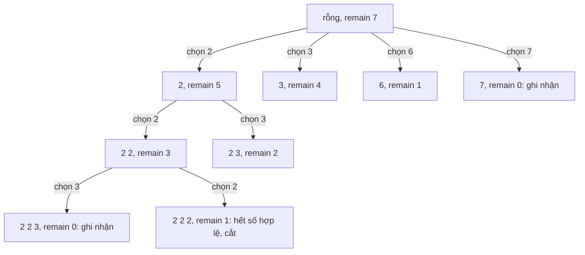
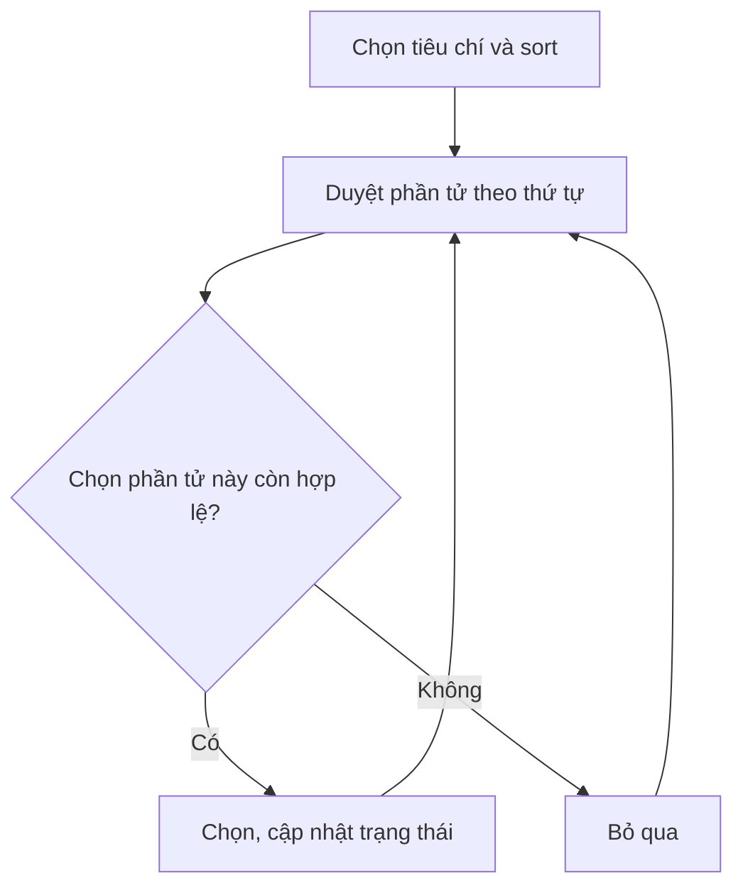
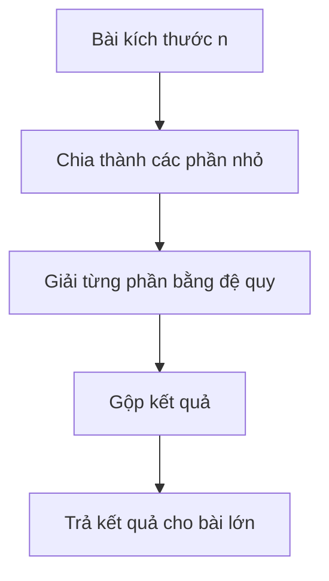
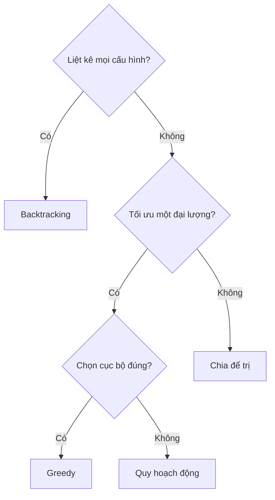

# Backtracking, Tham lam và Chia để trị

## Ba cách nghĩ khi không có công thức giải thẳng

Có những bài bạn không thể áp một công thức là xong. Khi đó có ba hướng tư duy quen thuộc. **Backtracking** là thử từng lựa chọn, đi vào ngõ cụt thì lùi lại và thử lựa chọn khác, giống người đi trong mê cung đánh dấu ngã rẽ để quay về. **Greedy** là mỗi bước chọn phương án tốt nhất tại thời điểm đó và không quay lại. **Chia để trị (divide and conquer)** là chia bài thành các phần độc lập, giải từng phần rồi gộp kết quả, như merge sort.

**Tóm tắt:**

- Backtracking liệt kê cấu hình bằng ba bước chọn, đệ quy, undo; sức mạnh nằm ở pruning sớm.
- Khi ghi kết quả phải copy danh sách hiện tại (`new ArrayList<>(cur)`), nếu không mọi kết quả cùng trỏ một object.
- Tập con và tổ hợp duyệt từ `start`, hoán vị dùng `used[]`, phần tử trùng thì sort rồi bỏ qua `i > start && a[i] == a[i-1]`.
- Greedy chỉ đúng khi có greedy choice property và cấu trúc con tối ưu; hãy thử tìm counterexample hoặc dùng exchange argument.
- Greedy sai kinh điển: đổi 6 với xu `{1, 3, 4}`; lịch họp thì chọn theo giờ kết thúc sớm nhất.
- Divide and conquer khác DP ở chỗ các bài con không chồng lấn, nên không có gì để memoize.
- Độ phức tạp theo master theorem `T(n) = a·T(n/b) + f(n)`; fast exponentiation chỉ gọi đệ quy một lần.

## Vấn đề: nhận ra đúng mô hình

Có bài buộc phải liệt kê mọi khả năng (hoán vị, sudoku), có bài chỉ cần chọn khéo từng bước (xếp lịch), có bài tự chia nhỏ được (merge sort). Nếu không nhận ra mô hình, bạn dễ viết brute force quá chậm, hoặc chọn greedy cho kết quả sai mà không hay biết, và đó là kiểu lỗi nguy hiểm vì code vẫn chạy và cho đáp án trông hợp lý.

## Khi nào dùng cái nào, khi nào không

Dùng backtracking cho hoán vị, tổ hợp, N-Queens, sudoku, tức những bài cần liệt kê hoặc tìm một cấu hình thỏa ràng buộc; không dùng khi chỉ cần giá trị tối ưu và các bài con lặp lại, lúc đó DP nhanh hơn rất nhiều. Dùng greedy cho lập lịch, nén dữ liệu, gộp khoảng; chỉ dùng khi chứng minh được chọn cục bộ vẫn dẫn đến tối ưu toàn cục, nếu không hãy chuyển sang quy hoạch động. Dùng chia để trị khi bài tự chia thành các phần độc lập giống nhau (merge sort, lũy thừa nhanh); không dùng khi các phần chồng lấn nhau, vì lúc đó bạn sẽ tính lặp.

Về cách làm: backtracking là chọn, đệ quy, bỏ chọn, và pruning sớm nhánh chắc chắn sai. Greedy là sort theo một tiêu chí rồi duyệt một lượt. Chia để trị là chia, giải đệ quy, gộp.

## Các khái niệm cần biết

- **Decision tree**: cây mà mỗi node là trạng thái hiện tại, mỗi cạnh là một lựa chọn. Backtracking chính là duyệt sâu cây này.
- **Pruning**: bỏ qua cả một nhánh khi biết chắc nó không dẫn tới đáp án. Quan trọng vì nó quyết định backtracking chạy được hay không.
- **Undo**: sau khi đệ quy xong, trả trạng thái (`cur`, `used`) về như trước khi chọn để lựa chọn kế tiếp bắt đầu sạch.
- **Greedy choice property**: tồn tại một lời giải tối ưu bắt đầu bằng lựa chọn greedy.
- **Exchange argument**: cách chứng minh greedy đúng bằng việc biến đổi một lời giải tối ưu bất kỳ để chứa lựa chọn greedy mà không xấu đi.
- **Counterexample**: một đầu vào nhỏ chứng minh chiến lược greedy sai. Luôn thử tìm trước khi tin.
- **Master theorem**: công thức để rút ra độ phức tạp của đệ quy dạng `T(n) = a·T(n/b) + f(n)`, trong đó `a` là số bài con, `n/b` là kích thước mỗi bài con, `f(n)` là chi phí chia và gộp.
- **Bitmask**: dùng các bit của một số nguyên để biểu diễn một tập con (bit `i` bật nghĩa là phần tử `i` được chọn), tiện khi `n` nhỏ.

## Backtracking

Vấn đề đặt ra là liệt kê mọi cấu hình hợp lệ mà không viết `n` vòng `for` lồng nhau (không biết trước `n`). Cách giải quyết là một hàm đệ quy lặp lại ba bước: chọn, đi sâu, undo. Hãy xem luồng của khuôn này.



```java
// Mọi tập con
void subsets(int[] a, int start, List<Integer> cur, List<List<Integer>> out) {
    out.add(new ArrayList<>(cur));
    for (int i = start; i < a.length; i++) {
        cur.add(a[i]);                     // chọn
        subsets(a, i + 1, cur, out);       // đệ quy
        cur.remove(cur.size() - 1);        // bỏ chọn
    }
}
```

| Bài | Điểm mấu chốt |
|---|---|
| Hoán vị | Mảng `used[]`; n! kết quả |
| Tổ hợp / tập con | Duyệt từ `start` để không lặp |
| Có phần tử trùng | Sort rồi bỏ qua giá trị trùng ở cùng tầng |
| N-Queens | Kiểm tra cột, hai đường chéo bằng tập |
| Tổng bằng target | **Pruning** khi tổng vượt quá |

Độ phức tạp thường O(số lời giải × độ dài); sức mạnh nằm ở **pruning** sớm các nhánh không thể dẫn tới đáp án.

**Phải thuộc:** Khuôn backtracking gồm ba bước: chọn, đệ quy, undo (bỏ chọn); khi ghi kết quả phải copy `new ArrayList<>(cur)`. Tập con và tổ hợp duyệt từ `start` để không lặp, hoán vị dùng mảng `used[]`, có phần tử trùng thì sort rồi bỏ qua `i > start && a[i] == a[i-1]`. Tập con là O(n · 2ⁿ), hoán vị là O(n · n!); sức mạnh nằm ở pruning sớm.

**Suy luận:** Backtracking dùng một cấu trúc `cur` chung duy nhất cho mọi nhánh, vì tạo bản sao ở mỗi bước sẽ tốn O(n) cho mỗi node của cây. Cái giá của việc chia sẻ là mỗi nhánh phải trả `cur` về đúng trạng thái trước khi chọn (undo), nếu không nhánh anh em kế tiếp bắt đầu từ trạng thái đã bị làm bẩn và sinh ra kết quả sai. Cũng vì `cur` được dùng chung và sửa liên tục, lúc ghi kết quả phải copy nó, nếu chỉ thêm tham chiếu thì cuối cùng mọi phần tử của `out` cùng trỏ vào một danh sách rỗng. Hai lỗi này dễ nhầm vì code vẫn chạy và không ném exception, chỉ ra kết quả lạ. Hệ quả khi review: kiểm tra mọi dòng "chọn" có một dòng "undo" đối xứng (kể cả `used[i]`), và mọi chỗ ghi kết quả có copy. Pruning phải đặt ở nơi sớm nhất có thể kết luận nhánh vô vọng, vì bỏ một node ở tầng nông loại cả cây con bên dưới.

## Bài giải mẫu: backtracking

### Tập con và decision tree

Với `a = [1, 2, 3]`, hàm `subsets` ở trên đi theo cây sau. Mỗi node là `cur` tại lúc vào hàm; mỗi cạnh là một lần `cur.add(a[i])` (chọn phần tử ở chỉ số `i >= start`):



Thứ tự `out.add` là thứ tự duyệt trước của cây (đã chạy): `[], [1], [1,2], [1,2,3], [1,3], [2], [2,3], [3]`. Có 2ⁿ node nên O(n · 2ⁿ) tính cả chi phí copy. Việc truyền `start = i + 1` là thứ ngăn sinh lặp (`[2,1]` không bao giờ xuất hiện).

### Hoán vị: mảng `used`

Hoán vị khác tập con ở chỗ thứ tự quan trọng nên mỗi tầng phải xét lại mọi phần tử chưa dùng:

```java
void perm(int[] a, boolean[] used, List<Integer> cur, List<List<Integer>> out) {
    if (cur.size() == a.length) { out.add(new ArrayList<>(cur)); return; }
    for (int i = 0; i < a.length; i++) {
        if (used[i]) continue;
        used[i] = true; cur.add(a[i]);                    // chọn
        perm(a, used, cur, out);
        cur.remove(cur.size() - 1); used[i] = false;      // undo đối xứng
    }
}
```

Nhánh đầu tiên của `[1, 2, 3]`:

| Bước | `cur` | `used` | Hành động |
|---|---|---|---|
| 1 | [1] | T F F | chọn 1 |
| 2 | [1,2] | T T F | chọn 2 |
| 3 | [1,2,3] | T T T | đủ độ dài, ghi kết quả |
| 4 | [1,2] | T T F | undo 3, không còn lựa chọn, lùi |
| 5 | [1] | T F F | undo 2, thử 3 |
| 6 | [1,3] | T F T | tiếp tục... |

Kết quả 6 hoán vị theo thứ tự `[1,2,3], [1,3,2], [2,1,3], [2,3,1], [3,1,2], [3,2,1]` (đã chạy). O(n · n!).

### Có phần tử trùng và pruning

Tập con của `[1, 2, 2]` mà không lặp: sort trước, rồi bỏ qua phần tử bằng phần tử đứng trước **trong cùng tầng**:

```java
void subsetsDup(int[] a, int start, List<Integer> cur, List<List<Integer>> out) {
    out.add(new ArrayList<>(cur));
    for (int i = start; i < a.length; i++) {
        if (i > start && a[i] == a[i - 1]) continue;       // trùng ở cùng tầng thì bỏ
        cur.add(a[i]);
        subsetsDup(a, i + 1, cur, out);
        cur.remove(cur.size() - 1);
    }
}
```

Ra `[], [1], [1,2], [1,2,2], [2], [2,2]` (đã chạy). Điều kiện là `i > start`, không phải `i > 0`: ở tầng sâu, chọn `2` thứ hai sau khi đã chọn `2` thứ nhất (đường `[1,2,2]`) vẫn hợp lệ vì chúng ở hai tầng khác nhau.

Pruning: tổ hợp tổng bằng `target` với số dùng lại được, mảng đã sort:

```java
void combSum(int[] a, int start, int remain, List<Integer> cur, List<List<Integer>> out) {
    if (remain == 0) { out.add(new ArrayList<>(cur)); return; }
    for (int i = start; i < a.length; i++) {
        // mảng tăng dần: các số sau càng lớn, cắt hết
        if (a[i] > remain) break;
        cur.add(a[i]);
        // truyền i (không phải i+1): cho dùng lại
        combSum(a, i, remain - a[i], cur, out);
        cur.remove(cur.size() - 1);
    }
}
```

Cây tìm kiếm cho `a = [2,3,6,7]`, `target = 7` (mỗi node ghi `cur` và `remain`; nhánh bị cắt ghi rõ):



Đọc sơ đồ: mỗi nhánh trừ dần `remain`; khi `remain == 0` thì ghi nhận, khi số kế tiếp lớn hơn `remain` thì `break` cắt luôn các số sau vì mảng đã sort. Sơ đồ chỉ vẽ một phần cây để dễ nhìn. Kết quả: `a = [2,3,6,7]`, `target = 7` ra `[[2,2,3],[7]]` (đã chạy). Dòng `break` vừa pruning vừa là điều kiện dừng: bỏ nó thì phải tự thêm `if (remain < 0) return;`, nếu không `remain` âm mãi và đệ quy không dừng; có thêm thì kết quả vẫn đúng nhưng đi vào nhiều nhánh vô vọng.

## Greedy

Mỗi bước chọn phương án tốt nhất hiện tại và không quay lại. Chỉ đúng khi bài có **tính chọn greedy** và cấu trúc con tối ưu. Hãy tưởng tượng bạn cần xếp được nhiều cuộc họp nhất vào một phòng: nếu luôn chọn cuộc kết thúc sớm nhất, bạn chừa nhiều thời gian nhất cho các cuộc sau. Nhưng với bài đổi tiền hệ `{1, 3, 4}`, "chọn xu to nhất" lại cho kết quả tệ hơn, nên mỗi bài phải kiểm chứng riêng.



Điểm khác với backtracking: không có bước undo, mỗi quyết định là cuối cùng, nên chi phí thường chỉ là chi phí sort O(n log n).

**Nền tảng:** Greedy chỉ đúng khi bài có tính chọn greedy (có lời giải tối ưu bắt đầu bằng lựa chọn greedy) và cấu trúc con tối ưu. Vì vậy phải chứng minh bằng exchange argument hoặc ít nhất tìm counterexample trước khi tin. Ví dụ greedy sai: đổi 6 với xu `{1, 3, 4}` cho 3 xu trong khi tối ưu là 2 xu (`3 + 3`), nên bài đó dùng DP.

| Bài | Cách chọn |
|---|---|
| Lịch họp nhiều nhất không chồng | Sort theo giờ **kết thúc**, chọn cái kế không chồng |
| Nhảy trên mảng (jump game) | Theo dõi vị trí xa nhất có thể tới |
| Gộp khoảng | Sort theo đầu mút, gộp khi chồng nhau |
| Mã Huffman | Luôn gộp hai nút tần suất nhỏ nhất (heap) |
| Đổi tiền | Chỉ đúng với một số hệ tiền; nói chung cần DP |

**Suy luận:** Greedy không quay lại nên nó chỉ đúng nếu mọi lựa chọn cục bộ đều "an toàn", tức tồn tại một lời giải tối ưu chứa lựa chọn đó. Với lịch họp, chọn cuộc kết thúc sớm nhất là an toàn vì nếu lời giải tối ưu bắt đầu bằng cuộc khác, ta thay nó bằng cuộc kết thúc sớm hơn mà không đụng cuộc nào phía sau, nên số cuộc không giảm. Đó chính là exchange argument, và nó chỉ đi được khi việc thay thế không làm hỏng phần còn lại. Với đổi tiền `{1, 3, 4}` phép thay thế này thất bại: lấy xu 4 trước làm hỏng cách chia phần còn lại, nên greedy sai và phải dùng DP để xét mọi khả năng. Điểm dễ nhầm là tiêu chí trông hợp lý (giờ bắt đầu sớm nhất, cuộc ngắn nhất) nhưng đều có counterexample nhỏ, và code greedy sai vẫn cho đáp án nghe có lý. Khi gặp bài tối ưu, hãy tự thử một tiêu chí với 3 đến 4 phần tử trước khi cài đặt.

Cách chứng minh: **exchange argument**: mọi lời giải tối ưu có thể biến đổi để chứa lựa chọn greedy mà không xấu đi. Nếu không chứng minh được, nghi ngờ và kiểm tra bằng counterexample nhỏ.

## Chia để trị

Chia bài thành các phần độc lập, giải, rồi gộp. Độ phức tạp tính bằng master theorem: `T(n) = a·T(n/b) + f(n)`. Điểm khác với DP là các phần **không chồng lấn**, nên không có gì để memoize.



- Merge sort: `T(n) = 2T(n/2) + O(n)` → O(n log n).
- Binary search: `T(n) = T(n/2) + O(1)` → O(log n).
- Lũy thừa nhanh: `x^n` trong O(log n).
- Đếm nghịch thế bằng merge sort.

**Phải thuộc:** Chia để trị khác DP ở chỗ các bài con không chồng lấn nên không có gì để memoize. Độ phức tạp theo master theorem `T(n) = a·T(n/b) + f(n)`: merge sort `2T(n/2) + O(n)` là O(n log n), binary search `T(n/2) + O(1)` là O(log n). Lũy thừa nhanh chỉ gọi đệ quy **một** lần rồi bình phương mới đạt O(log n). Bài chọn nhiều cuộc họp nhất: sort theo giờ kết thúc.

## Bài giải mẫu: greedy và chia để trị

### Chọn nhiều cuộc họp nhất

Hướng nghĩ: brute force mọi tập con là 2ⁿ. Greedy: luôn chọn cuộc họp **kết thúc sớm nhất** trong số còn lại không chồng, vì nó chừa nhiều chỗ nhất cho phần sau (exchange argument: thay cuộc họp đầu của một lời giải tối ưu bằng cuộc kết thúc sớm nhất không làm xấu đi).

```java
// m[i] = {bắt đầu, kết thúc}
int maxMeetings(int[][] m) {
    Arrays.sort(m, (x, y) -> Integer.compare(x[1], y[1]));  // theo giờ kết thúc
    int cnt = 0, end = Integer.MIN_VALUE;
    for (int[] t : m) if (t[0] >= end) { cnt++; end = t[1]; }
    return cnt;
}
```

Với `{1,4} {3,5} {0,6} {5,7} {3,9} {5,9} {6,10} {8,11}` (đã sắp theo giờ kết thúc sẵn):

| Cuộc họp | `end` hiện tại | Quyết định |
|---|---|---|
| (1,4) | -∞ | chọn, `end = 4` |
| (3,5) | 4 | bỏ (3 < 4) |
| (0,6) | 4 | bỏ |
| (5,7) | 4 | chọn, `end = 7` |
| (3,9), (5,9), (6,10) | 7 | bỏ hết |
| (8,11) | 7 | chọn, `end = 11` |

Đáp án 3 (đã chạy). Counterexample cho các tiêu chí sai: sắp theo giờ **bắt đầu** sớm nhất thất bại với `(0,100), (1,2), (3,4)`: chọn `(0,100)` được 1, tối ưu là 2. Sắp theo **độ dài** ngắn nhất cũng sai với `(1,5), (4,7), (6,10)`: `(4,7)` ngắn nhất nhưng chồng cả hai cuộc còn lại nên chỉ được 1, tối ưu là `(1,5)` và `(6,10)`, được 2. Dùng `>=` hay `>` phụ thuộc đề cho phép cuộc họp nối đuôi nhau (kết thúc 5, bắt đầu 5) hay không.

### Gộp khoảng

```java
int[][] merge(int[][] iv) {
    Arrays.sort(iv, (x, y) -> Integer.compare(x[0], y[0]));   // theo đầu mút trái
    List<int[]> res = new ArrayList<>();
    for (int[] cur : iv) {
        // rời nhau
        if (res.isEmpty() || res.get(res.size() - 1)[1] < cur[0]) res.add(cur);
        else res.get(res.size() - 1)[1] = Math.max(res.get(res.size() - 1)[1], cur[1]);
    }
    return res.toArray(new int[0][]);
}
```

`[[1,3],[8,10],[2,6],[15,18],[6,7]]` ra `[[1,7],[8,10],[15,18]]` (đã chạy): sau sort `[1,3],[2,6],[6,7],[8,10],[15,18]`; `[2,6]` chồng `[1,3]` thành `[1,6]`; `[6,7]` chạm `[1,6]` (6 < 6 sai) nên gộp thành `[1,7]`. Bẫy: dùng `max` cho đầu mút phải vì khoảng sau có thể nằm trọn bên trong khoảng trước (`[1,10]` và `[2,3]`); hàm này sửa phần tử của đầu vào.

### Greedy sai: đổi tiền hệ `{1, 3, 4}`

Đổi 6: greedy lấy 4, rồi 1, 1: 3 xu. Tối ưu `3 + 3`: 2 xu. Đây là lý do bài đổi tiền tổng quát dùng DP (xem [Quy hoạch động](/go?p=05-Algorithms%2Fhard%2Flt-07-quy-hoach-dong.md)). Jump game (`[2,3,1,1,4]` được, `[3,2,1,0,4]` không) thì greedy đúng: duy trì `far`, nếu `i > far` thì kẹt (đã chạy: `true`, `false`).

### Chia để trị: lũy thừa nhanh

`x^n = (x^(n/2))²`, nhân thêm `x` nếu `n` lẻ; `T(n) = T(n/2) + O(1)` nên O(log n).

```java
double pow(double x, long n) {
    // dùng long để -n không tràn khi n = Integer.MIN_VALUE
    if (n < 0) return 1 / pow(x, -n);
    if (n == 0) return 1;
    double h = pow(x, n / 2);                  // chỉ gọi MỘT lần rồi bình phương
    return n % 2 == 0 ? h * h : h * h * x;
}
```

`pow(2, 10)` là `1024.0`, `pow(2, -2)` là `0.25` (đã chạy). Bẫy: viết `pow(x, n/2) * pow(x, n/2)` gọi hai lần làm cây đệ quy trở về O(n).

Luyện tập: [bộ bài tập thuật toán](/go?p=00-Roadmap%2Fbai-tap-thuat-toan.md).

## Chọn mô hình



## Điều cần nhớ

- Nhớ **copy** danh sách hiện tại khi ghi kết quả (`new ArrayList<>(cur)`), nếu không mọi kết quả cùng trỏ một object.
- Backtracking luôn có bước undo trạng thái đối xứng với bước chọn.
- Greedy sai rất hay gặp: luôn tìm counterexample trước khi tin.
- Nếu n nhỏ (≤ 20) thì brute force với bitmask là lựa chọn hợp lý.

