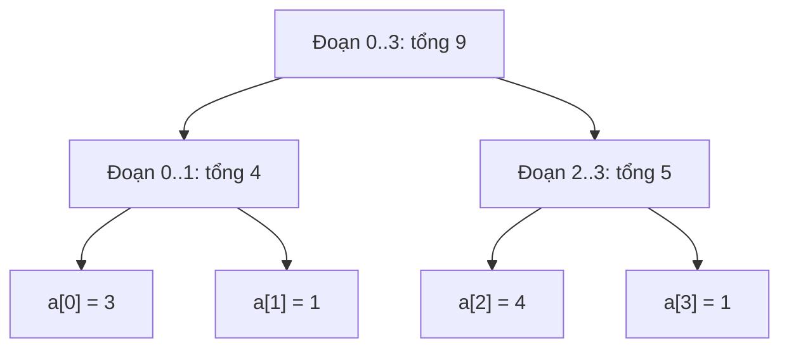
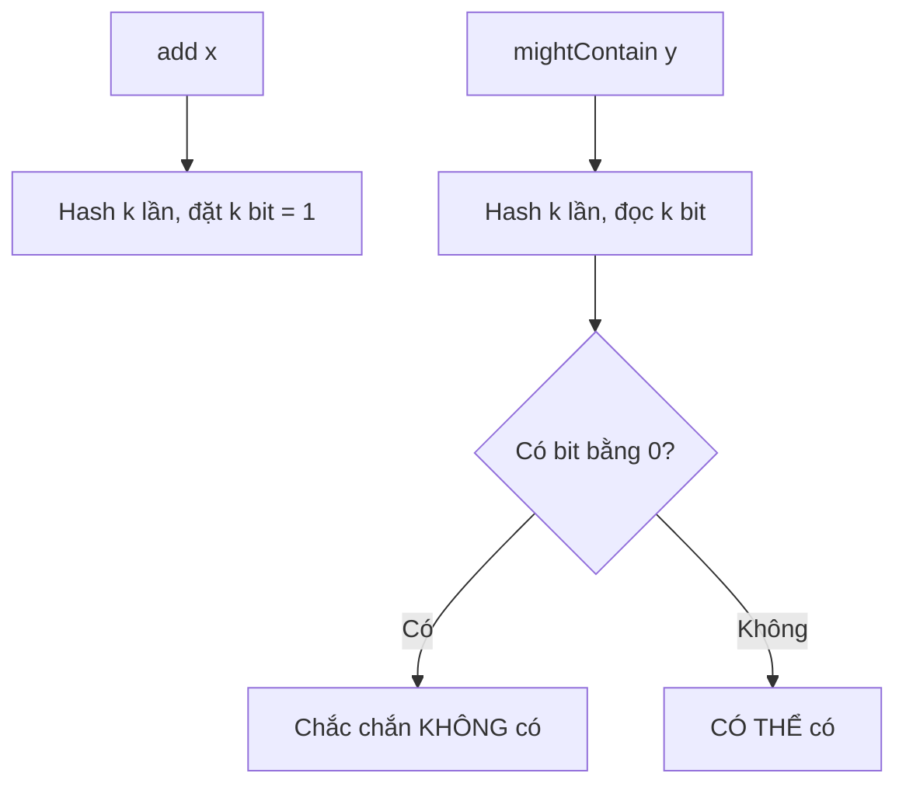
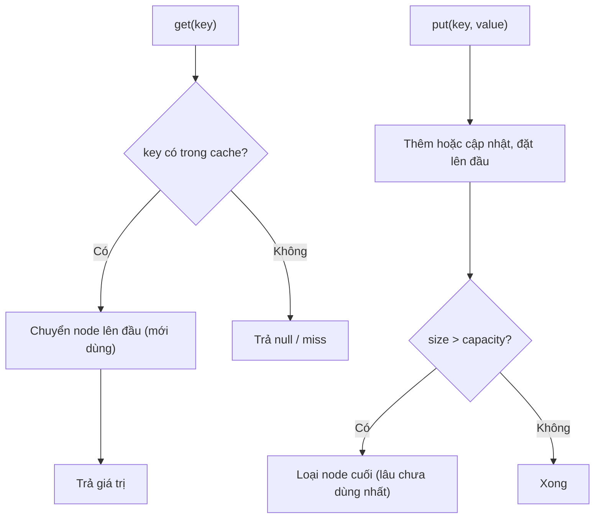

# Cấu trúc dữ liệu nâng cao và thuật toán xâu

## Khi mảng và hash map không đủ

Mảng và hash map giải được phần lớn bài, nhưng có những tình huống chúng lộ giới hạn. Bài này giới thiệu bộ đồ nghề cho các tình huống đó: segment tree và Fenwick tree (truy vấn đoạn có cập nhật), Bloom filter (kiểm tra tồn tại tiết kiệm memory), LRU và LFU cache (cache có giới hạn), KMP và Rabin-Karp (tìm chuỗi con), thao tác bit và lấy mẫu từ stream.

**Tóm tắt:**

- Dữ liệu không đổi thì prefix sum hoặc sparse table là đủ; có cập nhật điểm thì dùng Fenwick hoặc segment tree, đều O(log n).
- Fenwick dựa trên `i & -i` (bit 1 thấp nhất) để đi lên và đi xuống; cần chỉ số 1-based và cộng delta, không phải giá trị mới.
- Cập nhật cả đoạn trong segment tree cần lazy propagation.
- Bloom filter có thể false positive nhưng không bao giờ false negative, và không xóa được (trừ bản có bộ đếm).
- LRU cache là hash map cộng danh sách liên kết đôi, `get` và `put` O(1); `LinkedHashMap` với `accessOrder = true` không thread-safe.
- KMP tìm chuỗi O(n + m) nhờ bảng prefix cũng là suffix; Rabin-Karp dùng rolling hash, trung bình O(n + m).
- XOR cả mảng triệt tiêu các cặp; bitmask chỉ dùng khi n khoảng 20 trở xuống.
- Reservoir sampling chọn đều từ stream độ dài chưa biết với memory O(1).

## Mỗi cấu trúc giải một "cơn đau" riêng

Giả sử bạn phải liên tục trả lời "tổng của đoạn từ `l` đến `r`" và xen kẽ đổi giá trị một phần tử. Cộng lại cả đoạn mỗi lần là O(n), với hàng trăm nghìn truy vấn thì tổng thể quá chậm. Mảng prefix sum trả lời được tức thì nhưng mỗi lần cập nhật phải dựng lại O(n). Segment tree và Fenwick cân bằng hai việc này ở O(log n).

Một ví dụ khác: có hàng tỷ key và bạn muốn biết "đã thấy key này chưa". Lưu hết vào hash set thì không đủ RAM. Bloom filter chấp nhận đổi một chút độ chính xác để dùng memory nhỏ hơn rất nhiều.

## Khi nào dùng, khi nào không

Truy vấn tổng hoặc min trên đoạn có cập nhật thì dùng segment tree hoặc Fenwick; nếu dữ liệu **không đổi** thì prefix sum (hoặc sparse table) là đủ, đừng dùng đồ nặng. Cần kiểm tra "có thể đã tồn tại" với ít memory và chấp nhận báo nhầm thì dùng Bloom filter; không dùng khi báo nhầm gây hậu quả nghiêm trọng hoặc cần xóa. Cache có giới hạn thì LRU hoặc LFU. Tìm chuỗi con trong văn bản dài thì KMP hoặc Rabin-Karp; với chuỗi ngắn, `String.indexOf` có sẵn là đủ.

Cách nhớ: mỗi cấu trúc ứng với một bài và một độ phức tạp, ví dụ segment tree và Fenwick cùng O(log n) cho mỗi truy vấn và cập nhật. Bloom filter có thể báo nhầm "có" nhưng không bao giờ báo nhầm "không".

## Các khái niệm cần biết

- **Range query**: câu hỏi về một đoạn liên tiếp của mảng, như tổng, min, max.
- **Point update**: đổi giá trị của một phần tử. Ngược lại, cập nhật đoạn đổi cả một khoảng, và cần lazy propagation.
- **Lazy propagation**: kỹ thuật trong segment tree, ghi "việc cần làm" lên node cha và chỉ đẩy xuống node con khi thực sự cần, để cập nhật cả đoạn vẫn O(log n).
- **False positive và false negative**: false positive là báo "có" khi thực tế không có; false negative là báo "không" khi thực tế có. Bloom filter có false positive nhưng không có false negative.
- **Hash function**: biến dữ liệu thành một số nguyên; cùng đầu vào luôn ra cùng số. Hai đầu vào khác nhau có thể trùng số (va chạm).
- **Rolling hash**: cách tính hash của window kế tiếp từ hash của window hiện tại trong O(1), dùng trong Rabin-Karp.
- **Prefix và suffix**: phần đầu và phần cuối của chuỗi. "Proper prefix" là prefix ngắn hơn cả chuỗi.
- **LRU (least recently used)**: khi đầy, loại phần tử **lâu nhất chưa được dùng**. **LFU (least frequently used)**: loại phần tử **được dùng ít lần nhất**.
- **XOR (`^`)**: phép toán bit cho kết quả 1 khi hai bit khác nhau. Có tính chất `a ^ a = 0` và `a ^ 0 = a`, nên XOR cả mảng triệt tiêu các phần tử xuất hiện hai lần.
- **Bitmask**: dùng các bit của một số nguyên để biểu diễn một tập con.
- **Reservoir sampling**: chọn ngẫu nhiên đều từ stream chưa biết độ dài.

## Truy vấn đoạn

| Cấu trúc | Truy vấn đoạn | Cập nhật điểm | Ghi chú |
|---|---|---|---|
| Prefix sum | O(1) | O(n) | Chỉ khi dữ liệu không đổi |
| **Fenwick (BIT)** | O(log n) | O(log n) | Gọn, dùng cho tổng; ít code |
| **Segment tree** | O(log n) | O(log n) | Tổng, min, max, gcd; cập nhật cả đoạn với lazy propagation |
| Sparse table | O(1) | không | Min/max tĩnh, tiền xử lý O(n log n) |

**Phải thuộc:** Truy vấn đoạn: dữ liệu không đổi thì dùng prefix sum (truy vấn O(1)) hoặc sparse table cho min/max; có cập nhật điểm thì dùng Fenwick (BIT) hoặc segment tree, đều O(log n) cho mỗi truy vấn và cập nhật; cập nhật cả đoạn cần lazy propagation. Fenwick dùng `i & -i` (bit 1 thấp nhất) để đi lên và đi xuống.

Segment tree: mỗi node giữ kết quả của một đoạn; truy vấn ghép O(log n) node. Dùng khi cần "cập nhật một phần tử, hỏi tổng/min đoạn" nhiều lần. Ví dụ với `a = [3, 1, 4, 1]` và phép tổng:



Đọc sơ đồ: lá là phần tử gốc, node cha là tổng của hai con. Hỏi tổng đoạn `1..2` thì ghép `a[1]` và `a[2]` (hai lá, không cần cả node lớn). Đổi `a[2]` thì chỉ sửa lá đó và các node tổ tiên trên đường lên gốc, tức O(log n) node. Segment tree nhiều code hơn Fenwick nhưng làm được nhiều phép hơn (min, max, gcd) và cập nhật cả đoạn.

## Bloom filter



Nhánh "CÓ THỂ có" nghĩa là có xác suất false positive (các bit đã bị phần tử khác bật).

Cách hoạt động: Bloom filter là một mảng bit ban đầu toàn 0 cùng `k` hash function. Thêm phần tử thì bật `k` bit mà các hash function chỉ tới. Hỏi một phần tử thì xem `k` bit đó: chỉ cần một bit bằng 0 là chắc chắn chưa từng thêm; nếu cả `k` bit đều bằng 1 thì có thể đã thêm, nhưng cũng có thể các bit đó do phần tử khác bật. Càng thêm nhiều, càng nhiều bit bằng 1 và tỷ lệ báo nhầm càng tăng.

**Nền tảng:** Bloom filter đổi độ chính xác lấy memory: nó có thể báo nhầm "có" (false positive) nhưng không bao giờ báo nhầm "không" (không có false negative), và không xóa được phần tử (trừ bản có bộ đếm). Vì vậy nó dùng làm filter chặn các key chắc chắn không tồn tại trước khi đụng DB hoặc cache.

Tiết kiệm memory, không có false negative, không xóa được (bản đếm thì xóa được). Dùng để chặn truy vấn key không tồn tại trước khi đụng DB/cache (liên hệ [Caching](/go?p=15-System%20Design%2Feasy%2Flt-03-caching-cdn.md)), web crawler, kiểm tra tên người dùng.

**Suy luận:** Bloom filter chỉ lưu bit chứ không lưu phần tử, nên nó nhỏ, nhưng chính điều đó quyết định mọi tính chất của nó. Khi thêm, `k` bit bị bật và không bao giờ bị tắt, nên một phần tử đã thêm luôn thấy đủ `k` bit bằng 1, do đó không thể có false negative. Ngược lại, các bit đó có thể do nhiều phần tử khác bật chung, nên "đủ k bit bằng 1" không chứng minh được phần tử đã thêm, đó là false positive, và tỷ lệ này tăng dần khi mảng bit đầy lên. Việc xóa cũng bất khả thi vì tắt một bit có thể làm hỏng các phần tử khác dùng chung bit đó, gây ra đúng loại false negative mà cấu trúc cam kết không có. Điểm dễ nhầm là coi câu trả lời "có" là chắc chắn: chỉ câu trả lời "không" mới chắc chắn. Vì vậy dùng nó như bộ chặn phía trước (nếu nói không thì khỏi gọi DB), còn nếu nói có thì vẫn phải kiểm tra thật, và chọn `m`, `k` theo số phần tử và tỷ lệ sai chấp nhận được.

## LRU và LFU cache

Cache có dung lượng giới hạn nên khi đầy phải quyết định loại ai. Vấn đề là chọn chính sách sao cho phần tử hay dùng ở lại. Hai chính sách phổ biến:

- **LRU:** hash map + danh sách liên kết đôi, `get`/`put` O(1). Hash map giúp tìm node nhanh, danh sách giúp chuyển node lên đầu và bỏ node cuối trong O(1). Java: `LinkedHashMap` với `accessOrder = true` và ghi đè `removeEldestEntry`. Hợp khi cái vừa dùng nhiều khả năng sẽ được dùng lại (tính cục bộ theo thời gian).
- **LFU:** theo dõi tần suất; cài O(1) bằng hai hash map và danh sách theo nhóm tần suất. Cache có tính "nóng lâu dài" hợp LFU hơn. Nhược điểm: phần tử từng rất hot trong quá khứ có thể chiếm chỗ lâu dù không còn được dùng.

**Phải thuộc:** LRU cache là hash map cộng danh sách liên kết đôi, `get` và `put` đều O(1); khi đầy thì loại phần tử lâu nhất chưa dùng. Trong Java: `LinkedHashMap` với `accessOrder = true` và ghi đè `removeEldestEntry`; class này không thread-safe. LFU loại phần tử được dùng ít lần nhất.



## Tìm chuỗi

Bài toán: tìm vị trí của chuỗi mẫu `p` (độ dài `m`) trong văn bản `s` (độ dài `n`). Cách ngây thơ khi so khớp sai thì lùi pointer văn bản và thử lại từ vị trí kế, nên xấu nhất O(n·m). KMP tránh lùi bằng cách dùng thông tin đã biết về mẫu; Rabin-Karp tránh so từng ký tự bằng cách so hash trước.

| Thuật toán | Ý tưởng | Độ phức tạp |
|---|---|---|
| Ngây thơ | So từng vị trí | O(n·m) |
| **KMP** | Bảng "prefix cũng là suffix" để không lùi pointer văn bản | O(n + m) |
| **Rabin-Karp** | Rolling hash trên window, so khi hash trùng | O(n + m) trung bình |
| Z, suffix array | Tiền xử lý để trả lời nhiều truy vấn | |

**Suy luận:** KMP nhanh vì khi so khớp sai ở vị trí `k`, ta đã biết `k` ký tự cuối của văn bản trùng với `p[0..k)`, nên phần cần giữ lại chính là phần dài nhất của đoạn đó vừa là prefix vừa là suffix của `p`. Mọi vị trí bắt đầu ngắn hơn thế đều không thể khớp (vì suffix dài hơn bị loại) nên có thể bỏ qua mà không bỏ sót đáp án, và con trỏ trong văn bản không phải lùi. Mỗi bước `k` tăng tối đa 1 còn mỗi lần lùi theo bảng chỉ trừ vào phần đã tăng, nên tổng số bước là O(n + m) dù có vòng `while` bên trong. Điểm dễ nhầm là đếm theo "vòng while nhân vòng for" rồi kết luận O(n·m), giống phép amortized của monotonic stack. Rabin-Karp thì ngược lại: trung bình nhanh nhưng xấu nhất vẫn O(n·m) khi hash va chạm liên tục, nên phải so lại chuỗi thật khi hash trùng. Với chuỗi ngắn hoặc dùng một lần, `String.indexOf` là đủ.

## Thao tác bit

```java
// xóa bit 1 thấp nhất; x == 0 hoặc là lũy thừa của 2 nếu kết quả bằng 0
x & (x - 1)
x & -x             // lấy bit 1 thấp nhất
a ^ a == 0         // XOR: tìm phần tử xuất hiện một lần trong mảng các cặp
Integer.bitCount(x)
```

Giải thích ba dòng đầu: `x & (x - 1)` tắt bit 1 thấp nhất, nên lặp lại đến khi bằng 0 đếm được số bit 1; `x & -x` giữ lại đúng bit 1 thấp nhất (dùng trong Fenwick tree bên dưới); XOR toàn mảng trong đó mọi số xuất hiện hai lần trừ một số cho ra đúng số lẻ đó, với O(1) memory.

**Phải thuộc:** Thao tác bit hay dùng: `x & (x - 1)` xóa bit 1 thấp nhất (bằng 0 thì `x` là 0 hoặc lũy thừa của 2); `x & -x` lấy bit 1 thấp nhất; XOR có `a ^ a = 0` và `a ^ 0 = a` nên XOR cả mảng cho ra phần tử xuất hiện một lần trong mảng các cặp. Bitmask duyệt `mask` từ 0 đến `2^n - 1`, chỉ dùng khi `n` khoảng 20 trở xuống. KMP là O(n + m) nhờ bảng prefix cũng là suffix.

Bitmask biểu diễn tập con của tập ≤ 20 phần tử: duyệt `mask` từ 0 tới `2^n - 1`. Ví dụ `mask = 5` (nhị phân `101`) là tập gồm phần tử 0 và 2. Với `n` lớn hơn khoảng 20 thì 2ⁿ quá lớn, không nên dùng.

## Lấy mẫu từ stream

**Reservoir sampling:** chọn ngẫu nhiên đều một phần tử từ stream độ dài chưa biết: phần tử thứ `i` thay thế lựa chọn hiện tại với xác suất `1/i`. Memory O(1).

## Bài giải mẫu có trace

### Fenwick tree (BIT)

Ý tưởng: `t[i]` (đánh chỉ số từ 1) giữ tổng của `lowbit(i) = i & -i` phần tử kết thúc tại `i`. Truy vấn prefix đi xuống bằng cách trừ bit thấp nhất, cập nhật đi lên bằng cách cộng bit thấp nhất, mỗi chiều tối đa log n bước.

```java
class Fenwick {
    private final long[] t;
    Fenwick(int n) { t = new long[n + 1]; }
    // i tính từ 0
    void add(int i, long delta) { for (i++; i < t.length; i += i & -i) t[i] += delta; }
    // tổng a[0..i]
    long prefix(int i) { long s = 0; for (i++; i > 0; i -= i & -i) s += t[i]; return s; }
    long range(int l, int r) { return prefix(r) - (l > 0 ? prefix(l - 1) : 0); }
}
```

Mảng `a = [3, 1, 4, 1, 5]` (đã chạy):

| Chỉ số 1-based `i` | 1 | 2 | 3 | 4 | 5 |
|---|---|---|---|---|---|
| `t[i]` phủ đoạn | [1] | [1..2] | [3] | [1..4] | [5] |
| Giá trị `t[i]` | 3 | 4 | 4 | 9 | 5 |

`range(1, 3)` (tức `1 + 4 + 1`) = `prefix(3) - prefix(0)`; `prefix(3)` đọc `t[4] = 9`, `prefix(0)` đọc `t[1] = 3`, kết quả 6; `range(0, 4)` = 14. Sau `add(2, 6)` (đổi `a[2]` từ 4 thành 10), cập nhật đi `i = 3 → 4` sửa `t[3]` thành 10 và `t[4]` thành 15; khi đó `range(1, 3) = 12`, `range(0, 4) = 20`. Bẫy: chỉ số 0 làm vòng lặp `i += i & -i` đứng yên mãi, vì thế phải đổi sang 1-based (`i++` ở đầu). `add` cộng **độ lệch** (delta), không phải giá trị mới.

### KMP: bảng prefix cũng là suffix

`f[i]` = độ dài lớn nhất của proper prefix của `p[0..i]` đồng thời là suffix của nó. Khi so khớp sai ở vị trí `k`, ta không lùi pointer văn bản mà nhảy `k` về `f[k - 1]`.

```java
int[] failure(String p) {
    int[] f = new int[p.length()];
    for (int i = 1, k = 0; i < p.length(); i++) {
        while (k > 0 && p.charAt(i) != p.charAt(k)) k = f[k - 1];   // lùi theo bảng
        if (p.charAt(i) == p.charAt(k)) k++;
        f[i] = k;
    }
    return f;
}
// vị trí đầu tiên, hoặc -1
int kmp(String s, String p) {
    if (p.isEmpty()) return 0;
    int[] f = failure(p);
    for (int i = 0, k = 0; i < s.length(); i++) {
        while (k > 0 && s.charAt(i) != p.charAt(k)) k = f[k - 1];
        if (s.charAt(i) == p.charAt(k)) k++;
        if (k == p.length()) return i - k + 1;
    }
    return -1;
}
```

Bảng cho `p = "abcaby"` (đã chạy):

| i | 0 | 1 | 2 | 3 | 4 | 5 |
|---|---|---|---|---|---|---|
| p[i] | a | b | c | a | b | y |
| f[i] | 0 | 0 | 0 | 1 | 2 | 0 |

Ví dụ `f[4] = 2`: `"abcab"` có prefix `"ab"` trùng suffix `"ab"`. Tại `i = 5` ký tự `y` khác `c`, `k` nhảy từ 2 về `f[1] = 0` rồi thử lại, không cần so lại từ đầu. `kmp("abxabcabcaby", "abcaby")` trả 6 (đã chạy). Mỗi bước `k` tăng tối đa 1 và các bước lùi chỉ trừ vào phần đã tăng nên tổng O(n + m).

### LRU cache bằng `LinkedHashMap`

```java
class LRU<K, V> extends LinkedHashMap<K, V> {
    private final int cap;
    // true: thứ tự theo lần truy cập
    LRU(int cap) { super(16, 0.75f, true); this.cap = cap; }
    @Override protected boolean removeEldestEntry(Map.Entry<K, V> e) { return size() > cap; }
}
```

Trace dung lượng 2 (đã chạy): `put(1)`, `put(2)` cho thứ tự `[1, 2]`; `get(1)` chuyển 1 về cuối (mới dùng) thành `[2, 1]`; `put(3)` làm `size = 3 > 2` nên loại phần tử cũ nhất là 2, còn `[1, 3]`. Lớp này **không thread-safe**; dùng đồng thời phải bọc `Collections.synchronizedMap` hoặc dùng thư viện như Caffeine.

### Bloom filter tối giản

```java
class Bloom {
    private final BitSet bits; private final int m, k;
    Bloom(int m, int k) { bits = new BitSet(m); this.m = m; this.k = k; }
    // double hashing: h1 + i*h2
    private int h(String s, int i) {
        int h1 = s.hashCode(), h2 = (h1 >>> 16) | 1;
        return Math.floorMod(h1 + i * h2, m);
    }
    void add(String s) { for (int i = 0; i < k; i++) bits.set(h(s, i)); }
    boolean mightContain(String s) {
        for (int i = 0; i < k; i++) if (!bits.get(h(s, i))) return false;
        return true;
    }
}
```

Thử với `m = 1000` bit, `k = 3`, thêm 100 chuỗi `"user0".."user99"`: cả 100 đều trả `true` (không false negative), và trong 1000 chuỗi chưa thêm (`"user100".."user1099"`) có 26 chuỗi bị báo nhầm là "có" (đã chạy, khoảng 2,6%). Công thức xấp xỉ `(1 - e^(-kn/m))^k` cho khoảng 1,7%; chênh lệch do hash function đơn giản ở trên kém đều. Thực tế dùng hash function tốt (Murmur, hoặc `BloomFilter` của Guava) và chọn `m`, `k` theo `n` và tỷ lệ sai mong muốn.

Luyện tập: [bộ bài tập thuật toán](/go?p=00-Roadmap%2Fbai-tap-thuat-toan.md).

## Khung cuối cùng cho bài lạ

Thứ tự: làm rõ ràng buộc và ví dụ nhỏ; viết lời giải brute force đúng và nêu độ phức tạp; tìm phần lặp lại hoặc dư thừa; chọn mẫu (hash, hai pointer, heap, đồ thị, DP, binary search...); kiểm thử trường hợp biên, đối chiếu với brute force.

## Điều cần nhớ

- Bloom filter đổi độ chính xác lấy memory: tỷ lệ false positive điều chỉnh bằng số bit và số hash function.
- Truy vấn đoạn tĩnh dùng prefix/sparse table; có cập nhật mới cần Fenwick/segment tree.
- Nhớ các "mẫu số bài": nếu một bài có vẻ mới, thường là tổ hợp của hai mẫu quen thuộc.

