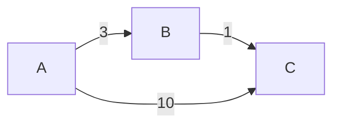
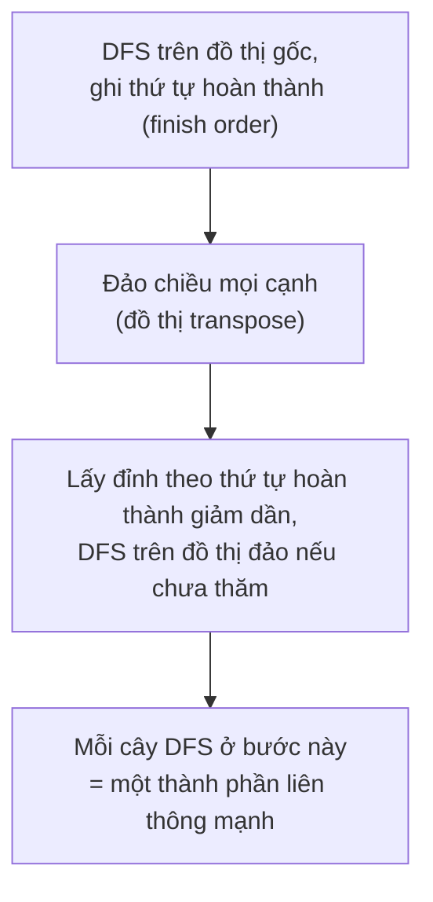

# Đồ thị nâng cao: Floyd-Warshall, Bellman-Ford và thành phần liên thông mạnh

Bài Đồ thị đã liệt kê Bellman-Ford và Floyd-Warshall trong một bảng so sánh thuật toán đường đi ngắn nhất, nhưng chỉ dừng ở tên gọi và độ phức tạp. Bài này cài đặt cả hai, thêm thuật toán tìm **thành phần liên thông mạnh** (strongly connected component, SCC) cho đồ thị có hướng — thứ Dijkstra hay BFS/DFS thường không trả lời được — và một kiểm tra nhanh đồ thị có phải hai phía (bipartite) hay không.

**Tóm tắt:**

- Floyd-Warshall tính khoảng cách ngắn nhất giữa **mọi cặp đỉnh** cùng lúc bằng quy hoạch động ba tầng, O(V³), hợp khi V nhỏ (vài trăm đỉnh).
- Bellman-Ford chịu được cạnh âm và relax tất cả cạnh `V - 1` lần; relax thêm một lần nữa mà vẫn còn cải thiện thì đồ thị có **vòng âm**.
- Floyd-Warshall cũng phát hiện vòng âm: sau khi chạy xong, nếu `dist[v][v] < 0` với đỉnh `v` nào đó thì có vòng âm đi qua `v`.
- Thành phần liên thông mạnh là tập đỉnh mà đỉnh nào trong tập cũng tới được mọi đỉnh khác trong cùng tập (đi theo chiều cạnh).
- Thuật toán Kosaraju tìm SCC bằng hai lượt DFS: lượt một trên đồ thị gốc để lấy thứ tự hoàn thành, lượt hai trên đồ thị **đảo chiều** theo thứ tự đó, mỗi cây DFS ở lượt hai là một SCC.
- Đồ thị hai phía (bipartite) kiểm tra được bằng tô màu hai màu qua BFS/DFS; gặp cạnh nối hai đỉnh cùng màu nghĩa là có chu trình độ dài lẻ và đồ thị không phải hai phía.
- Bẫy thường gặp: nhầm thứ tự duyệt cạnh khi "đảo chiều" đồ thị cho Kosaraju; quên đỉnh không liên thông cần DFS riêng; dùng Dijkstra khi đề cho cạnh âm thay vì chuyển sang Bellman-Ford.

## Vì sao cần vượt ra ngoài Dijkstra và BFS/DFS

Dijkstra trả lời "đường ngắn nhất từ **một** đỉnh nguồn", và sai ngay khi có cạnh âm. BFS/DFS thường trả lời "có tới được không" hoặc "duyệt hết đồ thị", nhưng không phân biệt được "hai đỉnh tới được nhau cả hai chiều" với "chỉ tới được một chiều" trên đồ thị có hướng — ví dụ `A → B` nhưng không có đường về, so với `A → B → A`. Ba công cụ trong bài này lấp đúng ba khoảng trống đó: Floyd-Warshall cho mọi cặp đỉnh cùng lúc, Bellman-Ford cho cạnh âm, Kosaraju cho "nhóm đỉnh tới được nhau cả hai chiều".

**Nền tảng:** Chọn công cụ theo đúng câu hỏi: cần khoảng cách từ một nguồn và mọi cạnh không âm thì Dijkstra là đủ và nhanh nhất; cần khoảng cách từ một nguồn nhưng có cạnh âm thì Bellman-Ford; cần khoảng cách giữa **mọi cặp** đỉnh và đồ thị nhỏ thì Floyd-Warshall; cần nhóm các đỉnh "đi vòng được với nhau" trên đồ thị có hướng thì SCC.

## Các khái niệm cần biết

| Khái niệm | Là gì | Vì sao quan trọng |
|---|---|---|
| **Vòng âm (negative cycle)** | Chu trình có tổng trọng số âm | Nếu tới được một vòng âm, "đường ngắn nhất" không tồn tại vì đi thêm vòng lại giảm tiếp; phải phát hiện thay vì tính ra một con số sai |
| **Relax cạnh** | Với cạnh `u → v` trọng số `w`, nếu `dist[u] + w < dist[v]` thì cập nhật `dist[v]` | Thao tác lặp lại của cả Bellman-Ford lẫn Floyd-Warshall |
| **Thành phần liên thông mạnh (SCC)** | Tập đỉnh lớn nhất mà mọi cặp trong đó tới được nhau theo cả hai chiều | Dùng để "co cụm" đồ thị có hướng phức tạp thành một DAG của các SCC, dễ phân tích hơn |
| **Đồ thị đảo chiều (transpose)** | Đồ thị có cùng tập đỉnh, mọi cạnh bị đảo hướng | Thành phần đi tới được từ một đỉnh trên đồ thị đảo chính là thành phần có thể đi tới đỉnh đó trên đồ thị gốc |
| **Đồ thị hai phía (bipartite)** | Tập đỉnh chia được thành hai nhóm, mọi cạnh nối hai đỉnh khác nhóm | Tương đương với việc đồ thị không có chu trình độ dài lẻ |

## Floyd-Warshall: mọi cặp đỉnh cùng lúc

Ý tưởng quy hoạch động: `dist[k][i][j]` là khoảng cách ngắn nhất từ `i` đến `j` chỉ được phép đi qua các đỉnh trung gian trong tập `{0, 1, ..., k}`. Công thức chuyển: hoặc không dùng đỉnh `k` làm trung gian (`dist[k-1][i][j]`), hoặc có dùng (`dist[k-1][i][k] + dist[k-1][k][j]`). Vì chỉ cần lớp `k-1` để tính lớp `k`, có thể thu gọn thành một ma trận 2 chiều, cập nhật tại chỗ.

```java
long[][] floydWarshall(long[][] dist) {  // dist[i][j] = trọng số cạnh i->j, hoặc INF nếu không có cạnh, 0 nếu i == j
    int n = dist.length;
    for (int k = 0; k < n; k++)
        for (int i = 0; i < n; i++)
            for (int j = 0; j < n; j++)
                if (dist[i][k] + dist[k][j] < dist[i][j])
                    dist[i][j] = dist[i][k] + dist[k][j];
    return dist;
}
```



Trace trên đồ thị 3 đỉnh A, B, C với cạnh `A→B=3`, `B→C=1`, `A→C=10` (đã chạy, kết quả `dist[A][C] = 4`):

| Bước `k` | Cập nhật | `dist[A][C]` sau bước |
|---|---|---|
| Khởi tạo | — | 10 (cạnh trực tiếp) |
| `k = A` | A không có cạnh vào nên không đỉnh nào được cải thiện qua A | 10 |
| `k = B` | `dist[A][C] = min(10, dist[A][B] + dist[B][C]) = min(10, 3+1) = 4` | 4 |
| `k = C` | C không có cạnh ra nên không cải thiện gì thêm | 4 |

**Phải thuộc:** Floyd-Warshall là ba vòng `for` lồng nhau O(V³), vòng ngoài cùng **phải** là đỉnh trung gian `k`; đổi thứ tự vòng lặp (ví dụ để `i` ngoài cùng) sẽ cho kết quả sai vì phá vỡ tính chất "lớp `k` chỉ phụ thuộc lớp `k-1`". Sau khi chạy xong, `dist[v][v] < 0` với một đỉnh `v` nào đó nghĩa là có vòng âm đi qua `v`.

## Bellman-Ford: chịu được cạnh âm

Ý tưởng: lặp `V - 1` lần, mỗi lần relax **tất cả** các cạnh. Vì đường đi ngắn nhất không lặp đỉnh có tối đa `V - 1` cạnh, sau `V - 1` lần relax mọi cạnh, khoảng cách ngắn nhất (nếu không có vòng âm) chắc chắn đã đúng.

```java
long[] bellmanFord(int n, int[][] edges, int src) {  // edges[i] = {u, v, w}
    long[] dist = new long[n];
    Arrays.fill(dist, Long.MAX_VALUE / 2);
    dist[src] = 0;
    for (int iter = 0; iter < n - 1; iter++)
        for (int[] e : edges) {
            if (dist[e[0]] + e[2] < dist[e[1]]) dist[e[1]] = dist[e[0]] + e[2];
        }
    // Thêm một lượt nữa: còn cải thiện được nghĩa là có vòng âm
    for (int[] e : edges) {
        if (dist[e[0]] + e[2] < dist[e[1]]) throw new IllegalStateException("Đồ thị có vòng âm");
    }
    return dist;
}
```

Trace với đỉnh nguồn `S`, cạnh `S→A=4`, `S→B=5`, `A→B=-3` (3 đỉnh nên `V - 1 = 2` lượt, đã chạy, kết quả `dist = {S:0, A:4, B:1}`):

| Lượt | Relax `S→A` | Relax `S→B` | Relax `A→B` | `dist` sau lượt |
|---|---|---|---|---|
| Khởi tạo | — | — | — | `S:0, A:∞, B:∞` |
| 1 | `dist[A] = min(∞, 0+4) = 4` | `dist[B] = min(∞, 0+5) = 5` | `dist[B] = min(5, 4-3) = 1` | `S:0, A:4, B:1` |
| 2 | không đổi (`0+4` không nhỏ hơn 4) | không đổi | không đổi | `S:0, A:4, B:1` |

Lượt kiểm tra vòng âm (lượt thứ 3): không cạnh nào cải thiện thêm được, nên không có vòng âm và `dist` ở trên là kết quả cuối. Nếu đề bài có một cạnh ví dụ `B→A = -10` tạo vòng `A→B→A` tổng trọng số `-3 + (-10) = -13 < 0`, lượt kiểm tra sẽ thấy `dist[A] + (-10) < dist[B]`... (cần đi đúng chiều cạnh) vẫn tiếp tục giảm được, và thuật toán ném ngoại lệ thay vì trả một con số sai.

**Suy luận:** Bellman-Ford đúng vì một đường đi ngắn nhất không lặp đỉnh có tối đa `V - 1` cạnh (nhiều hơn thế thì phải lặp lại một đỉnh). Sau lượt relax thứ `i`, `dist` đã đúng cho mọi đường đi tối đa `i` cạnh, nên sau `V - 1` lượt mọi đường ngắn nhất hợp lệ (không vòng âm) đã được relax đủ số cạnh của nó. Nếu có vòng âm, đường đi "tối ưu" không tồn tại (đi thêm vòng luôn lợi hơn), nên lượt relax thứ `V` vẫn tìm được cải thiện — đó chính là dấu hiệu duy nhất và chắc chắn của vòng âm, không có cách nào gán cho nó một khoảng cách hữu hạn hợp lệ.

## Thành phần liên thông mạnh: thuật toán Kosaraju

Vấn đề: trên đồ thị có hướng, `A` tới được `B` không có nghĩa `B` tới được `A`. Thành phần liên thông mạnh gom các đỉnh **tới được nhau theo cả hai chiều** thành một nhóm. Kosaraju làm điều này bằng hai lượt DFS:



```java
List<List<Integer>> kosaraju(int n, List<List<Integer>> adj) {
    Deque<Integer> finishOrder = new ArrayDeque<>();
    boolean[] visited = new boolean[n];
    for (int i = 0; i < n; i++) if (!visited[i]) dfs1(i, adj, visited, finishOrder);

    List<List<Integer>> rev = new ArrayList<>();
    for (int i = 0; i < n; i++) rev.add(new ArrayList<>());
    for (int u = 0; u < n; u++) for (int v : adj.get(u)) rev.get(v).add(u);   // đảo chiều

    Arrays.fill(visited, false);
    List<List<Integer>> sccs = new ArrayList<>();
    while (!finishOrder.isEmpty()) {
        int u = finishOrder.pop();
        if (!visited[u]) {
            List<Integer> comp = new ArrayList<>();
            dfs2(u, rev, visited, comp);
            sccs.add(comp);
        }
    }
    return sccs;
}

void dfs1(int u, List<List<Integer>> adj, boolean[] visited, Deque<Integer> finishOrder) {
    visited[u] = true;
    for (int v : adj.get(u)) if (!visited[v]) dfs1(v, adj, visited, finishOrder);
    finishOrder.push(u);                        // đẩy sau khi đã thăm hết nhánh con: thứ tự hoàn thành
}

void dfs2(int u, List<List<Integer>> rev, boolean[] visited, List<Integer> comp) {
    visited[u] = true;
    comp.add(u);
    for (int v : rev.get(u)) if (!visited[v]) dfs2(v, rev, visited, comp);
}
```

Trace trên đồ thị có hướng `1→2, 2→3, 3→1, 3→4, 4→5, 5→4` (hai cụm: một chu trình `1-2-3` và một chu trình `4-5`, nối nhau bởi cạnh một chiều `3→4`; đã chạy, kết quả hai SCC là `{1, 2, 3}` và `{4, 5}`):

| Bước | Việc làm | Kết quả |
|---|---|---|
| DFS gốc từ đỉnh 1 | Thăm `1 → 2 → 3 → 4 → 5`, hoàn thành theo thứ tự `5, 4, 3, 2, 1` | `finishOrder` (đỉnh ở đầu được pop trước) = `1, 2, 3, 4, 5` |
| Đảo chiều | Cạnh gốc `1→2,2→3,3→1,3→4,4→5,5→4` thành `2→1,3→2,1→3,4→3,5→4,4→5` | đồ thị đảo |
| Pop `1`, DFS trên đồ thị đảo | `1 → 3 → 2`, dừng vì `2` chỉ trỏ tới `1` (đã thăm) | SCC đầu tiên: `{1, 3, 2}` |
| Pop `2`, `3` | đã thăm, bỏ qua | — |
| Pop `4`, DFS trên đồ thị đảo | `4 → 3` (đã thăm, dừng nhánh đó), `4 → 5` (chưa thăm) → `5 → 4` (đã thăm) | SCC thứ hai: `{4, 5}` |

Kết quả khớp với quan sát trực giác: `1, 2, 3` tới được nhau theo vòng tròn; `3` tới được `4` nhưng `4` không có đường quay lại `3`, nên chúng ở hai SCC khác nhau; `4` và `5` tới được nhau qua cạnh hai chiều `4↔5`.

**Phải thuộc:** Kosaraju gồm đúng hai lượt DFS: lượt một trên đồ thị gốc lấy thứ tự hoàn thành, lượt hai trên đồ thị **đảo chiều**, duyệt đỉnh theo thứ tự hoàn thành giảm dần; mỗi cây DFS ở lượt hai là một SCC. Độ phức tạp O(V + E), như hai lần DFS thường.

## Kiểm tra đồ thị hai phía (bipartite)

Một đồ thị là hai phía khi tô được hai màu sao cho không cạnh nào nối hai đỉnh cùng màu. Cách kiểm tra: BFS/DFS, tô đỉnh xuất phát một màu, mỗi lần đi qua cạnh thì đổi màu; nếu gặp một đỉnh đã có màu và màu đó **trùng** màu đang muốn gán, đồ thị không phải hai phía.

```java
boolean isBipartite(List<List<Integer>> adj, int n) {
    int[] color = new int[n];                     // 0 = chưa tô, 1 hoặc -1 = hai màu
    for (int start = 0; start < n; start++) {
        if (color[start] != 0) continue;
        color[start] = 1;
        Deque<Integer> queue = new ArrayDeque<>(List.of(start));
        while (!queue.isEmpty()) {
            int u = queue.poll();
            for (int v : adj.get(u)) {
                if (color[v] == 0) { color[v] = -color[u]; queue.offer(v); }
                else if (color[v] == color[u]) return false;   // cạnh nối hai đỉnh cùng màu
            }
        }
    }
    return true;
}
```

Tam giác `1-2, 2-3, 3-1` (chu trình độ dài lẻ): tô `1 = +1`, `2 = -1`, `3` muốn tô `+1` (vì cạnh `2-3`) nhưng cạnh `3-1` lại đòi `3 = -1` (ngược màu `1`) — mâu thuẫn, nên không phải hai phía. Hình vuông `1-2, 2-3, 3-4, 4-1` (chu trình độ dài chẵn) tô được `1=+1, 2=-1, 3=+1, 4=-1` không mâu thuẫn đâu cả, nên là hai phía. Quy luật chung: đồ thị hai phía khi và chỉ khi không có chu trình độ dài lẻ.

## Điều cần nhớ

- Floyd-Warshall: ba vòng lặp, đỉnh trung gian `k` phải là vòng ngoài cùng, O(V³), hợp cho mọi cặp đỉnh trên đồ thị nhỏ.
- Bellman-Ford: `V - 1` lượt relax tất cả cạnh, lượt thứ `V` còn cải thiện được là dấu hiệu vòng âm; dùng khi có cạnh âm, nơi Dijkstra sai.
- Kosaraju: hai lượt DFS (gốc lấy thứ tự hoàn thành, đảo chiều rồi DFS theo thứ tự đó) tìm thành phần liên thông mạnh trong O(V + E).
- Bipartite: tô hai màu bằng BFS/DFS; mâu thuẫn màu nghĩa là có chu trình độ dài lẻ.
