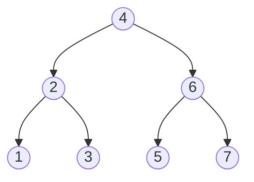
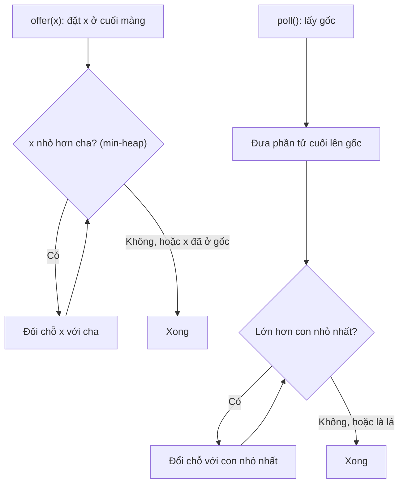
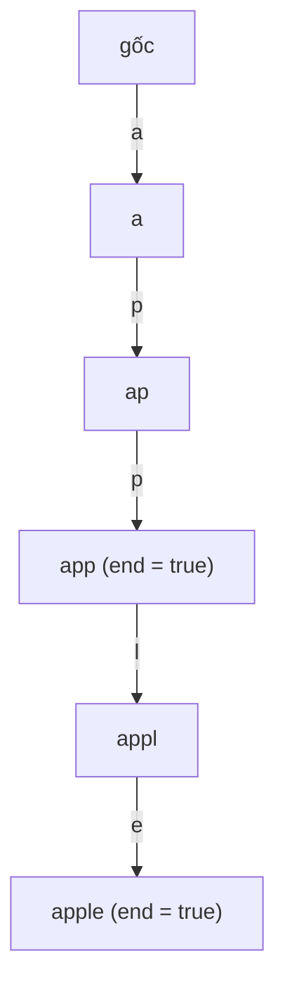

# Cây, Heap và Trie

## Cây là gì và vì sao cần nó

Cây là cấu trúc dữ liệu mà mỗi node có thể có các node con, giống sơ đồ tổ chức công ty hay cây thư mục trên máy. Bài này nói về ba họ cây: **cây nhị phân và BST** để tìm kiếm theo thứ tự, **heap** để luôn lấy ra được phần tử lớn nhất hoặc nhỏ nhất, và **trie** để tìm theo tiền tố, như tính năng gợi ý khi bạn gõ vào ô tìm kiếm.

Vấn đề cây giải quyết: với mảng hoặc list, muốn tìm một phần tử hoặc chèn mà vẫn giữ thứ tự thì mất O(n). Cây cân bằng làm cả hai trong O(log n). Ngoài ra nhiều dữ liệu vốn đã là cây (thư mục, cây biểu thức, cấu trúc DOM), ép vào mảng rất khó dùng.

**Tóm tắt:**

- Mọi thao tác trên cây tỷ lệ với chiều cao `h`: cây cân bằng cho O(log n), cây lệch suy biến thành O(n).
- Ba kiểu DFS khác nhau ở vị trí của gốc (preorder, inorder, postorder); BFS đi theo tầng bằng queue.
- Inorder của BST ra dãy tăng dần; `TreeMap` và `TreeSet` của Java là cây red-black.
- Kiểm tra BST phải truyền khoảng `(min, max)` xuống, không chỉ so với con trực tiếp.
- Heap là cây đầy đủ lưu trong mảng: `offer` và `poll` O(log n), `peek` O(1), dựng heap từ mảng O(n).
- Top-K lớn nhất dùng min-heap kích thước K (O(n log K)); iterator của `PriorityQueue` không duyệt theo thứ tự.
- Trie tìm theo tiền tố trong O(độ dài từ); cờ `end` phân biệt `search` với `startsWith`.
- Hầu hết bài cây giải bằng đệ quy: kết quả của cây là kết hợp kết quả hai cây con.

## Khi nào dùng cái nào, khi nào không

Dữ liệu cần giữ thứ tự mà vẫn thêm và xóa liên tục thì dùng BST (trong Java là `TreeMap`/`TreeSet`). Cần top-k hoặc priority queue thì dùng heap (`PriorityQueue`). Cần autocomplete hoặc tìm theo tiền tố thì dùng trie. Đừng dùng BST thuần túy khi dữ liệu thêm vào theo thứ tự đã sort, vì cây thoái hóa thành danh sách và thao tác trở lại O(n). Đừng dùng heap khi cần duyệt theo thứ tự hoặc tìm một phần tử bất kỳ, vì heap chỉ đảm bảo phần tử ở gốc. Đừng dùng trie khi chỉ cần tra đúng khớp toàn bộ key: hash map gọn và nhẹ hơn.

Cách học hiệu quả: nắm các kiểu duyệt (preorder, inorder, postorder, theo tầng), nhớ tính chất riêng của mỗi cấu trúc (inorder của BST ra dãy tăng dần, heap chỉ đảm bảo gốc là max hoặc min), rồi luyện các mẫu bài hay gặp.

## Các khái niệm cần biết

- **Node, gốc (root), lá (leaf)**: node là một ô chứa dữ liệu và tham chiếu tới con; gốc là node trên cùng; lá là node không có con.
- **Chiều cao (height)**: số tầng của đường dài nhất từ gốc xuống lá. Hầu hết chi phí thao tác trên cây tỷ lệ với chiều cao `h`.
- **Binary tree**: mỗi node có tối đa hai con, gọi là trái và phải.
- **DFS và BFS**: DFS (duyệt sâu) đi hết một nhánh rồi mới quay lại, thường viết bằng đệ quy. BFS (duyệt rộng) đi theo từng tầng, dùng queue.
- **Balanced tree**: hai cây con của mỗi node có chiều cao chênh lệch nhỏ, nên `h` khoảng `log n`. **AVL** và **red-black** là hai loại cây tự cân bằng: sau mỗi lần thêm hoặc xóa, chúng xoay lại các node để giữ cân bằng.
- **Heap**: cây nhị phân đầy đủ mà mỗi node nhỏ hơn hoặc bằng hai con (min-heap) hoặc lớn hơn hoặc bằng (max-heap). Nhờ đầy đủ nên lưu được trong mảng: con của chỉ số `i` ở `2i + 1` và `2i + 2`.
- **Sift-up và sift-down**: hai thao tác sửa heap. Sau khi thêm vào cuối, phần tử "nổi lên" (sift-up) đến đúng chỗ; sau khi lấy gốc, phần tử cuối được đưa lên gốc rồi "chìm xuống" (sift-down).
- **Priority queue**: queue mà phần tử được lấy ra là phần tử có độ ưu tiên cao nhất, không phải vào trước. Heap là cách cài đặt phổ biến.
- **Trie**: cây mà mỗi cạnh là một ký tự và đường từ gốc tới một node là một tiền tố.
- **LCA (lowest common ancestor)**: node thấp nhất có cả hai node cho trước nằm trong cây con của nó.
- **`floor` và `ceiling`**: trong `TreeMap`, `floorKey(x)` trả key lớn nhất không vượt quá `x`, `ceilingKey(x)` trả key nhỏ nhất không nhỏ hơn `x`.

## Cây nhị phân và các kiểu duyệt



Với cây mẫu trên, các kiểu duyệt cho kết quả khác nhau:

| Kiểu duyệt | Thứ tự thăm | Kết quả | Ghi chú |
|---|---|---|---|
| Preorder (DFS) | gốc, trái, phải | 4 2 1 3 6 5 7 | Sao chép/serialize cây |
| Inorder (DFS) | trái, gốc, phải | 1 2 3 4 5 6 7 | BST cho thứ tự tăng dần |
| Postorder (DFS) | trái, phải, gốc | 1 3 2 5 7 6 4 | Tính từ lá lên |
| BFS | từng tầng, dùng queue | 4 2 6 1 3 5 7 | Duyệt theo tầng |

**Phải thuộc:** Ba kiểu duyệt DFS khác nhau ở vị trí của gốc: preorder (gốc, trái, phải), inorder (trái, gốc, phải), postorder (trái, phải, gốc); BFS duyệt theo tầng bằng queue. Inorder của BST cho dãy tăng dần. Chiều cao: `1 + max(height(trái), height(phải))`, cây rỗng là 0.

```java
int height(TreeNode n) {
    if (n == null) return 0;
    return 1 + Math.max(height(n.left), height(n.right));
}
```

Mẫu hay gặp: chiều cao, đường kính, kiểm tra cây cân bằng, tổng đường đi, LCA, duyệt theo tầng, serialize cây. Hầu hết giải bằng đệ quy: "kết quả của cây = kết hợp kết quả của hai cây con".

## BST

- Mọi giá trị ở cây con trái nhỏ hơn gốc, cây con phải lớn hơn gốc, áp dụng đệ quy.
- Tìm, thêm, xóa: O(h) với `h` là chiều cao; cây lệch thành danh sách thì O(n).
- **Cây tự cân bằng** (AVL, red-black) giữ `h = O(log n)`; `TreeMap`/`TreeSet` của Java là cây red-black.
- Kiểm tra BST hợp lệ: truyền khoảng `(min, max)` xuống, không chỉ so với con trực tiếp.

**Nền tảng:** Mọi thao tác trên cây tỷ lệ với chiều cao `h`, nên cây cân bằng (`h` khoảng `log n`) cho O(log n) còn cây lệch suy biến thành O(n). Vì vậy `TreeMap`/`TreeSet` dùng cây red-black tự cân bằng. Hầu hết bài về cây giải bằng đệ quy theo công thức: kết quả của cây bằng kết hợp kết quả hai cây con.

**Suy luận:** BST nhanh vì mỗi lần so sánh với gốc loại bỏ nguyên một cây con, nên số bước bằng chiều cao `h` chứ không phải số node. Nhưng cấu trúc BST chỉ ràng buộc quan hệ trái nhỏ phải lớn, không ràng buộc hình dạng, nên hình dạng hoàn toàn phụ thuộc thứ tự chèn: chèn dữ liệu đã sort thì mỗi node mới đều đi sang phải và cây thành danh sách, `h = n`. Đó là lý do cần AVL hay red-black: sau mỗi lần chèn hoặc xóa chúng xoay để giữ `h = O(log n)`, đổi lại mỗi thao tác tốn thêm vài phép xoay. Điểm dễ nhầm là kiểm tra BST chỉ bằng con trực tiếp: điều kiện thật là mọi node trong cây con trái đều nhỏ hơn gốc, nên phải truyền khoảng xuống. Hệ quả khi chọn cấu trúc: cần thứ tự và thêm xóa liên tục thì dùng `TreeMap`, đừng tự cài BST thuần.

## Heap (priority queue)

- Cây nhị phân đầy đủ lưu trong mảng; gốc là min (hoặc max).
- `offer`/`poll` O(log n), `peek` O(1), dựng heap từ mảng O(n).

Hãy xem `offer` hoạt động ra sao. Phần tử mới được đặt ở cuối mảng (vị trí trống đầu tiên của tầng cuối), rồi so với cha; nếu vi phạm tính chất heap thì đổi chỗ và lặp lại. Nhờ cây đầy đủ, chiều cao chỉ khoảng log n nên tối đa log n lần đổi chỗ.



**Suy luận:** Heap chỉ đảm bảo quan hệ cha-con chứ không sort toàn bộ, và đó chính là lý do nó rẻ: để giữ gốc đúng, mỗi lần thêm hoặc lấy chỉ cần sửa một đường từ lá lên gốc, dài tối đa `log n` vì cây đầy đủ nên thấp. Cây đầy đủ lại cho phép lưu trong mảng với con của `i` ở `2i+1` và `2i+2`, nên không tốn con trỏ. Cũng vì thế heap không biết gì về thứ tự giữa các phần tử ngoài gốc, nên iterator hay `toString` của `PriorityQueue` không ra dãy sort, và tìm một phần tử bất kỳ vẫn O(n). Với top-K lớn nhất, ta cần loại nhanh ứng viên yếu nhất trong nhóm K, đó là gốc của min-heap, nên mới dùng min-heap chứ không phải max-heap. Nếu dùng max-heap cho cả n phần tử thì tốn O(n) memory và O(n log n) thời gian thay vì O(K) và O(n log K).

Top-K phần tử lớn nhất trong stream: giữ **min-heap kích thước K**; phần tử mới lớn hơn gốc thì thay vào. O(n log K), memory O(K).

**Phải thuộc:** Heap là cây nhị phân đầy đủ lưu trong mảng (con của `i` ở `2i+1` và `2i+2`); `offer` và `poll` là O(log n) (sift-up, sift-down), `peek` là O(1), dựng heap từ mảng là O(n). Top-K lớn nhất dùng min-heap kích thước K: O(n log K). `PriorityQueue` của Java là min-heap mặc định và iterator không duyệt theo thứ tự.

```java
PriorityQueue<Integer> pq = new PriorityQueue<>();      // min-heap
for (int x : nums) {
    pq.offer(x);
    if (pq.size() > k) pq.poll();
}
// pq.peek() là phần tử lớn thứ k
```

Còn dùng cho: gộp K danh sách đã sort, lập lịch, trung vị của stream (hai heap), thuật toán Dijkstra.

## Trie

Mỗi cạnh là một ký tự; đường từ gốc tới một node là một tiền tố. Vấn đề: có 1 triệu từ, muốn lấy mọi từ bắt đầu bằng "app". Quét hết danh sách là O(số từ), còn trie đi theo ba ký tự rồi liệt kê phần còn lại. Cờ `end` đánh dấu node tại đó có một từ hoàn chỉnh kết thúc, để phân biệt từ "app" với tiền tố "app" của "apple".



```java
class Trie {
    private final Trie[] next = new Trie[26];
    private boolean end;
    void insert(String w) {
        Trie t = this;
        for (char c : w.toCharArray()) {
            if (t.next[c - 'a'] == null) t.next[c - 'a'] = new Trie();
            t = t.next[c - 'a'];
        }
        t.end = true;
    }
}
```

Tìm theo tiền tố O(độ dài từ), không phụ thuộc số từ. Dùng cho: gợi ý tìm kiếm, kiểm tra chính tả, tìm từ trong bảng chữ cái (liên hệ [Search Autocomplete](/go?p=15-System%20Design%2Fmedium%2F05-search-autocomplete.md)).

## Bài giải mẫu có trace

Các đoạn dưới dùng `TreeNode` có `val`, `left`, `right`; cây mẫu là cây 7 node ở đầu bài.

### Duyệt theo tầng (BFS)

Hướng nghĩ: cần xử lý từng tầng riêng nên chụp `size` của queue trước khi lặp.

```java
List<List<Integer>> levelOrder(TreeNode root) {
    List<List<Integer>> res = new ArrayList<>();
    if (root == null) return res;
    Queue<TreeNode> q = new ArrayDeque<>();
    q.offer(root);
    while (!q.isEmpty()) {
        int size = q.size();                       // số node của tầng hiện tại
        List<Integer> level = new ArrayList<>();
        for (int i = 0; i < size; i++) {
            TreeNode n = q.poll();
            level.add(n.val);
            if (n.left != null) q.offer(n.left);
            if (n.right != null) q.offer(n.right);
        }
        res.add(level);
    }
    return res;
}
```

| Lượt `while` | `size` | Lấy ra | Queue sau lượt |
|---|---|---|---|
| 1 | 1 | 4 | 2, 6 |
| 2 | 2 | 2, 6 | 1, 3, 5, 7 |
| 3 | 4 | 1, 3, 5, 7 | rỗng |

Kết quả `[[4], [2, 6], [1, 3, 5, 7]]` (đã chạy). O(n) thời gian, O(chiều rộng) memory. Cây rỗng trả danh sách rỗng.

### Kiểm tra BST: truyền khoảng xuống

```java
// gọi với Long.MIN_VALUE, Long.MAX_VALUE
boolean isValidBST(TreeNode n, long min, long max) {
    if (n == null) return true;
    if (n.val <= min || n.val >= max) return false;      // phải nằm trong (min, max)
    // cây con trái: chặn trên là n.val
    return isValidBST(n.left, min, n.val)
        // cây con phải: chặn dưới là n.val
        && isValidBST(n.right, n.val, max);
}
```

Bẫy kinh điển: chỉ so node với con trực tiếp. Cây gốc 5, con trái 1, con phải 6, và 6 có con trái 3: mọi cặp cha-con đều ổn (3 < 6) nhưng 3 nằm bên phải của 5 mà nhỏ hơn 5, nên không phải BST. Bản truyền khoảng bắt được: tới node 3 khoảng là `(5, 6)` và `3 <= 5` trả `false` (đã chạy). Dùng `long` để node mang giá trị `Integer.MIN_VALUE` không bị coi là vi phạm.

### LCA của cây nhị phân

```java
TreeNode lca(TreeNode n, TreeNode p, TreeNode q) {
    if (n == null || n == p || n == q) return n;      // gặp p hoặc q thì trả luôn
    TreeNode l = lca(n.left, p, q), r = lca(n.right, p, q);
    // hai bên mỗi bên một node: n là LCA
    if (l != null && r != null) return n;
    return l != null ? l : r;                         // cả hai ở cùng một phía
}
```

Với cây mẫu: LCA(1, 3) = 2; LCA(1, 7) = 4; LCA(2, 3) = 2 (một node là tổ tiên của node kia, được xử lý nhờ điều kiện `n == p`). Đã chạy. Giả định `p`, `q` có trong cây. O(n).

### Phần tử nhỏ thứ k trong BST

Inorder cho dãy tăng nên dừng ở node thứ k:

```java
int cnt = 0, ans = -1;
void kth(TreeNode n, int k) {
    if (n == null || ans != -1) return;                // đã tìm thấy thì cắt sớm
    kth(n.left, k);
    if (++cnt == k) { ans = n.val; return; }
    kth(n.right, k);
}
```

`k = 3` trên cây mẫu ra 3 (đã chạy). Dùng biến thành viên thì nhớ khởi tạo lại giữa các lần gọi; giá trị `-1` làm cờ chỉ ổn nếu cây không chứa `-1`.

### Top-K bằng min-heap: trace

Tìm phần tử lớn thứ 2 của `[3, 2, 1, 5, 6, 4]`, giữ heap tối đa 2 phần tử (nội dung heap in từ `toString`, thứ tự bên trong không bảo đảm sort; ở đây tình cờ trùng, đã chạy):

| Phần tử | Heap sau `offer` rồi cắt về k = 2 | Ghi chú |
|---|---|---|
| 3 | [3] | |
| 2 | [2, 3] | gốc 2 là nhỏ nhất |
| 1 | [2, 3] | thêm 1 thành 3 phần tử, `poll` bỏ 1 |
| 5 | [3, 5] | bỏ 2 |
| 6 | [5, 6] | bỏ 3 |
| 4 | [5, 6] | bỏ 4 |

Gốc `peek() = 5` chính là lớn thứ 2. Vì sao chọn **min**-heap cho top lớn nhất: gốc là ứng viên yếu nhất trong nhóm k, bị đuổi trước.

### Trie đầy đủ

```java
boolean search(String w)     { Trie t = walk(w); return t != null && t.end; }
boolean startsWith(String p) { return walk(p) != null; }
private Trie walk(String s) {
    Trie t = this;
    for (char c : s.toCharArray()) {
        t = t.next[c - 'a'];
        // đứt đường: không có tiền tố này
        if (t == null) return null;
    }
    return t;
}
```

Thêm `"app"` và `"apple"`: `search("app")` là `true`, `search("ap")` là `false` (có đường đi nhưng `end` chưa bật), `startsWith("ap")` là `true`, `startsWith("b")` là `false` (đã chạy). Phân biệt `search` và `startsWith` bằng cờ `end`, đây là lỗi hay gặp nhất. Mảng 26 con chỉ hợp chữ thường a-z; ký tự khác thì dùng `HashMap<Character, Trie>`.

Luyện tập: [bộ bài tập thuật toán](/go?p=00-Roadmap%2Fbai-tap-thuat-toan.md).

## Chọn cấu trúc

| Nhu cầu | Chọn |
|---|---|
| Tìm/sort có thứ tự, cần `floor`/`ceiling` | `TreeMap` |
| Chỉ cần min/max nhanh | `PriorityQueue` |
| Tìm theo tiền tố, nhiều từ chung tiền tố | Trie |
| Truy vấn tổng/min trên đoạn có cập nhật | Segment tree / Fenwick (bài nâng cao) |

## Điều cần nhớ

- Cây nhị phân bài phỏng vấn gần như luôn giải bằng đệ quy hoặc BFS với queue.
- Duyệt inorder trên BST cho dãy tăng dần: dùng để kiểm tra và tìm phần tử thứ k.
- `PriorityQueue` của Java duyệt bằng iterator **không** theo thứ tự.
- Đệ quy trên cây lệch sâu có thể tràn stack.

