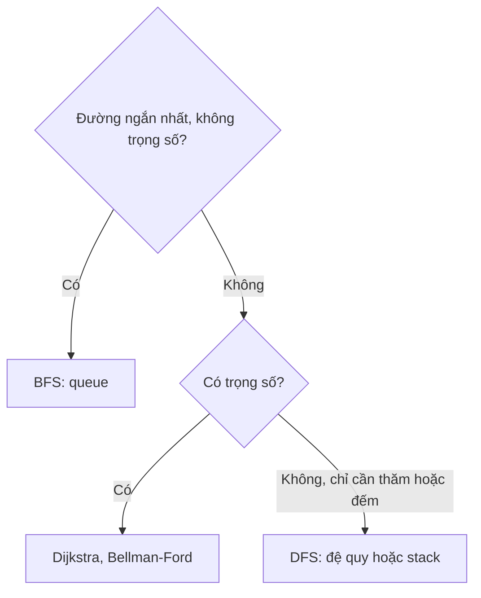
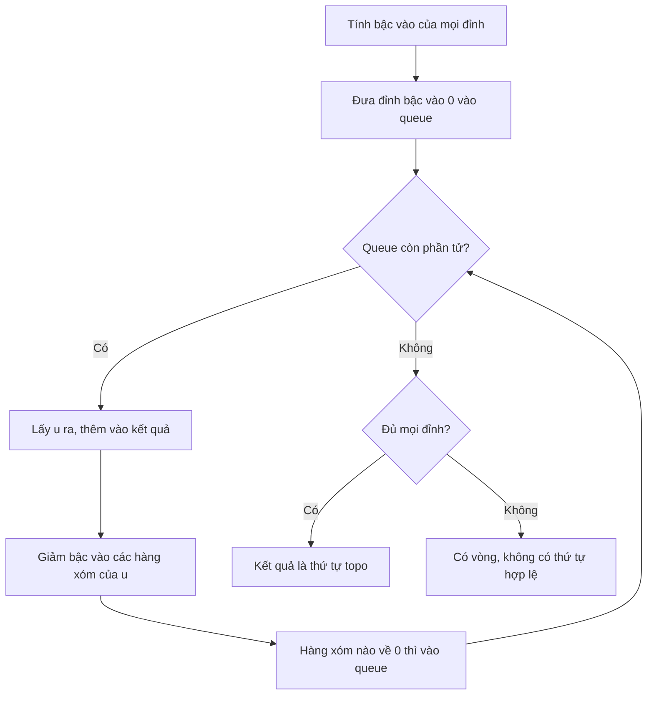
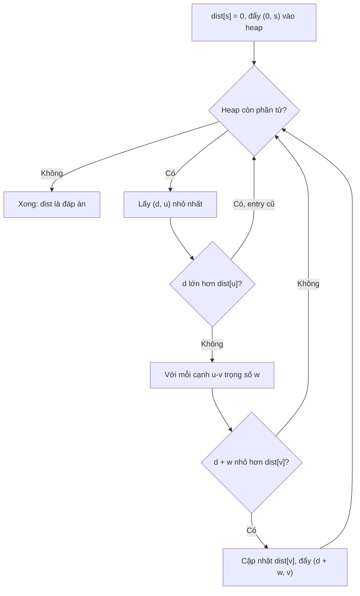
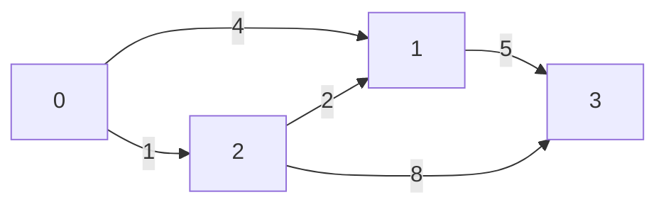

# Đồ thị

## Đồ thị là gì?

Đồ thị là một tập các điểm (gọi là **đỉnh**, vertex) nối với nhau bằng các đường (gọi là **cạnh**, edge). Cạnh có thể một chiều (như đường một chiều trong thành phố) hoặc hai chiều (như tình bạn trên mạng xã hội), và có thể mang trọng số như khoảng cách hay chi phí. Chỉ cần bạn có "các thứ" và "quan hệ giữa chúng" là đã có một đồ thị.

## Vì sao phải nhìn ra đồ thị

Rất nhiều bài toán thật là đồ thị trá hình: bạn bè trên mạng xã hội, bản đồ đường đi, các module phụ thuộc nhau, ô lưới 2D trong mê cung, trạng thái của một trò chơi. Nếu không nhận ra, bạn sẽ cố giải bằng mảng và vòng lặp rất rối. Khi nhận ra, bài toán trở thành một thuật toán đồ thị có sẵn.

**Tóm tắt:**

- Nhận ra đồ thị trá hình (lưới 2D, trạng thái, phụ thuộc module) là bước quan trọng nhất: trạng thái là đỉnh, phép biến đổi là cạnh.
- Dùng adjacency list cho đồ thị thưa (O(V + E) memory), luôn đánh dấu đỉnh đã thăm và duyệt từ mọi đỉnh chưa thăm.
- BFS cho đường ngắn nhất khi mọi cạnh cùng chi phí; đánh dấu khi đưa vào queue, không phải khi lấy ra.
- Dijkstra cho trọng số không âm, O((V + E) log V) với heap, và sai khi có cạnh âm.
- Bellman-Ford xử lý cạnh âm và phát hiện negative cycle; Floyd-Warshall cho mọi cặp đỉnh khi V nhỏ.
- Topological sort (Kahn) chỉ cho DAG: không lấy đủ mọi đỉnh nghĩa là có vòng.
- Union-Find với path compression và union by rank gần O(1) mỗi thao tác; `union` trả `false` nghĩa là cạnh tạo vòng.

## Khi nào dùng thuật toán nào

Đề nói "đường đi", "có kết nối không", "thứ tự phụ thuộc", "lan truyền" hoặc cho một lưới 2D thì nghĩ tới đồ thị. Đường ngắn nhất khi mọi cạnh có chi phí như nhau thì dùng BFS. Có trọng số không âm thì Dijkstra. Cần thứ tự thực hiện khi các việc phụ thuộc nhau thì topological sort. Gom nhóm các phần tử có liên quan thì Union-Find. Không dùng Dijkstra khi có cạnh âm, và không dùng BFS thường cho bài có trọng số khác nhau vì nó chỉ đếm số cạnh, không đếm chi phí.

Cách làm chung: biểu diễn bằng adjacency list, duyệt bằng BFS hoặc DFS, luôn đánh dấu đỉnh đã thăm để không lặp vô hạn, rồi chọn thuật toán chuyên biệt theo yêu cầu.

## Các khái niệm cần biết

- **Directed và undirected**: cạnh có hướng `u → v` chỉ đi được từ `u` sang `v`; cạnh vô hướng đi được cả hai chiều.
- **Degree**: số cạnh của một đỉnh. Với đồ thị có hướng, **in-degree** là số cạnh đi vào đỉnh, dùng trong topo sort.
- **Connected component**: nhóm đỉnh có đường đi tới nhau. Đồ thị có thể có nhiều thành phần, nên đừng chỉ duyệt từ một đỉnh.
- **DAG (directed acyclic graph)**: đồ thị có hướng không có vòng. Chỉ DAG mới có thứ tự topo.
- **Sparse graph**: số cạnh `E` nhỏ so với `V²`. Phần lớn đồ thị thực tế thuộc loại này.
- **Relaxation**: cập nhật `dist[v] = min(dist[v], dist[u] + w)` khi tìm được đường tới `v` qua `u` ngắn hơn đường đang biết. Là thao tác cốt lõi của Dijkstra và Bellman-Ford.
- **Negative cycle**: một vòng có tổng trọng số âm, đi mãi quanh nó thì đường đi ngắn nhất không tồn tại. Bellman-Ford phát hiện được, Dijkstra thì không.
- **Path compression**: trong Union-Find, mỗi lần `find` thì gắn thẳng các node trên đường vào gốc để lần sau nhanh hơn.
- **Union by rank**: khi hợp nhất hai nhóm, gắn cây thấp vào cây cao để cây không bị cao dần.
- **Cây khung nhỏ nhất (MST)** và **Kruskal**: cây nối mọi đỉnh với tổng trọng số nhỏ nhất; Kruskal sort cạnh tăng dần và thêm cạnh nào không tạo vòng (kiểm bằng Union-Find).

## Biểu diễn

| Cách | Memory | Duyệt hàng xóm | Kiểm tra cạnh |
|---|---|---|---|
| Adjacency list `List<List<Integer>>` | O(V + E) | O(bậc) | O(bậc) |
| Adjacency matrix | O(V²) | O(V) | O(1) |

Đồ thị thưa (thường gặp) dùng adjacency list. Lưới 2D là đồ thị ngầm: hàng xóm là 4 hoặc 8 ô xung quanh.

## BFS và DFS



BFS thăm đỉnh theo từng lớp khoảng cách (cách gốc 1 cạnh, rồi 2 cạnh, ...), nên lần đầu chạm tới một đỉnh chính là đường ngắn nhất tính theo số cạnh. DFS đi hết một nhánh rồi mới quay lại. DFS dùng khi cần thăm hết, đếm thành phần liên thông, phát hiện vòng hoặc tìm một đường đi bất kỳ.

**Nền tảng:** BFS đi theo từng lớp khoảng cách nên lần đầu chạm tới một đỉnh chính là đường ngắn nhất tính theo số cạnh, miễn là mọi cạnh có chi phí như nhau. Luôn đánh dấu đã thăm khi đưa vào queue (không phải khi lấy ra) để mỗi đỉnh vào queue đúng một lần, và đồ thị có thể không liên thông nên cần duyệt từ mọi đỉnh chưa thăm.

```java
int shortest(List<List<Integer>> g, int s, int t) {
    int[] dist = new int[g.size()];
    Arrays.fill(dist, -1);
    Deque<Integer> q = new ArrayDeque<>();
    dist[s] = 0; q.offer(s);
    while (!q.isEmpty()) {
        int u = q.poll();
        if (u == t) return dist[u];
        for (int v : g.get(u)) {
            if (dist[v] == -1) { dist[v] = dist[u] + 1; q.offer(v); }
        }
    }
    return -1;
}
```

Luôn đánh dấu đã thăm **khi đưa vào queue** để mỗi đỉnh vào một lần. Độ phức tạp O(V + E).

## Topological sort

Đồ thị có hướng không vòng (DAG): sắp đỉnh sao cho mọi cạnh `u → v` có `u` đứng trước `v`.

Thuật toán Kahn: tính bậc vào; đưa các đỉnh bậc vào 0 vào queue; lấy ra, giảm bậc vào của hàng xóm. Nếu không lấy đủ mọi đỉnh nghĩa là có **vòng** (ví dụ lịch môn học bị phụ thuộc vòng, hệ thống build). Ví dụ đời thường: bạn phải học môn A trước môn B, B trước C; thứ tự topo cho bạn một lịch học hợp lệ, còn nếu A cần B và B cần A thì không thể xếp được.



## Đường đi ngắn nhất có trọng số

| Thuật toán | Điều kiện | Độ phức tạp |
|---|---|---|
| **Dijkstra** | Trọng số không âm | O((V + E) log V) với heap |
| Bellman-Ford | Có trọng số âm, phát hiện vòng âm | O(V·E) |
| Floyd-Warshall | Mọi cặp đỉnh, V nhỏ | O(V³) |
| BFS 0-1 | Trọng số chỉ 0 hoặc 1 | O(V + E) |

**Phải thuộc:** Chọn thuật toán đường đi: không trọng số dùng BFS, O(V + E); trọng số không âm dùng Dijkstra, O((V + E) log V) với heap; có trọng số âm hoặc cần phát hiện vòng âm dùng Bellman-Ford, O(V·E); mọi cặp đỉnh với V nhỏ dùng Floyd-Warshall, O(V³). Dijkstra sai khi có cạnh âm. Topo sort (Kahn) chỉ cho DAG: không lấy đủ mọi đỉnh nghĩa là có vòng.

Dijkstra: heap chứa `(khoảng cách, đỉnh)`; lấy đỉnh gần nhất, relax các cạnh; bỏ qua entry cũ đã lỗi thời. Ý tưởng cốt lõi: khi đỉnh gần nhất chưa chốt được lấy ra, mọi đường khác tới nó phải đi qua đỉnh xa hơn, mà trọng số không âm nên không thể ngắn hơn. Đây là lý do cạnh âm làm thuật toán sai.



**Suy luận:** Dijkstra đúng nhờ một bất biến: khi lấy ra đỉnh có `dist` nhỏ nhất chưa chốt, mọi đường khác tới nó phải đi qua một đỉnh chưa chốt có `dist` không nhỏ hơn, và cộng thêm các cạnh không âm thì chỉ lớn lên, nên không thể ngắn hơn. Vì vậy mỗi đỉnh được chốt đúng một lần và không bao giờ phải xét lại, đó là chỗ Dijkstra rẻ hơn Bellman-Ford. Một cạnh âm phá đúng điểm này: đi vòng qua đỉnh xa hơn rồi trừ đi có thể ra đường ngắn hơn đỉnh đã chốt, nhưng Dijkstra không quay lại sửa. Điểm dễ nhầm là cho rằng chỉ cần "cộng hằng số vào mọi cạnh cho hết âm", cách này sai vì đường dài nhiều cạnh bị cộng nhiều lần hơn. Khi review, hãy kiểm tra trọng số có thể âm không (ví dụ chi phí có hoàn tiền) trước khi chọn Dijkstra.

## Union-Find (Disjoint Set)

Vấn đề: cần liên tục trả lời "hai phần tử này có cùng nhóm không" và "gộp hai nhóm lại" (ví dụ thêm dần các kết nối vào mạng). Duyệt lại đồ thị mỗi lần thì chậm. Union-Find giữ mỗi nhóm là một cây, gốc cây là đại diện của nhóm. Quản lý các nhóm rời nhau với `find` và `union` gần O(1) khi dùng **path compression** và **union by rank**. Dùng cho: đếm thành phần liên thông, phát hiện vòng trong đồ thị vô hướng, cây khung nhỏ nhất (Kruskal), "số đảo".

**Phải thuộc:** Union-Find (Disjoint Set) có hai thao tác `find` (path compression) và `union` (union by rank), gần như O(1) khấu hao mỗi thao tác (hàm Ackermann ngược). `union` trả `false` khi hai đỉnh đã cùng nhóm, nghĩa là cạnh đó tạo vòng; đây là cốt lõi của Kruskal và bài đếm thành phần liên thông.

## Bài giải mẫu có trace

### BFS trên lưới: đường ngắn nhất trong mê cung

Hướng nghĩ: thử mọi đường bằng DFS/backtracking là hàm mũ; mọi bước có chi phí 1 nên BFS đi theo tầng sẽ chạm đích đầu tiên bằng đường ngắn nhất. `.` là ô đi được, `#` là tường, đi từ góc trên trái tới góc dưới phải, 4 hướng.

```java
int shortestPath(char[][] g) {
    int R = g.length, C = g[0].length;
    if (g[0][0] == '#' || g[R-1][C-1] == '#') return -1;
    int[][] dist = new int[R][C];
    for (int[] row : dist) Arrays.fill(row, -1);              // -1 = chưa thăm
    int[] dr = {1, -1, 0, 0}, dc = {0, 0, 1, -1};
    Deque<int[]> q = new ArrayDeque<>();
    dist[0][0] = 0; q.offer(new int[]{0, 0});
    while (!q.isEmpty()) {
        int[] cur = q.poll();
        if (cur[0] == R - 1 && cur[1] == C - 1) return dist[cur[0]][cur[1]];
        for (int d = 0; d < 4; d++) {
            int r = cur[0] + dr[d], c = cur[1] + dc[d];
            if (r < 0 || c < 0 || r >= R || c >= C || g[r][c] == '#' || dist[r][c] != -1) continue;
            // đánh dấu khi đưa vào queue
            dist[r][c] = dist[cur[0]][cur[1]] + 1;
            q.offer(new int[]{r, c});
        }
    }
    return -1;                                                // không có đường
}
```

Lưới mẫu (hàng 0: `..#`, hàng 1: `#..`, hàng 2: `#..`):

| Khoảng cách | Các ô (hàng, cột) |
|---|---|
| 0 | (0,0) |
| 1 | (0,1) |
| 2 | (1,1) |
| 3 | (1,2), (2,1) |
| 4 | (2,2) đích |

Kết quả 4 (đã chạy); lưới `.#. / ##. / ...` bị tường chặn ngay từ gốc nên trả -1 (đã chạy). Độ phức tạp O(R·C). Bẫy: đánh dấu khi `poll` thay vì khi `offer` làm một ô vào queue nhiều lần; quên kiểm tra ô đầu/đích là tường.

### Topological sort (Kahn)

```java
// cạnh {u, v}: u phải đứng trước v
List<Integer> topo(int n, int[][] edges) {
    List<List<Integer>> g = new ArrayList<>();
    for (int i = 0; i < n; i++) g.add(new ArrayList<>());
    int[] indeg = new int[n];
    for (int[] e : edges) { g.get(e[0]).add(e[1]); indeg[e[1]]++; }
    Deque<Integer> q = new ArrayDeque<>();
    for (int i = 0; i < n; i++) if (indeg[i] == 0) q.offer(i);
    List<Integer> order = new ArrayList<>();
    while (!q.isEmpty()) {
        int u = q.poll();
        order.add(u);
        for (int v : g.get(u)) if (--indeg[v] == 0) q.offer(v);
    }
    // thiếu đỉnh nghĩa là có vòng
    return order.size() == n ? order : Collections.emptyList();
}
```

Trace với 4 đỉnh, cạnh `0→1, 0→2, 1→3, 2→3` (bậc vào ban đầu `[0,1,1,2]`):

| Bước | Lấy ra | Bậc vào sau bước | Queue | `order` |
|---|---|---|---|---|
| đầu | | [0,1,1,2] | 0 | |
| 1 | 0 | [0,0,0,2] | 1, 2 | 0 |
| 2 | 1 | [0,0,0,1] | 2 | 0,1 |
| 3 | 2 | [0,0,0,0] | 3 | 0,1,2 |
| 4 | 3 | | rỗng | 0,1,2,3 |

Kết quả `[0, 1, 2, 3]` (đã chạy). Với cạnh `0→1, 1→0` không đỉnh nào có bậc vào 0, queue rỗng ngay, `order` rỗng nên trả danh sách rỗng, tức có vòng (đã chạy). Thứ tự topo thường **không duy nhất**. O(V + E).

### Dijkstra với `PriorityQueue`



```java
int[] dijkstra(List<List<int[]>> g, int s) {             // g.get(u): {v, trọng số}
    int[] dist = new int[g.size()];
    Arrays.fill(dist, Integer.MAX_VALUE);
    dist[s] = 0;
    PriorityQueue<int[]> pq = new PriorityQueue<>((a, b) -> Integer.compare(a[0], b[0]));
    pq.offer(new int[]{0, s});                           // {khoảng cách, đỉnh}
    while (!pq.isEmpty()) {
        int[] top = pq.poll();
        int d = top[0], u = top[1];
        if (d > dist[u]) continue;                       // entry cũ, bỏ qua
        for (int[] e : g.get(u)) {
            int nd = d + e[1];
            if (nd < dist[e[0]]) { dist[e[0]] = nd; pq.offer(new int[]{nd, e[0]}); }
        }
    }
    return dist;
}
```

Trace từ đỉnh 0 (đã chạy, kết quả `[0, 3, 1, 8]`):

| Lấy ra `(d, u)` | Relax | `dist` sau bước |
|---|---|---|
| (0, 0) | đỉnh 1 = 4, đỉnh 2 = 1 | [0, 4, 1, ∞] |
| (1, 2) | đỉnh 1 = 1+2 = 3, đỉnh 3 = 1+8 = 9 | [0, 3, 1, 9] |
| (3, 1) | đỉnh 3 = 3+5 = 8 | [0, 3, 1, 8] |
| (4, 1) | entry cũ, bỏ qua | không đổi |
| (8, 3) | không cải thiện | không đổi |
| (9, 3) | entry cũ, bỏ qua | không đổi |

Vì sao bỏ qua entry cũ: `PriorityQueue` không có thao tác decrease-key hiệu quả, nên đẩy thêm entry mới và loại entry lỗi thời khi lấy ra. Bẫy: Dijkstra **sai** với cạnh âm; cộng `Integer.MAX_VALUE + w` bị tràn (ở đây chỉ relax từ đỉnh đã có `dist` hữu hạn nên an toàn); đỉnh không tới được giữ `MAX_VALUE`. O((V + E) log V).

### Union-Find

```java
class UF {
    int[] p, rank; int comps;
    UF(int n) { p = new int[n]; rank = new int[n]; comps = n; for (int i = 0; i < n; i++) p[i] = i; }
    // path compression
    int find(int x) { return p[x] == x ? x : (p[x] = find(p[x])); }
    boolean union(int a, int b) {
        int ra = find(a), rb = find(b);
        // đã cùng nhóm: cạnh này tạo vòng
        if (ra == rb) return false;
        if (rank[ra] < rank[rb]) { int t = ra; ra = rb; rb = t; }
        // gắn cây thấp vào cây cao
        p[rb] = ra;
        if (rank[ra] == rank[rb]) rank[ra]++;
        comps--;
        return true;
    }
}
```

Với 5 đỉnh: `union(0,1)` `true`, `union(1,2)` `true`, `union(0,2)` `false` (đã cùng nhóm, tức cạnh tạo vòng), còn 3 nhóm `{0,1,2}, {3}, {4}` (đã chạy). Cùng cơ chế, "số đảo" có thể giải bằng DFS đổi `'1'` thành `'0'` khi thăm; lưới `11000 / 11000 / 00100 / 00011` có 3 đảo (đã chạy bản DFS). `find` đệ quy sâu trên chuỗi dài có thể tràn stack, nhưng union by rank giữ chiều cao O(log n).

Luyện tập: [bộ bài tập thuật toán](/go?p=00-Roadmap%2Fbai-tap-thuat-toan.md).

## Bài mẫu hay gặp

- Số đảo trong lưới (DFS/BFS/Union-Find).
- Sao chép đồ thị (hash map từ node cũ sang node mới).
- Thứ tự môn học (topo, phát hiện vòng).
- Đường đi ngắn nhất trong mê cung (BFS).
- Mạng trễ, chuyến bay rẻ nhất có tối đa K điểm dừng (Dijkstra, Bellman-Ford).

## Điều cần nhớ

- Đồ thị có thể **không liên thông**: lặp qua mọi đỉnh chưa thăm.
- Vô hướng thì mỗi cạnh thêm hai chiều; có hướng thì một chiều.
- DFS đệ quy trên đồ thị sâu có thể tràn stack, cân nhắc stack tự quản.
- Nhận ra "đồ thị ngầm": trạng thái là đỉnh, phép biến đổi là cạnh (ví dụ "ladder word").

