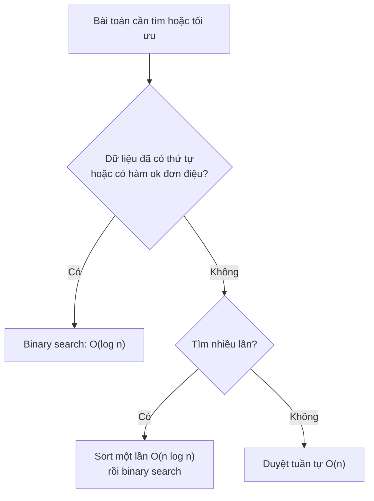
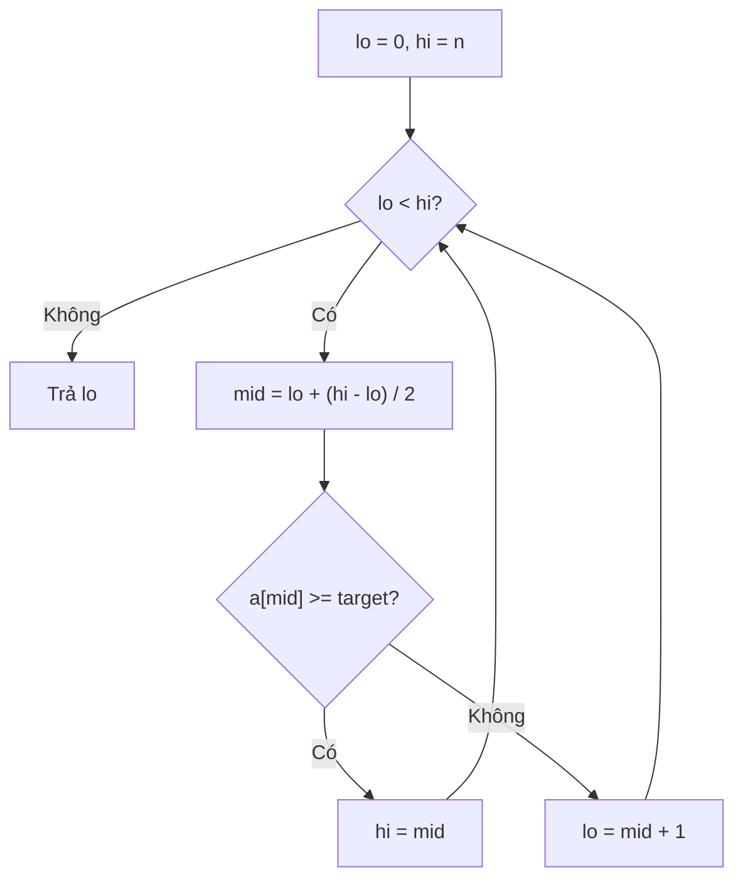
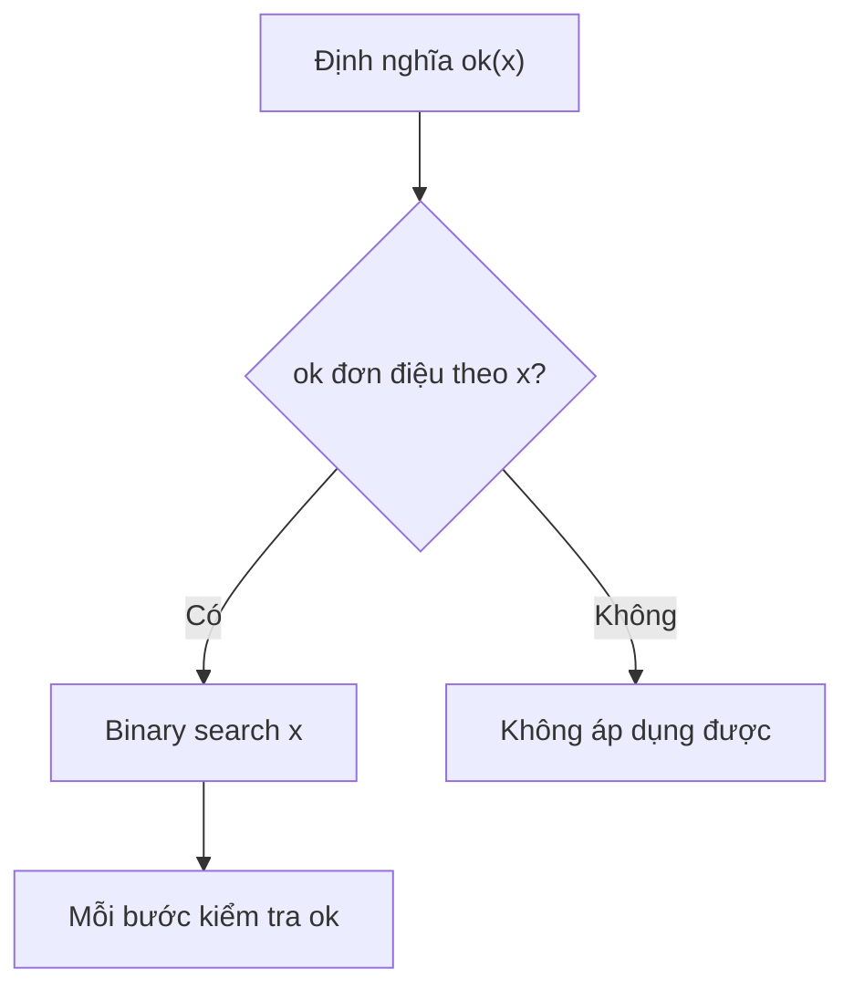
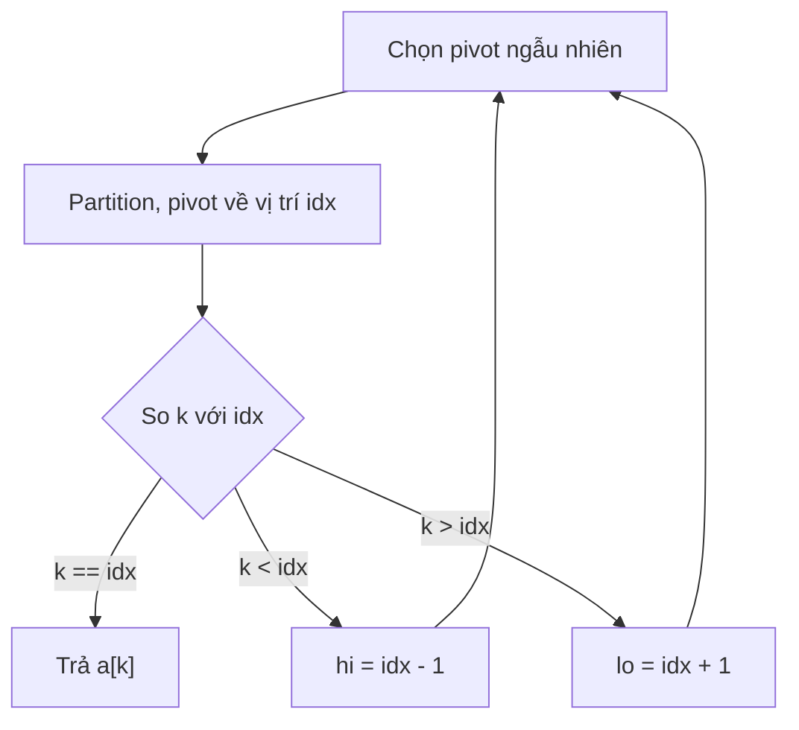

# Sắp xếp và Tìm kiếm

Bài này nói về hai việc rất cơ bản nhưng xuất hiện ở khắp nơi: đưa dữ liệu về một thứ tự nhất định (sort), và tìm một giá trị trong dữ liệu đó bằng cách liên tục loại bỏ một nửa không thể chứa đáp án (binary search).

**Tóm tắt:**

- Sort dựa trên so sánh có giới hạn dưới Ω(n log n); merge sort và heap sort luôn đạt mức đó, quick sort xấu nhất O(n²).
- Stable giữ thứ tự ban đầu của các phần tử bằng nhau, quan trọng khi sort nhiều lần theo nhiều key; merge sort và insertion sort stable, quick sort và heap sort thì không.
- Java: `Arrays.sort` kiểu nguyên thủy dùng dual-pivot quicksort, object và `List.sort` dùng TimSort (stable).
- Điều kiện của binary search là tính đơn điệu, không nhất thiết là một mảng đã sort.
- Khuôn lower bound với `[lo, hi)` và `mid = lo + (hi - lo) / 2`; upper bound chỉ đổi `>=` thành `>`.
- Binary search trên đáp án: định nghĩa `ok(x)` đơn điệu rồi tìm giá trị nhỏ nhất làm `ok` đúng, thường kiểm tra bằng greedy O(n).
- Quickselect tìm phần tử thứ k trung bình O(n) bằng cách chỉ đi tiếp một nửa sau mỗi lần partition.
- Lỗi hay gặp: tràn `int` ở `(lo + hi) / 2`, lặp vô hạn do `lo = mid`, sai đơn điệu mà không báo lỗi.

## Vì sao cần học hai thứ này

Hãy hình dung bạn tìm một từ trong cuốn từ điển. Bạn không lật từng trang từ đầu: bạn mở giữa cuốn, thấy chữ "M", biết từ cần tìm bắt đầu bằng "C" nên bỏ nửa sau, rồi lặp lại với nửa trước. Đó chính là binary search, và nó chỉ chạy được vì từ điển đã được sort. Tìm tuần tự phải duyệt hết, tốn O(n); binary search trên dữ liệu đã sort chỉ tốn O(log n), tức 1 triệu phần tử chỉ cần khoảng 20 bước.

Sort còn là một "đòn bẩy" để đơn giản hóa bài toán. Rất nhiều bài trông khó (tìm cặp trùng, gộp khoảng, ghép cặp gần nhất) trở nên dễ khi dữ liệu đã có thứ tự, và chi phí giảm từ O(n²) xuống O(n log n) do bước sort chiếm phần lớn.

## Khi nào nên dùng, khi nào không

- Dùng binary search khi dữ liệu đã có thứ tự và bạn cần tìm vị trí hoặc một khoảng giá trị.
- Dùng binary search "trên đáp án" cho bài kiểu "tối thiểu hóa giá trị lớn nhất": thay vì tự tính đáp án, bạn thử một giá trị rồi kiểm tra nó có đủ không, và binary search trên chính giá trị đó.
- Không sort chỉ để tìm một lần trên dữ liệu chưa có thứ tự: duyệt thẳng O(n) rẻ hơn sort O(n log n) rồi mới tìm.
- Không dùng binary search khi điều kiện không đơn điệu (không có ranh giới rõ ràng giữa "sai" và "đúng"); khi đó nửa bị loại có thể vẫn chứa đáp án và kết quả sai âm thầm.

Cách học hiệu quả: với sort, hãy nắm đặc tính của từng thuật toán (độ phức tạp, có stable không, tốn thêm memory không). Với binary search, hãy thuộc một khuôn duy nhất gồm `lo`, `hi`, `mid` và xử lý biên cẩn thận.

## Các khái niệm cần biết

- **Độ phức tạp O(n log n)**: thời gian tăng gần tuyến tính theo số phần tử, nhân thêm hệ số logarit. Đây là mức tốt nhất có thể cho mọi thuật toán sort dựa trên so sánh phần tử (giới hạn Ω(n log n)).
- **Pivot**: phần tử "chốt" mà quick sort và quickselect chọn ra, rồi đẩy các phần tử nhỏ hơn sang một bên và lớn hơn sang bên kia. Chọn pivot ngẫu nhiên giúp tránh trường hợp xấu khi dữ liệu đầu vào đã gần sort.
- **Partition**: bước sắp lại đoạn mảng quanh pivot. Sau bước này pivot đã nằm đúng vị trí cuối cùng của nó.
- **Stable**: hai phần tử bằng nhau giữ nguyên thứ tự ban đầu. Quan trọng khi sort nhiều lần theo nhiều key: ví dụ sắp theo tên rồi sắp theo phòng ban, nếu thuật toán stable thì trong mỗi phòng ban danh sách vẫn giữ thứ tự tên.
- **Heap**: cây nhị phân đầy đủ lưu trong mảng, phần tử cha luôn lớn hơn (hoặc nhỏ hơn) các con. Heap sort dùng nó để lần lượt lấy phần tử lớn nhất ra.
- **Tính đơn điệu**: hàm `ok(x)` có dạng sai, sai, ..., đúng, đúng. Chỉ cần có ranh giới đơn nhất này là binary search dùng được, kể cả khi không có mảng nào.
- **Lower bound / upper bound**: vị trí đầu tiên mà giá trị không nhỏ hơn (lower) hoặc lớn hơn hẳn (upper) giá trị cần tìm. Hai hàm này giải quyết cả bài toán "tồn tại", "vị trí đầu", "vị trí cuối", "đếm số lần xuất hiện".

Luồng chọn công cụ có thể tóm tắt như sau.



Đọc sơ đồ: câu hỏi quyết định không phải "mảng có sort không" mà là "có ranh giới đơn điệu để loại một nửa không". Nếu chưa có thì chỉ bỏ công sort khi bạn sẽ tìm nhiều lần.

## Các thuật toán sort

| Thuật toán | Trung bình | Xấu nhất | Memory | Stable | Ghi chú |
|---|---|---|---|---|---|
| Insertion | O(n²) | O(n²) | O(1) | Có | Tốt cho mảng nhỏ/gần như đã sắp |
| Merge sort | O(n log n) | O(n log n) | O(n) | Có | Dễ chạy song song, hợp danh sách liên kết |
| Quick sort | O(n log n) | O(n²) | O(log n) | Không | Nhanh trong thực tế; chọn pivot ngẫu nhiên |
| Heap sort | O(n log n) | O(n log n) | O(1) | Không | Không phụ thuộc đầu vào |
| Counting/Radix | O(n + k) | | O(k) | Có | Key nguyên nhỏ, không so sánh |

**Phải thuộc:** Giới hạn dưới của sort dựa trên so sánh là Ω(n log n). Merge sort: O(n log n) stable, tốn O(n) memory. Quick sort: trung bình O(n log n), xấu nhất O(n²), không stable. Heap sort: O(n log n), O(1) memory, không stable. Insertion sort: O(n²) nhưng tốt cho mảng nhỏ hoặc gần sắp. Java: `Arrays.sort` kiểu nguyên thủy dùng dual-pivot quicksort, object và `List.sort` dùng TimSort (stable).

**Stable** nghĩa là các phần tử bằng nhau giữ nguyên thứ tự ban đầu (quan trọng khi sort theo nhiều key liên tiếp).

**Suy luận:** Mọi thuật toán sort dựa trên so sánh bị chặn dưới Ω(n log n) vì mỗi lần so sánh chỉ cho một bit thông tin (lớn hơn hay không), trong khi phải phân biệt n! hoán vị đầu vào, tức cần ít nhất log2(n!) khoảng n log n bit. Vì vậy các khác biệt giữa thuật toán nằm ở phần còn lại: merge sort chia đôi cố định nên luôn n log n nhưng cần mảng phụ O(n), quick sort chia theo pivot nên nhanh nhờ cache nhưng nếu pivot lệch thì chia thành n và 0 phần tử và thành O(n²), heap sort luôn n log n và tại chỗ nhưng nhảy cóc trong memory nên chậm hơn thực tế. Counting/Radix qua mặt được giới hạn vì không so sánh mà dùng giá trị làm chỉ số, đổi lại cần key là số nguyên trong khoảng nhỏ. Điểm dễ nhầm là chọn theo Big-O trung bình mà quên stable: sort theo nhiều key bằng thuật toán không stable sẽ làm mất thứ tự của lần sort trước, nên với object hãy dùng `List.sort` (TimSort) hoặc `Comparator.thenComparing`.

Hãy chọn theo hoàn cảnh: mảng nhỏ hoặc gần như đã sắp thì insertion sort rất nhanh; cần stable và chấp nhận tốn O(n) memory thì merge sort; cần nhanh trung bình và ít memory thì quick sort nhưng phải chấp nhận xấu nhất O(n²) (xảy ra khi pivot liên tục tệ, ví dụ luôn chọn phần tử đầu trên mảng đã sắp); cần đảm bảo O(n log n) mà gần như không tốn memory thì heap sort. Counting/Radix chỉ dùng khi key là số nguyên trong khoảng nhỏ `k`; ngoài khoảng đó memory O(k) trở nên quá lớn.

Java: `Arrays.sort` cho kiểu nguyên thủy dùng dual-pivot quicksort; cho object và `List.sort` dùng **TimSort** (stable, hợp dữ liệu có sẵn đoạn đã sort). Giới hạn so sánh bằng thuật toán dựa trên so sánh là Ω(n log n).

## Binary search

```java
// Vị trí đầu tiên mà a[i] >= target (lower bound); không có thì trả n
int lowerBound(int[] a, int target) {
    int lo = 0, hi = a.length;                // khoảng [lo, hi)
    while (lo < hi) {
        int mid = lo + (hi - lo) / 2;         // tránh tràn int
        if (a[mid] >= target) hi = mid;
        else lo = mid + 1;
    }
    return lo;
}
```

Hãy xem cách thuật toán thu hẹp khoảng: mỗi vòng so sánh `a[mid]` với `target`, nếu `a[mid]` đã đủ lớn thì đáp án nằm ở `mid` hoặc bên trái nên `hi = mid`, ngược lại đáp án chắc chắn ở bên phải `mid` nên `lo = mid + 1`.



**Suy luận:** Binary search đúng nhờ một bất biến: đáp án luôn nằm trong `[lo, hi]`, và mỗi bước ta chỉ loại phần mà `ok(mid)` chứng minh không chứa đáp án. Vì `ok` có dạng sai rồi đúng, nếu `a[mid] >= target` thì mọi phần tử bên phải `mid` cũng thỏa, nên đáp án đầu tiên nằm ở `mid` hoặc bên trái, và ta phải giữ lại `mid` bằng `hi = mid`. Nếu sai thì `mid` chắc chắn không phải đáp án nên `lo = mid + 1` bỏ được nó. Chính sự bất đối xứng này là điểm dễ nhầm: viết `hi = mid - 1` thì có thể loại mất đáp án, còn viết `lo = mid` thì khi `hi = lo + 1` mid luôn bằng lo và vòng lặp không bao giờ kết thúc. Hệ quả khi dùng sai là chương trình không báo lỗi mà trả kết quả lệch một vị trí hoặc treo, nên hãy chọn một khuôn duy nhất và test với mảng rỗng, một phần tử, target nhỏ hơn hoặc lớn hơn mọi phần tử.

Chọn một quy ước khoảng (`[lo, hi)`) và giữ nhất quán để tránh lỗi lệch một đơn vị. Từ lower bound suy ra: tồn tại, vị trí đầu/cuối của giá trị, số phần tử nhỏ hơn.

**Phải thuộc:** Khuôn lower bound với khoảng `[lo, hi)`: `while (lo < hi) { mid = lo + (hi - lo) / 2; if (a[mid] >= target) hi = mid; else lo = mid + 1; } return lo;`. Dùng `lo + (hi - lo) / 2` để tránh tràn `int`; `upperBound` chỉ đổi `>=` thành `>`; số lần xuất hiện là `upperBound - lowerBound`. Binary search là O(log n).

## Binary search trên đáp án

Khi có hàm `ok(x)` đơn điệu (sai, sai, ..., đúng, đúng), tìm giá trị nhỏ nhất làm `ok` đúng:



Dùng khi bạn không tìm trong mảng mà tìm trong "không gian đáp án": đáp án nằm trong một khoảng số, và có cách kiểm tra nhanh một giá trị có khả thi không. Không dùng khi tính khả thi không đơn điệu (ví dụ x khả thi, x+1 không, x+2 lại khả thi). Nếu sai tính đơn điệu, chương trình vẫn chạy nhưng trả kết quả sai mà không báo lỗi.

**Nền tảng:** Điều kiện của binary search không phải "mảng đã sort" mà là **tính đơn điệu**: tồn tại một ranh giới đơn nhất giữa "sai" và "đúng", nên mỗi lần kiểm tra loại được một nửa. Nhờ đó nó áp dụng được cả lên không gian đáp án (tốc độ ăn chuối, công suất tàu), không chỉ lên mảng.

Bài mẫu: tối thiểu hóa giá trị lớn nhất (hoặc ngược lại); `ok(x)` hỏi "với đáp án x, có làm được không?" và thường kiểm tra bằng thuật toán greedy O(n).

Ví dụ: tốc độ ăn chuối nhỏ nhất để hết trong H giờ; chia mảng thành K đoạn với tổng lớn nhất nhỏ nhất; công suất tàu tối thiểu giao hết hàng trong D ngày. Độ phức tạp O(n log(khoảng đáp án)).

## Bài giải mẫu có trace

### Lower bound, upper bound và đếm số lần xuất hiện

Cùng khuôn, chỉ đổi một dấu so sánh: `upperBound` là vị trí đầu tiên mà `a[i] > target`.

```java
int upperBound(int[] a, int t) {
    int lo = 0, hi = a.length;
    while (lo < hi) {
        int mid = lo + (hi - lo) / 2;
        // khác lowerBound ở dấu > thay cho >=
        if (a[mid] > t) hi = mid; else lo = mid + 1;
    }
    return lo;
}
```

Với `a = [1, 2, 2, 2, 3, 5]` (đã chạy):

| Gọi | Kết quả | Ý nghĩa |
|---|---|---|
| `lowerBound(a, 2)` | 1 | vị trí đầu của giá trị 2 |
| `upperBound(a, 2)` | 4 | một vị trí sau cuối của giá trị 2 |
| `lowerBound(a, 4)` | 5 | 4 không có; vị trí chèn để giữ thứ tự |
| `lowerBound(a, 9)` | 6 | lớn hơn mọi phần tử, trả `n` |
| `lowerBound(a, 0)` | 0 | nhỏ hơn mọi phần tử |

Số lần xuất hiện của `t` = `upperBound - lowerBound` (ở đây 4 - 1 = 3). Tồn tại khi `lowerBound < n && a[lowerBound] == t`; nhớ kiểm tra `lowerBound < n` trước khi truy cập mảng.

### Binary search trên đáp án: tốc độ ăn chuối

Đề: các đống chuối `[3, 6, 7, 11]`, có `H = 8` giờ, mỗi giờ ăn đúng một đống với tốc độ `k` chuối (đống ít hơn `k` thì hết đống trong giờ đó). Tìm `k` nhỏ nhất ăn xong kịp.

Hướng nghĩ: thử `k = 1, 2, 3, ...` là brute force. Số giờ cần `hours(k)` giảm khi `k` tăng, nên `ok(k) = hours(k) <= H` đơn điệu (sai, ..., sai, đúng, ..., đúng), binary search `k` trong `[1, max(piles)]`.

```java
int minEatingSpeed(int[] piles, int h) {
    int lo = 1, hi = 0;
    // ăn max chuối/giờ chắc chắn đủ nếu h >= số đống
    for (int p : piles) hi = Math.max(hi, p);
    while (lo < hi) {
        int mid = lo + (hi - lo) / 2;
        long hours = 0;
        for (int p : piles) hours += (p + mid - 1) / mid;   // chia làm tròn lên
        if (hours <= h) hi = mid;                        // mid đủ: thử nhỏ hơn, giữ mid
        else lo = mid + 1;                               // mid chưa đủ: bỏ mid
    }
    return lo;
}
```

Trace (đã chạy, đáp án 4):

| lo | hi | mid | Số giờ | `ok`? | Hành động |
|---|---|---|---|---|---|
| 1 | 11 | 6 | 1+1+2+2 = 6 | đúng | `hi = 6` |
| 1 | 6 | 3 | 1+2+3+4 = 10 | sai | `lo = 4` |
| 4 | 6 | 5 | 1+2+2+3 = 8 | đúng | `hi = 5` |
| 4 | 5 | 4 | 1+2+2+3 = 8 | đúng | `hi = 4` |
| 4 | 4 | | | | dừng, trả 4 |

Điểm mấu chốt: khi `ok(mid)` đúng thì giữ `mid` (`hi = mid`), không phải `mid - 1`, vì `mid` có thể chính là đáp án; vòng `while (lo < hi)` kết thúc khi `lo == hi`. Độ phức tạp O(n log max). Đề phải bảo đảm `h >= số đống`, nếu không không có đáp án. Dùng `long` cho tổng giờ.

### Quickselect: phần tử thứ k không cần sort hết

Hướng nghĩ: sort rồi lấy `a[k]` là O(n log n); chỉ cần biết phần tử ở vị trí k, nên sau mỗi lần partition chỉ đi tiếp **một** nửa chứa k.

```java
int quickSelect(int[] a, int k) {                        // k tính từ 0, k-th nhỏ nhất
    int lo = 0, hi = a.length - 1;
    Random rnd = new Random();
    while (true) {
        if (lo == hi) return a[lo];
        // pivot ngẫu nhiên tránh trường hợp xấu
        int p = lo + rnd.nextInt(hi - lo + 1);
        int idx = partition(a, lo, hi, p);
        if (k == idx) return a[k];
        if (k < idx) hi = idx - 1; else lo = idx + 1;
    }
}
int partition(int[] a, int lo, int hi, int pivotIdx) {
    int pv = a[pivotIdx];
    swap(a, pivotIdx, hi);                               // đưa pivot về cuối
    int store = lo;
    for (int i = lo; i < hi; i++) if (a[i] < pv) swap(a, i, store++);
    swap(a, store, hi);                                  // pivot về đúng chỗ
    return store;
}
void swap(int[] a, int i, int j) { int t = a[i]; a[i] = a[j]; a[j] = t; }
```

Tìm phần tử lớn thứ 2 của `[3, 2, 1, 5, 6, 4]` tức nhỏ thứ `k = 4` (đếm từ 0); kết quả 5 (đã chạy). Trace khi pivot rơi vào giá trị 4 rồi 5:

| Vòng | Đoạn `[lo, hi]` | Pivot | Mảng sau partition | `idx` | Quyết định |
|---|---|---|---|---|---|
| 1 | [0, 5] | 4 | `3 2 1 4 6 5` | 3 | `k = 4 > 3`: `lo = 4` |
| 2 | [4, 5] | 5 | `3 2 1 4 5 6` | 4 | `k == idx`: trả 5 |

Luồng của quickselect: partition quanh pivot, so `k` với vị trí `idx` của pivot rồi chỉ đi tiếp một phía.



Trung bình O(n) (n + n/2 + n/4 + ...), xấu nhất O(n²) nếu pivot tệ liên tục, pivot ngẫu nhiên làm điều này hiếm. Bẫy: hàm **sửa mảng đầu vào**; nhiều phần tử trùng có thể suy biến, khi đó dùng partition ba phần (nhỏ, bằng, lớn).

### Tìm trong mảng đã sort bị xoay

```java
int searchRotated(int[] a, int t) {
    int lo = 0, hi = a.length - 1;
    while (lo <= hi) {
        int mid = lo + (hi - lo) / 2;
        if (a[mid] == t) return mid;
        if (a[lo] <= a[mid]) {                           // nửa trái [lo, mid] có thứ tự
            if (a[lo] <= t && t < a[mid]) hi = mid - 1; else lo = mid + 1;
        } else {                                         // nửa phải [mid, hi] có thứ tự
            if (a[mid] < t && t <= a[hi]) lo = mid + 1; else hi = mid - 1;
        }
    }
    return -1;
}
```

Trên `[4,5,6,7,0,1,2]`: tìm 0 trả 4, tìm 3 trả -1 (đã chạy). Ý tưởng: tại mỗi bước ít nhất một nửa luôn có thứ tự; kiểm tra `t` có thuộc nửa đó không để chọn bỏ nửa nào. Đoạn code giả định phần tử khác nhau; có phần tử trùng thì trường hợp `a[lo] == a[mid]` mất tính quyết định và xấu nhất thành O(n).

Luyện tập: [bộ bài tập thuật toán](/go?p=00-Roadmap%2Fbai-tap-thuat-toan.md).

## Các biến thể thường gặp

- Mảng đã sort bị xoay: so sánh `a[mid]` với `a[hi]` để biết nửa nào còn có thứ tự.
- Tìm đỉnh (peak): so sánh `a[mid]` với `a[mid+1]`.
- Tìm phần tử thứ k: **quickselect** O(n) trung bình, hoặc heap O(n log k).

## Điều cần nhớ

- Điều kiện tiên quyết của binary search là tính **đơn điệu**, không nhất thiết mảng được sort.
- `(lo + hi) / 2` có thể tràn `int`; dùng `lo + (hi - lo) / 2`.
- Vòng lặp vô hạn thường do `lo = mid` thay vì `mid + 1`.
- Sort theo nhiều key: `Comparator.comparing(...).thenComparing(...)`; không trừ hai số để so sánh (tràn số).

