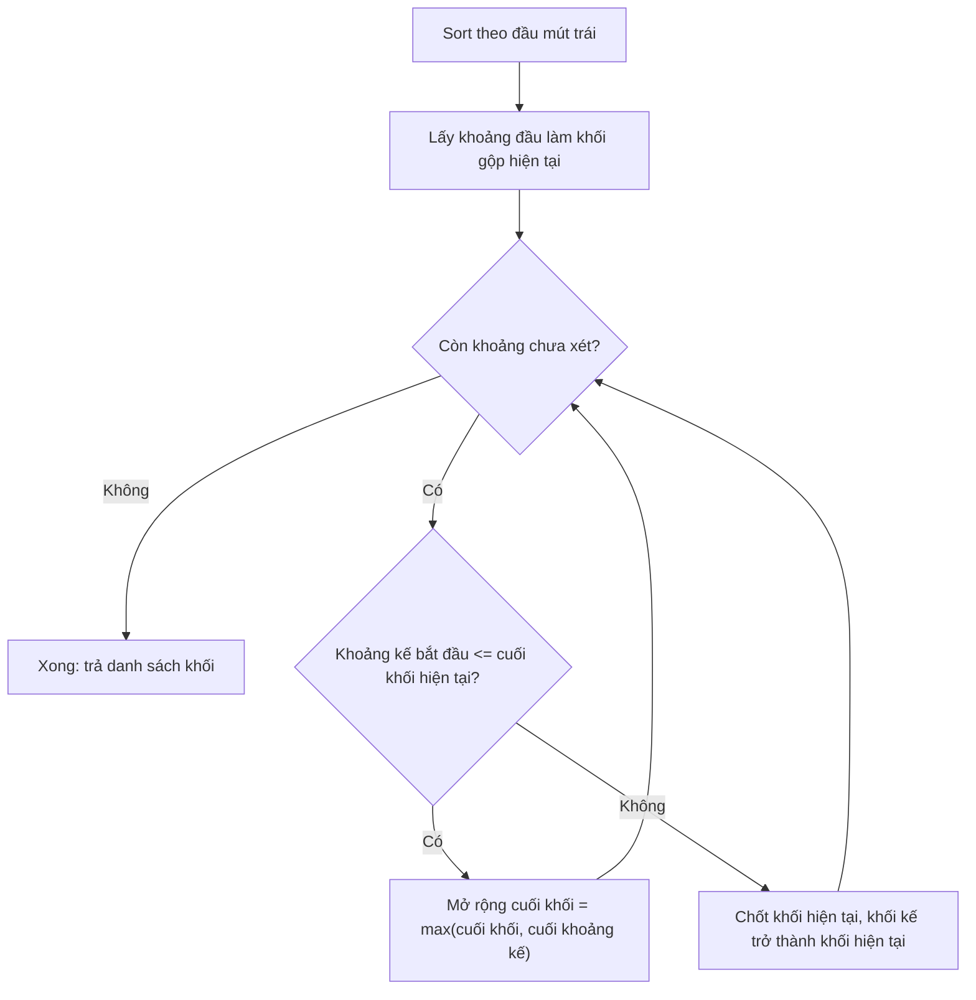

# Khoảng thời gian và lịch trình: merge, phòng họp, lịch tối ưu

Hệ thống đặt lịch họp, đặt phòng khách sạn hay đặt vé máy bay đều quy về cùng một câu hỏi: cho một tập các khoảng thời gian `[start, end]`, chúng chồng nhau ở đâu, cần bao nhiêu tài nguyên để phục vụ hết, hoặc chọn tập con nào để tối đa số lượng hay tổng giá trị. Bài "Gộp khoảng" và "Lịch họp nhiều nhất" đã được nhắc tên ở bài Greedy, nhưng ở đó chỉ là một dòng trong bảng; bài này đi vào cách cài, chứng minh và các biến thể hay gặp.

**Tóm tắt:**

- Phần lớn bài khoảng quy về hai bước: sort theo một tiêu chí (đầu mút trái, phải, hoặc hết hạn), rồi quét một lượt O(n).
- Hai khoảng `[a, b]` và `[c, d]` chồng nhau khi `a < d && c < b` (hoặc `<=` nếu cho phép chạm biên).
- Gộp khoảng: sort theo đầu mút trái, gộp khi khoảng sau bắt đầu trước hoặc bằng lúc khoảng gộp hiện tại kết thúc.
- Số phòng họp tối thiểu: sort theo giờ bắt đầu, dùng min-heap giữ giờ kết thúc của các phòng đang bận; heap nhỏ nhất `<=` giờ bắt đầu hiện tại thì tái sử dụng phòng đó.
- Lịch họp nhiều nhất không chồng: sort theo giờ **kết thúc**, luôn chọn cuộc tiếp theo không chồng cuộc vừa chọn; đây là greedy đã chứng minh đúng bằng exchange argument.
- Khi mỗi cuộc có trọng số khác nhau (không chỉ đếm số lượng mà tối đa tổng giá trị), greedy theo giờ kết thúc không còn đúng; phải chuyển sang quy hoạch động kết hợp binary search, O(n log n).
- Bẫy thường gặp: nhầm điều kiện chồng lấn dùng `<=` hay `<`, quên sort trước khi quét, và lẫn giữa "sort theo đầu" với "sort theo cuối" tùy bài.

## Vì sao một tiêu chí sort quyết định cả bài

Khoảng thời gian không có thứ tự tự nhiên như số: `[1, 10]` và `[2, 3]` cái nào "nhỏ hơn"? Câu trả lời phụ thuộc vào việc bạn đang hỏi gì. Muốn gộp các khoảng chồng nhau thành khối liền mạch thì cần duyệt từ trái sang phải, nên sort theo **điểm bắt đầu**. Muốn chọn được nhiều cuộc họp nhất có thể, bạn muốn chừa lại càng nhiều thời gian trống cho các cuộc sau càng tốt, nên sort theo **điểm kết thúc**. Chọn sai tiêu chí sort thường vẫn chạy ra một con số, nhưng là con số sai mà không có lỗi runtime nào báo cho bạn biết.

**Nền tảng:** Hai khoảng `[a, b)` và `[c, d)` chồng nhau khi và chỉ khi `a < d` và `c < b`; nếu đề cho phép "chạm biên nhưng không tính là chồng" (một cuộc hết lúc 9h, cuộc khác bắt đầu lúc 9h là hợp lệ) thì đổi `<` thành `<=` ở đúng chỗ ranh giới đó, và đây là điểm hay bị hỏi lại trong phỏng vấn.

## Khi nào dùng tiêu chí nào

- **Gộp các khoảng chồng nhau thành danh sách khối liền mạch:** sort theo đầu mút trái, quét một lượt, so khoảng hiện tại với khối đang gộp.
- **Đếm tài nguyên cần thiết tại mọi thời điểm (bao nhiêu phòng họp, bao nhiêu xe cùng lúc):** sort theo giờ bắt đầu, theo dõi các khoảng đang "sống" bằng min-heap hoặc kỹ thuật sweep line (sự kiện +1 lúc bắt đầu, -1 lúc kết thúc).
- **Chọn tối đa số khoảng không chồng, mọi khoảng giá trị như nhau:** sort theo giờ kết thúc, greedy chọn khoảng không chồng cuộc vừa chọn. Đây chính là bài "lịch họp nhiều nhất" đã nêu ở bài Greedy, chứng minh bằng exchange argument.
- **Chọn tối đa tổng giá trị khi mỗi khoảng có trọng số khác nhau:** greedy theo giờ kết thúc không còn đúng (một cuộc ngắn kết thúc sớm có thể có giá trị thấp hơn nhiều so với bỏ qua nó để lấy một cuộc dài giá trị cao), phải dùng quy hoạch động.

**Phải thuộc:** Gộp khoảng và đếm tài nguyên sort theo đầu mút trái (hoặc theo sự kiện); chọn tối đa **số lượng** khoảng không chồng sort theo đầu mút phải (giờ kết thúc) và tham lam; chọn tối đa **tổng giá trị trọng số** phải chuyển sang DP, không còn tham lam đúng được nữa.

## Các khái niệm cần biết

| Khái niệm | Là gì | Vì sao quan trọng |
|---|---|---|
| **Khoảng (interval)** | Cặp `[start, end]` biểu diễn một đoạn thời gian hoặc giá trị | Đơn vị cơ bản của mọi bài trong nhóm này |
| **Chồng lấn (overlap)** | Hai khoảng có phần giao khác rỗng | Điều kiện quyết định có cần gộp hay cần thêm tài nguyên |
| **Sweep line** | Quét các mốc thời gian theo thứ tự tăng dần, cộng/trừ bộ đếm tại mỗi mốc | Thay vì so từng cặp khoảng O(n²), chỉ cần sort mốc và quét O(n log n) |
| **Exchange argument** | Kỹ thuật chứng minh một lựa chọn greedy không làm lời giải tối ưu xấu đi | Dùng để tin tưởng greedy theo giờ kết thúc là đúng, xem lại bài Greedy |
| **Interval scheduling vs weighted interval scheduling** | Bài đầu tối đa **số lượng**, bài sau tối đa **tổng trọng số** | Bài đầu giải bằng greedy O(n log n), bài sau cần DP + binary search |

## Gộp khoảng (Merge Intervals)



```java
int[][] merge(int[][] intervals) {
    Arrays.sort(intervals, (a, b) -> a[0] - b[0]);           // sort theo đầu mút trái
    List<int[]> out = new ArrayList<>();
    for (int[] cur : intervals) {
        if (out.isEmpty() || cur[0] > out.get(out.size() - 1)[1]) {
            out.add(cur);                                      // không chồng khối cuối: thêm khối mới
        } else {
            out.get(out.size() - 1)[1] = Math.max(out.get(out.size() - 1)[1], cur[1]);  // mở rộng khối cuối
        }
    }
    return out.toArray(new int[0][]);
}
```

Trace `[[1,3],[2,6],[8,10],[15,18]]` (đã chạy, kết quả `[[1,6],[8,10],[15,18]]`):

| Khoảng đang xét | Khối cuối trước đó | So sánh | Hành động | Khối cuối sau |
|---|---|---|---|---|
| `[1,3]` | (chưa có) | — | thêm khối mới | `[1,3]` |
| `[2,6]` | `[1,3]` | `2 <= 3` | mở rộng | `[1,6]` |
| `[8,10]` | `[1,6]` | `8 > 6` | thêm khối mới | `[8,10]` |
| `[15,18]` | `[8,10]` | `15 > 10` | thêm khối mới | `[15,18]` |

Bẫy: nếu không sort trước, khoảng `[2,6]` có thể đứng trước `[1,3]` trong input và thuật toán quét một lượt sẽ bỏ sót việc gộp.

## Số phòng họp tối thiểu (Meeting Rooms II)

Vấn đề: biết lịch của mọi cuộc họp, cần bao nhiêu phòng để không cuộc nào phải chờ. Ý tưởng: sort theo giờ bắt đầu; với mỗi cuộc mới, hỏi "phòng nào đã trống (cuộc trước đó đã kết thúc) tại thời điểm này chưa" bằng một min-heap giữ giờ kết thúc của các phòng đang bận. Nếu giờ kết thúc nhỏ nhất trong heap `<=` giờ bắt đầu cuộc mới, tái sử dụng phòng đó; ngược lại phải mở phòng mới.

```java
int minMeetingRooms(int[][] intervals) {
    Arrays.sort(intervals, (a, b) -> a[0] - b[0]);            // sort theo giờ bắt đầu
    PriorityQueue<Integer> endTimes = new PriorityQueue<>();  // min-heap giờ kết thúc các phòng đang bận
    for (int[] m : intervals) {
        if (!endTimes.isEmpty() && endTimes.peek() <= m[0]) {
            endTimes.poll();                                   // phòng này đã trống, tái sử dụng
        }
        endTimes.offer(m[1]);                                  // dù tái sử dụng hay mở mới, đẩy giờ kết thúc mới vào
    }
    return endTimes.size();                                    // số phần tử còn lại trong heap = số phòng đang cần
}
```

Trace `[[0,30],[5,10],[15,20]]` (đã chạy, kết quả 2):

| Cuộc họp | Heap trước | Đỉnh heap `<=` giờ bắt đầu? | Hành động | Heap sau |
|---|---|---|---|---|
| `[0,30]` | `{}` | heap rỗng, không tái sử dụng | mở phòng mới | `{30}` |
| `[5,10]` | `{30}` | `30 <= 5`? không | mở phòng mới | `{10, 30}` |
| `[15,20]` | `{10, 30}` | `10 <= 15`? có | tái sử dụng, thay 10 bằng 20 | `{20, 30}` |

Kết quả: heap còn 2 phần tử nên cần 2 phòng. Cách đọc: cuộc `[5,10]` phải mở phòng mới vì phòng đầu (bận tới 30) chưa trống; cuộc `[15,20]` tái sử dụng được phòng vừa trống lúc 10h.

**Suy luận:** heap luôn giữ đúng giờ kết thúc của mỗi phòng **đang hoạt động** tại thời điểm xử lý cuộc họp hiện tại, vì ta sort theo giờ bắt đầu nên không bao giờ xử lý một cuộc trước khi các cuộc bắt đầu sớm hơn nó đã được gán phòng. Kích thước heap tại mọi thời điểm chính là số phòng đang bận cùng lúc, và giá trị lớn nhất mà kích thước heap từng đạt tới trong suốt quá trình quét chính là số phòng tối thiểu cần có — nhưng vì ta không bao giờ bỏ phần tử ra khỏi heap trừ khi tái sử dụng (tổng kích thước không giảm xuống dưới mức đã cần), kích thước heap ở cuối vòng lặp đúng bằng giá trị lớn nhất đó. Một cách tương đương và trực quan hơn là kỹ thuật sweep line: biến mỗi khoảng thành hai sự kiện `(start, +1)` và `(end, -1)`, sort mọi sự kiện theo thời gian (sự kiện `-1` xử lý trước `+1` nếu trùng mốc, để cho phép tái sử dụng phòng ngay lúc trống), cộng dồn và lấy giá trị lớn nhất.

## Lịch họp nhiều nhất không chồng (ôn lại và mở rộng)

Bài này đã nêu ở phần Greedy của bài Backtracking/Greedy: sort theo giờ kết thúc, luôn giữ `lastEnd` của cuộc vừa chọn, duyệt và chọn cuộc tiếp theo có giờ bắt đầu `>= lastEnd`.

```java
int maxNonOverlapping(int[][] meetings) {
    Arrays.sort(meetings, (a, b) -> a[1] - b[1]);     // sort theo giờ kết thúc
    int count = 0, lastEnd = Integer.MIN_VALUE;
    for (int[] m : meetings) {
        if (m[0] >= lastEnd) { count++; lastEnd = m[1]; }
    }
    return count;
}
```

Trace `[[1,3],[2,5],[4,7],[6,9],[8,10]]` (đã chạy, kết quả 3, chọn `[1,3]`, `[4,7]`, `[8,10]`):

| Cuộc họp (đã sort theo kết thúc) | `lastEnd` trước | `start >= lastEnd`? | Hành động | `lastEnd` sau |
|---|---|---|---|---|
| `[1,3]` | `-∞` | có | chọn | `3` |
| `[2,5]` | `3` | `2 >= 3`? không | bỏ qua | `3` |
| `[4,7]` | `3` | `4 >= 3`? có | chọn | `7` |
| `[6,9]` | `7` | `6 >= 7`? không | bỏ qua | `7` |
| `[8,10]` | `7` | `8 >= 7`? có | chọn | `10` |

Chứng minh greedy đúng (exchange argument, nhắc lại từ bài Greedy): nếu lời giải tối ưu không chọn cuộc kết thúc sớm nhất trong số các cuộc có thể chọn đầu tiên, ta luôn thay được lựa chọn đầu tiên của nó bằng cuộc kết thúc sớm nhất mà không làm giảm số lượng chọn được ở phần còn lại, vì khoảng trống chừa lại chỉ rộng ra chứ không hẹp đi.

## Khi trọng số khác nhau: Weighted Interval Scheduling

Nếu mỗi cuộc họp có một giá trị (trọng số) khác nhau và mục tiêu là tối đa **tổng giá trị** chứ không phải số lượng, greedy theo giờ kết thúc không còn đúng: bỏ qua một cuộc ngắn giá trị thấp để lấy một cuộc dài giá trị cao có thể lợi hơn. Đây là lúc quay lại quy hoạch động (xem bài Quy hoạch động).

Cách làm: sort theo giờ kết thúc. Với mỗi việc `i`, gọi `p(i)` là chỉ số lớn nhất `j < i` sao cho `end[j] <= start[i]` (tìm bằng binary search vì mảng đã sort theo end). Công thức:

```text
dp[i] = max(dp[i-1], weight[i] + dp[p(i)])
```

Nghĩa là tại việc `i`, hoặc bỏ qua nó (`dp[i-1]`), hoặc nhận nó cộng với lời giải tốt nhất của các việc tương thích đứng trước nó (`weight[i] + dp[p(i)]`).

```java
int weightedScheduling(int[][] jobs) { // mỗi job: {start, end, weight}, đã sort theo end
    int n = jobs.length;
    int[] dp = new int[n + 1];
    for (int i = 1; i <= n; i++) {
        int[] job = jobs[i - 1];
        int lo = 0, hi = i - 1;                      // binary search p(i) trong dp[0..i-1]
        while (lo < hi) {
            int mid = (lo + hi + 1) / 2;
            if (jobs[mid - 1][1] <= job[0]) lo = mid; else hi = mid - 1;
        }
        int withJob = job[2] + dp[lo];
        dp[i] = Math.max(dp[i - 1], withJob);
    }
    return dp[n];
}
```

Trace với job `{start, end, weight}` đã sort theo `end`: `J1{1,3,5}`, `J2{2,5,6}`, `J3{4,6,5}`, `J4{6,7,4}` (đã chạy, kết quả 14):

| i | Job | `p(i)` (job cuối cùng tương thích) | `dp[i-1]` | `weight + dp[p(i)]` | `dp[i]` |
|---|---|---|---|---|---|
| 1 | J1(1,3,5) | 0 (không có) | 0 | 5+0=5 | 5 |
| 2 | J2(2,5,6) | 0 (J1 kết thúc 3 > bắt đầu 2 của J2, không tương thích) | 5 | 6+0=6 | 6 |
| 3 | J3(4,6,5) | 1 (J1 kết thúc 3 `<=` 4) | 6 | 5+dp[1]=5+5=10 | 10 |
| 4 | J4(6,7,4) | 3 (J3 kết thúc 6 `<=` 6) | 10 | 4+dp[3]=4+10=14 | 14 |

Kết quả 14 đạt được bằng J1 + J3 + J4 (`5 + 5 + 4 = 14`), không phải bằng cách tham lam chọn J1 rồi J2 (sẽ bị kẹt vì J2 chồng J3). Độ phức tạp O(n log n): sort O(n log n), mỗi `p(i)` tìm bằng binary search O(log n).

**Phải thuộc:** Weighted interval scheduling khác interval scheduling thường ở chỗ phải dùng DP (`dp[i] = max(dp[i-1], weight[i] + dp[p(i)])`) thay vì tham lam, vì trọng số khác nhau phá vỡ tính an toàn của lựa chọn "kết thúc sớm nhất". `p(i)` tìm bằng binary search trên mảng đã sort theo giờ kết thúc, giữ độ phức tạp tổng thể ở O(n log n).

## Điều cần nhớ

- Luôn xác định rõ điều kiện chồng lấn dùng `<` hay `<=` trước khi viết code; đây là nguồn lỗi off-by-one phổ biến nhất của nhóm bài này.
- Sort theo đầu mút trái cho bài gộp/đếm tài nguyên; sort theo đầu mút phải (giờ kết thúc) cho bài tối đa số lượng không chồng.
- Thêm trọng số khác nhau vào bài tối đa số lượng là tín hiệu phải đổi từ greedy sang DP + binary search.
