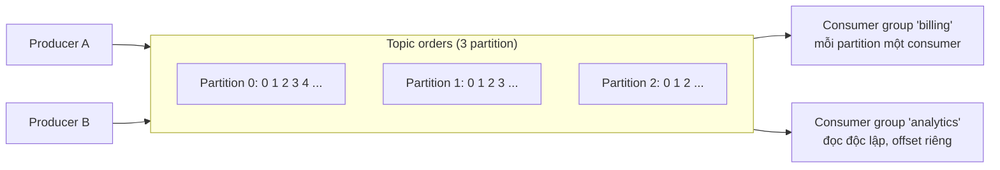
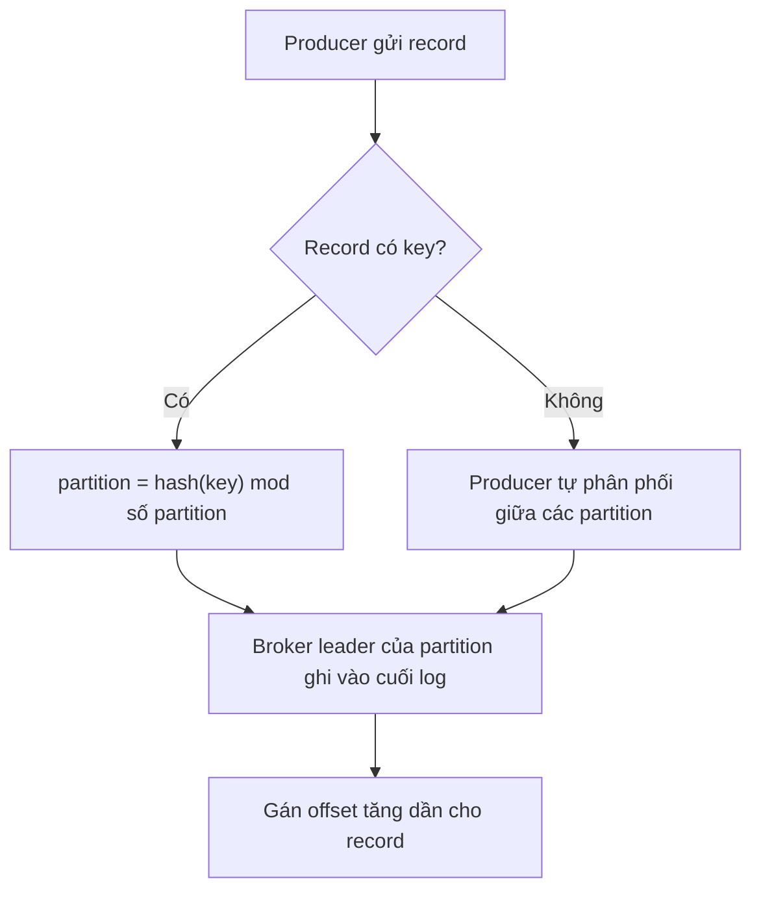
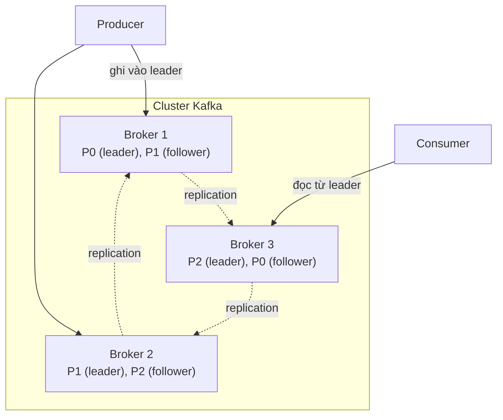

# Lý thuyết 01: Kafka tổng quan

Xem thêm: [Kiến trúc hướng event với Kafka (Spring Boot)](/go?p=01-Spring-Boot%2Fhard%2Flt-07-event-driven-kafka.md), [Message Queue (System Design)](/go?p=15-System%20Design%2Fmedium%2Flt-06-message-queue.md), [Distributed Message Queue](/go?p=15-System%20Design%2Fhard%2F05-distributed-message-queue.md).

**Tóm tắt:**

- Kafka là log event phân tán: record được ghi nối đuôi vào log của từng partition, lưu bền trên đĩa và không bị xóa khi consumer đọc.
- Mỗi consumer group tự giữ offset riêng, nên nhiều hệ thống đọc cùng dữ liệu độc lập và có thể replay; dữ liệu chỉ bị xóa theo retention hoặc compaction.
- Thứ tự chỉ có trong một partition; cùng key thì cùng partition (hash(key) mod số partition), nên gửi event của một entity với cùng key để giữ thứ tự.
- Số partition là trần parallelism của một consumer group, vì mỗi partition tại một thời điểm chỉ gán cho một consumer trong group.
- Offset là số thứ tự record trong một partition và chỉ duy nhất trong partition đó.
- Mỗi partition có một leader nhận ghi và các follower replicate từ leader; từ Kafka 4.0, controller chạy ở chế độ KRaft và không còn ZooKeeper.
- Khác queue truyền thống như RabbitMQ: Kafka là log bền để đọc lại nhiều lần, còn broker kiểu queue đẩy tin và xóa khi được ack.

## Kafka là gì?

Hãy hình dung một cuốn sổ ghi chép chỉ được viết nối tiếp vào trang cuối, không được tẩy xóa. Nhiều người có thể cùng đọc cuốn sổ đó, và mỗi người tự đặt một cái bookmark để nhớ mình đã đọc đến đâu. Kafka hoạt động giống vậy. Nó là nền tảng **log event phân tán**: các record được ghi nối tiếp vào cuối một log theo từng partition, lưu bền trên đĩa, và nhiều consumer đọc độc lập bằng cách giữ **offset** (cái bookmark) riêng. Điểm khác biệt quan trọng: Kafka không xóa record khi consumer đọc xong.

**Nền tảng:** Kafka là log event phân tán: record được ghi nối đuôi vào log của từng partition, lưu bền trên đĩa và không bị xóa khi consumer đọc. Mỗi consumer group tự giữ offset riêng, nên nhiều hệ thống đọc cùng dữ liệu độc lập và có thể phát lại (replay); dữ liệu chỉ bị xóa theo retention hoặc compaction.

## Vấn đề nó giải quyết

Queue truyền thống xóa message ngay khi đã được nhận. Điều đó kéo theo ba khó khăn: không đọc lại được khi cần xử lý lại, khó cho nhiều hệ thống cùng đọc một dòng dữ liệu (phải replication tin sang nhiều queue), và khó chịu tải lớn. Kafka giải quyết bằng một log bất biến ghi tuần tự trên đĩa. Ghi tuần tự cho throughput rất cao, giữ lại dữ liệu cho phép phát lại (replay), và việc mỗi bên đọc tự giữ offset giúp tách rời hoàn toàn bên gửi với bên nhận.

## Khi nào nên dùng, khi nào không

Kafka hợp với event stream lớn (clickstream, log, metric), tích hợp giữa nhiều service theo hướng event (event-driven), CDC từ database, pipeline dữ liệu và event sourcing. Nó không hợp khi bạn chỉ cần một queue tác vụ nhỏ có ack từng message, khi cần độ trễ cực thấp kiểu RPC, hoặc khi cần định tuyến phức tạp theo nội dung message. Chọn nhầm sẽ dẫn đến vận hành nặng nề cho một nhu cầu đơn giản, hoặc phải tự xây lại những thứ queue truyền thống có sẵn (retry từng message, DLQ).

## Cách nó chạy, nói gọn

Producer gửi record tới một topic. Kafka chọn partition dựa trên key của record. Broker ghi vào cuối log của partition đó và replicate sang các broker khác. Các consumer trong cùng một consumer group chia nhau các partition, mỗi consumer theo dõi offset của mình.

## Các khái niệm cần biết

- **Event / record**: một sự việc đã xảy ra (đơn hàng được tạo, người dùng bấm node). Kafka lưu nó thành một record gồm key, value, timestamp và header.
- **Key**: giá trị dùng để chọn partition; cùng key thì cùng partition. Dùng khi cần giữ thứ tự theo entity (ví dụ theo `orderId`).
- **Serializer / deserializer**: Kafka chỉ lưu mảng byte, nên producer cần serializer để biến key và value thành byte, consumer cần deserializer để đọc lại. Hai bên phải thống nhất định dạng, nếu không consumer sẽ lỗi khi đọc.
- **`bootstrap.servers`**: danh sách một vài broker để client kết nối lần đầu; từ đó client tự biết cả cluster.
- **Controller / KRaft**: controller là thành phần điều phối metadata của cluster (ai là leader của partition nào). KRaft là cơ chế bầu chọn và lưu metadata ngay trong Kafka, thay thế ZooKeeper.
- **CDC (Change Data Capture)**: kỹ thuật bắt từng thay đổi (insert, update, delete) của database và phát ra thành event stream, ví dụ bằng Debezium.
- **Event sourcing**: lưu mọi thay đổi trạng thái dưới dạng chuỗi event thay vì chỉ lưu trạng thái hiện tại; trạng thái được dựng lại bằng cách phát lại chuỗi đó.
- **DLQ (dead letter queue)**: nơi chuyển các message xử lý lỗi nhiều lần để không chặn main thread.
- **Ack (acknowledgement)**: lời xác nhận đã nhận hoặc đã xử lý tin; ở Kafka consumer xác nhận bằng cách commit offset.

## Mô hình khái niệm



Đọc sơ đồ: hai producer cùng ghi vào topic `orders`, topic được chia thành 3 partition. Hai consumer group đọc cùng topic nhưng độc lập nhau: nhóm `billing` chia partition cho các thành viên của nó, nhóm `analytics` có offset riêng nên không ảnh hưởng nhóm kia. Bảng dưới tóm tắt từng khái niệm trong sơ đồ.

| Khái niệm | Ý nghĩa |
|---|---|
| **Record** | Một record gồm key (có thể rỗng), value, timestamp, header |
| **Topic** | Tên logic của một event stream, chia thành nhiều partition |
| **Partition** | Một log có thứ tự, chỉ ghi nối vào cuối; đơn vị parallelism và đơn vị replication |
| **Offset** | Số thứ tự của record **trong một partition**, tăng dần, không dùng lại |
| **Broker** | Một server Kafka lưu các partition |
| **Consumer group** | Nhóm consumer chia nhau partition; mỗi partition tại một thời điểm chỉ có một consumer trong nhóm đọc |
| **Replica** | Replica của partition trên broker khác (leader và follower) |

## Thứ tự: chỉ có trong một partition

Đây là điểm bị hiểu sai nhiều nhất.

- Trong **một partition**, record được ghi và đọc đúng thứ tự offset.
- Giữa **các partition** của cùng topic không có thứ tự toàn cục nào.
- Muốn các event của cùng một entity (ví dụ một đơn hàng) giữ thứ tự, gửi chúng với **cùng key** để rơi vào cùng partition.

```java
// Cùng orderId => cùng partition => giữ thứ tự tạo, thanh toán, hủy
producer.send(new ProducerRecord<>("orders", orderId, eventJson));
```

Vậy Kafka chọn partition thế nào? Có key thì hash key rồi chia lấy dư cho số partition, nên cùng key luôn vào cùng partition (miễn số partition không đổi). Không có key thì producer tự phân phối để các partition được dùng đều.



Hệ quả thiết kế: số partition là trần của độ parallelism phía consumer trong một group. 12 partition thì tối đa 12 consumer trong group cùng làm việc có ích; consumer thứ 13 ngồi chờ.

**Phải thuộc:** Thứ tự chỉ có trong một partition, không có thứ tự toàn topic. Cùng key thì cùng partition (hash(key) mod số partition), nên gửi event của một entity với cùng key để giữ thứ tự. Số partition là trần độ parallelism của một consumer group.

**Suy luận:** Kafka muốn ghi nhanh và scale ngang, nên chia topic thành nhiều partition, mỗi partition là một log độc lập có thể nằm trên broker khác và được ghi, đọc parallel. Trong một partition, record nối đuôi nhau nên thứ tự là tự nhiên; giữa các partition không có đồng hồ chung hay bước điều phối nào, nên thứ tự giữa chúng không được định nghĩa. Vì thế bảo đảm thứ tự của Kafka là bảo đảm theo partition, và muốn các event của một entity (ví dụ một đơn hàng) giữ thứ tự thì phải đưa chúng vào cùng một partition bằng cách dùng cùng key; producer tính hash(key) mod số partition để chọn. Từ đây suy ra hai hệ quả. Số partition là trần của parallelism: một partition chỉ gán cho một consumer trong group để giữ thứ tự, nên topic có 6 partition thì consumer thứ bảy trong group chỉ ngồi chờ. Và đổi số partition làm đổi kết quả hash(key) mod N, nên key cũ có thể sang partition khác và thứ tự theo key bị gãy ở thời điểm chuyển. Điểm dễ nhầm là mong có thứ tự toàn topic; nếu thật sự cần, chỉ còn cách dùng một partition và đánh đổi toàn bộ throughput. Khi thiết kế, hãy chọn key theo entity cần giữ thứ tự và ước lượng số partition ngay từ đầu.

## Retention: Kafka không xóa khi đọc

Kafka giữ record theo chính sách của topic, không theo việc đã có ai đọc hay chưa.

| Chính sách | Cấu hình | Ý nghĩa |
|---|---|---|
| Theo thời gian | `retention.ms` | Xóa segment cũ hơn mốc này |
| Theo kích thước | `retention.bytes` | Giới hạn dung lượng mỗi partition |
| Compaction | `cleanup.policy=compact` | Chỉ giữ record mới nhất theo mỗi key (dùng cho trạng thái, changelog) |

Offset của consumer và dữ liệu trong log là hai thứ tách biệt: consumer chỉ nhớ "tôi đã đọc đến đâu", còn log tồn tại theo retention. Nhờ vậy một service mới có thể đọc lại từ đầu, hoặc một consumer lỗi có thể tua lại offset để xử lý lại. Xóa diễn ra theo **segment** (đơn vị file của log), nên dữ liệu có thể tồn tại lâu hơn mốc retention một chút. Chi tiết ở [bài 04](/go?p=06-Distributed-Systems%2FKafka%2Fhard%2Flt-04-kafka-noi-bo-replication.md).

**Phải thuộc:** Offset là số thứ tự record trong một partition, chỉ duy nhất trong partition đó. Mỗi partition tại một thời điểm chỉ gán cho một consumer trong group. Retention theo thời gian (retention.ms), theo kích thước (retention.bytes), hoặc compaction (cleanup.policy=compact).

## Kafka và RabbitMQ (queue truyền thống)

| Tiêu chí | Kafka | RabbitMQ / queue truyền thống |
|---|---|---|
| Mô hình | Log bền, consumer tự giữ vị trí đọc | Broker đẩy message, xóa khi được ack |
| Đọc lại | Có (tua offset, trong retention) | Thường không |
| Nhiều bên cùng đọc | Mỗi group một bản đọc độc lập | Cần nhiều queue, mỗi queue một copy |
| Thứ tự | Trong partition | Trong một queue (với một consumer) |
| Routing | Đơn giản: topic và key | Phong phú: exchange, binding, routing key |
| Throughput | Rất cao, ghi tuần tự | Cao nhưng thấp hơn ở tải lớn |
| Mức tin cậy từng message | Ack theo offset (batch) | Ack từng message, retry và DLQ có sẵn |
| Phù hợp | Event stream, tích hợp, phân tích | Queue tác vụ, RPC async, routing linh hoạt |

Ghi chú theo phiên bản: Kafka 4.0 bắt đầu cung cấp bản **early access** của *share groups* (KIP-932), cho phép nhiều consumer cùng chia message trong một partition và ack từng record, gần với ngữ nghĩa queue. Theo thông báo phát hành 4.2.0 tính năng này được tuyên bố sẵn sàng cho production; kiểm tra lại theo phiên bản bạn dùng trước khi áp dụng.

## Kiến trúc cluster một cái nhìn



Đọc sơ đồ: mỗi partition có đúng một leader nằm trên một broker và các follower nằm trên broker khác. Nếu một broker chết, một follower của partition đó được nâng lên làm leader mới nên dữ liệu vẫn truy cập được. Đây là lý do cluster thường có tối thiểu 3 broker.

- Mỗi partition có một **leader** nhận mọi lần ghi và (mặc định) mọi lần đọc; các follower replicate từ leader.
- Điều phối metadata (ai là leader, danh sách topic) do **controller** làm. Từ Kafka 4.0, controller chạy ở chế độ **KRaft**, không còn ZooKeeper (xem [bài 04](/go?p=06-Distributed-Systems%2FKafka%2Fhard%2Flt-04-kafka-noi-bo-replication.md)).

**Nền tảng:** Mỗi partition có một leader nhận ghi và các follower replicate từ leader trên broker khác; broker chết thì một follower được nâng lên làm leader. Từ Kafka 4.0, controller chạy ở chế độ KRaft và không còn ZooKeeper.

## Hello Kafka bằng Java (client thuần)

Hãy xem ví dụ nhỏ nhất: một producer gửi một record, một consumer đọc lại bằng vòng lặp `poll`. Producer gửi async nên kết quả (partition, offset) trả về qua callback. `auto.offset.reset=earliest` nghĩa là nếu group chưa có offset đã lưu thì đọc từ đầu log, nếu bỏ qua thì mặc định là `latest` (chỉ đọc message mới) và bạn có thể thấy "không có gì" dù topic đã có dữ liệu.

```java
Properties p = new Properties();
p.put("bootstrap.servers", "localhost:9092");
p.put("key.serializer", StringSerializer.class.getName());
p.put("value.serializer", StringSerializer.class.getName());

try (var producer = new KafkaProducer<String, String>(p)) {
    producer.send(new ProducerRecord<>("demo", "k1", "xin chào"),
        (meta, ex) -> {
            if (ex == null) System.out.printf("partition=%d offset=%d%n", meta.partition(), meta.offset());
        });
}

Properties c = new Properties();
c.put("bootstrap.servers", "localhost:9092");
c.put("group.id", "demo-group");
c.put("key.deserializer", StringDeserializer.class.getName());
c.put("value.deserializer", StringDeserializer.class.getName());
c.put("auto.offset.reset", "earliest");

try (var consumer = new KafkaConsumer<String, String>(c)) {
    consumer.subscribe(List.of("demo"));
    while (true) {
        for (var r : consumer.poll(Duration.ofMillis(500))) {
            System.out.println(r.key() + " -> " + r.value());
        }
    }
}
```

Chi tiết về ack, retry, offset commit ở [bài 02](/go?p=06-Distributed-Systems%2FKafka%2Fmedium%2Flt-02-producer-consumer-delivery.md).

## Các trường hợp sử dụng điển hình

| Use case | Vì sao hợp Kafka |
|---|---|
| Tích hợp microservices bằng event | Tách rời, nhiều bên cùng đăng ký một event |
| CDC (Debezium) đưa thay đổi DB ra event stream | Log thứ tự theo bảng, replay được |
| Thu thập log và metric | Throughput lớn, đệm giữa nguồn và hệ lưu trữ |
| Event sourcing, changelog | Log bất biến, compaction giữ trạng thái mới nhất |
| Stream processing (Kafka Streams, Flink) | Đọc có thứ tự trong partition, state có checkpoint |

## Bẫy thường gặp

- Tin rằng Kafka bảo đảm thứ tự toàn topic. Thực tế chỉ trong từng partition.
- Coi Kafka như cơ sở dữ liệu tra cứu theo key. Nó là log tuần tự, không có index tra cứu ngẫu nhiên theo giá trị.
- Tạo quá ít partition ngay từ đầu: sau này tăng partition làm đổi phép ánh xạ key sang partition (xem [bài 05](/go?p=06-Distributed-Systems%2FKafka%2Fhard%2Flt-05-kafka-van-hanh-exactly-once.md)).
- Nghĩ rằng đọc xong là mất message như queue; ngược lại, quên rằng retention hết hạn thì mất dữ liệu kể cả consumer chưa đọc.
- Dùng Kafka cho mọi thứ, kể cả tác vụ nền đơn giản nơi một queue nhỏ là đủ.

## Điểm cần nhớ

- Kafka là log phân tán bền: ghi nối đuôi, đọc theo offset, không xóa khi đọc.
- Thứ tự chỉ có trong một partition; dùng cùng key để giữ thứ tự theo entity.
- Số partition quyết định độ parallelism tối đa của một consumer group.
- Mỗi consumer group có offset riêng, nên nhiều hệ thống đọc cùng dữ liệu độc lập.
- Dữ liệu bị xóa theo retention hoặc compaction, không theo việc đã đọc.
- Từ Kafka 4.0 cluster chạy KRaft, không còn ZooKeeper.

## Câu hỏi tự kiểm tra

Với mỗi câu: tự trả lời, nếu bí thì đọc **Gợi ý suy luận**, rồi đối chiếu **Đáp**.

1. Hai record ở hai partition khác nhau cùng có offset 5. Có mâu thuẫn không? Offset là duy nhất trong phạm vi nào?
   - Gợi ý suy luận: offset được ai đánh số, ở đâu (mỗi partition là một log riêng)? Hai log độc lập có chia sẻ bộ đếm không?
   - Đáp: Mỗi partition là một log tuần tự có bộ đếm riêng, nên offset chỉ duy nhất trong một partition của một topic, không phải toàn topic. Không mâu thuẫn.
2. Vì sao hai consumer trong cùng một group không đọc chung một partition?
   - Gợi ý suy luận: nếu hai consumer cùng đọc một partition trong cùng group thì ai giữ offset, và thứ tự xử lý còn đảm bảo không?
   - Đáp: Để giữ thứ tự và offset đơn giản, tại một thời điểm mỗi partition chỉ gán cho một consumer trong group. Vì vậy số partition chặn trên độ parallelism của group.
3. Hai hệ thống khác nhau (billing và analytics) cùng cần đọc đủ mọi event của một topic. Cấu hình thế nào?
   - Gợi ý suy luận: offset được lưu theo cái gì (group)? Group khác nhau có ảnh hưởng đến offset của nhau không?
   - Đáp: Cho mỗi hệ thống một group riêng. Mỗi group giữ offset riêng nên nhận đủ mọi record, độc lập nhau.
4. Làm sao đảm bảo các event của cùng một đơn hàng được xử lý theo đúng thứ tự?
   - Gợi ý suy luận: Kafka chỉ đảm bảo thứ tự ở mức nào? Làm sao ép mọi event của một đơn vào cùng mức đó (key quyết định partition)?
   - Đáp: Thứ tự chỉ có trong một partition, nên gửi với cùng key (orderId) để key được hash về cùng một partition.
5. Consumer đọc xong một record thì record đó có biến mất không, và khi nào dữ liệu mới bị xóa?
   - Gợi ý suy luận: Kafka là log hay queue? Offset của consumer là gì, có liên quan việc xóa dữ liệu không?
   - Đáp: Không. Đọc chỉ dịch offset của group, không xóa. Dữ liệu chỉ bị xóa khi hết retention hoặc bị compaction, kể cả khi consumer chưa đọc.

Nguồn: tài liệu chính thức Apache Kafka (kafka.apache.org), kiểm tra ngày 2026-10-21.

