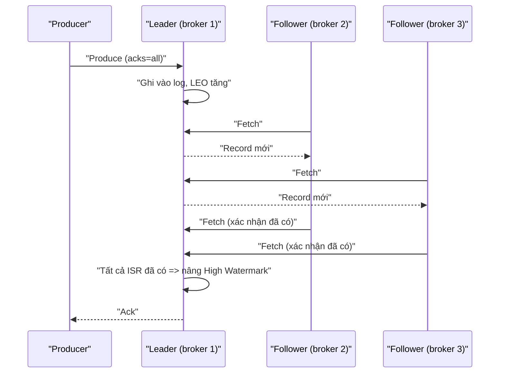
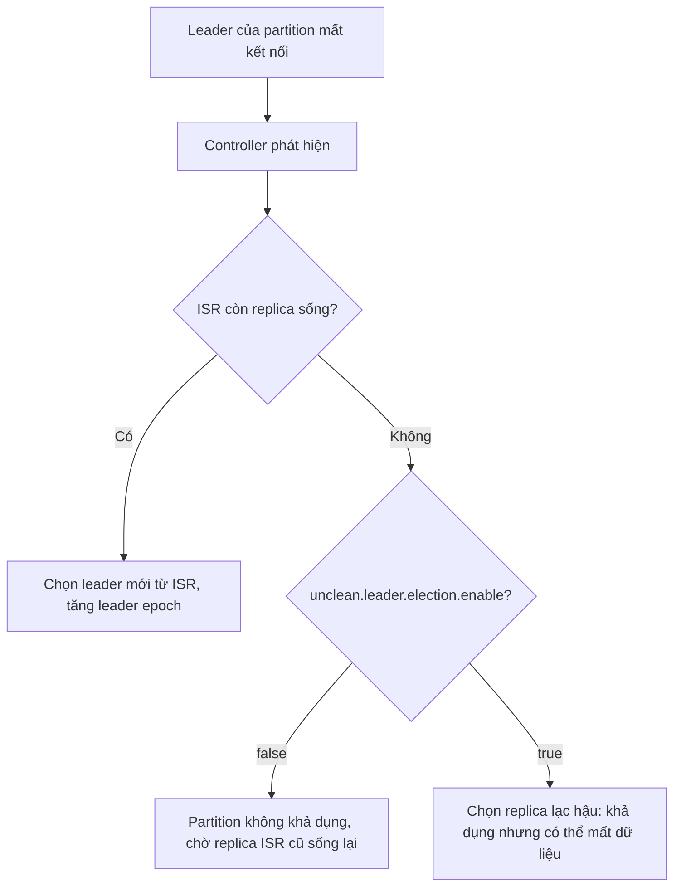
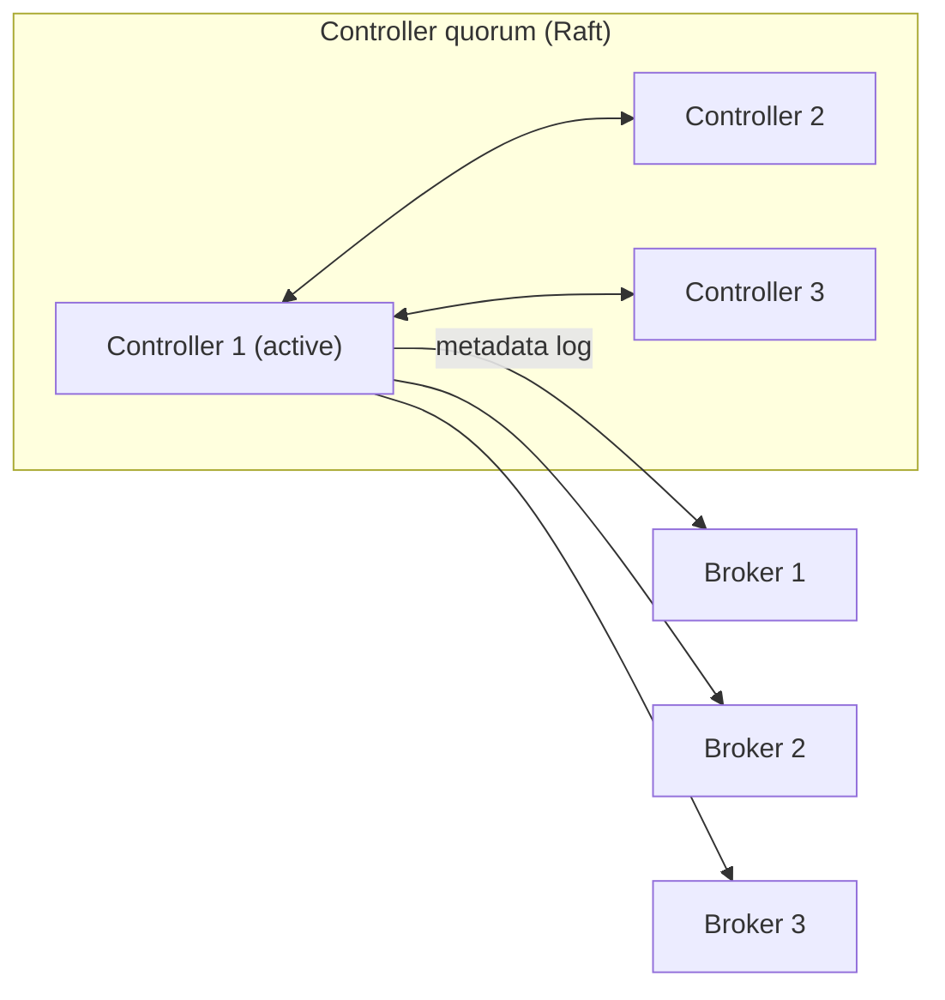
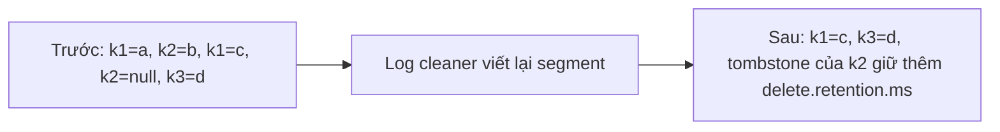

# Lý thuyết 04: Kafka bên trong: log, replication, KRaft

Kiến thức nền: [Kafka tổng quan](/go?p=06-Distributed-Systems%2FKafka%2Feasy%2Flt-01-kafka-tong-quan.md), [Producer, Consumer và giao nhận](/go?p=06-Distributed-Systems%2FKafka%2Fmedium%2Flt-02-producer-consumer-delivery.md). Xem thêm: [Distributed Message Queue](/go?p=15-System%20Design%2Fhard%2F05-distributed-message-queue.md), [CAP và Consistency](/go?p=15-System%20Design%2Fhard%2Flt-05-cap-consistency.md).

**Tóm tắt:**

- Kafka nhanh vì ghi tuần tự vào cuối segment, dựa vào page cache của hệ điều hành và zero-copy khi gửi ra mạng, cộng batch và nén.
- Durability không đến từ fsync từng record mà từ replication trên nhiều broker.
- ISR là tập replica theo kịp leader; high watermark (HW) là offset mà mọi replica trong ISR đều đã có, và consumer chỉ đọc tới HW.
- min.insync.replicas là số replica tối thiểu trong ISR để chấp nhận ghi khi acks=all; cấu hình bền cho dữ liệu quan trọng là replication.factor=3, min.insync.replicas=2, acks=all.
- unclean.leader.election.enable mặc định false: leader chỉ chọn từ ISR; bật true thì khả dụng hơn nhưng có thể mất dữ liệu.
- Controller quản lý metadata cluster; KRaft lưu metadata thành log event được replicate bằng Raft giữa các controller, và Kafka 4.0 chỉ còn KRaft.
- Retention xóa nguyên segment nên dữ liệu có thể sống lâu hơn retention.ms; compaction giữ record mới nhất theo key và xóa key bằng tombstone.

## Vì sao cần hiểu bên trong Kafka?

Nhiều câu hỏi vận hành khó nghe như phép màu cho đến khi bạn biết cơ chế: vì sao mất dữ liệu khi một broker sập, vì sao consumer thấy dữ liệu trễ hơn producer vừa ghi, vì sao có rebalance, vì sao đĩa đầy dù đã đặt retention. Tất cả đều trả lời được từ ba lớp cơ chế bên dưới:

1. **Log và segment trên một broker**: dữ liệu nằm trên đĩa thế nào, vì sao đọc ghi nhanh.
2. **Replication giữa các broker**: ai là leader, bản nào được coi là "đã chắc chắn", chuyện gì xảy ra khi leader chết.
3. **Metadata và bầu leader do controller quản lý**: cluster biết ai đang giữ partition nào bằng cách nào (KRaft).

## Khi nào cần dùng kiến thức này

Khi thiết kế durability (`acks`, `min.insync.replicas`, replication factor), cấu hình retention và compaction, ước lượng kích thước cluster, và xử lý sự cố broker. Nếu bạn chỉ là người dùng client thông thường thì đọc [bài 02](/go?p=06-Distributed-Systems%2FKafka%2Fmedium%2Flt-02-producer-consumer-delivery.md) là đủ; phần này dành cho người chịu trách nhiệm cấu hình durability và vận hành.

## Các khái niệm cần biết

- **Segment**: một file của log, tập hợp các record liên tiếp. Log của partition là chuỗi segment; việc xóa dữ liệu cũ diễn ra theo đơn vị segment.
- **Page cache**: vùng RAM mà hệ điều hành dùng để đệm nội dung file. Kafka tận dụng nó thay vì tự cache, nên đọc dữ liệu vừa ghi gần như không chạm đĩa.
- **Zero-copy**: kỹ thuật để hệ điều hành chuyển dữ liệu từ file ra mạng mà không sao chép qua memory ứng dụng, tiết kiệm CPU.
- **fsync**: lệnh ép hệ điều hành ghi dữ liệu đệm xuống đĩa vật lý. Gọi cho từng record thì rất chậm, nên Kafka mặc định không làm vậy.
- **Quorum / đa số**: quyết định chỉ có hiệu lực khi hơn một nửa số node đồng ý. Ba node chịu được mất một, năm node chịu được mất hai. Raft dùng nguyên tắc này để bầu leader và replicate log.
- **Raft**: giao thức đồng thuận cho phép nhiều node thống nhất một log duy nhất dù có node chết. KRaft là Raft trong Kafka.
- **Tombstone**: record có key nhưng value `null`, đánh dấu xóa key đó trong topic compact.
- **Zombie (leader cũ)**: node tưởng mình vẫn là leader dù cluster đã bầu leader khác, thường do bị cô lập mạng; epoch giúp chặn nó.
- **LEO, ISR, high watermark**: ba khái niệm replication trung tâm, giải thích kỹ ở mục 2.

## 1. Log trên đĩa

Mỗi partition là một thư mục trên broker, chứa một chuỗi **segment**. Chỉ segment cuối (active) được ghi; các segment cũ chỉ đọc.

```text
orders-0/
  00000000000000000000.log        <- dữ liệu segment, tên file = offset đầu tiên
  00000000000000000000.index      <- index offset -> vị trí trong file
  00000000000000000000.timeindex  <- index timestamp -> offset
  00000000000000052310.log        <- segment tiếp theo bắt đầu ở offset 52310
  ...
  leader-epoch-checkpoint
```

- Segment đóng và mở segment mới khi đạt kích thước (`log.segment.bytes`) hoặc quá thời gian (`log.roll.ms`/`log.roll.hours`).
- Index **thưa** (sparse): không có mục cho mỗi record mà cách nhau vài KB. Tìm offset X: tìm segment bằng tên file (tìm nhị phân), tra index để nhảy gần X, rồi quét tuần tự trong khoảng ngắn.
- Retention xóa **nguyên segment**: segment bị xóa khi toàn bộ record trong nó đã vượt giới hạn, nên dữ liệu có thể sống lâu hơn `retention.ms` cho tới khi segment đóng.

### Vì sao nhanh

Nghe thì ngược đời: Kafka ghi mọi thứ ra đĩa mà vẫn nhanh hơn nhiều hệ thống lưu trong memory. Lý do là Kafka chọn cách dùng đĩa mà phần cứng giỏi nhất, tức là tuần tự, và nhường phần còn lại cho hệ điều hành.

| Yếu tố | Cơ chế |
|---|---|
| Ghi tuần tự | Chỉ nối vào cuối file; đĩa (kể cả HDD) tuần tự nhanh hơn ngẫu nhiên nhiều bậc |
| Page cache của hệ điều hành | Kafka không tự cache dữ liệu trong heap; dựa vào page cache. Ghi đi vào cache rồi hệ điều hành flush; đọc dữ liệu mới thường trúng cache |
| Zero-copy (`sendfile`) | Đưa dữ liệu từ page cache thẳng ra socket mà không sao chép qua memory ứng dụng; không áp dụng khi dùng TLS vì phải encrypt |
| Gom batch và nén | Lô nén được lưu và truyền nguyên dạng, ít chi phí xử lý trên broker |
| Heap nhỏ | Dữ liệu không nằm trong heap nên ít áp lực GC; RAM dành cho page cache |

Durability **không** dựa vào fsync mỗi record (mặc định để hệ điều hành flush), mà dựa vào **replication** trên nhiều broker.

**Nền tảng:** Kafka nhanh vì ghi tuần tự vào cuối segment, dựa vào page cache của hệ điều hành và zero-copy (sendfile) khi gửi ra mạng, cộng gom batch và nén. Durability không đến từ fsync từng record mà từ replication trên nhiều broker.

## 2. Replication: leader, follower, ISR

Mỗi partition có `replication.factor` replica: một **leader** và các **follower**. Producer ghi và (mặc định) consumer đọc từ leader. Follower hoạt động như một consumer đặc biệt: gửi `Fetch` tới leader để replicate.



Đọc sơ đồ: producer chỉ nhận ack sau khi mọi replica trong ISR đã có record (với `acks=all`). Follower xác nhận bằng chính lần `Fetch` kế tiếp (offset nó xin chính là offset nó đã có), nên leader biết mà nâng high watermark.

### Các khái niệm

| Khái niệm | Ý nghĩa |
|---|---|
| **LEO** (Log End Offset) | Offset kế tiếp sẽ được ghi trên một replica |
| **ISR** (In-Sync Replicas) | Tập replica (kể cả leader) đang theo kịp leader, không bị tụt quá `replica.lag.time.max.ms` |
| **High watermark (HW)** | Offset lớn nhất mà **mọi replica trong ISR** đều đã có; consumer thường chỉ đọc tới HW |
| `min.insync.replicas` | Số replica tối thiểu trong ISR để chấp nhận ghi khi `acks=all` |

Tại sao consumer chỉ thấy tới HW: record chỉ ở leader (chưa replicate) mà leader sập thì có thể mất; nếu consumer đã đọc nó, sau khi leader mới lên consumer sẽ thấy lịch sử "đổi". HW bảo đảm consumer chỉ thấy dữ liệu đã chắc chắn tồn tại ở mọi replica ISR.

**Phải thuộc:** ISR là tập replica theo kịp leader; high watermark (HW) là offset mà mọi replica trong ISR đều đã có, consumer chỉ đọc tới HW. min.insync.replicas là số replica tối thiểu trong ISR để chấp nhận ghi khi acks=all.

**Suy luận:** Kafka không fsync từng record nên một broker sập có thể mất dữ liệu chưa xuống đĩa; độ bền phải đến từ việc dữ liệu có mặt ở nhiều broker. Nhưng đợi mọi replica, kể cả replica chết hoặc chậm, sẽ làm ghi bị treo, nên Kafka chỉ đợi tập ISR gồm các replica đang theo kịp leader; replica tụt hậu bị loại khỏi ISR và quay lại khi bắt kịp. Từ đó suy ra high watermark: một record chỉ an toàn khi mọi replica trong ISR đã có nó, vì nếu leader chết thì leader mới đến từ ISR và đã chứa record đó; consumer vì thế chỉ được đọc tới HW để không bao giờ thấy record có thể biến mất sau failover. Còn min.insync.replicas giải quyết trường hợp ISR co lại chỉ còn leader: khi đó acks=all chỉ đại diện một replica, nên broker từ chối ghi nếu ISR nhỏ hơn ngưỡng, đổi khả dụng lấy độ bền. Điểm dễ nhầm là tin rằng acks=all tự nó bảo đảm không mất; với min.insync.replicas=1 nó chỉ đợi leader. Khi cấu hình, hãy đặt replication.factor=3, min.insync.replicas=2 và acks=all để chịu được mất một broker mà vẫn ghi được và không mất dữ liệu đã ack.

### Mất dữ liệu xảy ra thế nào, và `min.insync.replicas`

Giả sử `replication.factor=3`, `acks=all`:

| `min.insync.replicas` | Kịch bản: 2 follower tụt, ISR còn chỉ leader | Kết quả |
|---|---|---|
| 1 | Vẫn nhận ghi, "all" = chỉ leader | Leader sập là mất dữ liệu đã ack |
| 2 | Ghi bị từ chối (`NotEnoughReplicas`) | Giữ durability, đổi lại **mất tính sẵn sàng ghi** |

Đây là đánh đổi consistency/availability thực tế. Cấu hình phổ biến cho dữ liệu quan trọng: `replication.factor=3`, `min.insync.replicas=2`, `acks=all`, cho phép chịu mất 1 broker mà vẫn ghi được và không mất dữ liệu.

**Phải thuộc:** Cấu hình bền cho dữ liệu quan trọng: replication.factor=3, min.insync.replicas=2, acks=all; chịu được mất 1 broker mà vẫn ghi được và không mất dữ liệu đã ack, mất 2 broker thì từ chối ghi. unclean.leader.election.enable mặc định false: chọn leader từ ISR, bật true thì khả dụng nhưng có thể mất dữ liệu.

### Bầu leader và unclean election

Khi leader sập, controller chọn leader mới **từ ISR** (mặc định). Quy trình quyết định như sau.



Nếu ISR rỗng (mọi replica sync đã chết):

- `unclean.leader.election.enable=false` (mặc định): partition **không khả dụng** cho đến khi một replica ISR cũ sống lại. Giữ nhất quán.
- `true`: chọn một replica lạc hậu làm leader: partition khả dụng nhưng **mất các record** mà replica đó chưa có, và có thể gây đọc lệch. Chỉ dùng cho dữ liệu chấp nhận mất.

Kafka 4.0 giới thiệu bản **preview** của *Eligible Leader Replicas* (ELR, KIP-966): tập con của ISR bảo đảm có đủ dữ liệu đến high watermark, giúp bầu leader an toàn hơn. Vì mới ở dạng preview trong 4.0, kiểm tra trạng thái ở phiên bản bạn dùng.

### Leader epoch

Mỗi lần đổi leader, số **leader epoch** tăng. Epoch gắn vào record và được lưu trong `leader-epoch-checkpoint`. Khi một replica cũ quay lại, nó hỏi leader mới "epoch của tôi kết thúc ở offset nào" để **cắt bớt** phần log phân kỳ, thay vì dựa vào high watermark như thiết kế cũ (vốn có thể gây mất hoặc lệch dữ liệu). Epoch cũng giúp loại bỏ request từ leader cũ ("zombie") và producer/consumer biết metadata đã lỗi thời.

## 3. Controller và KRaft

**Controller** quản lý metadata cluster: danh sách broker, topic, partition, leader/ISR của từng partition, cấu hình. Trước đây metadata nằm ở ZooKeeper. **KRaft** (Kafka Raft) đưa việc đó vào chính Kafka.



- Metadata là một **log event** (`__cluster_metadata`) được replicate bằng Raft giữa các controller; một controller là leader (active), số lẻ node để có đa số.
- Broker không hỏi từng thay đổi mà đọc log metadata và giữ replica trong memory; thay đổi lan nhanh.
- Mỗi node khai báo `process.roles`: `broker`, `controller`, hoặc cả hai (combined mode). Khuyến nghị cho production: tách controller riêng cho cluster lớn; combined thuận tiện cho cluster nhỏ/dev.
- Kafka 4.0 thêm cơ chế **Pre-Vote** (KIP-996) để giảm bầu cử không cần thiết khi mạng chập chờn.

**Nền tảng:** Controller quản lý metadata cluster (broker, topic, leader, ISR); KRaft lưu metadata thành log event replication bằng Raft giữa các controller (cần đa số, số node lẻ), thay ZooKeeper. Kafka 4.0 chỉ còn KRaft, 3.9 là bản cuối còn hỗ trợ ZooKeeper.

### KRaft so với ZooKeeper

| Tiêu chí | ZooKeeper | KRaft |
|---|---|---|
| Thành phần | Thêm một cluster ZK riêng | Nằm trong Kafka |
| Khôi phục khi controller đổi | Phải nạp lại toàn bộ metadata từ ZK | Controller mới đã có log metadata, nhanh hơn |
| Số partition mở rộng | Bị giới hạn bởi tải metadata | Nâng trần số partition |
| Vận hành | Hai hệ thống, hai bảo mật | Một hệ thống |

Trạng thái theo phiên bản (đã kiểm chứng với thông báo phát hành): Kafka 4.0 là bản lớn đầu tiên chạy hoàn toàn không cần ZooKeeper và KRaft là chế độ mặc định/duy nhất; cluster ZooKeeper phải được chuyển sang KRaft trước khi nâng cấp lên 4.0.x. Bản 3.9 là bản cuối còn hỗ trợ chế độ ZooKeeper, vì vậy lộ trình thường là nâng lên 3.9, di chuyển sang KRaft, rồi lên 4.x. Kafka 4.0 cũng yêu cầu Java 17 cho broker và Java 11 cho client.

## 4. Retention và log compaction

| `cleanup.policy` | Hành vi |
|---|---|
| `delete` (mặc định) | Xóa segment cũ theo `retention.ms`/`retention.bytes` |
| `compact` | Chỉ giữ **record mới nhất cho mỗi key** |
| `compact,delete` | Cả hai |

Dùng `delete` khi dữ liệu là dòng event có hạn dùng (log, clickstream). Dùng `compact` khi bạn chỉ quan tâm giá trị mới nhất của mỗi key, ví dụ hồ sơ khách hàng. Dùng sai (compact cho dữ liệu cần lịch sử) sẽ làm mất các bản cũ không thể khôi phục.



Compaction hoạt động nền: log cleaner chia log thành phần "sạch" (đã compact) và phần "bẩn" (đầu mới); khi tỷ lệ bẩn vượt `min.cleanable.dirty.ratio` nó viết lại các segment, bỏ record cũ trùng key. Điểm chính:

- Thứ tự offset được giữ; offset của record còn lại **không đổi**, chỉ có "lỗ hổng".
- Xóa một key: ghi record **tombstone** (key có, value `null`). Tombstone được giữ thêm `delete.retention.ms` để consumer kịp thấy rồi mới bị xóa.
- Segment đang ghi (active) không bị compact, nên có thể vẫn thấy nhiều record cùng key ở phần đuôi.
- Hợp với: trạng thái/bản chụp mới nhất theo key (cấu hình, hồ sơ), changelog của Kafka Streams, `__consumer_offsets`. Không dùng khi cần lịch sử đầy đủ.

**Phải thuộc:** cleanup.policy: delete (mặc định, xóa segment cũ theo retention.ms hoặc retention.bytes), compact (giữ record mới nhất theo key, offset không đổi), compact,delete. Xóa một key trong topic compact bằng tombstone (value null). Retention xóa nguyên segment nên dữ liệu có thể sống lâu hơn retention.ms.

## 5. Group coordinator và rebalance

Vấn đề: nhiều consumer trong group phải thống nhất ai đọc partition nào, và phải phát hiện khi có consumer chết. Việc đó do group coordinator đảm nhận. Mỗi consumer group có một **group coordinator**: broker là leader của partition của `__consumer_offsets` mà `hash(group.id)` trỏ tới. Coordinator nhận heartbeat, theo dõi thành viên, lưu offset đã commit.

Giao thức cổ điển: khi thành viên đổi, coordinator báo rebalance, một consumer được chọn làm **group leader** tính phân công ở **phía client** và gửi lại coordinator. Với KIP-848 (giao thức consumer mới, GA ở 4.0), việc tính phân công chuyển sang **phía broker**, mỗi consumer chỉ trao đổi với coordinator về phần mình, nên không còn "rào chắn" sync toàn group. Xem [bài 02](/go?p=06-Distributed-Systems%2FKafka%2Fmedium%2Flt-02-producer-consumer-delivery.md).

## 6. Tiered storage (nhận biết)

Vấn đề: giữ dữ liệu nhiều tháng trên đĩa broker rất đắt và làm việc thêm, bớt broker chậm vì phải chép nhiều dữ liệu. Tiered storage (KIP-405) cho phép giữ dữ liệu cũ ở **kho từ xa** (ví dụ object storage) và chỉ giữ phần mới trên đĩa broker: segment đóng được đẩy lên kho ngoài, đĩa cục bộ giữ theo `local.retention.*`, còn tổng retention dài hơn. Lợi ích: lưu lâu rẻ hơn, thêm/bớt broker nhanh hơn vì ít dữ liệu cần di chuyển. Theo thông báo phát hành Kafka 3.9, tính năng này **sẵn sàng cho production từ 3.9** (trước đó ở dạng early access); đọc dữ liệu từ kho ngoài chậm hơn đĩa cục bộ, nên tiêu chí chọn là mẫu truy cập, không phải thay thế đĩa hoàn toàn.

## Bẫy thường gặp

- `replication.factor=3` nhưng `min.insync.replicas=1` rồi tin là an toàn.
- Đặt `acks=all` mà quên rằng ISR co lại thì ack chỉ còn từ leader.
- Bật `unclean.leader.election.enable=true` cho dữ liệu quan trọng.
- Nghĩ retention xóa đúng lúc `retention.ms`; thực tế xóa theo segment đóng.
- Dùng compaction mà không quản lý tombstone, hoặc kỳ vọng compaction xóa ngay.
- Chạy KRaft combined mode trên cluster lớn tải cao rồi controller tranh tài nguyên với broker.
- Đặt heap quá lớn, bỏ đói page cache.

## Điểm cần nhớ

- Log = chuỗi segment; index thưa; retention xóa theo segment.
- Nhanh nhờ ghi tuần tự, page cache và zero-copy; bền nhờ replication, không nhờ fsync từng record.
- ISR và high watermark quyết định record nào "đã chắc chắn" và consumer được thấy gì.
- Durability = `replication.factor` cộng `min.insync.replicas` cộng `acks=all`; đổi lại giảm khả năng ghi khi mất broker.
- KRaft thay ZooKeeper; Kafka 4.0 chỉ còn KRaft.
- Compaction giữ bản mới nhất theo key; tombstone dùng để xóa.

## Câu hỏi tự kiểm tra

Với mỗi câu: tự trả lời, nếu bí thì đọc **Gợi ý suy luận**, rồi đối chiếu **Đáp**.

1. Producer vừa ghi một record vào leader nhưng consumer chưa thấy. Vì sao, và có nên coi đó là lỗi?
   - Gợi ý suy luận: nếu consumer đọc record chỉ có ở leader rồi leader chết, follower lên thay thì record đó còn không? Điểm nào đánh dấu "đã nằm ở mọi replica ISR" (high watermark)?
   - Đáp: Consumer chỉ đọc tới high watermark. Record chưa được ISR replicate đủ có thể mất khi đổi leader nên chưa được phép thấy. Đây là hành vi đúng, không phải lỗi.
2. Mỗi record đều ghi ra đĩa mà Kafka vẫn nhanh. Điều gì giải thích?
   - Gợi ý suy luận: ghi tuần tự nối đuôi khác ghi ngẫu nhiên thế nào? Hệ điều hành đệm dữ liệu ở đâu (page cache)? Gửi dữ liệu ra mạng có cần chép qua mã người dùng không?
   - Đáp: Ghi tuần tự, dùng page cache, zero-copy khi gửi ra socket, và gom batch nén. Durability đến từ replication chứ không từ fsync từng record.
3. Với `replication.factor=3` và `min.insync.replicas=2`, cluster chịu được gì khi broker chết?
   - Gợi ý suy luận: `acks=all` cần bao nhiêu replica trong ISR xác nhận? Mất 1 broker thì ISR còn bao nhiêu, mất 2 thì sao?
   - Đáp: Mất 1 broker: ISR còn 2, vẫn đủ ngưỡng nên ghi được, dữ liệu đã ack không mất. Mất 2: ISR còn 1, thấp hơn ngưỡng nên từ chối ghi để giữ durability.
4. Bật unclean leader election thì được và mất gì?
   - Gợi ý suy luận: nếu mọi replica trong ISR đã chết, chỉ còn replica tụt hậu, có nên cho nó làm leader? Nó thiếu những gì?
   - Đáp: Cho phép replica tụt hậu lên làm leader thì có lại khả năng ghi (sẵn sàng) nhưng có thể mất dữ liệu nó chưa kịp nhận. Đổi nhất quán lấy sẵn sàng.
5. Trong topic compact, làm sao xóa hẳn một key?
   - Gợi ý suy luận: compaction giữ bản mới nhất theo key: nếu bản mới nhất là "không có giá trị" thì sao?
   - Đáp: Gửi tombstone, tức record có key và value null. Compaction sẽ dọn key đó sau một thời gian giữ tombstone.
6. Bỏ ZooKeeper từ phiên bản nào, và vì sao câu hỏi này quan trọng khi lập kế hoạch nâng cấp?
   - Gợi ý suy luận: KRaft thay ZooKeeper từ khi nào ổn định? Bản cuối còn chế độ ZooKeeper là bản nào, nên cluster cũ phải chuyển trước mốc nào?
   - Đáp: Kafka 4.0 chỉ còn KRaft; 3.9 là bản cuối còn hỗ trợ ZooKeeper, nên cluster dùng ZooKeeper phải chuyển sang KRaft trước khi lên 4.0.

Nguồn: tài liệu chính thức Apache Kafka (kafka.apache.org), kiểm tra ngày 2026-10-21.

