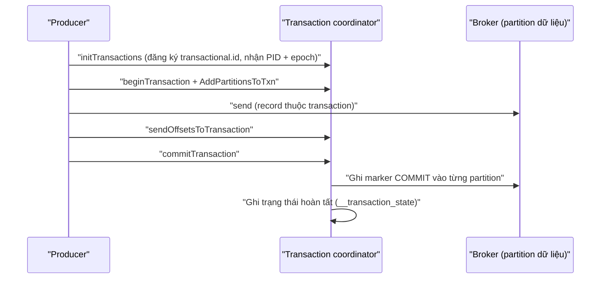
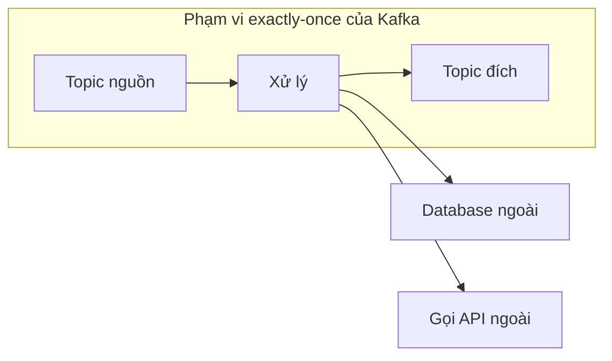
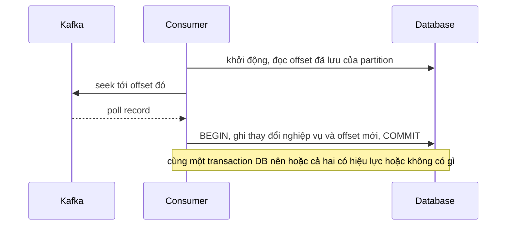
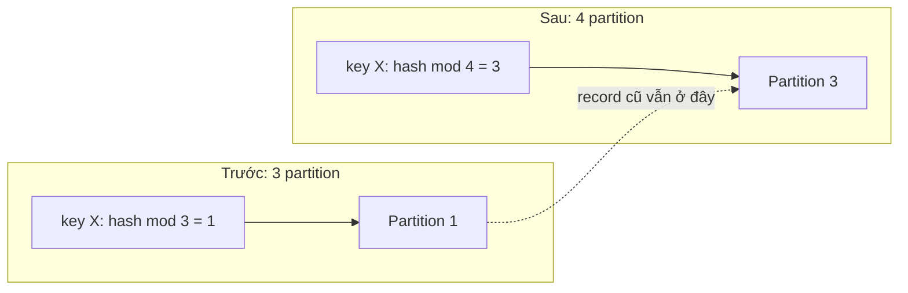
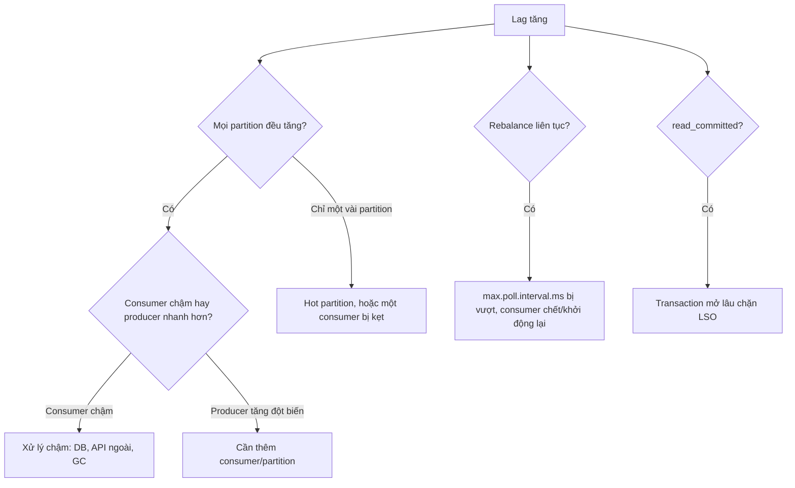

# Lý thuyết 05: Exactly-once, ordering và vận hành

Kiến thức nền: [Producer, Consumer và giao nhận](/go?p=06-Distributed-Systems%2FKafka%2Fmedium%2Flt-02-producer-consumer-delivery.md), [Kafka bên trong](/go?p=06-Distributed-Systems%2FKafka%2Fhard%2Flt-04-kafka-noi-bo-replication.md), [Spring Kafka thực chiến](/go?p=06-Distributed-Systems%2FKafka%2Fmedium%2Flt-03-spring-kafka-thuc-chien.md). Xem thêm: [Distributed lock và Idempotency](/go?p=01-Spring-Boot%2Fhard%2Flt-26-distributed-lock-idempotency.md), [Distributed Transactions](/go?p=15-System%20Design%2Fhard%2Flt-10-distributed-transactions.md), [Chẩn đoán sự cố production](/go?p=07-Interview-QA%2FBackend%2Fhard%2Fqa-18-tinh-huong-su-co-production.md).

Bài này gom ba chủ đề mà người dùng Kafka ở mức sâu hay gặp: (1) exactly-once bằng transaction và giới hạn thật của nó; (2) giữ thứ tự và chia tải bằng cách thiết kế key và partition; (3) vận hành: consumer lag, tăng partition, ước lượng dung lượng và giám sát.

**Tóm tắt:**

- Transaction của Kafka gom ghi nhiều partition và commit offset của consumer thành một khối atomic; transactional.id ổn định và duy nhất cho mỗi instance, epoch chặn (fence) producer cũ (zombie).
- Record abort vẫn nằm trong log nhưng bị consumer read_committed bỏ qua; isolation.level mặc định là read_uncommitted.
- read_committed chỉ đọc tới LSO nên một transaction mở lâu chặn consumer read_committed trên partition đó và làm lag tăng dù broker khỏe.
- Exactly-once của Kafka chỉ đúng trong phạm vi Kafka (Kafka sang Kafka, Streams với exactly_once_v2); ra database hoặc API ngoài phải tự idempotent hoặc lưu offset cùng transaction DB.
- Key quyết định thứ tự theo entity và độ đều của tải; tăng partition làm đổi hash(key) mod N nên thứ tự và state theo key bị lệch, và số partition chỉ tăng được, không giảm.
- Consumer lag là offset cuối trừ offset đã commit: lag tăng trên mọi partition thường do xử lý chậm, chỉ một partition là hot partition hoặc poison record, rebalance liên tục là do vượt max.poll.interval.ms.
- Dung lượng đĩa khoảng throughput ghi nhân retention nhân replication factor.

## Vì sao ba chủ đề này đi cùng nhau

"Exactly-once" là cluster từ bị hiểu sai nhiều nhất trong thế giới Kafka: nhiều người tin rằng bật một cờ là mọi thứ được xử lý đúng một lần, kể cả khi ghi vào database hay gọi API ngoài, và điều đó không đúng. Lag tăng, hot partition và việc tăng partition làm hỏng thứ tự là ba nguồn sự cố production phổ biến nhất. Cả ba đều xuất phát từ việc không hiểu rõ phạm vi bảo đảm của Kafka và vai trò của key.

## Khi nào cần đến kiến thức này

Khi thiết kế data flow có giá trị tiền bạc, khi hệ thống chậm dần theo thời gian, hoặc khi cần mở rộng cluster hay topic. Hướng tiếp cận xuyên suốt: hiểu rằng transaction chỉ phủ phạm vi Kafka, thiết kế idempotent ở đầu cuối cho phần nằm ngoài Kafka, chọn key theo thực thể cần giữ thứ tự, và đo lag cùng các chỉ số broker để phát hiện vấn đề sớm. Nếu flow của bạn chấp nhận được việc xử lý trùng và đã có xử lý idempotent, bạn không cần đến transaction của Kafka, vốn thêm độ trễ và độ phức tạp.

## Các khái niệm cần biết

- **Idempotent producer** (`enable.idempotence=true`): Kafka gán cho producer một PID và đánh số thứ tự mỗi record để broker loại record gửi lặp do retry. Nhờ vậy retry không tạo bản trùng trong một partition.
- **Transaction**: gom nhiều thao tác ghi (và cả việc commit offset) thành một khối "tất cả hoặc không". Dùng cho mẫu đọc, xử lý, ghi trong phạm vi Kafka.
- **Epoch và fencing**: epoch là số tăng dần gắn với một producer. Khi producer mới khởi động với cùng `transactional.id`, epoch tăng và broker từ chối mọi request mang epoch cũ. Việc chặn producer cũ gọi là fence.
- **Zombie**: instance tưởng mình còn sống và vẫn gửi dữ liệu dù đã bị thay thế (do treo lâu, network partition). Nếu không chặn, dữ liệu trùng hoặc sai sẽ lọt vào.
- **LSO (Last Stable Offset)**: offset ngay trước transaction mở sớm nhất; consumer `read_committed` chỉ đọc tới đây.
- **Idempotent xử lý (idempotency)**: làm cùng một thao tác nhiều lần cho kết quả như làm một lần, ví dụ `INSERT ... ON CONFLICT DO NOTHING` theo mã event. Nền tảng của "hiệu quả exactly-once" khi ra ngoài Kafka.
- **Hot partition**: một partition nhận quá nhiều tải so với các partition khác.
- **Consumer lag**: khoảng cách giữa cuối log và vị trí consumer đã commit; thước đo consumer có theo kịp không.
- **Backpressure**: cơ chế báo cho bên gửi (hoặc tự làm chậm bên nhận) khi hệ phía sau không xử lý kịp, để không bị tràn memory.
- **Poison message**: record khiến consumer lỗi lặp đi lặp lại (dữ liệu hỏng, sai định dạng), chặn cả partition nếu không có cách bỏ qua hoặc chuyển sang DLQ.
- **Schema registry / schema evolution**: nơi lưu cấu trúc dữ liệu của event và quy tắc để đổi cấu trúc mà không làm vỡ consumer, xem mục 6.

## 1. Transaction API của Kafka

Vấn đề đặt ra: một bước xử lý đọc từ topic A, ghi kết quả vào topic B và commit offset của A. Nếu ghi B xong mà commit offset thất bại thì khi chạy lại sẽ ghi B lần nữa (trùng); nếu commit trước rồi ghi B thất bại thì mất message. Transaction gom ba việc đó thành một khối. Cụ thể, transaction cho phép một producer ghi **atomic** vào nhiều partition/topic, và gắn **offset consumer** vào cùng transaction. Mẫu điển hình "đọc, xử lý, ghi" (consume-transform-produce):

```java
Properties p = new Properties();
// ổn định qua các lần khởi động, duy nhất mỗi instance
p.put("transactional.id", "billing-processor-1");
p.put("enable.idempotence", "true");
var producer = new KafkaProducer<String, String>(p);
producer.initTransactions();

Properties c = new Properties();
c.put("group.id", "billing");
c.put("enable.auto.commit", "false");
c.put("isolation.level", "read_committed");
var consumer = new KafkaConsumer<String, String>(c);
consumer.subscribe(List.of("orders"));

while (true) {
    var records = consumer.poll(Duration.ofMillis(500));
    if (records.isEmpty()) continue;
    producer.beginTransaction();
    try {
        for (var r : records) {
            producer.send(new ProducerRecord<>("invoices", r.key(), toInvoice(r.value())));
        }
        producer.sendOffsetsToTransaction(offsetsOf(records), consumer.groupMetadata());
        producer.commitTransaction();
    } catch (Exception e) {
        producer.abortTransaction();
        // đưa consumer về offset đã commit để xử lý lại
    }
}
```



Đọc sơ đồ: `initTransactions` đăng ký danh tính với transaction coordinator (một thành phần trên broker). Từ đó mọi record và offset được gắn vào transaction; khi `commitTransaction`, coordinator ghi marker COMMIT vào từng partition liên quan để consumer biết các record đó hợp lệ. Nếu ngoại lệ xảy ra, `abortTransaction` ghi marker ABORT và các record đó bị consumer `read_committed` bỏ qua.

Cơ chế cần hiểu:

**Nền tảng:** Transaction của Kafka gom ghi nhiều partition và commit offset consumer thành một khối atomic. transactional.id ổn định và duy nhất cho mỗi instance, epoch chặn (fence) producer cũ (zombie); record abort vẫn nằm trong log nhưng bị bỏ qua bởi consumer read_committed.

- **`transactional.id`** gắn một "danh tính" bền cho producer. Khi producer chạy lại với cùng id, coordinator nâng **epoch** và **chặn (fence) producer cũ** (zombie) cùng id; transaction dở của bản cũ bị hủy. Vì thế mỗi instance parallel cần id riêng, và id phải ổn định giữa các lần khởi động.
- Record trong transaction được ghi vào log ngay như bình thường, nhưng kèm cờ transaction. Khi commit hoặc abort, broker ghi **control marker** vào partition. Record của transaction bị abort vẫn nằm trong log (vẫn chiếm offset) nhưng consumer `read_committed` bỏ qua.
- Kafka 4.0 hoàn tất giai đoạn hai của KIP-890 ("transaction server-side defense"), giảm khả năng "zombie transaction" khi producer lỗi.

**Phải thuộc:** isolation.level mặc định là read_uncommitted; read_committed chỉ đọc tới LSO (Last Stable Offset), nên một transaction mở lâu chặn consumer read_committed trên partition đó và làm lag tăng dù broker khỏe.

### Phía consumer: `isolation.level`

| Giá trị | Thấy gì |
|---|---|
| `read_uncommitted` (mặc định) | Mọi record, kể cả của transaction đang mở hoặc đã abort |
| `read_committed` | Chỉ record của transaction đã commit và record không thuộc transaction |

Với `read_committed`, consumer chỉ đọc tới **LSO** (Last Stable Offset): offset trước transaction mở sớm nhất. **Hệ quả vận hành**: một transaction mở lâu hoặc treo sẽ **chặn consumer `read_committed` đọc qua nó** trên partition đó, lag tăng dù broker khỏe. Giữ transaction ngắn.

## 2. Exactly-once: phạm vi thật



| Tình huống | Bảo đảm | Ghi chú |
|---|---|---|
| Kafka sang Kafka (đọc topic, ghi topic, commit offset) trong transaction | **Exactly-once** hiệu ứng trên Kafka | Đây là phạm vi "EOS" thật sự |
| Kafka Streams với `processing.guarantee=exactly_once_v2` | Exactly-once cho trạng thái và đầu ra Kafka | Streams dùng transaction bên dưới |
| Kafka sang database ngoài | **Không** có bởi transaction Kafka | Cần idempotent ở DB hoặc lưu offset trong cùng transaction DB |
| Kafka sang API ngoài / email / thanh toán | Không | Cần idempotency key phía hệ ngoài |

Khi đích là database, có hai hướng. Hướng đơn giản là at-least-once kèm xử lý idempotent. Hướng chặt hơn là lưu offset cùng dữ liệu nghiệp vụ trong một transaction của DB, như sơ đồ dưới.



Cách đạt "hiệu quả exactly-once" đầu-cuối khi đích là database: **at-least-once cộng xử lý idempotent**, hoặc lưu `(topic, partition, offset)` cùng thay đổi nghiệp vụ trong **một transaction DB** rồi khi khởi động đọc offset từ DB (`seek`) thay vì dựa vào offset Kafka. Xem thêm outbox ở [bài 03](/go?p=06-Distributed-Systems%2FKafka%2Fmedium%2Flt-03-spring-kafka-thuc-chien.md).

Cảnh báo: nói "Kafka bảo đảm exactly-once" mà không nêu phạm vi là câu trả lời thiếu. Câu trả lời đúng: *exactly-once trong phạm vi Kafka (kể cả Streams) nhờ idempotent producer, transaction và `read_committed`; ra ngoài Kafka thì phải tự bảo đảm idempotent.*

**Phải thuộc:** Exactly-once của Kafka chỉ đúng trong phạm vi Kafka (Kafka sang Kafka, Kafka Streams với exactly_once_v2), nhờ idempotent producer, transaction và read_committed. Ra database hoặc API ngoài thì phải tự idempotent (at-least-once cộng xử lý idempotent) hoặc lưu offset cùng transaction DB.

**Suy luận:** Exactly-once của Kafka được ghép từ ba mảnh: idempotent producer chống trùng khi retry, transaction làm cho việc ghi nhiều partition cùng commit offset của consumer thành một khối atomic, và read_committed làm consumer bỏ qua record của transaction bị abort. Cả ba chỉ làm việc trên dữ liệu nằm trong Kafka, vì offset của consumer cũng nằm trong một topic Kafka (__consumer_offsets) nên có thể commit cùng transaction với các record đầu ra. Khi đầu ra là database hoặc API ngoài, Kafka không thể rollback việc ghi ở đó, nên transaction Kafka không bao trùm bước này, và nếu process sập giữa lúc ghi ra ngoài và commit offset thì record sẽ được xử lý lại. Vì thế ra ngoài Kafka, bảo đảm thực tế là at-least-once cộng xử lý idempotent (key nghiệp vụ, unique constraint), hoặc lưu offset cùng transaction với kết quả trong DB rồi seek khi khởi động. Điểm dễ nhầm là nghe exactly-once rồi bỏ idempotency ở consumer; nó chỉ đúng cho flow Kafka sang Kafka. Khi review, hãy hỏi đầu ra của consumer này nằm ở đâu, và nếu record đến hai lần thì điều gì xảy ra.

## 3. Thiết kế key, thứ tự và chia tải

Thứ tự chỉ có trong partition, nên **key** quyết định hai thứ cùng lúc: thứ tự theo thực thể và độ đều của tải.

| Lựa chọn key | Thứ tự | Phân bố tải |
|---|---|---|
| `orderId` | Giữ theo từng đơn | Đều nếu nhiều đơn |
| `customerId` | Giữ theo khách | Lệch nếu có khách rất lớn |
| Không key | Không | Đều (sticky) |
| `tenantId` (ít tenant lớn) | Giữ theo tenant | **Hot partition** |

**Hot partition**: một partition nhận tải lớn hơn hẳn, consumer của nó tụt lag trong khi các consumer khác rảnh. Cách xử lý:

- Chọn key mịn hơn (kết hợp `tenantId + shard`), chấp nhận thứ tự theo `shard` thay vì theo tenant.
- Tự cài `Partitioner` chia riêng cho hot key.
- Tách flow của khách lớn sang topic riêng.
- Xem lại có thật cần thứ tự ở mức đó không; nhiều trường hợp chỉ cần thứ tự theo thực thể nhỏ (đơn, tài khoản).

### Tăng partition và hệ quả

Vấn đề đặt ra: topic quá tải và bạn muốn tăng số partition. Lệnh làm rất dễ, nhưng hệ quả với thứ tự thì không hiển nhiên.



Đọc sơ đồ: cùng một key, trước và sau khi tăng, được ánh xạ tới hai partition khác nhau. Consumer của partition mới có thể xử lý record mới của key X trong khi record cũ của X còn đang nằm chờ ở partition cũ, nên thứ tự bị đảo.

```bash
kafka-topics.sh --bootstrap-server broker:9092 --alter --topic orders --partitions 24
```

- Chỉ **tăng** được, không giảm.
- Phép ánh xạ `hash(key) mod N` đổi khi N đổi: các key cũ có thể chuyển sang partition khác. Record cũ của key ở partition cũ, record mới ở partition mới, nên **thứ tự theo key bị phá tạm thời**, và consumer giữ trạng thái theo key (cache, aggregate) bị sai.
- Với topic compact, cùng key nằm ở hai partition làm compaction không gộp được.
- Cách an toàn: tạo topic mới với số partition đích, sao chép và chuyển traffic; hoặc lên kế hoạch trước số partition (ước tính theo throughput và số consumer mong muốn, cộng dư địa), vì tăng sau có chi phí thứ tự.

**Nền tảng:** Key quyết định hai thứ: thứ tự theo thực thể và độ đều của tải. Phép ánh xạ hash(key) mod số partition đổi khi tăng partition (chỉ tăng được, không giảm), nên thứ tự và trạng thái theo key bị lệch; cần lên kế hoạch số partition từ đầu.

## 4. Consumer lag và chẩn đoán

**Lag** của một partition = offset cuối của log (LEO, hoặc LSO với `read_committed`) trừ offset đã commit của group.

```bash
kafka-consumer-groups.sh --bootstrap-server broker:9092 --describe --group billing
# CURRENT-OFFSET  LOG-END-OFFSET  LAG  CONSUMER-ID ...
```



| Triệu chứng | Nguyên nhân thường gặp | Hướng xử lý |
|---|---|---|
| Lag tăng đều trên mọi partition | Xử lý mỗi record chậm hơn tốc độ đến | Tối ưu xử lý, batch ghi DB, thêm consumer (nếu còn partition) |
| Chỉ một partition lag | Hot partition hoặc record nặng/"poison" | Xem key, xem record tại offset kẹt |
| Lag nhảy theo chu kỳ, log rebalance nhiều | Vượt `max.poll.interval.ms`, pod khởi động lại | Giảm `max.poll.records`, xử lý async có kiểm soát, static membership |
| Lag nhưng consumer rảnh | `read_committed` bị chặn bởi transaction mở, hoặc fetch cấu hình quá bảo thủ | Tìm transaction treo, xem `fetch.*` |
| Lag không giảm dù thêm consumer | Số consumer vượt số partition | Tăng partition hoặc tăng xử lý trên từng consumer |

Lag nên được đọc kèm xu hướng: lag cao nhưng đang giảm là bình thường sau một đợt tăng tải, lag đang tăng đều mới là dấu hiệu cần can thiệp. **Backpressure** ở consumer: khi hệ đích chậm, dùng `consumer.pause(partitions)` rồi `resume` (vẫn phải `poll` đều để giữ heartbeat), hoặc giảm `max.poll.records`, thay vì để queue nội bộ phình memory.

**Phải thuộc:** Consumer lag là offset cuối của log trừ offset đã commit (xem bằng kafka-consumer-groups.sh --describe). Lag tăng trên mọi partition thường do xử lý chậm, chỉ một partition là hot partition hoặc record poison, rebalance liên tục là do vượt max.poll.interval.ms. Dung lượng đĩa khoảng throughput ghi nhân retention nhân replication factor.

Công cụ: `kafka-consumer-groups.sh`, JMX client (`records-lag-max`), Burrow, bộ exporter lag cho Prometheus, UI quản trị. Đo lag theo **thời gian** (tuổi record cũ nhất chưa xử lý) hữu ích hơn số record khi tốc độ thay đổi.

## 5. Sizing và giám sát

### Ước lượng dung lượng

```text
Lưu trữ  ≈ thông lượng ghi (byte/s) × thời gian retention (s) × replication factor
Mạng     ≈ ghi × RF + ghi × số group đọc
```

Ví dụ: 20 MB/s ghi, retention 3 ngày (259200 s), RF 3 cho ≈ 20 × 259200 × 3 ≈ 15,5 TB; cộng dư địa (thường 30 đến 50%) cho tăng trưởng và compaction. Số partition mỗi broker nên có trần (hàng nghìn là mức cần cân nhắc kỹ, kiểm tra khuyến nghị theo phiên bản); quá nhiều partition tăng chi phí bầu leader, mở file và thời gian phục hồi.

### Chỉ số quan trọng (JMX/Prometheus)

| Chỉ số | Ý nghĩa | Ngưỡng cảnh báo gợi ý |
|---|---|---|
| `UnderReplicatedPartitions` | Partition có replica tụt khỏi ISR | Khác 0 kéo dài |
| `OfflinePartitionsCount` | Partition không có leader | Khác 0 là sự cố |
| `ActiveControllerCount` | Số controller active (cluster có đúng một) | Khác 1 |
| `IsrShrinksPerSec`/`IsrExpandsPerSec` | ISR co giãn | Co liên tục: mạng/đĩa/GC có vấn đề |
| Request handler idle %, network processor idle % | Mức bão hòa thread broker | Idle thấp kéo dài |
| Độ trễ produce/fetch (request latency) | Sức khỏe chung | Tăng bất thường |
| Dung lượng đĩa, page cache hit | Đĩa đầy là sự cố nặng | Cảnh báo sớm |
| Lag consumer | Hệ downstream theo kịp không | Theo SLA |

## 6. Schema evolution

Vấn đề: event đã ghi vào log có thể tồn tại nhiều tháng, trong khi producer và consumer được nâng cấp ở các thời điểm khác nhau. Nếu producer thêm hoặc đổi một field mà consumer cũ không biết xử lý, consumer lỗi hoặc đọc sai dữ liệu. Event sống lâu hơn mã. Quy tắc tiến hóa an toàn khi consumer và producer nâng cấp lệch nhau:

| Chế độ tương thích | Ý nghĩa | Thay đổi an toàn |
|---|---|---|
| BACKWARD | Consumer mới đọc được dữ liệu cũ | Xóa field, thêm field **có mặc định** |
| FORWARD | Consumer cũ đọc được dữ liệu mới | Thêm field, xóa field có mặc định |
| FULL | Cả hai | Chỉ thêm/xóa field có mặc định |

Nâng cấp theo thứ tự phù hợp chế độ (BACKWARD: nâng consumer trước; FORWARD: nâng producer trước). Với JSON không registry, kỷ luật tương đương: chỉ thêm field tùy chọn, không đổi nghĩa, consumer bỏ qua field lạ (`FAIL_ON_UNKNOWN_PROPERTIES=false`), và gắn trường phiên bản.

## 7. Kafka Streams và Connect (nhận biết)

Đây là hai thành phần của hệ sinh thái Kafka giúp bạn không phải tự viết consumer/producer cho những bài toán lặp lại: stream processing (Streams) và đưa dữ liệu vào ra hệ thống khác (Connect).

| Thành phần | Dùng để | Điểm cần biết |
|---|---|---|
| **Kafka Streams** | Thư viện Java stream processing: lọc, join, aggregate theo cửa sổ, có state store | Trạng thái lưu local (RocksDB) và backup bằng changelog topic; dùng `exactly_once_v2` khi cần |
| **Kafka Connect** | Khung tích hợp đưa dữ liệu vào/ra Kafka bằng connector (JDBC, Debezium CDC, S3...) | Không phải viết code consumer/producer; quản lý offset và retry cho bạn |
| **MirrorMaker 2** | Replication giữa các cluster | Cho DR và đa vùng |

## Bẫy thường gặp

- Nói "Kafka có exactly-once" không nêu phạm vi, rồi ghi DB ngoài không idempotent.
- Hai instance dùng cùng `transactional.id`: chúng fence lẫn nhau liên tục.
- Giữ transaction mở lâu, làm consumer `read_committed` đứng ở LSO.
- Tăng partition giữa chừng mà bỏ qua việc thứ tự và trạng thái theo key bị lệch.
- Chọn key có phân bố lệch rồi trách hạ tầng.
- Chỉ nhìn lag dạng số record, không nhìn tuổi dữ liệu.
- Lập kế hoạch đĩa mà quên nhân với replication factor.

## Điểm cần nhớ

- Exactly-once của Kafka đúng trong phạm vi Kafka (và Streams); ra DB hoặc API ngoài phải tự idempotent hoặc lưu offset cùng transaction đích.
- `transactional.id` ổn định và duy nhất mỗi instance; epoch fence zombie; `read_committed` đọc tới LSO.
- Key quyết định thứ tự và độ đều tải; hot partition cần xử lý ở thiết kế key.
- Tăng partition đổi ánh xạ key; lên kế hoạch số partition từ đầu.
- Theo dõi lag, `UnderReplicatedPartitions`, `OfflinePartitionsCount`, đĩa; đo lag theo thời gian.

## Câu hỏi tự kiểm tra

Với mỗi câu: tự trả lời, nếu bí thì đọc **Gợi ý suy luận**, rồi đối chiếu **Đáp**.

1. Khi người ta nói "Kafka có exactly-once", điều gì thực sự được đảm bảo và điều gì không?
   - Gợi ý suy luận: transaction của Kafka gom được những thao tác nào (ghi vào topic, commit offset)? Ghi vào DB ngoài có nằm trong transaction đó không?
   - Đáp: Đảm bảo cho flow Kafka sang Kafka (và Streams) trong phạm vi Kafka. Không phủ DB hay API ngoài, các nơi đó phải tự idempotent hoặc lưu offset cùng transaction đích.
2. Hai instance chạy cùng `transactional.id` thì chuyện gì xảy ra?
   - Gợi ý suy luận: `transactional.id` dùng để nhận diện "cùng một producer logic" qua các lần khởi động. Khi instance mới đăng ký, broker xử lý instance cũ ra sao (epoch, fence)?
   - Đáp: Instance mới fence instance cũ qua epoch, rồi cái kia lại fence lại, nên chúng liên tục hủy transaction của nhau. Mỗi instance phải có `transactional.id` duy nhất và ổn định.
3. Broker khỏe nhưng lag của consumer `read_committed` tăng dần. Vì sao?
   - Gợi ý suy luận: `read_committed` chỉ được đọc tới đâu (LSO)? Một transaction mở lâu nằm ở đâu trong log và chặn gì phía sau nó?
   - Đáp: Transaction mở lâu giữ LSO lại, consumer không đọc vượt qua được dù dữ liệu phía sau đã có. Rút ngắn transaction hoặc đặt timeout.
4. Tăng số partition của topic đang chạy có an toàn với thứ tự theo key không?
   - Gợi ý suy luận: key được ánh xạ sang partition bằng công thức nào (hash chia số partition)? Đổi số partition thì cùng một key đi đâu?
   - Đáp: Không. Phép ánh xạ đổi nên cùng key có thể sang partition khác, thứ tự và trạng thái theo key bị lệch. Nên lên kế hoạch số partition từ đầu.
5. Ước lượng dung lượng đĩa cho một topic thế nào?
   - Gợi ý suy luận: dữ liệu ghi mỗi giây giữ lại trong bao lâu (retention)? Mỗi record được lưu bao nhiêu bản (replication)?
   - Đáp: Throughput ghi nhân thời gian retention nhân replication factor, cộng dư địa.
6. Thêm consumer mà lag không giảm. Nguyên nhân có thể là gì?
   - Gợi ý suy luận: độ parallelism tối đa của group bị chặn bởi điều gì? Nếu consumer đã đủ nhưng chậm thì bottleneck có thể ở đâu ngoài Kafka?
   - Đáp: Số consumer đã vượt số partition (consumer dư ngồi không), hoặc bottleneck nằm ở hệ downstream (DB, API).

Nguồn: tài liệu chính thức Apache Kafka (kafka.apache.org), kiểm tra ngày 2026-10-21.

