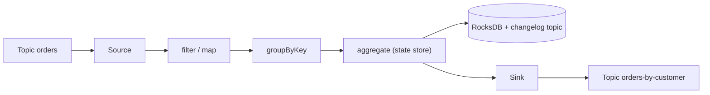
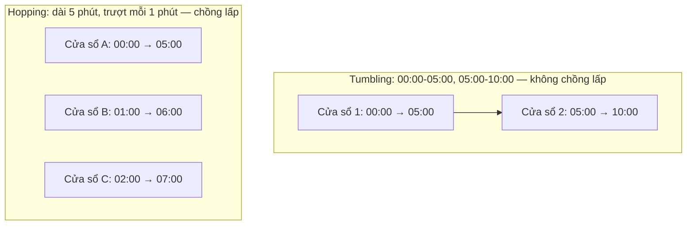
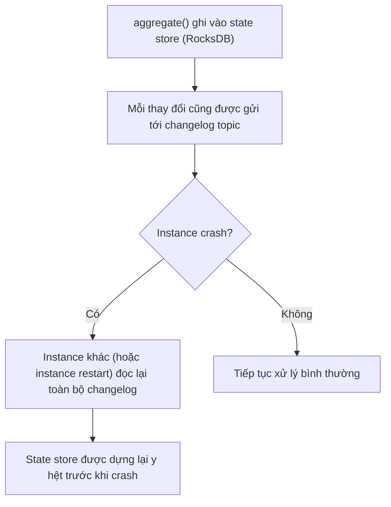

# Lý thuyết 06: Kafka Streams — xử lý luồng dữ liệu bên trong Kafka

Bài [Spring Kafka thực chiến](/go?p=06-Distributed-Systems%2FKafka%2Fmedium%2Flt-03-spring-kafka-thuc-chien.md) dừng ở mức một `@KafkaListener` xử lý từng message rời rạc. Bài toán thực tế thường khó hơn: đếm số đơn hàng theo khách trong 5 phút gần nhất, hay join luồng `orders` với luồng `payments` theo `orderId` để phát hiện đơn chưa thanh toán sau 10 phút. Tự viết bằng consumer thuần nghĩa là tự quản state (map trong RAM, mất khi restart), tự xử lý window, tự lo chuyện exactly-once khi ghi kết quả ra topic khác. Kafka Streams là thư viện Java chạy **ngay trong ứng dụng của bạn** (không phải cluster riêng như Flink/Spark) giải quyết đúng lớp bài toán này bằng một DSL khai báo.

**Tóm tắt:**

- Kafka Streams là thư viện embed trong ứng dụng JVM, không phải hệ thống riêng; mỗi instance xử lý một phần partition, scale bằng cách chạy thêm instance.
- `KStream` là luồng sự kiện (mọi bản ghi đều đáng kể), `KTable` là bảng trạng thái mới nhất theo key (bản ghi sau đè bản ghi trước cùng key).
- State cục bộ lưu bằng RocksDB trên đĩa và được backup bằng một changelog topic trong Kafka; mất instance thì state được khôi phục lại từ changelog, không mất.
- Join hai `KStream` bắt buộc phải có window vì không ai chờ "mãi mãi" sự kiện khớp cặp; join `KStream`-`KTable` thì không cần.
- Bốn kiểu window (tumbling, hopping, sliding, session) khác nhau ở việc cửa sổ có chồng lấp hay không và có cố định độ dài hay không.
- `processing.guarantee=exactly_once_v2` cho Streams dùng transaction Kafka y hệt bài exactly-once đã học, nên chỉ đúng trong phạm vi Kafka-to-Kafka.
- Serde (serializer/deserializer) của Streams cắm trực tiếp vào Schema Registry giống consumer thường, nhưng còn phải khai báo serde cho **state store**, không chỉ cho input/output topic.
- Dùng Streams khi bài toán vừa tầm một ứng dụng JVM xử lý; dữ liệu cực lớn hoặc cần nhiều ngôn ngữ xử lý cùng lúc thì nên nhìn sang Flink.

## Vấn đề nó giải quyết

Ba việc một consumer thuần làm rất vất vả, Streams có sẵn: (1) giữ trạng thái tổng hợp theo key qua thời gian (đếm, tổng, trạng thái mới nhất) mà vẫn chịu được restart; (2) join dữ liệu giữa nhiều topic; (3) gom nhóm sự kiện theo cửa sổ thời gian. Tất cả viết bằng một DSL khai báo (`.filter()`, `.groupByKey()`, `.aggregate()`...), Streams tự lo việc đọc, ghi, commit offset, backup state.

## Khi nào dùng, khi nào không

| Tình huống | Chọn gì |
|---|---|
| Transform/lọc/route đơn giản từng message | Consumer thuần hoặc Kafka Connect SMT (đơn giản hơn, không cần Streams) |
| Aggregate/join/window theo key, chạy vừa trong một ứng dụng Java | **Kafka Streams** |
| Xử lý lượng dữ liệu rất lớn, cần scale độc lập với số partition, hoặc đội dùng Python/SQL | Flink hoặc Spark Structured Streaming |
| Chỉ cần đưa dữ liệu vào/ra hệ thống khác, không biến đổi gì nhiều | Kafka Connect |

**Nền tảng:** Streams không phải cluster riêng; mỗi instance ứng dụng của bạn tự xử lý một tập partition được gán cho nó, y hệt một consumer trong consumer group. Scale ngang bằng cách chạy thêm instance, giới hạn trên vẫn là số partition.

## Các khái niệm cần biết

| Khái niệm | Là gì | Vì sao quan trọng |
|---|---|---|
| **Topology** | Đồ thị các bước xử lý (source → processor → sink) | Là "chương trình" Streams chạy; mỗi task xử lý một nhánh của đồ thị trên một tập partition |
| **KStream** | Luồng bản ghi độc lập, mọi event đều đáng kể | Dùng cho sự kiện: đơn hàng, click, log |
| **KTable** | Bảng trạng thái mới nhất theo key, bản ghi sau đè bản ghi trước | Dùng cho trạng thái: số dư, hồ sơ khách hàng hiện tại |
| **GlobalKTable** | Giống KTable nhưng mỗi instance giữ **toàn bộ** dữ liệu, không chia theo partition | Dùng để join khi bảng nhỏ và cần join không phân vùng theo key join |
| **State store** | Nơi lưu trạng thái cục bộ (mặc định RocksDB) | Cho phép `aggregate`/`count`/`reduce` tra cứu nhanh trạng thái hiện tại |
| **Changelog topic** | Topic nội bộ Kafka ghi lại mọi thay đổi của state store | Dùng để khôi phục state khi instance restart hoặc chuyển sang máy khác |
| **Punctuator** | Hàm được gọi định kỳ theo thời gian (event-time hoặc wall-clock) | Dùng để phát kết quả định kỳ không phụ thuộc có message mới tới hay không |
| **Repartition topic** | Topic nội bộ Streams tự tạo khi đổi key trước khi aggregate/join | Cần thiết vì aggregate theo key mới phải gom đúng partition của key đó |

## Mô hình: topology và luồng xử lý



Mỗi hộp xử lý chạy trong một **task**; Streams gán các task cho các instance đang chạy giống hệt cách consumer group gán partition. Thêm instance thì task được cân lại (rebalance), giống consumer group rebalance đã học ở bài tổng quan.

## KStream và KTable: hai cách nhìn một luồng

Cùng một topic có thể đọc theo hai cách khác nhau tùy mục đích:

```java
StreamsBuilder builder = new StreamsBuilder();

// Đọc "orders" như một luồng sự kiện: mọi record đều được xử lý
KStream<String, Order> orders = builder.stream("orders");

// Đọc "customer-profile" như một bảng trạng thái: record sau đè record trước cùng key
KTable<String, CustomerProfile> profiles = builder.table("customer-profile");
```

**Phải thuộc:** `KStream` không "quên" bản ghi nào — hai record cùng key là hai sự kiện độc lập. `KTable` chỉ giữ bản ghi **mới nhất** theo key — record sau tự động đè record trước. Một topic compacted (dùng cho changelog, hoặc dữ liệu kiểu "trạng thái hiện tại") hợp để đọc như `KTable`; một topic sự kiện thuần hợp để đọc như `KStream`.

### Join: khi nào cần window, khi nào không

| Kiểu join | Cần window? | Lý do |
|---|---|---|
| `KStream`-`KStream` | **Bắt buộc** | Hai luồng sự kiện độc lập, không ai "chờ mãi mãi" để khớp cặp; phải giới hạn khoảng thời gian chấp nhận khớp |
| `KStream`-`KTable` | Không cần | `KTable` luôn có sẵn giá trị "mới nhất tại thời điểm này" để tra cứu ngay khi một `KStream` record tới |
| `KTable`-`KTable` | Không cần | Join trạng thái với trạng thái, cả hai đều là "giá trị hiện tại" |

```java
KStream<String, OrderEnriched> enriched = orders.join(
    profiles,
    (order, profile) -> new OrderEnriched(order, profile)   // ValueJoiner
);   // KStream-KTable join: không cần window, tra cứu profile hiện tại ngay
```

**Suy luận:** Vì sao `KStream`-`KStream` phải có window mà `KStream`-`KTable` thì không? `KTable` đã trả lời sẵn câu hỏi "giá trị hiện tại của key này là gì" tại bất kỳ thời điểm nào, nên join chỉ là một phép tra cứu tức thời, không cần chờ. Còn hai `KStream` là hai luồng sự kiện rời rạc — ví dụ `orders` và `payments` — nếu không giới hạn thời gian thì Streams phải giữ **toàn bộ lịch sử** của cả hai luồng trong state store để chờ khớp cặp, không khả thi về bộ nhớ. Window ép buộc một ranh giới: "chỉ coi là khớp nếu payment đến trong vòng 10 phút sau order", sau đó phần state ngoài cửa sổ được dọn.

## Windowing



| Loại | Chồng lấp | Độ dài | Ví dụ dùng |
|---|---|---|---|
| **Tumbling** | Không | Cố định | "Đếm đơn hàng mỗi 5 phút", mỗi event chỉ thuộc đúng một cửa sổ |
| **Hopping** | Có | Cố định, trượt theo bước nhỏ hơn | "Trung bình trượt 5 phút, cập nhật mỗi 1 phút" |
| **Sliding** | Có, theo từng cặp event | Cố định | "Hai event cách nhau dưới 1 phút" — dùng cho join có window |
| **Session** | Không, nhưng độ dài co giãn | Động, đóng khi im lặng quá *gap* | "Một phiên duyệt web", gộp các event liền nhau, tách phiên khi im lặng quá *gap* |

```java
KTable<Windowed<String>, Long> countByWindow = orders
    .groupBy((key, order) -> order.customerId())
    .windowedBy(TimeWindows.ofSizeAndGrace(Duration.ofMinutes(5), Duration.ofSeconds(30)))
    .count();   // grace: chấp nhận event trễ tới 30 giây sau khi cửa sổ đóng
```

`grace` (ân hạn) quyết định Streams còn nhận event tới muộn bao lâu sau khi cửa sổ lẽ ra đã đóng — event-time trong dữ liệu luôn có thể trễ hơn wall-clock xử lý vì mạng, retry hay client offline.

## State store, changelog và chịu lỗi



**Nền tảng:** `changelog topic` là một Kafka topic compacted (giống cơ chế compaction dùng cho `__consumer_offsets`): nó luôn giữ ít nhất bản ghi mới nhất của mỗi key. State store vì vậy không bao giờ thực sự "chỉ nằm trên một máy" — nó luôn có thể được tái tạo lại từ Kafka. Cái giá phải trả là mỗi lần `aggregate`/`count` ghi state, Streams cũng ghi một record vào changelog, tốn thêm một lượt ghi Kafka.

Để đổi lại thời gian khôi phục khi rebalance, Streams hỗ trợ **standby replica** (`num.standby.replicas`): một instance khác giữ sẵn bản sao state store đã được warm-up từ changelog, nên khi task chuyển qua nó gần như không cần đọc lại từ đầu.

## Exactly-once trong Streams

`processing.guarantee=exactly_once_v2` dùng đúng cơ chế transaction Kafka đã học ở bài [Exactly-once, ordering và vận hành](/go?p=06-Distributed-Systems%2FKafka%2Fhard%2Flt-05-kafka-van-hanh-exactly-once.md): đọc input, cập nhật state store, ghi output và commit offset đều nằm trong **một transaction**. Phạm vi đảm bảo không đổi so với bài đó — chỉ đúng trong luồng Kafka-to-Kafka; nếu topology của bạn gọi ra một API hoặc ghi một DB ngoài (qua `Processor` tùy biến), phần đó vẫn phải tự idempotent.

## Serde và Schema Registry trong Streams

Serde (viết tắt serializer + deserializer) của Streams dùng lại đúng cơ chế Avro/Protobuf + Schema Registry đã học ở bài Spring Kafka thực chiến, nhưng có một điểm khác: ngoài serde cho topic input/output, bạn còn phải khai báo serde cho **state store**, vì mỗi lần ghi aggregate vào RocksDB và changelog cũng cần serialize giá trị đó.

```java
Serde<Order> orderSerde = // SpecificAvroSerde cấu hình trỏ tới Schema Registry URL
Serde<Long> longSerde = Serdes.Long();

KTable<String, Long> counts = builder
    .stream("orders", Consumed.with(Serdes.String(), orderSerde))
    .groupBy((k, order) -> order.customerId(), Grouped.with(Serdes.String(), orderSerde))
    .count(Materialized.with(Serdes.String(), longSerde));   // longSerde: serde cho GIÁ TRỊ lưu trong state store
```

Quy tắc tương thích (BACKWARD/FORWARD/FULL) đã học không đổi — Streams chỉ là một consumer và producer khác của cùng Schema Registry đó, không có luật riêng.

## Bẫy thường gặp

- Join `KStream`-`KStream` quên đặt window: code không compile (API bắt buộc truyền `JoinWindows`), nhưng nhầm lẫn khi chọn độ dài window quá ngắn làm rớt nhiều cặp hợp lệ.
- Coi `KTable` như một bảng SQL đọc được bất kỳ lúc nào từ bên ngoài — thực ra phải expose qua Interactive Query hoặc đẩy ra topic khác, nó không tự nhiên là một API truy vấn.
- Quên `grace period` cho windowed aggregation: event tới trễ hơn một chút bị bỏ qua hoàn toàn thay vì được cộng dồn.
- Đổi logic topology (thêm bước xử lý mới) mà không đổi tên ứng dụng (`application.id`) hoặc dọn state cũ: state cũ không khớp logic mới, dữ liệu sai lệch âm thầm.
- Để state store quá lớn mà không tính dung lượng đĩa instance; RocksDB ghi xuống đĩa cục bộ, không phải chỉ RAM.

## Điểm cần nhớ

- Kafka Streams chạy trong ứng dụng của bạn, xử lý đúng tập partition được gán, scale bằng cách thêm instance.
- `KStream` là sự kiện, `KTable` là trạng thái mới nhất theo key; join `KStream`-`KStream` bắt buộc có window, join với `KTable` thì không.
- State lưu RocksDB + backup bằng changelog topic nên luôn khôi phục được; `num.standby.replicas` giảm thời gian khôi phục khi rebalance.
- Bốn kiểu window khác nhau ở chồng lấp và độ dài cố định hay co giãn (tumbling, hopping, sliding, session).
- `exactly_once_v2` của Streams chỉ đúng trong phạm vi Kafka-to-Kafka, giống transaction Kafka thường.
- Serde của Streams cắm vào Schema Registry y hệt consumer thường, cộng thêm serde cho state store.

## Câu hỏi tự kiểm tra

Với mỗi câu: tự trả lời, nếu bí thì đọc **Gợi ý suy luận**, rồi đối chiếu **Đáp**.

1. Vì sao join giữa hai `KStream` bắt buộc phải có window, còn join `KStream` với `KTable` thì không?
   - Gợi ý suy luận: `KTable` luôn trả lời được "giá trị hiện tại của key này" ngay lập tức. Hai `KStream` thì sao — có ai giữ sẵn câu trả lời đó không?
   - Đáp: `KTable`-`KStream` join là tra cứu tức thời vào trạng thái hiện tại, không cần chờ. Hai `KStream` là các sự kiện rời rạc, không giới hạn thời gian thì phải giữ lịch sử vô hạn để chờ khớp cặp, nên bắt buộc có window.
2. Một instance Streams crash giữa chừng, state store trên đĩa của nó mất. Dữ liệu đã aggregate có mất theo không?
   - Gợi ý suy luận: mỗi lần ghi vào state store, Streams còn ghi vào đâu nữa?
   - Đáp: Không mất, vì mọi thay đổi của state store cũng được ghi vào changelog topic (một Kafka topic compacted); instance khác hoặc chính nó sau khi restart đọc lại changelog để dựng lại state.
3. Bạn đặt `TimeWindows.ofSizeAndGrace(Duration.ofMinutes(5), Duration.ofSeconds(0))` rồi thấy một số event hợp lệ bị thiếu trong kết quả đếm theo cửa sổ. Vì sao?
   - Gợi ý suy luận: event-time trong dữ liệu có luôn đến đúng lúc wall-clock không? `grace` dùng để làm gì?
   - Đáp: `grace = 0` nghĩa là không chấp nhận bất kỳ event nào tới muộn sau khi cửa sổ đóng; event bị trễ (do mạng, retry, client offline) bị loại khỏi cửa sổ. Cần đặt `grace` đủ lớn cho độ trễ thực tế của hệ thống.
4. Sếp nói "Streams expose KTable ra ngoài thì FE query thẳng vào đó được, khỏi cần thêm API". Đúng hay sai?
   - Gợi ý suy luận: `KTable` là một khái niệm bên trong topology Streams hay là một dịch vụ mạng?
   - Đáp: Sai. `KTable` không tự có giao diện mạng; muốn truy vấn từ ngoài phải dùng Interactive Query (expose qua REST tự viết) hoặc đẩy kết quả ra một topic/DB khác rồi mới query.
5. Bạn đổi logic xử lý trong topology (thêm một bước filter mới) nhưng giữ nguyên `application.id`. Kết quả đếm sau khi deploy bị sai lệch so với kỳ vọng dù code mới đúng. Nguyên nhân có thể là gì?
   - Gợi ý suy luận: state store cũ được tạo ra từ topology cũ. Topology mới có còn cùng ý nghĩa với dữ liệu đã tích lũy trong state cũ không?
   - Đáp: State store cũ chứa kết quả tích lũy theo logic cũ; logic mới đọc tiếp lên trên state đó mà không dọn sạch sẽ cho ra kết quả lẫn lộn giữa hai logic. Cần cân nhắc đổi `application.id` hoặc dọn state khi đổi logic xử lý đáng kể.

Nguồn: tài liệu chính thức Apache Kafka — Kafka Streams (kafka.apache.org/documentation/streams/), kiểm tra ngày 2026-11-09.
