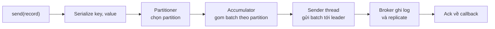
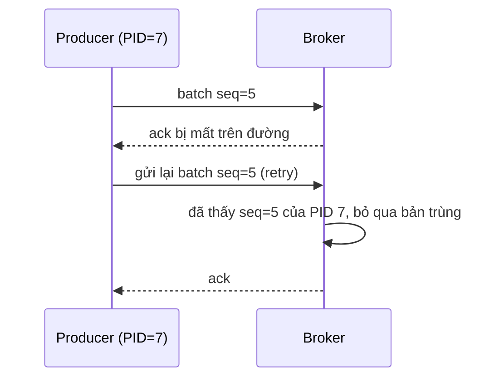
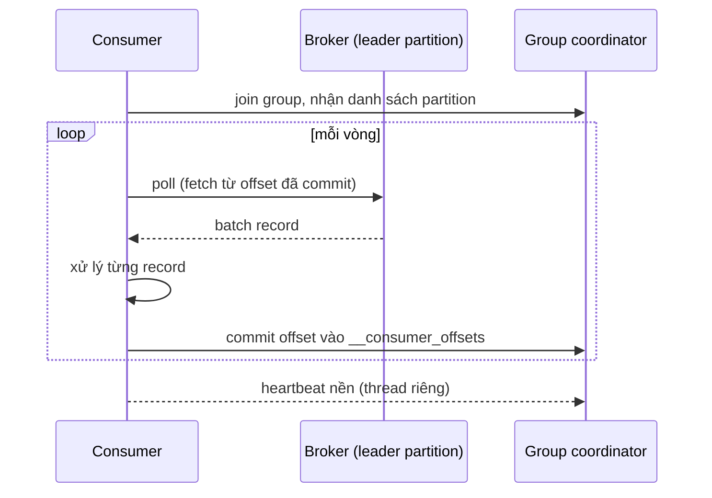
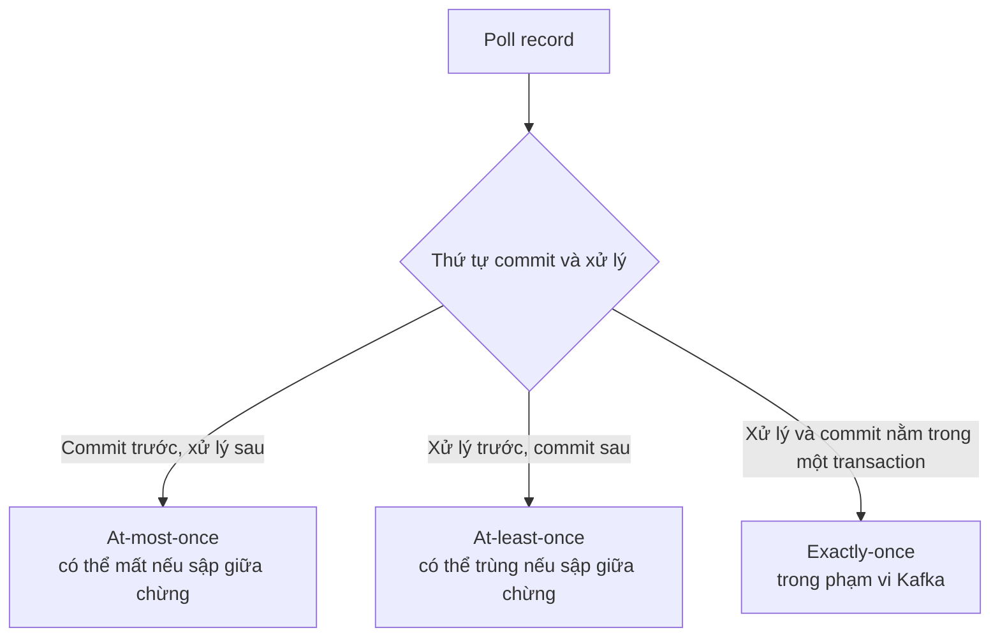

# Lý thuyết 02: Producer, Consumer và ngữ nghĩa giao nhận

Tiếp theo [Kafka tổng quan](/go?p=06-Distributed-Systems%2FKafka%2Feasy%2Flt-01-kafka-tong-quan.md). Xem thêm: [Kiến trúc hướng event với Kafka](/go?p=01-Spring-Boot%2Fhard%2Flt-07-event-driven-kafka.md), [Distributed lock và Idempotency](/go?p=01-Spring-Boot%2Fhard%2Flt-26-distributed-lock-idempotency.md).

Gửi một tin vào Kafka và đọc nó ra nghe đơn giản, nhưng ba sự cố kinh điển (mất message, trùng message, sai thứ tự) đều bắt nguồn từ hai chỗ: cấu hình của producer và thời điểm consumer commit offset. Bài này đi theo đường đi của một record: producer chọn partition, gom batch, nén và chờ xác nhận (ack); consumer đọc theo vòng `poll`, commit offset, và cả nhóm chia lại partition khi có thành viên thay đổi (rebalance). Kết hợp những mảnh này lại sẽ quyết định ngữ nghĩa giao nhận của hệ thống: at-most-once, at-least-once hay exactly-once.

**Tóm tắt:**

- Producer gửi record qua các bước chọn partition, gom batch, nén rồi chờ xác nhận (ack); acks quyết định bao nhiêu replica phải xác nhận.
- acks=0 không chờ, acks=1 chỉ leader, acks=all chờ toàn bộ ISR; chỉ acks=all kết hợp min.insync.replicas từ 2 trở lên mới là cam kết không mất message khi một broker sập; từ Kafka 3.0 producer mặc định acks=all và bật idempotence.
- Idempotent producer dùng PID và sequence theo từng partition để broker bỏ bản gửi lại; nó chỉ chống trùng do retry trong một phiên producer, không chống trùng xuyên lần khởi động lại.
- Consumer đọc theo vòng poll và commit offset (lưu trong __consumer_offsets) để nhớ đã xử lý đến đâu.
- Có hai tín hiệu sống là heartbeat (process còn chạy) và max.poll.interval.ms (xử lý còn tiến triển); xử lý chậm quá khoảng này làm consumer bị đẩy khỏi group và gây rebalance.
- Commit trước khi xử lý là at-most-once, xử lý xong rồi mới commit là at-least-once nên xử lý phải idempotent; offset commit là offset của record cuối cộng 1.
- auto.offset.reset chỉ có hiệu lực khi group chưa có offset đã commit.

## Vì sao cần hiểu

Khi hiểu cơ chế, bạn đoán trước được hành vi lúc broker sập, mạng chập chờn hoặc consumer xử lý chậm, thay vì chỉ biết sửa sau khi sự cố xảy ra. Bài này áp dụng cho mọi ứng dụng dùng Kafka, nhất là khi dữ liệu có giá trị (thanh toán, đơn hàng) hoặc cần giữ thứ tự.

## Tóm tắt cách làm đúng

Phía producer: chọn `acks`, bật idempotence, thiết kế key. Phía consumer: tắt auto commit khi cần kiểm soát, commit **sau** khi xử lý xong, và viết logic xử lý idempotent để chịu được trùng lặp. Nếu hệ thống của bạn chấp nhận mất một ít message (log, metric), bạn có thể nới lỏng các cấu hình này để lấy throughput và độ trễ thấp hơn.

## Các khái niệm cần biết

- **Ack (acknowledgement)**: lời xác nhận broker trả cho producer sau khi ghi xong; mức xác nhận quyết định durability (xem mục `acks`).
- **Partitioner**: thành phần quyết định record đi vào partition nào.
- **Batch**: nhóm record gửi chung trong một request; batch lớn tiết kiệm mạng nhưng thêm độ trễ.
- **ISR (In-Sync Replicas)**: tập replica đang theo kịp leader; chi tiết ở [bài 04](/go?p=06-Distributed-Systems%2FKafka%2Fhard%2Flt-04-kafka-noi-bo-replication.md).
- **Commit offset**: lưu lại "tôi đã xử lý đến đâu" để lần sau đọc tiếp từ đó.
- **At-most-once / at-least-once / exactly-once**: tối đa một lần (có thể mất), ít nhất một lần (có thể trùng), đúng một lần.
- **Idempotent (bất biến khi lặp)**: làm một thao tác một lần hay nhiều lần đều cho cùng kết quả. Nền tảng để chịu được message trùng.
- **Rebalance**: chia lại partition giữa các consumer trong group khi thành viên đổi.
- **Heartbeat**: tín hiệu định kỳ consumer gửi cho coordinator để báo "tôi còn sống".

## Producer: một record đi qua những bước nào



`send()` không gửi ngay: nó đưa record vào buffer theo partition rồi thread nền (sender) gửi theo batch. Vì vậy `send` trả về nhanh và lỗi thật sự chỉ thấy qua callback hoặc `Future`.

### Chọn partition

Nguyên tắc: có key thì chọn có tính quyết định theo key, không key thì ưu tiên làm đầy batch.

- Có key: `murmur2(key) mod số_partition`. Cùng key luôn vào cùng partition **miễn là số partition không đổi**.
- Không key: producer dùng bộ chọn "sticky" gom nhiều record vào một partition rồi mới đổi sang partition khác, để batch đầy hơn. Không có thứ tự giữa các record này.
- Có thể tự cài `Partitioner` khi cần (ví dụ định tuyến khách hàng lớn riêng).

### Gom batch, độ trễ và throughput

| Cấu hình | Tác dụng |
|---|---|
| `batch.size` | Kích thước tối đa (byte) của một batch cho mỗi partition (mặc định 16384) |
| `linger.ms` | Chờ thêm bao lâu để batch đầy hơn trước khi gửi; tăng giá trị làm tăng throughput, tăng độ trễ |
| `compression.type` | `none`, `gzip`, `snappy`, `lz4`, `zstd`: nén cả batch, giảm băng thông và đĩa |
| `buffer.memory` | Tổng buffer; đầy thì `send` chờ tối đa `max.block.ms` rồi ném lỗi |

Ghi chú theo phiên bản: Kafka 4.0 thay đổi một số giá trị mặc định theo KIP-1030; kiểm tra bảng cấu hình của đúng phiên bản bạn dùng thay vì nhớ con số cũ.

Nén có hiệu quả cao khi batch lớn và dữ liệu lặp (JSON). Broker thường lưu nguyên batch đã nén, nên tiết kiệm cả đĩa lẫn băng thông replication.

### `acks`: bao nhiêu replica xác nhận mới coi là thành công

| `acks` | Ý nghĩa | Rủi ro |
|---|---|---|
| `0` | Không chờ xác nhận | Mất message mà không biết |
| `1` | Leader ghi xong là trả lời | Leader sập trước khi follower kịp replicate thì mất message |
| `all` (hoặc `-1`) | Leader chờ **toàn bộ ISR** ghi xong | An toàn nhất; đi kèm `min.insync.replicas` |

Khi dùng: `acks=all` cho dữ liệu không được mất (thanh toán, đơn hàng). `acks=1` chấp nhận được cho dữ liệu có thể mất đôi chút để lấy độ trễ thấp. `acks=0` chỉ hợp cho dữ liệu vứt đi được như metric thô. Từ Kafka 3.0 (KIP-679), producer mặc định dùng `acks=all` và bật idempotence (bản 3.0.0 và 3.1.0 có lỗi khiến idempotence mặc định chưa hiệu lực, sửa từ 3.0.1 trở đi theo ghi chú nâng cấp).

`acks=all` chỉ có ý nghĩa tốt khi kết hợp với `min.insync.replicas` ở phía broker/topic. Nếu `min.insync.replicas=1` thì ISR chỉ còn leader vẫn "all" nhưng thực chất chỉ một replica. Chi tiết ở [bài 04](/go?p=06-Distributed-Systems%2FKafka%2Fhard%2Flt-04-kafka-noi-bo-replication.md).

**Phải thuộc:** acks=0 không chờ xác nhận, acks=1 chỉ leader ghi xong, acks=all chờ toàn bộ ISR. Chỉ acks=all kết hợp min.insync.replicas từ 2 trở lên mới là cam kết không mất message khi một broker sập. Từ Kafka 3.0 producer mặc định acks=all và bật idempotence.

### Retry, timeout và thứ tự

Vấn đề đặt ra: mạng lỗi thoáng qua là chuyện thường, nên producer tự retry. Nhưng retry vô tình có thể tạo trùng hoặc đảo thứ tự, nên bạn cần hiểu các cấu hình dưới đây.

```java
Properties p = new Properties();
p.put("acks", "all");
p.put("enable.idempotence", "true");
// tổng thời gian tối đa cho một record, gồm cả retry
p.put("delivery.timeout.ms", "120000");
p.put("request.timeout.ms", "30000");     // chờ trả lời một request
p.put("max.in.flight.requests.per.connection", "5");
```

- `retries` mặc định rất lớn; constraint thực tế là `delivery.timeout.ms`.
- Không bật idempotence mà có retry và `max.in.flight > 1` thì một batch bị lỗi rồi gửi lại có thể **đến sau** batch gửi sau nó, làm đảo thứ tự, hoặc gây **trùng** nếu lần đầu thật ra đã ghi thành công nhưng ack bị mất.

### Idempotent producer

Khi `enable.idempotence=true`, broker cấp cho producer một **producer id (PID)** và producer gắn **sequence number** cho mỗi record theo từng partition. Broker nhớ sequence cuối đã nhận; record gửi lại có sequence đã thấy thì bị bỏ qua. Kết quả: không trùng và giữ thứ tự theo partition, miễn `max.in.flight.requests.per.connection <= 5` và `acks=all`.



Giới hạn quan trọng: idempotence chỉ che **một phiên producer và một partition**. Producer khởi động lại nhận PID mới, nên không chống được trùng giữa các lần chạy; muốn vậy cần transaction (xem [bài 05](/go?p=06-Distributed-Systems%2FKafka%2Fhard%2Flt-05-kafka-van-hanh-exactly-once.md)) hoặc idempotency ở tầng ứng dụng.

**Phải thuộc:** Idempotent producer (enable.idempotence=true) dùng PID và sequence theo từng partition để broker bỏ bản gửi lại, không trùng và giữ thứ tự, với acks=all và max.in.flight không quá 5. Nó chỉ chống trùng do retry trong một phiên producer, không chống trùng xuyên lần khởi động lại.

## Consumer: vòng poll

```java
consumer.subscribe(List.of("orders"));
while (running) {
    ConsumerRecords<String, String> records = consumer.poll(Duration.ofMillis(500));
    for (var r : records) {
        handle(r);                 // xử lý nghiệp vụ
    }
    consumer.commitSync();         // commit SAU khi xử lý xong
}
```

Vòng lặp trên thể hiện nhịp đọc cơ bản: lấy một batch record, xử lý, rồi báo broker đã xong. Sơ đồ dưới cho thấy các bên tham gia.



`poll()` làm ba việc cùng lúc: lấy record, gửi heartbeat nền (qua thread riêng), và tham gia giao thức rebalance. Nếu thread xử lý chiếm quá lâu giữa hai lần `poll`, consumer bị coi là chết.

| Cấu hình | Ý nghĩa |
|---|---|
| `max.poll.records` | Số record tối đa mỗi lần `poll` (mặc định 500) |
| `max.poll.interval.ms` | Thời gian tối đa giữa hai lần `poll` (mặc định 5 phút); vượt thì consumer bị đẩy khỏi group |
| `session.timeout.ms` | Không có heartbeat trong khoảng này thì coi là chết |
| `heartbeat.interval.ms` | Tần suất heartbeat, nên bằng khoảng 1/3 `session.timeout.ms` |
| `fetch.min.bytes`, `fetch.max.wait.ms` | Đánh đổi độ trễ lấy throughput phía fetch |

Kafka phân biệt hai loại "sống": heartbeat (process còn chạy) và `max.poll.interval.ms` (xử lý còn tiến triển). Xử lý chậm làm vượt `max.poll.interval.ms` dù process vẫn khỏe là nguyên nhân rebalance liên tục hay gặp nhất.

**Nền tảng:** Consumer đọc theo vòng poll và commit offset (lưu trong __consumer_offsets) để nhớ đã xử lý đến đâu. Có hai loại sống: heartbeat (process còn chạy) và max.poll.interval.ms (xử lý còn tiến triển); xử lý chậm quá khoảng này làm consumer bị đẩy khỏi group và gây rebalance.

**Suy luận:** Broker không đẩy record cho consumer mà consumer tự kéo bằng poll, nên broker không biết consumer xử lý đến đâu; nó chỉ biết offset đã commit và hai tín hiệu sống. Heartbeat gửi từ một thread nền cho biết process còn chạy, nhưng chỉ vậy chưa đủ: một consumer bị kẹt trong xử lý (gọi dịch vụ ngoài bị treo) vẫn gửi heartbeat đều đặn. Vì thế có tín hiệu thứ hai, max.poll.interval.ms, đo khoảng cách giữa hai lần gọi poll: quá khoảng đó broker coi consumer không tiến triển, đẩy nó khỏi group và chia lại partition (rebalance). Hệ quả: nếu xử lý một batch lâu hơn khoảng này, consumer bị đuổi dù đang khỏe, các record chưa commit được giao cho consumer khác, và khi consumer cũ quay lại thì đã mất partition; vòng lặp đó tạo rebalance liên tục và lag tăng. Điểm dễ nhầm là chỉnh session.timeout.ms khi gặp rebalance, trong khi nguyên nhân là xử lý chậm chứ không phải heartbeat. Cách chữa: giảm max.poll.records, đặt max.poll.interval.ms phù hợp với thời gian xử lý thật, hoặc đưa xử lý nặng sang thread khác nhưng vẫn phải gọi poll đều đặn.

### Offset và commit

Offset đã commit là "vị trí tiếp theo cần đọc" mà group lưu trong topic nội bộ `__consumer_offsets`. Khi consumer khởi động lại hoặc partition chuyển sang consumer khác, nó đọc tiếp từ offset đã commit.

| Cách commit | Hành vi |
|---|---|
| `enable.auto.commit=true` (mặc định của client thuần) | Tự commit định kỳ (`auto.commit.interval.ms`) trong lần `poll` kế tiếp; có thể commit offset của record **chưa xử lý xong** |
| `commitSync()` | Chặn đến khi broker xác nhận, thử lại khi lỗi tạm thời |
| `commitAsync()` | Không chặn, nhanh nhưng lỗi commit dễ bị bỏ qua; thường dùng `commitAsync` trong vòng lặp và `commitSync` khi tắt |
| Commit theo offset cụ thể | `commitSync(Map<TopicPartition, OffsetAndMetadata>)` để commit đến đúng record đã xong (nhớ cộng 1) |

`auto.offset.reset` chỉ có hiệu lực khi group **chưa có offset đã commit** hoặc offset không còn hợp lệ (đã bị xóa theo retention): `earliest`, `latest` (mặc định), hoặc `none` (ném lỗi). Từ 4.0 có thêm tùy chọn đặt theo khoảng thời gian (KIP-1106). Nhầm lẫn thường gặp: sửa `auto.offset.reset` mà group đã có offset thì không thay đổi gì.

## Ngữ nghĩa giao nhận



| Ngữ nghĩa | Cách đạt | Hệ quả |
|---|---|---|
| At-most-once | Commit trước khi xử lý | Mất message khi sập giữa chừng, không bao giờ trùng |
| At-least-once | Commit sau khi xử lý | Không mất message, **có thể trùng**; mặc định thực tế phổ biến nhất |
| Exactly-once | Transaction Kafka, hoặc at-least-once cộng xử lý idempotent | Chỉ đúng trong phạm vi nhất định, xem bài 05 |

**Phải thuộc:** Commit trước khi xử lý là at-most-once (có thể mất); xử lý xong rồi mới commit là at-least-once (không mất nhưng có thể trùng), nên xử lý phải idempotent; offset commit là vị trí tiếp theo cần đọc, tức offset của record cuối cộng 1. auto.offset.reset chỉ có hiệu lực khi group chưa có offset đã commit.

### Xử lý trùng lặp ở phía consumer

Vấn đề đặt ra: ví dụ consumer xử lý xong record, ghi vào DB, rồi sập trước khi kịp commit offset. Khi khởi động lại nó đọc lại record đó và ghi lần nữa. Với at-least-once, hệ quả nghiệp vụ phải chịu được xử lý lại. Ba cách thường dùng:

1. **Natural key idempotent**: ghi `upsert` theo key nghiệp vụ, hai lần ghi cùng kết quả.
2. **Bảng đã xử lý**: lưu `eventId` (hoặc cặp `topic-partition-offset`) cùng transaction với thay đổi nghiệp vụ; trùng key thì bỏ qua.
3. **Phép toán có điều kiện**: cập nhật có điều kiện phiên bản (`WHERE version = ?`).

```java
@Transactional
void handle(OrderEvent e) {
    if (processedRepo.existsById(e.eventId())) return;   // đã xử lý
    orderService.apply(e);
    processedRepo.save(new Processed(e.eventId()));       // cùng transaction DB
}
```

Điểm mấu chốt: việc "đã xử lý" và hiệu ứng nghiệp vụ phải nằm trong **cùng một transaction** của hệ đích, vì Kafka không thể tham gia transaction của cơ sở dữ liệu của bạn.

## Rebalance

Khi thành viên group đổi (consumer vào, ra, chết) hoặc số partition đổi, các partition được chia lại. Trong lúc chia, các partition bị ảnh hưởng không được đọc, nên rebalance càng thường xuyên thì độ trễ càng tăng và càng dễ xử lý trùng.

```mermaid
sequenceDiagram
    participant A as Consumer A
    participant B as Consumer B (mới vào)
    participant G as Coordinator
    B->>G: JoinGroup
    G->>A: báo rebalance (qua heartbeat)
    A->>G: nộp lại partition, JoinGroup
    G->>G: tính phân công mới
    G-->>A: partition mới
    G-->>B: partition mới
    Note over A,B: eager: tất cả ngừng đọc trong lúc này; cooperative: chỉ partition chuyển giao bị dừng
```

| Giao thức | Cách hoạt động | Nhược |
|---|---|---|
| Eager (cổ điển, `RangeAssignor`, `RoundRobinAssignor`) | Mọi consumer **trả hết** partition, rồi group chia lại từ đầu | "Stop-the-world": cả group ngừng đọc trong lúc chia |
| Cooperative (`CooperativeStickyAssignor`) | Chỉ thu hồi các partition cần chuyển, phần còn lại tiếp tục đọc | Có thể cần vài vòng rebalance; chuyển từ eager sang cooperative phải làm theo 2 bước (rolling) |
| Giao thức consumer mới (KIP-848) | Coordinator phía broker tính phân công, từng consumer nhận thay đổi dần dần, không có rào chắn toàn group | Cần bật từ client bằng `group.protocol=consumer`; GA từ Kafka 4.0 |

Theo thông báo phát hành Kafka 4.0, giao thức mới bật sẵn ở phía server nhưng consumer phải chủ động đặt `group.protocol=consumer`. Một số cấu hình phía client của giao thức cũ (ví dụ `session.timeout.ms`, chiến lược phân công phía client) chuyển sang cấu hình phía broker; xem tài liệu phiên bản bạn dùng.

Giảm thiệt hại do rebalance ngay cả với giao thức cũ:

- `group.instance.id` (static membership): consumer khởi động lại trong khoảng `session.timeout.ms` giữ nguyên partition, không gây rebalance.
- Xử lý nhanh trong mỗi `poll` hoặc hạ `max.poll.records`; đưa xử lý nặng sang thread khác nhưng vẫn phải `poll` đều.
- Dùng `ConsumerRebalanceListener` để commit offset trước khi mất partition (`onPartitionsRevoked`), tránh xử lý trùng.

```java
consumer.subscribe(List.of("orders"), new ConsumerRebalanceListener() {
    public void onPartitionsRevoked(Collection<TopicPartition> parts) {
        consumer.commitSync(currentOffsets);   // lưu tiến độ trước khi mất partition
    }
    public void onPartitionsAssigned(Collection<TopicPartition> parts) { }
});
```

## Bẫy thường gặp

- Bật auto commit rồi xử lý async: commit chạy trước khi xử lý xong, sập là mất message.
- Commit offset **bằng** offset của record vừa xử lý thay vì offset + 1, dẫn đến đọc lại record cuối.
- Dùng `acks=1` hoặc `min.insync.replicas=1` rồi tin rằng "không mất dữ liệu".
- Xử lý chậm trong vòng `poll` gây rebalance liên tục; thấy log "consumer group rebalance" lặp là dấu hiệu.
- Tin rằng idempotent producer chống trùng xuyên suốt hệ thống; nó chỉ chống trùng do retry của chính producer đó.
- Chỉ thêm consumer mà không thêm partition: consumer thừa nằm không.

## Điểm cần nhớ

- `send` async; luôn xử lý lỗi qua callback.
- `acks=all` kết hợp `min.insync.replicas>=2` mới là cam kết không mất message khi một broker sập.
- Idempotent producer dùng PID và sequence theo partition, bảo đảm không trùng và giữ thứ tự trong một phiên.
- Commit sau khi xử lý xong là at-least-once; luôn thiết kế xử lý chịu được trùng lặp.
- Rebalance gây ngừng đọc; cooperative, static membership và giao thức mới (KIP-848) giảm thiệt hại.

## Câu hỏi tự kiểm tra

Với mỗi câu: tự trả lời, nếu bí thì đọc **Gợi ý suy luận**, rồi đối chiếu **Đáp**.

1. Bạn đổi `auto.offset.reset` sang `earliest` nhưng consumer vẫn đọc tiếp từ chỗ cũ. Vì sao?
   - Gợi ý suy luận: khi khởi động, consumer ưu tiên lấy vị trí từ đâu (offset đã commit của group)? Cấu hình này chỉ cần dùng ở tình huống nào?
   - Đáp: Giá trị này chỉ dùng khi group chưa có offset đã commit hoặc offset không còn hợp lệ. Có offset commit rồi thì consumer đọc tiếp từ đó.
2. `acks=all` có chắc chắn không mất dữ liệu không?
   - Gợi ý suy luận: `all` nghĩa là chờ xác nhận của ai (các replica trong ISR)? Nếu ISR co lại chỉ còn leader thì "tất cả" là mấy replica?
   - Đáp: Chỉ khi `min.insync.replicas` đủ lớn (từ 2 trở lên). Nếu ISR chỉ còn leader thì ack chỉ đại diện một replica, leader chết là mất.
3. Idempotent producer chặn được loại trùng nào và không chặn được loại nào?
   - Gợi ý suy luận: trùng sinh ra khi nào (producer gửi lại do không nhận ack)? Broker nhận ra "đã nhận rồi" bằng cái gì (PID và sequence)? Thông tin đó còn khi producer khởi động lại không?
   - Đáp: Chặn trùng do retry của một producer tới một partition trong một phiên. Không chặn trùng xuyên phiên (restart) hay trùng ở phía consumer.
4. Làm sao đạt at-least-once ở phía consumer, và hệ quả với code xử lý?
   - Gợi ý suy luận: nếu commit offset trước khi xử lý mà process chết giữa chừng thì sao? Nếu xử lý xong rồi mới commit mà chết trước khi commit thì lần sau đọc lại gì?
   - Đáp: Xử lý xong rồi mới commit offset. Nếu chết trước khi commit thì record được đọc lại, nên xử lý phải chịu được trùng lặp.
5. Consumer vẫn chạy, không crash, nhưng bị loại khỏi group và gây rebalance. Vì sao?
   - Gợi ý suy luận: broker biết consumer còn "sống" qua tín hiệu nào? Nếu xử lý một batch quá lâu giữa hai lần `poll` thì sao?
   - Đáp: Khoảng cách giữa hai lần `poll` vượt `max.poll.interval.ms` nên coi như consumer kẹt và bị loại.
6. Static membership giải quyết vấn đề gì?
   - Gợi ý suy luận: restart nhanh thường làm group rebalance hai lần (rời, rồi vào lại). Nếu broker nhận ra "đây là cùng thành viên cũ" thì cần định danh nào?
   - Đáp: Gán `group.instance.id` ổn định, nên khởi động lại trong thời gian cho phép không kích hoạt rebalance.

Nguồn: tài liệu chính thức Apache Kafka (kafka.apache.org), kiểm tra ngày 2026-10-21.

