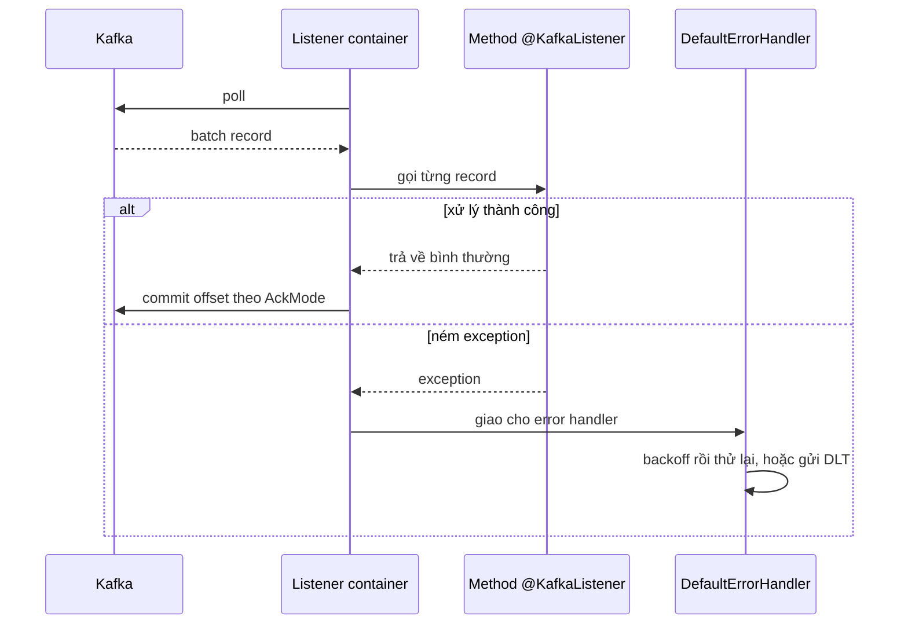
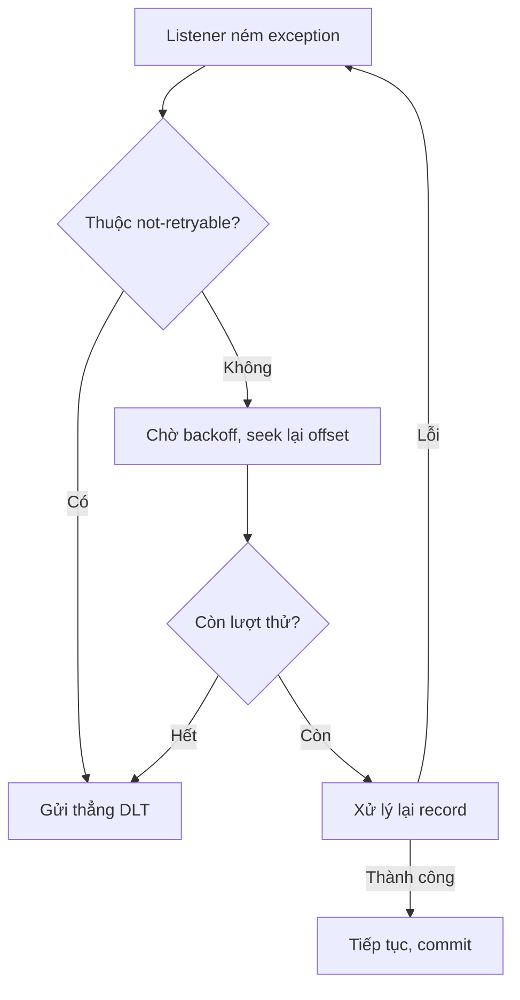
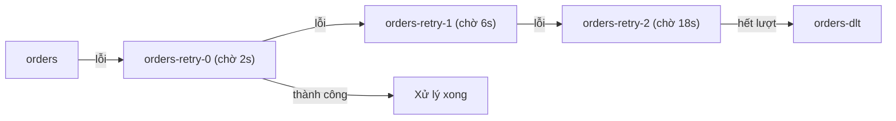
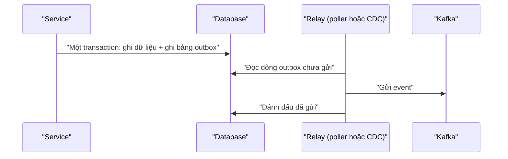

# Lý thuyết 03: Spring for Apache Kafka thực chiến

Kiến thức nền: [Producer, Consumer và giao nhận](/go?p=06-Distributed-Systems%2FKafka%2Fmedium%2Flt-02-producer-consumer-delivery.md). Xem thêm: [Kafka với Spring Boot (bài tổng quan)](/go?p=01-Spring-Boot%2Fhard%2Flt-07-event-driven-kafka.md), [Transaction trong Spring](/go?p=01-Spring-Boot%2Fmedium%2Flt-05-transaction.md), [Distributed lock và Idempotency](/go?p=01-Spring-Boot%2Fhard%2Flt-26-distributed-lock-idempotency.md).

Nếu dùng client Kafka thuần, bạn phải tự viết vòng `poll`, quản lý thread, commit offset, retry và xử lý record hỏng. Spring for Apache Kafka làm những việc đó theo một khuôn mẫu chuẩn: nó bọc client thành `KafkaTemplate` để gửi và `@KafkaListener` để nhận, cùng cơ chế xử lý lỗi, retry, dead letter topic, transaction và công cụ kiểm thử. Cái giá phải trả là Spring che đi nhiều cơ chế bên dưới, nên hiểu các giá trị mặc định là điều kiện để dùng đúng. Rất nhiều sự cố (mất message im lặng, kẹt partition, rebalance liên tục) đến từ việc tin vào một mặc định không như mình tưởng.

**Tóm tắt:**

- Spring Kafka bọc client thành listener container chạy vòng poll thay bạn, gọi @KafkaListener rồi commit offset theo AckMode (mặc định BATCH, auto commit của client bị tắt).
- Listener ném exception thì record không được ack và error handler quyết định bước tiếp theo.
- Mặc định DefaultErrorHandler thử tối đa 10 lần (một lần đầu cộng 9 lần retry, không chờ) rồi bỏ qua và ghi log, tức là không có dead letter; muốn có DLT phải cấu hình DeadLetterPublishingRecoverer.
- Retry tại chỗ giữ thứ tự nhưng chặn partition khi backoff; @RetryableTopic không chặn nhưng mất thứ tự theo key và thêm topic retry cùng DLT.
- ErrorHandlingDeserializer chặn poison pill ngay ở tầng deserialize.
- Số consumer hữu ích bị chặn bởi số partition, nên concurrency lớn hơn số partition là vô ích.
- Kafka transaction chỉ atomic trong phạm vi Kafka; để ghi DB và phát event nhất quán, dùng outbox: ghi dữ liệu và bảng outbox trong cùng transaction DB, một relay gửi lên Kafka (có thể trùng nên consumer phải idempotent).

## Khi nào dùng

Bài này dành cho ứng dụng Spring Boot gửi hoặc nhận event Kafka. Nếu bạn viết công cụ nhỏ không dùng Spring, hoặc cần kiểm soát từng chi tiết vòng poll, client thuần ở [bài 01](/go?p=06-Distributed-Systems%2FKafka%2Feasy%2Flt-01-kafka-tong-quan.md) và [bài 02](/go?p=06-Distributed-Systems%2FKafka%2Fmedium%2Flt-02-producer-consumer-delivery.md) phù hợp hơn.

## Cách làm tóm tắt

Cấu hình producer/consumer qua `spring.kafka.*`, đặt `ack-mode` và `concurrency` có chủ đích, thêm `DefaultErrorHandler` với backoff và `DeadLetterPublishingRecoverer`, dùng `ErrorHandlingDeserializer` để chặn "poison pill", và dùng outbox khi cần nhất quán giữa DB với Kafka.

## Các khái niệm cần biết

- **Listener container**: thành phần Spring chạy vòng `poll` thay bạn, gọi method `@KafkaListener` cho từng record hoặc batch, rồi commit offset theo `AckMode`.
- **Backoff**: khoảng chờ giữa các lần thử lại. Exponential backoff là khoảng chờ tăng dần (1s, 2s, 4s...) để không dồn dập vào hệ thống đang lỗi.
- **DLT (Dead Letter Topic)**: topic chứa record xử lý thất bại hết số lần thử, để xem xét sau thay vì chặn main thread hoặc bị mất.
- **Poison pill**: record không bao giờ xử lý được (ví dụ JSON hỏng); nếu không có cách bỏ qua, consumer kẹt mãi ở offset đó.
- **Recoverer**: hành động cuối cùng khi hết lần thử, ví dụ gửi record sang DLT.
- **Subject (Schema Registry)**: tên dưới đó các phiên bản schema của một loại dữ liệu được lưu.
- **Outbox pattern**: ghi event vào bảng trong cùng transaction DB rồi có process riêng chuyển lên Kafka, để tránh tình huống ghi DB xong mà gửi Kafka thất bại hoặc ngược lại.
- **Relay**: process đọc bảng outbox và gửi event lên Kafka.
- **Awaitility**: thư viện test chờ một điều kiện đúng trong thời gian giới hạn, thay cho `Thread.sleep`.

Flow một record đi qua listener container như sau.



## Gửi: KafkaTemplate

```java
@Service
class OrderPublisher {
    private final KafkaTemplate<String, OrderEvent> template;
    OrderPublisher(KafkaTemplate<String, OrderEvent> template) { this.template = template; }

    void publish(OrderEvent e) {
        // key = orderId để giữ thứ tự theo đơn
        template.send("orders", e.orderId(), e)
            .whenComplete((result, ex) -> {
                if (ex != null) log.error("gửi lỗi {}", e.orderId(), ex);
                else log.debug("partition={} offset={}",
                        result.getRecordMetadata().partition(),
                        result.getRecordMetadata().offset());
            });
    }
}
```

`send` trả về `CompletableFuture<SendResult>` (Spring Kafka 3.x). Gọi `.get()` ngay sau mỗi `send` biến gửi async thành sync, làm mất lợi thế gom batch; chỉ làm khi thật sự cần bảo đảm từng record.

```yaml
spring:
  kafka:
    bootstrap-servers: localhost:9092
    producer:
      acks: all
      key-serializer: org.apache.kafka.common.serialization.StringSerializer
      value-serializer: org.springframework.kafka.support.serializer.JsonSerializer
      properties:
        enable.idempotence: true
        linger.ms: 10
        delivery.timeout.ms: 120000
```

## Nhận: @KafkaListener

```java
@Component
class OrderListener {
    @KafkaListener(topics = "orders", groupId = "billing", concurrency = "3")
    void on(ConsumerRecord<String, OrderEvent> rec) {
        billingService.charge(rec.value());   // phải idempotent
    }
}
```

### Concurrency: bao nhiêu thread

Vấn đề: một thread đọc không kịp tốc độ ghi. Cách giải quyết là chạy nhiều consumer parallel. `concurrency = "3"` tạo 3 container con, mỗi cái một consumer chạy trên thread riêng, **trong cùng một ứng dụng**. Tổng số consumer của group (qua mọi instance) vẫn bị chặn bởi số partition.

| Tình huống | Hệ quả |
|---|---|
| 6 partition, 2 instance × `concurrency=3` | Mỗi consumer nhận đúng 1 partition, dùng hết |
| 6 partition, 2 instance × `concurrency=6` | 12 consumer, 6 consumer ngồi không |
| 1 instance, `concurrency=1`, 6 partition | Một thread xử lý lần lượt cả 6 partition |

### Ack mode: Spring commit offset khi nào

Spring tắt auto commit của client và tự quản lý commit theo `AckMode`. Chọn `BATCH` hoặc `RECORD` khi xử lý sync trong listener và muốn đơn giản. Chọn `MANUAL` khi xử lý async hoặc cần quyết định chính xác lúc nào mới được coi là xong. Chọn sai (ví dụ xử lý bằng thread khác mà vẫn để `BATCH`) nghĩa là offset có thể được commit trước khi công việc thật sự hoàn tất, và sập là mất message.

| AckMode | Khi commit |
|---|---|
| `BATCH` (mặc định) | Sau khi xử lý xong **cả batch** trả về từ một lần `poll` |
| `RECORD` | Sau mỗi record xử lý xong |
| `TIME`, `COUNT`, `COUNT_TIME` | Theo thời gian hoặc số lượng |
| `MANUAL` | Bạn gọi `Acknowledgment.acknowledge()`, Spring gom lại commit |
| `MANUAL_IMMEDIATE` | Bạn gọi `acknowledge()`, commit ngay |

```java
@KafkaListener(topics = "payments", containerFactory = "manualAckFactory")
void on(PaymentEvent e, Acknowledgment ack) {
    paymentService.apply(e);
    ack.acknowledge();       // chỉ commit khi thật sự xong
}
```

Nếu listener ném exception, record **không** được ack; hành vi tiếp theo do error handler quyết định.

**Nền tảng:** Spring Kafka bọc client thành listener container chạy vòng poll thay bạn, gọi @KafkaListener rồi commit offset theo AckMode (mặc định BATCH, auto commit của client bị tắt). Listener ném exception thì record không được ack và error handler quyết định bước tiếp. Số consumer hữu ích bị chặn bởi số partition, nên concurrency lớn hơn số partition là vô ích.

## Xử lý lỗi: DefaultErrorHandler

Mặc định (Spring Kafka 2.8+) container dùng `DefaultErrorHandler`: xử lý tối đa 10 lần (một lần đầu cộng 9 lần thử lại, không chờ giữa các lần, tương ứng `FixedBackOff(0, 9)`), sau đó **bỏ qua và ghi log**. Nghĩa là mặc định không có dead letter, record hỏng bị mất sau khi thử lại.

**Phải thuộc:** Mặc định DefaultErrorHandler thử tối đa 10 lần (một lần đầu cộng 9 lần thử lại, không chờ) rồi bỏ qua và ghi log, tức là không có dead letter. Muốn có DLT phải cấu hình DeadLetterPublishingRecoverer; lỗi dữ liệu nên đặt là not-retryable.

```java
@Bean
DefaultErrorHandler errorHandler(KafkaTemplate<Object, Object> template) {
    // gửi sang <topic>.DLT
    var recoverer = new DeadLetterPublishingRecoverer(template);
    var backoff = new ExponentialBackOffWithMaxRetries(4);
    backoff.setInitialInterval(1000);
    backoff.setMultiplier(2.0);
    var handler = new DefaultErrorHandler(recoverer, backoff);
    // lỗi dữ liệu thì khỏi thử lại
    handler.addNotRetryableExceptions(ValidationException.class);
    return handler;
}
```



Điều cần hiểu: với `DefaultErrorHandler`, khi chờ backoff và thử lại, **thread consumer bị chặn** (partition đó đứng yên), nên backoff dài làm chậm cả partition và có thể vượt `max.poll.interval.ms`, gây rebalance. Backoff dài nên dùng retry topic (bên dưới).

## Retry không chặn: @RetryableTopic

Vấn đề của retry tại chỗ: một record lỗi thoáng qua phải chờ backoff và làm cả partition đứng yên. `@RetryableTopic` tạo chuỗi topic retry; record lỗi được chuyển sang topic retry có độ trễ, để partition chính tiếp tục xử lý record khác.

```java
@RetryableTopic(
    attempts = "4",
    backoff = @Backoff(delay = 2000, multiplier = 3.0),
    dltStrategy = DltStrategy.FAIL_ON_ERROR,
    exclude = { ValidationException.class })
@KafkaListener(topics = "orders", groupId = "billing")
void on(OrderEvent e) { billingService.charge(e); }

@DltHandler
void dlt(OrderEvent e, @Header(KafkaHeaders.RECEIVED_TOPIC) String topic) {
    alerting.notify("DLT " + topic + " " + e.orderId());
}
```



Đọc sơ đồ: mỗi lần lỗi, record được chuyển sang topic kế tiếp với độ trễ lớn dần, trong khi `orders` tiếp tục xử lý record khác. Tên topic thực tế và số lượng topic do Spring sinh ra theo cấu hình `attempts` và `backoff`, nên kiểm tra tên thật trong cluster của bạn.

| | Retry tại chỗ (DefaultErrorHandler) | Retry topic (@RetryableTopic) |
|---|---|---|
| Chặn partition | Có | Không |
| Giữ thứ tự theo key | Có | **Không**: record lỗi đến muộn hơn các record sau |
| Số topic | Không thêm | Thêm topic retry và DLT |
| Hợp với | Lỗi thoáng qua ngắn, cần thứ tự | Lỗi dài (dịch vụ ngoài chết), không cần thứ tự nghiêm ngặt |

**Phải thuộc:** Retry tại chỗ (DefaultErrorHandler) giữ thứ tự nhưng chặn partition khi backoff; retry topic (@RetryableTopic) không chặn nhưng mất thứ tự theo key và thêm topic retry cùng DLT. ErrorHandlingDeserializer chặn poison pill ở tầng deserialize.

**Suy luận:** Trong một partition, consumer xử lý record theo thứ tự offset và chỉ commit tiến lên, nên nếu một record lỗi và được retry tại chỗ thì mọi record phía sau phải chờ; đó chính là cách giữ thứ tự. Vì thế retry tại chỗ với backoff dài chặn cả partition: khi record lỗi chờ 30 giây, lag của partition tăng và các key không liên quan cũng bị trễ. @RetryableTopic giải quyết bằng cách gửi record lỗi sang topic retry rồi cho consumer đi tiếp, nên partition gốc không bị chặn. Nhưng record lỗi giờ được xử lý sau các record mới hơn cùng key, nên thứ tự theo key không còn, và có thêm topic retry cùng DLT phải vận hành. Do đó lựa chọn là một đánh đổi giữa thứ tự và độ thông suốt, không cái nào tốt hơn hẳn. Điểm dễ nhầm là tưởng DefaultErrorHandler mặc định đã có dead letter; nó thử 10 lần rồi bỏ qua và chỉ ghi log, nghĩa là mất record. Hệ quả hành động: lỗi dữ liệu không đáng retry thì đặt là not-retryable, flow cần thứ tự dùng retry tại chỗ với backoff ngắn, còn lỗi tạm thời từ dịch vụ ngoài thì dùng retry topic.

## Dead Letter Topic

DLT là nơi chứa record không xử lý được, kèm header ghi lý do (exception, topic gốc, offset gốc). Thiết kế vận hành cần có:

- Cảnh báo khi DLT có record.
- Quy trình xem, sửa và **phát lại** record (replay về topic gốc), tránh để DLT thành "bãi rác" không ai đọc.
- Giữ nguyên key để phát lại vẫn đúng partition.

## Poison pill và ErrorHandlingDeserializer

Hãy hình dung một record JSON thiếu dấu ngoặc đóng nằm ở offset 100. Mỗi lần consumer poll, nó đều vấp ở đó, không bao giờ tiến lên được offset 101. Đó là poison pill. Record mà **deserialize** thất bại (JSON hỏng, sai schema) làm lỗi ngay trong client trước khi vào listener, nên error handler mặc định không bắt được; consumer có thể kẹt vô tận ở đúng offset đó.

```yaml
spring:
  kafka:
    consumer:
      key-deserializer: org.springframework.kafka.support.serializer.ErrorHandlingDeserializer
      value-deserializer: org.springframework.kafka.support.serializer.ErrorHandlingDeserializer
      properties:
        spring.deserializer.value.delegate.class: org.springframework.kafka.support.serializer.JsonDeserializer
        spring.json.trusted.packages: "com.example.events"
```

`ErrorHandlingDeserializer` bọc deserializer thật, bắt lỗi, gói thành header và đưa giá trị `null` kèm thông tin lỗi cho container; container chuyển cho error handler (và DLT). `spring.json.trusted.packages` giới hạn class được phép giải mã, tránh deserialize class tùy ý.

## Serialization: JSON, Avro và Schema Registry

| Lựa chọn | Ưu | Nhược |
|---|---|---|
| JSON | Dễ đọc, dễ debug | Không kiểm soát schema, dễ vỡ khi đổi field, kích thước lớn |
| Avro / Protobuf + Schema Registry | Schema bắt buộc, kiểm tra tương thích khi đăng ký, gọn nhị phân | Cần hạ tầng registry và quy trình schema |

Schema Registry (ví dụ của Confluent, Apicurio) lưu schema theo subject và đặt luật tương thích (BACKWARD, FORWARD, FULL). Mỗi record mang **id schema** thay vì cả schema. Nguyên tắc tiến hóa an toàn: thêm field phải có giá trị mặc định; không đổi kiểu hay xóa field bắt buộc. Xem thêm bài [Exactly-once, ordering và vận hành](/go?p=06-Distributed-Systems%2FKafka%2Fhard%2Flt-05-kafka-van-hanh-exactly-once.md).

## Transaction trong Spring Kafka

Đặt `transaction-id-prefix` để producer chạy transaction:

```yaml
spring:
  kafka:
    producer:
      transaction-id-prefix: tx-billing-
    consumer:
      isolation-level: read_committed
      enable-auto-commit: false
```

`KafkaTemplate` giờ chỉ gửi bên trong transaction (qua `@Transactional` hoặc `template.executeInTransaction`). Mẫu "đọc, xử lý, ghi" (consume-transform-produce): container bắt đầu transaction trước khi gọi listener và đưa offset vào transaction của producer, nên đầu ra và offset được commit hoặc hủy cùng nhau.

Cảnh báo quan trọng: `@Transactional` với `DataSourceTransactionManager` **không** làm DB và Kafka cùng atomic. Kafka transaction chỉ bảo đảm trong phạm vi Kafka. Muốn "ghi DB và gửi event" nhất quán, dùng outbox.

**Nền tảng:** Kafka transaction chỉ bảo đảm atomic trong phạm vi Kafka, không bao trùm cơ sở dữ liệu. Muốn ghi DB và phát event nhất quán, dùng outbox: ghi dữ liệu và bảng outbox trong cùng transaction DB, một relay gửi lên Kafka (có thể trùng nên consumer phải idempotent).

## Outbox pattern

Vấn đề đặt ra: dịch vụ lưu đơn hàng vào DB rồi gửi event lên Kafka. Hai thao tác này thuộc hai hệ thống nên không thể cùng atomic. Nếu DB commit mà gửi Kafka lỗi, event mất; nếu gửi Kafka trước mà DB rollback, event sai sự thật. Outbox giải quyết bằng cách biến "gửi event" thành một dòng dữ liệu trong chính DB.



```java
@Transactional
public void placeOrder(OrderCmd c) {
    Order o = orderRepo.save(Order.from(c));
    outboxRepo.save(new OutboxEvent(UUID.randomUUID(), "orders", o.getId(), toJson(o)));
}
```

Khi nào dùng: mọi lúc bạn phải vừa ghi DB vừa phát event mà không được lệch nhau. Khi nào không: event mất hoặc lệch được chấp nhận (log, thống kê), hoặc dùng được CDC trực tiếp trên bảng nghiệp vụ.

- Ghi dữ liệu và ghi `outbox` trong **cùng transaction DB**: hoặc cả hai hoặc không có gì.
- Relay đọc `outbox` rồi gửi lên Kafka; có thể là process quét định kỳ hoặc CDC (ví dụ Debezium đọc log DB).
- Relay có thể gửi trùng (gửi xong, chưa kịp đánh dấu thì sập), nên event mang `eventId` và consumer xử lý idempotent. Đây là at-least-once có chủ đích.

## Batch listener, seek, pause/resume và lifecycle listener

Bốn công cụ dưới đây dùng khi mặc định "một record một lần gọi, container tự chạy" không đủ.

### Batch listener

Vấn đề: ghi từng record vào DB hoặc gọi API từng cái thì chậm. Batch listener nhận cả batch `poll` trong một lần gọi để bạn ghi hàng loạt (`saveAll`, bulk insert). Bật bằng `factory.setBatchListener(true)` hoặc `spring.kafka.listener.type: batch`, và method nhận `List`.

_Minh họa_:

```java
@KafkaListener(topics = "orders", containerFactory = "batchFactory")
void onBatch(List<ConsumerRecord<String, OrderEvent>> records) {
    repo.saveAll(records.stream().map(r -> toEntity(r.value())).toList());
}
```

Kích thước batch do `max.poll.records` quyết định (mặc định 500). Lỗi trong batch khó hơn: ném exception thì **cả batch** bị coi là lỗi và thử lại từ đầu batch, nên xử lý phải idempotent; muốn chỉ định record hỏng, ném `BatchListenerFailedException` với chỉ số record để error handler cam kết các record trước nó và xử lý lỗi từ record đó trở đi. Retry topic (`@RetryableTopic`) không dùng được với batch listener.

### ConsumerSeekAware: tự đặt lại vị trí đọc

Vấn đề: cần đọc lại từ đầu để dựng lại dữ liệu (rebuild cache, sửa lỗi dữ liệu) hoặc nhảy tới một thời điểm, mà không muốn dùng công cụ dòng lệnh đặt lại offset của group. Cho listener implement `ConsumerSeekAware`, Spring đưa cho bạn `ConsumerSeekCallback` để `seekToBeginning`, `seek(topic, partition, offset)` hoặc `seekToTimestamp`. Hay dùng trong `onPartitionsAssigned` để đọc lại từ đầu mỗi khi khởi động (cache trong memory dựng lại từ topic).

_Minh họa_:

```java
@Component
class CacheRebuildListener implements ConsumerSeekAware {
    @Override
    public void onPartitionsAssigned(Map<TopicPartition, Long> assignments, ConsumerSeekCallback callback) {
        assignments.keySet().forEach(tp -> callback.seekToBeginning(tp.topic(), tp.partition()));
    }

    @KafkaListener(id = "cache-rebuild", topics = "products")
    void on(ProductEvent e) { cache.put(e.id(), e); }
}
```

Seek chỉ có tác dụng với consumer đang chạy và nên gọi từ thread của consumer (trong callback của container), không từ thread khác. Đọc lại nghĩa là xử lý lại, nên listener phải chịu được record trùng.

### Pause và resume

Vấn đề: hệ thống phía sau (DB, API) đang quá tải nhưng bạn không muốn bỏ group (gây rebalance) hay ném lỗi. Tạm dừng nhận record bằng `pause()` trên container: consumer vẫn `poll` (nên không vượt `max.poll.interval.ms`) nhưng không trả record mới; `resume()` để chạy tiếp. Container lấy qua `KafkaListenerEndpointRegistry` theo `id` của listener.

_Minh họa_:

```java
@Service
class ListenerControl {
    private final KafkaListenerEndpointRegistry registry;
    ListenerControl(KafkaListenerEndpointRegistry registry) { this.registry = registry; }

    void pause()  { registry.getListenerContainer("cache-rebuild").pause(); }
    void resume() { registry.getListenerContainer("cache-rebuild").resume(); }
}
```

Muốn dừng hẳn (bảo trì) thì `stop()` rời group và gây rebalance; chỉ nên pause khi muốn giữ chỗ trong group.

### Lifecycle listener: id, autoStartup

Mỗi `@KafkaListener` có `id` (tên container, đồng thời là `group.id` nếu không đặt `groupId` tường minh). Đặt `id` rõ ràng để lấy được container. `autoStartup = "false"` cho container không tự chạy khi ứng dụng khởi động; bạn `start()` khi sẵn sàng (sau khi nạp xong dữ liệu nền, hoặc khi bật tính năng bằng cờ cấu hình). Khi tắt ứng dụng, container dừng và commit offset đã xử lý xong, nên thao tác dài trong listener làm kéo dài thời gian tắt.

| Công cụ | Dùng khi | Lưu ý |
|---|---|---|
| Batch listener | Ghi hàng loạt, cần throughput | Lỗi tính theo batch; phải idempotent |
| `ConsumerSeekAware` | Dựng lại dữ liệu, nhảy offset, replay | Có thể xử lý lại record cũ |
| `pause`/`resume` | Hạ tầng phía sau quá tải, giữ chỗ trong group | Vẫn phải `poll` đều |
| `autoStartup`, `start`/`stop` | Kiểm soát lúc bắt đầu nhận | `stop` gây rebalance |

Tên API và giá trị mặc định có thể khác giữa các bản Spring Kafka: kiểm tra lại theo phiên bản.

## Kiểm thử

| Cách | Khi dùng | Lưu ý |
|---|---|---|
| `@EmbeddedKafka` (`spring-kafka-test`) | Test nhanh, không cần Docker | Là broker nhúng trong JVM, khác biệt với bản chạy thật |
| Testcontainers (`KafkaContainer`, kết hợp `@ServiceConnection` ở Spring Boot 3.1+) | Gần môi trường thật hơn | Cần Docker, chậm hơn |

```java
@SpringBootTest
@EmbeddedKafka(partitions = 1, topics = "orders")
class OrderFlowTest {
    @Autowired KafkaTemplate<String, OrderEvent> template;

    @Test
    void consumesAndProcesses() throws Exception {
        template.send("orders", "o1", new OrderEvent("o1", 100)).get();
        await().atMost(Duration.ofSeconds(5))
               .untilAsserted(() -> assertThat(repo.findById("o1")).isPresent());
    }
}
```

Dùng chờ có điều kiện (Awaitility) thay cho `Thread.sleep`. Test cả đường lỗi: gửi record hỏng, kiểm tra nó xuất hiện ở DLT.

## Bẫy thường gặp

- Tin rằng mặc định đã có dead letter: không, mặc định bỏ qua sau số lần thử.
- Backoff dài trong `DefaultErrorHandler` làm vượt `max.poll.interval.ms` và rebalance.
- Dùng `@RetryableTopic` cho flow cần thứ tự nghiêm ngặt: thứ tự bị phá.
- Quên `ErrorHandlingDeserializer`: một record JSON hỏng làm kẹt cả partition.
- `@Transactional` DB cộng gửi Kafka rồi tưởng là atomic.
- `concurrency` lớn hơn số partition.
- Không đặt `spring.json.trusted.packages`, hoặc đặt `*` cho mọi gói.

## Điểm cần nhớ

- Mặc định `AckMode.BATCH`; lỗi không ack, `DefaultErrorHandler` thử lại rồi bỏ qua nếu không cấu hình recoverer.
- Retry tại chỗ giữ thứ tự nhưng chặn partition; retry topic không chặn nhưng mất thứ tự.
- DLT cần cảnh báo và quy trình phát lại.
- `ErrorHandlingDeserializer` chặn poison pill ở tầng deserialize.
- Kafka transaction chỉ trong Kafka; DB cộng Kafka thì dùng outbox cộng consumer idempotent.

## Câu hỏi tự kiểm tra

Với mỗi câu: tự trả lời, nếu bí thì đọc **Gợi ý suy luận**, rồi đối chiếu **Đáp**.

1. Topic có 6 partition, bạn đặt `concurrency=12` nhưng throughput không tăng. Vì sao?
   - Gợi ý suy luận: trong một group, một partition được gán cho mấy consumer? Với 12 thread và 6 partition, 6 thread còn lại làm gì?
   - Đáp: Mỗi partition chỉ gán cho một consumer trong group, nên 6 thread dư nhàn rỗi. Muốn tăng parallelism phải tăng partition.
2. Một record luôn gây lỗi. `DefaultErrorHandler` mặc định xử lý sao, và hậu quả?
   - Gợi ý suy luận: handler thử lại bao nhiêu lần, sau đó có nơi nào "đỗ" record (DLT) không nếu chưa cấu hình? Record bị bỏ qua thì dữ liệu đó đi đâu?
   - Đáp: Thử lại số lần giới hạn rồi bỏ qua và ghi log. Không có DLT trừ khi cấu hình recoverer, nên record hỏng biến mất lặng lẽ nếu không theo dõi log.
3. Khi nào chọn `@RetryableTopic` thay vì retry tại chỗ?
   - Gợi ý suy luận: retry tại chỗ giữ thứ tự nhưng chặn gì? Nếu lỗi kéo dài và cần chờ lâu mới thử lại thì partition bị kẹt ra sao? Chuyển sang topic retry đánh đổi mất gì?
   - Đáp: Lỗi kéo dài, cần thử lại sau khoảng chờ dài mà không chặn partition, và chấp nhận mất thứ tự giữa các record.
4. Một record JSON hỏng làm consumer kẹt mãi ở một offset. Xử lý thế nào?
   - Gợi ý suy luận: lỗi xảy ra ở bước nào (deserialize trước khi vào listener)? Lỗi ném ở đó có đến được error handler không, nếu không bọc thì sao?
   - Đáp: Bọc deserializer bằng `ErrorHandlingDeserializer` để lỗi được chuyển thành giá trị cho error handler, rồi đẩy sang DLT, tránh poison pill chặn partition.
5. Outbox pattern giải quyết bài toán gì?
   - Gợi ý suy luận: ghi DB rồi gửi Kafka là hai hệ riêng: nếu chết giữa hai bước thì sao? Có thể gom "dữ liệu" và "việc cần gửi" vào cùng một transaction DB không?
   - Đáp: Nhất quán giữa ghi DB và phát event: ghi cả hai vào cùng transaction DB, rồi một relay đọc bảng outbox gửi lên Kafka; phía nhận phải idempotent.

Nguồn: tài liệu chính thức Apache Kafka (kafka.apache.org), kiểm tra ngày 2026-10-21. Phần Spring for Apache Kafka (giá trị mặc định của `DefaultErrorHandler`, `AckMode`, tên annotation) viết theo kiến thức về Spring Kafka 3.x, chưa đối chiếu lại tài liệu Spring theo phiên bản cụ thể: kiểm tra lại theo phiên bản bạn dùng.

