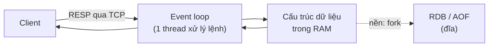
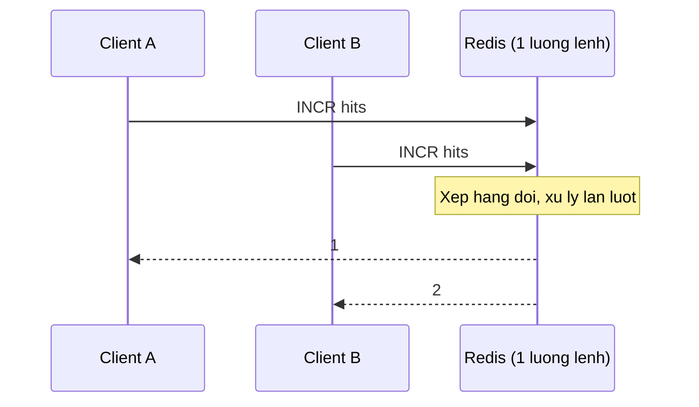

# Lý thuyết 01: Redis tổng quan và cấu trúc dữ liệu

**Tóm tắt:**

- Redis là kho cấu trúc dữ liệu trong RAM (String, Hash, List, Set, Sorted Set, Stream, Bitmap, HyperLogLog, Geo), không chỉ là key-value đơn giản.
- Redis thực thi lệnh trên một thread nên mỗi lệnh đơn lẻ là atomic và không cần lock; đổi lại một lệnh chậm (KEYS *, xóa key khổng lồ) chặn mọi client khác.
- Redis nhanh nhờ dữ liệu trong RAM, cấu trúc dữ liệu chuyên biệt, không lock giữa các lệnh và I/O multiplexing; pipeline giảm số round trip.
- Chọn kiểu dữ liệu đúng để mỗi thao tác là một lệnh (INCR, HINCRBY, ZADD...).
- Ghi đè bằng SET (không KEEPTTL) xóa TTL cũ; TTL trả -1 là key không có TTL, -2 là key không tồn tại; production dùng SCAN thay KEYS, UNLINK thay DEL cho key lớn.
- Use case điển hình: cache, session, bộ đếm, rate limit, lock tạm, bảng xếp hạng.
- Không nên dùng Redis làm kho chính cho dữ liệu cần bền tuyệt đối.

## Redis là gì?

Redis là một kho dữ liệu **trong memory** (in-memory) theo dạng key-value. Khác với một cái `HashMap` thông thường, value trong Redis không chỉ là chuỗi: nó là các cấu trúc dữ liệu thực thụ (String, Hash, List, Set, Sorted Set, Stream...) và Redis cung cấp sẵn các lệnh thao tác atomic trên từng cấu trúc. Dữ liệu có thể được ghi xuống đĩa (persistence) và replicate sang máy khác (replication). Bạn có thể hình dung Redis như một bộ hộp dụng cụ gồm ngăn kéo, danh sách, bảng điểm, đặt cạnh ứng dụng, mà thao tác nào cũng xong trong một lệnh.

## Vấn đề nó giải quyết

Cơ sở dữ liệu quan hệ đọc dữ liệu từ đĩa nên mỗi query tốn mili-giây hoặc hơn, và với bộ đếm hay bảng xếp hạng bạn phải đọc, sửa, ghi qua nhiều round trip (một lượt gửi request và nhận response giữa client và server), lại dễ lệch khi nhiều người cùng ghi. Redis đọc/ghi từ RAM theo index nên độ trễ tính bằng micro-giây đến dưới 1 ms. Quan trọng hơn, cấu trúc dữ liệu có sẵn (ZSet cho bảng xếp hạng, `INCR` cho bộ đếm, Stream cho queue) cho phép giải bài toán bằng **một lệnh** atomic.

## Khi nào nên dùng, khi nào không

Dùng cho cache dữ liệu đọc nhiều, session, rate limit, bộ đếm, bảng xếp hạng, queue nhẹ, distributed lock đơn giản, và dữ liệu tạm có TTL. Không dùng làm nguồn sự thật duy nhất cho dữ liệu lớn, khi cần query quan hệ phức tạp, hoặc khi đòi hỏi bảo đảm bền vững tuyệt đối. Nếu sai, hiện tượng thường gặp là hóa đơn RAM tăng vọt hoặc mất vài giây dữ liệu cuối khi server sập.

## Dùng như thế nào

Ứng dụng kết nối qua giao thức RESP (giao thức văn bản đơn giản của Redis chạy trên TCP) bằng một client (Lettuce, Jedis, Redisson trong Java), gọi lệnh theo kiểu cấu trúc dữ liệu, đặt TTL cho dữ liệu tạm, và chọn đúng kiểu dữ liệu để mỗi thao tác là một lệnh atomic.

Các thuật ngữ nên nắm trước khi đọc tiếp:

- **Atomic**: lệnh chạy trọn vẹn, không bị lệnh khác chen vào giữa. Ví dụ `INCR` đọc, cộng 1, ghi trong một bước nên hai client gọi cùng lúc vẫn ra đúng kết quả.
- **TTL (time to live)**: thời gian sống còn lại của key; hết hạn thì Redis tự xóa. Dùng cho cache, session, dữ liệu tạm.
- **Round trip**: một lượt gửi lệnh và nhận trả lời qua mạng. Giảm số round trip là cách tối ưu tốc độ chính.
- **Pipelining**: gửi nhiều lệnh liên tiếp không chờ từng response, rồi nhận response một lượt.
- **Big key**: key chứa quá nhiều dữ liệu (hash/list/set hàng triệu phần tử); thao tác trên nó chặn server.
- **Eviction**: cơ chế Redis tự xóa key khi đầy memory theo chính sách đã chọn.

Liên quan: [Caching và CDN](/go?p=15-System%20Design%2Feasy%2Flt-03-caching-cdn.md) (khái niệm cache nói chung), [Cache pattern và các vấn đề của cache](/go?p=06-Distributed-Systems%2FRedis%2Fmedium%2Flt-03-cache-pattern-van-de-cache.md).

## Vì sao Redis nhanh



1. **Dữ liệu nằm trong RAM**, không có truy cập đĩa trên đường đọc/ghi thông thường.
2. **Cấu trúc dữ liệu được thiết kế riêng** (skiplist, hash table, listpack...) nên mỗi lệnh có độ phức tạp biết trước.
3. **Một thread thực thi lệnh**: không lock contention, không context switch giữa các lệnh; mỗi lệnh chạy trọn vẹn rồi mới đến lệnh sau (lý do mỗi lệnh đơn lẻ là atomic). Chi tiết ở [bài 04](/go?p=06-Distributed-Systems%2FRedis%2Fhard%2Flt-04-redis-noi-bo-cluster-sentinel.md).
4. **Multiplexing I/O** (epoll/kqueue) phục vụ hàng nghìn kết nối bằng một thread.
5. Giao thức RESP đơn giản, dễ phân tích, hỗ trợ **pipelining** (gửi nhiều lệnh một lần).

Điểm yếu đi kèm: một lệnh chậm (ví dụ `KEYS *`, xóa key khổng lồ) **chặn mọi client khác**. Đây là đánh đổi có chủ đích: được atomicity và đơn giản, mất khả năng chạy parallel các lệnh nặng.

**Nền tảng:** Redis là kho cấu trúc dữ liệu trong RAM, thực thi lệnh trên một thread, nên mỗi lệnh đơn lẻ là atomic và không cần lock. Cái giá là một lệnh chậm (KEYS *, xóa key khổng lồ) chặn mọi client khác, vì vậy phải để ý độ phức tạp của lệnh và kích thước key.

**Suy luận:** Một thread thực thi lệnh nghe như điểm yếu nhưng là lựa chọn có chủ đích. Dữ liệu nằm trong RAM nên mỗi lệnh ngắn chỉ mất micro giây và nút thắt thường là mạng chứ không phải CPU; một thread vì thế không bỏ phí nhiều. Đổi lại, thread đơn loại bỏ lock giữa các lệnh và chi phí context switch, và quan trọng hơn, nó cho mỗi lệnh tính atomic miễn phí: không lệnh nào chen vào giữa lúc INCR đọc, cộng, ghi. Cái giá nằm ở phía đối diện: vì mọi client xếp hàng qua cùng một thread, một lệnh tốn thời gian làm mọi client khác chờ, nên KEYS *, xóa một key khổng lồ hay duyệt một collection hàng triệu phần tử đều là sự cố chứ không chỉ là chậm. Điểm dễ nhầm là cho rằng atomic của lệnh đơn đảm bảo atomic của chuỗi lệnh: GET rồi SET là hai lệnh và client khác có thể chen giữa, nên cần lệnh gộp, MULTI/EXEC hoặc Lua. Khi review code, hãy kiểm tra độ phức tạp của lệnh trên key lớn, và dùng SCAN, UNLINK thay vì KEYS, DEL.

Sơ đồ dưới đây cho thấy lifecycle của một lệnh khi nhiều client cùng gửi tới:



Đọc sơ đồ: hai lệnh đến cùng lúc được xếp hàng và chạy tuần tự, nên không bao giờ có chuyện cả hai cùng đọc giá trị cũ rồi ghi đè nhau.

## Các kiểu dữ liệu

| Kiểu | Mô tả | Lệnh tiêu biểu | Dùng cho |
|---|---|---|---|
| **String** | Chuỗi nhị phân tới 512 MB; cũng là số nguyên | `SET`, `GET`, `INCR`, `SETNX`, `MSET` | Cache object (JSON), bộ đếm, cờ, lock |
| **Hash** | Map field → value trong một key | `HSET`, `HGET`, `HGETALL`, `HINCRBY` | Object có nhiều field (user, giỏ hàng) |
| **List** | Danh sách liên kết hai đầu | `LPUSH`, `RPOP`, `BRPOP`, `LRANGE` | Queue đơn giản, timeline gần nhất |
| **Set** | Tập không trùng, không thứ tự | `SADD`, `SISMEMBER`, `SINTER`, `SPOP` | Tag, bạn chung, chống trùng |
| **Sorted Set (ZSet)** | Set có `score`, duyệt theo thứ tự | `ZADD`, `ZRANGE`, `ZRANK`, `ZINCRBY` | Bảng xếp hạng, queue trì hoãn, sliding window |
| **Bitmap** | Thao tác bit trên String | `SETBIT`, `GETBIT`, `BITCOUNT` | Điểm danh theo ngày, cờ cho số lượng ID lớn |
| **HyperLogLog** | Đếm số phần tử khác nhau gần đúng, memory nhỏ cố định | `PFADD`, `PFCOUNT` | Đếm unique visitor |
| **Geo** | Tọa độ, xây trên ZSet | `GEOADD`, `GEOSEARCH` | Tìm điểm gần vị trí |
| **Stream** | Log nối đuôi có consumer group | `XADD`, `XREADGROUP`, `XACK` | Event queue bền ([bài 05](/go?p=06-Distributed-Systems%2FRedis%2Fhard%2Flt-05-distributed-lock-lua-streams.md)) |

Vài kiểu ít quen cần giải thích thêm. **Sorted Set** lưu mỗi phần tử kèm một số `score` và luôn giữ thứ tự theo score, nên lấy top N hay hạng của một phần tử rất rẻ (độ phức tạp logarit). **HyperLogLog** là thuật toán xác suất đếm số phần tử khác nhau chỉ với khoảng 12 KB cố định, đổi lại sai số nhỏ (khoảng 0,81%); dùng khi chỉ cần con số xấp xỉ như unique visitor, không dùng khi cần danh sách thật. **Bitmap** coi một String như dãy bit, mỗi bit là cờ của một ID (ví dụ bit thứ `userId` bằng 1 nếu user đã điểm danh hôm nay). **Stream** là log chỉ nối thêm, có consumer group (nhóm consumer chia nhau xử lý) và `XACK` (xác nhận đã xử lý xong), phù hợp queue cần tin cậy.

**Phải thuộc:** Chọn kiểu dữ liệu đúng để mỗi thao tác là một lệnh: String (cache, INCR), Hash (object), List (queue đơn giản), Set (chống trùng, tag), Sorted Set (bảng xếp hạng), Stream (queue có ack), Bitmap, HyperLogLog (đếm gần đúng khoảng 12 KB, sai số khoảng 0,81%), Geo.

Redis 8 còn tích hợp sẵn trong bản phân phối: JSON, time series, các cấu trúc xác suất (Bloom filter, Cuckoo filter, Count-Min Sketch, Top-k, t-digest) và vector set (beta), vốn trước đây là các module riêng (theo thông báo Redis 8 GA ngày 01/05/2025).

## Lệnh cơ bản

```text
SET user:1:name "An"            # ghi
GET user:1:name                 # đọc
SET session:abc "..." EX 1800   # kèm TTL 1800 giây
EXPIRE user:1:name 60           # đặt TTL cho key đã có
TTL user:1:name                 # còn bao nhiêu giây (-1: không TTL, -2: không tồn tại)
INCR page:views                 # tăng atomic
HSET user:1 name An age 30      # hash
ZADD board 1200 "alice" 950 "bob"
ZREVRANGE board 0 2 WITHSCORES  # top 3 điểm cao nhất
```

Quy ước đặt tên key: `<loại>:<id>:<thuộc tính>` (ví dụ `order:1001:items`) để dễ đọc, dễ nhóm; tránh key quá dài.

### TTL và lifecycle key

Vấn đề: dữ liệu tạm mà không tự hết hạn sẽ làm RAM phình mãi. Cách giải quyết là gắn TTL cho key ngay khi tạo. Cần nhớ ba điều sau:

- `EXPIRE`/`PEXPIRE`/`SET ... EX|PX` đặt hạn; key hết hạn bị xóa **chủ động** (quét mẫu ngẫu nhiên) và **bị động** (khi truy cập). Chi tiết ở [bài 02](/go?p=06-Distributed-Systems%2FRedis%2Fmedium%2Flt-02-persistence-replication-eviction.md).
- Ghi đè bằng `SET` (không `KEEPTTL`) sẽ **xóa TTL** cũ: lỗi hay gặp khi cập nhật cache.
- Từ Redis 7.4 có hết hạn theo từng field của hash; Redis 8 thêm `HGETEX`, `HSETEX`, `HGETDEL` (theo thông báo Redis 8 GA).

**Phải thuộc:** Ghi đè bằng SET (không KEEPTTL) xóa TTL cũ. TTL trả -1 nghĩa là key không có TTL, -2 là key không tồn tại. Trên production dùng SCAN thay KEYS, UNLINK thay DEL cho key lớn.

## Ví dụ Java (Spring Data Redis)

Hãy xem một class nhỏ gom bốn bài toán điển hình: lưu session có TTL, bộ đếm, top 3 bảng xếp hạng và rate limit. `StringRedisTemplate` là class của Spring Data Redis để thao tác với key/value dạng chuỗi; `opsForValue()` tương ứng String, `opsForZSet()` tương ứng Sorted Set.

```java
@Service
class SessionStore {
    private final StringRedisTemplate redis;
    SessionStore(StringRedisTemplate redis) { this.redis = redis; }

    void save(String sid, String json) {
        redis.opsForValue().set("session:" + sid, json, Duration.ofMinutes(30));
    }

    long recordHit(String page) {                 // bộ đếm atomic
        return redis.opsForValue().increment("hits:" + page);
    }

    List<String> top3() {                          // bảng xếp hạng
        Set<String> s = redis.opsForZSet().reverseRange("board", 0, 2);
        return new ArrayList<>(s);
    }

    // rate limit cửa sổ cố định, 100 request/phút
    boolean allow(String userId) {
        String key = "rl:" + userId + ":" + (System.currentTimeMillis() / 60_000);
        Long n = redis.opsForValue().increment(key);
        if (n != null && n == 1) redis.expire(key, Duration.ofMinutes(2));
        return n != null && n <= 100;
    }
}
```

Lưu ý `increment` rồi `expire` là **hai lệnh**: nếu process chết giữa chừng, key không có TTL. Cách làm chặt chẽ dùng Lua ở [bài 05](/go?p=06-Distributed-Systems%2FRedis%2Fhard%2Flt-05-distributed-lock-lua-streams.md).

## Use case điển hình

| Bài toán | Cấu trúc | Ý chính |
|---|---|---|
| Cache | String/Hash + TTL | Cache-aside, đặt TTL, xem [bài 03](/go?p=06-Distributed-Systems%2FRedis%2Fmedium%2Flt-03-cache-pattern-van-de-cache.md) |
| Session | String hoặc Hash + TTL | TTL trượt bằng `EXPIRE` mỗi lần truy cập |
| Rate limit | String (`INCR`) hoặc ZSet | Cửa sổ cố định hoặc sliding window |
| Bộ đếm | String `INCR`, Hash `HINCRBY` | Atomic, không cần lock |
| Bảng xếp hạng | ZSet | `ZINCRBY` cập nhật, `ZREVRANGE` lấy top, `ZREVRANK` lấy hạng |
| Queue nhẹ | List (`LPUSH` + `BRPOP`) hoặc Stream | List mất message nếu consumer chết; Stream có ack |
| Chống trùng | Set, Bloom filter | `SADD` trả 0 nếu đã có |
| Lock tạm | `SET NX PX` | Xem [bài 05](/go?p=06-Distributed-Systems%2FRedis%2Fhard%2Flt-05-distributed-lock-lua-streams.md) và [Distributed lock và Idempotency](/go?p=01-Spring-Boot%2Fhard%2Flt-26-distributed-lock-idempotency.md) |

## Khi nào KHÔNG nên dùng Redis làm kho chính

- Dữ liệu vượt dung lượng RAM chấp nhận được (chi phí cao).
- Cần ACID đầy đủ, query quan hệ, join: dùng CSDL quan hệ ([Database](/go?p=02-Database%2Findex.md)).
- Không thể chấp nhận mất vài giây ghi cuối khi sự cố (xem mất dữ liệu ở [bài 02](/go?p=06-Distributed-Systems%2FRedis%2Fmedium%2Flt-02-persistence-replication-eviction.md)).

## Bẫy thường gặp

- Dùng `KEYS *` trên production (chặn toàn server): dùng `SCAN` lặp có `COUNT`.
- Lưu một **big key** (hash/list/set hàng triệu phần tử) rồi `HGETALL`, `LRANGE 0 -1`, hoặc xóa bằng `DEL` sync: dùng `UNLINK`, chia nhỏ key.
- Quên TTL cho dữ liệu tạm, memory phình đến lúc eviction hoặc OOM.
- Dùng Redis như queue tin cậy bằng List rồi mất message khi consumer chết giữa chừng.
- Giả định `GET` rồi `SET` là atomic: phải dùng lệnh đơn (`INCR`, `SET NX`) hoặc Lua.
- Nhầm Redis với CSDL bền vững khi cấu hình persistence mặc định không đủ cho dữ liệu quan trọng.

## Điểm cần nhớ

- Redis là kho cấu trúc dữ liệu trong RAM, mỗi lệnh đơn là atomic vì một thread thực thi lệnh.
- Chọn **kiểu dữ liệu đúng** để thao tác là một lệnh: INCR, ZINCRBY, SADD, HINCRBY.
- Luôn nghĩ đến TTL, kích thước key và độ phức tạp lệnh (O(1) hay O(N)).
- `SCAN` thay `KEYS`, `UNLINK` thay `DEL` cho key lớn.
- Redis không thay CSDL quan hệ; thường đứng cạnh nó làm cache/bộ đếm/queue.

## Câu hỏi tự kiểm tra

1. Hai client cùng `INCR counter` một lúc mà kết quả vẫn đúng. Vì sao?
   - Gợi ý suy luận: Redis thực thi lệnh trên mấy thread? Một lệnh có thể bị lệnh khác xen vào giữa không?
   - Đáp án: Vì lệnh được xử lý tuần tự trên một thread và chạy trọn vẹn, nên đọc-cộng-ghi không bị xen kẽ.
2. Production có hàng chục triệu key, chạy `KEYS *` thì server đứng. Khác nhau giữa `KEYS` và `SCAN`?
   - Gợi ý suy luận: Một thread xử lý lệnh, nếu một lệnh duyệt toàn bộ thì các lệnh khác làm gì? Chia việc thành từng đợt thì sao?
   - Đáp án: `KEYS` duyệt hết trong một lượt nên chặn mọi lệnh khác; `SCAN` duyệt từng đợt qua con trỏ nên không chặn lâu, đổi lại có thể trả trùng.
3. Làm bảng xếp hạng top 100 theo điểm, chọn kiểu dữ liệu nào?
   - Gợi ý suy luận: Cần giữ thứ tự theo một số thực và lấy theo hạng. Kiểu nào tự sắp theo score?
   - Đáp án: Sorted Set: `ZADD`/`ZINCRBY` để cập nhật, `ZREVRANGE 0 99` lấy top 100.
4. `SET key v` ghi đè key đang có TTL, key còn hết hạn không?
   - Gợi ý suy luận: `SET` thay giá trị bằng một giá trị mới hoàn toàn, vậy hạn cũ gắn với giá trị cũ còn ý nghĩa không?
   - Đáp án: Không, TTL cũ bị xóa, trừ khi dùng `KEEPTTL`.
5. Rate limiter làm `increment` rồi `expire` ở hai lệnh. Lỗi gì có thể xảy ra?
   - Gợi ý suy luận: Nếu process chết giữa hai lệnh, key đã có giá trị nhưng chưa có TTL thì chuyện gì xảy ra với nó?
   - Đáp án: Hai lệnh riêng nên không atomic; chết giữa chừng thì key không bao giờ hết hạn, nên gộp bằng Lua hoặc dùng `SET ... EX` phù hợp.

Nguồn: tài liệu chính thức Redis (redis.io), kiểm tra ngày 21/10/2026.

