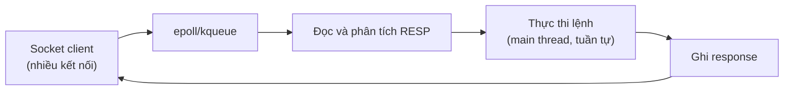
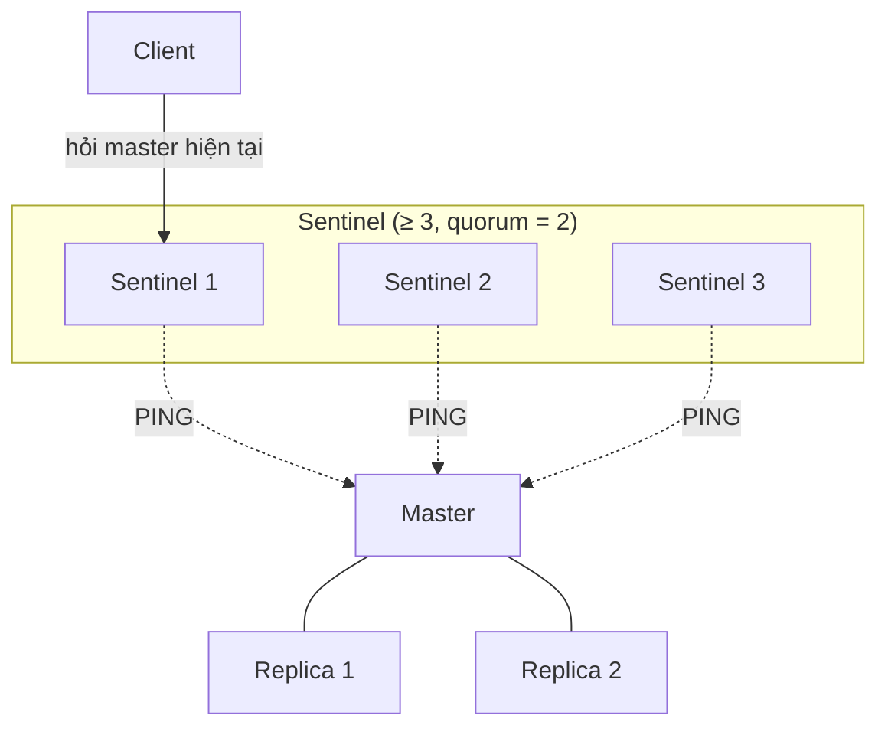
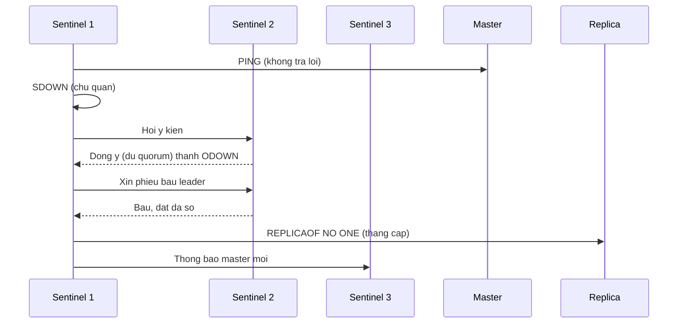
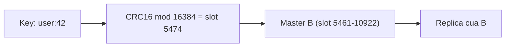

# Lý thuyết 04: Redis bên trong, Sentinel và Cluster

**Tóm tắt:**

- Redis thực thi lệnh tuần tự trên một main thread (event loop với epoll hoặc kqueue), nên mỗi lệnh atomic và không cần lock, nhưng một lệnh chậm làm mọi client chờ.
- I/O threads (từ Redis 6.0) chỉ lo đọc ghi socket và phân tích lệnh, còn thực thi lệnh vẫn ở main thread.
- Redis chọn encoding nội bộ theo kích thước dữ liệu để tiết kiệm memory, ví dụ dữ liệu nhỏ dùng cấu trúc gọn thay vì hash table đầy đủ.
- BGSAVE và AOF rewrite dùng fork cộng copy-on-write: fork gây khựng, RAM có thể tăng gần gấp đôi khi ghi nhiều, nên phải dự phòng RAM và tắt THP.
- Sentinel cần ít nhất 3 Sentinel trên các máy độc lập: SDOWN rồi ODOWN theo quorum, nhưng bầu leader để failover cần đa số; nó chỉ có một master ghi và không chia dữ liệu.
- Cluster chia key thành 16384 hash slot (slot = CRC16(key) mod 16384); MOVED nghĩa là slot đã sang node khác, ASK nghĩa là slot đang di chuyển; lệnh nhiều key phải cùng slot, dùng hash tag để ép.
- Sentinel dùng khi dữ liệu vừa RAM một node, Cluster dùng khi dữ liệu hoặc lượng ghi vượt một node; cả hai dùng replication async nên failover có thể mất ghi.

## Vì sao cần hiểu Redis bên trong?

Dùng Redis ở mức "gọi lệnh nào" thì ai cũng làm được. Câu hỏi ở mức senior là: vì sao Redis nhanh, vì sao thỉnh thoảng khựng, dữ liệu có thể mất ở đâu khi failover, và vì sao lệnh nhiều key lại báo lỗi trên Cluster. Chỉ khi hiểu cơ chế bên trong bạn mới trả lời và xử lý được các tình huống đó.

Bài này đi qua bốn mảng. Một là cách Redis thực thi lệnh (event loop một thread, I/O threads). Hai là cách dữ liệu được biểu diễn trong memory (SDS, listpack, skiplist, hashtable, intset). Ba là cơ chế fork và copy-on-write khi lưu snapshot. Bốn là hai mô hình sẵn sàng cao và mở rộng: **Sentinel** (tự động failover cho một master) và **Cluster** (chia dữ liệu thành 16384 hash slot trên nhiều master).

Bạn sẽ cần kiến thức này khi thiết kế kiến trúc Redis HA hoặc scale, khi điều tra latency spike (độ trễ tăng đột ngột) hay tràn memory, và khi chuẩn bị phỏng vấn sâu. Cách tiếp cận: nắm mô hình thực thi và memory, chọn Sentinel hay Cluster theo nhu cầu (cần HA hay cần scale), thiết kế key theo hash tag, và dùng công cụ chẩn đoán (SLOWLOG, LATENCY, MEMORY, INFO).

## Các khái niệm cần biết

- **Failover**: khi master chết, một replica được thăng cấp thành master mới để hệ thống tiếp tục phục vụ.
- **Master/replica**: master nhận ghi, replica sao chép dữ liệu từ master (async) và có thể phục vụ đọc.
- **Quorum**: số Sentinel tối thiểu phải đồng ý rằng master đã chết. Chỉ dùng để phát hiện lỗi, không đủ để bầu leader.
- **Hash slot**: một trong 16384 ô mà Cluster chia không gian key; mỗi key thuộc đúng một slot, mỗi master giữ một tập slot.
- **Gossip**: giao thức các node trao đổi tin trạng thái với nhau theo kiểu "tin đồn" để biết ai còn sống.
- **Copy-on-write (COW)**: sau `fork()`, cha và con dùng chung trang nhớ; chỉ khi một bên ghi vào trang thì hệ điều hành mới sao chép trang đó.
- **Split-brain**: mạng bị tách khiến hai phía cùng tin mình có master, dẫn đến hai bên ghi khác nhau.
- **CROSSSLOT**: lỗi khi một lệnh nhiều key có các key nằm ở slot khác nhau.
- **Latency spike**: độ trễ đột ngột tăng cao trong thời gian ngắn, thường do lệnh chậm, fork hoặc fsync.

Tiếp nối [Persistence, Replication và Eviction](/go?p=06-Distributed-Systems%2FRedis%2Fmedium%2Flt-02-persistence-replication-eviction.md).

## 1. Mô hình thực thi

Vấn đề đặt ra: làm sao một process phục vụ hàng chục nghìn client mà vẫn giữ mỗi lệnh atomic? Redis trả lời bằng một event loop: một main thread chờ event trên mọi socket (qua epoll hoặc kqueue, cơ chế của hệ điều hành báo socket nào đang có dữ liệu), đọc lệnh, thực thi tuần tự, rồi ghi response.



- **Main thread thực thi lệnh một cách tuần tự**. Hệ quả: mỗi lệnh atomic, không cần lock trên dữ liệu; nhưng một lệnh chậm làm **mọi client chờ**.
- **Vì sao một thread vẫn nhanh**: bottleneck thường là mạng và memory, không phải CPU; lệnh đa số O(1)/O(log N), chạy trong micro-giây; không có chi phí lock và context switch; multiplexing I/O cho hàng chục nghìn kết nối.
- **I/O threads** (từ Redis 6.0): các thread phụ đọc/ghi socket và phân tích lệnh, còn **thực thi lệnh vẫn ở main thread**. Bật bằng `io-threads` (mặc định 1). Redis 8 giới thiệu cài đặt I/O threading mới, theo Redis đo được cải thiện throughput đáng kể khi đặt nhiều thread trên CPU nhiều nhân (con số phụ thuộc phần cứng và lệnh).
- Các tác vụ nặng chuyển nền: xóa lười (`UNLINK`, `lazyfree-*`), fsync AOF, đóng file, và child process cho RDB/AOF rewrite.
- Từ Redis 7.0 có **Redis Functions** (thư viện hàm Lua lưu cùng dữ liệu, được replicate/persist) bên cạnh `EVAL` (xem [bài 05](/go?p=06-Distributed-Systems%2FRedis%2Fhard%2Flt-05-distributed-lock-lua-streams.md)).

**Nền tảng:** Redis thực thi lệnh tuần tự trên một main thread (event loop với epoll hoặc kqueue), nên mỗi lệnh atomic và không cần lock, nhưng một lệnh chậm làm mọi client chờ. I/O threads (từ Redis 6.0) chỉ lo đọc ghi socket và phân tích lệnh, thực thi vẫn ở main thread.

## 2. Biểu diễn dữ liệu trong memory

Một Hash nhỏ mà dùng hash table đầy đủ thì tốn con trỏ và bucket quá mức; còn một Hash khổng lồ mà dùng mảng liền kề thì sửa rất chậm. Vì vậy Redis chọn **encoding** (cách encode nội bộ) theo kích thước: tiết kiệm memory khi nhỏ và tự đổi sang cấu trúc nhanh hơn khi lớn lên. Người dùng không phải chọn, nhưng cần biết để hiểu vì sao memory đôi khi tăng đột biến. Xem bằng `OBJECT ENCODING key`.

| Kiểu | Encoding nhỏ | Encoding lớn | Ghi chú |
|---|---|---|---|
| String | `int` (số nguyên), `embstr` (chuỗi ngắn, một khối) | `raw` (SDS) | Dựa trên **SDS** |
| Hash | `listpack` | `hashtable` | Ngưỡng `hash-max-listpack-entries/value` |
| List | `listpack` | `quicklist` (danh sách liên kết các listpack) | Ngưỡng theo `list-max-listpack-size` |
| Set | `intset` (toàn số nguyên), `listpack` | `hashtable` | |
| Sorted Set | `listpack` | `skiplist` + `hashtable` | Skiplist cho thứ tự theo score, hashtable cho tra cứu member O(1) |
| Stream | cây radix (`rax`) chứa các listpack | | |

(Trước Redis 7.0, `ziplist` đóng vai trò mà `listpack` đảm nhận hiện nay.)

- **SDS (Simple Dynamic String)**: chuỗi lưu độ dài, nên `STRLEN` O(1), an toàn nhị phân, có thể cấp phát trước để nối nhanh.
- **listpack**: mảng liền kề gọn, tiết kiệm memory, nhưng sửa giữa phần tử là O(N); chỉ dùng khi nhỏ.
- **skiplist**: danh sách liên kết nhiều tầng, cho `ZRANGE`, `ZRANK`, chèn O(log N) kỳ vọng, đơn giản hơn cây cân bằng và duyệt theo khoảng hiệu quả.
- **Incremental rehashing**: hash table (`dict`) giữ **hai bảng**; khi cần nở ra, mỗi thao tác (và chu trình nền) chuyển dần một ít bucket sang bảng mới, thay vì chuyển hết một lần gây khựng. Trong lúc rehash, tra cứu phải xét cả hai bảng.
- Hệ quả thực tế: đổi từ encoding nhỏ sang lớn **tăng đột biến memory** (một Hash 100 field nhỏ có thể rẻ hơn nhiều so với 100 key riêng); vì vậy gom dữ liệu nhỏ vào Hash đôi khi tiết kiệm memory.

## 3. Fork và copy-on-write

`BGSAVE` và AOF rewrite gọi `fork()`. Child process **chia sẻ trang memory** với cha; chỉ khi cha **ghi** vào một trang, hệ điều hành sao chép trang đó (copy-on-write, COW).

- Chi phí fork tỷ lệ với kích thước **bảng trang** (dataset lớn gây khựng cỡ mili-giây đến trăm mili-giây; trên một số môi trường ảo hóa còn tệ hơn).
- Trong lúc con chạy, cha ghi nhiều thì nhiều trang bị sao chép, **memory có thể tăng gần gấp đôi** trong trường hợp xấu: lý do cần để dự phòng RAM và tránh `maxmemory` quá sát.
- Transparent Huge Pages (THP) làm COW sao chép trang 2 MB thay vì 4 KB nên nên tắt (Redis cảnh báo khi khởi động).
- Chẩn đoán: `INFO persistence` (thời gian fork gần nhất `latest_fork_usec`), `INFO memory`.

**Nền tảng:** BGSAVE và AOF rewrite dùng fork cộng copy-on-write: child process chia sẻ trang nhớ với cha, trang nào cha ghi mới bị sao chép. Vì vậy fork gây khựng tỷ lệ với bảng trang và RAM có thể tăng gần gấp đôi khi ghi nhiều, nên phải dự phòng RAM và tắt THP.

**Suy luận:** Để lưu snapshot của một dataset đang bị sửa liên tục, Redis cần một ảnh nhất quán tại một thời điểm mà không dừng phục vụ. Nó giải bằng fork: process con có không gian địa chỉ giống hệt cha, nhưng hệ điều hành không copy RAM ngay mà cho hai process dùng chung các trang và chỉ sao chép một trang khi một bên ghi vào nó (copy-on-write). Con thấy dữ liệu đóng băng tại lúc fork và ghi ra đĩa, còn cha tiếp tục phục vụ client. Hệ quả thứ nhất: bản thân việc fork phải copy bảng trang, tỷ lệ với RAM, nên main thread khựng một lúc ở dataset lớn. Hệ quả thứ hai: mỗi trang mà cha ghi trong lúc con chạy phải được sao chép, nên khi ghi nhiều, memory tăng dần và trong trường hợp xấu gần gấp đôi. Transparent Huge Pages làm tệ hơn vì mỗi lần ghi sao chép cả trang 2 MB thay vì 4 KB. Điểm dễ nhầm là nghĩ dataset 10 GB chỉ cần 10 GB RAM; một máy 12 GB có thể bị OOM đúng lúc BGSAVE. Hệ quả hành động: chừa RAM dự phòng cho fork, tắt THP, và theo dõi latency quanh thời điểm BGSAVE.

## 4. Sentinel

Sentinel là process giám sát **một nhóm master-replica** và tự động failover.



Sentinel dùng khi dữ liệu còn vừa RAM của một node và bạn chỉ cần tự động thay master khi nó chết. Không dùng khi cần chia dữ liệu hay tăng throughput ghi, vì luôn chỉ có một master ghi. Nếu chạy chỉ 2 Sentinel hoặc đặt cùng một máy, khi máy đó chết sẽ không còn đa số để failover.

Sơ đồ trình tự dưới đây mô tả quy trình failover:



Các bước diễn ra như sau:

1. Một Sentinel thấy master không trả lời quá `down-after-milliseconds` → **SDOWN** (chủ quan).
2. Khi đủ **quorum** Sentinel đồng ý → **ODOWN** (khách quan).
3. Các Sentinel **bầu một người dẫn đầu** (cần **đa số tuyệt đối** Sentinel, không chỉ quorum) để thực hiện failover.
4. Chọn replica thăng cấp theo ưu tiên, độ lệch offset replication và id; chuyển các replica khác sang master mới.
5. Client hỏi Sentinel địa chỉ master hiện tại (client như Lettuce/Jedis hỗ trợ).

**Quorum** chỉ dùng để phát hiện lỗi; **việc ủy quyền failover cần đa số** Sentinel đang hoạt động. Deploy tối thiểu 3 Sentinel trên các máy/vùng lỗi độc lập.

**Phải thuộc:** Sentinel: ít nhất 3 Sentinel trên các máy độc lập. SDOWN (một Sentinel thấy lỗi) rồi ODOWN (đủ quorum đồng ý), nhưng bầu leader để failover cần đa số Sentinel, không chỉ quorum. Sentinel chỉ có một master ghi và không chia dữ liệu.

Hạn chế: không chia dữ liệu (một master ghi duy nhất), và vì replication async nên **failover có thể mất các ghi chưa kịp replicate**.

## 5. Redis Cluster

Khi dữ liệu hoặc lượng ghi vượt khả năng của một node, bạn cần chia nhỏ (sharding). Cluster làm việc đó trong chính Redis: chia không gian key thành **16384 hash slot**; mỗi master giữ một tập slot.



- Slot của key = `CRC16(key) mod 16384`.
- Mỗi master có thể có replica; node dùng giao thức gossip trên cổng bus (cổng dữ liệu + 10000) để biết trạng thái và bầu replica thăng cấp khi master lỗi (cần đa số master).
- **Client thông minh** giữ bản đồ slot→node; gửi thẳng đến node đúng.

**Phải thuộc:** Cluster chia key thành 16384 hash slot, slot = CRC16(key) mod 16384. MOVED nghĩa là slot đã thuộc node khác (cập nhật bản đồ), ASK nghĩa là slot đang di chuyển (chỉ hỏi node đích lần này). Lệnh nhiều key phải cùng slot, nếu không báo CROSSSLOT; dùng hash tag {} để ép cùng slot.

### Chuyển hướng

| Response | Ý nghĩa |
|---|---|
| `MOVED slot host:port` | Slot đã **thuộc về** node khác (cố định): client cập nhật bản đồ slot |
| `ASK slot host:port` | Slot **đang di chuyển**: chỉ hỏi node đích lần này (kèm lệnh `ASKING`), chưa cập nhật bản đồ |

### Resharding

Di chuyển slot giữa node khi thêm/bớt node: từng key được chuyển (`MIGRATE`), trong lúc đó slot ở trạng thái `MIGRATING`/`IMPORTING`, nên có `ASK`. Redis 8.4 bổ sung **atomic slot migration** (chuyển cả slot atomic, an toàn hơn cho cân bằng lại; theo thông báo phát hành 8.4, kiểm tra lại theo phiên bản).

### Hash tag và hạn chế multi-key

Lệnh nhiều key (`MGET`, `MULTI/EXEC`, Lua, `SUNION`...) yêu cầu mọi key **cùng slot**, nếu không báo `CROSSSLOT`. Dùng **hash tag**: chỉ phần trong `{}` đầu tiên được hash.

```text
SET {user:42}:profile ...
SET {user:42}:cart    ...      # cùng slot, dùng chung được trong MULTI/Lua
```

Dùng hash tag khi bạn thực sự cần transaction hoặc script trên nhóm key liên quan (một user). Không dùng tag chung cho cả hệ thống. Đánh đổi: tag quá thô (ví dụ `{tenant}` cho tất cả) dồn dữ liệu vào một slot → **hot shard**.

### Tính sẵn sàng và nhất quán của Cluster

- Cluster **không bảo đảm nhất quán mạnh**: replication async, nên có thể **mất ghi** khi failover (master trả OK cho client rồi chết trước khi replica nhận).
- Khi một phần slot không có master phục vụ, mặc định cả Cluster ngừng nhận lệnh (`cluster-require-full-coverage yes`); đặt `no` để các slot còn lại vẫn chạy.
- Network partition: phía thiểu số (không đủ đa số master) ngừng sau `cluster-node-timeout`; client vẫn kết nối được phía thiểu số trong khoảng thời gian đó có thể **ghi vào master cũ** và các ghi này bị mất khi partition lành lại. Giảm cửa sổ bằng `cluster-node-timeout` nhỏ và `min-replicas-to-write`.
- Cluster chỉ dùng **database 0**.

### Sentinel hay Cluster?

| | Sentinel | Cluster |
|---|---|---|
| Mục tiêu | HA cho một dataset | HA và **mở rộng ghi/dữ liệu** |
| Dữ liệu | Một master chứa hết | Chia theo slot |
| Multi-key | Tự do | Giới hạn theo slot |
| Độ phức tạp vận hành | Thấp hơn | Cao hơn |
| Chọn khi | Dữ liệu vừa RAM một node, cần failover | Dữ liệu/ghi vượt một node |

**Phải thuộc:** Sentinel dùng khi dữ liệu vừa RAM một node và cần failover tự động; Cluster dùng khi dữ liệu hoặc lượng ghi vượt một node. Cả hai dùng replication async nên failover có thể mất ghi; min-replicas-to-write và WAIT chỉ giảm rủi ro.

## 6. Split-brain và mất ghi

Cả Sentinel lẫn Cluster đều có kịch bản: master bị cô lập nhưng vẫn nhận ghi từ một số client, trong khi phía kia bầu master mới. Khi nối lại, master cũ bị hạ cấp và **ghi của nó bị bỏ**. Giảm thiểu:

```text
min-replicas-to-write 1
min-replicas-max-lag 10
```

Master ngừng nhận ghi nếu không có đủ replica có độ trễ replication nhỏ; đánh đổi là **mất tính sẵn sàng** khi replica rớt. Đây là CP/AP trade-off, không loại bỏ hoàn toàn mất ghi.

## 7. Chẩn đoán

| Công cụ | Dùng để |
|---|---|
| `SLOWLOG GET n` | Lệnh vượt `slowlog-log-slower-than` (thời gian thực thi, không tính mạng) |
| `LATENCY DOCTOR`, `LATENCY LATEST`, `redis-cli --latency` | Tìm nguồn khựng (fork, AOF fsync, expire, lệnh chậm) |
| `INFO` (memory, stats, persistence, replication, clients) | Memory, `evicted_keys`, `expired_keys`, `latest_fork_usec`, lag replica, số client |
| `MEMORY USAGE key`, `MEMORY DOCTOR`, `MEMORY STATS` | Kích thước key, fragmentation |
| `redis-cli --bigkeys`, `--memkeys`, `--hotkeys` | Tìm key lớn/nóng (`--hotkeys` cần LFU) |
| `SCAN`/`HSCAN`/`ZSCAN` | Duyệt an toàn, không chặn |
| `CLIENT LIST`, `MONITOR` | Xem client; `MONITOR` làm chậm production, dùng ngắn |
| `INFO commandstats` | Thống kê theo lệnh, tìm lệnh tốn nhất |

Kịch bản điều tra "latency spike mỗi vài phút": kiểm tra `latest_fork_usec` (BGSAVE/rewrite), `SLOWLOG` (lệnh O(N)), expire hàng loạt (nhiều key cùng TTL hết hạn cùng lúc), swap, THP.

## Bẫy thường gặp

- Tưởng I/O threads làm lệnh thực thi parallel: chỉ phần I/O; lệnh vẫn tuần tự.
- Lấy `KEYS`, `SMEMBERS` trên set lớn, `FLUSHALL` sync trên production.
- Đặt hash tag quá thô, dồn dữ liệu vào một slot.
- Dùng `MULTI/EXEC`, Lua, `MGET` trên Cluster với key khác slot và gặp `CROSSSLOT`.
- Chạy 2 Sentinel (không có đa số khi mất một) hoặc đặt cùng một máy.
- Tin rằng failover của Sentinel/Cluster không mất dữ liệu.
- Bỏ qua cảnh báo THP, `vm.overcommit_memory`, và dự phòng RAM cho fork.

## Điểm cần nhớ

- Lệnh thực thi tuần tự trên một thread → atomic, nhưng một lệnh chậm chặn tất cả; I/O threads chỉ phục vụ phần mạng.
- Encoding nhỏ (listpack, intset) tiết kiệm RAM, chuyển lớn (hashtable, skiplist) khi vượt ngưỡng; hashtable rehash tăng dần.
- Fork + COW: khựng khi fork, RAM có thể tăng khi ghi nhiều trong lúc snapshot.
- Sentinel = HA một master; Cluster = chia 16384 slot, có MOVED/ASK, hash tag, hạn chế multi-key.
- Replication async → failover có thể mất ghi; `min-replicas-*` và `WAIT` chỉ giảm rủi ro.

## Câu hỏi tự kiểm tra

1. Redis một thread mà vẫn đạt hàng trăm nghìn lệnh/giây. Vì sao?
   - Gợi ý suy luận: Một lệnh trên dữ liệu trong RAM tốn bao lâu? Có phải chờ lock không? Thời gian thực sự mất ở đâu?
   - Đáp án: Lệnh ngắn trong RAM, không lock, I/O multiplexing cho nhiều kết nối; bottleneck thường là mạng chứ không phải CPU.
2. Client nhận `MOVED` rồi lần khác nhận `ASK`. Hai response này khác nhau thế nào?
   - Gợi ý suy luận: Slot đã đổi chủ hẳn khác với slot đang trong lúc di chuyển ở điểm nào? Client nên nhớ lại bản đồ trong trường hợp nào?
   - Đáp án: `MOVED`: slot đã đổi chủ, client cập nhật bản đồ; `ASK`: slot đang di chuyển, chỉ chuyển hướng một lần và không cập nhật bản đồ.
3. Hash tag dùng để làm gì và có rủi ro gì?
   - Gợi ý suy luận: Slot được tính từ gì trong key? Muốn nhiều key cùng slot thì cần gì? Nhiều key dồn vào một slot dẫn đến gì?
   - Đáp án: Ép nhiều key cùng slot để dùng lệnh multi-key; rủi ro là dồn tải vào một shard (hot shard).
4. Quorum của Sentinel dùng cho việc gì?
   - Gợi ý suy luận: Một Sentinel báo master lỗi có đủ tin không? Và ai được quyền thực hiện failover?
   - Đáp án: Quorum là số Sentinel đồng ý để xác nhận master lỗi (ODOWN); còn bầu leader để failover cần đa số.
5. Máy 8GB RAM, dữ liệu 5GB, bật RDB thì vẫn bị OOM lúc BGSAVE. Vì sao phải dự phòng RAM?
   - Gợi ý suy luận: BGSAVE fork child process, nó dùng chung trang nhớ ra sao? Khi cha ghi dữ liệu thì chuyện gì xảy ra với các trang đó?
   - Đáp án: Fork dùng copy-on-write; khi ghi nhiều, các trang bị sao chép nên memory tăng, có thể gần gấp đôi trong trường hợp xấu.
6. Latency tăng vọt đều đặn mỗi vài phút. Cách tìm nguyên nhân?
   - Gợi ý suy luận: Việc nào chạy định kỳ và chặn main thread: fork, expire hàng loạt, lệnh chậm? Công cụ nào đo từng cái?
   - Đáp án: Dùng `LATENCY DOCTOR`, `SLOWLOG`, xem `latest_fork_usec`, kiểm tra expire hàng loạt và THP.

Nguồn: tài liệu chính thức Redis (redis.io), kiểm tra ngày 21/10/2026. Chi tiết cấu hình mặc định và số hiệu phiên bản cần kiểm tra lại theo phiên bản đang dùng.

