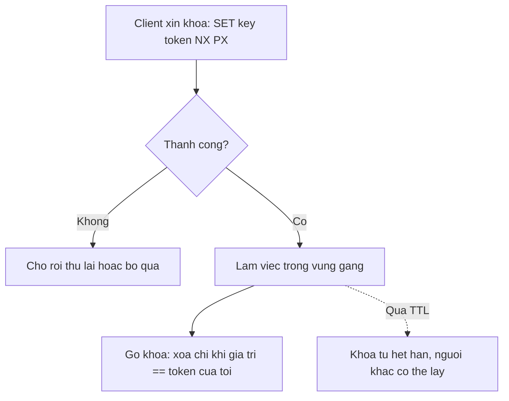
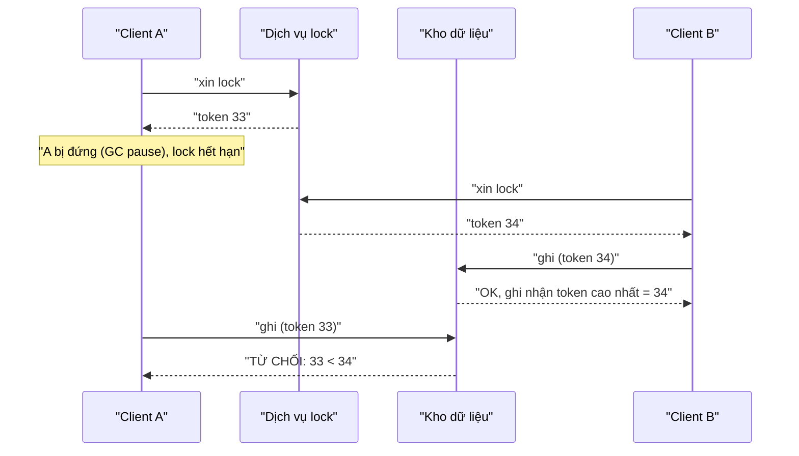
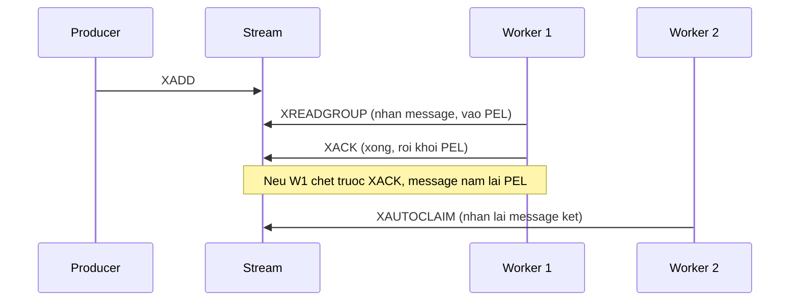

# Lý thuyết 05: Distributed lock, Lua và Streams

**Tóm tắt:**

- Distributed lock lấy bằng SET key token NX PX ttl với token ngẫu nhiên duy nhất; gỡ phải kiểm tra token và xóa trong một bước atomic (Lua, hoặc DELEX IFEQ từ Redis 8.4), vì DEL thẳng có thể gỡ nhầm lock của client khác.
- Lock có TTL không thể một mình bảo đảm loại trừ lẫn nhau: process bị tạm dừng (GC pause) làm lock hết hạn trong khi client vẫn tin mình giữ, và master-replica async còn có thể mất lock khi failover.
- Muốn đúng đắn tuyệt đối phải bảo vệ ở nơi ghi bằng fencing token, constraint trong database hoặc idempotency; lock Redis hợp để tránh làm trùng việc.
- Redlock lấy lock trên N node độc lập nhưng bị chỉ trích vì dựa vào giả định về thời gian, nên không thay được fencing.
- Redisson cung cấp reentrant lock và watchdog tự gia hạn TTL khi client còn sống.
- Lua script chạy trọn vẹn trên server nên kiểm tra rồi ghi không bị chen ngang, nhưng phải ngắn vì chặn cả server; khai báo key trong KEYS và tham số trong ARGV.
- Pub/Sub là gửi và quên (subscriber vắng mặt thì mất message); Stream là log có consumer group, PEL, XACK với at-least-once nên xử lý phải idempotent, và cần MAXLEN hoặc MINID vì nằm trong RAM.

## Ba công cụ phối hợp xây trên Redis

Bài này giới thiệu ba "công cụ phối hợp" mà Redis cung cấp. Thứ nhất là **distributed lock** (distributed lock): cơ chế để chỉ một process tại một thời điểm được làm một việc, dù các process chạy trên nhiều máy. Thứ hai là **Lua script và Functions**: chạy nhiều bước liền nhau một cách atomic ngay trên server. Thứ ba là **Pub/Sub và Streams**: truyền message giữa các thành phần, trong đó Streams có lưu trữ và consumer group.

Vì sao cần? Nhiều bài toán concurrency vượt ra ngoài phạm vi một JVM: chống xử lý trùng, rate limit, event queue. `synchronized` hay `ReentrantLock` không giúp gì khi có 5 instance của ứng dụng. Redis cho giải pháp rẻ và nhanh, nhưng **dễ sai tinh vi**: lock tưởng an toàn mà thực ra không, Lua chạy lâu chặn cả server, Pub/Sub mất message khi subscriber vắng mặt. Người ở mức senior cần biết đúng giới hạn của từng công cụ.

Cách chọn: lock Redis dùng cho mục đích **tối ưu hiệu quả** (tránh làm trùng việc, ví dụ cron chạy trên nhiều instance); Lua cho thao tác atomic đơn giản; Stream cho event queue quy mô vừa. Khi **tính đúng đắn tuyệt đối** phụ thuộc vào lock (tiền, tồn kho) thì cần thêm cơ chế khác như fencing token hoặc constraint ở CSDL. Cách làm cụ thể: dùng `SET NX PX` với giá trị ngẫu nhiên và gỡ lock an toàn, kèm fencing token ở nơi ghi; viết Lua ngắn; chọn Pub/Sub, Streams hay Kafka theo yêu cầu về durability và quy mô.

## Các khái niệm cần biết

- **Mutual exclusion**: tại một thời điểm chỉ một bên được vào vùng găng (đoạn việc cần độc quyền).
- **Lease**: lock kèm TTL; hết hạn là tự mất, để client chết không giữ lock mãi (tránh deadlock).
- **Fencing token**: số tăng đơn điệu cấp kèm mỗi lần lấy lock; nơi ghi dữ liệu từ chối token nhỏ hơn token đã thấy. Dùng để chặn client bị "đứng hình" rồi ghi muộn.
- **GC pause**: process (ví dụ JVM) tạm dừng vài giây do dọn rác; trong thời gian đó lock có thể đã hết hạn mà client không biết.
- **Wall-clock và monotonic clock**: đồng hồ treo tường có thể bị chỉnh hoặc nhảy; đồng hồ đơn điệu chỉ tiến lên, hợp để đo khoảng thời gian.
- **Idempotent**: làm một việc nhiều lần cho kết quả như làm một lần; nhờ đó xử lý lại message bị giao trùng cũng không hại.
- **At-least-once**: mỗi message được giao ít nhất một lần, có thể trùng, nhưng không mất.
- **Fire-and-forget**: gửi rồi quên, không biết ai nhận được hay chưa (Pub/Sub).
- **Consumer group, PEL**: nhóm consumer chia nhau xử lý một stream; PEL là danh sách các message đã giao nhưng chưa được xác nhận.
- **Watchdog**: thread nền của Redisson tự gia hạn TTL của lock khi client còn sống.

Nền: [Distributed lock và Idempotency](/go?p=01-Spring-Boot%2Fhard%2Flt-26-distributed-lock-idempotency.md), [Redis tổng quan](/go?p=06-Distributed-Systems%2FRedis%2Feasy%2Flt-01-redis-tong-quan-cau-truc-du-lieu.md), [Cache pattern](/go?p=06-Distributed-Systems%2FRedis%2Fmedium%2Flt-03-cache-pattern-van-de-cache.md).

## 1. Distributed lock trên một instance

Cách đúng cho một instance Redis (theo tài liệu Redis):

```text
SET resource:order:42 <token-ngau-nhien> NX PX 30000
```

- `NX`: chỉ đặt nếu chưa có. `PX 30000`: tự hết hạn sau 30 giây, nên **không deadlock** nếu client chết.
- Giá trị là **token duy nhất** cho mỗi lần xin lock, để chỉ chủ lock mới gỡ được lock của mình.

Gỡ lock **an toàn** phải là "xóa nếu giá trị đúng là token của tôi" trong **một bước atomic**:

```text
DELEX resource:order:42 IFEQ <token>      # có từ Redis 8.4
```

Trước 8.4, dùng Lua:

```lua
if redis.call("get", KEYS[1]) == ARGV[1] then
  return redis.call("del", KEYS[1])
else
  return 0
end
```

Dùng `DEL` thẳng là **sai**: client A giữ lock quá TTL, lock hết hạn, client B giành lock, rồi A xong việc và `DEL` **gỡ nhầm lock của B**.

**Phải thuộc:** Distributed lock trên Redis: lấy bằng SET key token NX PX ttl (token ngẫu nhiên duy nhất, có TTL để client chết không giữ lock mãi), gỡ phải kiểm tra token và xóa trong một bước atomic (Lua, hoặc DELEX IFEQ từ Redis 8.4). Gỡ bằng DEL thẳng sẽ gỡ nhầm lock của client khác.



Đọc sơ đồ: nhánh đứt nét là lý do bắt buộc phải kiểm tra token khi gỡ và phải đặt TTL phù hợp với thời gian xử lý.

**Nền tảng:** Lock có TTL không thể một mình bảo đảm loại trừ lẫn nhau tuyệt đối: process có thể bị tạm dừng (GC pause) sau khi lấy lock, lock hết hạn mà client vẫn tin mình giữ, và master-replica async có thể mất lock khi failover. Muốn đúng đắn tuyệt đối phải bảo vệ ở nơi ghi.

**Suy luận:** TTL tồn tại vì client giữ lock có thể chết, và nếu lock không tự hết hạn thì cả hệ thống kẹt mãi. Nhưng TTL biến lock thành một lời hứa theo thời gian, và đồng hồ không cho biết client còn đang chạy hay không. Một client lấy lock rồi bị GC pause hoặc page fault vài giây; lock hết hạn, client thứ hai lấy được và bắt đầu ghi; khi client thứ nhất tỉnh dậy, nó vẫn tin mình giữ lock và ghi đè. Không kiểm tra nào ở phía client giải quyết được vì chính khoảng dừng xảy ra sau lúc kiểm tra. Replication async thêm một đường hỏng nữa: lock mới chỉ có trên master, master chết trước khi lock sang replica thì replica được thăng cấp mà không có lock, và client khác lấy lại đúng lock đó. Vì vậy loại trừ lẫn nhau tuyệt đối không thể đạt được chỉ ở phía lock; nơi ghi phải tự bảo vệ bằng fencing token (từ chối token nhỏ hơn token đã thấy), constraint hoặc idempotency. Điểm dễ nhầm là cho rằng tăng TTL hoặc dùng Redlock giải quyết được, trong khi chúng chỉ giảm xác suất. Quy tắc review: lock Redis dùng để tối ưu hiệu năng, tránh làm trùng việc, thì ổn; dùng để bảo vệ tiền hoặc tồn kho thì phải có lớp bảo vệ ở nơi ghi.

```java
String token = UUID.randomUUID().toString();
Boolean ok = redis.opsForValue().setIfAbsent("lock:order:42", token, Duration.ofSeconds(30));
if (Boolean.TRUE.equals(ok)) {
    try {
        doWork();
    } finally {
        redis.execute(UNLOCK_SCRIPT, List.of("lock:order:42"), token); // Lua ở trên
    }
}
```

### Vì sao một instance vẫn chưa đủ an toàn

Theo tài liệu Redis, nếu dùng master + replica để chống điểm lỗi đơn, sẽ có **race do replication async**:

1. Client A lấy lock trên master.
2. Master chết trước khi ghi này tới replica.
3. Replica được thăng cấp thành master (không có lock).
4. Client B lấy được **cùng lock**: vi phạm loại trừ lẫn nhau.

## 2. Redlock và cuộc tranh luận

**Redlock**: dùng **N master độc lập** (thường 5, không replication giữa chúng). Client:
1. Ghi nhận thời điểm bắt đầu.
2. Cố lấy lock **trên tất cả** N node (cùng key, cùng token) với timeout ngắn mỗi node.
3. Lock được xem là **lấy được** khi có **đa số (N/2+1)** thành công **và** tổng thời gian lấy < TTL.
4. Thời hạn hiệu lực còn lại = TTL − thời gian đã tốn (− sai số đồng hồ).
5. Thất bại thì gỡ lock trên **mọi** node, chờ ngẫu nhiên rồi thử lại.

Tài liệu Redis nêu chính thức hai lưu ý quan trọng trong phần "Disclaimer about consistency":
- Nên triển khai **fencing token**, đặc biệt cho process chạy lâu; việc gia hạn lock là một lựa chọn nhưng **đừng giả định lock còn giữ chỉ vì process còn sống**.
- Redis dùng **đồng hồ treo tường, không phải đồng hồ đơn điệu** cho TTL; chỉnh giờ hệ thống có thể khiến hai process cùng giữ lock. Giảm nhẹ bằng NTP đúng cách và không cho chỉnh tay.

### Kleppmann vs antirez (tóm tắt)

Tài liệu Redis dẫn hai bài: phân tích của Martin Kleppmann (2016) và phản biện của antirez (Salvatore Sanfilippo). Cốt lõi tranh luận:

| Điểm | Kleppmann | antirez |
|---|---|---|
| Lock dùng để làm gì | Tối ưu hiệu quả hay đảm bảo đúng đắn? Với đúng đắn, Redlock không đủ | Redlock phù hợp trong mô hình đồng hồ chạy cùng tốc độ xấp xỉ |
| Tạm dừng process (GC pause, page fault) | Client có thể bị đứng **sau khi** lấy lock, lock hết hạn, nhưng client vẫn tin mình giữ lock và ghi dữ liệu | Có thể giảm bằng kiểm tra thời gian sau khi lấy lock; thừa nhận mọi hệ thống lock có TTL chịu giới hạn này |
| Giải pháp đúng đắn | **Fencing token** tăng đơn điệu, nơi ghi từ chối token cũ | Thừa nhận Redlock không sinh token đơn điệu; cho rằng với nơi ghi hỗ trợ kiểm tra-và-ghi, có thể dùng giá trị token ngẫu nhiên để làm điều kiện ghi |
| Đồng hồ | Nhảy đồng hồ/sai lệch phá vỡ giả định | Giả định sai lệch nhỏ là hợp lý với phần cứng thực |

(Bảng là tóm tắt của người học; hãy đọc hai bài gốc được dẫn trong trang tài liệu Redis để nắm lập luận chính xác.)

Kết luận thực dụng cho phỏng vấn: **lock có TTL không thể một mình đảm bảo loại trừ lẫn nhau tuyệt đối** vì process có thể bị tạm dừng bất kỳ lúc nào. Muốn đúng đắn tuyệt đối, cần bảo vệ ở **nơi ghi**.

**Phải thuộc:** Fencing token là số tăng đơn điệu cấp kèm mỗi lần lấy lock; nơi ghi từ chối token nhỏ hơn token đã thấy, chặn client bị đứng hình ghi muộn. Lock Redis hợp để tránh làm trùng việc; với tiền hoặc tồn kho cần fencing, constraint CSDL hoặc idempotency.

### Fencing token



Hiện thực ở CSDL: lưu `last_token`/`version` cùng record và cập nhật có điều kiện:

```sql
UPDATE account SET balance = ?, last_token = ?
WHERE id = ? AND last_token < ?;      -- 0 dòng bị ảnh hưởng nghĩa là token cũ, bỏ
```

Token có thể lấy từ `INCR` trên Redis (đơn điệu trong một master, **không** an toàn xuyên failover), hoặc từ nguồn tăng đơn điệu mạnh như ZooKeeper/etcd, sequence của CSDL.

## 3. Redisson và watchdog

Redisson (Java) cung cấp `RLock`, `RReadWriteLock`, `RSemaphore`, `RCountDownLatch`, `RRateLimiter`, `RBloomFilter`...

```java
RLock lock = redisson.getLock("lock:order:42");
if (lock.tryLock(5, TimeUnit.SECONDS)) {        // chờ tối đa 5s; không truyền leaseTime
    try { doWork(); } finally { lock.unlock(); }
}
```

- Khi **không** chỉ định `leaseTime`, Redisson bật **watchdog**: tự **gia hạn TTL** khi client còn sống (mặc định `lockWatchdogTimeout` khoảng 30 giây, gia hạn định kỳ; kiểm tra lại giá trị mặc định theo phiên bản). Client chết thì watchdog dừng và lock tự hết hạn.
- Khi chỉ định `leaseTime`, **không có watchdog**: hết hạn là hết hạn, kể cả việc đang chạy.
- Watchdog **không** giải quyết bài toán GC pause kéo dài hay network partition: client có thể mất lock mà không biết. Vẫn cần fencing ở nơi ghi nếu yêu cầu đúng đắn chặt.
- `RLock` có tính reentrant (cùng thread lấy lại được), lưu thông tin thread trong Hash.

## 4. Khi nào dùng công cụ khác

| Nhu cầu | Gợi ý |
|---|---|
| Tránh chạy trùng việc lặp (cron trên nhiều instance) | Lock Redis TTL (ShedLock, Redisson) là đủ |
| Bảo vệ dữ liệu quan trọng, tránh ghi đè | **Constraint ở CSDL**: lock dòng (`SELECT ... FOR UPDATE`), optimistic lock (cột version), `UNIQUE`; hoặc fencing token |
| Cần lock mạnh có phát hiện phiên hết hạn đúng nghĩa | ZooKeeper/etcd (ephemeral node/lease gắn với session và có số tăng đơn điệu) |
| Chống xử lý trùng message | **Idempotency key** (xem [Distributed lock và Idempotency](/go?p=01-Spring-Boot%2Fhard%2Flt-26-distributed-lock-idempotency.md)) |

Quy tắc: nếu bạn có thể thiết kế để thao tác **idempotent** hoặc bảo vệ bằng constraint CSDL, thì **đừng phụ thuộc vào distributed lock** để đúng đắn.

## 5. Lua script

Vấn đề: nhiều thao tác như "đọc rồi quyết định rồi ghi" không thể gói bằng một lệnh Redis, mà gửi rời từng lệnh thì bị chen ngang. Lua script cho phép gửi cả đoạn logic lên server chạy trọn vẹn. Dùng khi cần kiểm tra-rồi-ghi (gỡ lock, rate limit); không dùng cho tính toán nặng hoặc vòng lặp lớn vì sẽ chặn server.

`EVAL` chạy một script **atomic**: trong lúc chạy, không lệnh nào khác chen vào (vì thread thực thi duy nhất).

**Nền tảng:** Lua script chạy trọn vẹn trên server (nhờ thread thực thi duy nhất) nên kiểm tra rồi ghi không bị chen ngang, nhưng script chạy lâu chặn cả server nên phải ngắn; khai báo key trong KEYS và tham số trong ARGV.

```lua
-- rate limiter cửa sổ cố định, atomic: tăng, đặt TTL lần đầu, trả về đếm
local n = redis.call("INCR", KEYS[1])
if n == 1 then redis.call("EXPIRE", KEYS[1], ARGV[1]) end
return n
```

```java
DefaultRedisScript<Long> script = new DefaultRedisScript<>(SCRIPT, Long.class);
Long n = redis.execute(script, List.of("rl:user:7"), "60");
```

Nguyên tắc:
- Khai báo mọi key trong `KEYS` (cần cho Cluster định tuyến) và tham số trong `ARGV`.
- Script **phải ngắn**: chạy lâu **chặn cả server** (ngưỡng `busy-reply-threshold`, sau đó server trả lỗi `BUSY` cho client khác).
- Tính **tất định**: tránh phụ thuộc thời gian/ngẫu nhiên không kiểm soát khi cần replicate theo lệnh; Redis hiện hiện thực replication hiệu ứng (effects) nên hạn chế này ít nghiêm trọng hơn trước, nhưng vẫn nên lấy thời gian qua tham số.
- `EVALSHA` chạy bằng hash để khỏi gửi lại cả script.

### Redis Functions (từ 7.0)

Thay vì gửi script mỗi lần, **nạp một thư viện hàm** lên server (được replicate và lưu qua persistence), gọi bằng `FCALL`:

```text
FUNCTION LOAD "#!lua name=mylib\n redis.register_function('rl', function(keys, args) ... end)"
FCALL rl 1 rl:user:7 60
```

Ưu điểm so với `EVAL`: quản lý như mã đã deploy, không phụ thuộc cache script, dễ phiên bản hóa.

### Rate limiter sliding window bằng ZSet

```lua
-- KEYS[1]=key, ARGV[1]=now(ms), ARGV[2]=cửa sổ(ms), ARGV[3]=giới hạn, ARGV[4]=id request duy nhất
redis.call("ZREMRANGEBYSCORE", KEYS[1], 0, ARGV[1] - ARGV[2])
if redis.call("ZCARD", KEYS[1]) < tonumber(ARGV[3]) then
  redis.call("ZADD", KEYS[1], ARGV[1], ARGV[4])
  redis.call("PEXPIRE", KEYS[1], ARGV[2])
  return 1
end
return 0
```

Chính xác hơn cửa sổ cố định (không có hiện tượng gấp đôi ở biên cửa sổ) nhưng tốn memory O(số request trong cửa sổ). Có thể dùng token bucket với Hash/String lưu `tokens` và `last_refill`.

## 6. Pub/Sub và Streams

### Pub/Sub

`PUBLISH channel msg` / `SUBSCRIBE channel`: **gửi và quên** (fire-and-forget).
- Không lưu: subscriber offline hoặc chậm là **mất message**.
- Không ack, không phát lại.
- Hợp cho thông báo tức thời có thể mất (vô hiệu hóa cache, đẩy realtime tới UI).

### Streams

Stream là **log nối đuôi** có ID tăng dần (`<mili-giây>-<thứ tự>`), lưu trữ và đọc lại được. Dùng khi cần queue hoặc event stream có xác nhận xử lý mà chưa muốn dựng Kafka; không dùng khi dữ liệu rất lớn hoặc không chấp nhận mất message do failover.

Lifecycle một message trong consumer group:



```text
XADD orders MAXLEN ~ 100000 * orderId 42 amount 100
XGROUP CREATE orders payments $ MKSTREAM
XREADGROUP GROUP payments worker-1 COUNT 10 BLOCK 5000 STREAMS orders >
XACK orders payments 1700000000000-0
XPENDING orders payments           # xem các message đã giao nhưng chưa ack
XAUTOCLAIM orders payments worker-2 60000 0   # nhận lại message kẹt quá 60s
```

- **Consumer group**: mỗi message trong nhóm chỉ giao cho **một** consumer; mỗi consumer ack khi xong.
- **PEL (Pending Entries List)**: message đã giao chưa ack được ghi nhớ; consumer chết thì `XAUTOCLAIM`/`XCLAIM` chuyển cho consumer khác: ngữ nghĩa **at-least-once**, nên xử lý phải idempotent.
- **Cắt tỉa**: `MAXLEN`/`MINID` giữ kích thước; stream nằm trong RAM nên cần giới hạn.
- Redis 8.6 bổ sung **idempotent production** cho stream (tránh thêm trùng khi producer thử lại), theo thông báo phát hành 8.6.

**Phải thuộc:** Pub/Sub là gửi và quên, không lưu, subscriber vắng mặt thì mất message. Stream là log nối đuôi có consumer group, PEL, XACK và XAUTOCLAIM với ngữ nghĩa at-least-once, nên xử lý phải idempotent; stream nằm trong RAM nên cần MAXLEN hoặc MINID.

| | Pub/Sub | List (BRPOP) | Stream |
|---|---|---|---|
| Lưu trữ | Không | Có (đến khi lấy ra) | Có, đọc lại được |
| Ack/ giao lại | Không | Không (mất message nếu chết sau khi pop) | Có (PEL, XAUTOCLAIM) |
| Nhiều consumer độc lập | Có (broadcast) | Không | Có (nhiều group) |
| Phát lại lịch sử | Không | Không | Có |

### Stream so với Kafka

| | Redis Stream | Kafka |
|---|---|---|
| Lưu trữ | RAM (bị giới hạn bởi memory), persistence tùy cấu hình | Đĩa, giữ lâu (ngày/tuần), dung lượng lớn |
| Quy mô | Vừa; mở rộng bằng nhiều stream/key trên Cluster | Rất lớn, partition tuyến tính |
| Thứ tự | Trong một stream | Trong một partition |
| Durability | Replication async, có thể mất | Replication cấu hình `acks`, ISR |
| Hệ sinh thái | Nhẹ, đơn giản | Connect, Streams, schema registry... |
| Dùng khi | Queue/event nhẹ, độ trễ rất thấp, đã có Redis | Event backbone, replay dài, throughput cao, nhiều đội dùng chung |

Nếu mất tin là không chấp nhận được và dữ liệu lớn, chọn Kafka hoặc hệ nhắn tin chuyên dụng ([Message Queue](/go?p=15-System%20Design%2Fmedium%2Flt-06-message-queue.md)).

## Bẫy thường gặp

- Gỡ lock bằng `DEL` không kiểm tra token.
- Đặt TTL ngắn hơn thời gian xử lý rồi tin rằng vẫn loại trừ lẫn nhau.
- Dùng lock Redis để đảm bảo đúng đắn tài chính mà không có fencing/constraint CSDL.
- Master-replica làm "lock HA" mà quên race do replication async.
- Lua script chạy lâu hoặc có vòng lặp lớn, chặn server.
- Dùng Pub/Sub cho message không được mất.
- Quên `XACK` làm PEL phình; quên `MAXLEN` làm stream ăn hết RAM.
- Dùng Redis List làm queue tin cậy mà không có cơ chế giao lại.

## Điểm cần nhớ

- Lock Redis: `SET NX PX` + token ngẫu nhiên + gỡ atomic (`DELEX IFEQ` từ 8.4 hoặc Lua).
- TTL + tạm dừng process = có thể hai client cùng nghĩ mình giữ lock; **fencing token ở nơi ghi** mới đảm bảo đúng đắn.
- Redlock cải thiện chịu lỗi nhưng vẫn bị tranh luận về đồng hồ và pause; chọn công cụ theo mức đúng đắn cần thiết.
- Lua là atomic nhưng phải ngắn; Functions là cách triển khai mã phía server có quản lý.
- Pub/Sub không bền; Stream có consumer group, PEL, at-least-once; Kafka cho quy mô và durability lớn.

## Câu hỏi tự kiểm tra

1. Vì sao gỡ lock phải kiểm tra token?
   - Gợi ý suy luận: Nếu lock của mình đã hết hạn và người khác lấy lock, `DEL` lúc này xóa lock của ai?
   - Đáp án: Để không gỡ nhầm lock của client khác sau khi lock mình đã hết hạn; so token rồi xóa phải atomic (Lua).
2. Fencing token giải quyết vấn đề gì?
   - Gợi ý suy luận: Client giữ lock bị tạm dừng (GC) đến khi lock hết hạn rồi tỉnh dậy, nó vẫn nghĩ mình đang giữ lock. Ai là người cuối cùng có thể chặn nó?
   - Đáp án: Nơi ghi từ chối thao tác mang token cũ hơn token đã thấy, chặn client "đứng hình" ghi muộn.
3. Vì sao master-replica không đủ cho lock an toàn?
   - Gợi ý suy luận: Replication sync hay async? Nếu master chết ngay sau khi cấp lock và replica chưa nhận thì sao?
   - Đáp án: Replication async nên failover có thể mất lock vừa lấy và hai client cùng giữ lock.
4. Watchdog của Redisson hoạt động khi nào?
   - Gợi ý suy luận: Nếu bạn tự chỉ định thời gian lock, ai quyết định khi nào hết? Còn khi không chỉ định thì cần gì để lock không hết giữa chừng?
   - Đáp án: Khi `lock()`/`tryLock()` không chỉ định `leaseTime`; nó tự gia hạn TTL khi client còn sống.
5. Khác biệt chính giữa Pub/Sub và Stream?
   - Gợi ý suy luận: Subscriber ngắt kết nối lúc có message thì có nhận lại không? Cần lưu, ack và giao lại thì kiểu nào đáp ứng?
   - Đáp án: Stream lưu trữ, có consumer group, ack và giao lại; Pub/Sub bắn và quên, không lưu.
6. Khi nào chọn Kafka thay Stream?
   - Gợi ý suy luận: Dữ liệu cần giữ bao lâu, replay bao nhiêu, throughput và durability yêu cầu đến mức nào, và dữ liệu có nằm gọn trong RAM không?
   - Đáp án: Khi cần lưu lâu, replay lớn, throughput rất cao và durability mạnh.

Nguồn: tài liệu chính thức Redis (redis.io), trang "Distributed Locks with Redis" (cập nhật 30/09/2026) và thông báo phát hành 8.x, kiểm tra ngày 21/10/2026. Giá trị mặc định (watchdog, ngưỡng BUSY) cần kiểm tra lại theo phiên bản client/server.

