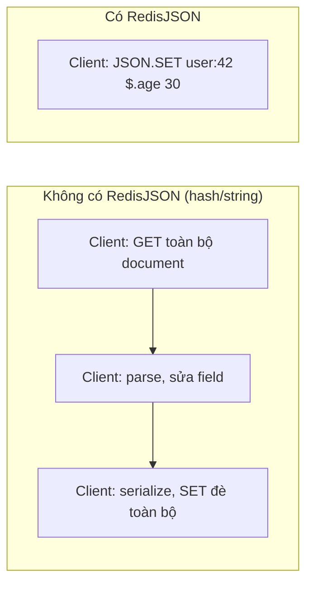
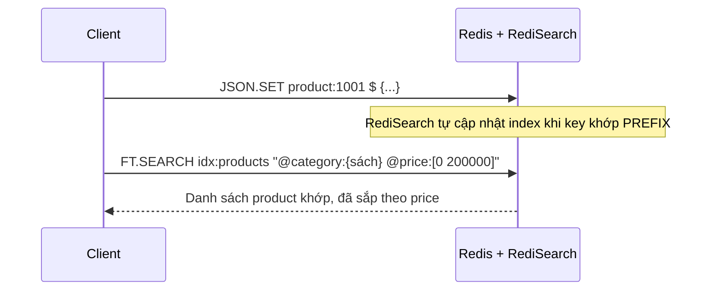

# Lý thuyết 06: RedisJSON và RediSearch — Redis như một document store có truy vấn

Bài [tổng quan](/go?p=06-Distributed-Systems%2FRedis%2Feasy%2Flt-01-redis-tong-quan-cau-truc-du-lieu.md) đã học năm cấu trúc dữ liệu cốt lõi (string, hash, list, set, sorted set), và bài [distributed lock, Lua và Streams](/go?p=06-Distributed-Systems%2FRedis%2Fhard%2Flt-05-distributed-lock-lua-streams.md) đã so sánh kỹ Pub/Sub với Streams để nhắn tin giữa các service — bài này không lặp lại phần đó. Vấn đề còn lại: những cấu trúc cốt lõi không có khái niệm "truy vấn theo điều kiện". Muốn tìm mọi user có `age > 30` lưu trong hash, bạn phải tự quét (`SCAN` + đọc từng key) hoặc tự dựng sorted set làm chỉ mục tay — chấp nhận được với vài nghìn key, không ổn với hàng triệu. RedisJSON (lưu document JSON lồng nhau) và RediSearch (chỉ mục + truy vấn trên hash hoặc JSON) là hai module chính thức lấp đúng khoảng trống này, biến Redis thành một document store có full-text search và secondary index ngay trên cùng một engine đang giữ cache của bạn.

**Tóm tắt:**

- Năm kiểu dữ liệu cốt lõi của Redis không có "truy vấn theo điều kiện" tích hợp sẵn; RedisJSON và RediSearch là module mở rộng giải quyết đúng chỗ trống này.
- RedisJSON lưu document JSON lồng nhau tại một key, sửa một field con bằng JSONPath mà không cần đọc-sửa-ghi lại toàn bộ document.
- RediSearch tạo index trên hash hoặc JSON document, hỗ trợ full-text, số, tag, địa lý và cả vector search trong cùng một lệnh `FT.SEARCH`.
- Từ Redis 8 (và trước đó là Redis Stack), các module này đi kèm sẵn trong bản phân phối chính thức, không còn là extension rời phải tự cài riêng.
- Đây không phải thay thế cho Elasticsearch hay một document DB chuyên dụng khi dữ liệu rất lớn hoặc cần aggregation phức tạp; điểm mạnh là **không cần thêm một hệ thống mới** khi dữ liệu vốn đã nằm trong Redis.
- Index phải khai báo trước (schema-on-write kiểu tương đối), và mọi field muốn lọc/tìm phải được đưa vào schema của index, không tự động như quét toàn bộ document.
- Ghi qua RedisJSON/RediSearch vẫn tốn thêm chi phí cập nhật index mỗi lần ghi, đổi lại tốc độ đọc theo điều kiện nhanh hơn hẳn so với tự quét.

## Vấn đề nó giải quyết

Một cache "chỉ lưu và lấy theo key" rất nhanh nhưng vô dụng khi câu hỏi là "ai", không phải "cái gì ở key này". RediSearch thêm khả năng trả lời: tìm mọi sản phẩm có `category = "sách"` và `price < 200000`, sắp theo mức giảm giá; tìm mọi bài viết có từ "kafka" trong tiêu đề. RedisJSON giải quyết một vấn đề khác: hash của Redis chỉ lưu được cặp field-value phẳng (không lồng nhau); muốn lưu một object JSON có mảng và object con, trước đây bạn phải tự serialize cả document thành một string và mất khả năng sửa từng phần.

## Khi nào dùng, khi nào không

| Tình huống | Chọn gì |
|---|---|
| Dữ liệu đã ở Redis (cache, session), cần thêm vài điều kiện lọc/tìm đơn giản, muốn tránh thêm hệ thống mới | RedisJSON + RediSearch |
| Tập dữ liệu rất lớn (hàng trăm triệu document), cần aggregation phức tạp, cần full-text nhiều ngôn ngữ nâng cao | Elasticsearch/OpenSearch chuyên dụng |
| Document là nguồn sự thật (source of truth) lâu dài, cần transaction phức tạp, quan hệ giữa nhiều collection | MongoDB hoặc PostgreSQL JSONB (xem bài [JSONB, ARRAY, range type](/go?p=02-Database%2Fmedium%2Flt-16-jsonb-array-range-fulltext.md)) |
| Chỉ cần đọc/ghi theo đúng một key, không cần lọc theo field con | Hash hoặc string thường là đủ, không cần thêm module |

**Nền tảng:** RedisJSON/RediSearch mạnh nhất khi dữ liệu **đã có lý do nằm trong Redis** (tốc độ, TTL, cùng hạ tầng cache) và bạn chỉ cần thêm một lớp truy vấn mỏng lên trên, không phải khi Redis được chọn làm kho dữ liệu chính chỉ vì có search.

## Các khái niệm cần biết

| Khái niệm | Là gì | Vì sao quan trọng |
|---|---|---|
| **RedisJSON** | Kiểu dữ liệu document JSON lồng nhau, thao tác qua lệnh `JSON.*` | Cho phép sửa một field con mà không đọc-sửa-ghi lại cả document |
| **JSONPath** | Cú pháp địa chỉ một phần của document (`$.address.city`) | Dùng trong mọi lệnh `JSON.GET`/`JSON.SET` để trỏ đúng phần cần đọc/sửa |
| **RediSearch** | Module tạo chỉ mục và truy vấn trên hash hoặc JSON | Thêm khả năng `WHERE` mà cấu trúc dữ liệu gốc của Redis không có |
| **Index schema** | Khai báo trước field nào được đánh chỉ mục và kiểu gì (TEXT, NUMERIC, TAG, GEO, VECTOR) | Chỉ field có trong schema mới lọc/tìm được; thêm field mới phải tạo lại index hoặc `FT.ALTER` |
| **FT.SEARCH / FT.AGGREGATE** | Lệnh truy vấn theo index: tìm kiếm và tổng hợp | Tương đương `SELECT ... WHERE` và `GROUP BY` của RediSearch |
| **TAG field** | Kiểu field so khớp chính xác theo danh sách giá trị rời rạc (khác TEXT là full-text) | Dùng cho category, status, enum — không bị tokenize như TEXT |
| **Vector field** | Field lưu embedding, truy vấn theo khoảng cách (KNN) | Cho phép tìm kiếm ngữ nghĩa (semantic search) ngay trên Redis, không cần hệ vector DB riêng cho tập dữ liệu vừa |

## RedisJSON: document lồng nhau, sửa từng phần

```text
JSON.SET user:42 $ '{"name":"An","age":29,"address":{"city":"Hà Nội","zip":"100000"},"tags":["vip","early-adopter"]}'
JSON.GET user:42 $.address.city
JSON.SET user:42 $.age 30                      # chỉ ghi lại field age, không ghi lại cả document
JSON.ARRAPPEND user:42 $.tags '"beta-tester"'  # thêm phần tử vào mảng con, tại chỗ
JSON.NUMINCRBY user:42 $.age 1                 # tăng một field số, tại chỗ, không đọc-sửa-ghi phía client
```

**Phải thuộc:** Với hash hoặc string, "sửa một field trong object lồng nhau" nghĩa là client phải `GET` cả document, parse JSON, sửa field, serialize lại, rồi `SET` đè — tốn băng thông và có race condition nếu hai client cùng sửa. RedisJSON thực hiện phép sửa **tại chỗ, bên trong Redis**, nguyên tử theo từng lệnh, không cần vòng đọc-sửa-ghi phía client.



## RediSearch: khai báo index rồi mới truy vấn

Khác với SQL (tạo bảng rồi muốn thì thêm index sau), RediSearch đòi hỏi khai báo **trước** field nào cần đánh chỉ mục và kiểu gì; field không khai báo thì `FT.SEARCH` không lọc/tìm được trên đó dù document vẫn có field đó.

```text
FT.CREATE idx:products ON JSON PREFIX 1 "product:" SCHEMA
    $.name       AS name     TEXT WEIGHT 2.0
    $.category   AS category TAG
    $.price      AS price    NUMERIC SORTABLE
    $.description AS description TEXT
```

| Tham số | Ý nghĩa |
|---|---|
| `ON JSON` | Index trên document RedisJSON (thay vì `ON HASH`) |
| `PREFIX 1 "product:"` | Chỉ những key bắt đầu bằng `product:` mới được đưa vào index này |
| `TEXT WEIGHT 2.0` | Field full-text, trọng số cao hơn khi tính độ liên quan (tên sản phẩm quan trọng hơn mô tả) |
| `TAG` | So khớp chính xác theo danh sách giá trị, không tokenize như TEXT (hợp cho category, status) |
| `NUMERIC SORTABLE` | Field số, cho phép lọc theo khoảng và sắp xếp kết quả theo field này |

```text
FT.SEARCH idx:products "@category:{sách} @price:[0 200000]" SORTBY price ASC LIMIT 0 10
```

Đọc câu lệnh: tìm trong index `idx:products`, field `category` khớp tag `sách`, field `price` trong khoảng 0-200000, sắp theo `price` tăng dần, lấy 10 kết quả đầu.



**Suy luận:** Vì sao RediSearch bắt field phải khai báo trước thay vì tự nhận biết như MongoDB? Redis vốn là key-value store tối ưu cho đọc/ghi theo key cụ thể với độ trễ dưới mili-giây; để giữ tốc độ đó, chỉ mục phải được xây và cập nhật đồng bộ ngay khi ghi, nên engine cần biết trước chính xác field nào, kiểu gì để cấu trúc chỉ mục (B-tree cho numeric, inverted index cho text, trie cho tag) phù hợp. Nhận biết kiểu tự động như một document DB tổng quát sẽ phải đánh đổi tốc độ ghi, đi ngược lại lý do người ta chọn Redis.

## Full-text, aggregate và vector search trong cùng một lệnh

```text
# Full-text: tìm "lập trình" hoặc các biến thể gần giống trong mô tả
FT.SEARCH idx:products "@description:(lập trình)"

# Aggregate: tổng số sản phẩm và giá trung bình theo từng category
FT.AGGREGATE idx:products "*" GROUPBY 1 @category REDUCE COUNT 0 AS so_luong REDUCE AVG 1 @price AS gia_tb

# Vector (KNN): tìm 5 sản phẩm có embedding gần nhất với vector truy vấn
FT.SEARCH idx:products "*=>[KNN 5 @embedding $vec AS score]" PARAMS 2 vec "<bytes vector>" DIALECT 2
```

Vector search đặt RediSearch cạnh các vector DB chuyên dụng (xem phần pgvector trong bài [Extension của PostgreSQL](/go?p=02-Database%2Fhard%2Flt-21-extension-pgvector-postgis-timescale.md)) cho những tập dữ liệu vừa phải đã nằm sẵn trong Redis — không cần đồng bộ dữ liệu sang một hệ vector DB riêng chỉ để tìm kiếm ngữ nghĩa.

## Khi nào KHÔNG nên dùng RedisJSON/RediSearch

- Tập dữ liệu hàng trăm triệu document trở lên với yêu cầu aggregation phức tạp nhiều tầng: Elasticsearch có engine phân tích chuyên biệt hơn.
- Document là nguồn sự thật lâu dài, cần ràng buộc quan hệ, transaction phức tạp đa bảng: dùng DB quan hệ hoặc document DB chuyên dụng, Redis giữ vai trò cache/index phụ.
- Chỉ cần lọc theo đúng một field đơn giản trên vài nghìn key: một sorted set làm chỉ mục tay hoặc `SCAN` định kỳ có thể đủ, không cần thêm module.
- RAM là tài nguyên giới hạn và đắt; mọi dữ liệu RedisJSON lẫn chỉ mục RediSearch đều nằm trong RAM (trừ khi dùng cấu hình tiered storage), nên tập dữ liệu lớn đẩy chi phí lên rất nhanh so với một hệ lưu trên đĩa.

## Bẫy thường gặp

- Thêm field mới vào document nhưng quên thêm vào schema index: `FT.SEARCH` lọc theo field đó âm thầm trả về rỗng thay vì báo lỗi.
- Nhầm `TAG` với `TEXT`: TAG so khớp chính xác cả chuỗi (phân tách bằng dấu phẩy), TEXT tokenize và hỗ trợ tìm gần đúng; dùng sai kiểu làm truy vấn không ra kết quả mong đợi.
- Tạo index với `PREFIX` sai hoặc quá rộng, index "ăn" luôn những key không liên quan, tốn RAM và làm chậm cập nhật.
- Coi RediSearch như một hệ phân tích (OLAP) đầy đủ rồi dồn toàn bộ báo cáo nghiệp vụ phức tạp vào `FT.AGGREGATE`, trong khi một kho dữ liệu chuyên cho báo cáo sẽ hợp hơn.
- Quên rằng mọi thứ vẫn nằm trong RAM: bật RedisJSON/RediSearch cho một tập dữ liệu lớn mà không tính lại dung lượng RAM cần thiết.

## Điểm cần nhớ

- RedisJSON lưu document JSON lồng nhau và cho sửa từng field con tại chỗ bằng JSONPath, không cần đọc-sửa-ghi toàn bộ document.
- RediSearch tạo index khai báo trước (TEXT, TAG, NUMERIC, GEO, VECTOR) trên hash hoặc JSON, truy vấn bằng `FT.SEARCH`/`FT.AGGREGATE`.
- Khác hẳn Pub/Sub và Streams (nhắn tin, đã học ở bài distributed lock) — đây là lớp **truy vấn theo điều kiện** trên dữ liệu đang nằm trong Redis.
- Mạnh nhất khi dữ liệu đã có lý do ở Redis và chỉ cần thêm một lớp lọc/tìm mỏng; không thay thế Elasticsearch hay document DB chuyên dụng cho dữ liệu rất lớn.
- Mọi thứ vẫn nằm trong RAM: chi phí tăng theo dữ liệu, không "miễn phí" so với dùng Redis làm cache thuần.

## Câu hỏi tự kiểm tra

Với mỗi câu: tự trả lời, nếu bí thì đọc **Gợi ý suy luận**, rồi đối chiếu **Đáp**.

1. Bạn thêm field `brand` vào document `product:1001` nhưng `FT.SEARCH idx:products "@brand:{Samsung}"` không trả về gì dù document chắc chắn tồn tại và đúng field. Vì sao?
   - Gợi ý suy luận: index của RediSearch được xây dựa trên cái gì — toàn bộ document, hay một danh sách field đã khai báo trước?
   - Đáp: `brand` chưa được khai báo trong schema của index (`FT.CREATE ... SCHEMA`), nên RediSearch không lập chỉ mục cho field đó; cần thêm field vào schema (hoặc `FT.ALTER`) trước khi lọc/tìm được trên nó.
2. Vì sao RedisJSON cho phép `JSON.SET user:42 $.age 30` nhanh hơn cách cũ "GET cả document, sửa, SET đè lại"?
   - Gợi ý suy luận: cách cũ tốn những bước nào ở phía client? RedisJSON thực hiện phép sửa ở đâu?
   - Đáp: Cách cũ cần client đọc toàn bộ document qua mạng, parse, sửa, serialize, rồi ghi đè toàn bộ — tốn băng thông và có nguy cơ race condition. RedisJSON sửa field tại chỗ bên trong Redis bằng JSONPath, chỉ một lệnh, nguyên tử, không cần chuyển cả document qua lại.
3. Một đồng nghiệp đề xuất bỏ Elasticsearch, chuyển toàn bộ 500 triệu document log sang RedisJSON + RediSearch để tiết kiệm hạ tầng. Bạn phản biện thế nào?
   - Gợi ý suy luận: RedisJSON/RediSearch lưu dữ liệu và chỉ mục ở đâu? Chi phí đó so với lưu trên đĩa của Elasticsearch thế nào ở quy mô rất lớn?
   - Đáp: Toàn bộ dữ liệu và chỉ mục của Redis nằm trong RAM, trong khi Elasticsearch lưu trên đĩa với RAM chỉ cho cache/index nóng; ở quy mô 500 triệu document, chi phí RAM cho Redis sẽ rất lớn so với một hệ được thiết kế lưu trên đĩa. RediSearch hợp hơn cho dữ liệu vừa phải đã có lý do nằm trong Redis, không phải thay thế toàn bộ hệ phân tích log quy mô lớn.
4. Field `category` nên khai báo kiểu `TAG` hay `TEXT` nếu bạn muốn lọc chính xác "sách" mà không khớp nhầm "sách giáo khoa" hay bị tokenize?
   - Gợi ý suy luận: TEXT xử lý chuỗi theo hướng nào (tách từ, tìm gần đúng)? TAG so khớp theo hướng nào?
   - Đáp: `TAG`, vì TAG so khớp chính xác toàn bộ giá trị (hoặc danh sách giá trị phân tách bằng dấu phẩy), không tokenize như TEXT nên không bị khớp nhầm theo từng từ con.

Nguồn: tài liệu chính thức Redis — RedisJSON và RediSearch (redis.io/docs/latest/develop/data-types/json/, redis.io/docs/latest/develop/interact/search-and-query/), kiểm tra ngày 2026-11-09.
