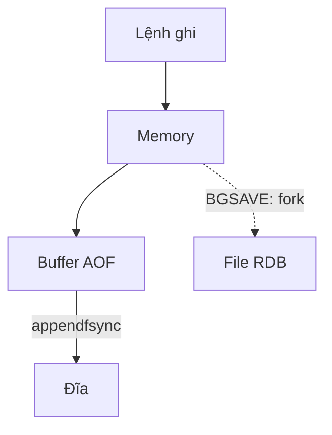
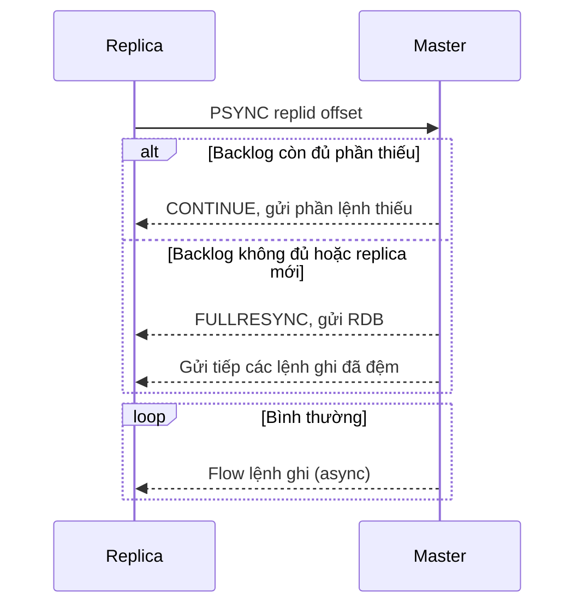
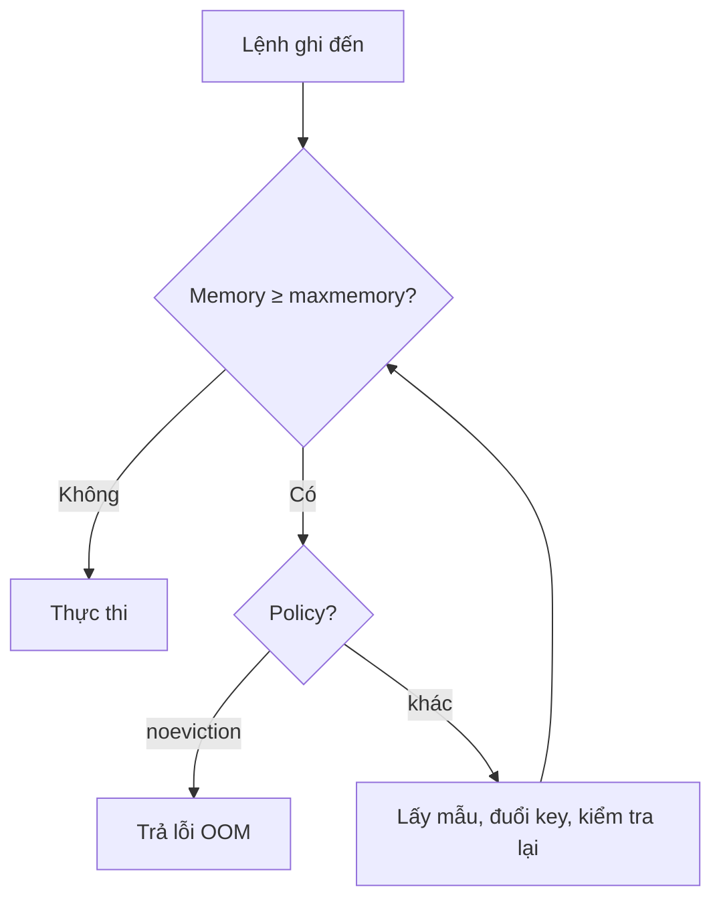

# Lý thuyết 02: Persistence, Replication và Eviction

**Tóm tắt:**

- Redis giữ dữ liệu trong RAM nên mất sạch khi process tắt; mỗi cơ chế (RDB, AOF, replication) có một cửa sổ dữ liệu có thể mất, và câu hỏi cốt lõi là nếu node chết bây giờ thì mất bao nhiêu.
- RDB là snapshot gọn, phục hồi nhanh nhưng mất mọi ghi kể từ snapshot cuối; AOF ghi từng lệnh ghi, appendfsync mặc định everysec nên mất tối đa khoảng 1 giây.
- BGSAVE và AOF rewrite đều dùng fork với copy-on-write, nên phải chừa RAM dự phòng.
- Replication là async: master trả lời client trước khi replica nhận lệnh, nên failover có thể mất ghi gần nhất và đọc từ replica có thể thấy dữ liệu cũ.
- Mất kết nối ngắn thì replica partial resync từ replication backlog, không đủ thì full resync bằng RDB.
- Expire (key hết TTL, xóa bị động khi truy cập cộng chủ động bằng lấy mẫu) khác eviction (chạm maxmemory, đuổi key theo policy); mặc định noeviction, cache thuần dùng allkeys-lru hoặc allkeys-lfu.
- MULTI/EXEC chạy tuần tự các lệnh đã xếp hàng nhưng không có rollback; WATCH cho optimistic lock, pipeline giảm RTT nhưng không phải transaction.

## Bài này nói về điều gì?

Redis giữ dữ liệu trong RAM. RAM nhanh nhưng mất sạch khi process tắt hoặc máy mất điện. Vì vậy câu hỏi đầu tiên khi đưa Redis lên production không phải là "lệnh nào dùng thế nào" mà là: **nếu node này chết ngay bây giờ, mình mất bao nhiêu dữ liệu?** Ba cơ chế trả lời câu hỏi đó:

- **Persistence** (RDB snapshot và AOF log): ghi dữ liệu xuống đĩa để khởi động lại không bị rỗng.
- **Replication**: replication dữ liệu sang các node phụ (replica) để đọc mở rộng và để có node thay thế khi master chết.
- **Expire và eviction**: quyết định xóa key nào, lúc nào, khi key hết hạn hoặc khi RAM đầy.

**Nền tảng:** Redis giữ dữ liệu trong RAM nên mất sạch khi process tắt; mỗi cơ chế (RDB, AOF, replication) đều có một cửa sổ dữ liệu có thể mất. Câu hỏi cốt lõi khi lên production: nếu node chết ngay bây giờ, mình mất bao nhiêu dữ liệu.

Cuối bài có thêm hai công cụ hay đi kèm khi làm việc với nhiều lệnh: **MULTI/EXEC** (gom lệnh chạy liền nhau) và **pipelining** (gửi nhiều lệnh trong một lượt mạng).

## Vì sao cần hiểu kỹ

Một ví dụ dễ hình dung: bạn ghi chép bài giảng lên bảng trắng (RAM). Bảng rất nhanh, nhưng ai lau là mất. RDB giống việc chụp ảnh cái bảng mỗi vài phút; AOF giống việc chép từng dòng mới vào sổ; replication giống việc có bạn ngồi cạnh chép lại cùng lúc nhưng chép chậm hơn bạn một chút. Mỗi cách đều có một "cửa sổ" dữ liệu có thể mất, và bạn phải biết cửa sổ đó dài bao lâu để quyết định Redis được dùng làm cache thuần (mất cũng không sao) hay làm kho dữ liệu có giá trị.

Bài này đặc biệt cần khi bạn cấu hình Redis production, chọn mức bền dữ liệu, đặt `maxmemory`, thiết kế cache có TTL, hoặc điều tra các sự cố kiểu "dữ liệu tự biến mất" và "memory đầy". Cách làm chung: chọn RDB, AOF hoặc cả hai theo lượng dữ liệu chấp nhận mất; dùng replication cho đọc mở rộng và tính sẵn sàng; đặt `maxmemory` cùng policy phù hợp; dùng pipeline khi cần giảm số vòng mạng, dùng Lua hoặc MULTI khi cần chạy nhiều lệnh liền nhau.

## Các khái niệm cần biết

- **fork và copy-on-write**: `fork` là lời gọi hệ điều hành tạo child process giống hệt parent process. Hệ điều hành không chép RAM ngay; hai process dùng chung các trang nhớ, chỉ khi một bên ghi vào trang nào thì trang đó mới được chép riêng (copy-on-write). Redis dùng điều này để child process có một "ảnh" nhất quán của dữ liệu và ghi xuống đĩa, trong khi parent process vẫn phục vụ client. Hệ quả: khi đang fork mà ghi nhiều, memory có thể phình lên gần gấp đôi.
- **fsync**: lệnh buộc hệ điều hành đẩy dữ liệu đang nằm trong buffer xuống đĩa thật. Chưa fsync thì dữ liệu "đã ghi" vẫn có thể mất khi mất điện.
- **TTL (time to live)**: thời gian sống còn lại của key, đặt bằng `EXPIRE`, `SET ... EX`. Hết TTL thì key được coi là đã hết hạn.
- **LRU và LFU**: LRU (least recently used) đuổi key lâu nhất chưa được dùng; LFU (least frequently used) đuổi key được dùng ít lần nhất. Dùng khi cần chọn "nạn nhân" để giải phóng memory.
- **Replication lag**: độ trễ giữa lúc master ghi và lúc replica áp dụng cùng thay đổi đó. Đọc từ replica trong khoảng này sẽ thấy dữ liệu cũ.
- **Round trip (RTT)**: một lượt gửi lệnh và nhận response qua mạng; thường là chi phí lớn nhất của một lệnh Redis nhỏ.

Nền tảng: [Redis tổng quan](/go?p=06-Distributed-Systems%2FRedis%2Feasy%2Flt-01-redis-tong-quan-cau-truc-du-lieu.md). Phần sau: [Redis bên trong, Sentinel và Cluster](/go?p=06-Distributed-Systems%2FRedis%2Fhard%2Flt-04-redis-noi-bo-cluster-sentinel.md).

## 1. Persistence

### RDB (snapshot)

RDB là ảnh chụp toàn bộ dữ liệu tại một thời điểm, ghi ra file nhị phân gọn.

- Kích hoạt theo luật `save <giây> <số thay đổi>` hoặc lệnh `BGSAVE`.
- `BGSAVE` **fork** một child process; con ghi file, cha tiếp tục phục vụ nhờ **copy-on-write** của hệ điều hành (chi tiết ở [bài 04](/go?p=06-Distributed-Systems%2FRedis%2Fhard%2Flt-04-redis-noi-bo-cluster-sentinel.md)).
- Ưu: file nhỏ, khởi động lại nhanh, hợp backup và chuyển dữ liệu.
- Nhược: mất mọi ghi **kể từ snapshot cuối** (có thể vài phút); fork trên dataset lớn có thể gây khựng ngắn.

### AOF (append-only file)

AOF ghi lại **từng lệnh ghi** vào cuối file; khi khởi động, Redis chạy lại các lệnh để dựng lại dữ liệu.

| `appendfsync` | Hành vi | Cửa sổ mất dữ liệu khi mất điện |
|---|---|---|
| `always` | fsync sau mỗi lệnh ghi | Gần như không (đổi lại chậm) |
| `everysec` (mặc định) | fsync mỗi giây | Tối đa khoảng 1 giây ghi |
| `no` | để hệ điều hành quyết định | Có thể hàng chục giây |

**Phải thuộc:** RDB là snapshot gọn, phục hồi nhanh, nhưng mất mọi ghi kể từ snapshot cuối. AOF ghi từng lệnh ghi; appendfsync mặc định là everysec nên mất tối đa khoảng 1 giây (always gần như không mất nhưng chậm, no để hệ điều hành quyết định). BGSAVE và AOF rewrite đều dùng fork với copy-on-write.

- **AOF rewrite**: file AOF phình dần, nên Redis định kỳ viết lại thành dạng gọn (tương đương dữ liệu hiện tại) bằng child process, cũng qua fork. Từ Redis 7.0 AOF dùng cấu trúc nhiều file (một file nền "base" cộng các file "incr" và file manifest).
- Tùy chọn **RDB preamble** trong AOF: phần đầu là snapshot RDB, phần sau là lệnh nối thêm: khởi động nhanh hơn AOF thuần.
- Nếu file AOF bị cắt dở do sập nguồn, Redis có thể tự cắt phần dở khi khởi động (`aof-load-truncated`), hoặc dùng công cụ `redis-check-aof`.

### Chọn mô hình persistence

Không có cấu hình đúng tuyệt đối, chỉ có cấu hình khớp với mức mất dữ liệu bạn chấp nhận. Bảng dưới đi từ ít bền (nhanh, đơn giản) đến bền nhất (chậm hơn).

| Nhu cầu | Cấu hình gợi ý |
|---|---|
| Cache thuần, mất được | Có thể tắt persistence hoặc chỉ RDB |
| Chấp nhận mất tối đa khoảng 1 giây | AOF `everysec` (thường kèm RDB để backup) |
| Gần như không mất | AOF `always` và chấp nhận chi phí, hoặc dùng CSDL bền vững cho dữ liệu đó |

Mẫu hiện thực: replica ghi persistence còn master tắt (hoặc ngược lại) để giảm tải fsync trên master. Cân nhắc rủi ro: master khởi động lại **rỗng** có thể kéo replica về rỗng theo (cần quy trình failover đúng).



## 2. Replication

Replication của Redis là **async**: master ghi xong và trả lời client **trước khi** replica nhận được lệnh.

- Replica kết nối master và gửi `PSYNC <replid> <offset>`.
- **Full resync**: master tạo RDB (hoặc truyền thẳng), gửi cho replica, đồng thời đệm các lệnh ghi mới để gửi sau.
- **Partial resync**: nếu replica mất kết nối ngắn và phần lệnh nó thiếu vẫn còn trong **replication backlog** của master (buffer vòng, kích thước `repl-backlog-size`), master chỉ gửi phần thiếu. Backlog quá nhỏ so với tốc độ ghi và thời gian gián đoạn là nguyên nhân hay gặp của full resync lặp lại.


Đọc sơ đồ: replica luôn bắt đầu bằng `PSYNC` kèm định danh bộ dữ liệu (`replid`) và vị trí nó đã nhận (`offset`). Master so sánh với backlog để chọn gửi phần thiếu hay gửi lại toàn bộ; sau đó lệnh ghi chảy liên tục sang replica mà master không chờ xác nhận.

**Nền tảng:** Replication của Redis là async: master trả lời client trước khi replica nhận lệnh, nên failover có thể mất ghi gần nhất và đọc từ replica có thể thấy dữ liệu cũ. Replica mất kết nối ngắn thì partial resync từ replication backlog, không đủ thì full resync bằng RDB.

**Suy luận:** Redis được thiết kế để trả lời trong dưới một mili giây, nên master không chờ replica xác nhận trước khi trả lời client; nếu chờ, mỗi lệnh ghi sẽ chậm theo kết nối mạng chậm nhất. Hệ quả trực tiếp là luôn có một đoạn lệnh ghi gần nhất mà master đã xác nhận với client nhưng replica chưa nhận. Nếu master chết đúng lúc đó và replica được thăng cấp, đoạn ấy mất, dù client đã được báo thành công. Cũng vì replica chậm hơn một nhịp, đọc từ replica có thể thấy dữ liệu cũ, nên đọc sau ghi từ replica không bảo đảm thấy dữ liệu vừa ghi. Khi mất kết nối ngắn, replica không cần copy lại toàn bộ: master giữ replication backlog, và replica chỉ xin phần lệnh bị lỡ (partial resync); chỉ khi backlog không đủ mới phải full resync bằng RDB, vừa nặng vừa tốn RAM do fork. Điểm dễ nhầm là nghĩ Redis có replica nghĩa là dữ liệu đã an toàn; replica giúp chịu lỗi phần cứng nhưng không bảo đảm không mất ghi. WAIT hoặc min-replicas-to-write chỉ giảm rủi ro, nên dữ liệu không được phép mất phải có nguồn sự thật khác như database.

- Replica mặc định **chỉ đọc**; chuỗi replica (replica của replica) giảm tải master.
- Giảm rủi ro mất ghi: `min-replicas-to-write`/`min-replicas-max-lag` (master từ chối ghi nếu quá ít replica đủ gần), hoặc lệnh `WAIT n timeout` chờ n replica xác nhận. Cả hai **không** biến Redis thành CP đầy đủ; xem phần mất ghi ở [bài 04](/go?p=06-Distributed-Systems%2FRedis%2Fhard%2Flt-04-redis-noi-bo-cluster-sentinel.md).
- Đọc từ replica có thể trả **dữ liệu cũ** (replication lag): không dùng cho đọc-sau-ghi cần nhất quán. Nên dùng replica khi dữ liệu chấp nhận hơi cũ (danh mục, bảng xếp hạng); không dùng khi vừa ghi xong đã phải đọc lại đúng giá trị đó (ví dụ số dư, trạng thái đơn hàng).

Redis 8 giới thiệu cơ chế replication mới dùng hai thread truyền parallel (một thread dữ liệu nền, một thread thay đổi phát sinh), giảm buffer trên master (theo thông báo Redis 8 GA).

## 3. Expire và Eviction

Có hai lý do khiến một key biến mất, và chúng hoàn toàn khác nhau. **Expire** là key tự hết hạn theo TTL bạn đặt (mất theo ý bạn). **Eviction** là Redis bị buộc đuổi key vì hết memory (mất ngoài ý bạn nếu cấu hình không cẩn thận). Bảng so sánh:

| | Expire | Eviction |
|---|---|---|
| Kích hoạt bởi | Hết TTL của key | Chạm `maxmemory` |
| Chọn key | Key đã hết hạn | Theo `maxmemory-policy` |
| Mục đích | Dọn dữ liệu quá hạn | Giải phóng memory để nhận ghi mới |

### Expire: bị động và chủ động

- **Lazy**: khi truy cập một key đã quá hạn, Redis thấy và xóa nó rồi trả như không tồn tại.
- **Chủ động**: một chu trình nền lặp, mỗi lần lấy mẫu ngẫu nhiên một số key có TTL và xóa các key quá hạn; nếu tỉ lệ quá hạn trong mẫu còn cao thì lặp tiếp (có giới hạn thời gian để không chặn lệnh).
- Vì vậy key hết hạn **có thể còn nằm trong memory** một lúc nếu không ai truy cập; memory không giải phóng ngay đúng giây hết hạn.
- Trên replica, việc hết hạn do master phát lệnh `DEL` xuống; replica không tự xóa chủ động theo cách độc lập.

### Eviction theo `maxmemory-policy`

Khi dùng memory đạt `maxmemory`, mỗi lệnh ghi sẽ kích hoạt đuổi key theo policy:

| Policy | Chọn key để đuổi |
|---|---|
| `noeviction` | Không đuổi, từ chối lệnh ghi (trả lỗi OOM) |
| `allkeys-lru` | Ít dùng gần đây nhất, trong mọi key |
| `allkeys-lfu` | Ít dùng thường xuyên nhất (đếm tần suất xấp xỉ), mọi key |
| `allkeys-random` | Ngẫu nhiên, mọi key |
| `volatile-lru` / `volatile-lfu` / `volatile-random` | Như trên nhưng **chỉ** trong key có TTL |
| `volatile-ttl` | Key có TTL sắp hết hạn nhất |
| `allkeys-lrm`, `volatile-lrm` | Ít được **ghi** gần đây nhất (Redis 8.6 trở lên) |

**Phải thuộc:** Expire (key hết TTL, xóa bị động khi truy cập cộng chủ động bằng lấy mẫu) khác eviction (chạm maxmemory, đuổi key theo maxmemory-policy). Mặc định noeviction (từ chối ghi, trả lỗi OOM); cache thuần dùng allkeys-lru hoặc allkeys-lfu; LRU và LFU của Redis là xấp xỉ bằng lấy mẫu.

- LRU/LFU của Redis là **xấp xỉ**: lấy mẫu `maxmemory-samples` key rồi chọn key tệ nhất trong mẫu, không duy trì danh sách toàn cục (tiết kiệm memory).
- Policy `volatile-*` chỉ có tác dụng nếu key có TTL; nếu không có key nào đủ điều kiện, hành xử như `noeviction`. Tài liệu Redis khuyên các policy volatile chủ yếu hợp khi **một instance vừa làm cache vừa chứa key bền**, và cân nhắc tách hai instance.
- Giá trị mặc định của `maxmemory-policy` trong cấu hình mặc định của Redis Open Source là `noeviction` (kiểm tra lại trên phiên bản bạn dùng; các dịch vụ managed có thể đặt mặc định khác).



### Chọn policy cho cache

Chọn policy tức là chọn "ai bị đuổi trước". Chọn sai thì hoặc cache đuổi nhầm key nóng làm tỉ lệ trúng giảm, hoặc ghi bị từ chối bằng lỗi OOM.

- Cache thuần: `allkeys-lru` hoặc `allkeys-lfu` (LFU hợp khi phân bố truy cập lệch mạnh, có hot key ổn định).
- Hệ thống dùng Redis như kho có key không được mất: `noeviction` và giám sát memory, hoặc tách instance.
- Nhớ chừa **memory dự phòng** cho fork (copy-on-write) và buffer replication/client, không đặt `maxmemory` bằng 100% RAM máy.

## 4. Transaction: MULTI/EXEC

Vấn đề đặt ra: bạn cần trừ tồn kho và thêm đơn vào queue như một khối, không để lệnh của client khác chen vào giữa. `MULTI/EXEC` làm đúng việc đó, nhưng nó **không phải** transaction kiểu CSDL quan hệ.

```text
MULTI
DECRBY stock:42 1
LPUSH orders:pending 9001
EXEC
```

- Các lệnh giữa `MULTI` và `EXEC` được **xếp hàng**, rồi chạy **tuần tự, không bị lệnh client khác xen vào**.
- **Không có rollback**: nếu một lệnh lỗi lúc chạy (ví dụ sai kiểu), các lệnh khác vẫn chạy. Lỗi cú pháp lúc xếp hàng thì hủy cả khối.
- **`WATCH key`** cho optimistic lock: nếu key bị đổi trước `EXEC`, transaction bị hủy (trả nil) để client thử lại.
- Không đọc-quyết-định bên trong khối (các lệnh chỉ xếp hàng, chưa có kết quả); logic có điều kiện dùng **Lua** (xem [bài 05](/go?p=06-Distributed-Systems%2FRedis%2Fhard%2Flt-05-distributed-lock-lua-streams.md)).
- Trên **Cluster**, mọi key trong một transaction phải cùng hash slot.

**Phải thuộc:** MULTI/EXEC chạy tuần tự các lệnh đã xếp hàng, không bị lệnh khác xen vào, nhưng không có rollback và không đọc được kết quả giữa chừng; WATCH cho optimistic lock, logic có điều kiện dùng Lua.

## 5. Pipelining

Vấn đề: với một lệnh Redis nhỏ, thời gian chờ mạng thường lớn hơn nhiều so với thời gian Redis xử lý. Gửi 1000 lệnh lần lượt là 1000 lượt chờ.

Mỗi lệnh gửi riêng tốn một **round trip** (RTT). Pipelining gửi nhiều lệnh liền nhau, không chờ từng response, rồi đọc tất cả:

```java
List<Object> results = redisTemplate.executePipelined((RedisCallback<Object>) conn -> {
    for (int i = 0; i < 1000; i++) {
        conn.stringCommands().set(("k:" + i).getBytes(), ("v" + i).getBytes());
    }
    return null;
});
```

| | Pipelining | MULTI/EXEC | Lua |
|---|---|---|---|
| Mục đích | Giảm RTT | Atomic theo batch | Atomic, có logic điều kiện |
| Lệnh khác xen vào? | Có thể | Không | Không |
| Có điều kiện/đọc kết quả giữa chừng | Không | Không | Có |

Dùng pipeline khi cần nạp hoặc đọc nhiều key độc lập và không cần atomic; không dùng khi lệnh sau phụ thuộc kết quả lệnh trước. Pipeline quá lớn làm tăng output buffer trên server: chia batch vài trăm đến vài nghìn lệnh.

## Bẫy thường gặp

- Tưởng AOF `everysec` không mất gì: vẫn có thể mất tối đa khoảng 1 giây.
- Tắt persistence rồi để Redis tự khởi động lại **rỗng** làm replica sync theo trạng thái rỗng.
- Đặt `maxmemory` sát RAM, rồi fork khi BGSAVE/rewrite gặp ghi nhiều làm tiêu thụ memory tăng vọt và bị OOM-killer giết.
- Dùng `volatile-lru` nhưng key không có TTL: không có gì để đuổi, ghi bị từ chối.
- Mong `MULTI/EXEC` rollback như CSDL quan hệ.
- Đọc từ replica ngay sau khi ghi và gặp dữ liệu cũ.
- Backlog replication quá nhỏ, replica rớt mạng ngắn cũng phải full resync, tốn fork và băng thông.

## Điểm cần nhớ

- RDB: gọn, nhanh phục hồi, mất theo khoảng snapshot. AOF: mất tối đa khoảng 1 giây với `everysec`. Kết hợp cho cân bằng.
- Replication async: failover có thể mất ghi gần nhất; `WAIT` giảm nhưng không loại bỏ rủi ro.
- Expire ≠ eviction. Expire chủ động theo mẫu cộng bị động khi truy cập; eviction xảy ra khi chạm `maxmemory` theo policy.
- LRU/LFU là xấp xỉ bằng lấy mẫu.
- MULTI/EXEC không rollback; điều kiện thì dùng WATCH hoặc Lua.
- Pipelining tiết kiệm RTT chứ không bảo đảm atomic.

## Câu hỏi tự kiểm tra

1. Với AOF `everysec`, mất điện thì mất tối đa bao nhiêu?
   - Gợi ý suy luận: `everysec` gọi fsync khi nào? Dữ liệu ghi giữa hai lần fsync nằm ở đâu?
   - Đáp án: Khoảng 1 giây ghi cuối (có thể hơn trong tình huống đặc biệt như fsync chậm).
2. Vì sao BGSAVE dùng fork?
   - Gợi ý suy luận: Muốn chụp ảnh nhất quán mà vẫn phục vụ client thì cần gì? Hai process dùng chung memory ra sao?
   - Đáp án: Child process có ảnh memory nhất quán, cha tiếp tục phục vụ nhờ copy-on-write.
3. Replica mất kết nối ngắn rồi nối lại, khi nào là partial resync, khi nào full resync?
   - Gợi ý suy luận: Master giữ lại lệnh gần đây ở đâu? Nếu phần replica bỏ lỡ không còn trong đó thì sao?
   - Đáp án: Partial chỉ gửi phần thiếu từ backlog nếu còn đủ; không đủ thì full resync gửi cả snapshot.
4. Key đã hết TTL nhưng memory chưa giảm. Redis xóa key hết hạn như thế nào?
   - Gợi ý suy luận: Quét mọi key liên tục thì tốn gì? Còn nếu chỉ kiểm khi truy cập thì key không ai chạm tới sẽ ra sao?
   - Đáp án: Bị động khi truy cập và chủ động bằng lấy mẫu nền, nên key hết hạn có thể tồn tại một lúc.
5. Policy eviction nào hợp cache thuần?
   - Gợi ý suy luận: Cache thuần thì mọi key đều bỏ được hay chỉ key có TTL? Cần bỏ key ít dùng nhất theo tiêu chí nào?
   - Đáp án: `allkeys-lru` hoặc `allkeys-lfu`, vì xét mọi key.
6. `MULTI/EXEC` khác Lua ở điểm nào?
   - Gợi ý suy luận: Trong MULTI, lệnh được xếp hàng, bạn có đọc được kết quả lệnh trước để quyết định lệnh sau không? Có rollback không?
   - Đáp án: MULTI chỉ xếp hàng, không đọc kết quả giữa chừng và không rollback; Lua có logic điều kiện trong một lần chạy atomic.

Nguồn: tài liệu chính thức Redis (redis.io), kiểm tra ngày 21/10/2026. Chính sách eviction `lrm` (8.6) và replication mới (8.0) theo thông báo phát hành của redis.io; giá trị mặc định cấu hình cần kiểm tra lại theo phiên bản.

