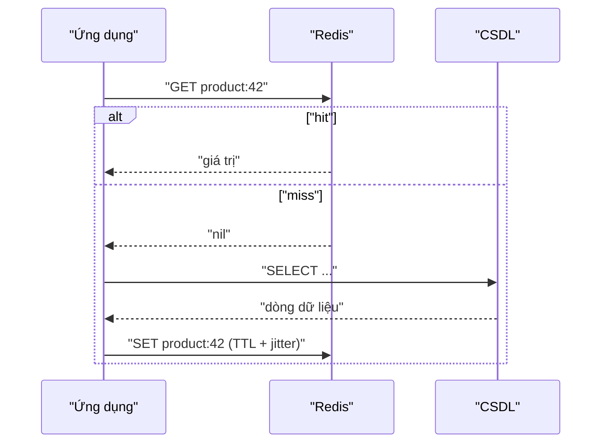
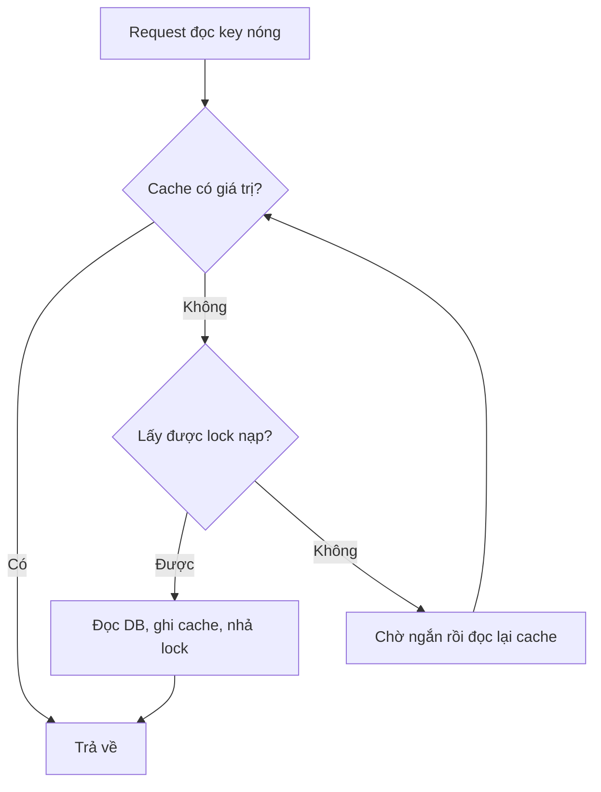
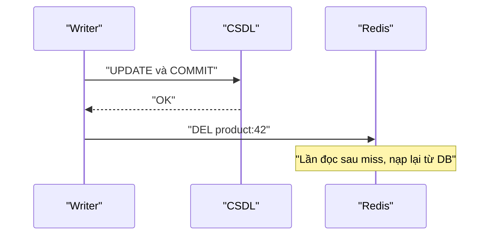

# Lý thuyết 03: Cache pattern và các vấn đề của cache

**Tóm tắt:**

- Cache nghĩa là có hai bản sao của cùng một dữ liệu (database là nguồn sự thật), nên luôn có cửa sổ lệch và dữ liệu có thể stale.
- Dùng cache khi đọc nhiều hơn ghi rất nhiều và chịu được dữ liệu hơi cũ.
- Cache-aside: đọc thì hỏi cache, miss thì đọc DB rồi nạp cache kèm TTL cộng jitter; ghi thì ghi DB trước rồi xóa key cache.
- Write-through ghi cache và DB sync; write-behind ghi DB sau nên có thể mất ghi.
- Ba sự cố kinh điển: penetration (key không tồn tại ở đâu cả), breakdown (một key nóng hết hạn), avalanche (nhiều key hết hạn cùng lúc hoặc Redis sập).
- Cách chống tương ứng: null cache hoặc Bloom filter; mutex nạp hoặc hết hạn logic; jitter TTL, cache nhiều tầng và HA.
- Thứ tự khuyến nghị là ghi DB rồi xóa cache sau commit, kèm TTL làm lưới an toàn; xóa cache trước khi ghi DB hoặc cập nhật cache thay vì xóa đều dễ để lại giá trị cũ.
- Hot key và big key tạo bottleneck trên một node.

## Cache là gì và vì sao nó gây rắc rối?

Query CSDL thường chậm và đắt: phải đọc đĩa, join nhiều bảng, giữ kết nối. **Cache** là nơi cất sẵn kết quả của những query đó ở một chỗ nhanh hơn nhiều (ở đây là Redis trong RAM), để lần sau hỏi lại thì trả ngay mà không phải làm lại việc cũ. Hình dung: thay vì mỗi lần cần số điện thoại đều ra thư viện tra danh bạ dày, bạn chép các số hay gọi lên một tờ giấy dán cạnh bàn.

Cái giá phải trả là bạn đang có **hai bản sao của cùng một dữ liệu**: một ở CSDL (nguồn sự thật), một ở cache. Hầu hết sự cố cache trên production đến từ hai chuyện: (1) nhiều request cùng "không tìm thấy trong cache" (cache miss) một lúc rồi đồng loạt dồn xuống CSDL; (2) hai bản sao lệch nhau và người dùng thấy dữ liệu cũ. Bài này đi qua các mẫu thiết kế (cache-aside, read-through, write-through, write-behind), các sự cố kinh điển (penetration, breakdown/stampede, avalanche), cách giữ nhất quán với CSDL, và hai vấn đề cấu trúc là hot key và big key.

**Nền tảng:** Cache nghĩa là có hai bản sao của cùng một dữ liệu (CSDL là nguồn sự thật, cache là bản sao), nên luôn có cửa sổ lệch và dữ liệu có thể cũ (stale). Dùng cache khi đọc nhiều hơn ghi rất nhiều và chịu được hơi cũ; hầu hết sự cố cache đến từ miss đồng loạt dồn xuống DB hoặc từ hai bản sao lệch nhau.

## Khi nào nên dùng, khi nào không

Cache hiệu quả khi đọc nhiều hơn ghi rất nhiều, dữ liệu chịu được hơi cũ (stale) trong một khoảng thời gian, và query gốc đắt. Ví dụ điển hình: trang chi tiết sản phẩm, cấu hình hệ thống, danh mục. Không nên cache khi bắt buộc đọc luôn bản mới nhất (số dư tài khoản ngay sau khi chuyển tiền), hoặc khi mỗi dữ liệu chỉ được đọc đúng một lần (cache chỉ tốn RAM mà không có lần "trúng" nào).

Cách làm chung: chọn mẫu cache theo đặc tính đọc/ghi; đặt TTL kèm jitter; chặn query key không tồn tại bằng null cache hoặc Bloom filter; dùng lock cho key nóng; khi ghi thì **xóa** cache chứ không cập nhật; và theo dõi hot key, big key.

## Các khái niệm cần biết

- **Cache hit / cache miss**: hit là tìm thấy trong cache và trả ngay; miss là không thấy, phải xuống CSDL. Tỉ lệ hit là thước đo chính của một cache.
- **TTL và jitter**: TTL là thời gian sống của key. Jitter là phần ngẫu nhiên cộng thêm vào TTL (ví dụ 600 giây cộng 0 đến 120 giây) để các key không hết hạn cùng một giây.
- **Stale**: giá trị trong cache đã khác CSDL. Chấp nhận stale trong một khoảng ngắn là điều kiện để dùng cache.
- **Eventual consistency**: hai bản sao có thể lệch tạm thời nhưng cuối cùng sẽ khớp nhau nếu không có ghi mới.
- **Bloom filter**: cấu trúc dữ liệu xác suất, trả lời "phần tử này chắc chắn KHÔNG có" hoặc "có thể có". Rất nhỏ so với việc lưu cả tập ID; dùng để chặn sớm các ID rác trước khi chạm cache hoặc DB.
- **Single-flight / mutex nạp**: kỹ thuật chỉ cho đúng một thread đi nạp lại giá trị khi miss, các thread còn lại chờ kết quả đó.
- **CDC (change data capture) và binlog**: binlog là log thay đổi của CSDL; CDC là kỹ thuật đọc log này để phát hiện thay đổi và phản ứng (ví dụ xóa cache) mà không phải sửa code ghi.
- **Outbox**: ghi event cần gửi vào một bảng ngay trong transaction DB, rồi một process khác gửi đi, để không bao giờ bỏ sót event.

Khái niệm nền: [Caching và CDN](/go?p=15-System%20Design%2Feasy%2Flt-03-caching-cdn.md). Kiểu dữ liệu và TTL: [Redis tổng quan](/go?p=06-Distributed-Systems%2FRedis%2Feasy%2Flt-01-redis-tong-quan-cau-truc-du-lieu.md).

## 1. Bốn mẫu cache

Vấn đề đặt ra: ai chịu trách nhiệm nạp cache và sync với CSDL, ứng dụng hay thư viện? Bốn mẫu dưới đây là bốn câu trả lời khác nhau.

| Mẫu | Ai nói chuyện với CSDL | Đọc | Ghi | Ưu | Nhược |
|---|---|---|---|---|---|
| **Cache-aside** (lazy loading) | Ứng dụng | Miss thì ứng dụng đọc DB rồi nạp cache | Ghi DB, rồi **xóa** key cache | Đơn giản, cache chỉ chứa thứ được đọc; Redis chết vẫn chạy | Miss đầu chậm, cửa sổ lệch dữ liệu |
| **Read-through** | Thư viện cache | Cache tự nạp từ DB khi miss | Tách biệt | Ứng dụng gọn | Cần thư viện/provider hỗ trợ |
| **Write-through** | Thư viện cache | Đọc từ cache | Ghi cache và DB sync cùng lúc | Cache luôn mới | Ghi chậm hơn, ghi cả dữ liệu ít đọc |
| **Write-behind** (write-back) | Thư viện cache | Đọc từ cache | Ghi cache trước, **ghi DB sau** theo batch | Ghi rất nhanh, gom thao tác | Mất ghi nếu cache chết trước khi flush, khó đảm bảo thứ tự |

Cache-aside là mẫu phổ biến nhất với Redis, vì Redis không tự biết CSDL của bạn ở đâu: chính ứng dụng quyết định khi nào đọc, khi nào nạp, khi nào xóa. Dùng write-through khi cần cache luôn mới và chấp nhận ghi chậm hơn; dùng write-behind chỉ khi chịu được rủi ro mất ghi (ví dụ bộ đếm lượt xem), và không dùng cho dữ liệu tiền bạc. Read-through và write-through thường đòi hỏi thư viện hoặc nền tảng cache đứng giữa; Redis thuần không cung cấp sẵn.

**Phải thuộc:** Cache-aside: đọc thì hỏi cache, miss thì đọc DB rồi nạp cache kèm TTL cộng jitter; ghi thì ghi DB trước rồi xóa key cache (không cập nhật cache). Write-through ghi cache và DB sync; write-behind ghi DB sau nên có thể mất ghi.

Flow cache-aside khi đọc như sau.



Đọc sơ đồ: ứng dụng luôn hỏi Redis trước. Chỉ khi miss mới xuống CSDL, và sau khi lấy được thì nạp lại vào Redis kèm TTL có jitter để lần sau trúng. Lưu ý code ví dụ nạp cả trường hợp "không có" bằng `NULL_MARK` để chặn penetration (xem phần 2).

Hãy xem ví dụ sau: nhánh đọc và nhánh ghi của cache-aside.

```java
public Product get(long id) {
    String key = "product:" + id;
    String cached = redis.opsForValue().get(key);
    if (cached != null) return NULL_MARK.equals(cached) ? null : json.read(cached, Product.class);
    Product p = repo.findById(id).orElse(null);
    long ttl = 600 + ThreadLocalRandom.current().nextInt(120);   // jitter
    redis.opsForValue().set(key, p == null ? NULL_MARK : json.write(p), Duration.ofSeconds(ttl));
    return p;
}

@Transactional
public void update(Product p) {
    repo.save(p);
    // xóa cache sau khi commit (xem phần nhất quán)
    TransactionSynchronizationManager.registerSynchronization(new TransactionSynchronization() {
        @Override public void afterCommit() { redis.delete("product:" + p.getId()); }
    });
}
```

## 2. Ba sự cố kinh điển

### Cache penetration

Vấn đề đặt ra: cache chỉ hữu ích khi có thứ để trúng. Nếu kẻ tấn công (hoặc một bug) liên tục hỏi ID không tồn tại, cache không bao giờ có giá trị để trả và DB bị hỏi mãi.

**Hiện tượng**: query key **không tồn tại** ở cả cache lẫn DB (ID rác, tấn công), nên lần nào cũng chạm DB.

Giải pháp:
- **Null caching**: lưu giá trị "không có" với TTL ngắn (như `NULL_MARK` ở trên).
- **Bloom filter** đặt trước: tập ID hợp lệ; ID chắc chắn không có thì chặn ngay (Bloom filter không có âm tính giả, nhưng có dương tính giả). Redis 8 có sẵn Bloom filter; client Redisson cũng cung cấp.
- Kiểm tra tham số đầu vào (ID âm, định dạng sai) và rate limit.

### Cache breakdown / stampede (sập một key nóng)

Hãy hình dung trang chủ có 10.000 request mỗi giây, và key của nó vừa hết hạn đúng lúc này.

**Hiện tượng**: một key **rất nóng** hết hạn, hàng nghìn request cùng miss và đồng loạt đập vào DB để dựng lại cùng giá trị.

Giải pháp:
- **Mutex/lock nạp** (single-flight): chỉ một thread được nạp lại, thread khác chờ hoặc dùng giá trị cũ.
- **Hết hạn logic**: lưu thêm thời điểm hết hạn logic trong giá trị; khi quá hạn logic, trả bản cũ ngay và **làm mới nền** (chấp nhận hơi cũ).
- Với key cực nóng, không đặt TTL cứng, hoặc làm mới chủ động trước khi hết hạn.



Đọc sơ đồ: trong số hàng nghìn request cùng miss, chỉ một request giành được lock và đi xuống DB; số còn lại chờ rồi đọc lại cache sau khi giá trị đã được nạp. Nhờ vậy DB chỉ nhận một query thay vì hàng nghìn. Cách này không dùng khi không chấp nhận được độ trễ chờ, lúc đó nên dùng hết hạn logic.

```java
public String loadWithLock(String key, Supplier<String> loader) {
    String v = redis.opsForValue().get(key);
    if (v != null) return v;
    String lock = "lock:" + key;
    Boolean got = redis.opsForValue().setIfAbsent(lock, "1", Duration.ofSeconds(10));
    if (Boolean.TRUE.equals(got)) {
        try {
            v = loader.get();
            redis.opsForValue().set(key, v, Duration.ofMinutes(10));
            return v;
        } finally { redis.delete(lock); }
    }
    // ví dụ 50 ms rồi thử đọc lại, có giới hạn số lần
    sleepBriefly();
    return redis.opsForValue().get(key);  // có thể vẫn null: xử lý dự phòng
}
```

(Mutex này đủ cho bảo vệ DB, không cần mức an toàn của distributed lock chặt chẽ; xem giới hạn ở [bài 05](/go?p=06-Distributed-Systems%2FRedis%2Fhard%2Flt-05-distributed-lock-lua-streams.md). Trong một JVM đơn có thể dùng single-flight cục bộ như `ConcurrentHashMap<String, CompletableFuture<V>>`.)

### Cache avalanche

Khác với breakdown (một key), avalanche là sự cố trên diện rộng: DB bị đè bởi rất nhiều loại query cùng lúc, nên mutex cho từng key không đủ.

**Hiện tượng**: **rất nhiều key hết hạn cùng lúc** (cùng TTL, nạp hàng loạt lúc khởi động) hoặc **Redis sập**, tải dồn về DB.

Giải pháp:
- **Jitter TTL**: TTL cơ sở cộng ngẫu nhiên.
- Khởi động ấm (warm-up) có kiểm soát, nạp dần.
- **Cache nhiều tầng**: tầng cục bộ (Caffeine) trước Redis, hấp thụ một phần sự cố Redis.
- Bảo vệ DB bằng rate limiting, circuit breaker, bulkhead; Redis có HA (Sentinel/Cluster, [bài 04](/go?p=06-Distributed-Systems%2FRedis%2Fhard%2Flt-04-redis-noi-bo-cluster-sentinel.md)).

| Sự cố | Gốc | Phân biệt nhanh | Đòn chính |
|---|---|---|---|
| Penetration | Key không tồn tại | DB bị hỏi ID không có | Null cache, Bloom filter |
| Breakdown | Một key nóng hết hạn | Một query lặp lại nghìn lần | Mutex, hết hạn logic |
| Avalanche | Nhiều key hết hạn / cache chết | Cả loạt query | Jitter, đa tầng, HA |

**Phải thuộc:** Penetration (key không tồn tại ở cả cache lẫn DB) chống bằng null cache hoặc Bloom filter. Breakdown (một key nóng hết hạn) chống bằng mutex nạp hoặc hết hạn logic. Avalanche (nhiều key hết hạn cùng lúc hoặc Redis sập) chống bằng jitter TTL, cache nhiều tầng, HA.

**Suy luận:** Ba sự cố này có cùng gốc là cache đang che DB khỏi tải, và mỗi sự cố là một cách để lớp che đó bị thủng. Penetration xảy ra khi key không tồn tại ở đâu cả: cache không có gì để lưu nên mọi request đều miss và đi xuống DB, và kẻ tấn công chỉ cần gửi id rác. Cách chữa là cho cache nhớ cả sự vắng mặt (null cache với TTL ngắn) hoặc chặn từ trước bằng Bloom filter. Breakdown là một key nóng hết hạn: hàng nghìn request cùng miss trong một khoảnh khắc và cùng đi nạp lại một giá trị, nên chỉ cần một request nạp (mutex hoặc single-flight) còn lại chờ hoặc dùng bản cũ. Avalanche là breakdown ở quy mô lớn: nhiều key đặt cùng TTL hết hạn cùng lúc, hoặc cả Redis sập, nên cần rải TTL bằng jitter, thêm cache nhiều tầng và HA. Điểm dễ nhầm là dùng mutex để chữa avalanche; mutex bảo vệ một key, còn avalanche có hàng nghìn key khác nhau cùng miss nên lock từng key không cứu được DB. Khi gặp sự cố, hãy hỏi đây là một key, nhiều key hay key không tồn tại, rồi mới chọn công cụ.

## 3. Nhất quán giữa cache và CSDL

Vấn đề đặt ra: mỗi lần ghi, bạn phải cập nhật hai nơi (DB và cache) mà không có transaction nào bao trùm cả hai. Giữa hai bước luôn có một khoảnh khắc lệch, và request khác có thể chen vào. Không thể có nhất quán tuyệt đối giữa hai hệ thống mà không có transaction phân tán; mục tiêu là **eventual consistency** (eventual) với cửa sổ lệch nhỏ.

### Vì sao "xóa cache" chứ không "cập nhật cache"

Nếu hai lần ghi concurrent cập nhật cache theo thứ tự khác với thứ tự cập nhật DB, cache giữ giá trị **cũ vĩnh viễn** (đến khi hết hạn). Xóa key thì lần đọc sau nạp lại từ DB, tự sửa.

### Điều xảy ra khi thứ tự sai

| Thứ tự | Lỗi có thể xảy ra |
|---|---|
| Xóa cache, **rồi** ghi DB | Giữa hai bước, reader nạp **giá trị cũ** từ DB vào cache; cache cũ tồn tại đến TTL |
| Ghi DB, **rồi** xóa cache (khuyến nghị) | Hiếm: reader đọc DB (cũ) trước khi ghi, rồi nạp cache **sau** khi writer xóa, để lại cache cũ. Cần reader chậm hơn writer, xác suất thấp |
| Ghi DB, xóa cache thất bại | Cache cũ đến hết TTL |

Hậu quả thực tế của hàng thứ hai: người dùng sửa giá sản phẩm, nhưng nhiều phút sau trang vẫn hiện giá cũ cho đến khi TTL hết. Flow ghi khuyến nghị:



**Phải thuộc:** Thứ tự khuyến nghị là ghi DB rồi xóa cache sau commit, kèm TTL làm lưới an toàn. Xóa cache trước khi ghi DB để reader nạp lại giá trị cũ; cập nhật cache thay vì xóa có thể để lại giá trị cũ vĩnh viễn khi hai ghi đảo thứ tự.

**Suy luận:** Cache và DB là hai nơi lưu cùng một dữ liệu mà không có transaction chung, nên không thể cập nhật cả hai cùng một lúc; luôn có một thứ tự, và mọi thứ tự đều có một cửa sổ có thể lệch. Câu hỏi đúng là thứ tự nào làm cửa sổ ngắn nhất và tự lành được. Nếu xóa cache trước rồi mới ghi DB, một reader chen vào giữa sẽ thấy cache miss, đọc DB giá trị cũ và nạp lại vào cache; sau đó DB được ghi giá trị mới và cache giữ giá trị cũ cho đến khi hết TTL. Cửa sổ này rộng vì nó kéo dài suốt thời gian ghi DB và nằm đúng trên đường đi của reader. Nếu ghi DB trước rồi xóa cache, để sai cần một reader đọc giá trị cũ từ DB trước khi ghi nhưng nạp cache sau khi key bị xóa, một cửa sổ rất hẹp vì đọc thường nhanh hơn ghi; việc xóa sau commit và TTL lo phần còn lại. Cập nhật cache thay vì xóa còn tệ hơn: hai lần ghi concurrent có thể đảo thứ tự giữa DB và cache và để lại giá trị cũ vĩnh viễn, trong khi xóa thì lần đọc sau luôn nạp từ DB. Điểm dễ nhầm là xóa cache khi transaction ghi DB chưa commit, vì reader sẽ nạp lại giá trị cũ rồi mới đến commit. Hệ quả hành động: xóa cache sau commit, luôn đặt TTL, và với yêu cầu chặt hơn dùng outbox hoặc CDC để xóa cache có retry.

### Các biện pháp

- **Ghi DB trước, xóa cache sau commit**, kèm **TTL** làm lưới an toàn.
- **Delayed double delete**: xóa ngay sau ghi, và xóa lại sau một khoảng ngắn (hơn thời gian reader dựng cache) để dọn cache cũ do race. Chỉ giảm xác suất, không loại bỏ.
- **Xóa có retry/bù đắp**: thất bại xóa thì đẩy vào queue (hoặc outbox) để thử lại.
- **Sync qua binlog (CDC)**: một dịch vụ đọc binlog của CSDL (ví dụ qua Debezium/Kafka) rồi xóa/cập nhật cache; tách khỏi flow ghi, thử lại được, bảo đảm không bỏ sót.
- Dữ liệu cần đọc-sau-ghi chính xác: đọc thẳng DB hoặc dùng phiên bản (version) trong giá trị.

Xem thêm mô hình outbox/CDC tại [Distributed lock và Idempotency](/go?p=01-Spring-Boot%2Fhard%2Flt-26-distributed-lock-idempotency.md).

## 4. Hot key và big key

Hai vấn đề này khác với ba sự cố ở trên: chúng không phải do hết hạn mà do **hình dạng dữ liệu và phân bố truy cập**. Redis xử lý lệnh trên một main thread, nên một key quá nóng hoặc quá to sẽ làm chậm mọi client trên cùng node.

**Hot key**: một key chịu lượng truy cập cực lớn, dồn vào một node (một slot) của Cluster, tạo bottleneck.
- Phát hiện: `redis-cli --hotkeys` (cần policy LFU), giám sát từ phía client, và Redis 8.6 có phát hiện/báo cáo hot key (theo thông báo phát hành 8.6).
- Xử lý: cache cục bộ trong ứng dụng (kèm TTL ngắn), **replication key** thành `key#1..#N` và chọn ngẫu nhiên khi đọc, client-side caching của Redis (theo dõi key, server báo vô hiệu hóa), đọc từ replica.

**Big key**: một key giá trị quá lớn hoặc cấu trúc quá nhiều phần tử.
- Hậu quả: lệnh chậm chặn server, đột biến mạng, xóa key chặn (`DEL` trên tập hàng triệu phần tử).
- Phát hiện: `redis-cli --bigkeys`, `MEMORY USAGE key`, `SCAN` có kiểm soát.
- Xử lý: **chia nhỏ** (shard theo hậu tố), dùng `UNLINK` (xóa không chặn), `HSCAN/SSCAN/ZSCAN` thay lệnh lấy hết, nén dữ liệu, đổi cấu trúc.

## 5. Spring Cache + Redis

Nếu không muốn tự viết code cache-aside ở mọi nơi, Spring cho gắn annotation (`@Cacheable`, `@CacheEvict`) lên method và lo việc đọc, ghi cache qua một `CacheManager`; ở đây là `RedisCacheManager`. Dùng khi logic cache đơn giản theo key; tự viết khi cần jitter theo key, Bloom filter hay mutex đa instance. Cách annotation hoạt động, `@CachePut`, `unless`, Caffeine và cache nhiều tầng xem [Spring Cache abstraction](/go?p=01-Spring-Boot%2Fmedium%2Flt-39-spring-cache-abstraction.md); bài này chỉ giữ phần cấu hình riêng của Redis.

```java
@Configuration
@EnableCaching
class CacheConfig {
    @Bean
    RedisCacheManager cacheManager(RedisConnectionFactory cf) {
        var json = new GenericJackson2JsonRedisSerializer();
        RedisCacheConfiguration base = RedisCacheConfiguration.defaultCacheConfig()
            .entryTtl(Duration.ofMinutes(10))                       // TTL mặc định
            .disableCachingNullValues()
            .serializeValuesWith(RedisSerializationContext.SerializationPair.fromSerializer(json));
        return RedisCacheManager.builder(cf)
            .cacheDefaults(base)
            .withCacheConfiguration("product", base.entryTtl(Duration.ofMinutes(30)))
            .build();
    }
}

@Service
class ProductService {
    // sync: chống stampede cục bộ
    @Cacheable(cacheNames = "product", key = "#id", sync = true)
    public Product get(long id) { return repo.findById(id).orElseThrow(); }

    @CacheEvict(cacheNames = "product", key = "#p.id")
    public void update(Product p) { repo.save(p); }
}
```

Điểm cần chú ý:
- **Serialization**: mặc định dùng JDK serialization (kích thước lớn, gắn chặt với class, rủi ro bảo mật); nên dùng JSON và đặt **TTL mặc định** (nếu không đặt, key không hết hạn).
- `sync = true` chỉ lock **trong một JVM**, và `@CacheEvict` có thể chạy trước commit nên reader nạp lại bản cũ: hai điểm này giải thích ở mục "`sync = true` và cache cùng transaction" của [Spring Cache abstraction](/go?p=01-Spring-Boot%2Fmedium%2Flt-39-spring-cache-abstraction.md).
- Quy ước tiền tố key (`cacheName::key`) để quét và giám sát; cẩn thận khi đổi cấu trúc class làm giá trị cũ không giải mã được (đặt phiên bản vào tên cache).

## Bẫy thường gặp

- Dùng cùng TTL cố định cho mọi key nạp hàng loạt, rồi hết hạn cùng giây.
- Cập nhật cache thay vì xóa, và gặp race để lại giá trị cũ vĩnh viễn.
- Cache giá trị `null` mà không phân biệt "chưa nạp" và "không tồn tại".
- Xóa cache **trước** commit transaction.
- Một dịch vụ nạp lại key nóng không có bảo vệ stampede.
- Lưu object lớn bằng JDK serialization mặc định.
- Tin rằng Redis không bao giờ chết, nên không có đường lui khi cache sập.

## Điểm cần nhớ

- Cache-aside: đọc miss thì nạp, ghi thì ghi DB rồi **xóa** cache; luôn có TTL.
- Penetration: Bloom filter, null cache. Breakdown: mutex hoặc hết hạn logic. Avalanche: jitter, đa tầng, HA.
- Không có nhất quán tuyệt đối; thiết kế cho eventual consistency với cửa sổ lệch nhỏ và có lưới an toàn (TTL, thử lại, CDC).
- Hot key và big key làm hỏng một node: phát hiện sớm, chia nhỏ, đệm cục bộ.
- Spring Cache: đặt TTL, dùng JSON, hiểu giới hạn của `sync` và transaction.

## Câu hỏi tự kiểm tra

1. Hai request ghi cùng một sản phẩm gần như cùng lúc. Vì sao khi ghi nên xóa key cache thay vì ghi giá trị mới vào cache?

   **Gợi ý suy luận:**
   - Hai request ghi DB theo thứ tự nào, và ghi cache theo thứ tự nào? Hai thứ tự đó có bắt buộc trùng nhau không?
   - Nếu cache giữ giá trị của request đến trước trong khi DB giữ giá trị của request đến sau, ai sửa sai?

   **Lập luận:** hai bước "ghi DB" và "ghi cache" không nằm trong một transaction chung, nên request A có thể ghi DB trước nhưng ghi cache sau request B. Khi đó cache giữ giá trị cũ của A còn DB giữ giá trị mới của B, và không có gì sửa cho tới khi TTL hết. Xóa key thì không mang giá trị nào đi sai thứ tự: lần đọc sau miss và nạp lại từ DB, tức là tự sửa.

   **Đáp án ngắn:** cập nhật cache dễ để lại giá trị cũ khi hai ghi đảo thứ tự; xóa để lần đọc sau nạp lại từ DB.

2. Có kẻ liên tục gọi API với ID không hề tồn tại và DB quá tải dù đã có cache. Bloom filter chặn việc này thế nào?

   **Gợi ý suy luận:**
   - Cache chỉ trúng khi có giá trị. Với ID không tồn tại thì lần nào cũng miss, vậy request đi đâu?
   - Muốn chặn trước DB, ta cần một memory nhỏ trả lời "ID này có tồn tại không". Nó được phép sai theo hướng nào mà vẫn an toàn?

   **Lập luận:** ID không tồn tại thì không bao giờ có giá trị để cache, nên mọi request chạm DB. Đặt Bloom filter chứa tập ID hợp lệ phía trước: nếu nó nói "chắc chắn không có" thì trả về luôn, DB không bị hỏi. Bloom filter chỉ có thể sai kiểu dương tính giả (nói "có" khi không có), khi đó request đi tiếp xuống DB và vẫn đúng, chỉ tốn thêm một query. Vì không có âm tính giả nên không bao giờ chặn nhầm ID thật.

   **Đáp án ngắn:** Bloom filter báo "chắc chắn không có" để chặn trước DB; nó có thể dương tính giả nhưng không âm tính giả.

3. Trang chủ vừa hết hạn cache và DB đột ngột quá tải. Làm sao phân biệt cache breakdown với cache avalanche?

   **Gợi ý suy luận:**
   - Có bao nhiêu key cùng mất hiệu lực: một hay rất nhiều?
   - Query tới DB là một query lặp lại nghìn lần, hay cả loạt query khác nhau?

   **Lập luận:** nếu một key rất nóng hết hạn, hàng nghìn request cùng miss và cùng dựng lại một giá trị, nên chỉ cần một lock nạp cho key đó là đủ (breakdown). Nếu nhiều key cùng hết hạn hoặc Redis sập, DB nhận nhiều loại query cùng lúc, lock từng key không cứu được, cần jitter TTL, cache nhiều tầng, HA (avalanche).

   **Đáp án ngắn:** breakdown là một key nóng hết hạn; avalanche là nhiều key hết hạn cùng lúc hoặc cache sập.

4. Đã ghi DB rồi xóa cache mà vẫn có thể còn cache cũ. Vì sao, và delayed double delete giải quyết gì, còn hạn chế gì?

   **Gợi ý suy luận:**
   - Một reader đọc DB trước khi writer commit, nhưng nạp cache sau khi writer xóa: kết quả là gì?
   - Xóa lần hai sau một khoảng ngắn nhắm vào đúng cửa sổ nào? Khoảng đó có đo chính xác được không?

   **Lập luận:** reader chậm có thể mang giá trị cũ vào cache sau lần xóa đầu, và nó nằm đó đến hết TTL. Xóa lại sau một khoảng lớn hơn thời gian dựng cache sẽ dọn giá trị cũ đó. Nhưng khoảng chờ chỉ là ước lượng và lần xóa thứ hai cũng có thể thất bại, nên cách này chỉ giảm xác suất, không bảo đảm tuyệt đối. Vì vậy vẫn cần TTL làm lưới an toàn.

   **Đáp án ngắn:** nó dọn cache cũ do race của reader; chỉ giảm xác suất, không bảo đảm tuyệt đối.

5. Ba instance cùng dùng `@Cacheable(sync = true)` và một key nóng hết hạn. Có đảm bảo chỉ một lần nạp DB không?

   **Gợi ý suy luận:**
   - `sync = true` lock ở đâu: trong memory của một process hay ở chỗ dùng chung?
   - Ba instance là ba JVM riêng, chúng có thấy lock của nhau không?

   **Lập luận:** lock của `sync = true` là lock trong JVM nên chỉ tuần tự hóa các thread cùng instance. Mỗi JVM vẫn có một thread đi nạp, nên DB nhận tối đa một query trên mỗi instance. Muốn một query cho cả cluster cần mutex qua Redis như ví dụ `loadWithLock`.

   **Đáp án ngắn:** không, chỉ lock trong một JVM.

6. Redis bỗng chậm cho mọi client trên cùng node. Nghi ngờ big key thì phát hiện thế nào?

   **Gợi ý suy luận:**
   - Redis xử lý lệnh trên mấy main thread? Một lệnh đụng tới key rất to mất bao lâu?
   - Cần công cụ nào để duyệt key mà không chặn server?

   **Lập luận:** vì một main thread xử lý lệnh, một thao tác trên key rất to chặn mọi lệnh khác. Cần tìm key to: `redis-cli --bigkeys` thống kê, `MEMORY USAGE key` đo từng key, và duyệt bằng `SCAN` (không dùng `KEYS` vì chặn server).

   **Đáp án ngắn:** `redis-cli --bigkeys`, `MEMORY USAGE`, duyệt bằng `SCAN`.

Nguồn: tài liệu chính thức Redis (redis.io), kiểm tra ngày 21/10/2026. Phần mẫu cache là thực hành kỹ thuật phổ biến, không phải đặc tả của Redis.

