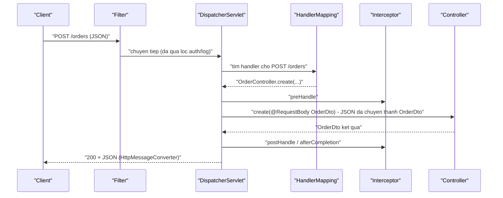

# Câu hỏi: Spring cơ bản

Mỗi câu hỏi được viết theo chuỗi suy luận: **Câu hỏi** theo tình huống, **Gợi ý suy luận** (các câu hỏi nhỏ dẫn tới kiến thức nền), **Lập luận** (chuỗi nhân quả vì A nên B), **Đáp án ngắn** nói được thành tiếng, **Nhớ** (kiến thức cốt lõi), rồi **Ví dụ**. Mỗi **Hỏi xoáy** nêu thêm vì sao nó là bước tiếp theo logic của câu trước. Kiến thức gốc: [Spring Boot Easy](/go?p=01-Spring-Boot%2Feasy%2Findex.md). Nâng cao hơn: [Spring bên trong](/go?p=07-Interview-QA%2FBackend%2Fmedium%2Fqa-04-spring-noi-bo.md), [Spring Boot nâng cao](/go?p=07-Interview-QA%2FBackend%2Fmedium%2Fqa-15-spring-boot-nang-cao.md).

Quy ước về ví dụ, để bạn biết mức tin cậy:

- **"Đã chạy thử trên JDK 11"**: chương trình Java thuần mô phỏng cơ chế (container DI tối giản, proxy), output là thật. Chúng **không phải Spring thật**, chỉ minh họa nguyên lý mà Spring dựa vào.
- **"Minh họa"**: code/cấu hình/thông báo theo đặc tả và tài liệu Spring, chưa chạy trong môi trường này (không có Spring Boot, DB). Các thông báo lỗi và JSON phản hồi chỉ là **dạng** tiêu biểu, câu chữ có thể khác theo phiên bản Spring.

**Tóm tắt:**

- Phạm vi file: nền tảng Spring và Spring Boot, mỗi câu đều đi từ một hiện tượng lỗi thường gặp tới cơ chế gây ra nó.
- IoC đảo chiều việc chọn và tạo dependency cho container; DI qua constructor là cách nên dùng vì dependency hiện ở chữ ký, field `final` được và test không cần Spring.
- Bean singleton mặc định dùng chung cho mọi request nên không được giữ state thay đổi; `prototype` tiêm vào singleton chỉ được giải quyết một lần.
- Proxy được tạo sau khi khởi tạo bean, nên `@Transactional` trong `@PostConstruct` hay gọi qua `this` không có tác dụng.
- Hai bean cùng kiểu thì Spring dừng ngay lúc khởi động (`NoUniqueBeanDefinitionException`); `@SpringBootApplication` chỉ quét từ package của class main trở xuống; auto-configuration chỉ chạy khi chưa có bean của bạn.
- Cấu hình càng gần nơi triển khai thì càng thắng (dòng lệnh, biến môi trường, rồi file); request đi qua Filter, `DispatcherServlet`, Interceptor tới controller, và `@ControllerAdvice` không bắt được lỗi ở Filter.
- Hay bị hỏi xoáy nhất: vì sao `@Transactional` không chạy khi gọi nội bộ, vì sao không trả entity JPA thẳng ra API, và validation ở controller khác ràng buộc UNIQUE ở DB thế nào.

## 1. IoC và Dependency Injection: vì sao để bên ngoài trao phụ thuộc vào?

**Phải thuộc:** Câu này là câu cốt lõi, gặp rất thường xuyên.

**Câu hỏi:** Class `OrderService` tự `new EmailNotifier()` thì test phải gửi email thật. Cần đổi điều gì để test được mà không sửa logic, và đó có phải là IoC/DI không?

**Gợi ý suy luận:**
- Khi class tự `new` một class cụ thể thì nó bị buộc vào cài đặt nào, thay thế được không?
- Nếu thay vì tự lấy, phụ thuộc được trao từ bên ngoài thì ai chọn cài đặt?
- Phụ thuộc bắt buộc nên truyền qua đâu để thấy rõ ngay ở chữ ký và để `new` được trong test?

**Lập luận:** Khi class tự `new EmailNotifier()` thì nó bị buộc cứng vào một cài đặt cụ thể, nên không thay được và cũng không test riêng được vì test phải gửi email thật. Vấn đề không nằm ở logic mà ở **ai chọn và tạo dependency**. IoC đảo chiều trách nhiệm đó: class chỉ nói "tôi cần một `Notifier`", còn bên ngoài (container) chọn cái nào và trao vào. DI là kỹ thuật thực hiện việc trao đó, qua constructor (nên ưu tiên), setter hoặc field. Constructor tốt hơn vì ba lý do nối nhau: dependency hiện ngay ở chữ ký nên không giấu được; field có thể `final` nên object không bao giờ ở trạng thái thiếu dependency; và test chỉ cần `new OrderService(fakeNotifier)` không cần Spring. Thêm nữa circular dependency lộ ngay lúc khởi động thay vì âm thầm. Điểm dễ nhầm là cho rằng dùng `@Autowired` trên field là "đã DI": nó vẫn là DI nhưng che mất dependency và buộc test phải dùng reflection hay context. Lợi ích thật là điểm nối thay thế được: production lắp bản email thật, test lắp bản giả mà không sửa logic.

**Đáp án ngắn:** IoC là container tạo và nối object thay class tự `new`. DI là kỹ thuật dependency injection qua constructor (ưu tiên), setter hoặc field, để dễ thay thế và dễ test.

**Nhớ:** DI cho điểm nối thay thế được, không phải "ít code". Gốc: [Spring Boot Easy](/go?p=01-Spring-Boot%2Feasy%2Findex.md).

**Ví dụ:** so sánh có/không DI (Java thuần).

```java
interface Notifier { String send(String msg); }
class EmailNotifier implements Notifier { public String send(String m) { return "email: " + m; } }
class FakeNotifier implements Notifier { final List<String> sent = new ArrayList<>(); public String send(String m) { sent.add(m); return "fake"; } }

// KHONG co DI: tu new, khong thay duoc
class OrderServiceHardCoded { private final Notifier n = new EmailNotifier(); String placeOrder() { return n.send("don hang moi"); } }
// Co constructor injection
class OrderService { private final Notifier n; OrderService(Notifier n) { this.n = n; } String placeOrder() { return n.send("don hang moi"); } }

FakeNotifier fake = new FakeNotifier();
new OrderService(fake).placeOrder();     // test: khong gui email that
```

```text
khong DI: email: don hang moi  <- khong the thay bang gia lap khi test
co DI + test: fake | fake nhan: [don hang moi]
```

_Đã chạy thử trên JDK 11._ Bản không DI buộc test phải gửi email thật (hoặc phải hack bằng reflection); bản có DI thay bằng `FakeNotifier` và kiểm tra được thứ nó nhận. Trong Spring, container làm đúng việc `new OrderService(new EmailNotifier())` thay bạn.

**Hỏi xoáy 1:** Vì sao constructor injection được ưu tiên hơn field injection (`@Autowired` trên field)?
**Vì sao hỏi tiếp:** Đã nói DI có ba cách, người phỏng vấn muốn biết bạn chọn cách nào và lý do suy ra từ lợi ích ở trên (dễ thay, dễ test).
**Gợi ý suy luận:** Field injection có hiện phụ thuộc ở chữ ký không? Có dùng `final` được không? Test không Spring thì gán bằng gì?
**Lập luận:** Field injection giấu danh sách phụ thuộc (dễ phình 10 dependency mà không ai thấy, dấu hiệu class làm quá nhiều việc), không `final`, và test phải có Spring hoặc reflection để gán. Constructor injection làm mọi thứ hiện ở chữ ký và test chỉ cần `new`.

**Hỏi xoáy 2:** Circular dependency A cần B, B cần A thì sao?
**Vì sao hỏi tiếp:** Constructor injection đòi có đủ dependency trước khi tạo, nên câu tự nhiên là khi hai bên cần nhau thì thế nào.
**Gợi ý suy luận:** Có thể tạo cái nào trước? Lỗi lộ lúc khởi động hay lúc chạy, và đó là điểm tốt hay xấu?
**Lập luận:** Không thể tạo cái nào trước, nên Spring báo `BeanCurrentlyInCreationException` lúc khởi động (Spring Boot 2.6 trở đi cấm vòng tham chiếu mặc định, kể cả field injection). Lỗi thiết kế lộ ngay là lợi ích. Sửa đúng là tách trách nhiệm (đưa phần chung ra bean thứ ba) hoặc dùng event, không phải bật `allow-circular-references`.

**Sai lầm hay gặp:** Dùng `@Autowired` field "cho nhanh" rồi viết test phải khởi động cả Spring context (chậm), hoặc tiêm `ApplicationContext` rồi `getBean` (biến DI thành service locator).

## 2. Bean và scope: vì sao bean singleton không được giữ state?

**Phải thuộc:** Câu này là câu cốt lõi, gặp rất thường xuyên.

**Câu hỏi:** Nếu tôi đặt `private User currentUser` trong một `@Service` thì người dùng A có thể thấy dữ liệu của người dùng B. Vì sao, và scope của bean quyết định điều đó thế nào?

**Gợi ý suy luận:**
- Scope mặc định cho mỗi lần xin bean: cùng một cái hay cái mới?
- Trong web, mỗi request chạy trên thread nào, và các thread đó gọi bean nào?
- Nếu nhiều thread cùng ghi một biến thì chuyện gì xảy ra (nhớ demo `int++`)?

**Lập luận:** Bean là object do container sở hữu lifecycle, và scope quyết định container cấp lại cùng một instance hay tạo cái mới. Mặc định là `singleton`: một instance cho cả container. Vì mỗi request thường chạy trên một thread riêng nhưng tất cả đều gọi chung một bean, nên bất kỳ state thay đổi được nào trong bean (như `private User currentUser`) thực chất là biến dùng chung giữa các request: người A có thể thấy dữ liệu của người B, hoặc hai request ghi đè nhau (race condition). Vì vậy bean singleton phải stateless hoặc chỉ giữ state bất biến; dữ liệu theo request phải đi bằng tham số hoặc nằm ở scope `request`. Điểm dễ nhầm là nghĩ `prototype` là cách chữa: bean `prototype` tiêm vào singleton chỉ được giải quyết **một lần** lúc singleton khởi tạo, nên thực ra vẫn dùng chung một instance, thành singleton trá hình. Muốn lấy bean mới mỗi lần phải dùng `ObjectProvider`, `@Lookup` hoặc scoped proxy. Khi review, thấy field không `final` trong `@Service`/`@Component` thì nghi ngờ ngay.

**Đáp án ngắn:** Scope: `singleton` (mặc định, một instance mỗi container), `prototype` (mỗi lần mới), `request`, `session`, `application`. Bean singleton phải không giữ state thay đổi được; tiêm `prototype` vào singleton chỉ được một lần.

**Nhớ:** Singleton + state mutable = dữ liệu chung giữa các request.

**Ví dụ:** hai loại phạm vi, bằng container tối giản (Java thuần).

```java
class Container {
    Map<String, Supplier<Object>> defs; Map<String, Object> singletons; Set<String> singletonNames;
    Object get(String name) {
        // prototype: moi lan moi
        if (!singletonNames.contains(name)) return defs.get(name).get();
        // singleton: tao 1 lan, tai su dung
        return singletons.computeIfAbsent(name, k -> defs.get(k).get());
    }
}
c.register("notifier", EmailNotifier::new, true);
c.register("report", ArrayList::new, false);
// c.get("notifier") == c.get("notifier") ?   c.get("report") == c.get("report") ?

// bay: singleton giu 1 prototype
// phu thuoc chi duoc giai quyet LUC TAO singleton
Service singleton = new Service(prototype.get());
```

```text
singleton: cung instance? true
prototype: cung instance? false
singleton goi reportId() 3 lan: 1,1,1  <- luon cung 1 prototype
```

_Đã chạy thử trên JDK 11 (mô phỏng, không phải Spring)._ Dòng cuối là bẫy: "prototype" trong singleton thực chất thành singleton. Spring giải quyết bằng `ObjectProvider<Report>` hoặc `@Lookup` (xin mới mỗi lần dùng).

Còn vì sao singleton không được giữ state: xem demo `int++` từ 4 thread ở [câu 4 bài collections và concurrency](/go?p=07-Interview-QA%2FBackend%2Fmedium%2Fqa-03-collections-concurrency.md), cùng một bộ đếm mà mất cập nhật; trong web, mỗi request là một thread gọi chung một bean.

**Hỏi xoáy 1:** Singleton của Spring có thread-safe không?
**Vì sao hỏi tiếp:** Nếu mọi thread dùng chung một bean thì phải hỏi ai chịu trách nhiệm thread-safe.
**Gợi ý suy luận:** Spring bảo đảm việc gì: tạo bean hay dùng bean? Bean chỉ có phụ thuộc `final` có gì để tranh chấp?
**Lập luận:** Spring chỉ đảm bảo **tạo** bean an toàn. Bean không trạng thái (chỉ phụ thuộc `final`) thì không có gì để tranh chấp nên an toàn; bean giữ `List`/`Map`/biến đếm thay đổi được thì không, và trách nhiệm là của bạn.

**Hỏi xoáy 2:** Khi nào cần `request` scope?
**Vì sao hỏi tiếp:** Nếu singleton không giữ state được thì dữ liệu gắn với một request để ở đâu?
**Gợi ý suy luận:** Dữ liệu nào sống đúng bằng một request (người dùng hiện tại, correlation ID)? Truyền tham số có thay được không?
**Lập luận:** Dùng `request` scope cho dữ liệu gắn với một request. Thường tránh bằng truyền tham số hoặc `RequestContextHolder`/`ThreadLocal`; cả hai có điểm yếu với thread async và virtual thread.

**Sai lầm hay gặp:** Đặt `private User currentUser` làm field trong `@Service`: người dùng A thấy dữ liệu của người dùng B dưới tải. Đây là lỗi bảo mật thật, rất khó tái hiện.

## 3. `@Component`, `@Service`, `@Repository`, `@Controller`: khác nhau thật ở đâu?

**Câu hỏi:** Nếu tôi gắn `@Component` cho cả bốn loại thì ứng dụng vẫn chạy. Vậy bốn annotation này khác nhau ở điểm nào, và khi nào dùng `@Bean`?

**Gợi ý suy luận:**
- Về kỹ thuật cả bốn đăng ký bean bằng cơ chế nào (meta-annotation)?
- Phần khác biệt nằm ở ngữ nghĩa cho người đọc, công cụ hay hành vi phụ?
- `@Repository` làm gì với ngoại lệ của JDBC/Hibernate, và vì sao có lợi?
- Class từ thư viện ngoài không sửa được thì đăng ký thế nào?

**Lập luận:** `@Service`, `@Repository`, `@Controller` đều được chú thích bằng `@Component`, nên về cơ chế cả bốn đều làm đúng một việc: khi quét classpath, Spring đăng ký class đó thành bean. Vì vậy gắn `@Component` cho tất cả vẫn chạy. Phần khác nhau là ngữ nghĩa và hành vi phụ, nên là lý do để dùng đúng loại. Ngữ nghĩa nói vai trò cho người đọc và cho công cụ (AOP có thể nhắm `@Service`, `@WebMvcTest` chỉ nạp `@Controller`). Hành vi phụ rõ nhất là `@Repository`: nó kích hoạt dịch exception riêng của công nghệ lưu trữ thành hệ `DataAccessException` thống nhất, nên tầng nghiệp vụ bắt `DuplicateKeyException` mà không phụ thuộc MySQL hay PostgreSQL. Còn `@Bean` cần khi không gắn annotation lên class được (class của thư viện như `Clock` của JDK) hoặc cần logic tạo phức tạp: bạn khai báo method trong class `@Configuration` và container dùng giá trị trả về làm bean. Điểm dễ nhầm là coi chúng chỉ là nhãn trang trí, và bỏ mất việc dịch exception hoặc phạm vi test khi dùng lẫn lộn.

**Đáp án ngắn:** Cả bốn đăng ký bean; khác ở ngữ nghĩa, riêng `@Repository` thêm dịch ngoại lệ thành `DataAccessException`. Dùng `@Bean` khi không sửa được class hoặc cần logic tạo phức tạp.

**Nhớ:** `@Service` chỉ là nhãn tầng nghiệp vụ, không có hành vi phụ.

**Ví dụ:**

```java
@Repository
class UserRepo {
    private final JdbcTemplate jdbc;
    UserRepo(JdbcTemplate jdbc) { this.jdbc = jdbc; }
    void insert(String email) { jdbc.update("insert into users(email) values (?)", email); }
}
// Khi email trung (unique) -> nguoi goi nhan DuplicateKeyException (DataAccessException),
// thay vi SQLException co ma loi rieng cua tung CSDL.

@Configuration
class AppConfig {
    // lop Clock cua JDK: khong gan @Component duoc
    @Bean Clock clock() { return Clock.systemUTC(); }
}
```

_Minh họa, chưa chạy thử trong môi trường này (cần Spring và DB)._ Lợi ích của dịch ngoại lệ: tầng nghiệp vụ `catch (DuplicateKeyException e)` đúng cho cả MySQL lẫn PostgreSQL, không phải đọc mã lỗi SQL riêng.

**Hỏi xoáy 1:** Dùng `@Component` cho cả bốn có chạy không?
**Vì sao hỏi tiếp:** Nếu bốn cái cùng cơ chế thì câu hỏi tự nhiên là bỏ khác biệt đi có sao không.
**Gợi ý suy luận:** Mất gì khi không có `@Repository`? Công cụ nào dựa vào `@Service`/`@Controller`?
**Lập luận:** Vẫn chạy, nhưng mất dịch ngoại lệ của `@Repository` (với JdbcTemplate/Spring Data thường đã dịch sẵn) và mất ngữ nghĩa cho người đọc và công cụ (AOP pointcut theo `@Service`, `@WebMvcTest` chỉ quét `@Controller`).

**Hỏi xoáy 2:** `@Configuration` khác `@Component` ở đâu?
**Vì sao hỏi tiếp:** Ở trên nhắc `@Bean` trong `@Configuration`, nên hỏi tiếp vì sao phải là `@Configuration` mà không phải `@Component`.
**Gợi ý suy luận:** Nếu một `@Bean` method gọi `@Bean` method khác trong cùng class, kết quả là cùng instance hay mới?
**Lập luận:** Class `@Configuration` được proxy bằng CGLIB để call `@Bean` nội bộ trả cùng bean singleton (chế độ "full"). Trong `@Component` các `@Bean` method ở chế độ "lite": gọi nội bộ là gọi Java thường nên ra instance mới.

**Sai lầm hay gặp:** Gắn `@Service` lên mọi thứ kể cả class tiện ích không phụ thuộc gì (không cần là bean), hoặc đặt logic nghiệp vụ trong `@Controller`.

## 4. Lifecycle bean: vì sao `@Transactional` trong `@PostConstruct` không có tác dụng?

**Câu hỏi:** Tôi gọi một method có `@Transactional` từ `@PostConstruct` mà không có transaction nào được mở. Container làm các bước theo thứ tự nào để dẫn đến điều đó?

**Gợi ý suy luận:**
- Một bean phải trải qua những bước nào từ tạo tới sẵn sàng (tạo, nối phụ thuộc, khởi tạo, ...)?
- Proxy transaction/cache được tạo ở bước nào: trước hay sau khởi tạo?
- Khi `@PostConstruct` chạy, `this` là object gốc hay proxy?

**Lập luận:** Chuỗi event của một bean có thứ tự cố định và proxy nằm ở cuối. Container tạo instance bằng constructor, nối dependency, rồi chạy mã khởi tạo (`@PostConstruct` được xử lý ở `postProcessBeforeInitialization`). Chỉ sau đó các `BeanPostProcessor` mới được bọc object lại ở `postProcessAfterInitialization`, và proxy AOP (cho `@Transactional`, `@Cacheable`, `@Async`) được tạo đúng ở bước này. Vì vậy lúc `@PostConstruct` chạy, `this` vẫn là object gốc chưa được bọc, nên mọi annotation dựa trên proxy ghi trên method được gọi từ đó đều không có hiệu lực: không có transaction nào được mở. Điểm dễ nhầm là tưởng đã có `@Transactional` trên method thì chỗ nào gọi cũng có transaction; thực ra annotation chỉ có tác dụng khi lời gọi đi qua proxy. Hệ quả khi thiết kế: việc cần transaction lúc khởi động nên chạy sau khi context sẵn sàng (`ApplicationReadyEvent`, `SmartInitializingSingleton`) hoặc tự mở bằng `TransactionTemplate`. Khi đóng, `@PreDestroy` và `DisposableBean.destroy` chạy để dọn tài nguyên.

**Đáp án ngắn:** Thứ tự: constructor, dependency injection, `Aware`, `@PostConstruct`/`afterPropertiesSet`/`init-method`, rồi proxy bọc sau khởi tạo, bean sẵn sàng, đóng thì `@PreDestroy`. Vì proxy tạo sau khởi tạo nên trong `@PostConstruct` chưa có transaction.

**Nhớ:** Khởi tạo trước, bọc proxy sau.

**Ví dụ:** hệ quả của "khởi tạo trước, bọc sau" (Java thuần, mô phỏng).

```java
Tx target = new TxImpl();
System.out.println("buoc 1: goi init() tren doi tuong goc (giong @PostConstruct)");
target.init();
Tx proxy = (Tx) Proxy.newProxyInstance(loader, new Class[]{Tx.class}, handlerBeginCommit(target));
System.out.println("buoc 2: boc proxy (BeanPostProcessor sau khoi tao), tu day moi co giao dich");
proxy.work();
```

```text
buoc 1: goi init() tren doi tuong goc (giong @PostConstruct)
    init() chay
buoc 2: boc proxy (BeanPostProcessor sau khoi tao), tu day moi co giao dich
  [proxy] BEGIN work
    work() chay
  [proxy] COMMIT work
```

_Đã chạy thử trên JDK 11 (mô phỏng)._ `init()` chạy **không** có `BEGIN/COMMIT`. Tương ứng trong Spring: `@Transactional`, `@Cacheable`, `@Async` ghi trên method được gọi từ `@PostConstruct` **không có hiệu lực**, vì lúc đó `this` chưa được bọc proxy.

**Hỏi xoáy 1:** Muốn chạy mã khi ứng dụng sẵn sàng (có transaction, có proxy) thì làm sao?
**Vì sao hỏi tiếp:** Biết `@PostConstruct` chạy quá sớm thì phải có chỗ khác an toàn hơn.
**Gợi ý suy luận:** Thời điểm nào mọi bean đã khởi tạo và bọc proxy xong?
**Lập luận:** Sau khi context sẵn sàng, nên dùng `ApplicationRunner`/`CommandLineRunner`, hoặc lắng nghe `ApplicationReadyEvent`, thay vì `@PostConstruct`.

**Hỏi xoáy 2:** `@PreDestroy` có đảm bảo chạy không?
**Vì sao hỏi tiếp:** Đầu lifecycle là khởi tạo, thì cuối lifecycle là dọn dẹp, nên hỏi độ tin cậy của bước cuối.
**Gợi ý suy luận:** Điều gì xảy ra với process khi `SIGTERM` so với `kill -9` hay crash?
**Lập luận:** Chỉ chạy khi context đóng êm (SIGTERM, `SpringApplication.exit`). `kill -9` hoặc crash thì không, nên đừng đặt việc sống còn (flush dữ liệu) chỉ ở đó mà không có cơ chế dự phòng.

**Sai lầm hay gặp:** Gọi dịch vụ chậm/ngoài hệ thống trong `@PostConstruct` làm khởi động chậm hoặc thất bại cả ứng dụng.

## 5. Hai bean cùng kiểu: vì sao Spring từ chối khởi động?

**Câu hỏi:** Có hai bean `Notifier` và `AlertService` cần một `Notifier`. Ứng dụng không khởi động được. Vì sao Spring không tự chọn một cái, và tôi giải quyết thế nào?

**Gợi ý suy luận:**
- Container có đủ thông tin để biết bạn muốn cái nào không?
- Chọn bừa thì lỗi lộ ra lúc nào, dễ thấy hay âm thầm?
- Bạn có thể chỉ rõ lựa chọn ở nơi nào: ở bean (mặc định chung) hay tại điểm tiêm?

**Lập luận:** Khi có hai bean cùng kiểu `Notifier`, container không có đủ thông tin để chọn thay bạn, và chọn bừa sẽ gây ra lỗi âm thầm chỉ lộ lúc chạy (gửi nhầm kênh). Spring chọn thà dừng sớm hơn đoán sai: nó ném `NoUniqueBeanDefinitionException` ngay khi khởi động (fail-fast), nên lỗi cấu hình không lọt ra production. Từ đó bạn có bốn cách chỉ rõ ý định, theo thứ tự từ chung đến riêng. Thứ nhất, `@Primary` đặt mặc định chung cho mọi nơi tiêm. Thứ hai, `@Qualifier` chọn đích danh ngay tại điểm tiêm. Thứ ba, đặt tên tham số trùng tên bean (Spring dùng tên làm fallback). Thứ tư, nếu thực sự cần cả hai thì tiêm `List<Notifier>` hoặc `Map<String, Notifier>` rồi chọn lúc chạy, đúng mẫu Strategy. Điểm dễ nhầm là thêm `@Primary` để "cho qua" mà quên rằng nó âm thầm thay đổi hành vi của mọi nơi khác tiêm cùng kiểu. Khi review, chọn cách phản ánh đúng quan hệ: một mặc định thì `@Primary`, các ngoại lệ thì `@Qualifier`.

**Đáp án ngắn:** Spring ném `NoUniqueBeanDefinitionException` lúc khởi động. Giải quyết bằng `@Primary`, `@Qualifier`, tên tham số trùng tên bean, hoặc tiêm `List<Notifier>`/`Map<String, Notifier>`.

**Nhớ:** Lỗi này là kiểm tra fail-fast có lợi.

**Ví dụ:**

```java
@Component class EmailNotifier implements Notifier { ... }
@Component class SmsNotifier   implements Notifier { ... }

@Service class AlertService {
    AlertService(Notifier notifier) { }                          // loi: 2 ung vien
}
// Thong bao co dang:
//   Parameter 0 of constructor in AlertService required a single bean, but 2 were found:
//     - emailNotifier ...
//     - smsNotifier ...
//   Action: Consider marking one of the beans as @Primary, updating the consumer to accept multiple beans,
//           or using @Qualifier to identify the bean that should be consumed

// Cach 1: chon tai noi tieu
AlertService(@Qualifier("smsNotifier") Notifier notifier) { }
// Cach 2: lay tat ca (Strategy)
AlertService(Map<String, Notifier> byName) { byName.get("smsNotifier").send("hi"); }
```

_Minh họa, chưa chạy thử trong môi trường này; thông báo lỗi chỉ là dạng tiêu biểu._

**Hỏi xoáy 1:** `@Primary` và `@Qualifier` cùng có thì cái nào thắng?
**Vì sao hỏi tiếp:** Đã có hai cách chọn, nên hỏi khi chúng mâu thuẫn.
**Gợi ý suy luận:** Cái nào cụ thể hơn: mặc định chung hay lựa chọn tại điểm dùng?
**Lập luận:** `@Qualifier` thắng vì nó chọn rõ ràng ở đúng chỗ cần, còn `@Primary` chỉ là mặc định chung.

**Hỏi xoáy 2:** Bean tên gì khi không đặt?
**Vì sao hỏi tiếp:** `@Qualifier("smsNotifier")` và `Map<String, Notifier>` đều dựa vào tên bean, nên phải biết tên đến từ đâu.
**Gợi ý suy luận:** Tên lấy từ tên class hay tên method?
**Lập luận:** Tên class viết thường chữ đầu (`EmailNotifier` thành `emailNotifier`); với `@Bean` là tên method.

**Sai lầm hay gặp:** Đặt `@Primary` khắp nơi để "hết lỗi" mà quên mất mình đang che giấu một lựa chọn thiết kế; sau này thêm bean thứ ba, hành vi đổi âm thầm.

## 6. Spring Boot thêm gì so với Spring, và vì sao nó "tự cấu hình" được?

**Câu hỏi:** Chỉ thêm `spring-boot-starter-web` mà ứng dụng tự có `DispatcherServlet` và Tomcat, còn không có driver MongoDB thì không có cấu hình Mongo. Boot quyết định bằng cách nào, và tôi ghi đè được không?

**Gợi ý suy luận:**
- Spring Framework cung cấp cơ chế nhưng ai phải nối mọi thứ?
- Nếu hầu hết ứng dụng nối giống nhau thì đóng gói thành gì, kèm điều kiện gì?
- Khi bạn đã tự khai báo một bean thì mặc định của Boot nên thế nào?

**Lập luận:** Spring Framework cung cấp cơ chế (DI, AOP, MVC, Data) nhưng bạn phải tự chọn thư viện và nối chúng, mà phần lớn ứng dụng nối giống hệt nhau. Boot đóng gói phần chung đó thành các mặc định **có điều kiện**: "nếu thấy thư viện X trên classpath và bạn chưa tự khai báo bean Y thì tạo Y cho bạn". Hai điều kiện cụ thể là `@ConditionalOnClass` (có `spring-webmvc` trên classpath thì dựng `DispatcherServlet` và Tomcat nhúng, không có driver MongoDB thì không cấu hình Mongo) và `@ConditionalOnMissingBean` (bean của bạn đã có thì mặc định lùi lại). Vì auto-configuration chỉ chạy khi chưa có bean của bạn, mặc định luôn ghi đè được, và đó cũng là cách phân biệt "Boot làm" và "tôi làm". Điểm dễ nhầm là coi auto-configuration là phép màu không kiểm soát được: thực tế nó là danh sách điều kiện có thể xem bằng `--debug` (conditions report) hoặc loại trừ bằng `exclude`. Khi cấu hình không như ý, đọc báo cáo này trước khi đoán.

**Đáp án ngắn:** Boot thêm auto-configuration theo classpath và theo bean bạn đã có, starter, server nhúng, cấu hình ngoài và Actuator. Mặc định luôn ghi đè được vì bean của bạn được ưu tiên.

**Nhớ:** Không rõ vì sao Boot cấu hình hay không cấu hình thì chạy `--debug` để xem báo cáo điều kiện.

**Ví dụ:** thấy được lựa chọn của Boot bằng báo cáo điều kiện.

```text
$ java -jar app.jar --debug
...
Positive matches:
-----------------
   DispatcherServletAutoConfiguration matched:
      - @ConditionalOnClass found required class 'org.springframework.web.servlet.DispatcherServlet'
      - @ConditionalOnWebApplication (required) found 'session' scope

Negative matches:
-----------------
   MongoAutoConfiguration:
      Did not match:
         - @ConditionalOnClass did not find required class 'com.mongodb.client.MongoClient'
```

_Minh họa, chưa chạy thử trong môi trường này; dạng báo cáo theo tài liệu Spring Boot, chi tiết thay đổi theo phiên bản._ Đọc: có `spring-boot-starter-web` nên Boot cấu hình `DispatcherServlet`; không có driver MongoDB nên không cấu hình Mongo. Khi "sao Boot không cấu hình cái tôi cần?", hãy chạy `--debug` thay vì đoán.

**Hỏi xoáy 1:** Auto-configuration biết cấu hình nào cần nạp bằng cách nào?
**Vì sao hỏi tiếp:** Điều kiện chỉ quyết định áp dụng hay không, còn danh sách ứng viên phải đến từ đâu.
**Gợi ý suy luận:** Cần một danh sách class cấu hình ở đâu đó mà Boot đọc, và mỗi class tự quyết bằng gì?
**Lập luận:** Các class cấu hình được liệt kê trong file imports (`META-INF/spring/org.springframework.boot.autoconfigure.AutoConfiguration.imports` ở Boot 2.7+/3, trước đó là `spring.factories`); mỗi class mang các `@Conditional...` để tự quyết có áp dụng hay không.

**Hỏi xoáy 2:** Tắt một auto-configuration cụ thể?
**Vì sao hỏi tiếp:** Vì mặc định có thể không mong muốn, phải biết cách loại hẳn một cái.
**Gợi ý suy luận:** Có thể khai báo loại trừ ở annotation hay ở cấu hình ngoài?
**Lập luận:** `@SpringBootApplication(exclude = DataSourceAutoConfiguration.class)` hoặc `spring.autoconfigure.exclude`.

**Sai lầm hay gặp:** Coi Boot là "phép màu" rồi không đọc được lý do một bean xuất hiện; kéo starter không dùng làm bật các cấu hình ngoài ý muốn (ví dụ thêm Security vào classpath khiến mọi endpoint bị lock mặc định).

## 7. `@SpringBootApplication`: vì sao bean ngoài gói gốc không được tiêm?

**Câu hỏi:** `OrderService` cần `AuditService` nhưng ứng dụng báo không tìm thấy bean, dù `AuditService` có `@Service`. Vì sao?

**Gợi ý suy luận:**
- `@SpringBootApplication` gồm những annotation nào?
- `@ComponentScan` quét bắt đầu từ đâu: toàn classpath hay một gói cụ thể?
- `AuditService` nằm trong gói nào so với class main?

**Lập luận:** `@SpringBootApplication` không có phép màu riêng, nó chỉ gộp ba annotation: `@SpringBootConfiguration`, `@EnableAutoConfiguration` và `@ComponentScan`, nên mọi hành vi đều suy ra được từ ba phần đó. Phần liên quan ở đây là `@ComponentScan`: nó quét từ gói chứa class main trở xuống, không phải toàn bộ classpath, vì quét cả classpath sẽ chậm và kéo vào cả bean ngoài ý muốn. Vì vậy `AuditService` ở `com.shop.common` nằm ngoài `com.shop.app` sẽ không được quét, không thành bean, và việc tiêm vào `OrderService` thất bại dù class có `@Service`. Điểm dễ nhầm là nghĩ có annotation là đủ: annotation chỉ là nhãn, còn việc có được phát hiện hay không do phạm vi quét quyết định. Có hai cách sửa: đưa class main lên gói cha chung (cách gọn và nên làm), hoặc khai báo `scanBasePackages` khi thực sự cần quét nhiều gói gốc. Khi gặp lỗi "không tìm thấy bean", việc đầu tiên là so sánh package của class đó với package của class main.

**Đáp án ngắn:** Nó gộp `@SpringBootConfiguration`, `@EnableAutoConfiguration`, `@ComponentScan`. Quét bắt đầu từ gói của class main trở xuống, nên bean ngoài gói gốc không được tìm thấy.

**Nhớ:** Đặt class main ở gói gốc của dự án.

**Ví dụ:**

```text
com.shop.app.ShopApplication        <-- @SpringBootApplication (goi goc: com.shop.app)
com.shop.app.order.OrderService     <-- duoc quet
com.shop.app.user.UserService       <-- duoc quet
com.shop.common.AuditService        <-- KHONG duoc quet (nam ngoai com.shop.app)
```

```java
@Service class OrderService {
    OrderService(AuditService audit) { }
}
// Khoi dong that bai:
//   Parameter 0 of constructor in OrderService required a bean of type 'com.shop.common.AuditService'
//   that could not be found.
// Cach sua: dua ShopApplication len com.shop, hoac
@SpringBootApplication(scanBasePackages = {"com.shop.app", "com.shop.common"})
```

_Minh họa, chưa chạy thử trong môi trường này._

**Hỏi xoáy 1:** Đặt class main ở gói mặc định (không `package`) thì sao?
**Vì sao hỏi tiếp:** Nếu quét theo gói của class main, trường hợp cực đoan là class main không có gói.
**Gợi ý suy luận:** Gói gốc rỗng thì "từ đây trở xuống" bao gồm những gì?
**Lập luận:** Quét toàn bộ classpath (cả thư viện) nên chậm và lỗi lạ; Spring cảnh báo, không nên.

**Hỏi xoáy 2:** `@EnableAutoConfiguration` quét gói nào?
**Vì sao hỏi tiếp:** Trong ba annotation, phần còn lại cũng dựa vào vị trí class main hay không.
**Gợi ý suy luận:** Auto-configuration cần biết gói nào để tìm `@Entity`, `@Repository`?
**Lập luận:** Nó dùng gói của class được đánh dấu làm "gói gốc" cho auto-configuration (tìm `@Entity`, `@Repository`), nên cùng quy tắc vị trí class main.

**Sai lầm hay gặp:** Tách module dùng chung (`common`) ra gói khác rồi không hiểu vì sao bean không được tiêm.

## 8. Cấu hình lấy từ đâu và nguồn nào thắng?

**Câu hỏi:** `server.port` được đặt ở file trong jar, ở profile `prod`, ở biến môi trường và ở dòng lệnh, khác nhau. Giá trị nào được dùng và vì sao Spring thiết kế thứ tự như vậy?

**Gợi ý suy luận:**
- Một ứng dụng phải chạy ở nhiều môi trường mà không đóng gói lại, vậy giá trị nào do người vận hành đặt?
- Giá trị gần thời điểm và nơi triển khai nên thắng hay thua giá trị cố định trong jar?
- Nhiều giá trị liên quan nhau thì gom bằng cách nào để có kiểu và kiểm tra?

**Lập luận:** Mục tiêu của thứ tự ưu tiên là ghi đè được mà không sửa code hay build lại, nên nguyên tắc là giá trị càng gần thời điểm và nơi triển khai càng thắng. Từ đó suy ra thứ tự: tham số dòng lệnh thắng biến môi trường, biến môi trường thắng file ngoài jar, file ngoài jar thắng file trong jar, và file theo profile thắng file chung. Vì mỗi tầng do một người khác nhau sở hữu (nhà phát triển, người đóng gói, người vận hành), việc người vận hành đặt giá trị gần nơi chạy nhất mà vẫn thắng là hợp lý. Ví dụ `--server.port=7070` ra 7070, `SERVER_PORT=9090` ra 9090 (nhờ relaxed binding đổi `SERVER_PORT` thành `server.port`), còn profile `prod` ra 8081. Điểm dễ nhầm là tưởng file `application.yml` trong jar là "nguồn cuối cùng" trong khi nó ở tầng thấp nhất, và tưởng đổi giá trị trong jar là đủ khi vận hành vẫn đặt biến môi trường đè lên. Với nhóm giá trị có cấu trúc, nên dùng `@ConfigurationProperties` có kiểu và validate thay vì rải `@Value`.

**Đáp án ngắn:** Thứ tự từ cao xuống: dòng lệnh, `-D`, biến môi trường, file profile, `application.yml` (ngoài jar thắng trong jar), mặc định. Gần nơi triển khai thì thắng để vận hành ghi đè không cần build lại.

**Nhớ:** Dùng `@ConfigurationProperties` cho nhóm cấu hình có kiểu và validate.

**Ví dụ:** một lock `server.port` ở nhiều nơi.

```yaml
# application.yml (trong jar)
server:
  port: 8080
---
# application-prod.yml (trong jar, khi profile=prod)
server:
  port: 8081
```

```text
java -jar app.jar                                         -> 8080
java -jar app.jar --spring.profiles.active=prod           -> 8081   (profile thang file chung)
SERVER_PORT=9090 java -jar app.jar --spring.profiles.active=prod       -> 9090  (bien moi truong thang file)
SERVER_PORT=9090 java -jar app.jar --server.port=7070                  -> 7070  (dong lenh thang het)
```

_Minh họa theo quy tắc ưu tiên của tài liệu Spring Boot, chưa chạy thử trong môi trường này._ Biến môi trường `SERVER_PORT` khớp `server.port` nhờ "relaxed binding".

```java
@ConfigurationProperties(prefix = "app.mail")
@Validated
record MailProps(@NotBlank String host, @Min(1) int port) { }
```

**Hỏi xoáy 1:** Đặt mật khẩu DB ở đâu?
**Vì sao hỏi tiếp:** Nguồn nào cũng có thể chứa giá trị, nên phải hỏi nguồn nào hợp với bí mật.
**Gợi ý suy luận:** File trong repo có ai đọc được? Giá trị nào do hạ tầng cấp lúc chạy?
**Lập luận:** Không để trong repo. Dùng biến môi trường, Kubernetes Secret, Vault/secrets manager; file cấu hình chỉ chứa tham chiếu (`${DB_PASSWORD}`).

**Hỏi xoáy 2:** Vì sao `@ConfigurationProperties` tốt hơn `@Value`?
**Vì sao hỏi tiếp:** Phần Trả lời nhắc nên dùng nó, nên cần lý do cụ thể.
**Gợi ý suy luận:** Thiếu `host` thì lỗi lộ lúc khởi động hay lúc chạy? Gom nhóm có kiểu được gì?
**Lập luận:** Gom nhóm có kiểu, validate lúc khởi động (fail-fast nếu thiếu `host`), dễ test, có metadata cho IDE.

**Sai lầm hay gặp:** Đẩy cả `application-prod.yml` chứa bí mật lên Git; hoặc sửa `application.yml` để "đổi theo môi trường" thay vì ghi đè bằng biến môi trường.

## 9. Một request đi qua Spring MVC từ Filter tới Controller thế nào?

**Phải thuộc:** Câu này là câu cốt lõi, gặp rất thường xuyên.

**Câu hỏi:** Tôi gửi `POST /orders` với JSON. Method controller của tôi chỉ nhận `OrderDto`, không đụng servlet API. Ai đã làm những bước ở giữa, và Filter với Interceptor chen vào chỗ nào?

**Gợi ý suy luận:**
- Một servlet duy nhất nhận mọi request rồi ủy quyền: design pattern đó tên gì?
- Ai tìm method controller, ai gọi nó, ai đổi JSON thành `OrderDto`?
- Thành phần nào thuộc đặc tả servlet (chạy trước) và thành phần nào thuộc Spring MVC (biết handler)?

**Lập luận:** Spring MVC theo mẫu Front Controller: một `DispatcherServlet` duy nhất nhận mọi request rồi ủy quyền cho các thành phần chuyên trách, nhờ vậy controller của bạn chỉ là method POJO không đụng servlet API. Thứ tự đi vào như sau. Thứ nhất, `Filter` (mức servlet, ngoài Spring MVC) chạy trước. Thứ hai, `HandlerMapping` tìm method controller khớp `POST /orders`. Thứ ba, `HandlerInterceptor.preHandle` chạy quanh controller. Thứ tư, `HandlerMethodArgumentResolver` cùng `HttpMessageConverter` đổi path, query và JSON thành tham số `OrderDto`, rồi `HandlerAdapter` gọi method. Thứ năm, kết quả trả về lại đi qua `HttpMessageConverter` để ghi thành JSON. Điểm dễ nhầm là Filter và Interceptor: Filter thấy request thô ở mức servlet và chạy cho mọi đường dẫn, còn Interceptor biết handler nào sẽ chạy nên hợp để kiểm quyền theo method. Hệ quả: logic cần chạy cho cả request tĩnh hay lỗi hệ thống đặt ở Filter, logic gắn với controller đặt ở Interceptor.

**Đáp án ngắn:** `Filter` rồi `DispatcherServlet`, `HandlerMapping` tìm handler, `HandlerAdapter` gọi nó với tham số đã được convert, `Interceptor` chạy quanh, kết quả được `HttpMessageConverter` ghi thành JSON.

**Nhớ:** Filter thuộc servlet, Interceptor và `@ControllerAdvice` thuộc Spring MVC.

**Ví dụ:** `POST /orders` với body JSON.



| Thành phần | Chạy ở đâu | Dùng để |
|---|---|---|
| `Filter` | Trước `DispatcherServlet` | Authentication, log, CORS, nén (thấy cả request lỗi trước MVC) |
| `HandlerInterceptor` | Quanh controller | Logic cần biết handler nào được chọn |
| `@ControllerAdvice` | Sau khi controller ném lỗi | Dịch ngoại lệ thành phản hồi |

_Minh họa thread theo kiến trúc Spring MVC._

**Hỏi xoáy 1:** Khác nhau giữa Filter và Interceptor?
**Vì sao hỏi tiếp:** Hai thứ cùng "chen vào trước controller", nên hỏi ranh giới.
**Gợi ý suy luận:** Cái nào thuộc đặc tả servlet, cái nào biết handler đã chọn? Cái nào thấy tài nguyên tĩnh?
**Lập luận:** Filter thuộc đặc tả servlet, chạy cho mọi request kể cả tài nguyên tĩnh, không biết controller. Interceptor thuộc Spring MVC, biết handler đã chọn, chỉ chạy cho request tới `DispatcherServlet`.

**Hỏi xoáy 2:** JSON không hợp lệ thì lỗi ở đâu?
**Vì sao hỏi tiếp:** Trong thread trên, JSON đổi thành tham số trước khi vào controller, nên lỗi ở bước đó xảy ra ở đâu.
**Gợi ý suy luận:** Bước convert nằm trước hay sau controller?
**Lập luận:** `HttpMessageConverter` ném `HttpMessageNotReadableException` trước khi vào controller; mặc định trả `400`.

**Sai lầm hay gặp:** Đặt kiểm tra authentication trong Interceptor mà quên rằng lỗi ném ở Filter hay ở bước convert vẫn bỏ qua nó.

## 10. `@RestController` hay `@Controller`: giá trị trả về được hiểu thế nào?

**Câu hỏi:** Method trả `"hello"` mà `@Controller` thì đi tìm template `hello`, còn `@RestController` thì body là chữ `hello`. Điều gì khác nhau?

**Gợi ý suy luận:**
- Giá trị trả về của method được coi là tên view hay là dữ liệu?
- Ai chịu trách nhiệm ghi dữ liệu thành JSON vào body (`@ResponseBody`, `HttpMessageConverter`)?
- Nếu dùng sai loại cho API thì Spring tìm cái gì?

**Lập luận:** Câu trả lời của một method controller có thể mang hai ý nghĩa khác nhau: một **tên view** để dựng HTML, hoặc **dữ liệu** để ghi thẳng vào body. `@Controller` chọn nghĩa thứ nhất: giá trị trả về `"hello"` được coi là tên template và đưa cho `ViewResolver`. `@RestController` là `@Controller` cộng `@ResponseBody`: giá trị trả về là dữ liệu, được `HttpMessageConverter` ghi vào body (chuỗi thì thành chữ, object thì thành JSON). Vì vậy dùng `@Controller` cho API thì chuỗi `"hello"` bị tìm như tên view, không thấy template nên lỗi 404 hoặc `TemplateInputException` thay vì trả dữ liệu. Điểm dễ nhầm là trộn: một class `@RestController` không thể trả tên view nữa, nên trang HTML và API nên nằm ở hai class khác nhau, hoặc dùng `@Controller` với `@ResponseBody` trên từng method. Khi review, nhìn annotation ở class trước khi đoán body trả về là gì.

**Đáp án ngắn:** `@RestController` cho API JSON (giá trị trả về ghi vào body). `@Controller` cho render HTML phía server, hoặc trộn bằng `@ResponseBody` trên từng method.

**Nhớ:** `@RestController` = `@Controller` + `@ResponseBody`.

**Ví dụ:**

```java
@Controller
class PageController {
    // tim view ten "hello" (vd. hello.html)
    @GetMapping("/hello") String hello() { return "hello"; }
}
@RestController
class ApiController {
    // body = chuoi "hello"
    @GetMapping("/api/hello") String hello() { return "hello"; }
    // body = {"name":"An","age":30}
    @GetMapping("/api/user")  User user()    { return new User("An", 30); }
}
```

_Minh họa, chưa chạy thử trong môi trường này._ Nếu dùng nhầm `@Controller` cho API: trả `String "hello"` làm Spring đi tìm template `hello`, không thấy thì lỗi (404 hoặc lỗi resolve view) thay vì trả JSON.

**Hỏi xoáy 1:** Trả `null` từ method `@RestController` thì sao?
**Vì sao hỏi tiếp:** Khi giá trị trả về là dữ liệu ghi vào body, thì "không có dữ liệu" trông thế nào với client.
**Gợi ý suy luận:** Body rỗng thì status code là gì, có đúng nghĩa "không tìm thấy" không?
**Lập luận:** Body rỗng với `200`, trừ khi dùng `ResponseEntity`/ném lỗi 404. Thường nên trả `ResponseEntity.notFound()` hoặc ném ngoại lệ có status code.

**Hỏi xoáy 2:** `ResponseEntity` dùng khi nào?
**Vì sao hỏi tiếp:** Câu trước cần điều khiển status code, nên hỏi công cụ chính cho việc đó.
**Gợi ý suy luận:** Khi nào mã luôn 200, khi nào cần mã và header riêng?
**Lập luận:** Khi cần điều khiển status code và header (201 + `Location`) thì dùng `ResponseEntity`; trả thẳng DTO khi luôn 200.

**Sai lầm hay gặp:** Trả `void` cho `POST` tạo mới rồi để client không biết id; trả 200 cho lỗi nghiệp vụ.

## 11. Xử lý lỗi tập trung: vì sao `@ControllerAdvice` không bắt lỗi ở Filter?

**Câu hỏi:** Thay vì `try/catch` ở từng controller, tôi muốn mọi lỗi ra cùng một định dạng. Làm thế nào, và vì sao lỗi ném trong Filter lại không được bắt?

**Gợi ý suy luận:**
- Tách "phát hiện lỗi" khỏi "biến lỗi thành phản hồi" thì mỗi phần nằm ở đâu?
- `@ControllerAdvice` hoạt động bên trong thành phần nào của thread request?
- Filter chạy trước hay sau `DispatcherServlet`?

**Lập luận:** Nếu mỗi controller tự `try/catch` thì lỗi ra nhiều định dạng khác nhau và code lặp ở mọi nơi. Cách gọn hơn là ném exception ở nơi gần nghiệp vụ, rồi để một `@RestControllerAdvice` với các `@ExceptionHandler` biến exception thành phản hồi ở đúng một chỗ, tốt nhất theo cấu trúc chuẩn `ProblemDetail` (RFC 9457). Nhưng cơ chế này có phạm vi: advice là một phần của Spring MVC, nên chỉ chạy trong `DispatcherServlet`. `Filter` chạy ngoài và trước `DispatcherServlet`, nên exception ném trong Filter không bao giờ đi qua advice và container servlet xử lý (trang lỗi mặc định). Điểm dễ nhầm là tưởng `@ControllerAdvice` là "bắt mọi lỗi của ứng dụng", đặc biệt với lỗi xác thực trong Filter của Spring Security. Hệ quả khi thiết kế: lỗi trong Filter phải xử lý riêng (ví dụ `AuthenticationEntryPoint`, hoặc Filter tự ghi phản hồi lỗi cùng định dạng), để client luôn nhận một cấu trúc lỗi thống nhất.

**Đáp án ngắn:** Dùng `@RestControllerAdvice` với các `@ExceptionHandler` trả cấu trúc lỗi thống nhất (hoặc `ProblemDetail`). Nó chỉ bắt lỗi trong phạm vi MVC, lỗi ở Filter phải xử lý riêng.

**Nhớ:** Ném lỗi ở nghiệp vụ, dịch lỗi ở một chỗ.

**Ví dụ:**

```java
class OrderNotFoundException extends RuntimeException {
    OrderNotFoundException(long id) { super("Khong tim thay don " + id); }
}

@RestControllerAdvice
class ApiErrors {
    @ExceptionHandler(OrderNotFoundException.class)
    ProblemDetail notFound(OrderNotFoundException e) {
        ProblemDetail pd = ProblemDetail.forStatusAndDetail(HttpStatus.NOT_FOUND, e.getMessage());
        pd.setTitle("Order not found");
        return pd;
    }
}
// GET /orders/99  ->  404, Content-Type: application/problem+json
// {"type":"about:blank","title":"Order not found","status":404,"detail":"Khong tim thay don 99","instance":"/orders/99"}
```

_Minh họa, chưa chạy thử trong môi trường này; JSON là dạng theo chuẩn problem details._

**Hỏi xoáy 1:** Lỗi ném ở Filter xử lý thế nào?
**Vì sao hỏi tiếp:** Giới hạn vừa nêu của advice dẫn thẳng tới cách xử lý phần nằm ngoài.
**Gợi ý suy luận:** Nếu advice không thấy thì xử lý ở đâu, có công cụ riêng nào của Spring Security?
**Lập luận:** Filter chạy ngoài `DispatcherServlet` nên advice không thấy. Xử lý ngay trong filter, hoặc dùng `HandlerExceptionResolver`/`AuthenticationEntryPoint` (Spring Security) cho từng loại.

**Hỏi xoáy 2:** Có nên lộ stack trace ra client?
**Vì sao hỏi tiếp:** Khi đã tự dựng phản hồi lỗi thì phải quyết định đưa gì vào đó.
**Gợi ý suy luận:** Stack trace tiết lộ gì cho kẻ tấn công? Chi tiết nên ở đâu?
**Lập luận:** Không: nó lộ cấu trúc nội bộ. Log chi tiết phía server kèm mã tương quan, client chỉ nhận message an toàn.

**Sai lầm hay gặp:** Bắt `Exception` chung trả 200 kèm `{"success": false}` (làm hỏng giám sát và cache dựa trên status code).

## 12. Validation: quên `@Valid` thì chuyện gì xảy ra, và kiểm tra trùng email đặt ở đâu?

**Câu hỏi:** Tôi đánh `@NotBlank`, `@Email` trên DTO nhưng dữ liệu rác vẫn lọt vào. Còn kiểm tra "email chưa tồn tại" thì nên đặt ở đâu?

**Gợi ý suy luận:**
- Annotation chỉ là siêu dữ liệu hay tự chạy kiểm tra?
- Dữ liệu ngoài biên nên được chặn ở đâu và sớm hay muộn?
- Quy tắc cần truy vấn DB có thể biểu diễn bằng annotation không?

**Lập luận:** Dữ liệu từ ngoài không bao giờ tin được, nên kiểm tra ở biên (controller) chặn dữ liệu rác sớm với chi phí thấp nhất, trước khi nó chạm tới nghiệp vụ và DB. Nhưng `@NotBlank`, `@Email` chỉ là siêu dữ liệu: không có gì chạy cả cho đến khi `@Valid` (hoặc `@Validated`) xuất hiện trên tham số `@RequestBody`, và cần `spring-boot-starter-validation` trên classpath. Quên `@Valid` thì annotation nằm im và dữ liệu rác lọt qua; khi có, thất bại ném `MethodArgumentNotValidException` hoặc `ConstraintViolationException`, thường được bắt ở advice để trả 400. Còn quy tắc "email chưa tồn tại" khác bản chất: nó phụ thuộc vào trạng thái hiện tại của dữ liệu và chỉ đúng tại thời điểm kiểm, nên phải đặt trong service cùng transaction, và cuối cùng vẫn cần ràng buộc UNIQUE ở DB vì hai request có thể cùng qua bước kiểm. Điểm dễ nhầm là nghĩ validation ở controller đã đủ cho nghiệp vụ. Phân chia đúng: dạng và giới hạn của dữ liệu ở biên, quy tắc cần dữ liệu ở service, tính duy nhất ở DB.

**Đáp án ngắn:** Dùng Bean Validation (`@NotBlank`, `@Email`, ...) cộng `@Valid`; thiếu `@Valid` thì không kiểm tra. Quy tắc nghiệp vụ cần dữ liệu viết trong service.

**Nhớ:** Kiểm tra biên bằng annotation, kiểm tra nghiệp vụ trong service.

**Ví dụ:**

```java
record CreateUser(@NotBlank String name, @Email String email, @Min(18) int age) { }

@PostMapping("/users")
ResponseEntity<Void> create(@Valid @RequestBody CreateUser body) { ... }

@ExceptionHandler(MethodArgumentNotValidException.class)
ProblemDetail invalid(MethodArgumentNotValidException e) {
    ProblemDetail pd = ProblemDetail.forStatus(HttpStatus.BAD_REQUEST);
    pd.setProperty("errors", e.getBindingResult().getFieldErrors().stream()
        .collect(Collectors.toMap(FieldError::getField, FieldError::getDefaultMessage, (a, b) -> a)));
    return pd;
}
// POST {"name":"", "email":"abc", "age":10}
//   -> 400 {"errors": {"name":"must not be blank","email":"must be a well-formed email address","age":"must be greater than or equal to 18"}}
```

_Minh họa, chưa chạy thử trong môi trường này; câu chữ thông báo mặc định phụ thuộc phiên bản và ngôn ngữ._

**Hỏi xoáy 1:** Quên `@Valid` thì sao?
**Vì sao hỏi tiếp:** Annotation chỉ là siêu dữ liệu nên người phỏng vấn muốn biết hậu quả thực tế khi thiếu công tắc.
**Gợi ý suy luận:** Có lỗi nào được báo khi thiếu `@Valid` không? Làm sao phát hiện?
**Lập luận:** Không có lỗi nào, vì annotation chỉ là siêu dữ liệu và `@Valid` mới kích hoạt. Nên cần test cho trường hợp dữ liệu sai.

**Hỏi xoáy 2:** Kiểm tra "email chưa tồn tại" đặt ở đâu?
**Vì sao hỏi tiếp:** Phần Lập luận nói quy tắc cần dữ liệu thuộc service, nên hỏi tiếp nó có đủ an toàn khi đồng thời không.
**Gợi ý suy luận:** Hai request cùng lúc cùng qua bước kiểm tra thì sao? Ai là lớp chặn cuối?
**Lập luận:** Đặt ở service (cần truy vấn DB), kèm ràng buộc unique ở DB làm lưới an toàn cuối: hai request đồng thời cùng qua bước kiểm tra, chỉ DB mới chặn được cái thứ hai.

**Sai lầm hay gặp:** Chỉ kiểm tra trong controller rồi gọi service từ chỗ khác (job, message) mà không validate.

## 13. Vì sao không trả entity JPA thẳng ra API?

**Phải thuộc:** Câu này là câu cốt lõi, gặp rất thường xuyên.

**Câu hỏi:** Trả thẳng `Order` (entity) từ controller thì gặp `StackOverflowError` hoặc `LazyInitializationException` lúc tạo JSON. Điều gì xảy ra, và nên làm gì thay thế?

**Gợi ý suy luận:**
- Entity phục vụ mục đích gì (lưu trữ) và API phục vụ mục đích gì (contract với bên ngoài)?
- Quan hệ hai chiều `Order -> lines -> order` khi serialize thì Jackson đi thế nào?
- Quan hệ lazy cần phiên Hibernate: khi serialize ngoài transaction thì phiên còn không?

**Lập luận:** Entity là mô hình lưu trữ gắn chặt với bảng, phiên Hibernate và quan hệ lazy, còn API là contract với bên ngoài cần ổn định. Nối hai thứ lại thì mọi thay đổi schema thành thay đổi API, và chi tiết ORM rò rỉ vào lúc serialize JSON. Có bốn hậu quả nối nhau. Thứ nhất, quan hệ hai chiều (`Order` chứa `Item`, `Item` trỏ lại `Order`) làm Jackson đi vòng vô hạn, nên `StackOverflowError`. Thứ hai, quan hệ lazy khi phiên đã đóng ném `LazyInitializationException`. Thứ ba, trường nhạy cảm như `passwordHash` bị lộ ra ngoài chỉ vì ai đó thêm field vào entity. Thứ tư, nếu phiên còn mở thì việc ghi JSON vô tình kích hoạt truy vấn lười cho từng dòng (N+1). Điểm dễ nhầm là chữa bằng `@JsonIgnore` hay `FetchType.EAGER`, chỉ che một triệu chứng và gắn thêm ràng buộc vào entity. Cách đúng là DTO (thường là `record`) với ánh xạ rõ ràng: API chỉ có các trường bạn chủ ý công khai.

**Đáp án ngắn:** Entity gắn với lưu trữ nên trả thẳng gây lộ trường, vòng vô hạn, lazy loading lỗi và gắn API vào schema. Dùng DTO và ánh xạ rõ ràng.

**Nhớ:** Entity khác DTO vì khác contract và lifecycle.

**Ví dụ:**

```java
@Entity class Order { @Id Long id; @ManyToOne(fetch = LAZY) Customer customer; @OneToMany(mappedBy = "order") List<Line> lines; }
// Line -> Order -> lines -> Line ...
@Entity class Line  { @Id Long id; @ManyToOne Order order; }

@GetMapping("/orders/{id}") Order get(@PathVariable Long id) { return repo.findById(id).orElseThrow(); }
// Hau qua dien hinh:
//  - Jackson di Order -> lines -> order -> lines ...  => StackOverflowError ("Infinite recursion")
//  - customer lazy ma session da dong => LazyInitializationException luc serialize

record OrderDto(Long id, String customerName, List<LineDto> lines) {
    static OrderDto of(Order o) { return new OrderDto(o.id, o.customer.name, o.lines.stream().map(LineDto::of).toList()); }
}
@GetMapping("/orders/{id}") OrderDto get(@PathVariable Long id) { return OrderDto.of(repo.findWithLines(id)); }
```

_Minh họa, chưa chạy thử trong môi trường này (cần JPA và Jackson)._

**Hỏi xoáy 1:** `@JsonIgnore` trên quan hệ có đủ không?
**Vì sao hỏi tiếp:** Nó là cách vá nhanh nhất cho lỗi vòng, nên hỏi liệu có thay được DTO không.
**Gợi ý suy luận:** Cắt vòng có giải quyết việc API phụ thuộc cấu trúc entity không?
**Lập luận:** Cắt được vòng nhưng API vẫn gắn với entity (thêm trường vào entity là đổi API). DTO cho kiểm soát đầy đủ.

**Hỏi xoáy 2:** `spring.jpa.open-in-view` là gì?
**Vì sao hỏi tiếp:** `LazyInitializationException` biến mất khi cài đặt này bật, nên cần biết nó che giấu gì.
**Gợi ý suy luận:** Giữ phiên mở suốt request thì lazy loading chạy lúc render được, nhưng tốn gì?
**Lập luận:** Giữ phiên Hibernate mở suốt request để lazy loading chạy lúc render; che giấu N+1 và giữ kết nối DB lâu hơn. Nhiều đội tắt (`false`) và buộc tải dữ liệu cần thiết trong service.

**Sai lầm hay gặp:** Dùng cùng một class làm entity, request body và response (vừa mass-assignment, vừa lộ dữ liệu).

## 14. Test trong Spring Boot: làm sao giữ bộ test nhanh?

**Câu hỏi:** Bộ test của tôi chạy chậm dần khi thêm test. Loại test nào cần context Spring và loại nào không, và vì sao nhiều `@MockBean` khác nhau lại làm chậm?

**Gợi ý suy luận:**
- Test nào không cần khởi động Spring (constructor injection giúp gì)?
- Test web hay JPA có cần nạp cả ứng dụng không, hay chỉ một phần (slice)?
- Context được cache theo key gồm những gì, và key khác nhau thì sao?

**Lập luận:** Test chậm vì dựng ApplicationContext tốn thời gian, và càng nạp nhiều Spring thì càng chậm và khó chỉ ra lỗi nằm ở đâu. Vì vậy quy tắc là chỉ nạp phần cần thiết cho điều đang kiểm. Logic nghiệp vụ test bằng unit test thuần: nhờ constructor injection ta `new` service với mock, không cần Spring. Chỗ cần một phần Spring thì dùng slice: `@WebMvcTest` chỉ nạp tầng web với service được mock, `@DataJpaTest` chỉ nạp JPA, còn `@SpringBootTest` nạp cả ứng dụng nên dùng ít. Về chuyện `@MockBean`: Spring cache context giữa các test theo một key gồm cấu hình và cả tập mock. Mỗi tổ hợp `@MockBean` khác nhau là một key mới, nên context phải dựng lại từ đầu thay vì dùng lại, và bộ test chậm dần dù mỗi test nhỏ. Điểm dễ nhầm là mỗi test class tự khai báo mock theo nhu cầu riêng. Cách giảm: gom mock vào một class cơ sở chung hoặc dùng ít tổ hợp cấu hình để tái dùng context.

**Đáp án ngắn:** Unit test thuần (Mockito) cho logic; `@WebMvcTest`/`@DataJpaTest` cho từng lát; `@SpringBootTest` ít thôi. Nhiều tập mock khác nhau tạo nhiều context nên chậm.

**Nhớ:** Test nhanh là test không khởi động context.

**Ví dụ:**

```java
// 1) Unit test thuan: khong Spring, chay vai mili giay
class OrderServiceTest {
    @Test void place_order_sends_notification() {
        Notifier notifier = mock(Notifier.class);
        new OrderService(notifier).placeOrder();
        verify(notifier).send("don hang moi");
    }
}

// 2) Test lop web
@WebMvcTest(OrderController.class)
class OrderControllerTest {
    @Autowired MockMvc mvc;
    @MockitoBean OrderService service;      // truoc Boot 3.4 la @MockBean
    @Test void returns_404_when_not_found() throws Exception {
        when(service.find(99L)).thenThrow(new OrderNotFoundException(99L));
        mvc.perform(get("/orders/99")).andExpect(status().isNotFound());
    }
}
```

_Minh họa, chưa chạy thử trong môi trường này._ Bài học về tốc độ: ví dụ 1 không có Spring nên nhanh nhất vì dựa vào constructor injection (câu 1).

| Test | Khởi động | Độ chậm tương đối |
|---|---|---|
| Unit thuần | Không | Rất nhanh |
| `@WebMvcTest` / `@DataJpaTest` | Một phần context | Nhanh đến trung bình |
| `@SpringBootTest` | Toàn bộ | Chậm |

**Hỏi xoáy 1:** Vì sao nhiều `@MockBean` khác nhau làm test chậm?
**Vì sao hỏi tiếp:** Phần Lập luận nêu context được cache theo key, nên hỏi cụ thể mock ảnh hưởng thế nào.
**Gợi ý suy luận:** Key cache gồm gì? Mock khác nhau có phải lock khác nhau không?
**Lập luận:** Spring cache context theo "cấu hình key" (gồm tập mock). Mỗi tập mock khác nhau là một key mới nên context dựng lại. Gom mock vào một class cơ sở chung hoặc dùng ít kiểu cấu hình để tái sử dụng context.

**Hỏi xoáy 2:** Test với DB thật?
**Vì sao hỏi tiếp:** `@DataJpaTest` cần một DB, nên hỏi nên dùng loại nào để kết quả đáng tin.
**Gợi ý suy luận:** H2 có giống PostgreSQL/MySQL ở JSONB, lock, kiểu dữ liệu không?
**Lập luận:** Dùng Testcontainers chạy đúng loại DB production; tránh H2 giả lập khi dùng tính năng riêng của PostgreSQL/MySQL, vì hành vi khác có thể che bug.

**Sai lầm hay gặp:** Đặt `@SpringBootTest` cho mọi test "cho chắc", thời gian CI tăng vọt, và test thất bại vì lý do không liên quan.

## 15. Actuator: ứng dụng tự báo tình trạng và nguy cơ khi mở sai endpoint

**Câu hỏi:** Kubernetes cần biết ứng dụng còn sống và sẵn sàng nhận traffic chưa, mà không ai đăng nhập vào máy. Actuator giúp thế nào, và vì sao mở `include: "*"` ra ngoài là nguy hiểm?

**Gợi ý suy luận:**
- Hệ thống bên ngoài cần những tín hiệu nào từ ứng dụng (sống, sẵn sàng, số liệu)?
- Endpoint như `env` và `heapdump` chứa những gì?
- Nên bật endpoint nào, và bảo vệ phần còn lại thế nào?

**Lập luận:** Ứng dụng production cần tự báo cáo tình trạng, vì không ai đăng nhập vào máy để xem: Kubernetes cần biết ứng dụng còn sống (`liveness`) và sẵn sàng nhận traffic (`readiness`), load balancer cần biết nên gửi request tới đâu, hệ thống giám sát cần số liệu. Actuator đưa những nhu cầu đó thành endpoint chuẩn: `health`, `metrics` (qua Micrometer), `info`... Nhưng chính vì chúng cho thấy "nội tạng" ứng dụng nên cũng là điểm tấn công: `env` lộ cấu hình có thể chứa bí mật, `heapdump` chứa mật khẩu và token đang nằm trong memory, `loggers` cho phép đổi mức log từ xa. Vì vậy `include: "*"` mở ra ngoài tương đương trao chìa khóa. Điểm dễ nhầm là tưởng Actuator "chỉ là health check" nên để mặc định rộng. Nguyên tắc: chỉ bật endpoint thật sự cần, tách cổng quản trị (`management.server.port`) ra khỏi cổng ứng dụng, và bảo vệ phần còn lại bằng authentication hoặc mạng nội bộ.

**Đáp án ngắn:** Actuator cung cấp endpoint `health`, `metrics`, `info`, ... cho vận hành. Chỉ bật cái cần và bảo vệ phần còn lại, vì `env`, `heapdump` lộ bí mật.

**Nhớ:** Công cụ vận hành đồng thời là bề mặt tấn công.

**Ví dụ:**

```yaml
management:
  endpoints:
    web:
      exposure:
        include: health,info,prometheus       # chi lo nhung cai can
  endpoint:
    health:
      probes:
        enabled: true                         # /actuator/health/liveness va /readiness
```

```text
GET /actuator/health            ->  {"status":"UP"}
GET /actuator/health/readiness  ->  {"status":"UP"}      (K8s dung de quyet dinh co dua traffic vao khong)
GET /actuator/env               ->  lo cau hinh (co the co bi mat) -> KHONG de mo ra ngoai
GET /actuator/heapdump          ->  tai ban ghi bo nho (chua ca mat khau, token) -> KHONG de mo ra ngoai
```

_Minh họa, chưa chạy thử trong môi trường này; mặc định trên web ở các bản Boot gần đây chỉ lộ `health`, nên kiểm tra theo phiên bản bạn dùng._

**Hỏi xoáy 1:** Liveness và readiness khác nhau thế nào?
**Vì sao hỏi tiếp:** Hai probe `health` nêu ở trên có mục đích khác nhau và đặt sai gây hậu quả.
**Gợi ý suy luận:** Thất bại liveness thì hệ thống làm gì (khởi động lại)? Thất bại readiness thì làm gì?
**Lập luận:** Liveness: "process còn đáng sống không?" (thất bại thì khởi động lại). Readiness: "sẵn sàng nhận traffic chưa?" (thất bại thì ngừng đưa request vào nhưng không khởi động lại). Đặt kiểm tra DB vào liveness có thể gây restart hàng loạt khi DB chậm.

**Hỏi xoáy 2:** Cung cấp metric cho Prometheus thế nào?
**Vì sao hỏi tiếp:** `metrics` mới là dữ liệu trong ứng dụng, nên hỏi cách đưa ra cho hệ giám sát.
**Gợi ý suy luận:** Prometheus kéo (scrape) hay ứng dụng đẩy? Cần registry nào?
**Lập luận:** Thêm `micrometer-registry-prometheus`, bật endpoint `prometheus`; Prometheus scrape định kỳ. Xem [Observability](/go?p=01-Spring-Boot%2Fmedium%2Flt-19-observability.md).

**Sai lầm hay gặp:** Mở `include: "*"` ra internet: lộ `env`, `heapdump` (mật khẩu, token trong memory).

## 16. Singleton của Spring có phải Singleton pattern?

**Câu hỏi:** Hai `ApplicationContext` trong cùng JVM, mỗi cái có bean `service` singleton. Hai bean đó có cùng instance không, và nó khác Singleton pattern cổ điển thế nào?

**Gợi ý suy luận:**
- Singleton cổ điển ép "một instance" bằng cách nào (constructor private, class loader)?
- Singleton của Spring do ai giữ: class hay container?
- Nếu có hai container thì mỗi cái giữ bao nhiêu instance?

**Lập luận:** Singleton pattern cổ điển do chính class ép: constructor `private` nên chỉ có đúng một instance cho mỗi class loader. Singleton của Spring là một chính sách của container: nó giữ một instance cho mỗi tên bean trong container đó, còn bản thân class vẫn `new` được bình thường. Vì phạm vi là container chứ không phải JVM, hai `ApplicationContext` trong cùng một JVM sẽ có hai instance khác nhau cho cùng một bean (`a1 == b1` là `false`), trong khi trong cùng một container thì mọi nơi tiêm đều nhận chung một bản. Điểm dễ nhầm là nghĩ singleton Spring bảo đảm "chỉ một instance trong toàn JVM" hoặc tự an toàn thread: nó chỉ bảo đảm dùng chung, nên state thay đổi được vẫn gây lỗi concurrency. Chính vì do container quản lý, ta thay được bean trong test hay trong từng môi trường, điều mà Singleton cổ điển (gọi `getInstance()` cứng) làm rất khó.

**Đáp án ngắn:** Không. Singleton của Spring là một instance mỗi container, không phải mỗi JVM, và class không bị ép constructor private. Singleton pattern cổ điển do chính class ép duy nhất.

**Nhớ:** Cluster nhiều pod thì mỗi process một bản; state chung phải ở DB/cache ngoài.

**Ví dụ:**

```java
Container c1 = new Container(), c2 = new Container();
Object a1 = c1.get("service", Service::new), a2 = c1.get("service", Service::new), b1 = c2.get("service", Service::new);
System.out.println("cung container -> cung instance: " + (a1 == a2));
System.out.println("khac container -> cung instance: " + (a1 == b1));
enum Holder { INSTANCE }
System.out.println("Singleton co dien (enum): " + (Holder.INSTANCE == Holder.INSTANCE));
```

```text
cung container -> cung instance: true
khac container -> cung instance: false   (singleton cua Spring la theo container, khong theo JVM)
Singleton co dien (enum): true
```

_Đã chạy thử trên JDK 11 (mô phỏng container)._ Singleton cổ điển (enum) đảm bảo duy nhất bất kể ai tạo; singleton của "container" chỉ duy nhất **trong container đó**.

**Hỏi xoáy 1:** Thực tế có hai context trong một JVM không?
**Vì sao hỏi tiếp:** Phần trên nói "một mỗi container" nên hỏi trường hợp thực tế có nhiều container.
**Gợi ý suy luận:** Ứng dụng có context cha/con hay test nhiều context không?
**Lập luận:** Có: Spring MVC cổ điển có root và servlet context, hoặc nhiều context trong test. Bean ở context con có thể che bean cùng tên ở context cha.

**Hỏi xoáy 2:** Vì sao vẫn nên tránh Singleton pattern cổ điển?
**Vì sao hỏi tiếp:** Sau khi biết hai loại, cần chọn loại nào và lý do.
**Gợi ý suy luận:** Singleton cổ điển có state toàn cục ẩn, thay được trong test không?
**Lập luận:** Nó là state toàn cục ẩn, khó thay trong test, phụ thuộc ngầm. DI cho lợi ích "một instance" mà không có nhược điểm đó.

**Sai lầm hay gặp:** Nghĩ "đã là singleton thì luôn chỉ có một trong cả hệ thống": trong hệ thống nhiều instance (cluster, nhiều pod) mỗi process có bản riêng, nên state chung phải nằm ở DB/cache ngoài.

---

Nguồn: tài liệu Spring Framework và Spring Boot (cơ chế IoC, lifecycle bean, MVC, auto-configuration, Actuator); các ví dụ Java thuần được chạy trên JDK 11, phần Spring là minh họa chưa chạy trong môi trường này.

