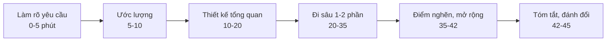
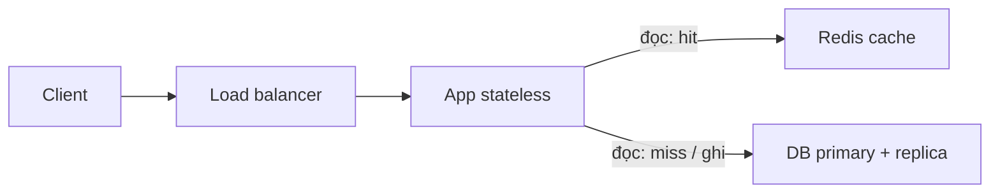
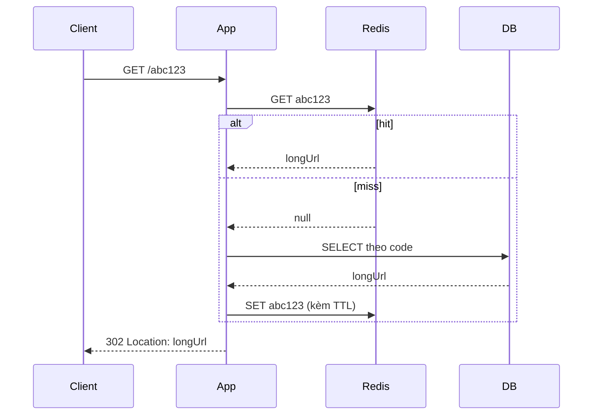
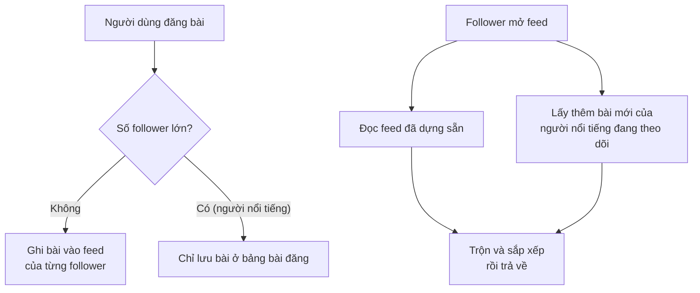

# Cách trả lời một bài System Design

Kiến thức gốc: [System Design Easy](/go?p=15-System%20Design%2Feasy%2Findex.md), [Medium](/go?p=15-System%20Design%2Fmedium%2Findex.md), [Hard](/go?p=15-System%20Design%2Fhard%2Findex.md), [Back-of-the-envelope](/go?p=15-System%20Design%2Feasy%2Flt-08-back-of-envelope.md), [URL Shortener](/go?p=15-System%20Design%2Feasy%2F01-url-shortener.md).

Bài này không liệt kê "các bước" suông. Mỗi mục đặt một câu hỏi, rồi đi theo chuỗi: **gợi ý suy luận** (các câu hỏi nhỏ dẫn tới khái niệm nền), **lập luận** (vì A nên B nên C), **đáp án ngắn** để nói thành tiếng, **ví dụ có số liệu** (chạy xuyên suốt một đề: rút gọn URL), **cách nói thành lời** và **hỏi xoáy**. Mục tiêu là bạn tự suy ra được từng bước chứ không học thuộc. Mọi con số là **giả định** nêu rõ và phép tính đã được tính lại bằng Python (_Đã tính bằng Python_), không phải số đo thật.

**Tóm tắt:**

- Phạm vi file: cách trả lời system design trong khoảng 45 phút, từ làm rõ yêu cầu tới nêu đánh đổi.
- Làm rõ yêu cầu trước khi vẽ, vì cùng một đề có thể cho ba kiến trúc khác nhau tùy chức năng, phi chức năng và ràng buộc.
- Ước lượng chỉ cần đúng bậc độ lớn: DAU, QPS trung bình và đỉnh, dung lượng; sai một bậc là sai kiến trúc, sai 30% thì vô hại.
- Mỗi thành phần trong sơ đồ phải gắn với một con số hoặc ràng buộc vừa tính; chạy thử một flow đọc và một flow ghi để kiểm tra.
- Đi sâu là chỉ ra xung đột ràng buộc và tính chi phí từng hướng, không phải kể thêm công nghệ; điểm nghẽn tìm bằng bảng tải so với năng lực ở 1x và 10x.
- Mỗi quyết định cần bốn mảnh: chọn gì, vì sao (gắn số liệu), đổi lại chấp nhận gì, và điều kiện đổi hướng; hết giờ hoặc bị ngắt lời thì nói rõ phần tạm bỏ.
- Hay bị hỏi xoáy nhất: "nếu lưu lượng tăng 10 lần thì thành phần nào vỡ trước", vì sao chọn SQL hay NoSQL, và cache làm dữ liệu cũ thế nào.

## Khung 45 phút và vì sao cần nó

Khi gặp đề "thiết kế hệ thống X", nhiều người vội vẽ ngay các hộp quen thuộc (load balancer, cache, queue). Vấn đề là đề loại này không có đáp án duy nhất: người phỏng vấn chấm **cách bạn suy luận từ ràng buộc đến quyết định**, không chấm việc bạn có nhớ "kiến trúc đúng" hay không. Vì vậy cần một khung cố định để mỗi quyết định đều truy ngược được về một con số hoặc một ràng buộc đã nói ra trước đó.

Khung gồm sáu bước, tổng cộng khoảng 45 phút: làm rõ yêu cầu, ước lượng, thiết kế tổng quan, đi sâu một hai phần khó, tìm điểm nghẽn, rồi tóm tắt đánh đổi. Khung này dùng cho vòng phỏng vấn thiết kế và cả khi viết design doc thật. Với đề nhỏ, bạn có thể rút gọn (ví dụ gộp bước 2 vào bước 1), nhưng không nên bỏ hẳn bước nào, đặc biệt là ước lượng và đánh đổi.

### Các khái niệm cần biết

| Keyword | Nghĩa | Dùng khi nào |
|---|---|---|
| DAU | Daily Active Users: số người dùng hoạt động mỗi ngày | Điểm xuất phát của mọi phép ước lượng tải |
| QPS | Queries Per Second: số request mỗi giây. QPS trung bình = request/ngày chia 86.400; QPS đỉnh = trung bình nhân hệ số đỉnh (thường 2 đến 3) | Quyết định một máy hay nhiều máy, có cần cache hay không |
| Cache-aside | App hỏi cache trước; **hit** thì trả luôn, **miss** thì đọc DB, nạp vào cache rồi trả | Tải đọc lớn, dữ liệu lặp lại nhiều |
| TTL | Time To Live: thời gian sống của một mục cache trước khi tự hết hạn | Chấp nhận dữ liệu cũ trong một khoảng thời gian đổi lấy sự đơn giản |
| Stateless | Server không giữ state phiên giữa các request; trạng thái nằm ở cache/DB | Muốn thêm bớt máy tùy ý sau load balancer |
| Fan-out | Một event (bài đăng) phải lan tới nhiều nơi (feed của mọi follower) | Thiết kế news feed, thông báo |
| Idempotency | Gọi một thao tác nhiều lần cho cùng kết quả như gọi một lần | Retry an toàn khi mạng lỗi (payment, tạo đơn) |
| Hot key | Một key nhận tải lớn bất thường so với các key khác | Phân tích điểm nghẽn khi tải không đều |
| Shard | Chia dữ liệu thành nhiều phần đặt trên nhiều máy theo một key | Khi dữ liệu hoặc tải vượt giới hạn một máy |

Các khái niệm sâu hơn sẽ được giải thích ngay tại bước dùng chúng. Sơ đồ dưới đây cho thứ tự và mốc thời gian của sáu bước.



## 1. Vì sao phải làm rõ yêu cầu trước khi vẽ?

**Phải thuộc:** Câu này là câu cốt lõi, gặp rất thường xuyên.

**Gợi ý suy luận:**
- Đề "thiết kế hệ thống X" có bao nhiêu lời giải đúng? Điều gì phân biệt lời giải này với lời giải kia?
- Nếu đọc nhiều gấp 100 lần ghi, thành phần nào thành trung tâm? Nếu cần thống kê từng click thì sao?
- Nếu bạn chọn công nghệ trước khi biết quy mô, bạn đang tối ưu cho đề bài nào?

**Lập luận:** Đề system design không có đáp án duy nhất, nên thứ chọn ra lời giải phải là **yêu cầu**, và yêu cầu chỉ có khi bạn hỏi. Cùng là "rút gọn URL", nếu đọc gấp 100 lần ghi thì cache và độ trễ đọc là trung tâm; nếu cần thống kê click theo thời gian thực thì flow ghi event là trung tâm; nếu link có thời hạn thì mô hình dữ liệu và việc dọn là trung tâm. Ba đề trông giống hệt nhau nhưng dẫn tới ba kiến trúc khác nhau. Vì vậy hỏi thiếu nghĩa là tối ưu cho một đề tự tưởng tượng, và người phỏng vấn thường chấm đúng khả năng nhận ra điều chưa rõ. Điểm dễ nhầm là nghĩ hỏi nhiều là thiếu tự tin, hoặc hỏi lan man mọi chuyện. Hỏi có chủ đích theo ba nhóm: chức năng (và cái gì không làm), phi chức năng (quy mô, tỷ lệ đọc/ghi, latency, sẵn sàng, nhất quán), ràng buộc (ngân sách, dữ liệu nhạy cảm), rồi nhắc lại bằng lời mình để xác nhận trước khi vẽ.

**Đáp án ngắn:** hỏi ba nhóm: chức năng (và cái gì **không** làm), phi chức năng (quy mô, tỷ lệ đọc/ghi, latency, sẵn sàng, nhất quán), ràng buộc (tăng trưởng, ngân sách, dữ liệu nhạy cảm). Nhắc lại bằng lời của mình để xác nhận.

**Ví dụ:** hai câu hỏi làm đổi hẳn kiến trúc của đề rút gọn URL:

| Câu hỏi | Nếu đáp "có" | Nếu đáp "không" |
|---|---|---|
| Người dùng được tự đặt alias? | Cần kiểm tra trùng khi ghi, không thể sinh mã hoàn toàn ngẫu nhiên không kiểm | Sinh mã tự động, đơn giản |
| Cần thống kê click theo giờ? | Thêm flow ghi event/queue, khối lượng ghi tăng ~100 lần | Chỉ cần bảng ánh xạ |
| Link hết hạn? | Cần TTL và dọn dẹp | Lưu vĩnh viễn |

**Cách nói thành lời:** "Trước khi vẽ, tôi xác nhận vài điều: có custom alias không, có analytics không, khoảng bao nhiêu người dùng. Tôi sẽ giả định 10 triệu người dùng hoạt động mỗi ngày, mỗi người tạo 0,1 link mỗi ngày và đọc gấp 100 lần ghi. Nếu số này sai, nhờ anh/chị chỉnh để tôi tính lại."

Hai câu xoáy dưới đây là bước tiếp theo logic: sau khi biết cần hỏi, câu hỏi kế là hỏi khi người kia không đưa số, và hỏi bao nhiêu thì đủ.

**Hỏi xoáy 1:** Người phỏng vấn trả lời "tùy bạn" thì sao?
**Đáp:** Tự đặt giả định **cụ thể và nói to**, kèm lý do. Giả định rõ ràng mà sai vẫn tốt hơn không giả định: nó cho người phỏng vấn điểm để sửa, và bạn tránh chết đứng.

**Hỏi xoáy 2:** Nên hỏi bao nhiêu câu?
**Đáp:** Khoảng 5 phút. Quá ít là mò mẫm; quá nhiều là trì hoãn. Dừng khi bạn đã có số người dùng, tỷ lệ đọc/ghi, và hai ba yêu cầu phi chức năng quyết định kiến trúc.

**Sai lầm hay gặp:** nhảy vào "dùng Kafka, Redis, Cassandra" khi chưa biết quy mô; sau đó phải bảo vệ lựa chọn không có căn cứ.

**Nhớ:** yêu cầu chọn ra lời giải; hỏi chức năng, phi chức năng, ràng buộc, và nêu giả định cụ thể khi bị bỏ ngỏ.

## 2. Ước lượng để làm gì, và làm thế nào cho đúng?

**Gợi ý suy luận:**
- Một máy xử lý được cỡ bao nhiêu request mỗi giây? 10 QPS và 1.000.000 QPS có dùng chung một kiến trúc không?
- Từ "số người dùng mỗi ngày" tới "request mỗi giây" cần nhân và chia những gì? (một ngày có 86.400 giây)
- Lưu dữ liệu nhiều năm thì dung lượng phụ thuộc những đại lượng nào?

**Lập luận:** Mỗi bậc độ lớn của tải đòi một kiến trúc khác nhau: 10 QPS chạy một máy, 10.000 QPS cần cache và nhiều máy, 1.000.000 QPS cần chia dữ liệu và nhiều tầng. Vì vậy thứ cần biết là **bậc độ lớn**, không phải con số chính xác: sai một bậc là chọn sai kiến trúc, còn sai 30% thì vô hại. Nên làm tròn mạnh được, miễn đi đúng chuỗi suy ra: từ DAU và hành vi mỗi người ra số request mỗi ngày, chia cho 86.400 giây ra QPS trung bình, nhân 2 đến 3 ra QPS đỉnh (vì tải không đều), rồi nhân kích thước bản ghi với số bản ghi và thời gian lưu để ra dung lượng. Điểm dễ nhầm là tính chi li một con số rồi không dùng nó, hoặc quên tính đỉnh mà chỉ thiết kế cho mức trung bình. Hệ quả hành động: nói to từng giả định để người phỏng vấn chỉnh, rồi dùng kết quả để quyết định có cần cache, queue, shard hay không.

**Đáp án ngắn:** đi theo chuỗi `DAU → hành vi → request/ngày → ÷ 86.400 → QPS trung bình → × 2-3 → QPS đỉnh`, và `kích thước bản ghi × số bản ghi × thời gian lưu → dung lượng`. Nói to giả định và làm tròn mạnh.

**Ví dụ (đã tính bằng Python), giả định: 10 triệu DAU, mỗi ngày tạo 1 triệu link mới, đọc gấp 100 lần ghi, mỗi bản ghi ~500 byte, lưu 5 năm:**

```text
ghi:   1.000.000 / 86.400 ≈ 11,6 QPS            -> rất nhỏ
đọc:   11,6 x 100 ≈ 1.157 QPS trung bình        -> đỉnh x3 ≈ 3.472 QPS
bản ghi sau 5 năm: 1.000.000 x 365 x 5 = 1,825 tỷ
dung lượng: 1,825 tỷ x 500 B ≈ 912 GB           -> vừa một máy DB cỡ lớn, chưa bắt buộc shard
```

Kết luận có thể rút từ số liệu: (1) ghi chỉ ~12 QPS nên **không cần** queue hay sharding cho đường ghi; (2) đọc ~3,5 nghìn QPS đỉnh là vừa phải nhưng lặp lại cùng link, **cache sẽ rất hiệu quả**; (3) 912 GB sau 5 năm không phải con số buộc phải sharding ngay, nên phương án "một DB primary + replica" hợp lý cho giai đoạn đầu. Nếu bạn ước lượng 3,5 nghìn QPS mà thiết kế 20 shard Cassandra, người phỏng vấn sẽ hỏi: "con số nào khiến bạn cần chừng đó?".

Kích thước cache (giả định 20% link chiếm 80% lượt đọc, giữ link của 30 ngày gần nhất): 20% × 1 triệu × 30 × 500 B = **3 GB**, vừa vặn một node Redis. _Đã tính bằng Python._

**Cách nói thành lời:** "11 QPS ghi, khoảng 3,5 nghìn QPS đọc ở đỉnh, 912 GB sau 5 năm. Từ đó tôi kết luận: đường đọc quan trọng hơn, tôi sẽ đặt cache phía trước; đường ghi không cần phức tạp."

Hai câu xoáy kế tiếp xuất phát từ chính chuỗi tính vừa rồi: hệ số đỉnh đến từ đâu, và làm tròn có làm hỏng kết luận không.

**Hỏi xoáy 1:** Hệ số "đỉnh gấp 3 lần trung bình" lấy ở đâu?
**Đáp:** Là giả định thực nghiệm (tùy loại sản phẩm: tin tức, bán lẻ ngày khuyến mãi có thể gấp 10 lần). Nói rõ là giả định và nhắc rằng sẽ **chỉnh theo số đo thật** từ log hiện có nếu đây là hệ thống đang chạy.

**Hỏi xoáy 2:** Làm tròn mạnh có sai không?
**Đáp:** Không, miễn nhất quán và kiểm tra bậc độ lớn. 86.400 giây/ngày có thể coi là ~10^5 để tính nhẩm; chỉ cần đủ để chọn kiến trúc.

**Sai lầm hay gặp:** tính ra dung lượng nhưng quên **hệ số sao chép** (3 bản sao nghĩa là gấp 3 lưu trữ) hoặc quên index.

**Nhớ:** ước lượng để chọn bậc kiến trúc; chuỗi DAU, request/ngày, chia 86.400, nhân hệ số đỉnh, và kích thước bản ghi nhân số bản ghi. Xem [Back-of-the-envelope](/go?p=15-System%20Design%2Feasy%2Flt-08-back-of-envelope.md).

## 3. Thiết kế tổng quan: vẽ gì, và vì sao theo thứ tự đó?

**Gợi ý suy luận:**
- Với 12 QPS ghi và 3,5 nghìn QPS đọc, thành phần nào thật sự cần? Thành phần nào chỉ là "cho giống bài mẫu"?
- Mỗi hộp trên sơ đồ giải quyết vấn đề gì: đỡ tải, tăng sẵn sàng hay giảm latency?
- Để kiểm tra sơ đồ có chạy được, bạn thử điều gì?

**Lập luận:** Phần ước lượng cho biết đường nào nặng và lặp lại: nếu đường đọc là phần nặng thì cần cache; nếu ghi nhỏ và ít thì chưa cần queue hay chia dữ liệu. Vì vậy mỗi thành phần trong sơ đồ phải gắn với một con số hoặc một ràng buộc vừa tính được, và thành phần nào không gắn được với thứ gì thì là thừa. Thứ tự vẽ cũng suy ra từ đó: bắt đầu từ flow chính của người dùng (client, load balancer, service, lưu trữ), rồi định nghĩa vài API và mô hình dữ liệu, để mọi mũi tên có lý do tồn tại. Để chắc sơ đồ không có lỗ hổng, chạy thử một flow đọc và một flow ghi qua nó, nói to từng bước dữ liệu đi đâu. Điểm dễ nhầm là vẽ đủ mọi công nghệ quen thuộc (queue, cache, shard) ngay từ đầu rồi bảo vệ chúng sau; người phỏng vấn sẽ hỏi "vì sao cần cái này" và bạn không có số liệu để trả lời. Làm đơn giản trước, thêm thành phần khi con số đòi hỏi.

**Đáp án ngắn:** vẽ flow từ client đến lưu trữ, định nghĩa vài API và mô hình dữ liệu, rồi chạy thử một flow đọc và một flow ghi qua sơ đồ để kiểm tra.

**Ví dụ:**

```text
POST /v1/urls   {longUrl, alias?}   -> 201 {shortCode}
GET  /{code}                        -> 301/302 Location: longUrl
bảng urls(code PK, long_url, created_at, expire_at)   -- tra theo khóa chính
```



Chạy thử thread đọc `GET /abc123` (đây chính là cache-aside đã nêu ở phần khái niệm): app hỏi cache; hit thì trả ngay (khoảng 1 ms); miss thì đọc DB, nạp cache, rồi trả.



Đọc sơ đồ: nhánh hit chỉ chạm Redis nên rất nhanh; nhánh miss tốn thêm một lần đọc DB và một lần ghi cache, nhưng lần sau cùng link sẽ là hit. Chọn `302` thay vì `301` khi cần đếm click (trình duyệt cache `301` nên các lần sau không qua server); chọn `301` khi muốn giảm tải và không cần thống kê. Đó là một quyết định **dẫn ra từ yêu cầu** (analytics) chứ không phải thói quen.

Hai câu xoáy kế tiếp hỏi vì sao hai lựa chọn trong sơ đồ (stateless, primary key) là hệ quả của số liệu và mẫu truy cập.

**Hỏi xoáy 1:** Vì sao app server phải stateless?
**Đáp:** Để thêm/bớt máy bất kỳ lúc nào sau LB mà không mất dữ liệu phiên; trạng thái dồn vào cache/DB, nơi bạn đã thiết kế sao chép. Đây là điều kiện để scale ngang tầng ứng dụng.

**Hỏi xoáy 2:** Vì sao primary key là `code` mà không phải id tự tăng?
**Đáp:** Truy vấn duy nhất là "tìm theo code", nên PK là code cho phép đọc bằng một lần tra index, không cần index phụ. Chọn lock theo **mẫu truy cập**.

**Sai lầm hay gặp:** vẽ 15 hộp (service mesh, queue, nhiều loại DB) cho một bài chỉ cần 4 hộp, rồi không còn thời gian đi sâu.

**Nhớ:** mỗi thành phần phải trả lời một con số ước lượng; chọn lock theo mẫu truy cập; luôn chạy thử flow đọc và ghi. Xem [URL Shortener](/go?p=15-System%20Design%2Feasy%2F01-url-shortener.md).

## 4. Đi sâu: chọn phần nào, và đi sâu nghĩa là gì?

**Phải thuộc:** Câu này là câu cốt lõi, gặp rất thường xuyên.

**Gợi ý suy luận:**
- Phần nào của đề có hai yêu cầu kéo ngược nhau (ví dụ đọc nhanh và ghi rẻ)?
- Nếu không có lời giải miễn phí, công việc của bạn là gì thay vì tìm "cách tốt nhất"?
- Làm sao biết chi phí của mỗi hướng? (tính bằng số liệu)

**Lập luận:** Phần khó của một đề là chỗ các ràng buộc xung đột nhau, và xung đột nghĩa là mỗi lời giải đẩy chi phí vào một đầu khác: nhanh hơn thì tốn memory hoặc lệch dữ liệu hơn, nhất quán hơn thì chậm hơn hoặc kém sẵn sàng hơn. Vì vậy "đi sâu" không phải là kể thêm công nghệ mà là chỉ ra xung đột đó, tính chi phí của từng hướng bằng con số, rồi chọn hướng có chi phí chịu được rẻ nhất cho yêu cầu đã chốt. Người phỏng vấn chấm khả năng suy ra hậu quả từ cơ chế (ví dụ vì sao cache làm dữ liệu cũ, vì sao shard theo user làm truy vấn chéo khó), không chấm việc bạn thuộc tên sản phẩm. Điểm dễ nhầm là chọn phần quen thuộc nhất của mình thay vì phần khó nhất của đề, hoặc đi sâu vào chi tiết triển khai mà bỏ qua xung đột chính. Hệ quả hành động: chọn phần khó nhất, nói rõ vì sao nó khó, và để người phỏng vấn dẫn hướng khi họ muốn xem phần khác.

**Đáp án ngắn:** chọn phần khó nhất của đề và để người phỏng vấn dẫn hướng.

| Đề | Phần khó thường đào sâu | Xung đột cốt lõi |
|---|---|---|
| URL shortener | Sinh mã duy nhất | Không trùng ⇔ không cần phối hợp tập trung |
| News feed | Fan-out khi ghi hay khi đọc | Đọc nhanh ⇔ ghi rẻ, người nổi tiếng |
| Chat | Thứ tự tin nhắn, WebSocket | Thứ tự ⇔ parallel |
| Rate limiter | Bộ đếm phân tán | Chính xác ⇔ latency, đồng bộ |
| Payment | Idempotency, nhất quán | Tin cậy ⇔ khả dụng |

**Ví dụ 1: sinh mã ngắn duy nhất (đã tính bằng Python).** Với 1,825 tỷ link sau 5 năm, mã base62 (biểu diễn số bằng 62 ký tự: 0-9, a-z, A-Z, nên mỗi ký tự mang log2(62) ≈ 6 bit) cần bao nhiêu ký tự? 62^6 = 56,8 tỷ ≥ 1,825 tỷ nên **6 ký tự đủ** (62^7 = 3,5 nghìn tỷ để dư). Có hai cách sinh:

| Cách | Cơ chế | Rủi ro/Chi phí |
|---|---|---|
| Sinh ngẫu nhiên rồi kiểm tra trùng | Chọn 6 ký tự ngẫu nhiên, `INSERT` với `UNIQUE`, trùng thì retry | Tỉ lệ trùng tăng theo độ đầy |
| Bộ đếm tăng rồi đổi sang base62 | Mỗi app lấy một dải số (ví dụ 1.000 số) từ nơi cấp, tự cấp trong dải | Cần nơi cấp dải; mã đoán được nếu không xáo trộn |

Tỉ lệ trùng của cách ngẫu nhiên: xác suất một mã ngẫu nhiên đã tồn tại = số đã có / 62^6:

```text
đã có 100 triệu    -> 0,18%  -> số lần thử kỳ vọng 1,002
đã có 1 tỷ         -> 1,76%  -> 1,018
đã có 1,825 tỷ     -> 3,21%  -> 1,033
```

Nghĩa là ngẫu nhiên + kiểm tra trùng chỉ tốn thêm ~3% lần thử ở cuối giai đoạn 5 năm: **rẻ và đơn giản**, và nhờ `UNIQUE` trong DB mà không có khe hở (khác với "kiểm tra rồi chèn" ở tầng code, xem [câu 11 trong JVM, Hiệu năng và Hệ phân tán](/go?p=07-Interview-QA%2FBackend%2Fhard%2Fqa-06-jvm-hieu-nang-phan-tan.md)). Bộ đếm có lợi khi muốn tránh mọi lần retry. Quyết định theo ràng buộc, không theo sở thích. _Đã tính bằng Python._

**Ví dụ 2: fan-out của news feed (đã tính bằng Python).** Một người có 1 triệu follower đăng bài:

```text
fan-out-on-write: mỗi bài ghi vào 1.000.000 feed => 1.000.000 lần ghi/bài; 2 bài/ngày = 2.000.000 lần ghi/ngày
                  người có 200 follower: mỗi bài chỉ 200 lần ghi
fan-out-on-read : mỗi lần mở feed gom bài của ~500 người mình theo dõi = 500 truy vấn/lần mở
                  100 triệu lần mở/ngày => 50 tỷ truy vấn/ngày
```

Mỗi hướng đẩy chi phí vào một đầu: ghi-lúc-đăng làm bài của người nổi tiếng **nặng khi ghi**; đọc-lúc-mở làm **mọi lần đọc nặng**. Lời giải thực tế là **lai**: fan-out-on-write cho người bình thường, fan-out-on-read cho người nổi tiếng (trộn khi hiển thị).



Đọc sơ đồ: nửa trên là đường ghi, nửa dưới là đường đọc. Người bình thường được đẩy sẵn vào feed (đọc nhanh), còn bài của người nổi tiếng chỉ được kéo vào lúc mở feed (tránh hàng triệu lần ghi mỗi bài). Đây là kiểu "đi sâu" người phỏng vấn mong đợi: bạn chỉ ra xung đột và tính được vì sao.

Hai câu xoáy dưới đây tiếp nối: nếu có xung đột thì sao không tránh được, và làm sao nhận ra phần khó.

**Hỏi xoáy 1:** Tại sao không chọn cách tốt nhất cho cả hai?
**Đáp:** Vì không có. Một bài toán có hai đầu (đọc, ghi) và tải không đều (người nổi tiếng); mỗi lời giải đẩy gánh nặng vào một chỗ. Công việc của bạn là chọn chỗ chịu được chi phí rẻ nhất theo số liệu.

**Hỏi xoáy 2:** Làm sao biết phần nào là "khó nhất"?
**Đáp:** Nhìn con số ước lượng: phần nào gần chạm giới hạn một máy/một DB nhất (xem mục 5), hoặc phần có hai yêu cầu mâu thuẫn. Nếu không chắc, hỏi thẳng người phỏng vấn muốn đi sâu vào đâu.

**Sai lầm hay gặp:** đi sâu vào phần dễ và quen (ví dụ mô tả chi tiết CRUD) rồi bỏ qua phần khó.

**Nhớ:** chỗ khó là chỗ ràng buộc xung đột; tính chi phí mỗi hướng rồi chọn, thường ra phương án lai.

## 5. Điểm nghẽn: "nếu lưu lượng tăng 10 lần, thành phần nào vỡ trước?"

**Gợi ý suy luận:**
- Mỗi thành phần có hai đại lượng nào? (tải đang chịu và năng lực tối đa)
- Khi tải tăng đồng loạt 10 lần, thành phần nào chạm 100% năng lực đầu tiên?
- Nếu thành phần đó vỡ, sửa nó có đủ không hay lại lộ thành phần kế tiếp?

**Lập luận:** Mỗi thành phần chịu một mức tải và có một trần năng lực, nên hệ thống vỡ ở thành phần có tỉ lệ `tải / năng lực` chạm 100% trước. Tỉ lệ này chỉ biết bằng cách tính, không đoán được, và thường không phải thành phần "nặng" nhất hay "đắt" nhất vỡ trước: một pool kết nối nhỏ, một primary ghi hoặc một hot key có thể chạm trần sớm hơn cả cụm lớn. Vì vậy cách làm là lập bảng ở 1x và 10x cho từng thành phần (QPS, kết nối, băng thông, dung lượng), tìm thành phần chạm trần đầu tiên, sửa đúng chỗ đó (cache, replica, shard, bất đồng bộ hóa), rồi tính lại vì điểm nghẽn sẽ dời sang thành phần kế tiếp. Điểm dễ nhầm là sửa chỗ nghe có vẻ chậm mà không tính, hoặc "scale mọi thứ" cho an toàn, gây tốn kém mà điểm nghẽn thật vẫn còn. Hãy nói to phép tính trên bảng để người phỏng vấn thấy chuỗi suy luận.

**Đáp án ngắn:** lập bảng tải so với năng lực ở 1x và 10x, tìm thành phần chạm trần đầu tiên, rồi sửa thành phần đó (và hỏi lại).

**Ví dụ (đã tính bằng Python; năng lực là giả định):** đỉnh hiện tại 3.472 QPS đọc, cache hit 90%.

| Thành phần (năng lực giả định) | Tải 1x | % năng lực | Tải 10x | % năng lực |
|---|---|---|---|---|
| App server (4 máy × 2.000 rps = 8.000) | 3.472 | 43% | 34.722 | **434%** |
| Redis (1 node ≈ 80.000 ops/s) | 3.472 | 4% | 34.722 | 43% |
| DB primary đọc (3.000 rps khi miss) | 347 | 12% | 3.472 | **116%** |

Vỡ trước là **tầng app** (434%), rồi tới DB (116%) nếu giữ hit 90%. Redis còn dư rất nhiều. Cách sửa tương ứng: (1) thêm máy app (dễ vì stateless); (2) tăng tỉ lệ cache hit từ 90% lên 99% đưa tải miss ở 10x xuống 347 rps, còn 12% năng lực DB; cùng cải thiện nhưng rẻ hơn mua DB lớn hơn. Đây là câu trả lời có số liệu, không phải "tôi sẽ thêm server".

Hai câu xoáy kế tiếp phá hai giả định ngầm của bảng: tải phân bố đều, và nguyên nhân vỡ chỉ là tải.

**Hỏi xoáy 1:** Hot key thì bảng trên còn đúng không?
**Đáp:** Không: bảng giả định tải phân bố đều. Một link nổi tiếng dồn mọi lượt đọc vào **một** key (một node Redis, một partition). Cần replication hot key, cache cục bộ trong app, hoặc CDN.

**Hỏi xoáy 2:** Còn những điểm lỗi nào ngoài tải?
**Đáp:** Điểm lỗi duy nhất (LB, DB primary), phụ thuộc chung (DNS, dịch vụ cấp mã), lan truyền lỗi (không timeout), triển khai (một bản lỗi xuống toàn bộ). Hỏi "thành phần nào chết thì người dùng thấy gì?" cho từng hộp trong sơ đồ.

**Sai lầm hay gặp:** nói "thêm cache" rồi "thêm queue" mà không chỉ ra thành phần nào quá tải, nên không chứng minh được sửa đúng chỗ.

**Nhớ:** điểm nghẽn là thành phần có tải/năng lực chạm trần đầu tiên; tính bảng 1x và 10x, và nhớ hot key phá giả định tải đều.

## 6. Nêu đánh đổi: làm sao nói một quyết định cho thuyết phục?

**Gợi ý suy luận:**
- Có quyết định thiết kế nào không mất gì không?
- Nếu bạn chỉ nói "tôi chọn X", người nghe không biết được điều gì về hiểu biết của bạn?
- Điều kiện nào thay đổi thì quyết định phải đổi?

**Lập luận:** Mọi quyết định thiết kế đổi cái này lấy cái kia, nên một phát biểu thiếu phần "đổi lại" là chưa đầy đủ và nghe như quảng cáo. Người từng vận hành hệ thống mới biết cái giá thật, nên người phỏng vấn dùng chính phần này để phân biệt người hiểu với người thuộc. Vì vậy mỗi quyết định cần bốn mảnh nối nhau: chọn gì, lý do gắn với con số hoặc ràng buộc đã chốt, cái giá chấp nhận, và điều kiện đổi hướng ("nếu tỉ lệ ghi tăng gấp 10 thì tôi chuyển sang..."). Mảnh cuối quan trọng vì nó cho thấy bạn coi quyết định là có điều kiện, không phải tín điều. Điểm dễ nhầm là bảo vệ quyết định bằng cách phủ nhận nhược điểm, hoặc liệt kê ưu nhược điểm chung chung không gắn với đề. Công thức dùng được: "Tôi chọn X vì Y; đổi lại ta chấp nhận Z; nếu W thay đổi thì tôi chuyển sang V."

**Đáp án ngắn:** công thức: "Tôi chọn X **vì** Y (gắn với ràng buộc/số liệu); **đổi lại** ta chấp nhận Z; nếu W thay đổi thì tôi chuyển sang V."

**Ví dụ (so sánh hai câu trả lời cho cùng một câu hỏi "cache hay không?"):**

| Câu trả lời yếu | Câu trả lời mạnh |
|---|---|
| "Em dùng Redis để cache cho nhanh." | "Đọc chiếm ~3,5 nghìn QPS đỉnh và lặp lại cùng link, nên em đặt cache-aside phía trước DB. Với hit 90%, tải đọc DB giảm từ 3,5 nghìn xuống ~350 QPS. Em chấp nhận link vừa sửa có thể cũ tối đa vài phút (TTL). Nếu sau này cần cập nhật tức thì thì em chuyển sang xóa cache khi ghi." |

Câu mạnh có: số liệu, cơ chế, cái giá (dữ liệu cũ), điều kiện đổi hướng. Mỗi phần chỉ một câu.

Hai câu xoáy là tình huống tự nhiên sau khi bạn đã nêu đánh đổi: bị phản đối, và gặp công nghệ chưa biết.

**Hỏi xoáy 1:** Nếu người phỏng vấn phản đối lựa chọn của bạn?
**Đáp:** Đừng bảo vệ bằng cảm tính. Hỏi ràng buộc nào khiến họ nghĩ vậy, tính lại theo số liệu họ đưa. Đổi quyết định khi lý lẽ đúng là điểm cộng, không phải thua.

**Hỏi xoáy 2:** Khi không biết một công nghệ mà người phỏng vấn nhắc?
**Đáp:** Nói thẳng chưa dùng, rồi suy từ nguyên lý: "Em chưa dùng, nhưng nếu nó là queue nhiều partition thì em hiểu nó giúp parallel nhưng thứ tự chỉ trong partition". Suy luận từ cơ chế đáng giá hơn đoán tên.

**Sai lầm hay gặp:** liệt kê công nghệ (Kafka, Cassandra, gRPC) như từ khóa không có giải thích **vì sao ở chỗ này**.

**Nhớ:** "chọn X vì Y, đổi lại Z, nếu W đổi thì chuyển V"; luôn gắn với số liệu.

## 7. Quản lý thời gian và xử lý khi bị ngắt lời

**Gợi ý suy luận:**
- Người phỏng vấn muốn thấy những loại năng lực nào trong 45 phút?
- Hoàn thiện một phần tới mức chi tiết có thể đổi lấy được những loại năng lực còn lại không?
- Khi bị ngắt lời, người kia cần biết điều gì về việc bạn có ý thức phần bỏ dở?

**Lập luận:** 45 phút không đủ cho mọi thứ, mà đánh giá cần thấy đủ nhiều loại năng lực: làm rõ yêu cầu, ước lượng, thiết kế tổng quan, đi sâu, nói về vận hành. Nếu tiêu hết thời gian cho một phần (thường là vẽ sơ đồ chi tiết) thì các loại năng lực còn lại không có bằng chứng, và điểm không thể bù. Vì vậy phải ưu tiên theo giá trị thông tin, tức là phần nào cho người phỏng vấn thấy nhiều nhất, thay vì hoàn thiện một phần. Khi bị ngắt lời hoặc chuyển hướng, đó thường là tín hiệu họ muốn xem chỗ khác, nên đi theo thay vì cố hoàn tất ý đang nói. Điểm dễ nhầm là coi bị ngắt lời là bị chê, hoặc im lặng bỏ dở mà không nói. Hệ quả hành động: đặt mốc thời gian ở đầu bài, và khi hết giờ hay đổi hướng thì nói rõ "tôi tạm bỏ qua X, sẽ quay lại nếu còn thời gian", để người kia biết đó là lựa chọn có ý thức chứ không phải bỏ sót.

**Đáp án ngắn:** theo bảng thời gian ở đầu bài; nếu hết giờ ở một mục, nói rõ "tôi tạm bỏ qua X, sẽ quay lại nếu còn thời gian" để người phỏng vấn biết bạn **ý thức** về nó.

**Ví dụ (đoạn hội thoại mẫu khi bị dẫn hướng):**

```text
Người phỏng vấn: "Phần sinh mã của em khá ổn. Giờ nói về việc link bị lạm dụng (spam) đi."
Bạn: "Được. Tôi chuyển phần đó. Về cơ chế sinh mã tôi đã chọn ngẫu nhiên + UNIQUE; nếu cần tôi quay lại nói tiếp.
      Với lạm dụng, trước hết tôi cần biết phạm vi: chặn khi tạo link hay khi truy cập? ..."
```

Mẫu: ghi nhận chủ đề cũ → chuyển → hỏi phạm vi chủ đề mới. Không im lặng và không cố hoàn thành ý cũ khi đã được yêu cầu chuyển.

Hai câu xoáy kế tiếp hỏi về nhịp tương tác và về cách kết thúc khi thiếu giờ.

**Hỏi xoáy 1:** Nên hỏi người phỏng vấn mấy lần trong lúc làm?
**Đáp:** Ở các điểm quyết định lớn (ước lượng xong, chọn hướng đi sâu) để kiểm tra bạn đi đúng hướng; không hỏi mọi chi tiết nhỏ.

**Hỏi xoáy 2:** Hết thời gian mà chưa vẽ xong?
**Đáp:** Tóm tắt phần đã có, nêu rõ phần chưa làm và cách tiếp cận; thiết kế dở có lý do vẫn hơn thiết kế đầy đủ nhưng không giải thích.

**Sai lầm hay gặp:** dành 25 phút cho phần ước lượng và yêu cầu rồi chỉ còn vài phút để đi sâu.

**Nhớ:** ưu tiên độ phủ năng lực theo bảng thời gian; khi bị ngắt, ghi nhận, chuyển, hỏi phạm vi.

## Lỗi thường gặp (tổng hợp)

| Lỗi | Hậu quả | Cách tránh |
|---|---|---|
| Nhảy vào chi tiết không làm rõ yêu cầu | Tối ưu cho đề tưởng tượng | Dành 5 phút đầu để hỏi |
| Dùng keyword công nghệ không giải thích | Không chứng minh được hiểu | Luôn nói **vì sao** chọn |
| Thiết kế quá phức tạp từ đầu | Không đủ thời gian đi sâu | Bắt đầu đơn giản, tiến hóa theo số ước lượng |
| Im lặng suy nghĩ | Người phỏng vấn không chấm được tư duy | Nói to suy nghĩ |
| Không có số liệu | Quyết định không có căn cứ | Gắn mỗi quyết định với một con số |
| Bỏ qua lỗi và độ tin cậy | Thiết kế chỉ đúng khi mọi thứ chạy tốt | Chủ động hỏi "thành phần X chết thì sao?" |

## Câu hỏi đào sâu hay gặp

- Nếu lưu lượng tăng 10 lần, thành phần nào vỡ trước? (mục 5)
- Làm sao đảm bảo không mất hoặc không trùng dữ liệu khi retry? (idempotency, xem [JVM, Hiệu năng và Hệ phân tán](/go?p=07-Interview-QA%2FBackend%2Fhard%2Fqa-06-jvm-hieu-nang-phan-tan.md))
- Chọn SQL hay NoSQL, vì sao? Chọn key shard thế nào? (xem [Trade-off kiến trúc](/go?p=07-Interview-QA%2FBackend%2Fhard%2Fqa-19-trade-off-kien-truc.md))
- Cache sai hoặc dữ liệu cũ thì sao? Cache stampede?
- Làm sao di cư dữ liệu hoặc triển khai không gián đoạn?
- Giám sát gì, cảnh báo khi nào?

Nguồn: kiến thức tổng hợp từ ghi chú System Design trong docs; số liệu là giả định nêu rõ, phép tính đã kiểm bằng Python 3.

