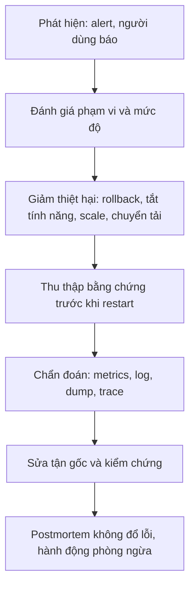

# Câu hỏi tình huống: xử lý sự cố production (senior)

Kiến thức gốc: [Công cụ chẩn đoán JVM](/go?p=08-Java%2FJava-Core%2Fhard%2Flt-32-cong-cu-chan-doan-jvm.md), [GC chuyên sâu](/go?p=08-Java%2FJava-Core%2Fhard%2Flt-18-gc-chuyen-sau.md), [Liveness hazards](/go?p=08-Java%2FJava-Concurrency%2Fhard%2Flt-10-liveness-hazards.md), [Sự cố, SRE và Observability](/go?p=04-DevOps%2Fhard%2Flt-07-su-co-sre-observability.md), [Index và tối ưu truy vấn](/go?p=02-Database%2Fmedium%2Flt-03-index-toi-uu-truy-van.md), [Observability trong Spring](/go?p=01-Spring-Boot%2Fmedium%2Flt-19-observability.md).

Người phỏng vấn senior không hỏi "deadlock là gì" mà hỏi "production đang treo, bạn làm gì trong 15 phút đầu". Điểm cộng nằm ở **thứ tự hành động** (giảm thiệt hại, rồi tìm nguyên nhân, rồi sửa tận gốc) và ở chỗ bạn **đọc được bằng chứng**: một dòng thread dump, một dòng GC log, một dòng `EXPLAIN` nói lên điều gì.

Mỗi ca viết theo chuỗi: câu hỏi, gợi ý suy luận, lập luận nhân quả, đáp án ngắn, ví dụ chạy thật, kiến thức cần nhớ. Để bài này không chỉ là lý thuyết, mỗi ca dưới đây có **ví dụ cụ thể**. Các ca JVM (1 đến 6, 7, 11) tôi **tái tạo bằng chương trình Java nhỏ và chạy thật** trên JDK 11 trong sandbox 2 CPU, rồi dán output đã rút gọn. Thread dump lấy bằng `jcmd <pid> Thread.print` (kết quả giống `jstack`). Ca truy vấn chậm chạy thật trên SQLite (khái niệm giống MySQL/PostgreSQL, nhưng con số của DB thật sẽ khác). Ca 9, 10, 12 là phép tính bằng Python. Chỗ nào chỉ là minh họa sẽ ghi rõ.

**Tóm tắt:**

- Phạm vi file: các tình huống sự cố production, mỗi ca đi theo chuỗi triệu chứng, giả thuyết, bằng chứng, xử lý.
- CPU 100%: tìm thread nóng bằng `top -H`, đổi TID sang hex, đối chiếu `nid` trong thread dump; không scale ngang khi chưa biết thread nào nóng.
- Heap tăng mãi: nhìn mức heap sau GC, histogram để biết loại object, heap dump cộng MAT để biết ai giữ; CPU thấp mà chậm là đang chờ (timeout, lock, pool cạn).
- Pool cạn do latency tăng (định luật Little) hoặc tác vụ chờ nhau; Hikari cạn thường do transaction giữ connection quá lâu, không phải pool nhỏ.
- Deadlock chứng minh bằng thread dump và sửa bằng thứ tự lock thống nhất; GC pause không đủ chỉ nhìn pause lớn nhất mà còn tần suất và tỷ lệ thời gian trong GC.
- Tải tăng 10 lần thì tìm mắt xích hẹp nhất (thường là DB); lag tăng đều khác lag một partition; vừa deploy lỗi tăng vọt thì rollback trước, điều tra sau.
- Hay bị hỏi xoáy nhất: "CPU thấp mà response chậm", "lag chỉ tăng ở một partition", và "bug chỉ xảy ra khi đồng thời" tái hiện và sửa thế nào.

## Khung chung cho mọi sự cố



Ba nguyên tắc nên nói ra ngay: (1) **thay đổi gần nhất** là nghi phạm số một (deploy, cấu hình, traffic); (2) **lấy bằng chứng trước khi restart** (thread dump, heap dump, log), vì restart xóa mất hiện trường; (3) mỗi lần chỉ đổi một thứ và đo lại.

## Bảng nhanh: triệu chứng, nghi ngờ, công cụ

| Triệu chứng | Nghi ngờ đầu tiên | Công cụ đầu tiên |
|---|---|---|
| CPU 100% | Vòng lặp vô hạn, regex tệ, GC thrashing | `top -H`, thread dump, JFR |
| Memory tăng mãi, `OutOfMemoryError` | Memory leak, cache không giới hạn, `ThreadLocal` | GC log, `GC.class_histogram`, heap dump, MAT |
| Chậm đột ngột, CPU thấp | Chờ I/O: DB, HTTP ngoài, lock | Thread dump nhiều lần, trace phân tán |
| Request treo, không lỗi | Thread pool cạn, deadlock, pool kết nối cạn | Thread dump, Actuator metrics |
| Giật lag theo chu kỳ | GC pause dài hoặc dày | GC log, JFR |
| `Connection is not available` | Hikari cạn, transaction giữ kết nối quá lâu | Metrics Hikari, `pg_stat_activity` |
| Truy vấn chậm, tranh chấp lock | Thiếu index, transaction dài, lock | `EXPLAIN (ANALYZE)`, slow query log |
| Lag queue tăng | Consumer chậm, message độc | Consumer lag theo partition, DLQ |
| Lỗi sau deploy | Phiên bản mới, cấu hình, migration | So sánh release, canary, rollback |

## 1. CPU lên 100%, bạn làm gì?

**Phải thuộc:** Câu này là câu cốt lõi, gặp rất thường xuyên.

**Câu hỏi:** Giám sát báo CPU của một instance chạy ở 100% và người dùng thấy chậm. Bạn làm gì, và vì sao không scale ngang ngay?

**Gợi ý suy luận:**
- CPU 100% nghĩa là thread đang chạy lệnh hay đang chờ? Một thread hay mọi thread?
- Hệ điều hành gọi thread bằng gì, JVM gọi bằng gì (TID thập phân so với `nid` hex)?
- Nếu một vòng lặp vô hạn nằm trong mỗi request thì thêm máy giúp được gì?

**Lập luận:** Vì CPU chỉ cao khi có thread thực sự thực thi lệnh, nên thủ phạm thường là một vài thread chứ không phải "server yếu". Vì vậy câu hỏi cần đổi từ "process nào" thành "thread nào, ở dòng code nào". OS chỉ biết thread qua TID, JVM ghi `nid` là TID đó ở dạng hex, nên đổi thập phân sang hex là cầu nối giữa `top -H` và thread dump. Có `nid` khớp thì đọc stack ra dòng code nóng. Nếu thread nóng là thread của GC thì code mình chỉ là nạn nhân (xem ca 6). Còn scale ngang khi chưa biết thread nào nóng chỉ nhân bản lỗi và đốt tiền. Điểm dễ nhầm là lấy thread dump đúng một lần: một ảnh chụp có thể rơi vào lúc thread vừa chạm một đoạn code ngẫu nhiên, nên cần 2 đến 3 lần cách nhau vài giây và xem thread nào luôn xuất hiện ở cùng chỗ. Khi cần số liệu chính xác hơn, dùng JFR hoặc profiler lấy mẫu, và kiểm tra thêm GC log để loại trừ trường hợp thread nóng chính là thread của GC.

**Đáp án ngắn:** Dùng `top -H -p <pid>` tìm thread nóng, đổi TID sang hex, tìm `nid=0x...` trong thread dump (lấy 2-3 lần cách vài giây) để đọc stack; cần sâu hơn thì dùng JFR. Không scale trước khi biết thread nào ăn CPU.

**Ví dụ (đã chạy thật):** chương trình có thread `report-generator` chạy vòng lặp `while (true)` tính toán và thread `idle-worker` ngủ.

```java
Thread t = new Thread(() -> { while (true) { sink += Math.sqrt(sink + 1); } }, "report-generator");
```

Bước 1, `top -H -b -n 1 -p <pid>`:

```text
    PID USER      PR  NI    VIRT    RES    SHR S  %CPU  %MEM     TIME+ COMMAND
     28 bold-gr+  20   0 3570980  75708  36032 R  99.9   1.9   0:05.89 report-+
      8 bold-gr+  20   0 3570980  75708  36032 S   0.0   1.9   0:00.00 java
     10 bold-gr+  20   0 3570980  75708  36032 S   0.0   1.9   0:01.18 java
     11 bold-gr+  20   0 3570980  75708  36032 S   0.0   1.9   0:00.00 GC Thre+
```

Cột `PID` ở đây là **TID**. Thread 28 chiếm 99,9% CPU. Bước 2: `printf '%x' 28` ra `1c`. Bước 3, trong thread dump:

```text
"report-generator" #10 prio=5 os_prio=0 cpu=6693.27ms elapsed=6.82s tid=0x000073428c451000 nid=0x1c runnable
   java.lang.Thread.State: RUNNABLE
	at Spin.lambda$main$0(Spin.java:4)
...
"idle-worker" #11 prio=5 os_prio=0 cpu=0.32ms elapsed=6.82s tid=... nid=0x1d waiting on condition
   java.lang.Thread.State: TIMED_WAITING (sleeping)
```

Cách đọc: `nid=0x1c` khớp TID 28; `cpu=6693ms` trên `elapsed=6.82s` là gần như dùng hết một nhân suốt thời gian chạy; stack dừng tại `Spin.java:4` chính là dòng vòng lặp. `idle-worker` có `cpu=0.32ms` và trạng thái `TIMED_WAITING` nên vô can. _Đã chạy thử trên JDK 11._

**Hỏi xoáy 1** (vì câu trước cho bạn công cụ đọc dump, nhưng trạng thái trong dump có đáng tin để suy ra CPU không?): Thread dump nào cũng có `RUNNABLE`, vậy `RUNNABLE` có nghĩa là đang ăn CPU không?
**Gợi ý suy luận:** Chữ `RUNNABLE` mô tả điều gì: chờ lock Java hay đang dùng CPU? Thread chờ socket được JVM xếp vào trạng thái nào?
**Lập luận và đáp:** Không. `RUNNABLE` chỉ nghĩa là JVM không thấy nó chờ lock Java; thread chờ đọc socket cũng hiện `RUNNABLE` (xem ca 3, `cpu=3.33ms` dù `RUNNABLE`). Phải đối chiếu với `cpu=` trong dump hoặc %CPU từ `top -H`.

**Hỏi xoáy 2** (vì khi `nid` khớp ra thread của JVM thay vì thread của bạn thì hướng điều tra đổi thế nào?): Thread nóng hóa ra là `GC Thread#3`, vậy làm sao?
**Gợi ý suy luận:** Thread GC tốn CPU khi nào: lúc heap còn rộng hay gần đầy? Ai gây ra việc cấp phát?
**Lập luận và đáp:** CPU bị GC ăn do heap gần đầy hoặc cấp phát dồn dập, code của bạn chỉ là nạn nhân. Chuyển sang ca 6: đọc GC log, xem tỷ lệ thời gian GC.

**Sai lầm hay gặp:** Thêm CPU hoặc scale ngang ngay mà chưa biết thread nào nóng. Nếu nguyên nhân là một vòng lặp vô hạn trên mỗi request thì scale chỉ đốt thêm tiền.

**Nhớ:** CPU cao = thread đang chạy; nối TID (OS) với `nid` hex (JVM) để biết dòng code. Xem [Công cụ chẩn đoán JVM](/go?p=08-Java%2FJava-Core%2Fhard%2Flt-32-cong-cu-chan-doan-jvm.md).

## 2. Heap tăng mãi, `OutOfMemoryError`

**Phải thuộc:** Câu này là câu cốt lõi, gặp rất thường xuyên.

**Câu hỏi:** Heap của service tăng dần qua nhiều giờ rồi chết bằng `OutOfMemoryError`. Bạn xác định đây có phải memory leak không, và tìm ra ai giữ memory bằng cách nào?

**Gợi ý suy luận:**
- GC thu hồi object khi nào (còn tham chiếu từ GC root hay không)? Vậy "leak" trong Java thực chất là gì?
- Nên nhìn mức heap lúc nào để thấy xu hướng: đỉnh hay sau mỗi lần GC?
- Histogram cho biết loại object, còn muốn biết ai giữ chúng thì cần công cụ nào?

**Lập luận:** Vì GC chỉ thu object không còn được tham chiếu từ GC root, leak trong Java là "còn tham chiếu mà không ai dùng" (static map, cache không hết hạn, listener quên hủy). Object bị giữ thì GC không thu được, nên mức heap sau mỗi GC (nền) tăng dần; nền ổn định thì đó không phải leak. Biết nền tăng rồi, `GC.class_histogram` cho biết loại object nhiều nhất, nhưng mới trả lời "cái gì" chứ chưa trả lời "ai giữ". Heap dump mở bằng MAT với dominator tree và đường tới GC root mới trả lời được câu đó. Vì restart xóa hiện trường nên phải lấy dump trước, tốt nhất bật sẵn `-XX:+HeapDumpOnOutOfMemoryError`. Điểm dễ nhầm là tăng `-Xmx` để "hết OOM": nó chỉ kéo dài thời gian trước khi chết và làm heap dump lớn hơn. Cũng đừng kết luận leak khi chỉ thấy heap tăng: phải nhìn mức heap sau mỗi full GC. Hệ quả vận hành: bật sẵn `-XX:+HeapDumpOnOutOfMemoryError` và đặt đường dẫn có đủ chỗ trống, để lần chết kế tiếp luôn để lại bằng chứng.

**Đáp án ngắn:** Xem nền heap sau GC: tăng dần là leak. Dùng `GC.class_histogram` để biết loại object, heap dump cộng MAT (dominator tree, đường tới GC root) để biết ai giữ. Không chỉ tăng `-Xmx`.

**Ví dụ (đã chạy thật):** mỗi "request" thêm một `Session` 1 MB vào `static Map` không bao giờ xóa. Chạy với `-Xmx64m -Xlog:gc`.

```java
static final Map<String, Session> CACHE = new HashMap<>();   // không bao giờ xóa
// 1 MB mỗi lần, cách nhau 100 ms
CACHE.put("user-" + i, new Session("user-" + i));
```

GC log (cột `A->B(C)` là heap trước GC, sau GC, tổng):

```text
[1.054s] GC(0)  Pause Young (Normal) 7M->2M(64M)    14.150ms
[1.516s] GC(2)  Pause Young (Normal) 13M->5M(64M)   12.934ms
[3.842s] GC(3)  Pause Young (Concurrent Start) (G1 Humongous Allocation) 29M->27M(64M)
[4.939s] GC(23) Pause Young ... 37M->37M(64M)
[6.011s] GC(43) Pause Young ... 47M->47M(64M)
[7.888s] GC(90) Pause Full (G1 Evacuation Pause) 61M->60M(64M)   20.017ms
```

Chương trình kết thúc bằng:

```text
Exception in thread "main" java.lang.OutOfMemoryError: Java heap space
	at java.base/java.util.HashMap.newNode(HashMap.java:1815)
	at Leak.main(Leak.java:7)
```

Cách đọc: số "sau GC" đi 2M, 5M, 27M, 37M, 47M, 60M, **không bao giờ giảm lại** dù GC chạy liên tục; cuối cùng cả Full GC chỉ thu được 61M về 60M, tức hầu như mọi thứ còn sống. Đó là chữ ký của leak. `GC.class_histogram` giữa chừng cho thấy `[B` (mảng byte) chiếm khoảng 33 MB trên 15.187 instance, nhưng **không cho biết ai giữ chúng**; heap dump + dominator tree mới chỉ ra `Leak.CACHE` giữ toàn bộ. _Đã chạy thử trên JDK 11._

**Hỏi xoáy 1** (vì sau khi biết nền tăng là dấu hiệu leak, câu tự nhiên là: nếu nền không tăng mà vẫn OOM thì sao?): `OutOfMemoryError` nhưng nền sau GC ổn định, vậy là gì?
**Gợi ý suy luận:** Nền ổn định nói gì về lượng dữ liệu sống lâu? Vậy OOM đến từ đỉnh tạm thời hay từ tham chiếu bị giữ?
**Lập luận và đáp:** Không phải leak mà là **đỉnh** vượt heap: một request tải cả bảng triệu dòng vào memory, hoặc heap cấu hình nhỏ so với tập làm việc. Sửa bằng phân trang/stream, không phải săn leak.

**Hỏi xoáy 2** (vì câu trước nhắc đến heap dump, nên cần biết thời điểm và cái giá của việc lấy nó): Vì sao heap dump phải lấy **trước** khi restart và nên lấy ở thời điểm nào?
**Gợi ý suy luận:** Restart làm gì với trạng thái trong JVM? Heap dump to cỡ nào và JVM có bị dừng khi lấy không?
**Lập luận và đáp:** Restart xóa mọi trạng thái. Lấy khi nền đã cao nhưng chưa chết (hoặc tự động qua `HeapDumpOnOutOfMemoryError`). Lưu ý heap dump làm JVM dừng tạm và file lớn bằng kích thước heap, nên trên production cân nhắc lấy từ một instance đã rút khỏi load balancer.

**Sai lầm hay gặp:** Tăng `-Xmx` để "hết OOM". Leak vẫn còn, chỉ chết muộn hơn và Full GC dài hơn.

**Nhớ:** Leak = còn tham chiếu mà không dùng, thấy qua nền sau GC tăng; histogram cho "cái gì", heap dump cho "ai giữ". Xem [GC chuyên sâu](/go?p=08-Java%2FJava-Core%2Fhard%2Flt-18-gc-chuyen-sau.md) và [Công cụ chẩn đoán JVM](/go?p=08-Java%2FJava-Core%2Fhard%2Flt-32-cong-cu-chan-doan-jvm.md).

## 3. Response chậm đột ngột, CPU vẫn thấp

**Câu hỏi:** Response time tăng vọt nhưng CPU của server gần như rảnh. Bạn nghĩ tới điều gì đầu tiên và kiểm chứng bằng bằng chứng nào?

**Gợi ý suy luận:**
- CPU thấp mà chậm thì thread đang làm việc hay đang chờ? Chờ những thứ gì (socket, DB, lock, queue)?
- Mặc định Java có giới hạn thời gian chờ cho thao tác I/O không?
- Nếu lấy nhiều thread dump cách nhau vài giây mà các thread vẫn dừng đúng một chỗ thì điều đó nói lên gì?

**Lập luận:** Vì CPU thấp mà latency cao, thread không tính toán mà đang chờ một thứ gì đó (socket, DB, lock). Mặc định thao tác chờ trong Java không có hạn chót, nên gọi HTTP/DB không đặt timeout là giao quyền giữ thread cho hệ thống bên ngoài. Để xác nhận, lấy vài thread dump cách nhau ~5 giây: nếu phần lớn thread cùng dừng ở `socketRead`, `park` hoặc `waiting to lock` và không tiến triển giữa các lần dump, thì đó là chờ chứ không phải xử lý chậm. Từ stack biết chờ ở đâu, rồi dùng trace hoặc `ss -tnp` để biết chờ ai. Điểm dễ nhầm là thấy CPU thấp rồi kết luận hệ thống khỏe, hoặc thêm instance khi nút thắt là phụ thuộc bên ngoài (thêm instance chỉ thêm số thread cùng chờ). Quy tắc: CPU thấp và latency cao thì tìm chỗ chờ, và biện pháp bền vững là timeout hợp lý ở mọi lời gọi ra ngoài, circuit breaker và giới hạn số lời gọi đồng thời tới từng phụ thuộc (bulkhead).

**Đáp án ngắn:** CPU thấp cộng latency cao là dấu hiệu chờ phụ thuộc. Lấy 3 thread dump cách nhau vài giây, xem thread dừng ở `socketRead`/`park`/`waiting to lock`, rồi khoanh vùng bằng trace; sửa bằng timeout và circuit breaker.

**Ví dụ (đã chạy thật):** 4 thread gọi một "dịch vụ đối tác" (stub nhận kết nối nhưng không bao giờ trả lời), không đặt `setSoTimeout`.

```java
try (Socket s = new Socket("localhost", port)) {          // KHÔNG đặt setSoTimeout
    s.getOutputStream().write("GET /quote\n".getBytes());
    return s.getInputStream().read();                      // chờ vô hạn
}
```

Kết quả `top` (CPU nhàn rỗi 100%, process Java 0,0% CPU) và thread dump:

```text
%Cpu(s):  0.0 us,  0.0 sy,  0.0 ni,100.0 id
"http-nio-exec-0" #11 prio=5 cpu=3.33ms elapsed=4.30s nid=0x1c runnable
   java.lang.Thread.State: RUNNABLE
	at java.net.SocketInputStream.socketRead0(Native Method)
	at java.net.SocketInputStream.read(SocketInputStream.java:168)
	at SlowDep.lambda$main$2(SlowDep.java:11)
```

Lấy dump lần hai sau 5 giây, **cả 4 thread vẫn nằm ở `socketRead0`** (đếm được 4 dòng). Cách đọc: `elapsed=4.30s` nhưng `cpu=3.33ms` tức hầu như chỉ chờ; stack dừng ở `socketRead0` nghĩa là đang chờ dữ liệu từ mạng; ở lần dump thứ hai vẫn cùng chỗ nghĩa là không tiến triển. Lưu ý trạng thái hiện `RUNNABLE` dù thread không ăn CPU (xem ca 1). Cách sửa nằm ở code gọi ngoài: `setSoTimeout`, hoặc `HttpClient` với connect/read timeout, kèm circuit breaker. _Đã chạy thử trên JDK 11._

**Hỏi xoáy 1** (vì sau khi thấy thread kẹt ở socket, câu hỏi kế tiếp là thread đó kẹt vì ai): Làm sao biết thread đang chờ **ai** mà không có trace?
**Gợi ý suy luận:** Dòng stack cho biết điều gì (chờ ở loại tài nguyên nào)? Cần thông tin nào để biết đích kết nối?
**Lập luận và đáp:** Dòng stack cho biết chờ ở đâu (socket, JDBC, `park`), kết hợp `ss -tnp`/`netstat` để xem kết nối nào đang `ESTABLISHED` với đích nào. Đây là lý do tên thread và log có correlation id rất đáng giá.

**Hỏi xoáy 2** (vì đã có timeout thì tưởng xong, nhưng giá trị timeout vẫn có thể là vấn đề): Đã đặt timeout 30 giây cho mọi call, vậy đủ chưa?
**Gợi ý suy luận:** Mỗi call treo giữ một thread trong bao lâu? Nhân với tốc độ đến thì cần bao nhiêu thread (định luật Little)?
**Lập luận và đáp:** Chưa. Nếu chịu 100 req/s và mỗi call treo 30 giây thì cần 3000 thread chỉ để chờ (định luật Little, xem ca 4). Timeout phải **ngắn theo SLO** (cỡ vài trăm ms đến vài giây), cộng circuit breaker để ngừng gọi khi đối tác đã chết.

**Sai lầm hay gặp:** Nhìn CPU thấp rồi kết luận hệ thống "khỏe". CPU thấp cộng latency cao là dấu hiệu kinh điển của chờ phụ thuộc.

**Nhớ:** Chậm mà CPU thấp là đang chờ; thread dump lặp lại cho thấy chờ ở đâu; mọi call ngoài phải có timeout. Xem [Công cụ chẩn đoán JVM](/go?p=08-Java%2FJava-Core%2Fhard%2Flt-32-cong-cu-chan-doan-jvm.md) và [Observability trong Spring](/go?p=01-Spring-Boot%2Fmedium%2Flt-19-observability.md).

## 4. Thread pool cạn, request treo

**Phải thuộc:** Câu này là câu cốt lõi, gặp rất thường xuyên.

**Câu hỏi:** Ứng dụng nhận request nhưng bắt đầu treo, không có lỗi nào trong log, thread pool báo toàn bộ thread đang bận. Điều gì đang xảy ra và bạn kiểm tra gì?

**Gợi ý suy luận:**
- Mỗi request giữ một thread bao lâu? Số thread cần liên hệ thế nào với throughput và latency?
- Khi pool hết thread thì request mới đi đâu, có sinh lỗi không?
- Nếu một tác vụ trong pool lại chờ kết quả của tác vụ khác cũng cần pool đó thì chuyện gì xảy ra?

**Lập luận:** Vì mỗi request giữ một thread suốt thời gian xử lý, số thread cần xấp xỉ throughput nhân latency (định luật Little). Khi phụ thuộc chậm đi, latency tăng nên cùng pool nhanh chóng hết thread. Request dư không bị từ chối mà xếp hàng trong queue, nên hệ thống treo mà không có lỗi. Có hai nghi phạm: các thread cùng chờ một thứ chậm (xem dump có chung một stack), hoặc starvation deadlock, khi tác vụ ngoài giữ thread mà chờ tác vụ trong đang nằm trong queue vì không còn thread. Cả hai đều lộ ra khi đối chiếu metrics (`busy`, `active`, `queued`) với thread dump. Điểm dễ nhầm là tăng kích thước pool khi bị cạn: nếu phụ thuộc đang chậm thì pool lớn hơn chỉ giữ thêm nhiều request treo và đẩy tải xuống hạ nguồn, còn nếu starvation deadlock thì pool bao nhiêu cũng không đủ. Hãy xem thread dump để biết thread đang chờ gì, thêm timeout, tách pool theo loại việc, và dùng queue có giới hạn để quá tải bị từ chối nhanh thay vì treo.

**Đáp án ngắn:** Pool cạn vì latency tăng (số thread cần = throughput x latency) hoặc tác vụ chờ nhau trong cùng pool. Xem metrics `active/queued` kèm thread dump; sửa bằng timeout, tách pool theo loại việc và queue có giới hạn.

**Ví dụ A, tính kích thước (phép tính Python):**

| Throughput | Latency | Thread cần |
|---|---|---|
| 100 req/s | 0,2 s | 20 |
| 100 req/s | 2,0 s | **200** |
| 1000 req/s | 0,2 s | 200 |

Pool 200 thread với latency 2 giây chỉ phục vụ tối đa 200/2 = **100 req/s**. Phụ thuộc chậm lên 10 lần thì năng lực chia 10.

**Ví dụ B, starvation deadlock (đã chạy thật):** pool cố định 2 thread; mỗi tác vụ ngoài (xử lý đơn) lại `submit` một tác vụ trong (tính giá) vào **cùng pool** rồi `get()`.

```java
pool.submit(() -> {
    Future<String> price = pool.submit(() -> "price-" + id);   // CÙNG pool
    return price.get();                                         // chờ
});
```

In trạng thái pool mỗi 2 giây và thread dump:

```text
active=2 queued=2 completed=0          <- mãi mãi như vậy
"order-pool-200" #10 prio=5 cpu=1.94ms elapsed=3.91s nid=0x1b waiting on condition
   java.lang.Thread.State: WAITING (parking)
	- parking to wait for  <0x00000000c62bdb28> (a java.util.concurrent.FutureTask)
	at java.util.concurrent.FutureTask.get(FutureTask.java:190)
	at Starve.lambda$main$2(Starve.java:9)
```

Cách đọc: 2 thread đều `WAITING` ở `FutureTask.get` (đang chờ tác vụ trong), còn 2 tác vụ trong nằm trong queue (`queued=2`) vì không còn thread nào để chạy chúng. Không ai nhường ai nên `completed=0` vĩnh viễn. JVM **không** báo "deadlock" vì đây không phải lock Java. Chỉ phát hiện được bằng thread dump kết hợp quan sát queue. Cách sửa: tách pool theo loại việc, hoặc không chờ đồng bộ trong pool (dùng `CompletableFuture` nối tiếp). _Đã chạy thử trên JDK 11._

**Hỏi xoáy 1** (vì câu trước đã chỉ ra pool cạn, vậy phản xạ "tăng pool" có đúng không?): Tăng kích thước pool có phải cách sửa?
**Gợi ý suy luận:** Với starvation, pool lớn hơn thay đổi điều kiện xảy ra thế nào? Với phụ thuộc chậm, nút thắt chuyển đi đâu?
**Lập luận và đáp:** Chỉ dời ngưỡng. Với starvation deadlock, pool lớn hơn chỉ cần nhiều đơn đồng thời hơn là lặp lại. Với phụ thuộc chậm, pool lớn chuyển nút thắt sang phụ thuộc (và có thể làm nó sập thêm). Cách sửa gồm timeout, tách pool (bulkhead), queue có giới hạn cùng chính sách từ chối rõ ràng.

**Hỏi xoáy 2** (vì sau khi biết request xếp hàng im lặng, câu hỏi là queue nên thiết kế ra sao): Queue không giới hạn (`newFixedThreadPool`) có gì sai?
**Gợi ý suy luận:** Queue không giới hạn thì khi quá tải, latency và memory biến đổi thế nào? Lỗi lộ ra ở đâu?
**Lập luận và đáp:** Nó **che giấu** quá tải: không có `RejectedExecutionException`, latency tăng dần vô hạn và memory phình. Queue có giới hạn buộc hệ thống từ chối sớm, lỗi lộ ra để alert bắt được.

**Sai lầm hay gặp:** `parallelStream()` hoặc `CompletableFuture.supplyAsync` không truyền executor cho Blocking I/O, dùng `ForkJoinPool.commonPool()` chung cho cả JVM, làm đói mọi chỗ khác.

**Nhớ:** Số thread cần = throughput x latency; queue không giới hạn che giấu quá tải; không chờ đồng bộ tác vụ con trong cùng pool. Xem [Liveness hazards](/go?p=08-Java%2FJava-Concurrency%2Fhard%2Flt-10-liveness-hazards.md).

## 5. Nghi ngờ deadlock

**Câu hỏi:** Hệ thống thỉnh thoảng treo, hai thread dừng hẳn mà không ai báo lỗi. Bạn chứng minh đó là deadlock thế nào và sửa tận gốc ra sao?

**Gợi ý suy luận:**
- Bốn điều kiện cần của deadlock là gì? Điều kiện nào dễ phá nhất trong code thực tế?
- Hai chỗ code lấy cùng hai lock nhưng khác thứ tự thì có thể tạo vòng chờ như thế nào?
- JVM có công cụ nào tự dò vòng chờ lock monitor?

**Lập luận:** Deadlock cần đủ bốn điều kiện (loại trừ lẫn nhau, giữ và chờ, không chiếm đoạt, chờ vòng). Trong code thực, điều kiện dễ vi phạm nhất và dễ phá nhất là chờ vòng: hai nơi lấy hai lock theo thứ tự ngược nhau. Vì vậy chứng minh bằng thread dump (JVM dò vòng chờ và in `Found one Java-level deadlock`, mỗi thread vừa `locked` một object vừa `waiting to lock` object do thread kia giữ), còn sửa bền vững là thống nhất thứ tự lấy lock. Restart chỉ xóa triệu chứng và mất hiện trường. Điểm dễ nhầm là chỉ restart cho "hết treo": vì deadlock sẽ tái diễn khi gặp lại thứ tự xen kẽ đó, và restart xóa mất bằng chứng. Hãy lấy thread dump trước khi restart, tìm hai điểm lấy lock theo thứ tự ngược, và sửa bằng thứ tự lấy lock thống nhất; nếu không thể thống nhất thì dùng `tryLock` có timeout kèm cách thoát khi thất bại.

**Đáp án ngắn:** Lấy thread dump, JVM sẽ in `Found one Java-level deadlock` với vòng chờ. Sửa bằng cách luôn lấy lock theo một thứ tự cố định (ví dụ id nhỏ trước), không chỉ restart.

**Ví dụ (đã chạy thật):** chuyển tiền giữa hai tài khoản, lock `from` rồi `to`:

```java
static void transfer(Object from, Object to) {
    synchronized (from) { sleep(100); synchronized (to) { } }
}
new Thread(() -> transfer(ACCOUNT_A, ACCOUNT_B), "transfer-A-to-B").start();
new Thread(() -> transfer(ACCOUNT_B, ACCOUNT_A), "transfer-B-to-A").start();
```

Thread dump (rút gọn):

```text
Found one Java-level deadlock:
"transfer-A-to-B":
  waiting to lock monitor 0x...8e00 (object 0x00000000c632d648),
  which is held by "transfer-B-to-A"
"transfer-B-to-A":
  waiting to lock monitor 0x...8f00 (object 0x00000000c632d638),
  which is held by "transfer-A-to-B"
Java stack information for the threads listed above:
"transfer-A-to-B":
	at Dead.transfer(Dead.java:4)
	- waiting to lock <0x00000000c632d648>
	- locked <0x00000000c632d638>
...
Found 1 deadlock.
```

Cách đọc: mỗi thread vừa `locked` một object vừa `waiting to lock` object còn lại, và object nó chờ đang do thread kia giữ (`which is held by`): đó là vòng chờ. Hai địa chỉ `...d638` và `...d648` là ACCOUNT_A, ACCOUNT_B. Cách sửa: luôn lock theo thứ tự cố định, ví dụ theo id tài khoản nhỏ trước. _Đã chạy thử trên JDK 11._

**Hỏi xoáy 1** (vì nếu deadlock chắc chắn như vậy thì vì sao thực tế nó lại hiếm và khó thấy?): Lỗi chỉ xảy ra 1 lần/tuần, vì sao khó tái hiện?
**Gợi ý suy luận:** Vòng chờ chỉ hình thành khi hai thread xen kẽ ở đâu? Cửa sổ thời gian đó dài hay ngắn?
**Lập luận và đáp:** Vòng chờ chỉ hình thành khi hai thread **xen kẽ đúng lúc** giữa lệnh lock thứ nhất và thứ hai (ở ví dụ trên tôi thêm `sleep(100)` để ép cửa sổ này). Trong production cửa sổ chỉ vài micro-giây nên hiếm. Vì vậy phải sửa theo nguyên tắc (thứ tự lock), không dựa vào "chạy thử không thấy lỗi".

**Hỏi xoáy 2** (vì câu trước nói về lock monitor, nên hỏi tiếp về các loại lock khác): Lock `ReentrantLock` hoặc lock DB có được `jcmd` báo deadlock không?
**Gợi ý suy luận:** Dump dò những loại lock nào? Deadlock giữa transaction DB do ai phát hiện và xử lý?
**Lập luận và đáp:** `Thread.print` báo cả `java.util.concurrent` lock (in "Found one Java-level deadlock" kèm ownable synchronizers). Deadlock giữa **transaction DB** thì do DB phát hiện và hủy một transaction (lỗi deadlock), xem bằng `SHOW ENGINE INNODB STATUS` hoặc log PostgreSQL.

**Sai lầm hay gặp:** Chỉ restart rồi quên lưu thread dump; lần sau lại gặp mà không biết hai chỗ code nào.

**Nhớ:** Chờ vòng là điều kiện dễ phá: thống nhất thứ tự lấy lock. Xem [Liveness hazards](/go?p=08-Java%2FJava-Concurrency%2Fhard%2Flt-10-liveness-hazards.md).

## 6. GC pause dài, ứng dụng giật

**Câu hỏi:** Người dùng báo ứng dụng giật theo chu kỳ, trong khi pause lớn nhất trong GC log chỉ vài chục mili-giây. Bạn đánh giá GC có phải thủ phạm không?

**Gợi ý suy luận:**
- GC gây đau theo hai kiểu nào: một lần dừng dài hay nhiều lần dừng ngắn dồn dập?
- Chỉ số nào cho thấy GC ăn bao nhiêu phần thời gian: pause lớn nhất hay tổng pause trên tổng thời gian chạy?
- Mỗi lần GC thu được bao nhiêu so với tập dữ liệu sống? Nếu thu ít thì bao lâu sau lại đầy?

**Lập luận:** Vì một lần dừng dài chỉ đẩy p99 lên, còn nhiều lần dừng ngắn lại ăn CPU của ứng dụng, nên pause lớn nhất không đủ để kết luận. Phải tính tổng pause chia cho thời gian chạy và đếm số lần GC. Nếu tập sống chiếm gần hết heap thì mỗi lần GC chỉ thu được ít, heap nhanh đầy lại và GC chạy dồn dập; đó là gốc chung của cả hai kiểu đau (tốc độ cấp phát cao so với heap rảnh). Số liệu từ GC log, đối chiếu thời điểm với latency người dùng, rồi mới chỉnh heap, giảm cấp phát hoặc đổi collector. Điểm dễ nhầm là chỉ nhìn pause lớn nhất mà bỏ qua tần suất: hàng trăm pause ngắn mỗi phút vẫn chiếm phần đáng kể thời gian chạy và làm p99 tệ. Quy trình: tính phần trăm thời gian ở trong GC, so với áp lực cấp phát (MB mỗi giây), tìm nguồn cấp phát lớn bằng profiler, rồi mới chỉnh heap hoặc chọn collector; đổi collector khi chưa hiểu nguyên nhân chỉ dời triệu chứng.

**Đáp án ngắn:** Bật GC log, tính số lần GC, tổng pause trên tổng thời gian, pause lớn nhất và có `Pause Full` không. Pause nhỏ mà tỷ lệ GC cao vẫn là GC thrash; sửa bằng heap hợp lý và giảm cấp phát.

**Ví dụ (đã chạy thật):** chương trình giữ khoảng 35 MB dữ liệu sống (như cache) và liên tục tạo rác (như request). Chạy 4 giây với hai kích thước heap; script Python cộng các pause từ GC log:

```text
Xmx=64m   lan_GC=542  Full=0  tong_pause=2458ms  max=24.0ms  ti_le_GC=61.5% (4s)
Xmx=256m  lan_GC=153  Full=0  tong_pause=1291ms  max=20.4ms  ti_le_GC=32.3% (4s)
[1.879s] GC(28) Pause Young (G1 Evacuation Pause) 51M->41M(64M) 3.465ms
[1.885s] GC(29) Pause Young (G1 Evacuation Pause) 51M->41M(64M) 3.419ms
```

Cách đọc: pause lớn nhất chỉ 24 ms (nhìn riêng thì chẳng đáng sợ), nhưng **542 lần GC trong 4 giây** ăn 61,5% thời gian vì mỗi lần chỉ thu được 10 MB (51M về 41M) rồi vài mili-giây sau lại đầy. Heap lớn hơn giảm số lần GC xuống còn 153 và tỷ lệ còn 32%. Đây là kịch bản "GC thrash" ở mức throughput, và nó cũng là lý do CPU cao ở ca 1. Các con số dependency máy (2 CPU, G1 mặc định), chỉ dùng để thấy xu hướng. _Đã chạy thử trên JDK 11._

**Hỏi xoáy 1** (vì nếu GC log sạch mà người dùng vẫn giật thì phải mở rộng nghi phạm): Pause nhỏ nhưng người dùng vẫn thấy giật, vì sao?
**Gợi ý suy luận:** Ngoài pause thường, G1 còn có thể rơi vào trạng thái nào? Cái gì khác ngoài GC có thể dừng toàn bộ thread (safepoint, swap, CPU throttling)?
**Lập luận và đáp:** Kiểm tra `Pause Full` (G1 rơi về Full GC khi không kịp thu hồi đồng thời, dài hơn nhiều lần), allocation stall (ZGC), hoặc nguyên nhân không phải GC: safepoint kéo dài, swap, CPU throttling của container. Đối chiếu bằng JFR.

**Hỏi xoáy 2** (vì khi đã chứng minh GC là vấn đề, đổi collector có phải đáp án mặc định không?): Chọn G1 hay ZGC?
**Gợi ý suy luận:** Collector khác giải quyết điều gì: pause hay cấp phát quá mức? Đã đo trước và sau chưa?
**Lập luận và đáp:** G1 cân bằng throughput và pause ở mức thông dụng, `-XX:MaxGCPauseMillis` là mục tiêu mềm. ZGC nhắm pause cực ngắn (dưới vài ms, ít dependency kích thước heap) đổi lấy chút throughput và memory. Chỉ chuyển khi **đo** thấy pause là vấn đề, vì đổi collector không sửa được cấp phát quá mức.

**Sai lầm hay gặp:** Đổi cờ JVM theo bài blog mà không đo trước/sau; hoặc đặt `-Xmx` bằng đúng giới hạn memory container, để OS giết process vì còn memory ngoài heap (metaspace, thread stack, direct buffer).

**Nhớ:** Đánh giá GC bằng tỷ lệ thời gian GC, không chỉ pause lớn nhất; gốc là cấp phát cao so với heap rảnh. Xem [GC chuyên sâu](/go?p=08-Java%2FJava-Core%2Fhard%2Flt-18-gc-chuyen-sau.md).

## 7. Hết connection pool (Hikari)

**Câu hỏi:** Service ném lỗi `Connection is not available, request timed out` dù DB gần như rảnh. Vì sao pool kết nối cạn và có nên tăng kích thước pool?

**Gợi ý suy luận:**
- Pool kết nối là tài nguyên đếm được: một request giữ một kết nối trong khoảng thời gian nào?
- Nếu `@Transactional` bao quanh một call HTTP chậm thì kết nối bị giữ trong lúc chờ gì?
- Throughput tối đa của pool bằng số kết nối chia cho thời gian giữ một kết nối, vậy muốn tăng nó thì chỉnh vế nào?

**Lập luận:** Vì kết nối được giữ suốt phạm vi transaction, bọc `@Transactional` quanh thao tác chậm (đặc biệt HTTP) nghĩa là giữ kết nối trong lúc chờ thứ không liên quan DB. Throughput tối đa bằng số kết nối chia thời gian giữ, nên thời gian giữ dài thì pool cạn dù DB rảnh. Do đó pool cạn gần như luôn là triệu chứng của việc có ai giữ kết nối quá lâu, không phải pool nhỏ. Tìm kẻ giữ bằng metrics (active bằng max, pending tăng), thread dump, `idle in transaction` phía DB và `leakDetectionThreshold`. Điểm dễ nhầm là tăng `maximum-pool-size` lên hàng trăm: DB có giới hạn kết nối và xử lý song song, nên pool quá lớn tạo thêm tranh chấp và thường làm chậm hơn. Cách xử lý là tìm kẻ giữ kết nối (active bằng max, pending tăng, `idle in transaction`), đưa lời gọi chậm ra ngoài transaction, đặt `leakDetectionThreshold`, và tính tổng kết nối của mọi instance so với `max_connections`.

**Đáp án ngắn:** Pool cạn vì có transaction giữ kết nối quá lâu (thường do bọc call chậm trong `@Transactional`). Tìm ai giữ bằng metrics Hikari, thread dump và `pg_stat_activity`; sửa bằng rút ngắn transaction, không phải tăng pool.

**Ví dụ (mô phỏng chạy thật, không phải Hikari):** pool 5 kết nối, mỗi request giữ kết nối 2 giây (giả lập transaction bao quanh một call HTTP chậm), chờ kết nối tối đa 1 giây, 12 request đến cùng lúc.

```text
t=1015ms req-06  LỖI: Connection is not available, request timed out after 1000ms
...        (req-07 đến req-12 cũng lỗi sau 1 giây)
t=2010ms req-01  OK
...        (req-02 đến req-05 xong sau 2 giây)
```

Cách đọc: 5 request đầu chiếm hết kết nối trong 2 giây; 7 request sau chờ đúng 1 giây (timeout) rồi lỗi, dù DB hoàn toàn rảnh. Throughput tối đa của pool này là 5 kết nối / 2 giây = **2,5 request/giây**. Rút transaction xuống 50 ms (không bọc call HTTP) nâng lên 5/0,05 = **100 request/giây** mà không đổi kích thước pool. _Đã chạy thử trên JDK 11 (mô phỏng bằng `Semaphore`)._ Câu lệnh phía PostgreSQL để tìm kẻ giữ kết nối (minh họa, chưa chạy ở đây):

```sql
SELECT pid, state, now() - xact_start AS xact_age, left(query, 60)
FROM pg_stat_activity
WHERE state = 'idle in transaction' ORDER BY xact_age DESC;
```

**Hỏi xoáy 1** (vì câu trước cho thấy pool không nhỏ, nên câu hỏi tự nhiên là cứ tăng pool thì sao?): Tăng `maximumPoolSize` từ 10 lên 100 có giúp không?
**Gợi ý suy luận:** DB xử lý hiệu quả nhất với bao nhiêu kết nối hoạt động? Nhiều instance nhân với pool lớn thì tổng kết nối là bao nhiêu so với `max_connections`?
**Lập luận và đáp:** Có thể làm tệ hơn: DB xử lý hiệu quả nhất với số kết nối hoạt động xấp xỉ vài lần số nhân CPU, hơn nữa thì tranh chấp và context switch dìm hiệu năng. HikariCP khuyên pool nhỏ (quy tắc ngón tay cái dạng `cores × 2 + số đĩa`) và nhân với số instance để tính tổng. 20 instance × 100 kết nối = 2000 kết nối có thể vượt `max_connections` của DB.

**Hỏi xoáy 2** (vì biết cần rút ngắn transaction, cần biết làm cụ thể thế nào khi vẫn phải gọi hệ ngoài): Làm sao để một transaction không giữ kết nối khi gọi HTTP?
**Gợi ý suy luận:** Việc gọi HTTP có thể đứng trước hay sau khối transaction được không? Nếu cần nhất quán với hệ ngoài thì dùng mẫu nào thay vì giữ transaction?
**Lập luận và đáp:** Thu hẹp phạm vi `@Transactional`: gọi HTTP **trước hoặc sau** khối transaction, không nằm trong nó. Nếu cần nhất quán với hệ ngoài, dùng outbox pattern thay vì giữ transaction mở.

**Sai lầm hay gặp:** Bật open-in-view và để transaction/kết nối sống suốt lifecycle request, gồm cả lúc render hay gọi dịch vụ khác.

**Nhớ:** Throughput pool = số kết nối / thời gian giữ; thu hẹp phạm vi transaction. Xem [Sự cố, SRE và Observability](/go?p=04-DevOps%2Fhard%2Flt-07-su-co-sre-observability.md).

## 8. Truy vấn chậm và tranh chấp lock DB

**Câu hỏi:** Một API đột nhiên chậm vì một câu truy vấn. Bạn phân biệt "truy vấn làm nhiều việc" với "truy vấn đang chờ" thế nào, và tối ưu ra sao?

**Gợi ý suy luận:**
- Truy vấn chậm vì đọc nhiều dòng hay vì chờ lock/I/O? Hai nguyên nhân này chữa có giống nhau không?
- Index giúp rút gọn điều gì: số dòng engine phải đọc so với số dòng cần trả về?
- Bọc cột trong hàm hoặc ép kiểu ngầm ảnh hưởng thế nào tới khả năng định vị bằng index?

**Lập luận:** Vì chữa hai nguyên nhân khác hẳn nhau (thêm index cho "làm nhiều việc", rút ngắn transaction cho "chờ"), phải tách trước. Chọn truy vấn tốn tổng thời gian nhiều nhất bằng slow query log hoặc `pg_stat_statements`. Chạy `EXPLAIN (ANALYZE, BUFFERS)`: quét toàn bảng cho thấy engine đọc nhiều hơn số dòng cần, và index tồn tại để kéo số dòng đọc về gần số dòng cần; nếu đã có index mà không dùng, xem cột có bị bọc hàm hoặc ước lượng dòng lệch thực tế không. Nếu `EXPLAIN` bình thường mà vẫn chậm thì nghi chờ lock. Điểm dễ nhầm là thấy truy vấn chậm là thêm index ngay: nếu thực sự đang chờ lock (một transaction khác giữ lock hoặc `idle in transaction`) thì index không giúp gì. Hãy tách hai nhóm bằng `EXPLAIN (ANALYZE)` (làm nhiều việc) và `pg_locks`/`pg_stat_activity` (đang chờ), và khi thêm index trên bảng lớn dùng cách online (`CREATE INDEX CONCURRENTLY`) để không tự gây thêm tranh chấp.

**Đáp án ngắn:** Chọn truy vấn tốn tổng thời gian nhất, xem `EXPLAIN (ANALYZE)` để biết quét toàn bảng hay dùng index và ước lượng có lệch không. Nếu kế hoạch tốt mà vẫn chậm thì kiểm tra lock và transaction mở lâu.

**Ví dụ (đã chạy thật trên SQLite, bảng 400.000 đơn hàng, 20.000 khách; số của MySQL/PostgreSQL sẽ khác nhưng hình dạng giống):**

```text
1) không index   : SCAN orders                                       | 18.23 ms/query
2) có index      : SEARCH orders USING INDEX idx_cust (customer_id=?) |  0.012 ms/query
3) hàm trên cột  : SCAN orders USING COVERING INDEX idx_date          | 41.50 ms
4) viết lại range: SEARCH orders USING COVERING INDEX idx_date (created_at>? AND created_at<?) | 2.09 ms
```

Cách đọc: (1) `SCAN` là quét 400.000 dòng để tìm khoảng 20 dòng của một khách; (2) thêm `CREATE INDEX idx_cust ON orders(customer_id)` thì `SEARCH` nhảy thẳng tới 20 dòng, nhanh khoảng 1500 lần. (3) `WHERE substr(created_at,1,7)='2026-05'` **bọc cột trong hàm** nên index theo `created_at` không dùng để định vị được, engine phải quét cả index (41,5 ms). (4) Viết lại thành khoảng `created_at >= '2026-05-01' AND created_at < '2026-06-01'` thì đi vào index đúng đoạn (2,09 ms), nhanh khoảng 20 lần. _Đã chạy thử với `sqlite3` của Python._ Trên PostgreSQL, bạn đọc cùng ý qua `Seq Scan` so với `Index Scan` và so sánh `rows=` ước lượng với `actual rows=`.

**Hỏi xoáy 1** (vì câu trước cho thấy index giúp, nên hỏi vì sao đôi khi có index mà vẫn quét toàn bảng): Có index mà planner vẫn chọn quét toàn bảng, vì sao?
**Gợi ý suy luận:** Điều kiện chọn bao nhiêu phần bảng? Thống kê có cũ không? Cột có bị bọc hàm không?
**Lập luận và đáp:** Thường do (a) điều kiện **không chọn lọc** (lấy 30% bảng thì quét tuần tự rẻ hơn nhảy qua index), (b) thống kê cũ khiến ước lượng sai (chạy `ANALYZE`), (c) cột bọc hàm hoặc ép kiểu ngầm, (d) bảng quá nhỏ. Đọc `EXPLAIN` xem ước lượng so với thực tế.

**Hỏi xoáy 2** (vì câu trước chỉ phân tích nhánh "làm nhiều việc", giờ xét nhánh "chờ"): Khi chậm vì chờ lock, bằng chứng trông ra sao?
**Gợi ý suy luận:** Truy vấn đơn giản mà vẫn nhiều giây, `EXPLAIN` bình thường thì nghi gì? Nhìn `wait_event_type` và transaction nào?
**Lập luận và đáp:** Truy vấn đơn giản mà nhiều giây; `EXPLAIN` bình thường; `pg_locks`/`pg_stat_activity` cho thấy `wait_event_type = Lock` và một transaction `idle in transaction` giữ lock. Chữa bằng rút ngắn transaction giữ lock, không phải thêm index.

**Sai lầm hay gặp:** Thêm index tùy tiện: mỗi index làm chậm ghi và tốn memory; tạo index trên bảng lớn không theo kiểu online có thể lock bảng.

**Nhớ:** Chậm do làm nhiều (index, viết lại điều kiện thành range) hay do chờ (lock) là hai hướng chữa khác nhau. Xem [Index và tối ưu truy vấn](/go?p=02-Database%2Fmedium%2Flt-03-index-toi-uu-truy-van.md).

## 9. Tải tăng gấp 10 (event, chiến dịch)

**Câu hỏi:** Marketing báo tuần sau có chiến dịch dự kiến kéo tải gấp 10 lần. Bạn chuẩn bị gì, và vì sao không chỉ scale ứng dụng 10 lần?

**Gợi ý suy luận:**
- Hệ thống chịu được tải bằng mắt xích nào: trung bình hay mắt xích hẹp nhất?
- Nếu số instance tăng 10 lần thì số kết nối tới DB thay đổi thế nào?
- Khi vượt giới hạn thì nên sập hay xuống cấp có kiểm soát?

**Lập luận:** Vì tải chịu được đúng bằng mắt xích hẹp nhất (thường DB hoặc dịch vụ ngoài), scale tầng ứng dụng 10 lần chỉ dời nút thắt xuống DB: nhiều instance nhân số kết nối mỗi instance có thể vượt `max_connections` trước khi gì khác hết. Nên load test đo cả tầng dữ liệu để tìm nút thắt đầu tiên, nới nó bằng cách rẻ nhất (cache, read replica, bộ gom kết nối, CDN), rồi lặp lại. Song song đó, đặt lớp bảo vệ (rate limit, queue làm phẳng đỉnh, load shedding, tắt tính năng phụ) và kiểm tra giới hạn mọi tầng, kế hoạch rollback, người trực. Điểm dễ nhầm là chỉ load test tầng ứng dụng bằng dữ liệu nhỏ, rồi bỏ sót nút thắt ở DB, cache hoặc API ngoài chỉ lộ ở dữ liệu cỡ thật. Khi chuẩn bị, load test với dữ liệu và mẫu truy cập giống thật, đo từng tầng, đặt giới hạn bảo vệ (rate limit, load shedding), có kế hoạch xuống cấp có kiểm soát (tắt tính năng phụ), và diễn tập rollback trước ngày chạy chiến dịch.

**Đáp án ngắn:** Load test để tìm mắt xích hẹp nhất (thường DB), nới nó bằng cache, replica, PgBouncer, rồi mới scale ngang; thêm rate limit, load shedding và kế hoạch xuống cấp có kiểm soát.

**Ví dụ (phép tính Python):** tải gốc 300 req/s, mỗi instance chịu 150 req/s, mỗi instance mở 20 kết nối DB.

```text
x10 = 3000 req/s -> cần 20 instance -> 20 x 20 = 400 kết nối DB
```

Cách đọc: ứng dụng scale được (2 lên 20 instance), nhưng **400 kết nối** có thể vượt `max_connections` (mặc định PostgreSQL là 100) trước khi bất cứ thứ gì khác hết. Nút thắt đầu tiên là DB, nên bước đúng là: giảm kết nối mỗi instance, thêm bộ gom kết nối (PgBouncer), cache để giảm đọc, rồi mới thêm instance. Đó là lý do load test phải đo cả tầng dữ liệu chứ không chỉ ứng dụng. _Phép tính, chưa chạy hệ thống thật._

**Hỏi xoáy 1** (vì khi không kịp chuẩn bị mà tải đã tới, thứ tự hành động thay đổi): Đang xảy ra rồi (không kịp chuẩn bị), làm gì trước?
**Gợi ý suy luận:** Việc nào giảm thiệt hại nhanh nhất: shed tải phụ hay restart? Restart đồng loạt khiến client làm gì?
**Lập luận và đáp:** Giảm thiệt hại: shed tải không quan trọng (báo cáo, gợi ý), tắt tính năng nặng, tăng nhanh phần scale được. Tránh restart đồng loạt vì gây thundering herd (mọi client kết nối lại cùng lúc).

**Hỏi xoáy 2** (vì nếu đã bật autoscaling thì có yên tâm không?): Autoscaling có tự cứu không?
**Gợi ý suy luận:** Autoscaling có latency bao lâu? Nó giúp được gì khi nút thắt là DB hoặc đối tác ngoài?
**Lập luận và đáp:** Không nếu nút thắt là DB hoặc đối tác ngoài, và autoscaling có latency (instance mới cần vài chục giây đến vài phút để sẵn sàng). Cần dự phòng đủ cho giai đoạn đầu đỉnh và pre-warm khi biết trước event.

**Sai lầm hay gặp:** Chỉ test tầng ứng dụng bằng dữ liệu nhỏ; quên giới hạn nhà cung cấp (quota API, SMS, thanh toán) và giới hạn hệ điều hành (file descriptor).

**Nhớ:** Năng lực hệ thống = mắt xích hẹp nhất; scale ứng dụng làm tăng áp lực lên DB. Xem [Sự cố, SRE và Observability](/go?p=04-DevOps%2Fhard%2Flt-07-su-co-sre-observability.md).

## 10. Queue tin nhắn tồn đọng (consumer lag tăng)

**Câu hỏi:** Consumer lag của một topic tăng liên tục. Bạn xác định thiếu năng lực hay kẹt cục bộ, và xử lý thế nào?

**Gợi ý suy luận:**
- Lag là hiệu số của hai tốc độ nào tích lũy theo thời gian?
- Lag tăng ở mọi partition hay chỉ một? Hai hình dạng này gợi ý nguyên nhân khác nhau thế nào?
- Trong một consumer group, một partition được bao nhiêu consumer đọc cùng lúc, theo thứ tự nào?

**Lập luận:** Vì lag là hiệu số tốc độ đến và tốc độ xử lý, lag tăng đều ở mọi partition nghĩa là năng lực consumer thấp hơn tốc độ vào. Còn lag tăng ở một partition khi các partition khác bằng 0 nghĩa là kẹt cục bộ: một partition chỉ một consumer đọc theo thứ tự, nên một message độc kẹt chặn mọi message sau nó, và scale consumer không giúp. Vì vậy đọc lag theo partition là bước chẩn đoán đầu tiên, rồi xem consumer có rebalance liên tục (xử lý quá `max.poll.interval.ms`), có chờ DB/dịch vụ ngoài, có message bị retry mãi không. Điểm dễ nhầm là thêm consumer khi lag tăng: số consumer hữu ích bị chặn trên bởi số partition, và nếu lỗi là một message độc hay xử lý chậm do phụ thuộc thì thêm consumer không giúp. Với message độc, retry có giới hạn kèm backoff rồi đẩy sang DLQ để partition không bị kẹt; với thiếu năng lực, tăng partition và consumer cùng tối ưu xử lý, và cảnh báo theo lag, không chỉ theo số tuyệt đối.

**Đáp án ngắn:** Xem lag theo partition: đều ở mọi partition thì thiếu năng lực (scale consumer, tối ưu xử lý), một partition thì có message độc (đẩy sang dead-letter sau vài lần retry có backoff).

**Ví dụ (phép tính Python):**

```text
Producer 1000 msg/s, consumer 600 msg/s -> lag +400 msg/s -> sau 10 phút: 240.000 msg.
Scale consumer lên 1200 msg/s: xả với tốc độ 1200-1000 = 200 msg/s -> hết lag sau 1200 s = 20 phút.
Poison: 12 partition, mỗi cái 100 msg/s, một partition kẹt -> lag +100 msg/s -> sau 1 giờ: 360.000 msg
        (trong khi 11 partition kia lag = 0).
```

Cách đọc: ví dụ đầu cho thấy **drain chậm hơn nhiều so với vẻ ngoài** vì chỉ hơn tốc độ vào có 200 msg/s; muốn xả nhanh phải dư năng lực rõ rệt. Ví dụ poison cho thấy **scale consumer không giúp**: một partition chỉ được một consumer đọc theo thứ tự, và message kẹt chặn mọi message phía sau nó trong partition đó. Cách xử lý đúng là đẩy message lỗi sang **dead-letter topic** sau vài lần thử có backoff rồi đi tiếp. _Phép tính, chưa chạy Kafka thật._

**Hỏi xoáy 1** (vì câu trước kết luận thiếu năng lực thì thêm consumer, nhưng điều này có giới hạn): Thêm consumer có luôn giảm lag không?
**Gợi ý suy luận:** Một partition cho phép bao nhiêu consumer trong một group? Consumer thừa số partition làm gì?
**Lập luận và đáp:** Chỉ khi còn partition chưa có consumer. Trong một group, mỗi partition chỉ một consumer đọc tại một thời điểm, nên consumer vượt số partition thì ngồi không. Muốn nhiều parallel hơn phải tăng partition (lưu ý ảnh hưởng thứ tự theo key).

**Hỏi xoáy 2** (vì nếu message độc cần retry, retry cũng có thể gây hại): Vì sao retry có thể làm tệ thêm?
**Gợi ý suy luận:** Xử lý không idempotent mà retry thì tác dụng phụ ra sao? Retry dày không backoff làm tải phụ thuộc đang chậm thế nào?
**Lập luận và đáp:** Xử lý không idempotent mà retry thì tạo thêm tác dụng phụ (trừ tiền hai lần); retry dày không backoff làm tăng tải cho phụ thuộc đang chậm (retry storm). Cần idempotency key và backoff có jitter.

**Sai lầm hay gặp:** Chỉ nhìn tổng lag toàn topic nên không thấy một partition kẹt; không có alert trên tuổi message cũ nhất.

**Nhớ:** Lag = tốc độ vào trừ tốc độ xử lý; một partition kẹt thì scale không giúp. Xem [Sự cố, SRE và Observability](/go?p=04-DevOps%2Fhard%2Flt-07-su-co-sre-observability.md).

## 11. Bug chỉ xảy ra khi đồng thời (race condition)

**Câu hỏi:** Hệ thống bán hàng thỉnh thoảng bán vượt tồn kho, test chạy một lần lại thấy đúng. Bạn nghi ngờ gì và tái hiện, sửa thế nào?

**Gợi ý suy luận:**
- `x++` hay `if (qty > 0) qty--` là một bước hay nhiều bước (đọc, tính, ghi)?
- Điều gì xảy ra nếu hai thread xen kẽ giữa các bước đó?
- Vì sao lỗi không ổn định và có thể biến mất khi thêm log?

**Lập luận:** Vì `x++` và "kiểm tra rồi hành động" thực chất gồm nhiều bước (đọc, tính, ghi), hai thread xen kẽ giữa các bước sẽ ghi đè nhau hoặc cùng thấy điều kiện còn đúng rồi cùng hành động (overselling). Kết quả phụ thuộc thời điểm xen kẽ nên mỗi lần chạy mỗi khác và thay đổi khi thêm log (log đổi thời điểm), do đó một lần chạy đúng không chứng minh gì. Tìm state chia sẻ có thể đổi (field `static`, singleton bean có field, `HashMap` dùng chung), tái hiện bằng nhiều thread khởi động cùng lúc nhiều vòng, rồi sửa bằng gói kiểm tra và hành động thành một thao tác nguyên tử. Điểm dễ nhầm là thêm `synchronized` ở một chỗ rồi cho là xong: bán vượt tồn kho thường nằm ở chuỗi kiểm tra rồi trừ trải trên nhiều instance, nên lock trong JVM không đủ. Với dữ liệu trong DB, đẩy phép trừ xuống một câu `UPDATE` nguyên tử hoặc dùng optimistic lock/ràng buộc, và viết test đồng thời kiểm tra bất biến "không bán quá tồn kho" thay vì kết quả từng lần chạy.

**Đáp án ngắn:** Đó là race condition do đọc-tính-ghi hoặc check-then-act không nguyên tử. Tái hiện bằng nhiều thread và nhiều vòng, sửa bằng cấu trúc nguyên tử (`AtomicInteger`, `synchronized`) hoặc đẩy xuống DB (`UPDATE ... WHERE qty > 0`).

**Ví dụ (đã chạy thật, 3 lần):** 8 thread, mỗi thread tăng bộ đếm 200.000 lần; và 8 thread cùng bán một mặt hàng có 100 tồn kho theo kiểu `if (qty > 0) qty--`.

```text
kỳ vọng=1600000  int++=1299025  AtomicInteger=1600000
tồn kho ban đầu=100  đã bán=107  tồn kho còn=-7
kỳ vọng=1600000  int++=1094038  AtomicInteger=1600000
tồn kho ban đầu=100  đã bán=107  tồn kho còn=-7
kỳ vọng=1600000  int++=1584909  AtomicInteger=1600000
tồn kho ban đầu=100  đã bán=103  tồn kho còn=-3
```

Cách đọc: `int++` mất từ 15.000 đến 500.000 lần cập nhật và **kết quả mỗi lần chạy khác nhau**, đó là chữ ký của race. `AtomicInteger` luôn đúng (đọc-tính-ghi thành một phép CAS). Phần tồn kho là **overselling**: hai thread cùng thấy `qty > 0` rồi cùng trừ nên bán vượt (107 trên 100, tồn kho âm). Sửa: gói kiểm tra và trừ vào một thao tác nguyên tử (`synchronized`, `AtomicInteger.updateAndGet`, hoặc ở DB `UPDATE stock SET qty = qty - 1 WHERE id = ? AND qty > 0` kiểm tra số dòng bị ảnh hưởng). _Đã chạy thử trên JDK 11, máy 2 CPU._

**Hỏi xoáy 1** (vì câu trước sửa bằng lock trong JVM, nhưng production thường chạy nhiều instance): Nhiều instance thì `synchronized` có đủ không?
**Gợi ý suy luận:** Lock trong JVM có hiệu lực giữa các process không? Sự nguyên tử cần đặt ở tầng nào?
**Lập luận và đáp:** Không: lock trong JVM không tác dụng giữa các process. Phải đẩy sự nguyên tử xuống **DB** (câu `UPDATE ... WHERE qty > 0`, `SELECT ... FOR UPDATE`, optimistic lock `@Version`) hoặc distributed lock. Ràng buộc `UNIQUE`/`CHECK (qty >= 0)` là lớp bảo vệ cuối nếu mã sai.

**Hỏi xoáy 2** (vì câu trước cho thấy lỗi ngẫu nhiên, nên hỏi về cách kiểm chứng): Test chạy 1 lần thấy đúng thì kết luận được gì?
**Gợi ý suy luận:** Một lần chạy đúng nói lên điều gì khi lỗi phụ thuộc thời điểm xen kẽ? Cần mấy vòng, mấy thread?
**Lập luận và đáp:** Không kết luận được gì: ví dụ trên chạy 3 lần cho 3 kết quả khác nhau. Test đồng thời cần nhiều vòng, nhiều thread, rào chắn cho khởi động cùng lúc, và công cụ chuyên dụng (jcstress) cho lỗi mức memory.

**Sai lầm hay gặp:** Singleton bean của Spring giữ state theo request (ví dụ field `currentUser`), các request ghi đè nhau.

**Nhớ:** Race = các bước bị xen kẽ; sửa bằng thao tác nguyên tử, test cần nhiều vòng và nhiều thread. Xem [Liveness hazards](/go?p=08-Java%2FJava-Concurrency%2Fhard%2Flt-10-liveness-hazards.md).

## 12. Vừa deploy xong thì lỗi tăng vọt

**Câu hỏi:** Vừa deploy xong thì tỷ lệ lỗi tăng vọt. Bước đầu tiên của bạn là gì, và vì sao không phải là debug?

**Gợi ý suy luận:**
- Chi phí rollback so với chi phí chẩn đoán trên production: cái nào biết trước, cái nào chưa biết?
- Nếu lỗi đang lan thì mỗi phút debug tốn gì?
- Rollback code có an toàn nếu migration đã xóa hoặc đổi tên cột không?

**Lập luận:** Vì chi phí rollback thấp và biết trước, còn chẩn đoán trên production tốn thời gian trong lúc lỗi vẫn lan, nên hành động đầu tiên là đảo ngược thay đổi (rollback hoặc tắt feature flag), điều tra sau khi ổn định. Để rollback thực sự an toàn, hai phiên bản liền kề phải chạy được cùng nhau, nên migration phải tương thích ngược (expand/contract: thêm cột, deploy, rồi xóa ở lần sau). Để một bản lỗi chỉ chạm ít người dùng, deploy canary giới hạn tỷ lệ traffic nên lỗi toàn hệ thống bằng tỷ lệ lỗi nhân tỷ lệ canary. Sau đó so sánh release và đọc log/trace request lỗi. Điểm dễ nhầm là cố sửa lỗi trên production ngay khi người dùng đang bị ảnh hưởng, kéo dài sự cố và có thể thêm lỗi mới. Quy tắc ưu tiên: giảm tác động trước (rollback, tắt feature flag), rồi mới tìm nguyên nhân với bằng chứng đã giữ lại; deploy cần có canary, chỉ số theo dõi sau deploy và điều kiện rollback tự động hoặc rõ ràng.

**Đáp án ngắn:** Rollback hoặc tắt flag trước, điều tra sau. Dùng canary và migration expand/contract để bản lỗi chỉ chạm một phần nhỏ người dùng và rollback luôn khả thi.

**Ví dụ A, canary giới hạn thiệt hại (phép tính Python):** bản mới làm 20% request lỗi.

```text
canary   5% traffic -> lỗi toàn hệ thống  1.0%
canary  50% traffic -> lỗi toàn hệ thống 10.0%
canary 100% traffic -> lỗi toàn hệ thống 20.0%
```

Cách đọc: cùng một bản lỗi, đi canary 5% rồi tự rollback khi lỗi vượt ngưỡng chỉ gây 1% lỗi (và chỉ trong vài phút), còn deploy 100% gây 20%. _Phép tính._

**Ví dụ B, migration expand/contract (minh họa, chưa chạy):** đổi cột `full_name` thành `first_name` và `last_name` mà không phá bản cũ đang chạy parallel.

```sql
-- Bước 1 (expand, deploy cùng bản mới): thêm cột mới, vẫn giữ cột cũ
ALTER TABLE users ADD COLUMN first_name varchar(100), ADD COLUMN last_name varchar(100);
-- Bản mới ghi CẢ HAI cột, đọc ưu tiên cột mới; chạy job backfill dữ liệu cũ theo lô nhỏ.
-- Bước 2 (sau khi mọi instance đã là bản mới và backfill xong): không còn ai đọc cột cũ
ALTER TABLE users DROP COLUMN full_name;   -- contract, ở một lần deploy SAU
```

Cách đọc: nếu `DROP COLUMN` nằm cùng lần deploy với code mới thì trong lúc rolling update, instance cũ vẫn truy vấn `full_name` và lỗi hàng loạt; và rollback code không còn đường lui vì cột đã mất. Tách hai bước làm mỗi bước đều có thể đảo ngược.

**Hỏi xoáy 1** (vì câu trước nói rollback là bước đầu, nhưng rollback không phải lúc nào cũng vô hại): Rollback code có luôn an toàn không?
**Gợi ý suy luận:** Điều gì khiến bản cũ không chạy được sau khi bản mới đã đổi schema hoặc ghi dữ liệu định dạng mới?
**Lập luận và đáp:** Không nếu migration không tương thích ngược (đã xóa/đổi tên cột) hoặc bản mới đã ghi dữ liệu định dạng mới mà bản cũ không đọc được. Vì vậy phải thiết kế migration và định dạng dữ liệu để **hai phiên bản liền kề cùng chạy được**.

**Hỏi xoáy 2** (vì câu trước nhắc canary, nên cần biết canary dựa vào đâu để tự rollback): Canary dựa trên chỉ số nào để tự rollback?
**Gợi ý suy luận:** Chỉ số nào phản ánh người dùng bị ảnh hưởng? Nên so canary với baseline cùng giờ hay với hôm qua, và vì sao?
**Lập luận và đáp:** Chỉ số người dùng chịu ảnh hưởng (tỷ lệ lỗi 5xx, latency p99, tỷ lệ thành công của business flow chính), so sánh **canary với baseline cùng thời điểm** chứ không so với hôm qua, vì lưu lượng thay đổi theo giờ.

**Sai lầm hay gặp:** Debug trên production khi lỗi đang lan thay vì rollback; hoặc "vá nhanh" một bản mới chồng lên bản lỗi.

**Nhớ:** Giảm thiệt hại bằng cách đảo ngược thay đổi; migration tương thích ngược và canary giữ rollback an toàn. Xem [Sự cố, SRE và Observability](/go?p=04-DevOps%2Fhard%2Flt-07-su-co-sre-observability.md).

## Cách kể một câu trả lời sự cố (khung 60 giây)

| Bước | Nói gì |
|---|---|
| Giảm thiệt hại | "Việc đầu tiên: rollback, tắt tính năng, hoặc scale để người dùng đỡ ảnh hưởng." |
| Giữ bằng chứng | "Trước khi restart, tôi lấy thread dump, heap dump, log." |
| Giả thuyết | "Dựa trên triệu chứng, tôi nghi ngờ X, kiểm bằng công cụ Y, và tôi mong thấy Z." |
| Sửa gốc | "Cách chữa ngắn hạn là A, dài hạn là B." |
| Phòng ngừa | "Sau đó tôi thêm alert, test, và viết postmortem không đổ lỗi." |

Câu "tôi mong thấy Z" là chỗ phân biệt senior: bạn nêu trước **bằng chứng nào sẽ chứng minh hoặc bác bỏ** giả thuyết (ví dụ "nếu là leak thì nền sau GC phải tăng dần", "nếu là chờ phụ thuộc thì CPU thấp và thread dừng ở `socketRead`").

## Câu hỏi đào sâu hay gặp

Ba câu dưới đây nối tiếp khung 60 giây: sau khi biết cách xử lý, người phỏng vấn hỏi làm sao phát hiện sớm, điều tra khi thiếu hiện trường và học từ sự cố.

**1. Làm sao phát hiện sự cố trước khi người dùng báo?**

**Gợi ý suy luận:**
- Người dùng cảm nhận triệu chứng (chậm, lỗi) hay nguyên nhân (CPU, heap)? Alert nên bám theo cái nào?
- Nếu có mục tiêu độ tin cậy (SLO) thì ngân sách lỗi cho phép bao nhiêu và đang cạn nhanh cỡ nào?

**Lập luận:** Vì thứ người dùng thấy là triệu chứng, alert theo nguyên nhân (CPU cao) vừa ồn vừa bỏ sót. Đặt SLO cho trải nghiệm (tỷ lệ lỗi, p99), rồi alert theo tốc độ đốt ngân sách lỗi: đốt nhanh thì báo ngay, đốt chậm thì báo thường. Nguyên nhân dùng làm dashboard để chẩn đoán sau.

**Đáp án ngắn:** Alert trên triệu chứng gắn với SLO và tốc độ đốt ngân sách lỗi, không alert theo từng chỉ số nguyên nhân.

**Nhớ:** Đo triệu chứng, chẩn đoán bằng nguyên nhân. Xem [Sự cố, SRE và Observability](/go?p=04-DevOps%2Fhard%2Flt-07-su-co-sre-observability.md).

**2. Không tái hiện được trên môi trường khác thì làm gì?**

**Gợi ý suy luận:**
- Khác biệt giữa môi trường test và production nằm ở đâu: dữ liệu, tải, cấu hình?
- Nếu không tái hiện được thì cần bổ sung loại thông tin nào để lần sau có bằng chứng?

**Lập luận:** Vì lỗi chỉ xuất hiện với dữ liệu và tải thật, đoán mò tốn thời gian. Cách bền là tăng khả năng quan sát để lần tới bắt được hiện trường: metrics, trace, log có ngữ cảnh (correlation id), JFR chạy liên tục. Song song đó, so sánh khác biệt dữ liệu và tải giữa hai môi trường.

**Đáp án ngắn:** Thêm quan sát (metrics, trace, log ngữ cảnh, JFR liên tục) và so sánh khác biệt dữ liệu, tải, cấu hình.

**Nhớ:** Không tái hiện được thì phải tăng quan sát. Xem [Observability trong Spring](/go?p=01-Spring-Boot%2Fmedium%2Flt-19-observability.md).

**3. Postmortem tốt gồm gì?**

**Gợi ý suy luận:**
- Mục đích là tìm người chịu lỗi hay tìm chỗ hệ thống cho phép lỗi xảy ra?
- Hành động nào có tác dụng thật: danh sách ý định chung chung hay việc có người nhận và hạn?

**Lập luận:** Vì đổ lỗi cá nhân làm người ta giấu thông tin, lần sau sẽ mù hơn. Mục tiêu là học: dựng dòng thời gian, tìm nguyên nhân gốc nhiều lớp (không dừng ở "ai bấm nút"), rồi chốt hành động phòng ngừa cụ thể, có người chịu trách nhiệm và hạn, thì sự cố mới không lặp lại.

**Đáp án ngắn:** Dòng thời gian, nguyên nhân gốc nhiều lớp, hành động có người chịu trách nhiệm và hạn, không đổ lỗi cá nhân.

**Nhớ:** Postmortem không đổ lỗi, ra hành động đo được. Xem [Sự cố, SRE và Observability](/go?p=04-DevOps%2Fhard%2Flt-07-su-co-sre-observability.md).

Nguồn kiến thức: các bài liên kết ở đầu trang; tình huống tổng hợp từ thực hành vận hành phổ biến. Các ví dụ JVM đã chạy thật trên OpenJDK 11 (lấy thread dump bằng `jcmd`), ví dụ SQL chạy trên SQLite 3.37.

