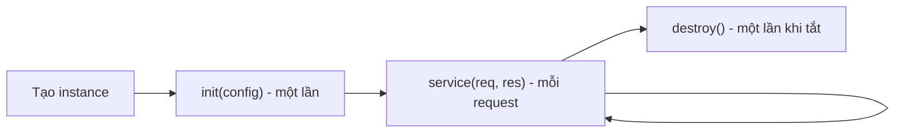
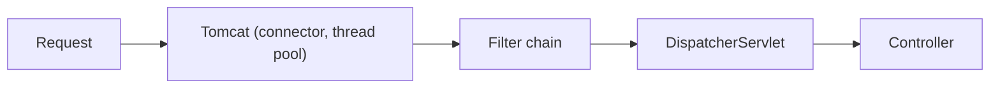

# Câu hỏi: Servlet API và web server Java

Kiến thức gốc: [Spring MVC bên trong, Filter và Interceptor](/go?p=01-Spring-Boot%2Fmedium%2Flt-15-mvc-internals.md), [HTTP chi tiết](/go?p=03-Network-Security%2Feasy%2Flt-02-http-chi-tiet.md), [Đồng thời và Virtual Threads trong Spring](/go?p=01-Spring-Boot%2Fhard%2Flt-22-concurrency-virtual-threads.md).

Mỗi câu đi theo chuỗi suy luận: **Câu hỏi** (tình huống hoặc hiện tượng), **Gợi ý suy luận** (các câu hỏi nhỏ dẫn tới khái niệm nền), **Lập luận** (chuỗi nhân quả tới đáp án), **Đáp án ngắn** (nói thành tiếng được), **Nhớ** (kiến thức cốt lõi), rồi **Ví dụ**, **Hỏi xoáy** (kèm lý do vì sao là bước tiếp theo) và **Sai lầm hay gặp**.

**Về cách kiểm chứng:** môi trường chạy thử chỉ có JDK 11, không có Tomcat, Servlet API hay mạng để tải thư viện. Vì vậy ví dụ có hai loại, được đánh dấu rõ:

- **Đã chạy thật:** dùng `com.sun.net.httpserver.HttpServer` có sẵn trong JDK (một web server thu nhỏ, cùng mô hình *một thread xử lý một request từ thread pool*) và mô phỏng "một servlet, nhiều thread" bằng `ExecutorService`. Output là output thật của lần chạy (`Demo10.java`, JDK 11).
- **Minh họa:** code dùng `jakarta.servlet`/Spring Boot (không biên dịch được ở đây). Cú pháp và cơ chế viết theo tài liệu Servlet API; chưa chạy thử trong môi trường này.

**Tóm tắt:**

- Phạm vi file: Servlet, Tomcat và web server, giải thích những gì Spring Boot đang chạy ở bên dưới.
- Servlet container (Tomcat, Jetty, Undertow) lo giao thức và thread, bạn chỉ viết logic cho một request và một response; Spring MVC chỉ là một servlet (`DispatcherServlet`) làm bộ định tuyến.
- Servlet có một instance cho nhiều thread nên field là state dùng chung, biến cục bộ mới an toàn; lifecycle gồm `init` một lần, `service` mỗi request, `destroy` một lần.
- Filter tạo chuỗi chặn request, phải gọi `chain.doFilter` để chuyển tiếp; `web.xml` và annotation cùng khai báo được nhưng `web.xml` thắng.
- Parameter là `key=giá trị` có thể lặp nên `getParameterMap()` trả `Map<String, String[]>`; session lưu ở server, cookie `JSESSIONID` chỉ là chìa khóa.
- `javax.servlet` đổi sang `jakarta.servlet` từ Servlet 5 (Tomcat 10, Spring Boot 3) vì lý do thương hiệu, và là hai class khác nhau với JVM.
- Hay bị hỏi xoáy nhất: Tomcat 200 thread mà DB chậm thì nút thắt ở đâu, tăng `threads.max` có giúp không, và virtual thread thay đổi gì.

## 1. Servlet là gì? Servlet container làm gì?

**Phải thuộc:** Câu này là câu cốt lõi, gặp rất thường xuyên.

**Câu hỏi:** Bạn viết một ứng dụng web Java mà không phải tự mở socket hay tự parse từng dòng HTTP. Ai đã làm những việc đó thay bạn, và phần việc còn lại của bạn là gì?

**Gợi ý suy luận:**
- HTTP chạy trên giao thức nào, và nếu tự làm thì phải đọc, tách những gì từ socket?
- Việc nào giống nhau ở mọi ứng dụng web, việc nào chỉ ứng dụng của bạn mới biết?
- Nếu ranh giới giữa hai phần được chuẩn hóa bằng interface, điều gì xảy ra khi đổi nhà cung cấp phía dưới?

**Lập luận:** HTTP chạy trên TCP, nên không có framework thì mỗi ứng dụng phải tự mở socket, đọc từng byte, tách dòng yêu cầu và header, ghép thân rồi định dạng phản hồi. Việc đó giống nhau ở mọi ứng dụng, nên nên gom về một chỗ. Servlet chuẩn hóa ranh giới: container lo giao thức và hạ tầng, lập trình viên chỉ viết logic cho một request và một response. Vì ranh giới là interface chuẩn, ứng dụng không phụ thuộc cài đặt container cụ thể, nên cùng một ứng dụng chạy được trên Tomcat lẫn Jetty. Điểm dễ nhầm là nghĩ Servlet là một framework như Spring: thực ra nó chỉ là đặc tả (interface và quy ước lifecycle), còn Tomcat, Jetty, Undertow là cài đặt của đặc tả đó. Hệ quả khi debug: lỗi trước khi vào controller (cổng, TLS, kích thước header, thread pool đầy) nằm ở container, lỗi sau đó mới ở ứng dụng; biết ranh giới này giúp biết nhìn log nào trước.

**Đáp án ngắn:** Servlet là class Java xử lý request/response (thực tế qua `HttpServlet`). Servlet container (Tomcat, Jetty, Undertow) lắng nghe cổng, đọc request, dựng `HttpServletRequest`/`HttpServletResponse`, chọn servlet theo đường dẫn, chạy nó trong một thread của container rồi gửi phản hồi. Container còn quản lý lifecycle servlet, session, filter, bảo mật cơ bản và triển khai ứng dụng.

**Nhớ:** container lo giao thức, bạn lo logic. Xem [Spring MVC bên trong, Filter và Interceptor](/go?p=01-Spring-Boot%2Fmedium%2Flt-15-mvc-internals.md) và [HTTP chi tiết](/go?p=03-Network-Security%2Feasy%2Flt-02-http-chi-tiet.md).

**Ví dụ (đã chạy thật):** thứ container nhận từ socket chỉ là văn bản. Gửi tay một request HTTP tới server JDK rồi in phản hồi:

```java
String resp = raw(port, "GET /hello?a=1&a=2 HTTP/1.1\r\nHost: localhost\r\nConnection: close\r\n\r\n");
```

```text
HTTP/1.1 200 OK
Date: ...
Content-length: 30
Set-cookie: JSESSIONID=ABC123; Path=/; HttpOnly
hi from exec-20 query=a=1&a=2
```

Mọi thứ trong request (dòng đầu `GET /hello?a=1&a=2 HTTP/1.1`, header `Host`) và phản hồi (status line, header, thân) là việc container phải parse/dựng. Handler của chúng ta chỉ nhận `getRequestURI().getQuery()` đã tách sẵn và viết ra thân phản hồi. Servlet container làm điều tương tự nhưng thêm: nhiều giao thức, TLS, session, filter, thread pool, quản lý nhiều ứng dụng.

_Đã chạy thử trên JDK 11 (dùng HttpServer của JDK thay cho Tomcat)._

Servlet tối thiểu (minh họa):

```java
@WebServlet("/hello")
public class HelloServlet extends HttpServlet {
    @Override
    protected void doGet(HttpServletRequest req, HttpServletResponse res) throws IOException {
        res.setContentType("text/plain;charset=UTF-8");
        res.getWriter().print("xin chào " + req.getParameter("name"));
    }
}
```

**Hỏi xoáy 1:** Nếu không ghi đè `doGet` mà vẫn gọi GET thì sao?
*Vì sao là bước tiếp theo:* Sau khi biết container giao request cho servlet, câu hỏi tự nhiên là servlet phản ứng thế nào với method HTTP mà nó chưa khai báo xử lý.
**Đáp:** `HttpServlet` có cài đặt mặc định của `doGet` trả lỗi (405 hoặc 400 tùy phiên bản/trường hợp): class chỉ phục vụ method HTTP nào bạn ghi đè.

**Hỏi xoáy 2:** Vì sao cùng ứng dụng chạy được trên Tomcat lẫn Jetty?
*Vì sao là bước tiếp theo:* Hệ quả trực tiếp của việc chuẩn hóa ranh giới: nếu container lo phần dưới, đổi container có làm vỡ code của bạn không.
**Đáp:** Servlet API chỉ là tập **interface chuẩn**; mỗi container cài đặt riêng. Ứng dụng phụ thuộc interface nên đổi container không đổi code (đúng nguyên lý "lập trình theo interface").

**Sai lầm hay gặp:** tự đọc raw socket cho ứng dụng web thật, bỏ qua mọi thứ container làm (chunked encoding, keep-alive, header trùng lặp...) và gặp lỗi khó hiểu.

## 2. Lifecycle của một servlet?

**Câu hỏi:** Nếu mỗi request phải tạo lại kết nối DB và `ObjectMapper` bên trong `doGet`, hệ thống sẽ ra sao? Container đặt việc khởi tạo đắt ở đâu trong lifecycle servlet?

**Gợi ý suy luận:**
- Việc nào đắt và chỉ cần một lần (tạo kết nối, đọc cấu hình), việc nào rẻ nhưng lặp hàng triệu lần?
- Servlet sống lâu hay chết sau mỗi request?
- Nếu tách theo nhịp "một lần / mỗi request / một lần cuối", đó là những pha nào?

**Lập luận:** Tạo servlet và khởi tạo tài nguyên là việc đắt, còn xử lý một request thì rẻ và lặp rất nhiều lần. Vì servlet tồn tại lâu và được tái sử dụng, lifecycle ba pha tách đúng hai nhịp đó: việc đắt làm một lần (`init`), việc rẻ làm mỗi request (`service`), dọn dẹp một lần (`destroy`). Từ đó đặt tài nguyên đắt vào `init`, không đặt vào `doGet`. Điểm dễ nhầm là đặt khởi tạo đắt trong `doGet` hoặc trong constructor có tham số mà container không gọi được, và nhầm `init` chạy một lần cho cả servlet chứ không mỗi request. Với Spring Boot, bạn ít viết servlet trực tiếp nhưng nguyên tắc vẫn vậy: tài nguyên đắt (kết nối DB, `ObjectMapper`) là bean singleton tạo một lần lúc khởi động, không tạo trong method xử lý.

**Đáp án ngắn:** Container tạo instance, gọi `init(config)` một lần, rồi gọi `service(req, res)` cho mỗi request (`HttpServlet` chuyển tiếp tới `doGet`, `doPost`... theo method HTTP), cuối cùng gọi `destroy()` khi gỡ ứng dụng hoặc tắt server.

**Nhớ:** lifecycle init một lần, service mỗi request, destroy một lần. Xem [Spring MVC bên trong](/go?p=01-Spring-Boot%2Fmedium%2Flt-15-mvc-internals.md).



**Ví dụ (minh họa):** đặt việc đắt vào `init`, không đặt vào `doGet`:

```java
public class ReportServlet extends HttpServlet {
    private DataSource ds;

    @Override public void init() {                    // một lần
        ds = lookupDataSource();
    }
    @Override protected void doGet(HttpServletRequest rq, HttpServletResponse rs) {
        // mỗi request: dùng ds có sẵn, KHÔNG tạo lại kết nối ở đây
    }
    @Override public void destroy() { /* đóng tài nguyên */ }
}
```

Mặc định servlet được tạo khi có request đầu tiên (nên request đầu chậm hơn); `loadOnStartup=1` trong `@WebServlet` tạo ngay lúc khởi động.

**Hỏi xoáy 1:** Lỗi trong `init` thì sao?
*Vì sao là bước tiếp theo:* Vì `init` là pha duy nhất chuẩn bị tài nguyên, ta cần biết nếu nó hỏng thì servlet còn phục vụ được không.
**Đáp:** Servlet không dùng được; container trả lỗi cho các request tới nó (503 hoặc 500) và thử khởi tạo lại tùy cài đặt.

**Hỏi xoáy 2:** Filter có lifecycle không?
*Vì sao là bước tiếp theo:* Filter cũng là thành phần sống lâu do container quản lý, nên câu hỏi là nó có cùng mô hình ba pha không.
**Đáp:** Có, tương tự: `init`, `doFilter` cho mỗi request, `destroy`.

**Sai lầm hay gặp:** mở kết nối DB hoặc tạo `ObjectMapper` bên trong `doGet`, tốn thời gian mỗi request và dễ cạn tài nguyên.

## 3. Một servlet có mấy instance? Có an toàn multithreading không?

**Phải thuộc:** Câu này là câu cốt lõi, gặp rất thường xuyên.

**Câu hỏi:** Một bộ đếm lượt truy cập đặt trong field của servlet cho số liệu sai, nhưng không báo lỗi nào. Vì sao, và cách sửa?

**Gợi ý suy luận:**
- Container tạo mấy instance servlet, và có bao nhiêu thread chạy `service` cùng lúc?
- Field nằm ở đâu (heap, dùng chung) còn biến cục bộ nằm ở đâu (stack riêng của thread)?
- `hits++` gồm những bước nào (đọc, cộng, ghi), và chuyện gì xảy ra nếu hai thread xen vào nhau?

**Lập luận:** Nếu mỗi request tạo một servlet mới thì `init` đắt chạy mỗi lần và memory phình theo số request, nên container tạo một instance và cho nhiều thread chạy `service` đồng thời trên đó. Vì vậy field của servlet là memory dùng chung giữa các request, còn biến cục bộ nằm trên stack riêng của từng thread nên an toàn. `hits++` là ba bước đọc, cộng, ghi: hai thread cùng đọc `5` rồi cùng ghi `6` thì mất một lần tăng, nên số đếm sai mà không có lỗi. Cách sửa là dùng biến cục bộ, dữ liệu bất biến, class thread-safe hoặc lock. Điểm dễ nhầm là cho rằng `synchronized` trên mọi method của servlet là cách sửa: nó biến mọi request thành tuần tự và giết throughput. Cách đúng là loại bỏ trạng thái dùng chung (biến cục bộ, dữ liệu bất biến), hoặc dùng `AtomicLong`/`LongAdder` cho bộ đếm. Quy tắc tương tự áp dụng cho `@Controller`/`@Service` của Spring: bean singleton nên stateless.

**Đáp án ngắn:** Field của servlet là trạng thái dùng chung, không an toàn multithreading. Dữ liệu theo request đặt trong **biến cục bộ**; dữ liệu dùng chung phải bất biến, hoặc dùng class thread-safe, hoặc lock.

**Nhớ:** một servlet, nhiều thread, field là dữ liệu chung. Xem [Thread Safety](/go?p=08-Java%2FJava-Concurrency%2Feasy%2Flt-02-thread-safety.md).

**Ví dụ (đã chạy thật):** mô phỏng container: một object `CounterServlet` dùng chung, 8 thread, mỗi thread gọi `doGet` 100 000 lần:

```java
static class CounterServlet {
    // SAI: field dùng chung, không đồng bộ
    int hits;
    final AtomicInteger safeHits = new AtomicInteger();    // ĐÚNG
    void doGet() { hits++; safeHits.incrementAndGet(); }
}
```

```text
ky vong 800000: hits(sai)=796046  safeHits(dung)=800000
```

`hits++` thực chất là ba bước **đọc, cộng, ghi** nên khi hai thread cùng đọc `5` rồi cùng ghi `6`, một lần tăng biến mất. Kết quả sai `796046` thay vì `800000` (con số sai thay đổi giữa các lần chạy: đó là đặc trưng của race condition). `AtomicInteger` dùng lệnh nguyên tử nên luôn đúng. Đây là lý do một bộ đếm "số lượt truy cập" trong field servlet cho số đo sai mà không báo lỗi nào.

_Đã chạy thử trên JDK 11 (mô phỏng, không phải Tomcat thật; cơ chế chia sẻ instance giữa thread giống nhau)._

`SingleThreadModel` từng có để serialization nhưng đã bị loại bỏ (deprecated từ Servlet 2.4, gỡ ở Servlet 6.0), đừng dùng.

**Hỏi xoáy 1:** Controller Spring có chịu quy tắc này không?
*Vì sao là bước tiếp theo:* Sau khi hiểu quy tắc "một instance, nhiều thread", ta kiểm tra nó có áp dụng cho Spring, nơi người ta ít viết servlet trực tiếp.
**Đáp:** Có. `@RestController` là bean singleton, một instance phục vụ mọi request đồng thời. Không đặt trạng thái theo request vào field của controller hay service singleton. Xem [Thread Safety](/go?p=08-Java%2FJava-Concurrency%2Feasy%2Flt-02-thread-safety.md).

**Hỏi xoáy 2:** Vậy `synchronized` quanh `doGet` có giải quyết được không?
*Vì sao là bước tiếp theo:* Khi biết field chung gây race, phản xạ đầu tiên là lock tất cả; câu hỏi này kiểm tra cái giá của phản xạ đó.
**Đáp:** Làm đúng nhưng **biến servlet thành tuần tự**: chỉ một request chạy một lúc, phá hết lợi ích multithreading và mọi request xếp hàng. Nên lock hẹp quanh dữ liệu dùng chung, hoặc tốt hơn là tránh state chung.

**Sai lầm hay gặp:** đặt `SimpleDateFormat` (không thread-safe) hoặc danh sách thay đổi được vào field servlet/controller; lỗi chỉ xuất hiện khi tải cao.

## 4. Filter là gì? Khác servlet thế nào? Thứ tự chạy?

**Câu hỏi:** Bạn cần authentication, ghi log và CORS cho mọi request. Nhét vào từng servlet có vấn đề gì, và cơ chế nào cho phép một request bị block trước khi tới servlet?

**Gợi ý suy luận:**
- Việc cắt ngang mọi request nếu lặp ở từng servlet thì rủi ro gì (quên một chỗ)?
- Nếu các bước xếp thành chuỗi trước servlet, mỗi bước cần quyền quyết định gì (cho đi tiếp hay dừng)?
- Phản hồi đi ngược lại chuỗi đó theo thứ tự nào?

**Lập luận:** Việc cắt ngang mọi request mà nhét vào từng servlet thì lặp code và dễ quên một nơi, tạo lỗ hổng bảo mật. Vì vậy dựng một chuỗi (pipeline) filter đứng trước servlet. Mỗi filter làm việc của mình rồi quyết định có chuyển tiếp xuống không bằng `chain.doFilter`; không gọi nó thì request dừng tại đó, và đó chính là cơ chế từ chối request. Vì chuỗi gọi lồng nhau nên phản hồi quay về theo thứ tự ngược lại. Điểm dễ nhầm là quên `chain.doFilter` (request treo hoặc trả trống) hoặc gọi nó hai lần, và đọc body trong filter rồi để servlet sau đó không còn gì để đọc vì stream chỉ đọc được một lần (cần bọc request bằng wrapper có cache). Thứ tự filter cũng quan trọng: filter bảo mật nên đứng trước filter nghiệp vụ, và filter ghi log nên bao quanh để thấy cả phản hồi lỗi.

**Đáp án ngắn:** `Filter` chặn request trước khi tới servlet (và phản hồi trên đường về). Method `doFilter(req, res, chain)`; **phải gọi `chain.doFilter`** để chuyển tiếp, nếu không request dừng tại đó. Nhiều filter tạo thành chuỗi; thứ tự quyết định bởi thứ tự khai báo mapping (hoặc `@Order`/`FilterRegistrationBean.setOrder` trong Spring Boot).

**Nhớ:** filter là chuỗi chặn, không gọi chain là dừng request. Xem [Spring MVC bên trong, Filter và Interceptor](/go?p=01-Spring-Boot%2Fmedium%2Flt-15-mvc-internals.md).

**Ví dụ (minh họa):** chặn request thiếu header `X-Api-Key`:

```java
public class RequireHeaderFilter implements Filter {
    @Override
    public void doFilter(ServletRequest req, ServletResponse res, FilterChain chain)
            throws IOException, ServletException {
        HttpServletRequest http = (HttpServletRequest) req;
        if (http.getHeader("X-Api-Key") == null) {
            ((HttpServletResponse) res).sendError(HttpServletResponse.SC_UNAUTHORIZED);
            return;                       // KHÔNG gọi chain: request dừng ở đây
        }
        chain.doFilter(req, res);         // cho đi tiếp xuống filter/servlet kế
        // code ở đây chạy lúc phản hồi quay về
    }
}
```

Thread chạy với hai filter A rồi B rồi servlet:

| Bước | Nơi chạy |
|---|---|
| 1 | A (phần trước `chain.doFilter`) |
| 2 | B (phần trước `chain.doFilter`) |
| 3 | Servlet |
| 4 | B (phần sau `chain.doFilter`) |
| 5 | A (phần sau `chain.doFilter`) |

Tham số là `ServletRequest`/`ServletResponse` chứ không phải bản `Http...` vì `Filter` không gắn riêng với HTTP, nên cần ép kiểu.

**Hỏi xoáy 1:** Quên `return` sau `sendError` thì sao?
*Vì sao là bước tiếp theo:* Vì quyền dừng request nằm ở việc có gọi chain hay không, ta hỏi điều gì xảy ra khi code vẫn chạy tiếp xuống dòng gọi chain.
**Đáp:** Code tiếp tục chạy xuống `chain.doFilter`: request vẫn tới servlet dù đã trả 401, có thể thực thi logic nhạy cảm hoặc ném `IllegalStateException` vì phản hồi đã được commit.

**Hỏi xoáy 2:** Spring Security nằm ở đâu trong chuỗi?
*Vì sao là bước tiếp theo:* Authentication là ví dụ điển hình của việc cắt ngang mọi request, nên ta hỏi Spring đặt nó vào cơ chế filter này ra sao.
**Đáp:** Là một chuỗi filter (`FilterChainProxy`) chạy **trước** `DispatcherServlet`, nên mọi request đã được authentication/authorization trước khi tới controller. Trong Spring nên kế thừa `OncePerRequestFilter` để mỗi request chỉ lọc một lần (tránh chạy lại khi forward nội bộ).

**Sai lầm hay gặp:** sai thứ tự filter (ví dụ filter ghi log chạy sau filter authentication nên không ghi được request bị từ chối); quên gọi `chain.doFilter` khiến request treo hoặc trả trang trống.

## 5. `web.xml` là gì? So với annotation?

**Câu hỏi:** Container phải biết servlet nào, URL nào, thứ tự filter nào trước khi chạy. Khai báo đó nên đặt trong XML tách khỏi code hay bằng annotation cạnh code, và mỗi lựa chọn đánh đổi gì?

**Gợi ý suy luận:**
- Thông tin cấu hình triển khai thay đổi theo môi trường hay theo logic code?
- Đặt gần code thì lợi gì (gọn, kiểm tra lúc biên dịch), đặt tách ra thì lợi gì (đổi không cần build)?
- Có thứ gì (như thứ tự filter) khó diễn đạt bằng annotation không?

**Lập luận:** Đây là cấu hình triển khai, nên câu hỏi thật là đặt cấu hình gần code hay tách khỏi code. `web.xml` khai báo tập trung bằng XML nên đổi không cần biên dịch lại và thứ tự rõ ràng; annotation đưa khai báo lại gần code nên gọn và kiểm tra được lúc biên dịch nhưng không quy định được thứ tự filter. Vì hai nơi có thể cùng khai báo một thứ, cần quy tắc ưu tiên: `web.xml` ghi đè annotation. Điểm dễ nhầm là nghĩ `web.xml` là bắt buộc hoặc đã lỗi thời hẳn: nó vẫn hữu ích khi cần thứ tự filter rõ ràng hoặc đổi cấu hình triển khai không biên dịch lại, và vẫn ghi đè annotation. Với Spring Boot nhúng container, bạn gần như không dùng cả hai: filter và servlet được đăng ký bằng bean (`FilterRegistrationBean`) trong code.

**Đáp án ngắn:** `web.xml` (deployment descriptor, trong `WEB-INF/`) khai báo servlet, filter, mapping, tham số khởi tạo, session. Từ Servlet 3.0 có thể thay bằng `@WebServlet`, `@WebFilter`, `@WebListener` hoặc đăng ký bằng code qua `ServletContainerInitializer`, nên `web.xml` là tùy chọn.

**Nhớ:** cấu hình đặt gần code (annotation) hay tách khỏi code (`web.xml`); trùng thì `web.xml` thắng.

**Ví dụ (minh họa):** cùng một servlet khai báo hai cách:

```xml
<servlet>
  <servlet-name>hello</servlet-name>
  <servlet-class>com.example.HelloServlet</servlet-class>
  <load-on-startup>1</load-on-startup>
</servlet>
<servlet-mapping>
  <servlet-name>hello</servlet-name>
  <url-pattern>/hello</url-pattern>
</servlet-mapping>
```

```java
@WebServlet(urlPatterns = "/hello", loadOnStartup = 1)
public class HelloServlet extends HttpServlet { }
```

| | `web.xml` | Annotation / code |
|---|---|---|
| Cấu hình | Tập trung một chỗ, đổi không cần biên dịch lại | Nằm cạnh class, gọn |
| Thứ tự filter | Rõ ràng theo thứ tự `filter-mapping` | Khó kiểm soát nếu chỉ dùng annotation |
| Khi trùng | Cấu hình trong `web.xml` ghi đè annotation | |

Trong Spring Boot hầu như không viết `web.xml`: dùng `ServletRegistrationBean`/`FilterRegistrationBean` hoặc để Spring tự đăng ký `DispatcherServlet` và các filter bean.

**Hỏi xoáy 1:** Khi cần đổi URL mapping trên production không build lại thì sao?
*Vì sao là bước tiếp theo:* Từ lợi ích "đổi không cần build" ta kiểm tra nó có thực sự dùng được trong vận hành.
**Đáp:** Với `web.xml` sửa file trong WAR đã triển khai (hoặc dùng cấu hình bên ngoài). Với annotation phải sửa code và build lại: đó là điểm mạnh còn lại của XML.

**Hỏi xoáy 2:** Thứ tự filter với annotation thì sao?
*Vì sao là bước tiếp theo:* Thứ tự là chỗ annotation yếu nhất, và thứ tự filter ảnh hưởng trực tiếp đến an toàn (xem câu 4).
**Đáp:** `@WebFilter` không quy định thứ tự giữa các filter; cần thứ tự rõ thì khai báo trong `web.xml` hoặc dùng cơ chế đăng ký của Spring Boot với `setOrder`.

**Sai lầm hay gặp:** vừa khai báo `web.xml` vừa annotation cùng một servlet, mapping lệch nhau nên khó biết cái nào có hiệu lực.

## 6. File WAR là gì? Triển khai lên Tomcat thế nào?

**Câu hỏi:** Bạn đưa một file lên thư mục `webapps` của Tomcat và ứng dụng tự chạy. Container biết class, thư viện và tài nguyên công khai nằm ở đâu bằng cách nào, và vì sao `WEB-INF` không tải về được?

**Gợi ý suy luận:**
- Muốn mọi ứng dụng triển khai giống nhau thì cần quy ước nào về cấu trúc thư mục?
- Phần nào của ứng dụng cần công khai (trang tĩnh), phần nào phải kín (cấu hình, class)?
- Đóng gói thành một file duy nhất giúp gì cho việc sao chép và triển khai?

**Lập luận:** Container cần một đơn vị triển khai chuẩn để biết class nằm đâu, thư viện nằm đâu, cái gì công khai và cái gì ẩn. WAR (Web Archive) là JAR có cấu trúc cố định cho ứng dụng web, nên container giải nén và vận hành theo một quy ước thống nhất bất kể ai viết ứng dụng. Phần cần kín được gom vào `WEB-INF`, nơi container chủ động không phục vụ qua URL. Điểm dễ nhầm là nghĩ phải dùng WAR cho mọi ứng dụng Java web: Spring Boot mặc định đóng gói JAR chạy được (`java -jar`) với server nhúng, và chỉ cần WAR khi phải triển khai lên một Tomcat dùng chung có sẵn. Khi đó class main phải kế thừa `SpringBootServletInitializer`, và dependency server nhúng đặt `provided`. Còn `WEB-INF` không tải về được vì container chủ động chặn truy cập trực tiếp tới thư mục này.

**Đáp án ngắn:** WAR gồm class đã biên dịch ở `WEB-INF/classes`, thư viện ở `WEB-INF/lib`, `WEB-INF/web.xml`, tài nguyên tĩnh ở gốc. Với Maven đặt `<packaging>war</packaging>`. Bỏ WAR vào `webapps` của Tomcat, Tomcat tự giải nén và phục vụ tại context trùng tên file.

**Nhớ:** WAR là đơn vị triển khai chuẩn; `WEB-INF` luôn kín. Xem [Spring MVC bên trong](/go?p=01-Spring-Boot%2Fmedium%2Flt-15-mvc-internals.md).

**Ví dụ (minh họa):**

```text
Booking.war
├── index.html                  <- tài nguyên tĩnh, công khai tại /Booking/index.html
└── WEB-INF/                    <- trình duyệt KHÔNG truy cập trực tiếp được
    ├── web.xml
    ├── classes/com/example/HelloServlet.class
    └── lib/jackson-databind-x.y.z.jar
```

Triển khai: sao chép `Booking.war` vào `$CATALINA_HOME/webapps`; Tomcat giải nén thành thư mục `Booking` và ứng dụng chạy tại `http://host:8080/Booking/`. Thư mục `WEB-INF` được container bảo vệ nên nội dung cấu hình và class không bị tải về qua URL.

**Hỏi xoáy 1:** Catalina và Jasper là gì?
*Vì sao là bước tiếp theo:* Khi nói "bỏ WAR vào Tomcat", ta cần biết Tomcat gồm những phần nào đứng sau việc đó.
**Đáp:** **Catalina** là servlet container của Tomcat (từ đó có `CATALINA_HOME`, `catalina.out`); **Jasper** biên dịch JSP thành servlet.

**Hỏi xoáy 2:** Spring Boot encapsulation thế nào so với WAR?
*Vì sao là bước tiếp theo:* WAR là mô hình "đưa ứng dụng vào server"; ta so với mô hình ngược lại của Boot.
**Đáp:** Mặc định là **JAR chạy được** chứa sẵn Tomcat nhúng (`java -jar`); không cần cài Tomcat riêng. Vẫn có thể đóng WAR để chạy trên Tomcat ngoài (xem câu 10).

**Sai lầm hay gặp:** đặt file cần giữ kín ngoài `WEB-INF` (nên tải về được qua URL); đóng gói thêm cả thư viện servlet API vào WAR gây xung đột với bản của container (nên để `provided`).

## 7. Request parameter được xử lý ra sao?

**Câu hỏi:** Request `GET /hello?a=1&a=2` đến servlet. `getParameter("a")` trả gì, và vì sao `getParameterMap()` lại trả `Map<String, String[]>` chứ không phải `Map<String, String>`?

**Gợi ý suy luận:**
- Query string và form POST có cấu trúc `key=giá trị` nối bằng `&`; HTTP có cấm lock lặp lại không?
- Nếu API chỉ giữ một giá trị cho mỗi lock, giá trị trùng đi đâu?
- Body JSON có cùng dạng `key=giá trị` không?

**Lập luận:** Query string và form POST đều là chuỗi `key=giá trị` nối bằng `&`, và HTTP không cấm một key xuất hiện nhiều lần (checkbox nhiều lựa chọn, `a=1&a=2`). Nếu API trả `Map<String, String>` sẽ làm mất giá trị trùng. Vì vậy mỗi key phải ứng với một mảng giá trị, và `getParameter` là lối tắt chỉ lấy phần tử đầu. Body JSON không có dạng key=giá trị nên không nằm trong parameter map. Điểm dễ nhầm là dùng `getParameter` cho một tham số có thể lặp (mất các giá trị sau) hoặc tìm JSON body trong parameter map (luôn rỗng). Với `application/json`, phải đọc body bằng `getInputStream()` hoặc, trong Spring, dùng `@RequestBody`. Cũng lưu ý nếu một filter đã đọc body của form trước, các parameter có thể đã bị tiêu thụ.

**Đáp án ngắn:** `getParameter("a")` trả giá trị **đầu tiên**; `getParameterValues("a")` hoặc `getParameterMap()` trả tất cả. Dùng chung cho query string và form (`application/x-www-form-urlencoded`). Body JSON **không** nằm trong parameter map, phải đọc từ `getInputStream()` (Spring làm qua `@RequestBody`).

**Nhớ:** một lock, nhiều giá trị; JSON không phải parameter. Xem [HTTP chi tiết](/go?p=03-Network-Security%2Feasy%2Flt-02-http-chi-tiet.md).

**Ví dụ (đã chạy thật):** phân tích `a=123&b=asdf&a=456` đúng như container làm:

```java
static Map<String, List<String>> parseQuery(String q) {
    Map<String, List<String>> m = new LinkedHashMap<>();
    for (String kv : q.split("&")) {
        String[] p = kv.split("=", 2);
        m.computeIfAbsent(p[0], k -> new ArrayList<>()).add(p.length > 1 ? p[1] : "");
    }
    return m;
}
```

```text
{a=[123, 456], b=[asdf]}
```

`a` có hai giá trị nên `getParameter("a")` trả `123` (bỏ `456` mà không báo), còn `getParameterValues("a")` trả cả hai. Ở ví dụ HTTP thô của câu 1, query `a=1&a=2` đến handler đúng nguyên văn.

_Đã chạy thử trên JDK 11 (parser tự viết mô phỏng; container thật còn giải mã `%XX` và `+`)._

**Hỏi xoáy 1:** Vì sao body JSON không có trong `getParameter`?
*Vì sao là bước tiếp theo:* Câu trả lời trên nói parameter chỉ gồm query và form, nên ta hỏi tiếp lý do và hệ quả khi đọc body.
**Đáp:** Parameter chỉ gồm query string và body dạng form. Body JSON là byte stream thô với `Content-Type: application/json`; container không biết cấu trúc nên để ứng dụng tự đọc, và nếu một filter đọc thread này trước thì servlet không đọc lại được (thread chỉ đọc một lần).

**Hỏi xoáy 2:** `getParameter` có an toàn không?
*Vì sao là bước tiếp theo:* Sau khi biết giá trị đến từ client, câu hỏi tự nhiên là có thể tin chúng không.
**Đáp:** Đó là dữ liệu **không tin cậy**: phải kiểm tra/chuẩn hóa trước khi dùng (chống injection, XSS); xem [OWASP Top 10](/go?p=03-Network-Security%2Fmedium%2Flt-04-owasp-web-security.md).

**Sai lầm hay gặp:** dùng `getParameter` cho tham số có thể lặp và âm thầm mất giá trị; tin giá trị client gửi.

## 8. Session hoạt động thế nào?

**Câu hỏi:** HTTP không có trạng thái, vậy sau khi bạn đăng nhập, request kế tiếp được server nhận ra là của bạn bằng cách nào? Dữ liệu "đã đăng nhập" nằm ở đâu?

**Gợi ý suy luận:**
- HTTP không nhớ gì giữa hai request, vậy cần gắn thêm thứ gì vào mỗi request?
- Trạng thái nên nằm ở client hay server, và định danh phải có tính chất gì (khó đoán)?
- Trình duyệt tự gửi lại thứ gì ở mọi request cùng miền?

**Lập luận:** Server không tự nhớ hai request có cùng một người dùng, nên muốn nhớ phải gắn mỗi request với một định danh. Server tạo object `HttpSession` trong memory, sinh id ngẫu nhiên (khó đoán) và gửi cho trình duyệt qua cookie `JSESSIONID`. Trình duyệt tự gửi cookie lại ở mỗi request, server dùng id tra ra session. Vì thế trạng thái nằm ở server, còn cookie chỉ là chìa khóa. Điểm dễ nhầm là nghĩ session nằm ở trình duyệt: trình duyệt chỉ giữ id, dữ liệu nằm ở server nên tốn memory và phải xử lý khi chạy nhiều instance (sticky session hoặc session dùng chung như Redis). Về bảo mật, cookie nên có `HttpOnly`, `Secure`, `SameSite`, và id phải được đổi sau khi đăng nhập để chống session fixation.

**Đáp án ngắn:** Session lưu trong memory server, định danh bằng cookie `JSESSIONID`, có timeout, hủy khi đăng xuất.

**Nhớ:** trạng thái ở server, cookie chỉ là id. Xem [Authentication, phiên và token](/go?p=03-Network-Security%2Fmedium%2Flt-05-xac-thuc-phien-token.md).

**Ví dụ (đã chạy thật một phần):** response ở câu 1 chứa header cấp cookie:

```text
Set-cookie: JSESSIONID=ABC123; Path=/; HttpOnly
```

Trình duyệt lưu rồi gửi lại ở request sau bằng `Cookie: JSESSIONID=ABC123`. `HttpOnly` ngăn JavaScript đọc cookie (giảm rủi ro XSS đánh cắp session). Ví dụ servlet (minh họa):

```java
HttpSession s = req.getSession();                    // tạo nếu chưa có
Integer n = (Integer) s.getAttribute("visits");
s.setAttribute("visits", n == null ? 1 : n + 1);     // lưu trong bộ nhớ server
s.setMaxInactiveInterval(30 * 60);                   // timeout 30 phút
```

**Hỏi xoáy 1:** Hai request đồng thời của cùng một người dùng, thread-safe không?
*Vì sao là bước tiếp theo:* Session sống ở server và được nhiều request cùng truy cập, nên ta nối lại với quy tắc multithreading ở câu 3.
**Đáp:** Không tự động: cùng session, hai thread cùng đọc-sửa attribute nên có race (như `visits` ở trên). Cần đồng bộ hoặc dùng cấu trúc thread-safe.

**Hỏi xoáy 2:** Chạy nhiều instance sau load balancer thì session trong memory sao?
*Vì sao là bước tiếp theo:* Vì session nằm trong memory một process, ta hỏi điều gì xảy ra khi có nhiều process.
**Đáp:** Session nằm trong memory **một** instance, request tới instance khác không thấy. Ba hướng: *sticky session* (LB luôn gửi một người dùng về cùng instance, mất khi instance sập), *lưu session ngoài* (Redis, Spring Session) để mọi instance dùng chung, hoặc *bỏ session* chuyển sang token (JWT). Xem [Authentication, phiên và token](/go?p=03-Network-Security%2Fmedium%2Flt-05-xac-thuc-phien-token.md).

**Sai lầm hay gặp:** nhét object lớn vào session làm tốn RAM theo số người dùng; không `invalidate()` khi đăng xuất; không đặt cờ `Secure`/`HttpOnly`/`SameSite` cho cookie.

## 9. `javax.servlet` và `jakarta.servlet` khác gì nhau?

**Câu hỏi:** Sau khi nâng Spring Boot 2 lên 3, ứng dụng ném `NoClassDefFoundError: javax/servlet/Filter`. Vì sao đổi mỗi tên package lại làm vỡ, và `javax` với `jakarta` khác nhau ở đâu?

**Gợi ý suy luận:**
- Tên package có là một phần của tên đầy đủ của class không? JVM coi hai class khác tên đầy đủ là một hay hai?
- Ai sở hữu thương hiệu "Java"/`javax` sau khi Java EE chuyển giao cho Eclipse Foundation?
- Container và thư viện phải khớp nhau theo tiêu chí nào?

**Lập luận:** Đây là hệ quả pháp lý và tổ chức, không phải khác biệt kỹ thuật: Oracle chuyển Java EE cho Eclipse Foundation nhưng giữ quyền thương hiệu `javax`, nên bản mới phải đổi tên thành Jakarta EE với package `jakarta.*`. Vì tên package là một phần tên class đầy đủ, `javax.servlet.Filter` và `jakarta.servlet.Filter` là hai class khác nhau hoàn toàn với JVM. Do đó container dùng `jakarta` không nhận class biên dịch với `javax`, và ngược lại. Điểm dễ nhầm là nghĩ chỉ cần sửa `import` trong code của mình: các thư viện phụ thuộc (và Hibernate, Tomcat embed...) cũng phải là bản `jakarta`, nếu một jar còn dùng `javax.servlet` thì vẫn lỗi lúc chạy. Khi nâng cấp, kiểm tra cây dependency để tìm jar cũ, dùng công cụ migration của Spring hoặc OpenRewrite, và đồng bộ phiên bản container với framework.

**Đáp án ngắn:** Từ **Jakarta EE 9** (Servlet 5.0) đổi sang `jakarta.servlet.*`. Tomcat 9 dùng `javax`; **Tomcat 10+** dùng `jakarta`. Spring Framework 6 và Spring Boot 3 (Java 17+) dùng `jakarta`; Boot 2.x dùng `javax`.

**Nhớ:** tên package khác là class khác; container và thư viện phải cùng thế hệ.

**Ví dụ (minh họa):**

```java
// Spring Boot 2.x / Tomcat 9
import javax.servlet.http.HttpServletRequest;
// Spring Boot 3.x / Tomcat 10+
import jakarta.servlet.http.HttpServletRequest;
```

Một thư viện cũ biên dịch với `javax.servlet.Filter` đặt vào Tomcat 10+: container tìm `jakarta.servlet.Filter` nên không nhận class filter của thư viện, hoặc lỗi lúc nạp class. Triệu chứng điển hình sau khi nâng Boot 2 lên 3:

```text
java.lang.NoClassDefFoundError: javax/servlet/Filter
```

Do hai class khác nhau nên không có cách "chạy cả hai" mà không có công cụ chuyển đổi.

**Hỏi xoáy 1:** Nâng cấp Boot 2 lên 3 kéo theo gì?
*Vì sao là bước tiếp theo:* Nếu hai thế hệ không tương thích, ta liệt kê việc phải làm để chuyển cả hệ sinh thái cùng lúc.
**Đáp:** Đổi import `javax` sang `jakarta` trong code của bạn; nâng mọi thư viện dùng servlet/JPA/Validation/JAXB lên bản `jakarta`; đổi container sang Tomcat 10+; yêu cầu Java 17. Có công cụ tự động (OpenRewrite, Eclipse Transformer).

**Hỏi xoáy 2:** Vì sao chỉ đổi tên package mà không đổi API?
*Vì sao là bước tiếp theo:* Sau khi thấy cái giá của việc đổi tên, ta hỏi vì sao nhà thiết kế không gộp thêm thay đổi khác.
**Đáp:** Để giảm công sức di chuyển: bản Jakarta EE 9 cố ý chỉ đổi tên, chưa thêm tính năng; thay đổi API thật đến ở bản sau.

**Sai lầm hay gặp:** để lẫn thư viện `javax` và `jakarta` trên cùng classpath rồi gặp `NoClassDefFoundError`/`ClassCastException` khó hiểu lúc chạy.

## 10. Spring Boot liên quan gì đến Tomcat và Servlet?

**Câu hỏi:** Spring Boot chạy được bằng `java -jar` mà không cài Tomcat. Vậy Spring MVC có phải là một web server không, và request đi qua những thành phần nào trước khi tới controller?

**Gợi ý suy luận:**
- Server lắng nghe cổng và quản lý thread thuộc về thành phần nào (container) hay Spring?
- Nếu container giao mọi request cho một servlet duy nhất, servlet đó làm công việc gì (định tuyến)?
- Nếu nhúng container vào ứng dụng, quan hệ "ứng dụng nằm trong server" đổi thành gì?

**Lập luận:** Spring MVC không phải server; nó chạy bên trong một servlet container. Về cơ chế, toàn bộ Spring MVC chỉ là một servlet (`DispatcherServlet`) làm bộ định tuyến: container giao cho nó mọi request, nó tra bảng ánh xạ để gọi đúng controller. Boot nhúng sẵn Tomcat vào ứng dụng nên `main()` tự khởi động server, đảo ngược mô hình cũ: thay vì đưa ứng dụng vào server, ta đưa server vào ứng dụng. Vì controller chỉ phụ thuộc Servlet API chuẩn, đổi container không đụng tới controller. Điểm dễ nhầm là coi Tomcat nhúng như một "phép màu" tách biệt: nó chỉ là một servlet container được thư viện hóa, và mọi khái niệm ở trên (thread pool, filter, session, `DispatcherServlet`) vẫn áp dụng. Khi cần đổi sang Jetty hay Undertow thì loại `spring-boot-starter-tomcat` và thêm starter thay thế; controller không phải sửa vì chỉ phụ thuộc Servlet API chuẩn.

**Đáp án ngắn:** `spring-boot-starter-web` kèm Tomcat nhúng; `java -jar app.jar` có web server. `DispatcherServlet` đăng ký ở `/`, filter (kể cả Spring Security) chạy trước nó.

**Nhớ:** Spring MVC = một servlet trong container; Boot nhúng container vào ứng dụng. Xem [Spring MVC bên trong](/go?p=01-Spring-Boot%2Fmedium%2Flt-15-mvc-internals.md).



**Ví dụ (minh họa):** đăng ký thêm servlet và filter, và đổi sang Jetty:

```java
@Bean ServletRegistrationBean<HelloServlet> hello() {
    return new ServletRegistrationBean<>(new HelloServlet(), "/legacy/hello");
}
@Bean FilterRegistrationBean<RequireHeaderFilter> keyFilter() {
    FilterRegistrationBean<RequireHeaderFilter> b = new FilterRegistrationBean<>(new RequireHeaderFilter());
    b.setOrder(1);                                   // chạy sớm
    b.addUrlPatterns("/api/*");
    return b;
}
```

```xml
<!-- Đổi sang Jetty: loại Tomcat, thêm starter Jetty -->
<dependency>
  <groupId>org.springframework.boot</groupId>
  <artifactId>spring-boot-starter-web</artifactId>
  <exclusions><exclusion>
    <groupId>org.springframework.boot</groupId>
    <artifactId>spring-boot-starter-tomcat</artifactId>
  </exclusion></exclusions>
</dependency>
<dependency>
  <groupId>org.springframework.boot</groupId>
  <artifactId>spring-boot-starter-jetty</artifactId>
</dependency>
```

Vẫn có thể đóng WAR chạy trên Tomcat ngoài: kế thừa `SpringBootServletInitializer`, đặt packaging `war`, đánh dấu Tomcat là `provided`.

**Hỏi xoáy 1:** Request đi qua những thành phần nào trước khi tới controller?
*Vì sao là bước tiếp theo:* Từ sơ đồ "container rồi servlet rồi controller", ta yêu cầu kể đủ từng chặng.
**Đáp:** Connector của Tomcat đọc request, giao cho một thread worker, đi qua chuỗi filter (Security, logging, CORS...), tới `DispatcherServlet`, rồi `HandlerMapping` chọn controller, `HandlerAdapter` gọi nó. Xem [Spring MVC bên trong](/go?p=01-Spring-Boot%2Fmedium%2Flt-15-mvc-internals.md).

**Hỏi xoáy 2:** Vì sao đổi container không phải sửa controller?
*Vì sao là bước tiếp theo:* Đây là hệ quả kiểm chứng việc controller và container chỉ gặp nhau qua interface chuẩn.
**Đáp:** Controller chỉ phụ thuộc Spring MVC và Servlet API (interface chuẩn), không phụ thuộc Tomcat; container chỉ là cài đặt nằm dưới.

**Sai lầm hay gặp:** để cả `starter-tomcat` lẫn `starter-jetty` trên classpath (nhiều container tranh nhau); đóng WAR mà quên đánh dấu Tomcat là `provided` nên xung đột với Tomcat ngoài.

## 11. Tomcat xử lý concurrent bao nhiêu request? Cấu hình thế nào?

**Phải thuộc:** Câu này là câu cốt lõi, gặp rất thường xuyên.

**Câu hỏi:** Server của bạn có Tomcat với 200 thread, mỗi request chờ DB 300 ms. Khi 1000 request đến cùng lúc, request thứ 1000 chờ bao lâu và nút thắt nằm ở đâu? Tăng `threads.max` lên 2000 có giúp không?

**Gợi ý suy luận:**
- Mô hình của Tomcat là mấy thread cho mỗi request, và thread có bị giữ khi đang chờ I/O không?
- Throughput bằng số thread chia cho thời gian xử lý mỗi request: nếu hết thread thì request đi đâu (queue)?
- Nếu request chặn vào DB, tài nguyên hữu hạn nào khác (pool kết nối) chặn trước, và nhiều thread tốn thêm gì (stack, context switch)?

**Lập luận:** Tomcat dùng một thread cho mỗi request đang xử lý, và thread bị giữ suốt thời gian chờ, kể cả chờ DB hay API ngoài. Vì vậy số request đồng thời tối đa bị chặn trên bởi kích thước thread pool, vượt quá thì request xếp hàng và latency người dùng cảm nhận tăng dù mỗi request tự nó chỉ mất 300 ms. Throughput bằng số thread chia thời gian xử lý, nên nếu request chậm vì chờ I/O thì thêm thread chỉ giúp tới một giới hạn, rồi nút thắt dời sang pool kết nối DB. Thêm thread còn tốn memory và context switch, nên tăng mù quáng là sai. Điểm dễ nhầm là đo hiệu năng bằng số thread mà không nhìn tài nguyên phía sau: 200 thread cùng chờ một pool DB 10 kết nối thì 190 thread đang xếp hàng. Quy trình đúng là đo thời gian xử lý, xác định tài nguyên hẹp nhất (thread, kết nối DB, CPU, API ngoài), rồi mới chỉnh `server.tomcat.threads.max`, `accept-count` và pool kết nối cho khớp với nhau, thêm timeout để request không chờ vô hạn.

**Đáp án ngắn:** Mỗi request chiếm một thread worker; vượt pool thì xếp hàng (rồi bị từ chối nếu hàng đầy). Tăng số thread chỉ giúp khi nút thắt thật là số thread; phải tìm nút thắt thật trước.

**Nhớ:** một thread một request, pool hữu hạn, queue gây trễ. Xem [Thread pool trong thực tế](/go?p=08-Java%2FJava-Concurrency%2Fmedium%2Flt-08-thread-pool.md).

Mặc định điển hình trong Spring Boot (nên kiểm tra theo phiên bản):

| Thuộc tính | Ý nghĩa | Mặc định thường gặp |
|---|---|---|
| `server.tomcat.threads.max` | Số thread worker tối đa | 200 |
| `server.tomcat.threads.min-spare` | Số thread nhàn rỗi tối thiểu | 10 |
| `server.tomcat.accept-count` | Độ dài queue khi hết thread | 100 |
| `server.tomcat.max-connections` | Số kết nối tối đa được duy trì | 8192 |

**Ví dụ (đã chạy thật):** thu nhỏ mô hình này bằng server JDK với **pool 2 thread** và 5 request mỗi cái xử lý 300 ms. Năm client gửi cùng lúc; ghi lại thời điểm server *bắt đầu* xử lý từng request:

```text
exec-N bat dau t=221ms
exec-N bat dau t=221ms
exec-N bat dau t=548ms
exec-N bat dau t=549ms
exec-N bat dau t=851ms
```

Hai request đầu bắt đầu ngay (`221 ms`), hai request kế phải **chờ 300 ms** (bắt đầu ở `548 ms`, khi hai thread rảnh), request thứ năm chờ thêm một lượt (`851 ms`). Queue chính là `accept-count` thu nhỏ: request thứ 5 không bị từ chối, chỉ **chờ lâu hơn**. Thời gian chờ này là latency người dùng cảm nhận được, dù mỗi request tự nó chỉ mất 300 ms. Nếu queue đầy thì kết nối bị từ chối hoặc timeout.

_Đã chạy thử trên JDK 11 (HttpServer của JDK với pool 2 thread, thay cho Tomcat; cơ chế xếp hàng tương tự)._

Tăng `threads.max` một cách mù quáng không giúp: nếu request chặn vào DB hay HTTP chậm thì nút thắt nằm ở pool kết nối DB hoặc dịch vụ phía sau, và quá nhiều thread tốn memory (mỗi thread mặc định giữ stack khoảng vài trăm KB đến 1 MB) và context switch ([Thread pool trong thực tế](/go?p=08-Java%2FJava-Concurrency%2Fmedium%2Flt-08-thread-pool.md)).

**Hỏi xoáy 1:** Pool Tomcat 200 thread nhưng pool DB chỉ 10 kết nối thì sao?
*Vì sao là bước tiếp theo:* Câu trả lời trên nói nút thắt dời sang pool DB, nên ta cụ thể hóa bằng hai pool lệch kích thước.
**Đáp:** Tối đa 10 request có kết nối DB cùng lúc; 190 thread còn lại chờ kết nối (hoặc đã nhận request nhưng bị block). Thread dump sẽ thấy nhiều thread `http-nio-8080-exec-*` ở trạng thái chờ lấy kết nối. Giải pháp là cân đối hai pool và tìm nút thắt thật, không phải tăng số thread Tomcat.

**Hỏi xoáy 2:** Làm sao thấy thread đang chờ gì?
*Vì sao là bước tiếp theo:* Muốn tìm nút thắt thật thì cần công cụ quan sát, nên đây là bước thực hành kế tiếp.
**Đáp:** Chụp thread dump (`jstack`, `jcmd Thread.print`) và xem stack của các thread `http-nio-*-exec-*`: chúng đang ở `SocketInputStream.read` (chờ mạng), chờ lấy kết nối DB, hay đang chạy CPU. Xem [công cụ chẩn đoán JVM](/go?p=08-Java%2FJava-Core%2Fhard%2Flt-32-cong-cu-chan-doan-jvm.md).

**Sai lầm hay gặp:** gặp chậm thì đặt `threads.max=2000`, hậu quả là hết memory hoặc dồn tải làm sập DB; không đặt timeout cho call ra ngoài nên thread bị giữ vô hạn.

## 12. Virtual threads thay đổi gì với Tomcat?

**Câu hỏi:** Hầu hết thời gian một request chỉ chờ I/O, vậy sao vẫn bị giới hạn bởi vài trăm thread? Virtual thread thay đổi điều gì với Tomcat, và nó có làm tác vụ tốn CPU nhanh hơn không?

**Gợi ý suy luận:**
- Thread nền tảng (OS thread) đắt ở điểm nào, nên có thể tạo bao nhiêu?
- Khi một thread chờ I/O, tài nguyên CPU có bị dùng không?
- Nếu thread do JVM quản lý và nhả thread nền tảng khi chặn, giới hạn chuyển sang đâu?

**Lập luận:** Vấn đề của "một thread một request" là thread nền tảng đắt (stack, tài nguyên OS) nên chỉ có vài trăm đến vài nghìn, trong khi phần lớn thời gian request chỉ chờ I/O, thread nằm không. Virtual thread do JVM quản lý, rất rẻ (hàng triệu thread), và khi gặp Blocking I/O nó nhả thread nền tảng bên dưới cho việc khác. Nhờ vậy giữ được mô hình "một request một thread" mà không bị giới hạn bởi số thread OS. Nhưng CPU vẫn chỉ có chừng ấy nhân, và pool DB vẫn hữu hạn, nên nó không giúp tác vụ tốn CPU và giới hạn dời sang tài nguyên khác. Điểm dễ nhầm là bật virtual thread rồi nghĩ mọi thứ nhanh hơn: nếu bottleneck là pool DB 10 kết nối thì hàng chục nghìn virtual thread chỉ xếp hàng ở đó. Khi review, tìm `synchronized` bao quanh I/O (ở Java 21 nó ghim virtual thread vào thread nền tảng, nên đổi sang `ReentrantLock`), `ThreadLocal` lớn, và đặt giới hạn đồng thời bằng `Semaphore` hoặc kích thước pool kết nối.

**Đáp án ngắn:** Từ Java 21 và Spring Boot 3.2, đặt `spring.threads.virtual.enabled=true` để Tomcat chạy mỗi request trên một virtual thread. Nó giúp tác vụ **chặn I/O**, **không** giúp tác vụ **tốn CPU**, và tài nguyên hữu hạn khác (pool kết nối DB) vẫn là giới hạn thật. Ở Java 21, `synchronized` có thể **ghim (pin)** virtual thread vào thread nền tảng khi chặn bên trong, nên trong đoạn chặn lâu ưu tiên `ReentrantLock` (kiểm tra theo phiên bản Java bạn dùng).

**Nhớ:** virtual thread rẻ, giúp việc chờ I/O, không giúp CPU. Xem [Virtual Threads và Structured Concurrency](/go?p=08-Java%2FJava-Core%2Fhard%2Flt-20-virtual-threads-structured-concurrency.md).

**Ví dụ (minh họa; cần Java 21, chưa chạy thử vì môi trường chỉ có JDK 11):**

```properties
# application.properties (Spring Boot 3.2+, Java 21)
spring.threads.virtual.enabled=true
```

```java
// Mô hình tương đương ở mức JDK thuần
try (var ex = Executors.newVirtualThreadPerTaskExecutor()) {
    for (int i = 0; i < 10_000; i++) {
        ex.submit(() -> { Thread.sleep(Duration.ofSeconds(1)); return null; });
    }
// 10_000 tác vụ chờ 1 giây hoàn tất xấp xỉ 1-2 giây, không cần pool 10_000 luồng nền tảng
}
```

Đối chiếu với câu 11: với pool 200 thread nền tảng và mỗi request chờ 1 giây, tối đa khoảng `200 request/giây`; với virtual thread, các request chờ I/O không chiếm thread nền tảng nên giới hạn dời sang DB, mạng và CPU.

**Hỏi xoáy 1:** Có nên tăng pool kết nối DB khi bật virtual thread?
*Vì sao là bước tiếp theo:* Khi gỡ giới hạn thread, số request đồng thời tăng, nên ta hỏi tải dồn về đâu.
**Đáp:** Không nên tăng mù quáng. Virtual thread làm cho *số request đồng thời* tăng, nên DB và dịch vụ phía sau chịu tải nhiều hơn; giới hạn kết nối vẫn là cơ chế bảo vệ. Có thể cần giới hạn đồng thời (semaphore) tại điểm tiếp xúc với tài nguyên hữu hạn.

**Hỏi xoáy 2:** Pinning là gì và vì sao quan trọng?
*Vì sao là bước tiếp theo:* Câu trả lời trên nhắc `synchronized` có thể làm virtual thread không nhả thread nền tảng, nên ta đào sâu cơ chế đó.
**Đáp:** Khi virtual thread block bên trong `synchronized` (hoặc call native) ở Java 21, nó **giữ luôn** thread nền tảng thay vì nhả. Nếu nhiều virtual thread cùng bị ghim, ta quay lại giới hạn của thread nền tảng. Đổi sang `ReentrantLock` hoặc rút ngắn đoạn chặn giúp tránh; chẩn đoán bằng JFR. Xem [Virtual Threads và Structured Concurrency](/go?p=08-Java%2FJava-Core%2Fhard%2Flt-20-virtual-threads-structured-concurrency.md).

**Sai lầm hay gặp:** bật virtual thread cho tác vụ tốn CPU rồi kỳ vọng nhanh hơn; hoặc đặt pool riêng cho virtual thread (virtual thread không nên dùng pool).

Nguồn: Java Programming Interviews Exposed (Markham), Chương 13.

