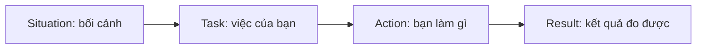
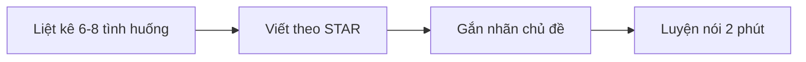
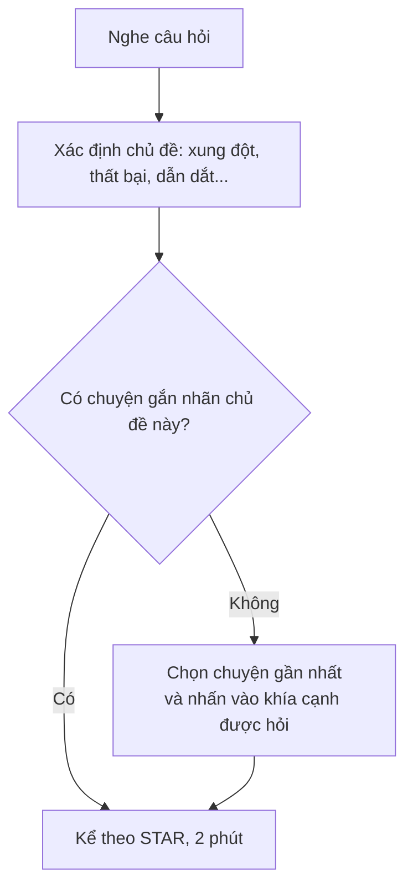

# Khung STAR và chuẩn bị kho câu chuyện

Phần lớn buổi phỏng vấn cấp cao có một nửa là câu hỏi hành vi (behavioral interview), dạng "Hãy kể về một lần bạn...". Bài này hướng dẫn bạn chuẩn bị sẵn một kho câu chuyện thật và kể chúng bằng khung STAR để người nghe thấy rõ bạn đã đóng góp gì.

**Tóm tắt:**

- Câu hỏi hành vi dựa trên nguyên tắc hành vi quá khứ dự báo hành vi tương lai, nên người phỏng vấn cần bằng chứng cụ thể chứ không cần câu trả lời "đúng".
- STAR gồm Situation, Task, Action, Result; Action chiếm 50 đến 60% vì là phần duy nhất chỉ ra năng lực riêng của bạn.
- Dùng "tôi" cho phần việc của mình và kèm số liệu ở Result để câu chuyện đáng tin.
- Có thể thêm L (Learning): nếu làm lại bạn sẽ đổi gì, đặc biệt quan trọng với chuyện thất bại.
- Chuẩn bị 6 đến 8 chuyện đa năng, gắn nhãn chủ đề, để một chuyện trả lời được nhiều câu hỏi.
- Mỗi chuyện kể trong khoảng 2 phút, luyện để nhớ ý chứ không học thuộc lòng.
- Không áp STAR cứng nhắc vào câu hỏi kỹ thuật thuần túy hay system design.

## STAR là gì?

STAR là khung kể chuyện gồm 4 bước: **S**ituation (bối cảnh), **T**ask (việc bạn phải làm), **A**ction (bạn đã làm gì) và **R**esult (kết quả). Giống như viết một bản tin ngắn: có hoàn cảnh, có nhiệm vụ, có hành động, có kết cục. Bạn chuẩn bị sẵn vài câu chuyện thật từ công việc để lúc nào cũng có cái để kể, thay vì nghĩ ra ngay trên ghế nóng.

## Vì sao phải chuẩn bị

Người phỏng vấn muốn đoán bạn sẽ làm gì trong tương lai, và cách đáng tin nhất là nghe bạn đã làm gì trước đây. Nếu bạn kể lan man hoặc nói chung chung ("tôi hay chủ động giao tiếp"), họ không thấy được đóng góp của bạn, dù thực tế bạn làm rất tốt. Hệ quả thường gặp: bạn bị đánh giá thấp hơn người kể gọn, có số liệu, dù người đó làm ít hơn.

**Nền tảng:** Câu hỏi hành vi dựa trên nguyên tắc hành vi trong quá khứ dự báo hành vi trong tương lai. Người phỏng vấn không cần câu trả lời "đúng", họ cần bằng chứng cụ thể về việc **bạn** đã làm gì, vì sao, và kết quả ra sao. Vì thế câu chuyện thật, có chi tiết và có số liệu luôn thắng câu trả lời chung chung.

## Khi nào dùng, khi nào không

Chuẩn bị kho chuyện trước buổi phỏng vấn, vì không ai kể tốt khi vừa nghĩ vừa nói. Cùng bộ chuyện này dùng lại được khi viết CV, tự đánh giá cuối kỳ hay họp review hiệu suất. Ngược lại, đừng áp STAR cứng nhắc vào câu hỏi kỹ thuật thuần túy ("giải thích MVCC") hay câu hỏi thiết kế hệ thống; ở đó người nghe cần kiến thức và lập luận, không cần một câu chuyện.

## Cách làm tóm tắt

Chọn 6-8 câu chuyện nổi bật, viết ra theo STAR, rồi tập nói gọn trong 2 phút. Hãy chọn chuyện đủ rộng để một chuyện trả lời được nhiều chủ đề (xung đột, thất bại, dẫn dắt...). Phần Action nói "tôi", và phần Result kèm số liệu.

## Các khái niệm cần biết

- **Behavioral question**: câu hỏi về hành vi trong quá khứ. Dấu hiệu nhận biết: bắt đầu bằng "Hãy kể về lần...", "Bạn xử lý thế nào khi...".
- **Reflection (L, Learning)**: phần tự nhìn lại ở cuối chuyện, "nếu làm lại tôi sẽ đổi gì". Nó cho thấy bạn học được từ kinh nghiệm, đặc biệt quan trọng với chuyện thất bại.
- **Trade-off (đánh đổi)**: lựa chọn mà được cái này thì mất cái kia. Câu chuyện cấp cao cần nêu bạn đã cân nhắc đánh đổi nào, không chỉ kết quả cuối.
- **p99**: ngưỡng latency mà 99% request nhanh hơn. Dùng trong ví dụ bên dưới để đo "trải nghiệm của những người chậm nhất".
- **Circuit breaker**: cơ chế ngắt tạm các call tới một service đang lỗi để không kéo cả hệ thống chết theo. Xuất hiện trong ví dụ như một phần của Action.

## Cấu trúc STAR

| Phần | Tỷ trọng | Lỗi hay gặp |
|---|---|---|
| Situation | 10-15% | Kể quá dài về bối cảnh |
| Task | 10% | Không nói rõ phần việc của mình |
| **Action** | **50-60%** | Dùng "chúng tôi", không nói được **bạn** làm gì và **vì sao** |
| **Result** | 15-20% | Không có số liệu, không nêu bài học |

Vấn đề của bảng trên là chỉ cho tỷ trọng, nên hãy hiểu lý do: Action quyết định người nghe đánh giá bạn, vì đó là phần duy nhất chỉ ra năng lực của riêng bạn. Situation dài quá sẽ ăn mất thời gian của Action.

**Suy luận:** Người phỏng vấn chỉ có khoảng hai phút để quyết định bạn đã thực sự làm gì, nên khung STAR được thiết kế để dồn phần lớn thời lượng vào phần duy nhất họ không thể suy ra từ bên ngoài. Bối cảnh và kết quả thì nghe qua là hiểu, còn Action mới cho thấy bạn đã chọn gì, bỏ gì và vì sao, tức là phán đoán của riêng bạn. Vì vậy khi bạn kể Situation quá dài, thời gian dành cho Action bị cắt, người nghe chỉ nhận được một bức tranh bối cảnh mà không có bằng chứng về năng lực. Điểm dễ nhầm là dùng "chúng tôi" cho khiêm tốn: người nghe không tách được phần của bạn, nên họ buộc phải coi đóng góp của bạn là nhỏ. Hệ quả hành động: khi luyện, đo xem Action có chiếm quá nửa thời gian không, và mọi động từ trong đó có chủ ngữ là "tôi" kèm lý do chọn cách đó hay không.

**Phải thuộc:** STAR gồm Situation (bối cảnh), Task (việc của bạn), Action (bạn đã làm gì và vì sao), Result (kết quả đo được), có thể thêm L (Learning, nếu làm lại sẽ đổi gì). Tỷ trọng gợi ý: Situation 10 đến 15%, Task 10%, Action 50 đến 60%, Result 15 đến 20%. Kể trong khoảng 2 phút, dùng "tôi" cho phần việc của mình, chuẩn bị 6 đến 8 câu chuyện đa năng gắn nhãn chủ đề.

Có thể thêm chữ **L** (Learning) hoặc **R** thứ hai (Reflection): nếu làm lại bạn sẽ đổi gì.

## Ví dụ rút gọn

> **S:** Service thanh toán thỉnh thoảng trả lỗi 504 vào giờ cao điểm, tỷ lệ lỗi 3%.
> **T:** Tôi được giao tìm nguyên nhân và giảm lỗi dưới 0,5% trong hai tuần.
> **A:** Tôi thêm metric latency theo từng dependency, phát hiện connection pool của DB cạn do một query thiếu index. Tôi thêm index, đặt timeout cho call tới đối tác, thêm circuit breaker, và viết alert theo độ bão hòa pool.
> **R:** Lỗi giảm từ 3% còn 0,2%, p99 từ 4 giây xuống 600 ms. Tôi rút ra: luôn đo trước khi sửa và đặt timeout cho mọi network call.

## Xây kho câu chuyện

Vấn đề đặt ra là bạn không thể chuẩn bị một chuyện riêng cho mỗi câu hỏi có thể gặp. Cách giải quyết là chuẩn bị một số chuyện "đa năng", gắn nhãn chủ đề, để khi nghe câu hỏi bạn chọn đúng chuyện.

Flow chọn chuyện khi nghe câu hỏi:

Mỗi chuyện nên có: **bối cảnh rõ, quyết định khó, trade-off bạn cân nhắc, tác động đo được, điều bạn học**.

**Suy luận:** Kho chuyện đa năng tồn tại vì số câu hỏi có thể gặp là vô hạn nhưng số chủ đề gốc (xung đột, thất bại, dẫn dắt, mơ hồ...) là hữu hạn, nên gắn nhãn theo chủ đề thì một chuyện phủ được nhiều câu. Chuyện chỉ phủ được nhiều chủ đề khi nó có quyết định khó và trade-off, vì chính các chi tiết đó cho phép bạn đổi trọng tâm tùy câu hỏi, trong khi chuyện chỉ có kết quả thì chỉ trả lời được một kiểu. Điểm dễ nhầm là chuẩn bị đúng một chuyện cho mỗi câu: khi gặp câu lạ, bạn không có gì để kể và phải bịa ngay tại chỗ, lúc đó người phỏng vấn đào sâu là lộ ngay. Vì vậy khi viết kho, hãy ghi sẵn ở mỗi chuyện các khía cạnh có thể nhấn (quyết định, xung đột, bài học) thay vì chỉ ghi diễn biến. Bảng gợi ý các chủ đề cần có chuyện:

| Chủ đề | Ví dụ chuyện cần chuẩn bị |
|---|---|
| Thành tựu lớn nhất | Dự án bạn tự hào nhất, vai trò thật của bạn |
| Thất bại, sai lầm | Lỗi production bạn gây ra và cách xử lý |
| Xung đột | Bất đồng kỹ thuật với đồng nghiệp hoặc quản lý |
| Dẫn dắt, ảnh hưởng | Thuyết phục đội đổi hướng không có quyền ra lệnh |
| Thời hạn, mơ hồ | Yêu cầu chưa rõ, phải ra quyết định khi thiếu thông tin |
| Kỹ thuật khó | Vấn đề phức tạp bạn đã phân tích và giải |
| Học hỏi | Học công nghệ mới nhanh để giải một bài toán thật |

## Điều cần nhớ

- Dùng **"tôi"** cho phần việc của mình, nhưng ghi nhận đóng góp của người khác cho phần của họ.
- Số liệu làm câu chuyện đáng tin: giảm bao nhiêu %, nhanh hơn bao nhiêu, tiết kiệm bao nhiêu.
- Chuyện thật, đừng bịa; người phỏng vấn sẽ đào sâu ("vì sao bạn chọn cách đó?", "nếu không có A thì sao?").
- Thất bại là kho báu nếu bạn nêu được **nguyên nhân gốc và thay đổi cụ thể** sau đó.
- Luyện để nhớ ý, không học thuộc lòng.

