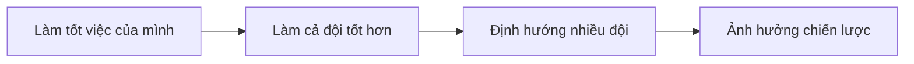
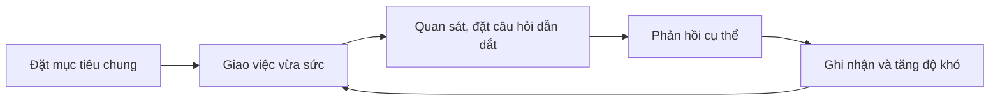
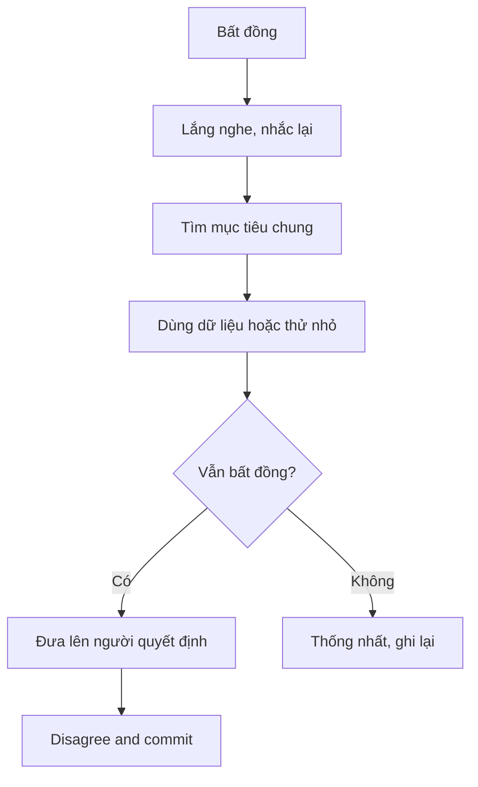

# Dẫn dắt kỹ thuật, Mentoring và xử lý xung đột

Khi lên cấp cao, bạn không còn được đánh giá chỉ bằng số dòng code bạn viết. Bài này hướng dẫn ba việc ngoài code mà kỹ sư cấp cao phải làm: giúp người khác làm được nhiều hơn (mentoring), chỉ hướng kỹ thuật cho nhóm, và gỡ bất đồng khi mọi người không thống nhất.

**Tóm tắt:**

- Ở cấp cao bạn được đo bằng kết quả của cả nhóm, nên việc chính là biến năng lực của mình thành năng lực của nhiều người.
- Nếu mọi việc khó đều đi qua bạn, bạn thành bottleneck và dự án đứng lại khi bạn vắng mặt.
- Mentoring: đặt mục tiêu chung, giao việc vừa sức, đặt câu hỏi dẫn dắt, phản hồi cụ thể, ghi nhận, rồi tăng độ khó.
- Phản hồi tốt gồm hành vi cụ thể, tác động, gợi ý cải thiện; nói về hành vi chứ không về con người.
- Delegation đúng là giao kết quả cùng bối cảnh, thống nhất tiêu chí hoàn thành và mốc kiểm tra, không micromanagement.
- Xung đột: lắng nghe, tìm mục tiêu chung, dùng dữ liệu hoặc thử nghiệm nhỏ, đưa lên người quyết định nếu cần, rồi disagree and commit.
- Ước lượng theo khoảng kèm giả định, trượt tiến độ thì báo sớm và đề xuất cắt scope hoặc đổi deadline.

## Vấn đề nó giải quyết

Một người dù giỏi cỡ nào cũng chỉ code được từng ấy. Nếu bạn làm hết mọi thứ khó, nhóm sẽ phụ thuộc vào bạn, bạn thành bottleneck (mọi việc phải đi qua bạn), và khi bạn nghỉ phép dự án đứng lại. Ở cấp cao, bạn được đo bằng kết quả của cả nhóm, nên việc quan trọng là biến năng lực của bạn thành năng lực của nhiều người.

## Khi nào dùng, khi nào không

Các kỹ năng này dùng khi dẫn dắt dự án, kèm đồng nghiệp mới, thương lượng giữa các đội, và chắc chắn được hỏi khi phỏng vấn vị trí cấp cao. Không phải việc gì cũng cần giao: việc nhỏ mà tự làm nhanh hơn thì cứ làm; việc lặp đi lặp lại hoặc việc là cơ hội để người khác lớn lên thì nên giao và hướng dẫn. Ngược lại, giao một việc lớn mà không có bối cảnh và mốc kiểm tra là bỏ rơi chứ không phải delegation.

## Cách làm tóm tắt

Cho người nhận việc đủ bối cảnh và hướng đi chứ không chỉ giao task. Delegate có kiểm soát: giao việc, thỏa thuận mốc kiểm tra. Phản hồi cụ thể, kịp thời. Khi xung đột thì quay về mục tiêu chung và dữ liệu, không cãi theo kiểu thắng thua.

## Các khái niệm cần biết

- **Mentoring**: kèm cặp một người có ít kinh nghiệm hơn theo mục tiêu phát triển của họ, khác với việc chỉ giao việc hoặc sửa bài hộ.
- **Delegation**: giao cho người khác một kết quả cần đạt cùng quyền quyết định cách làm. Khác với micromanagement, nơi bạn chỉ từng bước.
- **Spike**: một việc ngắn, giới hạn thời gian, để tìm hiểu hoặc thử nghiệm một điểm rủi ro kỹ thuật trước khi cam kết làm thật. Ví dụ: 2 ngày thử xem thư viện X có chịu được tải mong muốn không.
- **Retrospective**: buổi họp nhìn lại dự án để rút ra điều đã tốt, điều cần cải thiện.
- **Disagree and commit**: bạn nêu bất đồng đầy đủ, nhưng khi người có quyền đã quyết thì cả nhóm cùng thực hiện hết sức, không ngầm phá.
- **Managing up, managing across**: chủ động cung cấp thông tin và giải pháp cho quản lý (lên) và cho đồng nghiệp ở đội khác (ngang), thay vì chờ được hỏi.

## Từ cá nhân đến nhân rộng tác động

Tín hiệu cấp độ: bạn giải bài toán **mơ hồ**, tác động vượt ra ngoài nhóm, người khác nhờ bạn định hướng, và hệ thống/đội tốt hơn khi bạn **vắng mặt**.

**Nền tảng:** Ở cấp cao, giá trị của bạn đo bằng việc làm cả nhóm giỏi hơn chứ không phải số code tự viết. Nếu mọi việc khó đều đi qua bạn, bạn thành nút thắt cổ chai; nhân rộng tác động bằng mentoring, delegation và định hướng kỹ thuật. Tín hiệu cấp độ: giải bài toán mơ hồ, tác động vượt ngoài nhóm, và đội vẫn tốt khi bạn vắng mặt.

## Mentoring

| Hành vi | Cách làm |
|---|---|
| Đặt mục tiêu | Hỏi người được hướng dẫn muốn đi tới đâu, thống nhất mục tiêu ngắn hạn |
| Hướng dẫn | Đặt câu hỏi dẫn dắt thay vì đưa đáp án ngay; để họ tự đi trước, chặn khi sắp mắc lỗi tốn kém |
| Giao việc có độ khó vừa | Đủ thử thách nhưng có lưới an toàn; giảm dần sự giúp đỡ |
| Phản hồi | Cụ thể, kịp thời, về hành vi và tác động, kèm gợi ý cải thiện |
| Ghi nhận | Công khai công nhận thành quả của họ |

Bảng trên mô tả từng hành vi, còn thứ tự thực tế là: đặt mục tiêu chung, giao việc vừa sức, quan sát, phản hồi, ghi nhận, rồi tăng độ khó. Sai ở bước nào thì hiện tượng cũng dễ thấy: không đặt mục tiêu thì người được kèm không biết mình đang tiến bộ hay không; cho đáp án ngay thì họ không tự học; phản hồi chung chung thì họ không biết sửa gì.

Ví dụ phản hồi tốt: "Trong PR hôm qua, bạn thêm test cho trường hợp biên rất kỹ (hành vi), nên bắt được lỗi trước khi lên production (tác động). Lần tới thử viết thêm integration test cho flow thanh toán." Phản hồi xấu: "Code của bạn ổn" hoặc "Bạn cẩu thả".

**Phải thuộc:** Phản hồi tốt có ba phần: hành vi cụ thể, tác động của nó, và gợi ý cải thiện; kịp thời và về hành vi chứ không về con người. Delegation đúng cách là giao kết quả mong muốn cùng bối cảnh, thống nhất tiêu chí hoàn thành và mốc kiểm tra, để người nhận chọn cách làm, tránh giao mơ hồ hoặc micromanagement.

**Suy luận:** Mentoring hiệu quả khi bạn cho đáp án chậm hơn mức bạn muốn, vì năng lực của người được kèm chỉ tăng ở chỗ họ tự suy nghĩ. Nếu bạn đưa đáp án ngay, vấn đề hôm nay được giải nhanh nhưng lần sau họ lại quay về hỏi bạn, tức là bạn tự tạo thêm bottleneck cho mình. Ngược lại, câu hỏi dẫn dắt buộc họ dựng mô hình trong đầu, và chính mô hình đó áp dụng được cho vấn đề kế tiếp mà bạn chưa nhìn thấy. Tuy nhiên để họ đi một mình hoàn toàn cũng sai, vì lỗi tốn kém (mất data, ảnh hưởng production) không có giá trị học tương xứng với thiệt hại, nên bạn chỉ chặn ở đó. Điểm dễ nhầm là coi việc tự làm hộ là giúp đỡ: nó nhanh với bạn nhưng bào mòn tự tin của họ. Hệ quả hành động: giao việc vừa sức, đặt mốc kiểm tra sớm, và giảm dần mức hỗ trợ theo thời gian.

## Delegation và thúc đẩy

Vấn đề của nhiều người mới dẫn dắt là hoặc giao quá ít bối cảnh ("làm cái này đi") hoặc giám sát từng bước. Cách delegate đúng:

- Giao **kết quả mong muốn** và bối cảnh, không chỉ danh sách việc; để người nhận chọn cách làm.
- Thống nhất tiêu chí hoàn thành, mốc kiểm tra và khi nào cần báo.
- Chấp nhận cách làm khác bạn miễn đạt kết quả; tránh "làm lại hộ".

## Dẫn dắt kỹ thuật cho một dự án

Một dự án do bạn dẫn dắt thường đi theo năm bước sau; điểm quan trọng nhất là bước 2, vì rủi ro lớn phát hiện muộn sẽ làm trượt cả dự án.

1. **Làm rõ vấn đề và thành công** với các bên liên quan; viết thiết kế ngắn.
2. **Chia việc** thành phần độc lập, nhận diện rủi ro lớn và làm trước (spike).
3. **Đồng bộ** thường xuyên nhưng ít họp; minh bạch tiến độ và rủi ro.
4. **Xử lý trở ngại** cho đội; bảo vệ họ khỏi nhiễu.
5. **Chốt và rút kinh nghiệm**: tài liệu, bàn giao, hồi cứu.

## Xử lý xung đột

Đọc sơ đồ: bạn không vào cuộc để thắng, mà để tìm điều cả hai phía cùng muốn, rồi dùng dữ liệu hoặc một thử nghiệm nhỏ để quyết định thay vì tranh luận ý kiến. Chỉ khi vẫn không đồng thuận mới đưa lên người có quyền; sau đó mọi người thực hiện theo quyết định (disagree and commit).

**Phải thuộc:** Quy trình xử lý xung đột: lắng nghe và nhắc lại, tìm mục tiêu chung, dùng dữ liệu hoặc thử nghiệm nhỏ để quyết định, nếu vẫn bất đồng thì đưa lên người có quyền quyết, rồi disagree and commit. Ước lượng theo khoảng (tốt nhất, thường, xấu nhất) kèm giả định; trượt tiến độ thì báo sớm, nêu nguyên nhân, đề xuất cắt phạm vi hoặc đổi thời hạn.

**Suy luận:** Quy trình xung đột đặt dữ liệu và thử nghiệm nhỏ trước khi leo thang vì tranh luận ý kiến không có điểm dừng: mỗi bên đều có lý do hợp lý và đều thấy mình đúng. Khi chuyển sang một câu hỏi kiểm chứng được (benchmark, spike hai ngày), cuộc tranh luận về con người trở thành cuộc tìm kiếm sự thật chung, nên cả hai bên giữ được thể diện. Chỉ khi dữ liệu cũng không phân định, ví dụ vì hai phương án đều ổn và khác nhau ở sở thích, mới cần người có quyền chốt, vì tốn thêm thời gian tranh luận còn tốn hơn chọn sai một phương án đảo ngược được. Điểm dễ nhầm là coi disagree and commit là im lặng chịu đựng: thực ra nó chỉ có giá trị khi bạn đã nêu bất đồng đầy đủ trước đó, rồi sau quyết định thì không ngầm phá. Hệ quả hành động: khi thấy bất đồng kéo dài, hãy hỏi "dữ liệu nào làm anh đổi ý?" thay vì lặp lại lập luận của mình.

- Khi cảm xúc cao: dừng, nói chuyện riêng trực tiếp thay vì qua tin nhắn.
- Hỏi "Điều gì làm bạn lo nhất với phương án này?" thay vì chứng minh mình đúng.
- Công nhận phần đúng trong quan điểm đối phương.
- Với xung đột kéo dài giữa hai đội: làm rõ ai sở hữu quyết định, thống nhất nguyên tắc ưu tiên chung.

## Quản lý lên và quản lý ngang

- Hiểu mục tiêu và áp lực của quản lý; **đưa giải pháp cùng vấn đề**.
- Báo trước rủi ro và thay đổi thời hạn, kèm các lựa chọn và đánh đổi.
- Từ chối khéo: "Tôi có thể làm A hoặc B trong quý này, không cả hai; bạn muốn ưu tiên cái nào?"
- Xây quan hệ với các đội khác trước khi cần đến họ.

## Ước lượng và quản lý kỳ vọng

Vấn đề: ước lượng một con số duy nhất dễ bị hiểu là cam kết, trượt là mất lòng tin. Cách giải quyết:

- Ước lượng theo **khoảng** (tốt nhất, thường, xấu nhất) và nêu giả định, rủi ro.
- Chia nhỏ để ước lượng chính xác hơn; thêm đệm cho điều chưa biết.
- Khi trượt tiến độ: báo sớm, nêu nguyên nhân, đề xuất cắt phạm vi hoặc đổi thời hạn.

## Điều cần nhớ

- Khoe thành tích cá nhân kém thuyết phục hơn kể cách bạn **làm người khác thành công**.
- Một câu chuyện dẫn dắt tốt gồm: bối cảnh mơ hồ, bạn tạo tầm nhìn, huy động người, vượt trở ngại, kết quả và tác động tới tổ chức.
- Xung đột lành mạnh là dấu hiệu đội tin nhau; tránh né tránh và tránh công kích cá nhân.

