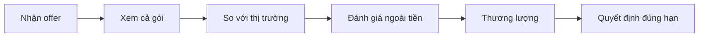

# Chuẩn bị phỏng vấn, đặt câu hỏi ngược và thương lượng offer

Biết kiến thức là điều kiện cần, nhưng để đi từ vòng đầu đến lúc ký offer còn một phần "ngoài kiến thức": chuẩn bị cho từng vòng, đặt câu hỏi ngược lại người phỏng vấn, và cân nhắc rồi thương lượng khi nhận offer. Bài này đi theo đúng trình tự đó.

**Tóm tắt:**

- Hai người giỏi ngang nhau thì người chuẩn bị có kế hoạch thường qua vòng, và phần offer ảnh hưởng thu nhập nhiều năm.
- Mỗi vòng kiểm một năng lực khác nhau (kiến thức, coding, system design, hành vi), nên kế hoạch ôn phải phủ cả chuỗi vòng.
- Ôn đều đặn và dùng active recall (tự trả lời thành tiếng) hiệu quả hơn đọc đi đọc lại; dồn thời gian vào vòng yếu nhất.
- Không biết thì nói thẳng và nêu cách tìm hiểu, không bịa; gặp bài lạ thì chia nhỏ và hỏi gợi ý.
- Luôn chuẩn bị câu hỏi ngược về công việc, kỹ thuật, đội ngũ; phỏng vấn là hai chiều.
- Đánh giá offer theo cả gói (lương, thưởng, sign-on bonus, cổ phần, phúc lợi), so với thị trường cùng level.
- Thương lượng hợp tác, dựa trên dữ liệu và leverage trung thực, nêu con số kèm lý do, chốt bằng văn bản; level thường quan trọng hơn vài phần trăm lương.

## Vì sao phải làm có kế hoạch

Hai người giỏi ngang nhau thì người chuẩn bị có kế hoạch thường qua vòng, vì họ ít bị vấp ở những câu quen thuộc và biết cách kể điều mình làm. Ở khâu offer, chỉ cần im lặng nhận ngay là có thể bỏ lỡ một khoản lương, thưởng hoặc cấp bậc đáng kể; và công ty bạn chọn sẽ ảnh hưởng cả vài năm sự nghiệp. Vì vậy phần này đáng được đầu tư như phần kỹ thuật.

## Khi nào làm gì, khi nào không

Bắt đầu từ vài tuần trước vòng phỏng vấn đầu tiên và kéo dài đến lúc trả lời offer. Câu hỏi ngược thì vòng nào cũng nên có. Không cần thương lượng nếu offer đã đúng mong muốn và hợp lý so với thị trường, nhưng ngay cả lúc đó vẫn nên hỏi kỹ các điều khoản. Đừng thương lượng bằng cách bịa offer khác: nếu bị kiểm chứng, bạn mất uy tín và có thể mất cả offer.

## Cách làm tóm tắt

Lập lịch ôn theo từng vòng, luyện phỏng vấn thử thành tiếng, chuẩn bị sẵn vài câu hỏi ngược về đội, dự án, cách làm việc. Khi thương lượng thì dựa trên dữ liệu thị trường và các offer thật, nói thật.

## Các khái niệm cần biết

- **Vòng sàng lọc CV (screening)**: bước đầu, thường là nhà tuyển dụng gọi hoặc xem hồ sơ, để kiểm tra bạn có khớp cơ bản về vị trí, mức lương mong muốn, thời gian.
- **System design**: vòng bạn phác thảo kiến trúc cho một hệ thống lớn (ví dụ rút gọn link) và giải thích trade-off. Không có đáp án duy nhất.
- **Active recall**: tự trả lời câu hỏi không nhìn tài liệu để buộc não truy xuất, nhớ lâu hơn đọc lại.
- **Mock interview**: luyện với người khác hoặc ghi âm, giả lập điều kiện thật.
- **Total compensation**: tổng của lương cơ bản, thưởng, thưởng ký hợp đồng, cổ phần và phúc lợi, không chỉ con số lương hằng tháng.
- **Sign-on bonus**: khoản thưởng trả một lần khi nhận việc, thường dễ thương lượng hơn lương cơ bản.
- **Level**: bậc nghề của bạn trong công ty. Nó quyết định khung lương, phạm vi trách nhiệm và đường thăng tiến, nên ảnh hưởng thu nhập nhiều năm.
- **Leverage**: lợi thế khi thương lượng, như một offer khác, hoặc kỹ năng khan hiếm.

## Hiểu các vòng phỏng vấn

Đọc sơ đồ: mỗi mũi tên là một "cổng" bạn phải qua, và mỗi vòng kiểm một năng lực khác nhau (kiến thức, giải quyết vấn đề, thiết kế, cách làm việc với người). Thiếu một trong các mảng đó là bị loại dù mạnh ở mảng khác. Vì vậy kế hoạch ôn phải phủ đủ cả chuỗi.

Hỏi nhà tuyển dụng trước: số vòng, hình thức từng vòng, ngôn ngữ cho coding, thời lượng, ai phỏng vấn. Mỗi công ty khác nhau.

## Kế hoạch ôn (khoảng 6 tuần, điều chỉnh theo bạn)

| Giai đoạn | Nội dung | Tài liệu trong bộ ghi chú |
|---|---|---|
| Tuần 1-2 | Củng cố nền tảng: Java, Spring, DB | [Java Core](/go?p=08-Java%2FJava-Core%2Findex.md), [Spring Boot](/go?p=01-Spring-Boot%2Findex.md), [Database](/go?p=02-Database%2Findex.md) |
| Tuần 2-4 | Thuật toán đều mỗi ngày (1-2 bài, nói to suy nghĩ) | [Thuật toán](/go?p=05-Algorithms%2Findex.md) |
| Tuần 3-5 | System Design: học khung, rồi luyện bài | [System Design](/go?p=15-System%20Design%2Findex.md), [Cách trả lời](/go?p=07-Interview-QA%2FBackend%2Fhard%2Fqa-07-cach-tra-loi-system-design.md) |
| Tuần 4-5 | Câu hỏi và đáp án thành tiếng | [Bộ câu hỏi](/go?p=07-Interview-QA%2FBackend%2Findex.md) |
| Tuần 5-6 | Hành vi, mô phỏng toàn bộ vòng, nghỉ ngơi trước ngày thi | [STAR](/go?p=07-Interview-QA%2FBehavioral%2Feasy%2Flt-01-star-chuan-bi-cau-chuyen.md) |

Bảng trên chỉ là mẫu; hãy dịch chuyển tuần theo vòng bạn yếu nhất. Nếu vòng coding là điểm yếu, dành nhiều tuần cho thuật toán hơn là đọc thêm lý thuyết.

Nguyên tắc: **đều đặn và chủ động nhớ lại** (tự trả lời, tự giải) hiệu quả hơn đọc đi đọc lại. Luyện mô phỏng với người khác (hoặc ghi âm) vì nói to khác với nghĩ thầm.

**Suy luận:** Active recall hiệu quả hơn đọc lại vì cơ chế ghi nhớ của não phụ thuộc vào việc truy xuất, không phải việc tiếp nhận. Khi đọc lại, nội dung hiện sẵn trước mắt nên bạn nhận ra nó và có cảm giác đã thuộc, nhưng trong phòng phỏng vấn không có trang nào để nhìn, nên cảm giác đó biến mất. Khi tự trả lời thành tiếng, bạn buộc phải lấy thông tin ra từ trí nhớ, lộ ngay chỗ hổng, và chính việc sửa chỗ hổng đó củng cố đường truy xuất. Vì vậy, điểm dễ nhầm là đo mức chuẩn bị bằng số trang đã đọc, trong khi thước đo đúng là số câu bạn trả lời được mà không nhìn tài liệu. Hệ quả hành động: mỗi buổi ôn nên dành phần lớn thời gian tự trả lời và mock interview, ghi lại câu vấp, rồi dồn lần sau vào đúng những chỗ đó thay vì ôn đều.

**Nền tảng:** Chuẩn bị phỏng vấn hiệu quả nhờ đều đặn và chủ động nhớ lại (active recall: tự trả lời, tự giải, nói thành tiếng) hơn là đọc đi đọc lại. Mỗi vòng kiểm một năng lực khác nhau (kiến thức, coding, thiết kế, cách làm việc với người), nên hãy dồn thời gian vào vòng yếu nhất thay vì ôn đều.

## Ngày phỏng vấn

- Đọc lại mô tả công việc và sản phẩm của công ty; chuẩn bị một vài hiểu biết cụ thể.
- Với coding: làm rõ đề, nói to, bắt đầu từ lời giải đơn giản, kiểm thử bằng ví dụ, phân tích độ phức tạp.
- Gặp bài chưa biết: bình tĩnh, chia nhỏ, hỏi gợi ý; người phỏng vấn đánh giá cách bạn xử lý bế tắc.
- Không biết thì nói thẳng và nêu cách bạn sẽ tìm hiểu; đừng bịa.
- Nghỉ ngơi, ăn ngủ đủ; kiểm tra micro, camera, mạng, môi trường code trước nếu phỏng vấn từ xa.

## Câu hỏi để hỏi ngược lại

Hỏi những điều bạn thật sự muốn biết; đây cũng là cách đánh giá công ty.

| Chủ đề | Ví dụ |
|---|---|
| Công việc | Một ngày điển hình? Thành công ở vị trí này sau 6-12 tháng trông thế nào? |
| Kỹ thuật | Kiến trúc hiện tại và technical debt lớn nhất? Quy trình deploy, tần suất, xử lý incident, on-call? |
| Đội ngũ | Cách đội ra quyết định kỹ thuật? Code review, tài liệu, chia sẻ kiến thức? |
| Phát triển | Lộ trình nghề nghiệp, đánh giá hiệu suất, cơ hội học? |
| Công ty | Ưu tiên sản phẩm 1-2 năm tới? Điều khiến bạn ở lại công ty? |
| Cân bằng | Làm việc từ xa/linh hoạt, mức độ làm thêm giờ thực tế? |

Tránh hỏi những điều tìm được ngay trên trang web, hoặc chỉ hỏi về lương/phúc lợi ở vòng đầu.

## Đánh giá offer

Đọc sơ đồ: đừng chỉ nhìn con số lương. Xem cả gói (thưởng, cổ phần, phúc lợi), so với mặt bằng thị trường cho cùng cấp bậc, rồi cân nhắc các yếu tố không phải tiền (đội, công nghệ, lộ trình), sau đó mới thương lượng và trả lời trước hạn.

**Phải thuộc:** Đánh giá offer theo cả gói (lương cơ bản, thưởng, sign-on bonus, cổ phần, phúc lợi), so với thị trường cùng cấp bậc, rồi cân nhắc yếu tố ngoài tiền. Khi thương lượng: cảm ơn trước, dựa trên dữ liệu và đòn bẩy trung thực, nêu con số hoặc khoảng kèm lý do, giữ thái độ hợp tác, mọi thỏa thuận cuối cùng bằng văn bản. Level thường ảnh hưởng thu nhập nhiều hơn vài phần trăm lương.

## Thương lượng

Vấn đề thường gặp là ngại nói chuyện tiền, hoặc mở lời quá gắt. Cách làm đúng là hợp tác: bạn và công ty cùng tìm một mức khiến cả hai hài lòng.

**Suy luận:** Thương lượng nên hợp tác và đi theo cả gói vì công ty đã chọn bạn và đã tốn công tuyển, nên họ muốn chốt được; cái họ cần là một lý do chính đáng để đẩy offer lên trong khung ngân sách và level cho phép. Dữ liệu thị trường và offer thật cung cấp đúng lý do đó, còn ra tối hậu thư hay bịa offer thì biến buổi trao đổi thành đối đầu và dễ bị kiểm chứng. Khung lương gắn với level, nên bạn thương lượng level có thể nâng mức trần của nhiều năm sau, trong khi thêm vài phần trăm lương cơ bản chỉ có tác dụng một lần. Điểm dễ nhầm là chỉ so con số lương hằng tháng: sign-on bonus và cổ phần thường linh hoạt hơn lương cơ bản, nên nếu chỉ đẩy một biến bạn bỏ qua những chỗ dễ nhượng bộ nhất. Hệ quả hành động: khi nhận offer, xin thời gian cân nhắc, liệt kê cả gói, nêu khoảng kèm lý do, rồi chốt mọi thứ bằng văn bản.

- Xin thời gian cân nhắc hợp lý, **cảm ơn và thể hiện quan tâm** trước.
- Dựa trên **dữ liệu thị trường** và giá trị bạn mang lại; có phương án thay thế mạnh làm đòn bẩy (nói trung thực).
- Thương lượng **cả gói**: mức lương, thưởng ký hợp đồng, cổ phần, cấp bậc, ngày bắt đầu, đào tạo, làm việc linh hoạt.
- Nêu con số hoặc khoảng cụ thể, kèm lý do; im lặng sau khi nêu để đối phương phản hồi.
- Giữ thái độ hợp tác, không ra tối hậu thư; mọi thỏa thuận cuối cùng cần **bằng văn bản**.
- Level thường ảnh hưởng tổng thu nhập nhiều hơn vài phần trăm lương: xem xét cẩn thận.

## Điều cần nhớ

- Phỏng vấn là hai chiều: bạn cũng đang chọn công ty.
- Bị từ chối không có nghĩa bạn kém; hỏi phản hồi nếu có thể và cải thiện vòng sau.
- Giữ nhật ký phỏng vấn: câu nào vấp, chủ đề nào cần học thêm.
- Giữ quan hệ tốt dù kết quả thế nào; ngành này nhỏ hơn bạn nghĩ.

