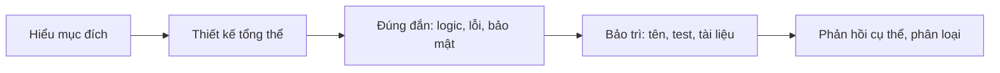
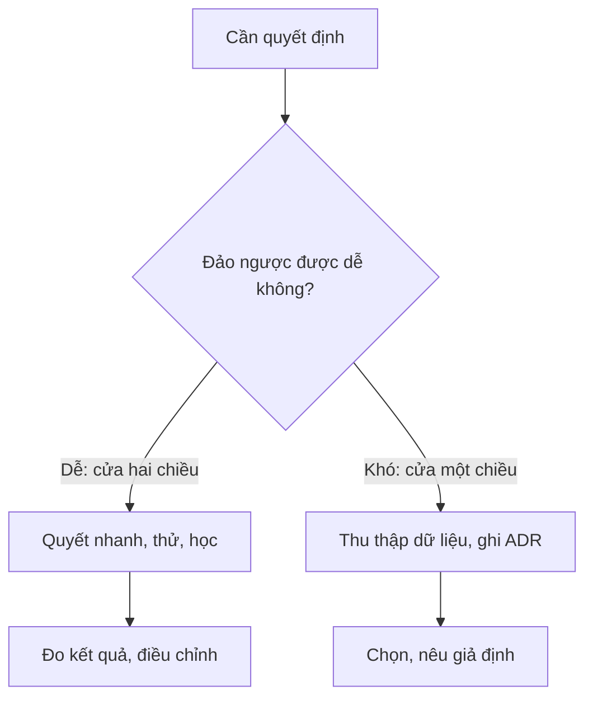

# Code review, giao tiếp kỹ thuật và ra quyết định

Một đội làm việc trơn tru hay không phụ thuộc rất nhiều vào những việc diễn ra hằng ngày ngoài lúc gõ code: review code của nhau, viết và nói cho rõ, và ghi lại vì sao chọn giải pháp này thay vì giải pháp khác. Bài này hướng dẫn từng việc đó.

**Tóm tắt:**

- Review code đi từ lớn đến nhỏ: mục đích, thiết kế tổng thể, tính đúng đắn, khả năng bảo trì, rồi phản hồi cụ thể.
- Phân loại góp ý thành chặn (phải sửa), đề nghị và nit, để người gửi biết cái nào bắt buộc.
- PR nhỏ, một mục đích, mô tả rõ vì sao; tranh cãi phong cách giao cho formatter và linter.
- Giao tiếp kỹ thuật: kết luận trước, lý do sau, nói rõ mức độ chắc chắn, báo tin xấu sớm kèm phương án.
- Design doc viết trước khi code cho thay đổi lớn, để nhận phản biện khi còn rẻ để đổi.
- ADR là một trang ngắn cho mỗi quyết định kiến trúc, không sửa ADR cũ mà tạo ADR mới thay thế.
- Trước mỗi quyết định hỏi "nếu sai thì quay lại tốn bao nhiêu": cửa hai chiều thì quyết nhanh, cửa một chiều thì phân tích kỹ; quyết xong thì disagree and commit.

## Vấn đề nó giải quyết

Code giỏi mà review gay gắt, viết mơ hồ, hoặc quyết định xong không ai nhớ lý do thì cả nhóm chậm lại. Ví dụ: người mới vào hỏi "sao chỗ này dùng Kafka?", không ai trả lời được, thế là có người đề xuất đổi sang thứ khác và cả đội tranh luận lại từ đầu. Kỹ sư cấp cao được đánh giá nhiều ở chỗ làm cả nhóm tốt lên, chứ không chỉ code của riêng mình.

## Khi nào dùng

Mỗi pull request cần một lần review; mỗi bản thiết kế cần một design doc; mỗi quyết định kiến trúc lớn nên có một ADR; mỗi cuộc họp kỹ thuật cần mục tiêu rõ. Phỏng vấn cũng hay hỏi chủ đề này. Không cần viết ADR cho quyết định nhỏ, dễ đảo ngược (đặt tên biến, chọn thư viện tiện ích): ghi lại quá nhiều khiến không ai đọc.

## Cách làm tóm tắt

Review để học và nâng chất lượng, không để bắt lỗi người khác. Viết tài liệu ngắn, có cấu trúc, đi thẳng vào ý. Quyết định kỹ thuật quan trọng thì ghi lại bằng ADR (bối cảnh, lựa chọn, lý do, hệ quả).

## Các khái niệm cần biết

- **Pull request (PR)**: đề nghị gộp một nhánh code vào nhánh chính, kèm không gian để đồng nghiệp xem và bình luận.
- **LGTM**: "looks good to me", lời chấp thuận nhanh. Dùng khi đã đọc thật; dùng để lướt qua PR lớn là dấu hiệu review hình thức.
- **Nit (nitpick)**: góp ý nhỏ, vặt, không bắt buộc sửa, nên gắn nhãn để người gửi biết có thể bỏ qua.
- **Linter, formatter**: tool tự động kiểm tra và định dạng code theo quy tắc, giúp đội không phải tranh cãi về phong cách trong review.
- **Design doc**: tài liệu thiết kế viết trước khi code cho thay đổi lớn, để lấy phản hồi sớm.
- **ADR (Architecture Decision Record)**: một trang ngắn ghi một quyết định kiến trúc: bối cảnh, quyết định, hệ quả, phương án đã loại.
- **Cửa một chiều và hai chiều**: ẩn dụ phân loại quyết định. Cửa hai chiều là dễ quay lại (thử, sai, đổi); cửa một chiều là khó quay lại (đổi database chính, public API).
- **Disagree and commit**: phản đối đầy đủ trước khi quyết, nhưng sau khi quyết thì cùng thực hiện.

## Code review tốt



Đọc sơ đồ: review đi từ lớn đến nhỏ. Hiểu mục đích trước, rồi xem thiết kế tổng thể (sai ở đây thì sửa chi tiết là vô nghĩa), sau đó mới tới tính đúng đắn và khả năng bảo trì. Bước cuối là viết phản hồi cụ thể và phân loại mức độ. Review theo thứ tự ngược lại (soi tên biến trước) làm người gửi mất công sửa rồi vẫn phải viết lại.

**Suy luận:** Thứ tự review từ lớn đến nhỏ xuất phát từ chi phí sửa: một sai lầm ở thiết kế kéo theo viết lại cả đoạn code, còn một cái tên xấu chỉ tốn vài giây để đổi. Nếu bạn soi tên biến trước, người gửi sửa xong lượt đầu, rồi lượt sau bạn mới nói "hướng này sai", toàn bộ công sửa lượt đầu bị bỏ đi và họ mất niềm tin vào review. Vì vậy phải xác nhận mục đích và thiết kế trước, rồi mới xuống tính đúng đắn và bảo trì. Điểm dễ nhầm là coi nhãn nit và nhãn chặn như nhau: không phân loại thì người gửi phải đoán cái nào bắt buộc, hoặc sửa hết mọi thứ làm PR chậm, hoặc bỏ qua cả phần phải sửa. Hệ quả hành động: khi review PR lớn hãy yêu cầu tách PR trước, vì "LGTM" cho thứ không đọc nổi còn tệ hơn không review.

Review là hợp tác giữa hai phía, mỗi bên có phần trách nhiệm:

| Người **review** | Người **gửi PR** |
|---|---|
| Phản hồi nhanh (trong ngày) | PR nhỏ, một mục đích, mô tả rõ **vì sao** |
| Nêu **lý do**, đề xuất cách thay thế | Tự review trước khi gửi |
| Phân loại: *chặn* (phải sửa), *đề nghị*, *nit* (vặt) | Có test, ảnh chụp/số liệu nếu cần |
| Khen điều làm tốt | Không phòng thủ: hỏi lại để hiểu |
| Hỏi thay vì áp đặt: "Bạn có nghĩ... không?" | Cảm ơn và giải thích khi không đồng ý |

Danh sách kiểm: đúng yêu cầu? trường hợp biên và lỗi? thread-safe? bảo mật (input, authorization)? hiệu năng ở quy mô thật (N+1, vòng lặp lồng)? đặt tên rõ? có test có ý nghĩa? tương thích ngược và migration?

**Phải thuộc:** Review đi từ lớn đến nhỏ: mục đích, thiết kế tổng thể, tính đúng đắn (logic, lỗi, bảo mật), khả năng bảo trì, rồi phản hồi cụ thể. Phân loại góp ý thành chặn (phải sửa), đề nghị và nit (vặt, không bắt buộc). Người gửi giữ PR nhỏ, một mục đích, mô tả rõ vì sao; tự động hóa tranh cãi phong cách bằng formatter và linter.

Chống lại: tranh cãi về phong cách (tự động hóa bằng formatter/linter), PR quá lớn ("LGTM" vì ngại đọc), phản hồi mang tính cá nhân.

## Giao tiếp kỹ thuật

- **Trả lời trước, giải thích sau:** nêu kết luận ở câu đầu, rồi lý do.
- Điều chỉnh theo người nghe: với quản lý nói tác động, rủi ro, thời gian; với kỹ sư nói chi tiết.
- Viết ngắn, có cấu trúc: bối cảnh, vấn đề, phương án, đề xuất, câu hỏi cần quyết định.
- Nói rõ **mức độ chắc chắn** ("tôi chắc 90%", "đây là giả định chưa kiểm chứng").
- Báo tin xấu **sớm** và kèm phương án.
- Họp: có mục tiêu, người quyết định, và kết thúc bằng việc cần làm có chủ.

## Tài liệu thiết kế (design doc)

Vấn đề đặt ra: viết xong cả tính năng rồi mới bị góp ý "hướng này sai" là tốn kém nhất. Design doc giải quyết bằng cách đưa ý tưởng ra cho người khác phản biện khi còn rẻ để đổi. Dùng cho thay đổi lớn, ảnh hưởng nhiều đội, hoặc khó đảo ngược; với thay đổi nhỏ chỉ cần mô tả trong PR.

| Mục | Nội dung |
|---|---|
| Bối cảnh và mục tiêu | Vấn đề gì, vì sao bây giờ |
| Phi mục tiêu | Những gì **không** làm |
| Thiết kế đề xuất | Sơ đồ, data flow, API, data model |
| Phương án đã cân nhắc | Và vì sao loại |
| Rủi ro và trade-off | Điểm lỗi, migration, bảo mật |
| Kế hoạch deploy và observability | Từng giai đoạn, cách rollback, chỉ số thành công |

Gửi cho người liên quan sớm để lấy phản hồi trước khi viết nhiều code.

## Ghi lại quyết định: ADR

**Architecture Decision Record**: một trang ngắn cho mỗi quyết định kiến trúc quan trọng, lưu trong repo.

```text
# ADR-012: Dùng Kafka cho event giữa các service
Trạng thái: Được chấp nhận (2026-03-02)
Bối cảnh: ... (áp lực, ràng buộc)
Quyết định: Dùng Kafka, topic theo miền nghiệp vụ ...
Hệ quả: + tách rời, chịu tải; - vận hành phức tạp, eventual consistency
Phương án đã loại: RabbitMQ (vì ...), gọi đồng bộ (vì ...)
```

Cách dùng: viết ADR ngay khi quyết định, đánh số tăng dần, không sửa ADR cũ mà tạo ADR mới ghi "thay thế ADR-012" khi đổi quyết định. Như vậy lịch sử không bị mất.

**Phải thuộc:** ADR (Architecture Decision Record) là một trang ngắn cho mỗi quyết định kiến trúc, gồm trạng thái, bối cảnh, quyết định, hệ quả (cả lợi lẫn hại) và phương án đã loại. Đánh số tăng dần, lưu trong repo, không sửa ADR cũ mà tạo ADR mới ghi rõ thay thế ADR nào. Design doc thì viết trước khi code, có cả mục phi mục tiêu và phương án đã cân nhắc.

Giá trị: người mới hiểu **vì sao** hệ thống như hiện tại; tránh tranh luận lại vô tận; dễ xem lại khi bối cảnh đổi.

**Suy luận:** ADR không sửa ADR cũ mà tạo ADR mới vì mục đích của nó là giữ lại lý do tại thời điểm quyết định, không phải mô tả trạng thái hiện tại. Bối cảnh khi đó (đội nhỏ, tải thấp, deadline) là thứ khiến lựa chọn hợp lý, nên nếu bạn ghi đè, người đọc sau chỉ thấy một quyết định có vẻ sai mà không hiểu vì sao nó từng đúng. Khi đã mất lý do, họ hoặc đảo ngược quyết định mà không biết ràng buộc cũ, hoặc giữ nguyên vì sợ động vào. Cả hai đều xuất phát từ việc thiếu lịch sử. Ngược lại, chuỗi ADR có "thay thế ADR-012" cho thấy bối cảnh đã đổi thế nào. Điểm dễ nhầm là viết ADR cho mọi thứ nhỏ nhặt, khiến không ai đọc; chỉ viết cho quyết định cửa một chiều hoặc gây tranh luận lặp lại.

## Ra quyết định khi không chắc chắn



Đọc sơ đồ: câu hỏi đầu tiên không phải "giải pháp nào tốt nhất" mà là "nếu sai thì quay lại tốn bao nhiêu". Với cửa hai chiều, tốn thời gian phân tích còn tệ hơn sai; với cửa một chiều, phân tích kỹ và ghi lại giả định để sau này kiểm lại.

**Nền tảng:** Cách ra quyết định khi thiếu thông tin: trước hết hỏi "nếu sai thì quay lại tốn bao nhiêu". Quyết định dễ đảo ngược (cửa hai chiều) thì quyết nhanh, thử, học; khó đảo ngược (cửa một chiều, như đổi database chính hay public API) thì phân tích kỹ, ghi giả định bằng ADR. Sau khi quyết, áp dụng disagree and commit.

- Phân biệt quyết định **dễ đảo ngược** (nhanh) và **khó đảo ngược** (cẩn thận).
- Nêu chi phí của việc **không** quyết định.
- Chọn giải pháp **đơn giản nhất đáp ứng yêu cầu hiện tại**, chừa đường mở rộng nhưng không xây thừa.
- "Không đồng ý nhưng cam kết": sau khi quyết định, ủng hộ hết mình dù bạn đã phản đối.

## Điều cần nhớ

- Review code là kênh truyền kiến thức và văn hóa quan trọng nhất của đội.
- Viết rõ ràng là nhân lực: một tài liệu tốt phục vụ hàng chục người.
- Quyết định không ghi lại thì sẽ bị tranh luận lại.

