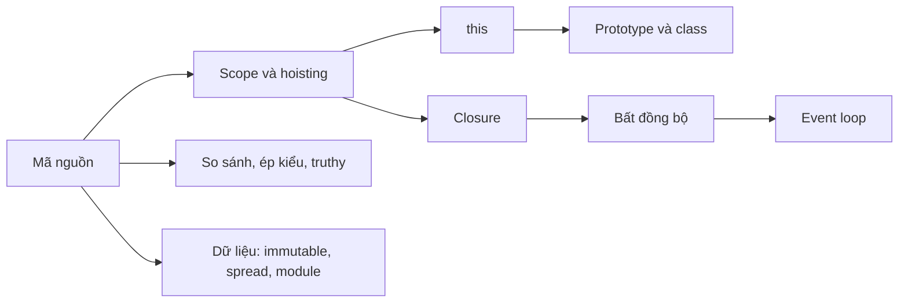
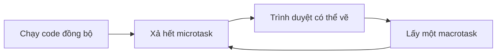

# Câu hỏi: JavaScript nền tảng

Mỗi câu hỏi được viết theo chuỗi suy luận: **Câu hỏi** như người phỏng vấn nói, **Gợi ý suy luận** (các câu hỏi nhỏ dẫn tới khái niệm nền), **Lập luận** (chuỗi nhân quả "vì A nên B"), **Đáp án ngắn** nói được thành tiếng, **Nhớ** (kiến thức cốt lõi và link bài gốc), rồi **Ví dụ** nếu cần. Mỗi **Hỏi xoáy** nêu thêm vì sao nó là bước kế tiếp logic của câu trước. Cách học: đọc câu hỏi, che phần dưới, tự đi theo gợi ý rồi mới so đáp án.

Kiến thức gốc: [JavaScript runtime và event loop](/go?p=11-Frontend-Core%2Flt-01-javascript-runtime-event-loop.md), [mục lục FE-Common](/go?p=11-Frontend-Core%2Findex.md). Đào sâu hơn: [Câu hỏi FE phỏng vấn mid-senior](/go?p=07-Interview-QA%2FFrontend%2Fhard%2Fqa-fe-phong-van.md). Phần TypeScript đọc ở [TypeScript nâng cao](/go?p=11-Frontend-Core%2Flt-02-typescript-nang-cao.md). Cặp bài này đi kèm [HTML và CSS layout](/go?p=07-Interview-QA%2FFrontend%2Feasy%2Fqa-fe-02-html-css-layout.md).

Quy ước về ví dụ, để bạn biết mức tin cậy:

- **"Đã chạy thử bằng Node"**: code JavaScript thuần, chạy bằng Node.js v22 trong môi trường soạn bài, output là thật. Node không có DOM, và một vài chi tiết của timer khác trình duyệt (ghi chú ở chỗ liên quan).
- **"Minh họa"**: code hoặc sơ đồ không chạy được ở đây (cần trình duyệt). Chỉ là dạng tiêu biểu.



Đọc sơ đồ: scope là nền, closure và `this` là hai cách một hàm "nhớ" ngữ cảnh, async dựa trên closure và event loop. Phần ép kiểu và dữ liệu là nhóm bẫy tách riêng.

**Tóm tắt:**

- Mọi câu JavaScript nền tảng quy về một chuỗi: scope và hoisting, closure, `this`, prototype, rồi async trên event loop.
- Closure là hàm giữ scope nơi nó được tạo, nên nhớ biến của hàm ngoài kể cả khi hàm ngoài đã chạy xong; đó cũng là gốc của memory leak khi giữ thứ lớn quá lâu.
- `this` do cách gọi quyết định, không do nơi khai báo; arrow function lấy `this` từ scope bao ngoài, và tách method khỏi object là cách mất `this` kinh điển.
- `class` là cú pháp bọc quanh prototype chain; method nằm trên prototype dùng chung, còn property riêng nằm trên instance.
- Mọi cách viết async (callback, Promise, async/await) cùng một cơ chế; event loop xả sạch microtask trước khi sang task kế, nên `Promise.then` luôn chạy trước `setTimeout(0)`.
- Hay bị hỏi xoáy: thứ tự log của đoạn trộn sync, microtask và macrotask; `[] == false` và truthy/falsy; spread chỉ copy nông.
- Hàm nhận object là reference nên sửa được property nhưng không gán lại được biến của người gọi; ESM là live binding, không phải bản copy.

## 1. Scope và hoisting: vì sao gọi hàm trước khi khai báo được, mà biến thì không?

**Câu hỏi:** Tôi gọi `hoistedFn()` ở dòng đầu, trước chỗ viết `function hoistedFn(){}` mà vẫn chạy. Nhưng đọc một biến `let` trước dòng khai báo thì báo lỗi, còn `var` thì ra `undefined`. Chuyện gì xảy ra ở đây?

**Gợi ý suy luận:**
- Engine đọc mã hai pha hay một pha: tạo "chỗ chứa" tên trước rồi mới chạy từng dòng?
- Khai báo hàm, `var`, `let/const` được khởi tạo giá trị ở thời điểm nào của hai pha đó?
- Khoảng từ đầu scope đến dòng khai báo `let` gọi là gì, và nó tránh lỗi nào?

**Lập luận:** Trước khi chạy, engine quét scope và đăng ký mọi tên khai báo (đó là hoisting, không phải "dời code lên đầu"). Khai báo hàm được đăng ký cùng thân hàm, nên gọi trước được. `var` được đăng ký và gán tạm `undefined`, nên đọc trước cho ra `undefined` thay vì lỗi, dễ che bug. `let/const` cũng được đăng ký nhưng ở trạng thái chưa khởi tạo cho tới khi chạy tới dòng khai báo, đoạn đó là vùng chết tạm thời (TDZ), đọc vào ném `ReferenceError`. Thêm nữa, `var` chỉ có scope hàm còn `let/const` có scope khối, nên biến không "rò" ra khỏi `if` hay `for`.

**Đáp án ngắn:** Mọi khai báo được đăng ký trước khi chạy. Hàm có sẵn thân, `var` có giá trị `undefined`, `let/const` nằm trong TDZ nên đọc sớm là lỗi. `var` scope hàm, `let/const` scope khối.

**Nhớ:** Dùng `const` mặc định, `let` khi cần gán lại, tránh `var`. Gốc: [Closure, this, prototype](/go?p=11-Frontend-Core%2Flt-01-javascript-runtime-event-loop.md).

**Ví dụ:** hoisting và TDZ.

```javascript
console.log(typeof hoistedFn, typeof hoistedVar);
function hoistedFn() {}
var hoistedVar = 1;
try { console.log(letVar); } catch (e) { console.log(e.name + ': ' + e.message); }
let letVar = 2;

var x = 1; { var x = 2; } console.log(x);   // var không có scope khối
let y = 1; { let y = 2; } console.log(y);   // let có scope khối
```

```text
function undefined
ReferenceError: Cannot access 'letVar' before initialization
2
1
```

_Đã chạy thử bằng Node._ Hàm có sẵn, `var` là `undefined`, `let` ném lỗi, và `var` trong khối ghi đè biến ngoài còn `let` thì không.

**Hỏi xoáy 1:** Vì sao vòng `for (var i...)` đẩy các callback ra mà tất cả đều in cùng một số?

**Vì sao hỏi tiếp:** Ví dụ kinh điển của scope hàm so với scope khối, và là cửa vào của closure.

**Gợi ý suy luận:** `var i` có bao nhiêu biến `i` cho cả vòng lặp? `let i` thì sao, mỗi lượt có bản riêng không?

**Đáp:** `var` chỉ có một `i` chung của hàm, các callback đọc sau khi vòng lặp xong nên cùng thấy giá trị cuối. `let` tạo một binding mới cho mỗi lượt lặp, mỗi callback giữ bản của lượt mình.

```javascript
var fns = [];
for (var i = 0; i < 3; i++) fns.push(() => i);
console.log(fns.map(f => f()));
const fns2 = [];
for (let j = 0; j < 3; j++) fns2.push(() => j);
console.log(fns2.map(f => f()));
```

```text
[ 3, 3, 3 ]
[ 0, 1, 2 ]
```

_Đã chạy thử bằng Node._

**Hỏi xoáy 2:** `typeof` một biến chưa khai báo có lỗi không, còn `typeof` một biến `let` trong TDZ thì sao?

**Vì sao hỏi tiếp:** Kiểm tra xem bạn phân biệt "chưa khai báo" với "đã khai báo nhưng chưa khởi tạo".

**Gợi ý suy luận:** Tên có nằm trong bảng đăng ký của scope không?

**Đáp:** `typeof undeclared` trả `"undefined"` vì tên không tồn tại, không lỗi. `typeof` một biến `let` đang trong TDZ vẫn ném `ReferenceError`, vì tên đã đăng ký nhưng chưa khởi tạo.

**Sai lầm hay gặp:** Nói "hoisting là đưa khai báo lên đầu file". Thực tế mã không bị di chuyển, chỉ là tên được đăng ký trước, và mỗi loại khai báo có trạng thái ban đầu khác nhau.

## 2. Closure: vì sao hàm trong còn nhớ biến của hàm ngoài đã chạy xong?

**Phải thuộc:** Câu này là câu cốt lõi, gặp rất thường xuyên.

**Câu hỏi:** Hàm `makeCounter` chạy xong rồi, biến `count` bên trong lẽ ra mất. Sao `inc()` gọi sau đó vẫn tăng đúng, và hai counter không lẫn nhau?

**Gợi ý suy luận:**
- Một hàm khi được tạo ra giữ reference tới môi trường (scope) nơi nó được định nghĩa hay nơi nó được gọi?
- Bộ dọn rác chỉ thu hồi vùng nhớ khi nào, và khi còn hàm reference tới scope thì sao?
- Mỗi lần gọi `makeCounter` tạo một scope mới hay dùng chung?

**Lập luận:** Hàm JavaScript nhớ môi trường từ nơi nó được định nghĩa (scope từ vựng), không phải nơi gọi. Khi `makeCounter` trả về các hàm con, các hàm đó vẫn trỏ tới scope của lần gọi đó, nên bộ dọn rác không thu hồi `count` chừng nào còn hàm con sống. Mỗi lần gọi `makeCounter` tạo một scope riêng, nên mỗi counter có `count` riêng. Closure vì vậy cho ta dữ liệu riêng tư mà không cần class, nhưng cũng là nguồn của memory leak nếu giữ reference lâu.

**Đáp án ngắn:** Closure là hàm cùng với môi trường từ vựng nơi nó được tạo. Biến ngoài còn sống chừng nào còn hàm reference tới nó, và mỗi lần gọi hàm ngoài tạo một môi trường mới.

**Nhớ:** Closure dùng cho dữ liệu riêng tư, factory, memoize, callback giữ ngữ cảnh. Rò rỉ khi closure giữ thứ lớn quá lâu. Gốc: [Closure, this, prototype](/go?p=11-Frontend-Core%2Flt-01-javascript-runtime-event-loop.md).

**Ví dụ:** hai counter độc lập.

```javascript
function makeCounter() {
  let count = 0;
  return { inc: () => ++count, get: () => count };
}
const c1 = makeCounter(), c2 = makeCounter();
c1.inc(); c1.inc(); c2.inc();
console.log(c1.get(), c2.get());
```

```text
2 1
```

_Đã chạy thử bằng Node._ Hai lần gọi có hai `count` khác nhau, `count` không truy cập được từ bên ngoài ngoài hai hàm trả về.

**Hỏi xoáy 1:** Closure có thể gây memory leak ở đâu trong một ứng dụng frontend?

**Vì sao hỏi tiếp:** Lập luận trên nói closure giữ scope sống, người phỏng vấn muốn biết hệ quả thực tế.

**Gợi ý suy luận:** Ai giữ callback lâu dài: `addEventListener`, `setInterval`, một mảng toàn cục? Khi component bị gỡ mà callback vẫn đăng ký thì sao?

**Đáp:** Callback đăng ký vào thứ sống lâu (event listener trên `window`, interval chưa clear, cache toàn cục) giữ scope của nó, kéo theo mọi biến lớn trong scope như DOM node hoặc mảng dữ liệu. Sửa bằng cách gỡ listener, clear interval khi unmount, và không giữ dữ liệu lớn trong scope không cần thiết. Xem [mục Memory và rò rỉ](/go?p=11-Frontend-Core%2Flt-01-javascript-runtime-event-loop.md).

**Hỏi xoáy 2:** Trong React, "stale closure" là gì và liên quan tới closure ở đây thế nào?

**Vì sao hỏi tiếp:** Nối kiến thức nền sang framework mà phần lớn ứng viên FE dùng.

**Gợi ý suy luận:** Mỗi lần component render là một lần gọi hàm mới hay dùng lại scope cũ? Một hàm tạo ở lần render cũ nhìn thấy state nào?

**Đáp:** Mỗi lần render là một lần gọi hàm component nên có scope riêng; callback tạo ở lần render cũ giữ state của lần đó. Nếu một effect hoặc interval dùng callback cũ mà thiếu dependency, nó đọc giá trị lỗi thời. Đây chính là closure, không phải lỗi riêng của React.

## 3. this: vì sao cùng một hàm lúc có name, lúc undefined?

**Phải thuộc:** Câu này là câu cốt lõi, gặp rất thường xuyên.

**Câu hỏi:** Tôi tách `const { hi } = user` rồi gọi `hi()` thì mất `this`. Truyền `onClick` của class vào event cũng hỏng. Còn arrow function lại không bị. `this` được quyết định thế nào?

**Gợi ý suy luận:**
- `this` được gán lúc hàm được định nghĩa hay lúc nó được gọi?
- Có những cách gọi nào: `obj.fn()`, `fn()`, `new Fn()`, `fn.call(x)`?
- Arrow function có bản `this` riêng không, hay lấy từ đâu?

**Lập luận:** Với hàm thường, `this` được quyết định tại điểm gọi. `obj.fn()` gán `this = obj`. Tách hàm ra rồi gọi trơn `fn()` thì không còn object ở trước dấu chấm, `this` là `undefined` (strict mode, module, thân class) hoặc object global (sloppy). `new` tạo object mới làm `this`. `call/apply/bind` ép `this` tường minh. Arrow function không có `this` riêng, nó dùng `this` của scope bao quanh lúc định nghĩa, nên không đổi dù gọi cách nào. Đó là lý do arrow hợp với callback trong method, nhưng không hợp để làm method của object literal hay prototype (không có `this` của chính object).

**Đáp án ngắn:** `this` của hàm thường do cách gọi quyết định: object trước dấu chấm, `new`, hoặc `call/apply/bind`. Arrow function lấy `this` từ scope bao quanh và không đổi được.

**Nhớ:** Mất `this` khi tách method. Sửa bằng `bind`, arrow class field, hoặc bọc `() => obj.method()`. Gốc: [Closure, this, prototype](/go?p=11-Frontend-Core%2Flt-01-javascript-runtime-event-loop.md).

**Ví dụ:** mất this khi tách method, và cách sửa.

```javascript
class Btn {
  label = 'ok';
  onClick() { return this.label; }
  onArrow = () => this.label;
}
const { onClick, onArrow } = new Btn();
try { onClick(); } catch (e) { console.log(e.name + ': ' + e.message); }
console.log(onArrow());

const user = { name: 'An', hi() { return this.name; } };
const hi = user.hi;
console.log(user.hi(), hi.call({ name: 'Binh' }), hi.apply({ name: 'Chi' }), hi.bind({ name: 'Dung' })());
```

```text
TypeError: Cannot read properties of undefined (reading 'label')
ok
An Binh Chi Dung
```

_Đã chạy thử bằng Node._ Thân class luôn là strict nên `this` là `undefined` khi tách method. Arrow class field giữ `this` của instance.

**Hỏi xoáy 1:** `call`, `apply` và `bind` khác nhau ra sao?

**Vì sao hỏi tiếp:** Ba hàm đã xuất hiện trong ví dụ, người phỏng vấn kiểm tra bạn phân biệt chúng chứ không chỉ nhớ tên.

**Gợi ý suy luận:** Cái nào gọi ngay, cái nào trả về hàm mới? Đối số truyền dạng danh sách hay mảng?

**Đáp:** `call(thisArg, a, b)` gọi ngay với đối số rời. `apply(thisArg, [a, b])` gọi ngay với mảng đối số. `bind(thisArg, ...)` không gọi mà trả về hàm mới đã key `this` (và có thể key vài đối số đầu).

**Hỏi xoáy 2:** Hàm đã `bind` rồi, gọi `.call({...})` với object khác thì `this` là gì?

**Vì sao hỏi tiếp:** Thử xem bạn hiểu `bind` là khóa cứng.

**Gợi ý suy luận:** Hàm bound là hàm bọc bên ngoài hay đổi hàm gốc?

**Đáp:** Vẫn là object đã bind lần đầu. Hàm bound là hàm bọc cố định `this`, các lần `call/apply/bind` sau không đổi được (chỉ `new` mới có hành vi khác). Chạy thử `bound.call({ name: 'Khac' })` với `bound = hi.bind({ name: 'Dung' })` ra `Dung`.

**Sai lầm hay gặp:** Dùng arrow function làm method của object literal rồi mong `this` là object đó. Arrow lấy `this` của scope ngoài (module hoặc global), không phải object.

## 4. Prototype và class: vì sao class là "đường cú pháp"?

**Câu hỏi:** `typeof` một `class` trả `"function"`. Method của instance không nằm trên từng object mà vẫn gọi được. JavaScript tìm method đó ở đâu, và `extends` làm gì?

**Gợi ý suy luận:**
- Khi đọc `obj.speak` mà `obj` không có property đó, engine tìm tiếp ở đâu?
- `new` nối object mới với cái gì?
- `class` và `extends` khác gì so với hàm constructor và `prototype` viết tay?

**Lập luận:** Mỗi object có một liên kết nội bộ tới prototype. Đọc property mà không có trên chính nó thì engine đi theo chuỗi prototype cho tới khi thấy hoặc hết (`null`). `new Fn()` tạo object mới có prototype là `Fn.prototype`, nên method đặt trên `Fn.prototype` dùng chung cho mọi instance, tiết kiệm memory. `class` là cú pháp gọn trên cơ chế đó: method nằm trên `Class.prototype`, `extends` nối `Child.prototype` tới `Parent.prototype`, và `super` gọi lên cha. Có vài khác biệt thật (class bắt buộc `new`, thân strict, trường private `#x`) nhưng nền vẫn là prototype.

**Đáp án ngắn:** Đọc property không có sẽ đi theo chuỗi prototype. `new` nối instance tới `Fn.prototype`, `class` và `extends` là cú pháp gọn trên cùng cơ chế đó.

**Nhớ:** Method trên prototype dùng chung, property riêng nằm trên instance. Gốc: [Closure, this, prototype](/go?p=11-Frontend-Core%2Flt-01-javascript-runtime-event-loop.md).

**Ví dụ:** chuỗi prototype.

```javascript
function Animal(n) { this.n = n; }
Animal.prototype.speak = function () { return this.n + ' speaks'; };
const a = new Animal('Cat');
console.log(a.speak(), Object.getPrototypeOf(a) === Animal.prototype,
  a.hasOwnProperty('speak'), 'speak' in a);

class P { hi() { return 'p'; } }
class Q extends P { hi() { return super.hi() + 'q'; } }
console.log(new Q().hi(), typeof P, Object.getPrototypeOf(Q) === P);
```

```text
Cat speaks true false true
pq function true
```

_Đã chạy thử bằng Node._ `speak` không phải property riêng của `a` (`hasOwnProperty` là `false`) nhưng toán tử `in` thấy nó qua chuỗi prototype.

**Hỏi xoáy 1:** Khác biệt giữa `hasOwnProperty` và `in`?

**Vì sao hỏi tiếp:** Ví dụ vừa cho thấy hai kết quả khác nhau.

**Gợi ý suy luận:** Cái nào chỉ xét chính object, cái nào đi theo cả chuỗi?

**Đáp:** `hasOwnProperty` (hoặc `Object.hasOwn`) chỉ xét property riêng. `in` xét cả chuỗi prototype. `for...in` cũng duyệt property inherit enumerable, nên hay kèm kiểm tra own.

**Hỏi xoáy 2:** Định nghĩa method bằng arrow class field (`onArrow = () => ...`) khác method thường thế nào?

**Vì sao hỏi tiếp:** Nối với câu 3: arrow field giải quyết mất `this` nhưng có giá phải trả.

**Gợi ý suy luận:** Method thường nằm ở đâu, arrow field nằm ở đâu? Mỗi instance có bản riêng không?

**Đáp:** Method thường nằm trên prototype, dùng chung. Arrow field là property riêng của từng instance, mỗi instance tạo một hàm riêng, tốn memory hơn và không gọi được bằng `super.method()` ở lớp con như method thường. Đổi lại `this` luôn đúng.

## 5. Callback, Promise, async/await: vì sao đổi cách viết mà cùng một cơ chế?

**Phải thuộc:** Câu này là câu cốt lõi, gặp rất thường xuyên.

**Câu hỏi:** Ba cách viết async này khác nhau ở đâu, và vì sao người ta bỏ callback lồng nhau để dùng `async/await`?

**Gợi ý suy luận:**
- Với callback, ai quyết định khi nào hàm được gọi, và lỗi đi về đâu?
- Promise đại diện cho cái gì, có mấy trạng thái, và `.then` trả về gì?
- `await` làm gì với hàm đang chạy, và `async` function trả về gì?

**Lập luận:** Callback trao quyền điều khiển cho bên khác: ta không biết nó được gọi mấy lần, lúc nào, và lỗi phải xử lý riêng ở từng tầng, lồng nhiều tầng thì khó đọc ("callback hell"). Promise là object đại diện cho kết quả tương lai, có ba trạng thái (pending, fulfilled, rejected) và chỉ chuyển một lần. `.then` trả về Promise mới nên nối chuỗi được, một `.catch` ở cuối bắt lỗi của cả chuỗi. `async/await` là cú pháp trên Promise: `async` function luôn trả Promise, `await` tạm dừng hàm đó (không chặn main thread) tới khi Promise xong rồi viết tiếp như mã sync, và lỗi bắt bằng `try/catch`. Cùng một cơ chế, chỉ khác về cách đọc và xử lý lỗi.

**Đáp án ngắn:** Callback trao quyền điều khiển nên khó nối và khó bắt lỗi. Promise là kết quả tương lai nối chuỗi được. `async/await` là cú pháp trên Promise cho mã đọc tuần tự và dùng `try/catch`.

**Nhớ:** `async` function luôn trả Promise, `await` chỉ tạm dừng hàm đó chứ không chặn thread. Gốc: [Promise và async/await: các bẫy](/go?p=11-Frontend-Core%2Flt-01-javascript-runtime-event-loop.md).

**Ví dụ:** chạy tuần tự và parallel, `allSettled`, lỗi.

```javascript
const wait = (ms, v) => new Promise(r => setTimeout(() => r(v), ms));
async function seq() { const t = Date.now(); await wait(100, 1); await wait(100, 2); return Math.round((Date.now() - t) / 100) * 100; }
async function par() { const t = Date.now(); await Promise.all([wait(100, 1), wait(100, 2)]); return Math.round((Date.now() - t) / 100) * 100; }
(async () => {
  console.log('seq ms', await seq(), 'par ms', await par());
  const r = await Promise.allSettled([Promise.reject(new Error('x')), wait(10, 'ok')]);
  console.log(r.map(x => x.status));
  try { await Promise.reject(new Error('boom')); } catch (e) { console.log('caught', e.message); }
  const v = await Promise.resolve(1).then(x => { x + 1; });
  console.log('then quên return ->', v);
})();
```

```text
seq ms 200 par ms 100
[ 'rejected', 'fulfilled' ]
caught boom
then quên return -> undefined
```

_Đã chạy thử bằng Node._ Hai `await` liên tiếp cộng thời gian (khoảng 200 ms), `Promise.all` chạy parallel (khoảng 100 ms). Số ms có thể lệch nhẹ tùy máy.

**Hỏi xoáy 1:** `Promise.all`, `allSettled`, `race`, `any` chọn thế nào?

**Vì sao hỏi tiếp:** Ví dụ dùng hai cái đầu, người phỏng vấn muốn biết bạn chọn theo yêu cầu nghiệp vụ.

**Gợi ý suy luận:** Một việc lỗi thì cả nhóm thất bại không? Cần kết quả của tất cả hay chỉ cái đầu tiên?

**Đáp:** `all`: cần tất cả, một cái lỗi là lỗi cả nhóm. `allSettled`: chờ hết và nhận trạng thái từng cái, hợp với việc độc lập. `race`: lấy cái xong đầu tiên (kể cả lỗi), hay dùng với timeout. `any`: lấy cái thành công đầu tiên, chỉ lỗi khi tất cả lỗi.

**Hỏi xoáy 2:** Dùng `array.forEach(async ...)` có chờ được không?

**Vì sao hỏi tiếp:** Bẫy phổ biến khi mới quen `async/await`.

**Gợi ý suy luận:** `forEach` có quan tâm giá trị trả về của callback không? Callback async trả về gì?

**Đáp:** Không chờ. `forEach` bỏ qua Promise mà callback trả về, nên mã phía sau chạy trước khi các việc xong và lỗi không được bắt. Dùng `for...of` với `await` để tuần tự, hoặc `await Promise.all(arr.map(async ...))` để parallel.

```javascript
(async () => {
  const wait = (ms, v) => new Promise(r => setTimeout(() => r(v), ms));
  [1, 2, 3].forEach(async n => { await wait(10, n); console.log('forEach item', n); });
  console.log('after forEach (không chờ)');
  await wait(50);
})();
```

```text
after forEach (không chờ)
forEach item 1
forEach item 2
forEach item 3
```

_Đã chạy thử bằng Node._

**Sai lầm hay gặp:** Quên `return` trong `.then` (kết quả mắt xích sau là `undefined`), hoặc `await` tuần tự các việc độc lập làm chậm gấp nhiều lần.

## 6. Event loop: vì sao `Promise.then` luôn chạy trước `setTimeout(0)`?

**Phải thuộc:** Câu này là câu cốt lõi, gặp rất thường xuyên.

**Câu hỏi:** Trong một đoạn mã có code sync, `setTimeout(..., 0)`, `Promise.then` và `await`, log ra theo thứ tự nào, và vì sao timer 0 ms vẫn chạy sau?

**Gợi ý suy luận:**
- JavaScript có mấy thread chạy mã, và code sync chạy xong khi nào thì mới có việc khác được chạy?
- Callback của timer và callback của Promise được xếp vào queue giống nhau hay khác nhau?
- Sau mỗi macrotask, engine làm gì với microtask queue trước khi sang việc tiếp theo?

**Lập luận:** Mã JavaScript chạy trên một thread, nên code sync chạy hết trước mọi callback. Việc chờ (timer, mạng, event) được môi trường (trình duyệt hoặc Node) xử lý rồi đẩy callback vào queue. Có hai loại queue: macrotask (timer, event, I/O) và microtask (`.then`, `queueMicrotask`, phần sau `await`). Quy tắc của event loop: chạy một macrotask, rồi xả sạch toàn bộ microtask (kể cả microtask mới sinh ra), sau đó mới lấy macrotask kế (và trình duyệt có thể vẽ giữa các macrotask). Vì vậy `.then` chạy ngay sau khối sync hiện tại, còn `setTimeout(0)` phải chờ vòng macrotask sau, dù trễ 0 ms.

**Đáp án ngắn:** Sync chạy trước. Sau mỗi macrotask, engine xả hết microtask (Promise, `await`) rồi mới sang macrotask kế (timer, event). Nên `then` luôn trước `setTimeout(0)`.

**Nhớ:** Microtask xả sạch trước khi vẽ và trước macrotask kế, nên vòng microtask vô hạn làm treo trang. Gốc: [Event loop](/go?p=11-Frontend-Core%2Flt-01-javascript-runtime-event-loop.md).

**Ví dụ:** thứ tự thực thi.

```javascript
console.log('1 sync');
setTimeout(() => console.log('5 timeout'), 0);
Promise.resolve().then(() => console.log('3 micro 1')).then(() => console.log('4 micro 2'));
queueMicrotask(() => console.log('3b queueMicrotask'));
(async () => { console.log('2 async start'); await null; console.log('3c after await'); })();
console.log('2b sync end');
```

```text
1 sync
2 async start
2b sync end
3 micro 1
3b queueMicrotask
3c after await
4 micro 2
5 timeout
```

_Đã chạy thử bằng Node._ Phần trước `await` chạy sync, phần sau `await` là microtask. `3 micro 1` và `3b` và `3c` đều xếp trước `4 micro 2` vì `4` chỉ được xếp sau khi `3 micro 1` chạy xong.



_Minh họa._

**Hỏi xoáy 1:** Vì sao `setTimeout(fn, 100)` không đảm bảo chạy đúng sau 100 ms?

**Vì sao hỏi tiếp:** Từ mô hình queue suy ra hệ quả về độ chính xác của timer.

**Gợi ý suy luận:** Hết 100 ms thì callback được đưa vào đâu, và có chạy ngay khi main thread đang bận không?

**Đáp:** 100 ms là thời gian tối thiểu trước khi callback được xếp vào queue. Nếu main thread còn bận (code sync dài, microtask nhiều) thì nó phải chờ. Trình duyệt cũng có thể làm tròn hoặc hạ tần số timer cho tab nền.

**Hỏi xoáy 2:** Làm animation bằng `setTimeout` thì giật, vì sao nên dùng `requestAnimationFrame`?

**Vì sao hỏi tiếp:** Áp dụng mô hình vòng lặp vào việc vẽ.

**Gợi ý suy luận:** Timer có biết khi nào trình duyệt chuẩn bị vẽ khung hình không?

**Đáp:** `setTimeout` không sync với nhịp vẽ nên có thể chạy hai lần giữa hai khung hoặc lỡ khung. `requestAnimationFrame` được gọi ngay trước mỗi lần vẽ nên cập nhật khớp nhịp màn hình và tự dừng ở tab nền. Chi tiết ở [bài gốc](/go?p=11-Frontend-Core%2Flt-01-javascript-runtime-event-loop.md).

**Sai lầm hay gặp:** Nghĩ `await` làm "dừng cả chương trình". Nó chỉ tạm dừng hàm async đó, mã gọi hàm vẫn chạy tiếp.

## 7. `==` và `===`: vì sao `[] == false` lại đúng?

**Câu hỏi:** `null == undefined` là `true`, `[] == false` cũng `true`, nhưng `NaN == NaN` là `false`. Khi nào dùng `==`, khi nào `===`?

**Gợi ý suy luận:**
- `===` có ép kiểu không? `==` thì ép theo quy tắc nào?
- Giá trị nguyên thủy (primitive) và object được so sánh theo giá trị hay theo reference?
- Giá trị nào không bằng chính nó, và có hàm nào so sánh đúng trường hợp đó?

**Lập luận:** `===` so sánh kiểu rồi giá trị, không ép kiểu, nên dễ đoán. `==` ép hai vế về cùng kiểu theo bảng quy tắc phức tạp (object chuyển thành primitive, rồi chuyển về số), nên sinh kết quả khó nhớ như `[] == false` (mảng rỗng thành chuỗi rỗng, thành 0, bằng `false` thành 0). Vì khó đoán nên quy ước phổ biến là luôn dùng `===`. Ngoại lệ hay được chấp nhận: `x == null` kiểm tra gọn cả `null` lẫn `undefined`. `NaN` không bằng chính nó theo chuẩn số thực, nên kiểm tra bằng `Number.isNaN` hoặc `Object.is`. Object so sánh theo reference: hai object có nội dung giống nhau vẫn khác nhau.

**Đáp án ngắn:** `===` không ép kiểu nên dùng mặc định. `==` ép kiểu theo quy tắc khó nhớ, chỉ nên dùng cho `x == null`. Object so theo reference, `NaN` kiểm tra bằng `Number.isNaN`.

**Nhớ:** Dùng `===`, và so object bằng reference hoặc so từng trường. Gốc: [Bẫy thường gặp](/go?p=11-Frontend-Core%2Flt-01-javascript-runtime-event-loop.md).

**Ví dụ:** kết quả so sánh.

```javascript
console.log(0 == '', null == undefined, null == 0, '1' == 1, [] == false, NaN == NaN, Object.is(NaN, NaN));
const o1 = { a: 1 }, o2 = { a: 1 };
console.log(o1 === o2, [1] === [1], o1 === o1);
```

```text
true true false true true false true
false false true
```

_Đã chạy thử bằng Node._ `null == 0` là `false` dù `null == undefined` là `true`, minh họa vì sao quy tắc `==` khó nhớ.

**Hỏi xoáy 1:** `Object.is` khác `===` ở đâu?

**Vì sao hỏi tiếp:** Ví dụ đã dùng `Object.is(NaN, NaN)`, người phỏng vấn muốn biết phạm vi khác biệt.

**Gợi ý suy luận:** Hai giá trị đặc biệt nào của số thực dễ gây khác biệt: `NaN` và số không có dấu?

**Đáp:** `Object.is(NaN, NaN)` là `true` còn `NaN === NaN` là `false`. `Object.is(0, -0)` là `false` còn `0 === -0` là `true`. Với phần còn lại hai phép cho cùng kết quả. React dùng `Object.is` để so state và dependency.

**Hỏi xoáy 2:** `x == null` có an toàn dùng trong code chuẩn không?

**Vì sao hỏi tiếp:** Kiểm tra bạn biết ngoại lệ có chủ đích thay vì cấm tuyệt đối.

**Gợi ý suy luận:** `==` với `null` ép kiểu theo quy tắc nào, có gì ngoài `null` và `undefined` bằng `null` không?

**Đáp:** Có. Theo đặc tả, `null == x` chỉ đúng khi `x` là `null` hoặc `undefined`, nên nó là cách viết gọn hợp lệ. Nhiều quy tắc lint cho phép riêng trường hợp này.

## 8. Truthy và falsy: vì sao `0 || 'mặc định'` lại ra giá trị mặc định?

**Câu hỏi:** Người dùng nhập số lượng là `0` nhưng form lại hiện giá trị mặc định 10. Mã viết `qty || 10`. Lỗi ở đâu, và `??` khác `||` thế nào?

**Gợi ý suy luận:**
- Những giá trị nào bị coi là falsy khi đặt vào điều kiện?
- `||` trả về boolean hay trả về một trong hai vế?
- Có toán tử nào chỉ thay khi giá trị thiếu (null hoặc undefined), không thay khi là `0` hay chuỗi rỗng?

**Lập luận:** Khi cần boolean, JavaScript ép giá trị: falsy gồm `false`, `0`, `-0`, `0n`, `""`, `null`, `undefined`, `NaN`; mọi thứ khác là truthy (kể cả `"0"`, `"false"`, `[]`, `{}`). `a || b` không trả boolean mà trả về `a` nếu `a` truthy, ngược lại trả `b`. Vì `0` là falsy nên `0 || 10` ra `10`, đúng là lỗi. `a ?? b` chỉ lấy `b` khi `a` là `null` hoặc `undefined`, giữ nguyên `0` và `""`. Nên dùng `??` cho giá trị mặc định khi `0` hay chuỗi rỗng là giá trị hợp lệ. Tương tự, `?.` (optional chaining) dừng và trả `undefined` khi gặp `null/undefined` thay vì ném lỗi.

**Đáp án ngắn:** `||` thay mọi giá trị falsy (kể cả `0` và `""`), `??` chỉ thay `null` và `undefined`. Dùng `??` cho giá trị mặc định khi `0` hợp lệ.

**Nhớ:** Falsy: `false, 0, -0, 0n, "", null, undefined, NaN`. Còn lại truthy, kể cả `[]` và `"0"`. Gốc: [Bẫy thường gặp](/go?p=11-Frontend-Core%2Flt-01-javascript-runtime-event-loop.md).

**Ví dụ:** `||` so với `??`.

```javascript
console.log(0 || 'dflt', 0 ?? 'dflt', '' || 'x', '' ?? 'x', null ?? 'n');
console.log(Boolean(0n), Boolean(-0), Boolean('0'), Boolean([]));
```

```text
dflt 0 x  n
false false true true
```

_Đã chạy thử bằng Node._ Dòng đầu: `'' ?? 'x'` cho chuỗi rỗng nên giữa hai chữ `x` và `n` có hai dấu cách.

**Hỏi xoáy 1:** `if (arr)` và `if (arr.length)` khác nhau thế nào khi kiểm tra mảng rỗng?

**Vì sao hỏi tiếp:** Ứng dụng trực tiếp của truthy vào lỗi hay gặp khi hiển thị danh sách.

**Gợi ý suy luận:** Mảng rỗng là truthy hay falsy?

**Đáp:** `[]` là truthy nên `if (arr)` luôn đúng với mảng rỗng. Cần kiểm tra `arr.length` (và `0` là falsy). Trong JSX, `{count && <List />}` với `count = 0` render ra chữ `0`, nên dùng `count > 0 && ...`.

**Hỏi xoáy 2:** `typeof null` trả về gì và vì sao kiểm tra object cần cẩn thận?

**Vì sao hỏi tiếp:** Nối kiểm tra kiểu với truthy: `null` là falsy nhưng `typeof` lại nói nó là object.

**Gợi ý suy luận:** `Array.isArray`, `typeof` phân biệt được những gì?

**Đáp:** `typeof null` là `"object"` (lỗi lịch sử được giữ lại vì tương thích). Kiểm tra object thật dùng `value !== null && typeof value === 'object'`, và mảng dùng `Array.isArray`.

## 9. Bất biến (immutability): vì sao spread chỉ là bản sao nông?

**Câu hỏi:** Tôi copy state bằng `{ ...state }` rồi sửa `copy.user.name`, state gốc cũng đổi theo. Vì sao, và làm sao cập nhật mà không đụng bản cũ?

**Gợi ý suy luận:**
- Object chứa object khác thì giá trị bên trong là bản sao hay là reference?
- Spread sao chép đến mấy tầng?
- Cập nhật "bất biến" nghĩa là tạo mới những tầng nào trên đường tới giá trị cần đổi?

**Lập luận:** Object và mảng được lưu và truyền theo reference. Spread chỉ sao chép các property ở tầng đầu, nên property con vẫn trỏ cùng một object. Sửa `copy.user.name` thực chất sửa object `user` dùng chung, nên bản gốc cũng đổi. Để cập nhật bất biến, tạo bản mới cho từng tầng trên đường tới giá trị cần đổi (`{ ...state, user: { ...state.user, name: 'Y' } }`), các nhánh không đổi vẫn dùng chung reference cũ. Điều này quan trọng vì React và nhiều thư viện phát hiện thay đổi bằng so sánh reference: sửa tại chỗ thì reference không đổi và UI không cập nhật. Muốn sao chép sâu thật sự có `structuredClone`.

**Đáp án ngắn:** Spread chỉ sao chép tầng đầu, tầng sâu vẫn dùng chung reference. Cập nhật bất biến là tạo bản mới cho mọi tầng trên đường tới giá trị đổi. `structuredClone` cho bản sao sâu.

**Nhớ:** Không sửa state tại chỗ, tạo object và mảng mới. `Object.freeze` chỉ đóng băng nông. Gốc: [Bẫy thường gặp](/go?p=11-Frontend-Core%2Flt-01-javascript-runtime-event-loop.md).

**Ví dụ:** nông, bất biến đúng, sao chép sâu, freeze.

```javascript
const state = { user: { name: 'An', tags: ['a'] }, n: 1 };
const shallow = { ...state }; shallow.user.name = 'X';
console.log(state.user.name, shallow.user === state.user);
const next = { ...state, user: { ...state.user, name: 'Y' } };
console.log(state.user.name, next.user.name, next.user.tags === state.user.tags);
const deep = structuredClone(state);
console.log(deep.user === state.user, deep.user.tags === state.user.tags);
const frozen = Object.freeze({ a: { b: 1 } }); frozen.a.b = 2; frozen.c = 3;
console.log(frozen.a.b, frozen.c);
const arr = [3, 1, 2];
console.log([...arr].sort(), arr.toSorted(), arr);
```

```text
X true
X Y true
false false
2 undefined
[ 1, 2, 3 ] [ 1, 2, 3 ] [ 3, 1, 2 ]
```

_Đã chạy thử bằng Node._ Dòng 2: bản gốc đã bị `X` làm bẩn từ dòng 1 (ví dụ cố tình nối tiếp), và `tags` vẫn dùng chung giữa hai bản vì chưa đổi. `Object.freeze` chặn thêm property nhưng `a.b` vẫn sửa được. `toSorted` có từ Node 20 và các trình duyệt hiện đại (kiểm tra lại theo phiên bản mục tiêu).

**Hỏi xoáy 1:** `JSON.parse(JSON.stringify(x))` làm bản sao sâu có ổn không?

**Vì sao hỏi tiếp:** Cách làm cũ rất phổ biến, so với `structuredClone` vừa nêu.

**Gợi ý suy luận:** JSON biểu diễn được những kiểu nào? `Date`, `undefined`, hàm đi qua JSON thành gì?

**Đáp:** Chỉ giữ được kiểu JSON: `Date` thành chuỗi, `undefined` và hàm bị bỏ, `Map`, `Set` mất, vòng reference gây lỗi. `structuredClone` giữ `Date`, `Map`, `Set`, vòng reference, nhưng ném `DataCloneError` với hàm.

**Hỏi xoáy 2:** Vì sao `arr.sort()` và `arr.reverse()` là bẫy khi làm state?

**Vì sao hỏi tiếp:** Áp dụng bất biến vào các hàm mảng cụ thể.

**Gợi ý suy luận:** Hàm nào sửa mảng gốc, hàm nào trả mảng mới?

**Đáp:** `sort`, `reverse`, `splice`, `push` sửa tại chỗ. Với state cần sao chép trước (`[...arr].sort()`) hoặc dùng bản bất biến `toSorted`, `toReversed`, `toSpliced`, `with`, hoặc `map`, `filter`, `slice`.

## 10. Destructuring và spread/rest: vì sao viết gọn mà vẫn dễ sai?

**Câu hỏi:** Giải thích đoạn `const { a = 10, b: { c } = { c: 5 }, ...rest } = obj`, và khi nào giá trị mặc định có hiệu lực?

**Gợi ý suy luận:**
- Destructuring lấy giá trị theo tên (object) hay theo vị trí (mảng)?
- Giá trị mặc định thay thế khi nào: khi thiếu property, hay cả khi là `null`?
- Dấu `...` ở vế trái khác gì dấu `...` ở vế phải?

**Lập luận:** Destructuring object lấy theo tên, mảng lấy theo vị trí, cho phép đổi tên (`b: x`), bỏ qua ô (`[a, , c]`), và đặt mặc định (`= v`). Mặc định chỉ có hiệu lực khi giá trị là `undefined`, không phải `null` hay `0`. Dấu `...` ở vế trái (rest) gom phần còn lại vào object hoặc mảng mới. Ở vế phải (spread) trải element của iterable hoặc property của object ra. Cả hai chỉ sao chép nông (câu 9). Trong tham số hàm, destructuring cho phép "tham số có tên" và mặc định, nhưng nhớ đặt `= {}` cho cả tham số nếu có thể gọi không đối số.

**Đáp án ngắn:** Destructuring tách giá trị theo tên (object) hoặc vị trí (mảng), hỗ trợ đổi tên và giá trị mặc định (chỉ khi là `undefined`). Rest gom phần còn lại, spread trải ra, và đều là bản sao nông.

**Nhớ:** Mặc định chỉ thay `undefined`. Spread không sao chép sâu. Gốc: [Bẫy thường gặp](/go?p=11-Frontend-Core%2Flt-01-javascript-runtime-event-loop.md).

**Ví dụ:** destructuring với mặc định và rest.

```javascript
const { a = 10, b: { c } = { c: 5 }, ...rest } = { x: 1, y: 2 };
console.log(a, c, rest);
const [first, , third = 'd', ...others] = [1, 2, undefined, 4, 5];
console.log(first, third, others);
const { n = 'dflt' } = { n: null };
console.log(n);
```

```text
10 5 { x: 1, y: 2 }
1 d [ 4, 5 ]
null
```

_Đã chạy thử bằng Node._ Mặc định `'dflt'` không dùng vì `n` là `null`, không phải `undefined`.

**Hỏi xoáy 1:** Destructuring một giá trị là `null` hoặc `undefined` thì sao?

**Vì sao hỏi tiếp:** Lỗi thực tế hay gặp khi API trả dữ liệu thiếu.

**Gợi ý suy luận:** Có thể lấy property của `null` không? Cách nào cho một mặc định an toàn?

**Đáp:** Ném `TypeError` vì không đọc được property của `null/undefined`. Phòng bằng mặc định ở tầng ngoài (`const { a } = obj ?? {}`) hoặc `= {}` ở tham số.

**Hỏi xoáy 2:** Thứ tự trong `{ ...a, ...b }` có ý nghĩa gì?

**Vì sao hỏi tiếp:** Spread thường dùng để merge cấu hình, nên cần biết bên nào thắng.

**Gợi ý suy luận:** Khi hai object cùng key, property nào được gán sau cùng?

**Đáp:** Spread sau ghi đè spread trước: `{ ...defaults, ...options }` để `options` thắng. Đặt ngược lại sẽ làm mặc định ghi đè giá trị người dùng truyền.

## 11. ES module: vì sao `import` là liên kết sống chứ không phải bản sao?

**Câu hỏi:** Module A xuất `counter` và hàm `inc()`. Module B import `counter`, gọi `inc()` thì `counter` ở B đổi theo. Nhưng B gán `counter = 5` thì lỗi. ES module khác CommonJS thế nào?

**Gợi ý suy luận:**
- `import` sao chép giá trị lúc nạp hay giữ liên kết tới biến gốc?
- Ai được phép gán lại biến đã export, module nhập hay module xuất?
- `import` tĩnh và `import()` động khác nhau ở điểm nào, và bundler hưởng lợi gì?

**Lập luận:** ES module có liên kết sống (live binding): biến import trỏ tới biến gốc ở module xuất, nên khi module gốc đổi giá trị thì nơi import thấy giá trị mới. Nơi import chỉ đọc, gán lại gây lỗi, chỉ module xuất mới đổi được. CommonJS `require` trả về bản sao giá trị tại thời điểm gọi. Vì `import` và `export` tĩnh (phải nằm ở cấp cao nhất, đường dẫn là chuỗi cố định), công cụ phân tích được dependency graph lúc build, nên tree shaking loại phần không dùng. `import()` động trả Promise, nạp khi cần (code splitting, lazy load).

**Đáp án ngắn:** ES module nhập liên kết sống chỉ đọc tới biến gốc, còn CommonJS trả bản sao. Import tĩnh cho phép tree shaking, `import()` động trả Promise để nạp theo nhu cầu.

**Nhớ:** Dùng ESM cho code mới. `export default` khác `export { name }` ở cách import. Gốc: [Module: ESM và CommonJS](/go?p=11-Frontend-Core%2Flt-01-javascript-runtime-event-loop.md).

**Ví dụ:** live binding (hai file `lib.mjs` và `m.mjs`).

```javascript
// lib.mjs
export let counter = 0;
export function inc() { counter++; }
export default function hello() {}

// m.mjs
import { counter, inc } from './lib.mjs';
console.log(counter); inc(); console.log(counter);
try { counter = 5; } catch (e) { console.log(e.name + ': ' + e.message); }
const mod = await import('./lib.mjs');
console.log(Object.keys(mod), typeof mod.default);
```

```text
0
1
TypeError: Assignment to constant variable.
[ 'counter', 'default', 'inc' ] function
```

_Đã chạy thử bằng Node._ Thông báo lỗi do Node hiển thị, câu chữ có thể khác theo engine.

**Hỏi xoáy 1:** Vì sao tree shaking làm việc tốt với ESM nhưng kém với CommonJS?

**Vì sao hỏi tiếp:** Hệ quả thực tế lớn nhất của tính "tĩnh" vừa nêu.

**Gợi ý suy luận:** Bundler có biết `require(x)` sẽ nạp gì khi `x` tính lúc chạy không?

**Đáp:** `require` là function call chạy được ở bất kỳ đâu với đường dẫn tính lúc chạy, nên bundler khó chứng minh phần nào không dùng. `import/export` tĩnh nên phân tích được. Thêm: property `sideEffects` trong `package.json` giúp tree shaking triệt để hơn, xem [bài gốc](/go?p=11-Frontend-Core%2Flt-01-javascript-runtime-event-loop.md).

**Hỏi xoáy 2:** Circular dependency giữa hai module ESM có chạy không?

**Vì sao hỏi tiếp:** Hệ quả khác của liên kết sống và việc nạp hai pha.

**Gợi ý suy luận:** Khi A import B và B import A, biến nào có thể đọc trước khi được gán?

**Đáp:** Chạy được, nhưng nếu một bên đọc giá trị của bên kia trước khi bên kia khởi tạo (đặc biệt `let/const` trong TDZ) sẽ gặp `ReferenceError`. Hàm khai báo thì dùng được vì được đăng ký trước. Cách sửa tốt là tách phần chung ra module thứ ba.

## 12. Bẫy thường gặp: vì sao kết quả "hiển nhiên" lại sai?

**Câu hỏi:** Kể một số kết quả khiến người mới ngạc nhiên: `0.1 + 0.2`, `[10, 9, 1].sort()`, `['1','2','3'].map(parseInt)`. Nguyên nhân từng cái là gì?

**Gợi ý suy luận:**
- Số trong JavaScript lưu theo chuẩn nào, và vì sao một số thập phân không biểu diễn chính xác?
- `sort` mặc định so sánh theo kiểu nào?
- `map` truyền cho callback bao nhiêu đối số, và `parseInt` nhận đối số thứ hai là gì?

**Lập luận:** Số JavaScript là số thực nhị phân 64 bit (IEEE 754), nên `0.1` và `0.2` không biểu diễn chính xác và tổng của chúng khác `0.3` một chút (so sánh bằng `Math.abs(a - b) < Number.EPSILON`, hoặc làm việc bằng số nguyên đơn vị nhỏ nhất như xu cho tiền). `sort()` không có hàm so sánh sẽ đổi element thành chuỗi rồi so theo thứ tự từ điển, nên `10` đứng trước `9`; số cần `sort((a, b) => a - b)`. `map` gọi callback với `(phần tử, chỉ số, mảng)`, nên `parseInt('2', 1)` dùng chỉ số làm cơ số và cho `NaN`; viết `map(Number)` hoặc `map(s => parseInt(s, 10))`. Mỗi bẫy cùng gốc: hàm hành xử đúng theo đặc tả nhưng khác trực giác.

**Đáp án ngắn:** Số là IEEE 754 nên `0.1 + 0.2 !== 0.3`. `sort` mặc định so chuỗi. `map(parseInt)` truyền chỉ số làm cơ số. Luôn truyền hàm so sánh và cơ số tường minh.

**Nhớ:** Đọc kỹ chữ ký hàm, và đừng truyền thẳng hàm có tham số tùy chọn vào `map`. Gốc: [Bẫy thường gặp](/go?p=11-Frontend-Core%2Flt-01-javascript-runtime-event-loop.md).

**Ví dụ:** các kết quả gây ngạc nhiên.

```javascript
console.log(0.1 + 0.2 === 0.3, [10, 9, 1].sort(), ['1', '2', '3'].map(parseInt));
console.log(typeof null, Array.isArray([]), [1, 2, 3].includes(NaN), [NaN].includes(NaN), [NaN].indexOf(NaN));
const o = {}; o[1] = 1; o['1'] = 2; console.log(Object.keys(o).length);
for (const k in [7, 8]) console.log(typeof k);
```

```text
false [ 1, 10, 9 ] [ 1, NaN, NaN ]
object true false true -1
1
string
string
```

_Đã chạy thử bằng Node._ Khóa của object luôn là chuỗi (`1` và `'1'` là một key), `for...in` trả key dạng chuỗi, `includes` tìm được `NaN` còn `indexOf` thì không.

**Hỏi xoáy 1:** Vì sao `Map` đôi khi tốt hơn object thuần làm từ điển?

**Vì sao hỏi tiếp:** Ví dụ cho thấy key object luôn là chuỗi, đặt ra nhu cầu cấu trúc khác.

**Gợi ý suy luận:** Khóa của object và `Map` có kiểu gì? Thứ tự duyệt và kích thước lấy thế nào?

**Đáp:** `Map` cho phép key kiểu bất kỳ (kể cả object), nhớ thứ tự thêm, có `size`, và không dính key inherited từ prototype. Object thuần hợp cho dữ liệu có cấu trúc cố định và JSON.

**Hỏi xoáy 2:** Số nguyên rất lớn xử lý thế nào, ví dụ id 64 bit từ server?

**Vì sao hỏi tiếp:** Bẫy số thực mở rộng sang giới hạn độ chính xác của số nguyên.

**Gợi ý suy luận:** Số nguyên lớn nhất biểu diễn chính xác trong số 64 bit thực là bao nhiêu (`Number.MAX_SAFE_INTEGER`)?

**Đáp:** Vượt `Number.MAX_SAFE_INTEGER` (khoảng 9 triệu tỷ, tức 2^53 trừ 1) thì mất chính xác. Id lớn nên nhận dạng chuỗi từ API, hoặc dùng `BigInt`. Lưu ý `JSON.stringify` không serialize được `BigInt` trực tiếp.

## 13. Reference và giá trị: vì sao hàm sửa được property object nhưng không gán lại được biến của người gọi?

**Câu hỏi:** Hàm `change(obj, num)` gán `obj.v = 1`, `num = 99` và `obj = {...}`. Sau khi gọi, `obj.v` đổi còn `num` thì không, và việc gán `obj = {...}` cũng không có hiệu lực ở ngoài. Vì sao?

**Gợi ý suy luận:**
- Tham số hàm là biến mới hay chính biến của người gọi?
- Khi truyền object, giá trị được sao chép là gì?
- Gán lại tham số khác gì sửa property qua tham số?

**Lập luận:** Mọi đối số JavaScript đều được truyền theo giá trị, nhưng giá trị của một object là reference tới nó. Tham số là biến cục bộ mới, được khởi tạo bằng bản sao giá trị đó. Số là primitive nên `num = 99` chỉ đổi biến cục bộ. Với object, tham số và biến ngoài cùng trỏ tới một object, nên `obj.v = 1` sửa chính object dùng chung và người gọi thấy. Nhưng `obj = {...}` chỉ trỏ biến cục bộ sang object khác, biến ngoài vẫn trỏ object cũ. Cách mô tả này đôi khi gọi là "truyền theo chia sẻ" (call by sharing).

**Đáp án ngắn:** Đối số truyền theo giá trị, mà giá trị của object là reference. Sửa property qua tham số ảnh hưởng object chung, còn gán lại tham số chỉ đổi biến cục bộ.

**Nhớ:** Tránh sửa đối số đầu vào, hãy trả giá trị mới (hàm "thuần"). Gốc: [Bẫy thường gặp](/go?p=11-Frontend-Core%2Flt-01-javascript-runtime-event-loop.md).

**Ví dụ:** sửa property và gán lại tham số.

```javascript
function change(o, n) { o.v = 1; n = 99; o = { v: 'moi' }; }
const obj = { v: 0 }; let num = 5;
change(obj, num);
console.log(obj.v, num);
```

```text
1 5
```

_Đã chạy thử bằng Node._

**Hỏi xoáy 1:** Vì sao `const` object vẫn sửa được property?

**Vì sao hỏi tiếp:** Cùng một mô hình reference, nhưng ở khai báo biến.

**Gợi ý suy luận:** `const` cố định cái gì: giá trị hay liên kết giữa tên và giá trị?

**Đáp:** `const` cố định liên kết tên với giá trị (không gán lại được). Giá trị là reference tới object, object đó vẫn thay đổi được nội dung. Muốn chặn sửa thì dùng `Object.freeze` (nông) hoặc thiết kế dữ liệu bất biến.

**Hỏi xoáy 2:** Hệ quả khi hai component cùng giữ một mảng reference và một nơi `push` vào?

**Vì sao hỏi tiếp:** Kết nối mô hình reference với lỗi UI không cập nhật.

**Gợi ý suy luận:** Framework phát hiện đổi state bằng so sánh gì?

**Đáp:** Cả hai nơi thấy thay đổi ngoài ý muốn (tác dụng phụ ẩn), và React không re-render vì reference mảng không đổi nên so sánh `Object.is` ra bằng nhau. Dùng mảng mới (`[...arr, item]`) như câu 9.

## 14. Closure trong thực tế: debounce hoạt động thế nào và lỗi chưa bắt từ Promise đi đâu?

**Câu hỏi:** Ô tìm kiếm gọi API mỗi lần gõ phím. Viết `debounce` để chỉ gọi sau khi người dùng ngừng gõ 300 ms, và giải thích nó dựa vào closure ra sao. Thêm nữa, nếu một Promise bị reject mà không ai `catch` thì chuyện gì xảy ra?

**Gợi ý suy luận:**
- Làm sao nhớ được mã timer của lần gọi trước giữa các lần gọi hàm?
- Mỗi lần gọi mới cần hủy cái gì để chỉ lần cuối chạy?
- Promise bị reject mà không có `catch` thì bị phát hiện ở đâu?

**Lập luận:** `debounce(fn, ms)` cần nhớ mã timer giữa các lần gọi, nên khai báo biến `t` trong hàm ngoài và trả về hàm trong dùng biến đó: đó là closure. Mỗi lần gọi hàm trả về thì `clearTimeout(t)` hủy timer cũ rồi đặt timer mới, nên chỉ lần gọi cuối cùng (sau khi yên lặng đủ `ms`) mới chạy `fn`. Còn Promise reject mà không có `.catch` hoặc `try/catch` sẽ phát ra event `unhandledrejection` (trình duyệt) hoặc `unhandledRejection` (Node), có thể làm tiến trình Node dừng theo cấu hình mặc định hiện nay. Do đó mọi chuỗi Promise cần có chỗ xử lý lỗi, và các `async` function gọi mà không `await` cần `.catch`.

**Đáp án ngắn:** `debounce` giữ mã timer trong closure, mỗi lần gọi hủy timer cũ và đặt timer mới nên chỉ lần cuối chạy. Promise reject không ai bắt sẽ thành `unhandledrejection`, nên luôn xử lý lỗi.

**Nhớ:** Debounce chờ yên lặng rồi chạy một lần, throttle giới hạn tần suất chạy. Gốc: [Closure, this, prototype](/go?p=11-Frontend-Core%2Flt-01-javascript-runtime-event-loop.md).

**Ví dụ:** debounce và unhandled rejection.

```javascript
function debounce(fn, ms) {
  let t;
  return (...args) => { clearTimeout(t); t = setTimeout(() => fn(...args), ms); };
}
const log = debounce(v => console.log('debounced', v), 50);
log(1); log(2); log(3);

process.on('unhandledRejection', e => console.log('unhandledRejection:', e.message));
Promise.reject(new Error('khong ai bat'));
```

```text
unhandledRejection: khong ai bat
debounced 3
```

_Đã chạy thử bằng Node._ Ba lần gọi chỉ chạy một lần với giá trị cuối. Trình duyệt dùng event `window.addEventListener('unhandledrejection', ...)` thay cho `process.on`.

**Hỏi xoáy 1:** Debounce và throttle khác nhau thế nào, dùng cho trường hợp nào?

**Vì sao hỏi tiếp:** Hai kỹ thuật cùng họ, người phỏng vấn muốn biết bạn chọn đúng theo hành vi người dùng.

**Gợi ý suy luận:** Với ô tìm kiếm cần giá trị cuối cùng, còn với event cuộn cần cập nhật đều đặn thì sao?

**Đáp:** Debounce gom nhiều lần gọi thành một lần sau khi yên lặng, hợp với ô tìm kiếm hoặc lưu tự động. Throttle cho chạy tối đa một lần mỗi khoảng thời gian, hợp với cuộn trang, đổi cỡ cửa sổ, kéo thả.

**Hỏi xoáy 2:** Debounce trong component React có gì cần chú ý?

**Vì sao hỏi tiếp:** Nối closure tới hook, nơi mỗi lần render tạo lại hàm.

**Gợi ý suy luận:** Nếu mỗi lần render tạo `debounce` mới thì biến `t` còn được chia sẻ không?

**Đáp:** Mỗi lần render tạo ra một closure mới với `t` riêng nên debounce mất tác dụng. Cần giữ một instance ổn định qua các lần render (ví dụ `useMemo`, `useRef`, hoặc hook `useDebouncedValue`) và dọn timer khi unmount.

**Sai lầm hay gặp:** Call hàm async mà không `await` và không `.catch`, nên lỗi biến mất hoặc thành unhandled rejection.

