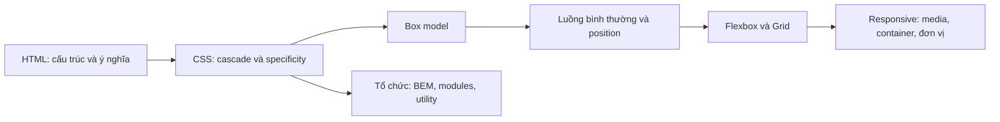
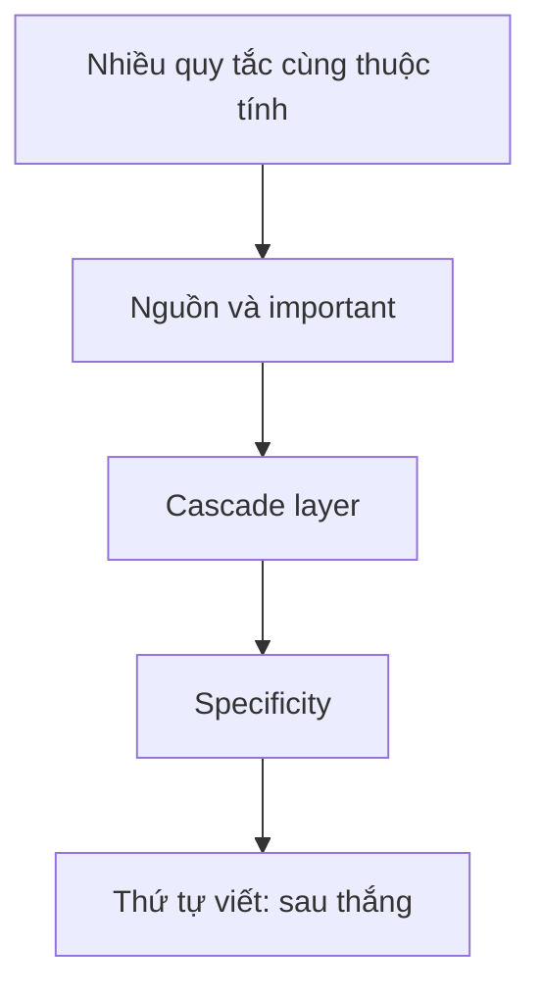
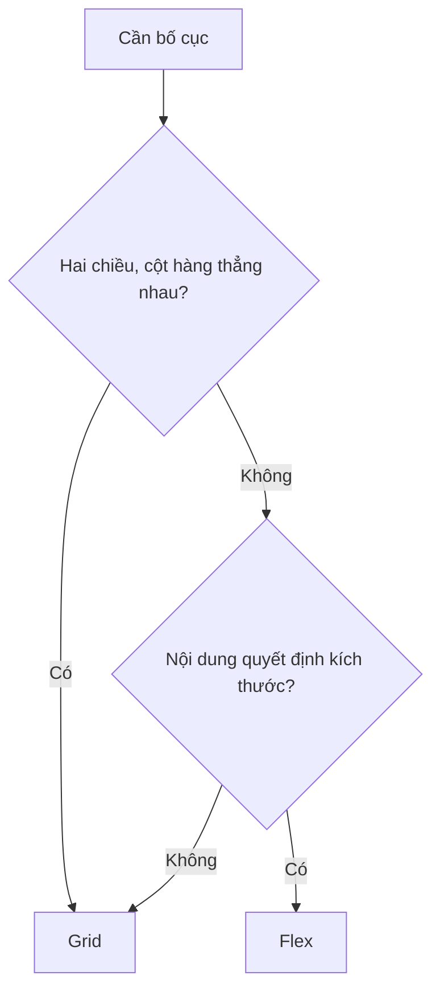

# Câu hỏi: HTML và CSS layout

Mỗi câu hỏi được viết theo chuỗi suy luận: **Câu hỏi** như người phỏng vấn nói, **Gợi ý suy luận** (các câu hỏi nhỏ dẫn tới khái niệm nền), **Lập luận** (chuỗi nhân quả "vì A nên B"), **Đáp án ngắn** nói được thành tiếng, **Nhớ** (kiến thức cốt lõi và link bài gốc), rồi **Ví dụ** nếu cần. Mỗi **Hỏi xoáy** nêu thêm vì sao nó là bước kế tiếp logic của câu trước. Cách học: đọc câu hỏi, che phần dưới, tự đi theo gợi ý rồi mới so đáp án.

Kiến thức gốc: [Kiến trúc frontend](/go?p=11-Frontend-Core%2Flt-05-kien-truc-frontend.md) (tổ chức CSS và component), [Web performance và Core Web Vitals](/go?p=11-Frontend-Core%2Flt-03-web-performance-core-web-vitals.md) (layout shift, render), [JavaScript runtime](/go?p=11-Frontend-Core%2Flt-01-javascript-runtime-event-loop.md) (chuyện gì xảy ra khi trình duyệt vẽ). Đào sâu hơn: [Câu hỏi FE phỏng vấn mid-senior](/go?p=07-Interview-QA%2FFrontend%2Fhard%2Fqa-fe-phong-van.md). Cặp bài này đi kèm [JavaScript nền tảng](/go?p=07-Interview-QA%2FFrontend%2Feasy%2Fqa-fe-01-javascript-nen-tang.md).

Quy ước về ví dụ, để bạn biết mức tin cậy:

- **"Minh họa"**: HTML và CSS theo đặc tả và tài liệu MDN, chưa được hiển thị trong môi trường soạn bài này (không có trình duyệt). Kết quả mô tả bằng lời là hành vi chuẩn của trình duyệt hiện đại. Một vài tính năng mới (container query, `:has()`, nesting, `@layer`, đơn vị `dvh`) phụ thuộc phiên bản trình duyệt, kiểm tra lại bảng tương thích (Can I use, MDN) theo trình duyệt mục tiêu của dự án.
- **"Đã chạy thử bằng Node"**: không dùng trong bài này vì không có JavaScript cần chạy. Các đoạn JavaScript nhỏ nếu có chỉ là minh họa.



Đọc sơ đồ: HTML cho cấu trúc, cascade quyết định quy tắc nào thắng, box model quyết định kích thước, rồi các cơ chế bố cục (flow, position, flex, grid) sắp xếp các hộp. Responsive và cách tổ chức CSS là hai lớp bao quanh.

**Tóm tắt:**

- Cascade quyết định rule nào thắng theo thứ tự: nguồn và `!important`, cascade layer, specificity, cuối cùng là thứ tự viết.
- Box model: `width` mặc định chỉ đo content, nên padding và border làm element rộng hơn; `box-sizing: border-box` đổi cách đo đó.
- Position (static, relative, absolute, fixed, sticky) khác nhau ở chỗ element có còn nằm trong normal flow hay không và neo theo ancestor nào.
- Flexbox sắp xếp một chiều theo nội dung, Grid dàn hai chiều theo lưới; chọn theo bài toán chứ không phải thay thế nhau.
- Responsive dùng media query theo viewport, container query theo container cha, và đơn vị tương đối (rem, %, vw, dvh, clamp).
- Hay bị hỏi xoáy: `z-index: 9999` vẫn bị che vì stacking context; layout vỡ do tràn nội dung, flex không co (`min-width: 0`), `100vw` tính cả scrollbar.
- Dùng `<button>` thay `<div onclick>` vì semantic và accessibility có sẵn; animation mượt khi chỉ đổi `transform` và `opacity` (chỉ cần composite).

## 1. Box model: vì sao `width: 300px` mà element rộng hơn 300px?

**Phải thuộc:** Câu này là câu cốt lõi, gặp rất thường xuyên.

**Câu hỏi:** Tôi đặt `width: 300px`, thêm `padding: 20px` và `border: 2px` thì element chiếm 344px chứ không phải 300px. Vì sao, và cách nào cho kích thước dễ đoán?

**Gợi ý suy luận:**
- Một element gồm những lớp hộp nào từ trong ra ngoài?
- `width` mặc định đo lớp nào: nội dung hay cả khung?
- Có property nào đổi cách đo đó không?

**Lập luận:** Mỗi element là một hộp gồm nội dung, padding, border và margin (từ trong ra ngoài). Mặc định (`box-sizing: content-box`) `width` chỉ là chiều rộng của vùng nội dung, nên padding và border cộng thêm vào: 300 + 2×20 + 2×2 = 344px. Điều đó khiến tính tổng chiều rộng của các cột khó, dễ tràn khi chia `33%` rồi thêm padding. `box-sizing: border-box` đổi cách đo: `width` đã gồm cả padding và border, nội dung tự co lại. Vì vậy phần lớn dự án đặt `border-box` cho mọi element, kích thước dễ đoán hơn. Margin luôn nằm ngoài, không tính vào `width`.

**Đáp án ngắn:** Mặc định `width` chỉ tính vùng nội dung, padding và border cộng thêm. Dùng `box-sizing: border-box` để `width` gồm cả padding và border, nên kích thước dễ đoán.

**Nhớ:** Đặt `*, *::before, *::after { box-sizing: border-box; }` làm nền. Margin nằm ngoài hộp. Gốc: [Kiến trúc frontend](/go?p=11-Frontend-Core%2Flt-05-kien-truc-frontend.md).

**Ví dụ:** so sánh hai cách đo.

```css
.a { width: 300px; padding: 20px; border: 2px solid; }            /* tổng 344px */
.b { box-sizing: border-box; width: 300px; padding: 20px; border: 2px solid; } /* tổng 300px */
```

_Minh họa._ Trong DevTools, tab Computed hiện sơ đồ box model để kiểm tra.

**Hỏi xoáy 1:** `margin` hai element xếp dọc có cộng dồn không?

**Vì sao hỏi tiếp:** Margin nằm ngoài hộp, nên hỏi tiếp về cách các margin tương tác với nhau.

**Gợi ý suy luận:** Hai margin dọc của hai khối liền nhau (hoặc cha và con đầu tiên) chồng lên nhau hay cộng lại?

**Đáp:** Margin dọc của các khối trong normal flow có thể "gộp" (collapse): hai khối cách nhau 20px và 30px thì khoảng cách là 30px (lấy số lớn hơn), không phải 50px. Margin cha và con đầu tiên cũng có thể gộp nếu không có padding, border hay nội dung ngăn cách. Margin trong flex hoặc grid không gộp. Cách tránh: dùng `gap`, hoặc tạo ngữ cảnh định dạng mới (`display: flow-root`).

**Hỏi xoáy 2:** `display: inline`, `block`, `inline-block` khác nhau ra sao ở chuyện `width/height`?

**Vì sao hỏi tiếp:** Kích thước chỉ có nghĩa với loại hộp phù hợp, nếu không thì `width` không có tác dụng.

**Gợi ý suy luận:** Element inline có nằm trên cùng dòng chữ và nhận `width` không? Block chiếm cả dòng thì sao?

**Đáp:** `block` chiếm cả dòng và nhận `width/height`. `inline` nằm trong dòng chữ, bỏ qua `width/height` và margin dọc. `inline-block` nằm trong dòng chữ nhưng nhận `width/height`. Nên khi `width` không có tác dụng, kiểm tra `display` trước.

**Sai lầm hay gặp:** Quên `border-box` rồi tính tay `calc(33.33% - 40px)` cho từng cột. Đặt `border-box` toàn cục và dùng `gap` hoặc grid là gọn hơn.

## 2. Specificity và cascade: vì sao style của tôi không ăn?

**Phải thuộc:** Câu này là câu cốt lõi, gặp rất thường xuyên.

**Câu hỏi:** Tôi viết `.btn { color: red; }` nhưng nút vẫn xanh vì có quy tắc khác. Trình duyệt chọn quy tắc nào, và khi nào nên dùng `!important`?

**Gợi ý suy luận:**
- Khi nhiều quy tắc cùng nhắm một element và cùng property, trình duyệt xét những yếu tố nào theo thứ tự?
- Bộ chọn (selector) nào "cụ thể" hơn: `#id`, `.class`, hay `div`?
- Nếu độ cụ thể bằng nhau thì quy tắc nào thắng?

**Lập luận:** Cascade giải quyết xung đột theo thứ tự: nguồn và độ ưu tiên (trình duyệt, người dùng, tác giả, và `!important` đảo thứ tự), rồi cascade layer (`@layer`), rồi độ cụ thể (specificity), cuối cùng là thứ tự xuất hiện (quy tắc sau thắng). Specificity tính theo ba nhóm: số id, số class/attribute/pseudo-class, số tên thẻ/pseudo-element; style inline mạnh hơn mọi selector. So sánh từ nhóm id trước, nên một `#id` thắng cả chục `.class`. Vì vậy `.card .btn` (hai class) thắng `.btn` (một class) dù viết trước. Bộ chọn càng cụ thể càng khó ghi đè, nên giữ bộ chọn phẳng (một class) để dễ dự đoán. `!important` phá thứ tự bình thường, chỉ nên dùng cho tiện ích chủ ý, vì muốn ghi đè phải dùng thêm `!important` nữa và sinh "cuộc chạy đua".

**Đáp án ngắn:** Trình duyệt xét nguồn và `!important`, layer `@layer`, rồi specificity (id, class, thẻ), cuối cùng là thứ tự viết. Giữ selector phẳng, tránh `!important` và `#id` trong CSS.

**Nhớ:** Specificity là bộ ba (id, class, thẻ), so từ trái sang. `:where()` có specificity 0, `:is()` lấy theo selector mạnh nhất bên trong. Gốc: [Kiến trúc frontend](/go?p=11-Frontend-Core%2Flt-05-kien-truc-frontend.md).

**Ví dụ:** tính specificity.

```css
p                     { color: black; }  /* (0,0,1) */
.note                 { color: blue; }   /* (0,1,0) */
.card .note           { color: green; }  /* (0,2,0) thắng .note */
#main .note           { color: red; }    /* (1,1,0) thắng cả hai */
:where(.card) .note   { color: gray; }   /* (0,1,0): :where không cộng điểm */
```

_Minh họa._ Element `<p class="note">` trong `#main` có `.card` cha sẽ đỏ vì `#main .note` có id.



_Minh họa._ Đọc từ trên xuống: bước nào phân thắng bại thì dừng, các bước dưới không xét.

**Hỏi xoáy 1:** Property nào được inherit từ element cha, property nào không?

**Vì sao hỏi tiếp:** Có những property không có quy tắc nào vẫn có giá trị vì inherit, một nguồn khác của "vì sao style này xuất hiện".

**Gợi ý suy luận:** Màu chữ và cỡ chữ của đoạn văn thường lấy từ đâu? `border` và `margin` có truyền xuống con không?

**Đáp:** Property liên quan đến chữ (`color`, `font-*`, `line-height`, `text-align`...) mặc định inherit. Property hộp (`margin`, `padding`, `border`, `background`, `width`) không inherit. Có thể ép bằng `inherit`, `initial`, `unset`, `revert`.

**Hỏi xoáy 2:** `@layer` giải quyết vấn đề gì so với tăng specificity?

**Vì sao hỏi tiếp:** Cuộc chạy đua specificity dẫn tới nhu cầu kiểm soát thứ tự ưu tiên theo nhóm.

**Gợi ý suy luận:** Nếu CSS của thư viện nên luôn thua CSS của ứng dụng, có cần tăng selector không?

**Đáp:** `@layer` cho khai báo thứ tự layer (ví dụ reset, thư viện, ứng dụng); layer khai báo sau thắng layer trước bất kể specificity bên trong. Nhờ đó ghi đè CSS thư viện mà không phải viết selector dài hay `!important`. CSS không nằm trong layer luôn thắng CSS trong layer (với khai báo thường). Kiểm tra lại hỗ trợ theo trình duyệt mục tiêu.

## 3. Position: static, relative, absolute, fixed, sticky khác nhau ở đâu?

**Phải thuộc:** Câu này là câu cốt lõi, gặp rất thường xuyên.

**Câu hỏi:** Tôi muốn huy hiệu "Mới" nằm góc phải trên của thẻ sản phẩm, nhưng nó bay lên góc trang. Vì sao, và các giá trị `position` còn lại dùng khi nào?

**Gợi ý suy luận:**
- Element `absolute` tính tọa độ `top/right` so với cái gì?
- Element tổ tiên nào được coi là "mốc" (containing block)?
- Element `absolute` còn chiếm chỗ trong normal flow không?

**Lập luận:** `position: absolute` đưa element ra khỏi flow (không còn chiếm chỗ) và đặt vị trí theo tổ tiên gần nhất có `position` khác `static`. Nếu không có tổ tiên nào như vậy thì mốc là khung nhìn ban đầu, nên huy hiệu bay lên góc trang. Cách sửa: đặt `position: relative` (không cần dịch chuyển) cho thẻ cha để làm mốc. `relative` giữ chỗ trong flow và dịch element so với vị trí cũ. `fixed` đặt theo khung nhìn, không cuộn theo trang. `sticky` là lai: bình thường nằm trong flow, khi cuộn chạm ngưỡng (`top: 0`) thì dính lại trong phạm vi cha của nó. Một vài property của tổ tiên (như `transform`) làm thay đổi mốc của `fixed`.

**Đáp án ngắn:** `absolute` ra khỏi flow và đặt theo tổ tiên gần nhất có position khác static, nên cần `relative` ở cha làm mốc. `fixed` theo khung nhìn, `sticky` dính khi cuộn chạm ngưỡng trong phạm vi cha.

**Nhớ:** Cặp quen thuộc: cha `relative`, con `absolute`. `sticky` cần ngưỡng (`top`) và không hoạt động nếu tổ tiên có `overflow` ẩn hoặc cuộn. Gốc: [Kiến trúc frontend](/go?p=11-Frontend-Core%2Flt-05-kien-truc-frontend.md).

**Ví dụ:** huy hiệu góc thẻ và header dính.

```html
<div class="card">
  <span class="badge">Mới</span>
  ...
</div>
```

```css
.card  { position: relative; }               /* làm mốc, vẫn trong flow */
.badge { position: absolute; top: 8px; right: 8px; }
.header { position: sticky; top: 0; z-index: 10; background: white; }
```

_Minh họa._ Nếu `.card` thiếu `position: relative`, `.badge` tính theo tổ tiên positioned xa hơn hoặc theo trang.

**Hỏi xoáy 1:** Vì sao `position: sticky` đôi khi không dính?

**Vì sao hỏi tiếp:** Lỗi hay gặp nhất của `sticky`, thử kiến thức về phạm vi cuộn.

**Gợi ý suy luận:** `sticky` dính trong phạm vi nào, và nó xét tổ tiên cuộn nào?

**Đáp:** Hay do tổ tiên có `overflow: hidden/auto/scroll` (nó trở thành vùng cuộn gần nhất và `sticky` dính theo vùng đó chứ không theo trang), thiếu ngưỡng `top/bottom`, hoặc cha quá thấp nên không có chỗ để dính (element chỉ dính trong phạm vi cha).

**Hỏi xoáy 2:** Căn giữa một element theo cả hai chiều có những cách nào, chọn cách nào?

**Vì sao hỏi tiếp:** Bài toán tạp nhất của position, và dẫn sang flex/grid ở câu sau.

**Gợi ý suy luận:** Có cách nào không cần tính tay `top: 50%` rồi trừ nửa kích thước không?

**Đáp:** Hiện đại nhất: `display: grid; place-items: center;` hoặc `display: flex; justify-content: center; align-items: center;` ở cha. Với `absolute`: `inset: 0; margin: auto;` kèm kích thước, hoặc `top: 50%; left: 50%; transform: translate(-50%, -50%)`. Ưu tiên flex hoặc grid vì ngắn và không cần biết kích thước con.

## 4. Flexbox và Grid: chọn cái nào khi nào?

**Phải thuộc:** Câu này là câu cốt lõi, gặp rất thường xuyên.

**Câu hỏi:** Làm thanh điều hướng, làm lưới thẻ sản phẩm, làm bố cục trang có sidebar. Mỗi cái chọn flexbox hay grid, và lý do?

**Gợi ý suy luận:**
- Bố cục này sắp xếp theo một chiều (hàng hoặc cột) hay hai chiều cùng lúc?
- Kích thước do nội dung quyết định hay do khung (lưới) quyết định?
- Cần các element ở hàng dưới thẳng cột với hàng trên không?

**Lập luận:** Flexbox là bố cục một chiều: xếp element dọc một trục (hàng hoặc cột), chia không gian dư hoặc thiếu theo `flex-grow/shrink/basis`, kích thước thường do nội dung quyết định. Grid là bố cục hai chiều: định nghĩa cột và hàng trước (`grid-template-columns`), rồi đặt element vào ô, nên các element hàng dưới thẳng cột với hàng trên. Vì vậy thanh điều hướng (một hàng, các mục co giãn theo nội dung) dùng flex; lưới thẻ cần cột đều và thẳng hàng dùng grid; bố cục trang có sidebar và nội dung chính dùng grid (hoặc flex với sidebar cố định). Quy tắc nhớ: nội dung dẫn dắt bố cục thì flex, bố cục dẫn dắt nội dung thì grid. Hai công cụ kết hợp được: grid cho khung trang, flex cho nội dung từng ô.

**Đáp án ngắn:** Flex cho bố cục một chiều và để nội dung quyết định kích thước (thanh điều hướng, hàng nút). Grid cho bố cục hai chiều với cột và hàng thẳng nhau (lưới thẻ, khung trang). Kết hợp cả hai là thường gặp.

**Nhớ:** `gap` dùng được cho cả hai, tốt hơn margin. `grid-template-columns: repeat(auto-fill, minmax(220px, 1fr))` là lưới responsive không cần media query. Gốc: [Kiến trúc frontend](/go?p=11-Frontend-Core%2Flt-05-kien-truc-frontend.md).

**Ví dụ:** lưới thẻ responsive và thanh điều hướng.

```css
.grid {
  display: grid;
  grid-template-columns: repeat(auto-fill, minmax(220px, 1fr));
  gap: 16px;
}
.nav { display: flex; align-items: center; gap: 12px; }
.nav .spacer { margin-left: auto; }          /* đẩy phần còn lại sang phải */
.layout { display: grid; grid-template-columns: 240px 1fr; min-height: 100vh; }
```

_Minh họa._ `auto-fill` với `minmax(220px, 1fr)`: trình duyệt tự tính số cột vừa khung, mỗi cột rộng tối thiểu 220px và chia đều phần dư.



_Minh họa._

**Hỏi xoáy 1:** `flex: 1` nghĩa là gì, và vì sao đôi khi các cột flex không bằng nhau dù đều `flex: 1`?

**Vì sao hỏi tiếp:** Property flex dùng nhiều nhất, và nguồn của bug bất đối xứng.

**Gợi ý suy luận:** `flex` là viết tắt của những property nào? Nội dung rộng có làm cột không co được không?

**Đáp:** `flex: 1` là `flex-grow: 1; flex-shrink: 1; flex-basis: 0`, nghĩa là chia đều không gian. Cột vẫn có thể không bằng nhau vì element flex có `min-width: auto` (không co nhỏ hơn nội dung), nên nội dung dài hoặc ảnh lớn đẩy cột rộng ra. Sửa bằng `min-width: 0` (xem câu 10).

**Hỏi xoáy 2:** Khi nào dùng `justify-content` và khi nào `align-items`?

**Vì sao hỏi tiếp:** Hai trục dễ nhầm và là câu kiểm tra nhanh kiến thức nền.

**Gợi ý suy luận:** Trục chính của flex là hướng nào theo `flex-direction`? Trục chéo vuông góc với nó.

**Đáp:** `justify-content` phân bố element dọc trục chính, `align-items` căn theo trục chéo. Khi đổi `flex-direction: column` thì hai trục đổi vai trò. Trong grid, `justify-*` theo chiều ngang (trục inline) và `align-*` theo chiều dọc (trục block).

## 5. Stacking context: vì sao `z-index: 9999` vẫn bị che?

**Câu hỏi:** Menu thả xuống có `z-index: 9999` mà vẫn nằm dưới một element `z-index: 1` ở chỗ khác. Chuyện gì xảy ra?

**Gợi ý suy luận:** 
- `z-index` so sánh các element trong phạm vi nào: toàn trang hay trong cùng một nhóm?
- Những property nào tạo ra một "nhóm" xếp chồng mới?
- Trong một nhóm đã tạo, giá trị z-index của con có thoát ra ngoài so với nhóm khác được không?

**Lập luận:** `z-index` chỉ có nghĩa so với các element cùng một stacking context (ngữ cảnh xếp chồng). Một số property tạo context mới: element positioned có `z-index` khác `auto`, `position: fixed/sticky`, `opacity` nhỏ hơn 1, `transform`, `filter`, `isolation: isolate`, `will-change` của các property đó, và element flex/grid con có `z-index`. Mỗi context được xếp chồng như một khối duy nhất so với các anh em của nó. Nên nếu menu nằm trong cha tạo context có `z-index: 1`, thì dù menu có `9999`, cả khối cha vẫn nằm dưới element `z-index: 2` ở context ngoài. Đây là lý do hay gặp: thêm `transform` hoặc `opacity` vào một thẻ cha khiến dropdown con bị che. Cách giải quyết: đưa menu ra ngoài (portal ở cuối `body`), hoặc bỏ property tạo context ở cha, và quản lý một thang `z-index` nhỏ (biến CSS).

**Đáp án ngắn:** `z-index` chỉ so trong cùng stacking context. Cha có `transform`, `opacity < 1`, hoặc `z-index` trên element positioned tạo context mới nhốt con lại, nên con z-index lớn vẫn thua khối ngoài. Sửa bằng portal ra `body` hoặc bỏ property tạo context.

**Nhớ:** Gặp "z-index không ăn", tìm tổ tiên tạo stacking context. `isolation: isolate` tạo context chủ ý để nhốt z-index của component. Gốc: [Kiến trúc frontend](/go?p=11-Frontend-Core%2Flt-05-kien-truc-frontend.md).

**Ví dụ:** con z-index lớn vẫn bị che.

```html
<div class="a">   <!-- position:relative; z-index:1  tạo context -->
  <div class="menu">Menu</div> <!-- z-index:9999 trong context a -->
</div>
<div class="b">B</div>  <!-- position:relative; z-index:2 -->
```

```css
.a    { position: relative; z-index: 1; }
.menu { position: absolute; z-index: 9999; }
.b    { position: relative; z-index: 2; }
```

_Minh họa._ `.menu` luôn nằm dưới `.b` vì cả khối `.a` (z=1) thấp hơn `.b` (z=2). Muốn menu trên `.b`, cần đưa menu ra khỏi `.a` (ví dụ render vào `body` bằng portal) hoặc nâng `.a` lên trên `.b`.

**Hỏi xoáy 1:** Làm sao tìm ra tổ tiên nào tạo stacking context?

**Vì sao hỏi tiếp:** Biết nguyên tắc thì cần biết gỡ lỗi thực tế.

**Gợi ý suy luận:** DevTools cho xem gì ở từng tổ tiên của element? Có thể tắt từng property nghi ngờ không?

**Đáp:** Dùng DevTools: chọn element, đi ngược các tổ tiên và tắt tạm `transform`, `opacity`, `filter`, `z-index`, `will-change`, `isolation` xem lỗi có biến mất. Một số DevTools có tiện ích hiển thị stacking context. Tránh thêm `transform` hoặc `will-change` chỉ để "tối ưu" vì chúng đổi hành vi xếp chồng và mốc của `fixed`.

**Hỏi xoáy 2:** Vì sao modal và dropdown thường render qua portal ở cuối `body`?

**Vì sao hỏi tiếp:** Ứng dụng cách giải quyết ở trên vào kiến trúc component.

**Gợi ý suy luận:** Ở cuối `body`, modal nằm ngoài stacking context của các thành phần trang, và không bị `overflow: hidden` của tổ tiên cắt thì sao?

**Đáp:** Ở cuối `body`, element không bị nhốt trong context hay bị `overflow` của tổ tiên cắt, nên z-index dễ dự đoán. Đây là lý do `createPortal` (React) và `Teleport` (Vue) tồn tại. Thẻ `<dialog>` với `showModal()` còn dùng "top layer" của trình duyệt, nằm trên mọi stacking context (kiểm tra theo phiên bản).

## 6. Responsive: media query khác container query ở đâu?

**Câu hỏi:** Cùng một component thẻ sản phẩm lúc nằm trong sidebar hẹp, lúc nằm trong vùng chính rộng. Media query theo màn hình có đủ không, và container query giải quyết gì?

**Gợi ý suy luận:**
- Media query đo cái gì: khung nhìn hay chiều rộng của chính element cha?
- Component đặt ở nhiều chỗ thì kích thước khả dụng của nó có luôn trùng khung nhìn không?
- Muốn component tự đáp ứng theo chỗ chứa thì cần đo cái gì?

**Lập luận:** Media query đo khung nhìn (hoặc đặc tính thiết bị), nên áp dụng cho cả trang. Một component dùng lại ở nhiều chỗ có chiều rộng khả dụng khác nhau dù khung nhìn như nhau: sidebar 280px và vùng chính 800px trên cùng màn hình 1280px. Với media query, ta phải viết theo bối cảnh trang chứ không theo component, nên khó tái sử dụng. Container query cho phép element cha khai báo là "container" (`container-type: inline-size`), rồi component bên trong dùng `@container (min-width: 400px) {...}` để đáp ứng theo chiều rộng chỗ chứa. Component vì vậy tự thích nghi dù đặt ở đâu. Media query vẫn cần cho quyết định cấp trang (bố cục tổng thể, `prefers-reduced-motion`, `prefers-color-scheme`, in ấn). Cách làm hợp lý là mobile-first (`min-width`) cho bố cục trang và container query cho component.

**Đáp án ngắn:** Media query đo khung nhìn, hợp cho bố cục trang. Container query đo chiều rộng của element chứa, hợp cho component dùng lại nhiều nơi. Kết hợp cả hai, thiết kế mobile-first.

**Nhớ:** Container query: cha khai báo `container-type`, con dùng `@container`. Hỗ trợ trình duyệt hiện đại, kiểm tra theo mục tiêu. Gốc: [Kiến trúc frontend](/go?p=11-Frontend-Core%2Flt-05-kien-truc-frontend.md).

**Ví dụ:** thẻ đáp ứng theo chỗ chứa.

```css
.card-wrap { container-type: inline-size; }

.card { display: grid; gap: 8px; }                 /* mặc định: xếp dọc */
@container (min-width: 420px) {
  .card { grid-template-columns: 120px 1fr; }      /* đủ rộng: ảnh bên trái */
}

/* media query cho quyết định cấp trang */
@media (min-width: 768px) { .layout { grid-template-columns: 240px 1fr; } }
@media (prefers-reduced-motion: reduce) { * { animation: none !important; } }
```

_Minh họa._ Cùng `.card` ở sidebar (hẹp) xếp dọc, ở vùng chính (rộng) xếp ngang, không cần class phụ hay biết vị trí.

**Hỏi xoáy 1:** Mobile-first nghĩa là gì và vì sao nên dùng `min-width` thay vì `max-width`?

**Vì sao hỏi tiếp:** Hướng viết media query ảnh hưởng độ gọn và độ ghi đè của CSS.

**Gợi ý suy luận:** Mặc định nên là UI cho màn hình nhỏ hay lớn? Mỗi `min-width` thêm hay bỏ bớt quy tắc?

**Đáp:** Mobile-first: viết style mặc định cho màn hình nhỏ rồi dùng `@media (min-width: ...)` để bổ sung cho màn hình lớn. Thiết bị nhỏ tải ít quy tắc phải ghi đè, và luồng tăng dần dễ đọc hơn so với "kiểu desktop rồi gỡ dần bằng `max-width`".

**Hỏi xoáy 2:** Thẻ `<meta name="viewport">` để làm gì, thiếu nó thì sao?

**Vì sao hỏi tiếp:** Điều kiện để responsive hoạt động trên điện thoại.

**Gợi ý suy luận:** Nếu điện thoại giả định khung nhìn rộng 980px thì media query `max-width: 600px` có kích hoạt không?

**Đáp:** `<meta name="viewport" content="width=device-width, initial-scale=1">` báo trình duyệt di động dùng chiều rộng thật của thiết bị. Thiếu nó, điện thoại giả lập khung nhìn rộng (khoảng 980px) rồi thu nhỏ trang, nên media query theo màn hình nhỏ không kích hoạt.

## 7. Đơn vị: khi nào dùng px, rem, em, %, vw, dvh, clamp?

**Câu hỏi:** Cỡ chữ nên dùng `px` hay `rem`? Còn `100vh` trên điện thoại sao bị che bởi thanh địa chỉ? Và `clamp()` dùng để làm gì?

**Gợi ý suy luận:**
- Người dùng đổi cỡ chữ mặc định của trình duyệt (vì thị lực) thì `px` và `rem` phản ứng thế nào?
- `em` tính theo cái gì, và có lồng nhau gây nhân dồn không?
- Trên điện thoại, thanh địa chỉ co giãn khi cuộn thì chiều cao khung nhìn có đổi không?

**Lập luận:** `px` là cố định, không theo cỡ chữ người dùng chọn. `rem` tính theo cỡ chữ của element gốc `<html>` (mặc định thường 16px), nên khi người dùng tăng cỡ chữ, mọi thứ dùng `rem` lớn theo, tốt cho khả năng truy cập; vì vậy cỡ chữ và khoảng cách nên dùng `rem`. `em` tính theo cỡ chữ của chính element (hoặc cha khi dùng cho `font-size`), nên lồng nhiều tầng sẽ nhân dồn, hợp cho thành phần tự co theo cỡ chữ của nó (nút có padding theo `em`). `%` tính theo kích thước của element chứa. `vw` và `vh` tính theo khung nhìn; trên di động, `100vh` thường tính theo khung lớn nhất (khi thanh địa chỉ đã ẩn) nên nội dung bị che khi thanh hiện, các đơn vị `dvh/svh/lvh` giải quyết điều này (kiểm tra hỗ trợ). `clamp(min, ưu tiên, max)` chặn một giá trị co giãn trong khoảng, cho cỡ chữ mượt giữa các khung mà không cần nhiều media query.

**Đáp án ngắn:** Dùng `rem` cho cỡ chữ và khoảng cách để tôn trọng cài đặt người dùng, `em` cho thành phần tự co theo chữ, `%` theo element chứa, `vw/dvh` theo khung nhìn (ưu tiên `dvh` trên di động), `clamp()` để co giãn có chặn.

**Nhớ:** Đừng key `html { font-size: 62.5% }` kiểu làm hỏng cài đặt người dùng nếu không bù lại bằng `rem` chuẩn. Gốc: [Web performance và Core Web Vitals](/go?p=11-Frontend-Core%2Flt-03-web-performance-core-web-vitals.md).

**Ví dụ:** cỡ chữ co giãn và chiều cao di động.

```css
html   { font-size: 100%; }                         /* theo cài đặt trình duyệt */
h1     { font-size: clamp(1.5rem, 1rem + 2vw, 2.5rem); }
.btn   { padding: 0.5em 1em; }                      /* theo cỡ chữ của nút */
.hero  { min-height: 100vh; min-height: 100dvh; }   /* dvh ghi đè nếu trình duyệt hỗ trợ */
```

_Minh họa._ Khai báo hai lần `min-height`: trình duyệt cũ bỏ qua `dvh` và dùng dòng trước, trình duyệt mới dùng dòng sau.

**Hỏi xoáy 1:** Vì sao `100vw` hay gây thanh cuộn ngang?

**Vì sao hỏi tiếp:** Bẫy hay gặp của đơn vị khung nhìn, liên quan trực tiếp đến câu "vì sao vỡ layout" sau này.

**Gợi ý suy luận:** `100vw` có tính cả thanh cuộn dọc không?

**Đáp:** Trên trình duyệt có thanh cuộn chiếm chỗ (phổ biến ở desktop), `100vw` gồm cả bề rộng thanh cuộn dọc, nên element rộng `100vw` dài hơn vùng nhìn thấy và sinh cuộn ngang. Dùng `width: 100%` (theo element chứa) hoặc để block tự chiếm hết chiều rộng.

**Hỏi xoáy 2:** `line-height` nên đặt có đơn vị hay không?

**Vì sao hỏi tiếp:** Một chi tiết đơn vị ảnh hưởng đến inherit.

**Gợi ý suy luận:** Giá trị `1.5` và `150%` được inherit bởi con theo cách nào?

**Đáp:** Số không đơn vị (`1.5`) được con nhân với cỡ chữ của chính nó, còn `150%` hoặc `1.5em` được tính ra một giá trị cố định ở cha rồi con inherit giá trị đó, gây khoảng dòng sai khi con có cỡ chữ khác. Nên dùng số không đơn vị.

## 8. Semantic HTML: vì sao dùng `<button>` thay vì `<div onclick>`?

**Câu hỏi:** Một số nút làm bằng `<div class="btn" onclick=...>`. Cái gì sẽ hỏng so với `<button>`, và vì sao HTML ngữ nghĩa quan trọng?

**Gợi ý suy luận:**
- Bàn phím và trình đọc màn hình biết `<div>` là nút không?
- `<button>` có sẵn những hành vi nào mà `<div>` phải tự viết?
- Công cụ tìm kiếm và trình đọc màn hình dựa vào cấu trúc nào để hiểu trang?

**Lập luận:** Thẻ ngữ nghĩa cho trình duyệt và công nghệ hỗ trợ biết vai trò của element. `<button>` tự có vai trò "button", nhận focus bằng Tab, kích hoạt bằng Enter và Space, có trạng thái `disabled`, và được trình đọc màn hình thông báo là nút. `<div>` không có gì trong số đó; muốn tương đương phải thêm `role="button"`, `tabindex="0"`, xử lý phím Enter và Space, kiểu focus, trạng thái, mất nhiều công mà vẫn dễ thiếu. Cấu trúc trang cũng vậy: `<header>`, `<nav>`, `<main>`, `<article>`, `<section>`, `<footer>`, và thứ bậc `<h1>` đến `<h6>` cho phép người dùng trình đọc màn hình nhảy theo vùng và mục, đồng thời giúp công cụ tìm kiếm hiểu nội dung. Quy tắc đầu tiên của ARIA: nếu có thẻ HTML sẵn đúng nghĩa thì dùng thẻ đó, đừng thêm ARIA.

**Đáp án ngắn:** Thẻ ngữ nghĩa cho sẵn vai trò, focus, phím tắt và thông báo cho trình đọc màn hình. `<div>` làm nút phải tự viết lại tất cả mà vẫn dễ thiếu. Ưu tiên thẻ đúng nghĩa trước, ARIA là phương án cuối.

**Nhớ:** Nút dùng `<button>`, liên kết dùng `<a href>`, danh sách dùng `<ul>/<ol>`, một `<h1>` mỗi trang và đúng thứ bậc. Gốc: [Kiến trúc frontend](/go?p=11-Frontend-Core%2Flt-05-kien-truc-frontend.md).

**Ví dụ:** so sánh hai cách.

```html
<!-- Tệ: không focus được, không có phím Enter/Space -->
<div class="btn" onclick="save()">Lưu</div>

<!-- Tốt: có đủ hành vi -->
<button type="button" class="btn" onclick="save()">Lưu</button>

<!-- Cấu trúc trang -->
<header>...</header>
<nav aria-label="Chính">...</nav>
<main>
  <h1>Tiêu đề trang</h1>
  <article><h2>Bài viết</h2>...</article>
</main>
<footer>...</footer>
```

_Minh họa._

**Hỏi xoáy 1:** Khi nào dùng `<a>` và khi nào dùng `<button>`?

**Vì sao hỏi tiếp:** Hai thẻ tương tác cơ bản, thường bị dùng lẫn.

**Gợi ý suy luận:** Hành động này đi tới một địa chỉ hay thực hiện một thao tác trên trang?

**Đáp:** `<a href>` để điều hướng tới địa chỉ (có thể mở tab mới, chuột phải sao chép link). `<button>` để thực hiện hành động (gửi form, mở modal, xóa). Dùng `<a>` không có `href` hoặc `<button>` để điều hướng làm mất hành vi chuẩn và gây bất tiện cho người dùng bàn phím.

**Hỏi xoáy 2:** Property `alt` của ảnh và `label` của ô nhập có vai trò gì?

**Vì sao hỏi tiếp:** Hai chỗ truy cập được thường thiếu nhất.

**Gợi ý suy luận:** Người dùng không thấy được ảnh sẽ nghe gì? Ô nhập không có nhãn thì trình đọc màn hình đọc thế nào?

**Đáp:** `alt` mô tả nội dung ảnh có ý nghĩa cho người không nhìn thấy, ảnh trang trí thì `alt=""` để bị bỏ qua. `<label for>` gắn nhãn với ô nhập, giúp trình đọc đọc đúng tên và tăng vùng bấm. Placeholder không thay được label.

## 9. Form cơ bản: vì sao `<form>` chạy được mà không cần JavaScript?

**Câu hỏi:** Form đăng nhập: bấm Enter trong ô nhập thì gửi, trình duyệt kiểm tra `required` và `type="email"` trước khi gửi. Những hành vi này đến từ đâu, và khi dùng JavaScript thì làm gì với chúng?

**Gợi ý suy luận:**
- Nút nào trong form kích hoạt việc gửi, và `type` mặc định của `<button>` là gì?
- Trình duyệt có kiểm tra hợp lệ giúp không?
- Khi bắt event `submit` bằng JavaScript, cần ngăn hành vi mặc định nào?

**Lập luận:** `<form>` là cơ chế gốc: các ô nhập có `name` được gom thành dữ liệu, nút `type="submit"` (mặc định của `<button>` trong form) hoặc phím Enter kích hoạt event `submit`, và nếu không bị chặn thì trình duyệt gửi dữ liệu tới `action` bằng `method` rồi tải lại trang. Trình duyệt kèm kiểm tra hợp lệ theo `required`, `type`, `min/max`, `pattern`. Khi dùng JavaScript (SPA), ta nghe `submit` trên form (không phải click trên nút, để Enter cũng hoạt động) và gọi `event.preventDefault()` để chặn tải lại, rồi gửi bằng `fetch`. Kiểm tra phía client chỉ để thân thiện; server luôn phải kiểm tra lại vì client bị qua mặt dễ dàng.

**Đáp án ngắn:** Form gốc có sẵn gom dữ liệu, gửi bằng Enter hoặc nút submit, và kiểm tra hợp lệ. Với JavaScript, bắt event `submit` rồi `preventDefault()`. Luôn kiểm tra lại ở server.

**Nhớ:** `<button>` trong form mặc định là `submit`, nút phụ cần `type="button"`. Gốc: [Bảo mật frontend](/go?p=11-Frontend-Core%2Flt-04-bao-mat-frontend.md).

**Ví dụ:** form chuẩn truy cập được.

```html
<form id="login" action="/login" method="post" novalidate>
  <label for="email">Email</label>
  <input id="email" name="email" type="email" required autocomplete="email">

  <label for="pw">Mật khẩu</label>
  <input id="pw" name="password" type="password" required minlength="8"
         autocomplete="current-password">

  <button type="submit">Đăng nhập</button>
  <button type="button" id="forgot">Quên mật khẩu</button>
</form>
```

```javascript
document.querySelector('#login').addEventListener('submit', async (event) => {
  event.preventDefault();                          // chặn tải lại trang
  const data = Object.fromEntries(new FormData(event.target));
  await fetch('/login', { method: 'POST', body: JSON.stringify(data),
                          headers: { 'Content-Type': 'application/json' } });
});
```

_Minh họa._ Bỏ `novalidate` nếu muốn trình duyệt tự kiểm tra bằng `required`.

**Hỏi xoáy 1:** Vì sao nên nghe `submit` của form chứ không phải `click` của nút?

**Vì sao hỏi tiếp:** Chi tiết nhỏ quyết định việc phím Enter có hoạt động không.

**Gợi ý suy luận:** Nhấn Enter trong ô nhập có phát sinh `click` trên nút không?

**Đáp:** Enter trong ô nhập kích hoạt submit nhưng có thể không đi qua event `click` do bạn gắn riêng, và cách nghe `submit` còn gồm cả kiểm tra hợp lệ của trình duyệt. Nghe `submit` là đúng nhất.

**Hỏi xoáy 2:** Các `type` của `<input>` mang lại lợi ích gì, và `autocomplete` dùng để làm gì?

**Vì sao hỏi tiếp:** Tận dụng nền tảng thay vì tự viết.

**Gợi ý suy luận:** Bàn phím di động hiện gì với `type="email"` hoặc `type="tel"`? Trình quản lý mật khẩu dựa vào gì?

**Đáp:** `type` đúng đem lại bàn phím phù hợp trên di động và kiểm tra hợp lệ miễn phí (`email`, `tel`, `number`, `date`...). `autocomplete` (như `email`, `current-password`, `one-time-code`) giúp trình duyệt và trình quản lý mật khẩu điền tự động, tăng khả năng truy cập và tỷ lệ hoàn thành form.

## 10. Vì sao layout bị vỡ: tràn nội dung, flex không co, 100vw?

**Câu hỏi:** Một tên file dài trong thẻ flex làm cả trang cuộn ngang, ảnh vượt khung, và có chỗ chữ không xuống dòng. Bạn gỡ lỗi theo thứ tự nào, nguyên nhân thường gặp là gì?

**Gợi ý suy luận:**
- Element nào vượt khung: dùng DevTools xem element rộng nhất là cái nào?
- Element flex có thể co nhỏ hơn nội dung của nó không (mặc định)?
- Kích thước nào bị cố định (`width` tính bằng px, ảnh lớn, `100vw`)?

**Lập luận:** Gỡ lỗi từ ngoài vào trong: tìm element gây tràn (outline mọi element, hoặc quan sát element rộng hơn khung). Các nguyên nhân tái diễn: (1) element flex hoặc grid có `min-width: auto` nên không co nhỏ hơn nội dung (chuỗi dài không ngắt, ảnh lớn), sửa bằng `min-width: 0` ở element đó (hoặc `overflow: hidden/auto`) kèm `overflow-wrap: anywhere` cho chuỗi dài. (2) `width` cố định bằng px hoặc `100vw` lớn hơn vùng chứa, nên dùng `max-width: 100%`, `width: 100%`. (3) ảnh không có `max-width: 100%; height: auto` nên giữ kích thước gốc. (4) thiếu `box-sizing: border-box` làm padding đẩy rộng hơn. (5) margin gộp hoặc float không clear làm cha co về 0. (6) nội dung động (ảnh chưa có kích thước, font tải muộn) làm layout dịch chuyển, nên khai báo `width/height` hoặc `aspect-ratio` cho ảnh. Cách nhìn chung: tìm xem kích thước nào là "cứng" trong khi nội dung thì "mềm".

**Đáp án ngắn:** Nguyên nhân hay gặp: element flex không co vì `min-width: auto` (cần `min-width: 0`), chuỗi dài không ngắt, ảnh và `width` cố định hoặc `100vw`, thiếu `border-box`. Dùng DevTools tìm element tràn rồi gỡ từng kích thước cứng.

**Nhớ:** `min-width: 0` cho element flex/grid chứa nội dung dài, `max-width: 100%` cho ảnh, `overflow-wrap: anywhere` cho chuỗi dài. Gốc: [Web performance và Core Web Vitals](/go?p=11-Frontend-Core%2Flt-03-web-performance-core-web-vitals.md) (layout shift).

**Ví dụ:** sửa flex không co và ảnh tràn.

```html
<div class="row">
  <div class="name">annual-report-final-final-v3-really-long-file-name-without-spaces.pdf</div>
  <button type="button">Tải</button>
</div>
```

```css
.row  { display: flex; gap: 8px; }
.name {
  flex: 1;
  min-width: 0;               /* cho phép co nhỏ hơn nội dung */
  overflow: hidden;
  text-overflow: ellipsis;    /* hiện "..." thay vì tràn */
  white-space: nowrap;
}
img { max-width: 100%; height: auto; display: block; }
.long { overflow-wrap: anywhere; }
```

_Minh họa._ Thiếu `min-width: 0` thì `.name` giữ độ rộng của cả chuỗi và đẩy nút "Tải" ra ngoài.

**Hỏi xoáy 1:** Vì sao ảnh tải xong làm nội dung bên dưới nhảy xuống, và sửa thế nào?

**Vì sao hỏi tiếp:** Dạng "vỡ layout" theo thời gian, ảnh hưởng điểm Core Web Vitals.

**Gợi ý suy luận:** Trước khi ảnh tải, trình duyệt biết ảnh cao bao nhiêu không?

**Đáp:** Chưa biết nên giữ chỗ bằng 0, đến khi ảnh về mới đẩy nội dung xuống: đó là layout shift (chỉ số CLS). Sửa bằng khai báo `width` và `height` trên thẻ `` hoặc `aspect-ratio` trong CSS để trình duyệt giữ chỗ trước. Chi tiết ở [Web performance](/go?p=11-Frontend-Core%2Flt-03-web-performance-core-web-vitals.md).

**Hỏi xoáy 2:** Element cha chỉ chứa con `float` thì co về chiều cao 0, tại sao và hiện nay làm sao tránh?

**Vì sao hỏi tiếp:** Một dạng vỡ kinh điển ở code cũ, hay gặp khi bảo trì.

**Gợi ý suy luận:** Con `float` có được tính vào chiều cao của cha không? Có cách nào cho cha bao lấy con?

**Đáp:** Element `float` ra khỏi flow nên cha không tính chiều cao của nó. Sửa bằng `display: flow-root` ở cha (tạo ngữ cảnh định dạng khối mới bao lấy float) hoặc kỹ thuật clearfix cũ. Với code mới, tránh `float` để bố cục, dùng flex hoặc grid.

**Sai lầm hay gặp:** Che lỗi bằng `overflow-x: hidden` trên `body` mà không tìm element gây tràn, nên lỗi quay lại ở màn hình khác hoặc làm hỏng `position: sticky`.

## 11. BEM, CSS Modules, utility-first: chọn cách tổ chức CSS nào?

**Câu hỏi:** Dự án lớn có nhiều người viết CSS, class `.title` của trang này vô tình đổi style trang khác. Có những cách nào tránh va chạm, và đánh đổi từng cách?

**Gợi ý suy luận:**
- CSS có phạm vi (scope) toàn cục hay cục bộ theo mặc định?
- Va chạm tên class tránh được bằng quy ước đặt tên hay bằng công cụ tự đổi tên?
- Viết thẳng class tiện ích vào HTML đổi chỗ cho vấn đề gì?

**Lập luận:** CSS mặc định toàn cục, nên hai class cùng tên ở hai nơi đè lên nhau. Có ba hướng chính. BEM là quy ước đặt tên (`block__element--modifier`, như `card__title--large`) để tên duy nhất và phẳng (specificity thấp), không cần công cụ nhưng phụ thuộc kỷ luật của cả nhóm và tên dài. CSS Modules đổi tên class thành duy nhất lúc build (`.title` thành `title_abc123`) nên cục bộ theo từng file, ghi đè không nhầm chỗ, nhưng chia sẻ biến thiết kế cần cơ chế riêng (biến CSS). Utility-first (Tailwind) dùng các class nhỏ một mục đích ngay trong markup (`p-4 flex gap-2`), không đặt tên, không phát sinh CSS mới khi thêm UI, đổi lại markup dài và cần kỷ luật tách component để không lặp. Chọn theo bối cảnh: quy mô nhóm, công cụ build, có design system hay không. Dù chọn gì, giữ specificity thấp và dùng biến CSS cho token (màu, khoảng cách).

**Đáp án ngắn:** BEM tránh va chạm bằng quy ước tên, CSS Modules bằng cách công cụ đổi tên cục bộ, utility-first bằng class nhỏ trong markup. Mỗi cái đánh đổi giữa kỷ luật, công cụ và độ dài markup, chọn theo nhóm và dự án.

**Nhớ:** Mọi cách đều nhằm hai điều: tránh va chạm tên và giữ specificity thấp. Token thiết kế nên là biến CSS. Gốc: [Kiến trúc frontend](/go?p=11-Frontend-Core%2Flt-05-kien-truc-frontend.md).

**Ví dụ:** ba cách viết cùng một thẻ.

```html
<!-- BEM -->
<article class="card card--featured">
  <h2 class="card__title">Tên</h2>
</article>

<!-- CSS Modules (React): class được đổi tên lúc build -->
<article className={styles.card}>
  <h2 className={styles.title}>Tên</h2>
</article>

<!-- Utility-first (Tailwind) -->
<article class="rounded-lg border p-4 shadow">
  <h2 class="text-lg font-semibold">Tên</h2>
</article>
```

```css
/* BEM */
.card { padding: 16px; }
.card--featured { border-color: gold; }
.card__title { font-size: 1.125rem; }
/* CSS Modules: file Card.module.css, .title chỉ có tác dụng trong Card */
```

_Minh họa._

**Hỏi xoáy 1:** CSS-in-JS khác CSS Modules thế nào, và đánh đổi về hiệu năng?

**Vì sao hỏi tiếp:** Hướng thứ tư phổ biến, đặt cùng câu hỏi "style gắn với component" nhưng sinh style lúc chạy.

**Gợi ý suy luận:** Style sinh lúc chạy (runtime) tốn gì? Style trích xuất lúc build thì khác thế nào?

**Đáp:** CSS-in-JS runtime (như styled-components, emotion) tạo và chèn style khi chạy, tiện theo props nhưng tốn CPU và khó với server component. Các giải pháp trích xuất lúc build (CSS Modules, vanilla-extract, Tailwind) sinh CSS tĩnh nên nhẹ hơn. Kiểm tra lại hỗ trợ của thư viện với framework theo phiên bản.

**Hỏi xoáy 2:** Biến CSS (custom properties) khác biến của Sass thế nào?

**Vì sao hỏi tiếp:** Token thiết kế cần giá trị đổi được lúc chạy (theme tối sáng), điều preprocessor không làm được.

**Gợi ý suy luận:** Biến Sass tồn tại ở giai đoạn nào? Biến CSS tồn tại ở giai đoạn nào, có inherit không?

**Đáp:** Biến Sass được thay giá trị lúc compile, trình duyệt không thấy. Biến CSS (`--color-bg`) tồn tại lúc chạy, inherit theo cây DOM, và đổi được bằng JavaScript hoặc theo selector (`[data-theme="dark"]`), nên làm theme và component tùy biến được.

## 12. CSS hiện đại: những tính năng nào đáng biết?

**Câu hỏi:** Những năm gần đây CSS thêm nhiều tính năng giúp bỏ bớt JavaScript và preprocessor. Kể vài cái bạn đã dùng, và chúng giải quyết vấn đề gì?

**Gợi ý suy luận:**
- Chọn element cha dựa vào con có từng làm được trong CSS không?
- Quy tắc lồng nhau và thứ tự ưu tiên theo nhóm có cần Sass hay quy ước riêng không?
- Căn lề, đặt cạnh theo hướng chữ viết (trái-sang-phải hay phải-sang-trái) làm thế nào cho gọn?

**Lập luận:** Một số tính năng đáng biết. `:has()` là bộ chọn "cha" (chọn element có con khớp điều kiện, như `.card:has(img)`), trước đây cần JavaScript. Nesting cho viết quy tắc lồng nhau trong CSS thuần. `@layer` kiểm soát thứ tự ưu tiên theo nhóm (câu 2). Container query cho component đáp ứng theo chỗ chứa (câu 6). Biến CSS cho token và theme. `clamp()`, `min()`, `max()` cho kích thước co giãn. `aspect-ratio` giữ tỷ lệ hộp. Logical properties (`margin-inline`, `padding-block`, `inset-inline-start`) thay `left/right/top/bottom` theo hướng chữ viết, thuận lợi cho UI đa ngôn ngữ (có chữ viết từ phải sang trái). `gap` cho flex, `accent-color` cho kiểm soát màu form, `prefers-color-scheme` và `prefers-reduced-motion` cho tùy chọn người dùng. Mức hỗ trợ khác nhau theo trình duyệt và phiên bản, nên kiểm tra bảng tương thích trước khi dùng, và dùng `@supports` làm phương án dự phòng khi cần.

**Đáp án ngắn:** `:has()` chọn theo con, nesting và `@layer` tổ chức CSS, container query cho component, biến CSS cho token và theme, `clamp()` và `aspect-ratio` cho kích thước, logical properties cho đa ngôn ngữ. Kiểm tra tương thích trước, dùng `@supports` khi cần.

**Nhớ:** Dùng tính năng mới theo ngân sách trình duyệt của dự án, dự phòng bằng `@supports`. Gốc: [Kiến trúc frontend](/go?p=11-Frontend-Core%2Flt-05-kien-truc-frontend.md).

**Ví dụ:** vài tính năng gom lại.

```css
@layer reset, base, components;        /* khai báo trước: thứ tự ưu tiên layer tăng dần */
:root { --space: 1rem; --bg: white; }
[data-theme="dark"] { --bg: #111; }

.card {
  aspect-ratio: 16 / 9;
  margin-inline: auto;                 /* thay margin-left/right theo hướng chữ */
  padding-block: var(--space);
  background: var(--bg);

  &:has(img) { padding: 0; }           /* có ảnh thì bỏ padding */
  & .title   { font-size: clamp(1rem, 0.8rem + 1vw, 1.5rem); }
}

@supports (container-type: inline-size) {
  .wrap { container-type: inline-size; }
}
```

_Minh họa._ Cú pháp nesting với `&` và `:has()` cần trình duyệt hiện đại (kiểm tra theo phiên bản mục tiêu).

**Hỏi xoáy 1:** Vì sao `:has()` từng được coi là khó cho trình duyệt thực hiện?

**Vì sao hỏi tiếp:** Hỏi về chi phí của tính năng mạnh, tránh dùng bừa.

**Gợi ý suy luận:** Bình thường trình duyệt khớp selector từ phải sang trái. Selector chọn theo con làm gì với hướng đó, và khi con đổi thì điều gì phải tính lại?

**Đáp:** `:has()` phải xét cả cây con để quyết định cha khớp hay không, và khi con thay đổi thì cha có thể đổi style, nên tốn hơn các selector thông thường. Trình duyệt đã tối ưu, nhưng nên giữ vùng áp dụng hẹp (đừng viết `body:has(...)` quá chung chung nếu có thể tránh).

**Hỏi xoáy 2:** Làm dark mode theo cách nào, tôn trọng cài đặt hệ thống mà vẫn cho người dùng tự chọn?

**Vì sao hỏi tiếp:** Ứng dụng tổng hợp biến CSS, media query và JavaScript.

**Gợi ý suy luận:** Cài đặt hệ thống đọc bằng gì? Lựa chọn tự đặt cần lưu ở đâu và áp dụng bằng gì?

**Đáp:** Định nghĩa màu bằng biến CSS. Mặc định theo `@media (prefers-color-scheme: dark)`. Cho người dùng chọn thì lưu lựa chọn (localStorage) và đặt `data-theme` trên `<html>`, selector `[data-theme="dark"]` ghi đè biến. Đặt attribute sớm (script nhỏ trong `<head>`) để tránh nháy sai theme lúc tải. Có thể thêm `color-scheme: light dark` để form và thanh cuộn theo theme.

## 13. Render và hiệu năng CSS: vì sao một thay đổi style gây giật?

**Câu hỏi:** Animation đổi `left` thì giật, đổi bằng `transform` thì mượt. Và `@import` CSS làm trang chậm. Trình duyệt vẽ trang qua những bước nào, và ảnh hưởng ra sao?

**Gợi ý suy luận:**
- Từ HTML và CSS tới pixel trên màn hình có những giai đoạn nào?
- Đổi `left` buộc làm lại giai đoạn nào, còn `transform` thì sao?
- CSS có chặn việc hiển thị trang không?

**Lập luận:** Trình duyệt phân tích HTML thành DOM và CSS thành CSSOM, ghép thành cây render, rồi qua các bước layout (tính vị trí và kích thước), paint (vẽ pixel vào các layer), composite (ghép layer lên màn hình, thường do GPU). Đổi property ảnh hưởng hình học (`left`, `width`, `margin`) buộc tính lại layout cho cả vùng bị ảnh hưởng rồi paint và composite, tốn kém và dễ giật. `transform` và `opacity` thường chỉ cần composite trên lớp riêng nên mượt hơn, vì vậy animation nên dùng chúng. CSS là tài nguyên chặn hiển thị (render-blocking): trình duyệt đợi CSS tải xong mới vẽ để tránh nháy chưa có style. Vì vậy nên giữ CSS quan trọng gọn, tránh chuỗi `@import` nối tiếp (mỗi cái phải chờ cái trước), và tách phần ít cần dùng. Chi tiết ở [Web performance](/go?p=11-Frontend-Core%2Flt-03-web-performance-core-web-vitals.md).

**Đáp án ngắn:** Quy trình là DOM và CSSOM, cây render, layout, paint, composite. Animation bằng `transform` và `opacity` chỉ tốn composite nên mượt, đổi `left` hay `width` kéo theo layout. CSS chặn hiển thị nên giữ gọn và tránh `@import` nối tiếp.

**Nhớ:** Animation dùng `transform` và `opacity`, đo bằng tab Performance. Đừng đọc rồi ghi layout xen kẽ trong vòng lặp (layout thrashing). Gốc: [Web performance và Core Web Vitals](/go?p=11-Frontend-Core%2Flt-03-web-performance-core-web-vitals.md), [Event loop và vẽ](/go?p=11-Frontend-Core%2Flt-01-javascript-runtime-event-loop.md).

**Ví dụ:** animation mượt và layout thrashing.

```css
/* Giật: đổi thuộc tính hình học, kéo theo layout mỗi khung */
.box-bad  { position: relative; transition: left 0.3s; }
.box-bad:hover { left: 100px; }

/* Mượt: chỉ composite */
.box-good { transition: transform 0.3s; }
.box-good:hover { transform: translateX(100px); }
```

```javascript
// Layout thrashing: đọc và ghi xen kẽ buộc tính lại layout mỗi vòng
items.forEach((el) => { el.style.width = el.parentNode.offsetWidth + 'px'; });
// Tốt hơn: đọc hết trước, ghi hết sau
const widths = items.map((el) => el.parentNode.offsetWidth);
items.forEach((el, i) => { el.style.width = widths[i] + 'px'; });
```

_Minh họa._ Hành vi cụ thể phụ thuộc trình duyệt, kiểm tra bằng DevTools Performance (xem các vệt Layout, Paint).

**Hỏi xoáy 1:** `will-change` có nên dùng khắp nơi để "tối ưu" không?

**Vì sao hỏi tiếp:** Một mẹo hay bị lạm dụng, nối với chuyện layer và memory.

**Gợi ý suy luận:** Mỗi layer riêng tốn gì? `will-change: transform` còn ảnh hưởng gì đến stacking context (câu 5)?

**Đáp:** Không. `will-change` báo trước để trình duyệt tạo lớp, nhưng mỗi lớp tốn memory GPU, và nó tạo stacking context mới. Chỉ dùng cho element sắp animation thật và gỡ khi xong. Đo trước khi tối ưu.

**Hỏi xoáy 2:** Tại sao nên đặt `<script>` với `defer` hoặc cuối body, và CSS ở `<head>`?

**Vì sao hỏi tiếp:** Nối quy trình vẽ với thứ tự nạp tài nguyên.

**Gợi ý suy luận:** Script sync có chặn việc phân tích HTML không? CSS đặt cuối trang thì lần vẽ đầu ra sao?

**Đáp:** Script thường chặn phân tích HTML nên dùng `defer` (chạy sau khi phân tích xong, giữ thứ tự) hoặc `async`. CSS đặt trong `<head>` để lần vẽ đầu đã có style, tránh nháy nội dung chưa có style. Tối ưu thêm bằng preload cho tài nguyên quan trọng, xem [Web performance](/go?p=11-Frontend-Core%2Flt-03-web-performance-core-web-vitals.md).

