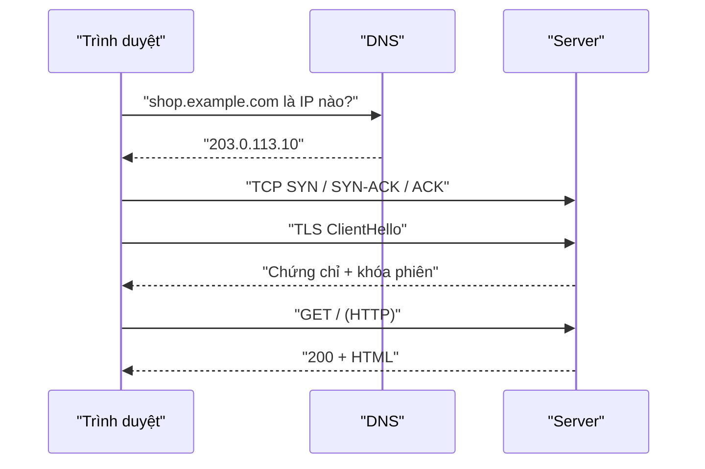
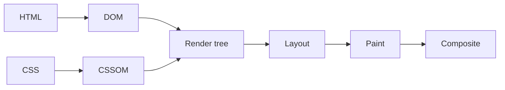

# Câu hỏi: Trình duyệt và mạng cơ bản

Mỗi câu hỏi được viết theo chuỗi suy luận: **Câu hỏi** theo tình huống, **Gợi ý suy luận** (các câu hỏi nhỏ dẫn tới khái niệm nền), **Lập luận** (chuỗi nhân quả vì A nên B), **Đáp án ngắn** nói được thành tiếng, **Nhớ** (kiến thức cốt lõi), rồi **Ví dụ**. Mỗi **Hỏi xoáy** nêu thêm vì sao nó là bước tiếp theo logic của câu trước. Kiến thức gốc: [JavaScript runtime và event loop](/go?p=11-Frontend-Core%2Flt-01-javascript-runtime-event-loop.md), [Hiệu năng web và Core Web Vitals](/go?p=11-Frontend-Core%2Flt-03-web-performance-core-web-vitals.md), [Bảo mật frontend](/go?p=11-Frontend-Core%2Flt-04-bao-mat-frontend.md). Bộ câu hỏi liên quan: [Bài code kinh điển FE](/go?p=07-Interview-QA%2FFrontend%2Feasy%2Fqa-fe-04-bai-code-kinh-dien-fe.md), [FE phỏng vấn tổng hợp](/go?p=07-Interview-QA%2FFrontend%2Fhard%2Fqa-fe-phong-van.md), [React phỏng vấn](/go?p=07-Interview-QA%2FFrontend%2Fhard%2Fqa-react-phong-van.md).

Quy ước về ví dụ, để bạn biết mức tin cậy:

- **_Đã chạy thử bằng Node_**: code JavaScript chạy bằng Node.js v22 (server HTTP cục bộ, `fetch`, `AbortController`), output là thật. Node **không phải trình duyệt**: không có DOM, không áp dụng chính sách CORS, nên các ví dụ chỉ chứng minh phía giao thức và logic, không chứng minh hành vi của trình duyệt.
- **_Mô phỏng_**: code JavaScript thuần dựng lại một quy tắc (lan truyền event, quy tắc preflight) và chạy bằng Node. Nó minh họa nguyên lý theo đặc tả, không phải trình duyệt thật.
- **_Minh họa_**: code cần trình duyệt (DOM, Service Worker, Storage), chưa chạy ở đây.

Thông tin phụ thuộc phiên bản (HTTP/3, giới hạn dung lượng storage, hành vi cookie bên thứ ba, ngưỡng Chrome) hãy kiểm tra lại theo phiên bản trình duyệt và tài liệu hiện hành.


**Tóm tắt:**

- Từ gõ URL tới thấy trang: DNS, TCP và TLS, HTTP request, parse HTML và CSS thành DOM và CSSOM, rồi layout, paint, composite.
- HTTP/2 multiplex nhiều stream trên một kết nối nhưng vẫn kẹt head-of-line blocking ở tầng TCP; HTTP/3 chạy trên QUIC nên mất gói chỉ ảnh hưởng một stream.
- Đọc rồi ghi layout xen kẽ gây layout thrashing; chỉ `transform` và `opacity` có thể chỉ cần composite.
- Event có capturing rồi bubbling; event delegation gắn một listener ở element cha thay vì từng dòng, dựa vào `target` và `currentTarget`.
- Cookie, localStorage, sessionStorage và IndexedDB khác nhau về dung lượng, lifecycle, và việc có gửi theo request hay không; token nhạy cảm không nên để tùy tiện.
- HTTP cache: `no-cache` vẫn lưu nhưng phải revalidate, `no-store` mới không lưu; ETag cho phép server trả 304 để khỏi tải lại body.
- Hay bị hỏi xoáy: CORS và preflight (server vẫn nhận request, trình duyệt mới chặn response); `fetch` không reject khi 404; dùng `AbortController` để kết quả cũ không đè kết quả mới.

## 1. Gõ URL rồi Enter: chuyện gì xảy ra cho tới khi thấy trang?

**Phải thuộc:** Câu này là câu cốt lõi, gặp rất thường xuyên.

**Câu hỏi:** Tôi gõ `https://shop.example.com/` rồi Enter. Hãy kể theo thứ tự từ lúc đó tới lúc thấy trang, và chỉ ra khâu nào hay chậm.

**Gợi ý suy luận:**
- Trình duyệt chỉ biết tên miền, làm sao có địa chỉ IP để kết nối (DNS)?
- Có IP rồi thì phải dựng kênh nào trước khi gửi dữ liệu tin cậy, và HTTPS thêm bước gì (TCP, TLS)?
- Nhận được HTML rồi thì còn phải làm gì trước khi vẽ được (phân tích, tải thêm CSS, JS, ảnh)?

**Lập luận:** Vì mạng định tuyến bằng IP chứ không bằng tên, bước đầu là DNS đổi tên miền ra IP. Có IP, vì HTTP chạy trên kết nối tin cậy, trình duyệt bắt tay TCP (HTTP/3 thì dùng QUIC trên UDP), và vì là HTTPS nên bắt tay TLS để thỏa thuận key và verify chứng chỉ. Sau đó mới gửi HTTP request và nhận HTML. Vì HTML reference thêm CSS, JS, ảnh, trình duyệt vừa phân tích vừa phát request tiếp. Từ HTML dựng DOM, từ CSS dựng CSSOM, hợp lại thành cây hiển thị rồi layout, paint, composite. Mỗi khâu phía trước (DNS, kết nối, TLS) là chờ mạng, đó là lý do giảm số lần bắt tay (tái dùng kết nối, `preconnect`) giúp tải nhanh hơn.

**Đáp án ngắn:** DNS đổi tên ra IP, bắt tay TCP rồi TLS (hoặc QUIC với HTTP/3), gửi HTTP request, nhận HTML, dựng DOM và CSSOM, tính layout, vẽ (paint) và ghép layer (composite). Phần chờ mạng (DNS, kết nối, TLS, byte đầu tiên) thường là chỗ chậm đầu tiên.

**Nhớ:** Trước khi có mạng, trình duyệt còn kiểm tra cache và service worker. Chi tiết tối ưu: [Hiệu năng web](/go?p=11-Frontend-Core%2Flt-03-web-performance-core-web-vitals.md).

**Ví dụ:**



_Minh họa_ (sơ đồ khái niệm; thứ tự và số vòng khứ hồi phụ thuộc phiên bản TLS và HTTP).

**Hỏi xoáy 1:** Nếu đã vào trang này hôm qua thì những bước nào có thể bị bỏ qua?
**Vì sao hỏi tiếp:** Biết chuỗi đầy đủ rồi, câu logic kế là cái nào có thể bỏ nhờ cache.
**Gợi ý suy luận:** Có thể nhớ kết quả DNS ở đâu? Kết nối cũ còn dùng lại được không? Bản HTML có thể lấy từ cache không?
**Đáp:** DNS có cache (trình duyệt, hệ điều hành), kết nối TCP/TLS có thể giữ sống để tái dùng (keep-alive), TLS có thể nối lại phiên, và response còn hạn trong HTTP cache thì không cần gọi mạng (câu 10). Bước nào bỏ được tùy header cache và trạng thái kết nối.

**Hỏi xoáy 2:** Vì sao `preconnect` giúp tải nhanh hơn?
**Vì sao hỏi tiếp:** Từ việc "khâu chờ mạng chậm" suy ra cách làm sớm chúng.
**Gợi ý suy luận:** Nếu biết trước sẽ cần tên miền khác (CDN, font) thì có thể làm khâu nào trước khi có request thật?
**Đáp:** `preconnect` bắt đầu DNS, TCP và TLS tới origin đó sớm, parallel với việc phân tích trang, nên khi request thật phát ra thì kênh đã sẵn. Dùng cho vài origin quan trọng, đừng lạm dụng vì mỗi kết nối mở sẵn tốn tài nguyên.

## 2. DNS: vì sao đổi bản ghi mà người dùng chưa thấy ngay?

**Câu hỏi:** Tôi đổi IP của `api.example.com` ở nhà cung cấp DNS nhưng nhiều người vẫn vào IP cũ cả giờ. Vì sao?

**Gợi ý suy luận:**
- Kết quả tra DNS được lưu ở những tầng nào trước khi hỏi tiếp (trình duyệt, hệ điều hành, resolver của nhà mạng)?
- Mỗi bản ghi mang một thời gian sống (TTL), hết TTL thì làm gì?
- Vì sao trước khi chuyển hệ thống người ta hạ TTL từ trước?

**Lập luận:** Vì hỏi DNS tốn một vòng khứ hồi, nhiều tầng giữ bản sao: trình duyệt, hệ điều hành, resolver của nhà mạng. Mỗi bản ghi có TTL, trong thời gian đó các tầng trả kết quả cũ và không hỏi lại. Nên đổi bản ghi chỉ có hiệu lực dần, khi TTL các bản sao hết hạn. Muốn chuyển nhanh, phải hạ TTL **trước** lúc đổi một khoảng bằng TTL cũ, rồi đổi bản ghi, sau đó mới tăng TTL lại.

**Đáp án ngắn:** DNS được cache nhiều tầng theo TTL, nên thay đổi lan dần. Hạ TTL trước khi chuyển để bản sao cũ hết hạn nhanh.

**Nhớ:** DNS gồm resolver đệ quy hỏi lần lượt root, TLD, authoritative. Bản ghi hay gặp: A và AAAA (IP), CNAME (bí danh), MX, TXT.

**Ví dụ:** Truy vấn tên cục bộ bằng Node để thấy bước đổi tên ra địa chỉ (chỉ `localhost`, không cần mạng ngoài).

```js
const dns = require('dns');
dns.lookup('localhost', { all: true }, (err, addrs) => {
  console.log(err ? err.code : addrs.map((a) => a.address + ' v' + a.family));
});
```

```text
[ '127.0.0.1 v4' ]
```

_Đã chạy thử bằng Node._ Kết quả có thể khác máy (có thể có thêm `::1 v6`). `dns.lookup` dùng cơ chế phân giải của hệ điều hành, gồm file `hosts`.

**Hỏi xoáy 1:** Vì sao gọi API tới tên miền mới lần đầu chậm hơn các lần sau?
**Vì sao hỏi tiếp:** Áp dụng cache vào hiệu năng thực tế.
**Gợi ý suy luận:** Lần đầu phải làm những khâu nào mà lần sau bỏ được?
**Đáp:** Lần đầu phải tra DNS, bắt tay TCP và TLS. Lần sau DNS có trong cache, và kết nối thường được tái dùng, nên chỉ còn request và response.

**Hỏi xoáy 2:** CNAME ở tên gốc (apex, `example.com`) có được không?
**Vì sao hỏi tiếp:** Câu thực tế khi gắn CDN.
**Gợi ý suy luận:** Tên gốc phải chứa những bản ghi nào khác (SOA, NS, MX)?
**Đáp:** Theo đặc tả, CNAME không được cùng tồn tại với các bản ghi khác trên cùng tên, mà tên gốc phải có SOA và NS, nên không dùng CNAME ở apex. Nhiều nhà cung cấp có kiểu bản ghi riêng (ALIAS/ANAME) để thay thế, tên và hành vi tùy nhà cung cấp.

## 3. TCP, TLS, HTTP: vì sao HTTP/2 và HTTP/3 nhanh hơn HTTP/1.1?

**Câu hỏi:** Trang có 80 tài nguyên nhỏ tải chậm trên HTTP/1.1 nhưng nhanh hơn trên HTTP/2. Vì sao, và HTTP/3 khác gì?

**Gợi ý suy luận:**
- HTTP/1.1 trên một kết nối xử lý bao nhiêu request cùng lúc, và trình duyệt giới hạn bao nhiêu kết nối parallel tới một host?
- HTTP/2 gửi nhiều stream trên một kết nối bằng cách nào (multiplexing)?
- Mất một gói TCP thì mọi stream trong kết nối đó bị chặn, vậy HTTP/3 giải quyết bằng cách đổi giao thức vận chuyển nào?

**Lập luận:** HTTP/1.1 chỉ xử lý tuần tự một request mỗi kết nối, nên để parallel trình duyệt mở nhiều kết nối (khoảng sáu mỗi host), mỗi kết nối tốn bắt tay. HTTP/2 chia thành khung nhị phân và multiplex nhiều stream trên một kết nối, nên 80 tài nguyên không cần nhiều kết nối và còn nén header. Nhưng vì HTTP/2 chạy trên TCP, mất một gói làm chặn mọi stream (head-of-line blocking ở tầng TCP). HTTP/3 chạy trên QUIC (trên UDP), mỗi stream được phục hồi độc lập, và bắt tay gộp với TLS 1.3 nên thiết lập nhanh hơn. Vì thế "nhiều file nhỏ" từng bị coi là xấu ở HTTP/1.1 ít gây hại hơn ở HTTP/2 trở đi.

**Đáp án ngắn:** HTTP/2 multiplex nhiều stream trên một kết nối và nén header, tránh được queue và nhiều bắt tay của HTTP/1.1. HTTP/3 chạy trên QUIC nên mất gói chỉ ảnh hưởng một stream và thiết lập kết nối nhanh hơn.

**Nhớ:** HTTP/2 vẫn bị chặn đầu hàng ở tầng TCP, HTTP/3 giải quyết điều đó. Kiểm tra lại theo phiên bản, mức hỗ trợ thực tế tùy trình duyệt và server.

**Ví dụ:** thứ tự event của một request HTTP bằng Node với server cục bộ (cấp socket, tra tên, kết nối TCP, rồi response):

```js
const http = require('http');
const server = http.createServer((req, res) => res.end('ok'));
server.listen(0, () => {
  const order = [];
  const req = http.get({ port: server.address().port, host: 'localhost' }, (res) => {
    order.push('response');
    res.resume();
    res.on('end', () => { console.log(order.join(' -> ')); server.close(); });
  });
  req.on('socket', (s) => {
    order.push('socket');
    s.on('lookup', () => order.push('lookup'));
    s.on('connect', () => order.push('connect'));
  });
});
```

```text
socket -> lookup -> connect -> response
```

_Đã chạy thử bằng Node._ Thứ tự là tra tên (`lookup`, DNS), kết nối TCP (`connect`), rồi mới tới response, đúng chuỗi ở câu 1. Với kết nối được tái dùng (keep-alive) hai event giữa sẽ không xuất hiện lại, và Node không có bước TLS trong ví dụ cục bộ này.

**Hỏi xoáy 1:** Với HTTP/2 có còn cần gộp file (bundle) không?
**Vì sao hỏi tiếp:** Hệ quả thực tế của multiplexing lên chiến lược bundling.
**Gợi ý suy luận:** Mỗi request còn tốn gì dù đã multiplexing (header, ưu tiên, nén)? Gộp quá mức có hại gì cho cache?
**Đáp:** Gộp không còn bắt buộc như HTTP/1.1, nhưng vẫn có lợi (nén tốt hơn, ít chi phí mỗi request). Chia nhỏ hợp lý giúp cache theo từng phần. Cân bằng giữa hai điều đó, đo bằng số liệu của chính trang.

**Hỏi xoáy 2:** TLS đảm bảo những gì và không đảm bảo gì?
**Vì sao hỏi tiếp:** Tránh hiểu nhầm "có HTTPS là an toàn".
**Gợi ý suy luận:** Kênh bị nghe lén thì sao? Trang HTTPS bị XSS thì TLS có giúp?
**Đáp:** TLS đảm bảo encrypt trên đường truyền, toàn vẹn dữ liệu và authenticate server qua chứng chỉ. Nó không ngăn XSS, CSRF hay lộ dữ liệu do server, ([Bảo mật frontend](/go?p=11-Frontend-Core%2Flt-04-bao-mat-frontend.md)).

## 4. Critical rendering path: vì sao trang trắng dù HTML đã về?

**Câu hỏi:** HTML đã tải xong nhưng người dùng vẫn thấy màn hình trắng vài giây. Từ HTML tới pixel, điều gì có thể chặn việc vẽ?

**Gợi ý suy luận:** 
- Trình duyệt dựng những cấu trúc nào từ HTML và từ CSS, rồi hợp lại thành gì (DOM, CSSOM, render tree)?
- Một thẻ `<script>` sync trong `<head>` buộc bộ phân tích HTML làm gì?
- Vì sao trình duyệt không vẽ khi CSS chưa tải xong?

**Lập luận:** HTML được phân tích thành DOM, CSS thành CSSOM. Vì cần biết kiểu dáng đúng trước khi vẽ (nếu không sẽ nháy trang chưa có kiểu), CSS được coi là chặn vẽ: chưa có CSSOM thì chưa có cây hiển thị. Script sync vừa chặn bộ phân tích HTML (vì script có thể sửa DOM bằng `document.write`) vừa phải đợi CSSOM phía trước nếu nó đọc kiểu. Vì thế CSS trong `<head>` và script sync là hai nguồn chính gây trang trắng. Có CSSOM và DOM thì kết hợp thành cây hiển thị (bỏ element `display: none`), tính layout (kích thước, vị trí), vẽ thành lớp rồi ghép (composite) để hiện lên.

**Đáp án ngắn:** DOM cộng CSSOM thành cây hiển thị, rồi layout, paint, composite. CSS chặn vẽ và script sync chặn phân tích HTML, nên đặt CSS quan trọng sớm, dùng `defer` hoặc `async` cho script.

**Nhớ:** `defer` chạy sau khi phân tích xong, giữ thứ tự. `async` chạy ngay khi tải xong, không đảm bảo thứ tự. Gốc: [Hiệu năng web](/go?p=11-Frontend-Core%2Flt-03-web-performance-core-web-vitals.md).

**Ví dụ:**



```html
<!-- Minh họa: chặn và không chặn -->
<link rel="stylesheet" href="app.css">          <!-- chặn vẽ -->
<script src="a.js"></script>                    <!-- chặn phân tích HTML -->
<script src="b.js" defer></script>              <!-- tải song song, chạy sau khi parse xong -->
<script src="c.js" async></script>              <!-- chạy ngay khi tải xong, không đảm bảo thứ tự -->
```

_Minh họa._

**Hỏi xoáy 1:** `defer` và `async` khác nhau ở thời điểm chạy thế nào, khi nào dùng cái nào?
**Vì sao hỏi tiếp:** Nêu giải pháp thì phải phân biệt hai lựa chọn.
**Gợi ý suy luận:** Script nào phụ thuộc DOM hoặc script khác, script nào độc lập (analytics)?
**Đáp:** `defer` chạy theo thứ tự trước `DOMContentLoaded`, hợp với script ứng dụng cần DOM. `async` chạy ngay khi tải xong, không đảm bảo thứ tự, hợp với script độc lập như analytics.

**Hỏi xoáy 2:** `DOMContentLoaded` khác `load` ở đâu?
**Vì sao hỏi tiếp:** Hai mốc hay dùng để đo "trang xong".
**Gợi ý suy luận:** Ảnh và stylesheet có được chờ trước khi mỗi event xảy ra không?
**Đáp:** `DOMContentLoaded` bắn khi HTML đã phân tích xong và các script `defer` đã chạy, không chờ ảnh. `load` bắn khi mọi tài nguyên phụ (ảnh, stylesheet, iframe) đã tải xong.

## 5. Reflow, repaint, composite: vì sao đọc rồi ghi layout làm giật?

**Câu hỏi:** Vòng lặp đổi `style.width` của 1000 element và đọc `offsetWidth` xen kẽ làm trang giật, còn gom lại thì mượt. Vì sao? Và vì sao animation bằng `transform` mượt hơn bằng `left`?

**Gợi ý suy luận:**
- Thay đổi kích thước hay vị trí element buộc trình duyệt tính lại điều gì (layout), và tính lại phần nào có thể chỉ cần vẽ lại (paint)?
- Đọc `offsetWidth` ngay sau khi vừa ghi style buộc trình duyệt làm gì để trả giá trị đúng?
- Property nào chỉ cần ghép layer (composite) mà không layout hay paint?

**Lập luận:** Đổi hình học (width, left, margin) làm vô hiệu layout nên cần reflow, sau đó paint, rồi composite. Đổi hình thức không đổi hình học (màu) thì chỉ paint và composite. Bình thường trình duyệt gộp thay đổi và tính một lần cho mỗi khung hình. Nhưng khi ta đọc `offsetWidth` ngay sau khi ghi, layout đang "bẩn", nên để trả đúng giá trị trình duyệt phải tính layout ngay (forced synchronous layout). Lặp ghi, đọc, ghi, đọc thì nó tính layout 1000 lần (layout thrashing). Gom tất cả lần đọc trước, ghi sau thì chỉ cần một lần. `transform` và `opacity` thường được xử lý ở bước composite (có khi trên GPU) nên không buộc layout và paint, vì thế mượt hơn `left`.

**Đáp án ngắn:** Đọc layout ngay sau khi ghi ép trình duyệt tính layout sync, lặp trong vòng lặp thành layout thrashing. Gom đọc trước, ghi sau, và dùng `transform`, `opacity` cho hoạt ảnh vì chúng chỉ cần composite.

**Nhớ:** Thứ tự chi phí: layout (reflow) lớn hơn paint lớn hơn composite. Công cụ: tab Performance của DevTools. Chi tiết: [Hiệu năng web](/go?p=11-Frontend-Core%2Flt-03-web-performance-core-web-vitals.md).

**Ví dụ:** _Minh họa_ (cần DOM, chưa chạy trong Node):

```js
// Chậm: đọc xen kẽ ghi, mỗi vòng ép tính lại layout
for (const el of items) {
  el.style.width = el.parentNode.offsetWidth / 2 + 'px';
}

// Tốt hơn: đọc hết trước, ghi hết sau
const width = container.offsetWidth / 2;
for (const el of items) el.style.width = width + 'px';

// Hoạt ảnh: ưu tiên transform thay vì left
el.style.transform = 'translateX(100px)';
```

**Hỏi xoáy 1:** Những thao tác đọc nào cũng ép layout?
**Vì sao hỏi tiếp:** Biết nguyên nhân thì cần biết danh sách để tránh.
**Gợi ý suy luận:** Những giá trị nào chỉ tính được khi biết layout (kích thước, vị trí, cuộn)?
**Đáp:** Các đọc phụ thuộc layout như `offsetWidth/Height`, `getBoundingClientRect()`, `scrollTop`, `clientWidth`, `getComputedStyle` (một số property). Danh sách đầy đủ phụ thuộc trình duyệt, nên đo bằng DevTools thay vì thuộc lòng.

**Hỏi xoáy 2:** `will-change` có nên bật cho mọi element?
**Vì sao hỏi tiếp:** Một mẹo hay bị lạm dụng sau khi nghe "composite nhanh".
**Gợi ý suy luận:** Mỗi layer composite cần thêm memory không?
**Đáp:** Không. Mỗi layer riêng tốn memory (đặc biệt GPU), bật tràn lan làm chậm. Chỉ dùng cho element sắp chuyển động và gỡ khi xong.

## 6. Event bubbling và capturing: vì sao click con làm chạy cả handler của cha?

**Câu hỏi:** Có `ul > li > button`, mỗi cấp có handler `click`. Bấm vào `button` thì handler nào chạy, theo thứ tự nào, và `stopPropagation` ảnh hưởng thế nào?

**Gợi ý suy luận:**
- Event đi qua những pha nào (capture từ gốc xuống, target, bubble từ target lên)?
- `addEventListener` mặc định đăng ký ở pha nào?
- `stopPropagation` chặn việc gì, và `stopImmediatePropagation` chặn thêm gì?

**Lập luận:** Vì element con nằm trong element cha, một cú bấm vào con cũng là bấm vào cha, nên đặc tả định nghĩa đường đi của event. Pha capture đi từ `window` xuống tới cha của target, rồi pha target, rồi pha bubble đi ngược từ target lên `window`. Mặc định listener đăng ký ở pha bubble, nên thứ tự thường thấy là con trước, cha sau. Đăng ký với `{ capture: true }` thì chạy ở pha capture, tức cha trước. `stopPropagation` ngăn event đi tiếp tới element khác, nhưng các listener còn lại trên cùng element vẫn chạy, `stopImmediatePropagation` chặn cả chúng.

**Đáp án ngắn:** Event đi xuống (capture) tới target rồi nổi lên (bubble). Listener mặc định chạy ở pha bubble nên con chạy trước cha. `stopPropagation` chặn việc đi tiếp sang element khác.

**Nhớ:** Một số event không bubble (`focus`, `blur`, `mouseenter`), dùng `focusin`, `focusout` thay thế. `preventDefault` chặn hành vi mặc định, không phải chặn lan truyền.

**Ví dụ:** dựng lại đường đi của event bằng JavaScript thuần (không có DOM), có thêm `stopPropagation` ở `li` pha bubble:

```js
function dispatch(target, event) {
  const path = []; for (let n = target; n; n = n.parent) path.unshift(n);
  event.stopped = false;
  for (const n of path.slice(0, -1)) { if (event.stopped) return; n.capture.forEach((h) => h(event, n)); }
  if (event.stopped) return;
  [...target.capture, ...target.bubble].forEach((h) => h(event, target));
  for (const n of path.slice(0, -1).reverse()) { if (event.stopped) return; n.bubble.forEach((h) => h(event, n)); }
}
```

```text
--- click vao button
capture html
capture ul
capture li
capture button
bubble  button
bubble  li
bubble  ul
bubble  html
--- li goi stopPropagation o bubble
capture html
capture ul
capture li
capture button
bubble  button
bubble  li
```

_Mô phỏng, đã chạy bằng Node_ (rút gọn: bản chạy đầy đủ có hàm tạo cây nút). Thứ tự capture xuống rồi bubble lên khớp đặc tả, và sau khi `li` dừng lan truyền thì `ul` và `html` không nhận ở pha bubble.

**Hỏi xoáy 1:** `event.target` khác `event.currentTarget` thế nào?
**Vì sao hỏi tiếp:** Khi event nổi lên, cần phân biệt "chỗ bấm" với "chỗ đang xử lý".
**Gợi ý suy luận:** Handler gắn trên `ul` nhưng bấm vào `li`, hai giá trị đó là gì?
**Đáp:** `target` là element gốc phát sinh event (li), `currentTarget` là element đang chạy handler (ul). Dùng `target` để biết bấm ở đâu, `currentTarget` để biết handler gắn ở đâu. (Arrow function hay `this` khác nhau, xem [JavaScript runtime](/go?p=11-Frontend-Core%2Flt-01-javascript-runtime-event-loop.md).)

**Hỏi xoáy 2:** React có dùng bubbling thật của DOM không?
**Vì sao hỏi tiếp:** Nối kiến thức nền với framework.
**Gợi ý suy luận:** Listener của React gắn ở đâu, ở mỗi nút hay một chỗ chung?
**Đáp:** React (từ 17) gắn listener ở root container và tự dựng lại việc truyền event qua cây component. Do đó `stopPropagation` trong React chặn trong cây React, và có tương tác với listener DOM gắn ngoài. Cơ chế chi tiết kiểm tra lại theo phiên bản React.

## 7. Event delegation: vì sao gắn một listener cho 10.000 dòng bảng?

**Câu hỏi:** Danh sách có hàng nghìn `li`, thêm xóa liên tục. Gắn handler cho từng `li` thì tốn memory và phải gắn lại với element mới. Có cách nào chỉ cần một listener?

**Gợi ý suy luận:**
- Event bubble lên cha, vậy cha có "thấy" được click của con không?
- Làm sao biết con nào bị bấm (`event.target`)?
- Bấm vào icon con nằm trong `li` thì `target` không phải `li`, xử lý thế nào (`closest`)?

**Lập luận:** Vì event nổi lên cha, một listener ở `ul` nhận được click của mọi `li`, kể cả `li` thêm sau này, nên không phải gắn lại và chỉ tốn một listener. Để biết con nào, đọc `event.target`. Vì người dùng có thể bấm vào element lồng bên trong `li` (icon, span), dùng `event.target.closest('li')` để đi ngược lên tìm `li` chứa nó và kiểm tra nó nằm trong `ul`. Điều kiện để dùng được là event phải bubble.

**Đáp án ngắn:** Gắn một listener ở element cha, dùng `event.target.closest(selector)` để biết con nào được bấm. Tiết kiệm listener và tự áp dụng cho element thêm sau.

**Nhớ:** Không dùng được với event không bubble. Chú ý `stopPropagation` ở con sẽ cắt delegation.

**Ví dụ:**

```js
// Minh họa (cần DOM)
list.addEventListener('click', (e) => {
  const item = e.target.closest('li');
  if (!item || !list.contains(item)) return;
  console.log('mở', item.dataset.id);
});
```

_Minh họa._ Mô phỏng bằng Node cho thấy một listener ở cha nhận được event của cả ba `li` thêm động:

```text
ul nhan click tu li -> tag li? true
ul nhan click tu li -> tag li? true
ul nhan click tu li -> tag li? true
```

_Mô phỏng, đã chạy bằng Node._ Ba `li` được tạo sau khi gắn listener ở `ul` và vẫn được xử lý.

**Hỏi xoáy 1:** Delegation có nhược điểm gì?
**Vì sao hỏi tiếp:** Mọi kỹ thuật có giá, người phỏng vấn muốn nghe đánh đổi.
**Gợi ý suy luận:** Handler cha phải xử lý lọc mỗi lần, và event nào không nổi lên?
**Đáp:** Phải lọc đúng element, không áp dụng với event không bubble, và nếu con gọi `stopPropagation` thì cha không nhận. Với danh sách nhỏ tĩnh, gắn trực tiếp cũng ổn.

**Hỏi xoáy 2:** Vì sao `{ once: true }` và `{ passive: true }` hữu ích?
**Vì sao hỏi tiếp:** Tùy chọn của `addEventListener` liên quan tới hiệu năng.
**Gợi ý suy luận:** `passive: true` hứa điều gì với trình duyệt về `preventDefault`?
**Đáp:** `once` tự gỡ sau lần đầu (tránh quên gỡ). `passive: true` hứa không gọi `preventDefault`, nên với `touchstart` và `wheel` trình duyệt cuộn ngay mà không phải đợi handler chạy xong.

## 8. Cookie, localStorage, sessionStorage: vì sao token không nên để tùy tiện?

**Phải thuộc:** Câu này là câu cốt lõi, gặp rất thường xuyên.

**Câu hỏi:** Cần lưu vài thứ ở client: một token đăng nhập, cài đặt UI, nháp biểu mẫu. Chọn cookie, `localStorage` hay `sessionStorage` cho từng thứ, và vì sao?

**Gợi ý suy luận:**
- Thứ nào được trình duyệt tự gửi kèm mọi request, thứ nào chỉ do JavaScript đọc?
- Lifecycle mỗi loại: hết khi nào (đóng tab, đóng trình duyệt, hết hạn)?
- Nếu trang bị XSS thì JavaScript độc đọc được những loại nào?

**Lập luận:** Cookie được trình duyệt tự gửi theo request tới đúng miền và đường dẫn, nên hợp để duy trì phiên với server; cookie có property `HttpOnly` (JS không đọc được), `Secure` (chỉ qua HTTPS) và `SameSite` (giới hạn gửi cross-site), nên bảo vệ được token trước XSS và giảm CSRF. `localStorage` do JavaScript đọc ghi, tồn tại lâu dài trong cùng origin, không tự gửi theo request. `sessionStorage` tương tự nhưng riêng cho từng tab và mất khi đóng tab. Vì JavaScript đọc được hai loại storage, XSS lấy được toàn bộ nội dung, nên token nhạy cảm không nên để ở đó. Cài đặt UI và nháp hợp với `localStorage` (hoặc `sessionStorage` nếu chỉ trong phiên).

**Đáp án ngắn:** Token phiên nên ở cookie `HttpOnly; Secure; SameSite`, cài đặt UI ở `localStorage`, dữ liệu tạm trong tab ở `sessionStorage`. Storage đọc được bằng JS nên XSS lấy được, cookie `HttpOnly` thì không.

**Nhớ:** Cookie có giới hạn khoảng 4KB mỗi cookie và gửi theo mọi request nên làm nặng. Storage thường vài MB (tùy trình duyệt, kiểm tra lại). Bàn luận token đầy đủ: [Bảo mật frontend](/go?p=11-Frontend-Core%2Flt-04-bao-mat-frontend.md).

**Ví dụ:** header đặt cookie từ server (đã nhận qua Node), và cách đọc trong trang:

```js
const http = require('http');
const server = http.createServer((req, res) => {
  res.setHeader('Set-Cookie', ['sid=abc123; HttpOnly; Secure; SameSite=Lax; Path=/; Max-Age=3600']);
  res.end('ok');
});
server.listen(0, async () => {
  const r = await fetch('http://localhost:' + server.address().port);
  console.log(r.headers.getSetCookie());
  server.close();
});
```

```text
[ 'sid=abc123; HttpOnly; Secure; SameSite=Lax; Path=/; Max-Age=3600' ]
```

_Đã chạy thử bằng Node_ (chạy thật server HTTP, phần này chỉ chứng minh header `Set-Cookie`, còn việc trình duyệt áp dụng `HttpOnly` thì cần trình duyệt). Trong trình duyệt, `document.cookie` không trả `sid` vì có `HttpOnly`.

**Hỏi xoáy 1:** `SameSite=Lax` khác `Strict` và `None` thế nào?
**Vì sao hỏi tiếp:** Property này là chỗ phỏng vấn hay đào sâu vì liên quan CSRF.
**Gợi ý suy luận:** Cookie có được gửi khi bấm link từ trang khác tới site của bạn, và khi trang khác gọi `fetch` tới bạn?
**Đáp:** `Strict` không gửi cookie trong mọi request cross-site. `Lax` (mặc định ở nhiều trình duyệt hiện đại, kiểm tra lại theo phiên bản) gửi khi điều hướng cấp cao bằng GET (bấm link) nhưng không gửi với `fetch` hay `POST` cross-site. `None` luôn gửi nhưng phải kèm `Secure`. Chi tiết CSRF: [Bảo mật frontend](/go?p=11-Frontend-Core%2Flt-04-bao-mat-frontend.md).

**Hỏi xoáy 2:** Hai tab cùng origin dùng `localStorage`, làm sao sync khi một tab đổi?
**Vì sao hỏi tiếp:** Tình huống đa tab thực tế (đăng xuất ở tab này, tab kia phải biết).
**Gợi ý suy luận:** Có event nào bắn ở các tab khác khi storage đổi?
**Đáp:** Event `storage` bắn trên các tab khác cùng origin (không bắn ở tab vừa ghi). Có thể dùng nó, hoặc `BroadcastChannel`, để thông báo như đăng xuất.

## 9. localStorage hay IndexedDB: vì sao đừng nhét dữ liệu lớn vào localStorage?

**Câu hỏi:** Ứng dụng cần lưu offline vài chục nghìn bản ghi và ảnh. Có nên dùng `localStorage`? Nếu không thì dùng gì?

**Gợi ý suy luận:**
- `localStorage` đọc ghi sync hay async, và hệ quả với main thread khi dữ liệu lớn?
- Nó chỉ lưu kiểu dữ liệu nào, nên cần chuyển đổi gì?
- Cần truy vấn theo index, transaction, lưu nhị phân thì cần công cụ nào?

**Lập luận:** `localStorage` đọc ghi **sync**, nên mỗi lần thao tác dữ liệu lớn sẽ chặn main thread, và nó chỉ lưu chuỗi nên phải `JSON.stringify` mỗi lần (tốn CPU, và mất kiểu như `Date`, `Blob`). Dung lượng cũng nhỏ (vài MB tùy trình duyệt). IndexedDB là cơ sở dữ liệu hướng object trong trình duyệt, async, hỗ trợ index, transaction và lưu được nhị phân (`Blob`, `ArrayBuffer`) và kiểu có thể sao chép bằng structured clone. Vì API gốc dài dòng, thực tế thường dùng thư viện bọc (như `idb`, hoặc Dexie). Nên với dữ liệu lớn, truy vấn, offline thì chọn IndexedDB.

**Đáp án ngắn:** `localStorage` sync, chỉ lưu chuỗi, dung lượng nhỏ nên chỉ hợp cho dữ liệu nhỏ. Dữ liệu lớn, cần truy vấn hoặc offline thì dùng IndexedDB, async, hỗ trợ index và nhị phân.

**Nhớ:** Dung lượng khả dụng phụ thuộc trình duyệt và ổ đĩa (hỏi bằng `navigator.storage.estimate()`), dữ liệu có thể bị dọn khi thiếu memory trừ khi xin lưu bền (`navigator.storage.persist()`). Kiểm tra lại theo phiên bản.

**Ví dụ:** _Minh họa_ (cần trình duyệt):

```js
// IndexedDB API gốc, rút gọn
const open = indexedDB.open('app', 1);
open.onupgradeneeded = () => open.result.createObjectStore('notes', { keyPath: 'id' });
open.onsuccess = () => {
  const tx = open.result.transaction('notes', 'readwrite');
  tx.objectStore('notes').put({ id: 1, text: 'xin chào', blob: new Blob(['x']) });
  tx.oncomplete = () => console.log('đã lưu');
};
```

**Hỏi xoáy 1:** Hai ứng dụng khác origin đọc được dữ liệu của nhau không?
**Vì sao hỏi tiếp:** Phạm vi truy cập của mọi storage.
**Gợi ý suy luận:** Origin gồm những phần nào (giao thức, host, cổng)?
**Đáp:** Không. Storage tách theo origin (giao thức, host, cổng). Khác một thành phần là khác kho. Cookie thì có quy tắc riêng theo miền và đường dẫn.

**Hỏi xoáy 2:** Người dùng "xóa dữ liệu trang" thì mất hết?
**Vì sao hỏi tiếp:** Thiết kế offline phải chịu được mất dữ liệu cục bộ.
**Gợi ý suy luận:** Nguồn sự thật duy nhất nên ở đâu?
**Đáp:** Có thể mất. Vì vậy dữ liệu quan trọng phải có bản gốc ở server, client chỉ là cache hoặc queue sync.

## 10. HTTP cache: vì sao `no-cache` vẫn lưu còn `no-store` mới không lưu?

**Phải thuộc:** Câu này là câu cốt lõi, gặp rất thường xuyên.

**Câu hỏi:** Tôi đặt `Cache-Control: no-cache` và tưởng trình duyệt không lưu gì, nhưng nó vẫn lưu. Hai header `no-cache` và `no-store` khác nhau thế nào, và bạn cấu hình cache ra sao cho file JS có hash tên và cho `index.html`?

**Gợi ý suy luận:**
- "Cache" ở đây là có lưu bản sao hay có dùng bản sao mà không hỏi lại?
- File có hash trong tên (`app.3f9a.js`) thay đổi nội dung thì tên đổi, vậy nên cache bao lâu?
- `index.html` trỏ tới các file hash, nếu bị cache lâu thì người dùng thấy gì?

**Lập luận:** `no-cache` không có nghĩa "đừng lưu", nó có nghĩa "được lưu nhưng phải hỏi lại server (revalidate) trước khi dùng". `no-store` mới là không lưu. `max-age=N` cho phép dùng bản sao tới N giây mà không cần hỏi. File có hash đổi tên khi đổi nội dung, nên một URL luôn ứng với một nội dung, có thể cache rất lâu và `immutable`: `max-age=31536000, immutable`. `index.html` trỏ tới tên file hash nên nếu nó bị cache lâu, người dùng sẽ không biết bản mới. Vì thế `index.html` dùng `no-cache` (luôn revalidate, rẻ nhờ 304) hoặc `max-age` rất ngắn.

**Đáp án ngắn:** `no-cache` là lưu nhưng phải revalidate, `no-store` là không lưu. File có hash dùng `max-age` một năm và `immutable`, còn `index.html` dùng `no-cache` để luôn nhận bản mới.

**Nhớ:** Dữ liệu nhạy cảm dùng `no-store`. `private` cấm cache dùng chung (CDN), `public` cho phép. Gốc: [Hiệu năng web](/go?p=11-Frontend-Core%2Flt-03-web-performance-core-web-vitals.md).

**Ví dụ:**

```text
# file có hash
/assets/app.3f9a1c.js   Cache-Control: public, max-age=31536000, immutable
# điểm vào
/index.html             Cache-Control: no-cache
# API cá nhân hóa
/api/me                 Cache-Control: private, no-store
```

_Minh họa_ (cấu hình điển hình; cụ thể tùy server và CDN).

**Hỏi xoáy 1:** Nhấn F5 và Ctrl+F5 khác gì về cache?
**Vì sao hỏi tiếp:** Hay gặp khi debug "sao tôi không thấy bản mới".
**Gợi ý suy luận:** F5 thường làm gì với bản sao còn hạn, Ctrl+F5 bỏ qua gì?
**Đáp:** F5 thường ép revalidate các tài nguyên chính (gửi điều kiện), còn tải lại cứng (Ctrl+F5) bỏ qua cache và tải mới. Hành vi chi tiết tùy trình duyệt, kiểm tra lại theo phiên bản.

**Hỏi xoáy 2:** Deploy bản mới, người dùng đang mở trang cũ gọi tới file hash đã bị xóa thì sao?
**Vì sao hỏi tiếp:** Hệ quả thực tế của cache dài với hash.
**Gợi ý suy luận:** Trang cũ còn reference tên file nào, và server còn giữ file đó không?
**Đáp:** Lỗi 404 khi tải chunk cũ. Cách giảm: giữ file cũ trên CDN một thời gian sau mỗi lần deploy, và bắt lỗi tải chunk để tải lại trang.

## 11. ETag và 304: vì sao revalidate nhẹ hơn tải lại?

**Câu hỏi:** Bản sao hết hạn thì trình duyệt phải hỏi server. Làm sao server nói "bản cũ vẫn dùng được" mà không gửi lại toàn bộ nội dung?

**Gợi ý suy luận:**
- Server cần cho trình duyệt một "dấu vân tay" của nội dung (`ETag`) hay thời điểm sửa (`Last-Modified`)?
- Lần sau trình duyệt gửi dấu vân tay đó kèm header nào (`If-None-Match`)?
- Nếu khớp, server trả mã gì và có body không?

**Lập luận:** Lần đầu server trả nội dung kèm `ETag` đại diện cho nội dung. Khi bản sao hết hạn, trình duyệt gửi request có điều kiện kèm `If-None-Match: <etag>`. Vì server so ETag và thấy nội dung không đổi, nó trả `304 Not Modified` không kèm body, và trình duyệt tiếp tục dùng bản sao, đồng thời gia hạn. Nếu khác, server trả 200 với nội dung mới và ETag mới. Nhờ vậy tiết kiệm băng thông dù vẫn tốn một vòng khứ hồi.

**Đáp án ngắn:** Server gửi `ETag`, trình duyệt gửi lại `If-None-Match`. Nếu khớp thì server trả `304` không body và trình duyệt dùng bản sao. Tốn một vòng khứ hồi nhưng không tải lại nội dung.

**Nhớ:** `ETag` mạnh (so từng byte) và yếu (`W/`, tương đương ngữ nghĩa). `Last-Modified` với `If-Modified-Since` là cơ chế cũ độ chính xác theo giây.

**Ví dụ:** server tự dựng `ETag`, trả 304 khi khớp, và các hành vi của `fetch` trên 404 và lỗi mạng:

```js
const server = http.createServer((req, res) => {
  if (req.url === '/api') {
    res.setHeader('Cache-Control', 'max-age=60');
    res.setHeader('ETag', etag);
    if (req.headers['if-none-match'] === etag) { res.statusCode = 304; return res.end(); }
    return res.end(body);
  }
  res.statusCode = 404; res.end('no');
});
```

```text
lan 1: 200 max-age=60 true {"hello":"world"}
lan 2 (revalidate): 304 body rong = true
404 co reject khong? khong: 404 false
loi mang reject: TypeError undefined
```

_Đã chạy thử bằng Node_ (phần rút gọn; bản đầy đủ có tạo `etag` từ hash của body). Lần hai gửi `If-None-Match` nhận 304 không body. Hai dòng cuối chuẩn bị cho câu 13: `fetch` không reject với 404, và chỉ reject (`TypeError`) khi lỗi mạng.

**Hỏi xoáy 1:** Khi nào `ETag` gây tác dụng ngược khi có nhiều server phía sau?
**Vì sao hỏi tiếp:** Một lỗi cấu hình thật làm mất lợi ích cache.
**Gợi ý suy luận:** Nếu mỗi server tính ETag từ thông tin riêng (inode, thời gian) thì cùng nội dung có cùng ETag không?
**Đáp:** ETag tính từ property riêng của máy (inode) khác nhau giữa các server, nên cùng một file có ETag khác nhau và 304 không xảy ra. Nên tính ETag từ nội dung.

**Hỏi xoáy 2:** Với file có hash trong tên có cần ETag không?
**Vì sao hỏi tiếp:** Kết nối với câu 10: nếu cache một năm thì không bao giờ revalidate.
**Gợi ý suy luận:** Khi bản sao còn hạn một năm, trình duyệt có hỏi server không?
**Đáp:** Gần như không cần, vì còn hạn thì không hỏi lại. ETag chỉ có ích khi hết hạn hoặc khi người dùng tải lại cứng.

## 12. CORS và preflight: vì sao `fetch` bị chặn dù server vẫn nhận request?

**Phải thuộc:** Câu này là câu cốt lõi, gặp rất thường xuyên.

**Câu hỏi:** Trang ở `https://app.example.com` gọi API ở `https://api.example.com` và trình duyệt báo lỗi CORS, dù tôi thấy request tới server. Ai chặn, vì sao, và preflight là gì?

**Gợi ý suy luận:**
- Chính sách cùng nguồn (same-origin) bảo vệ điều gì, và origin gồm những phần nào?
- CORS là server cấp phép hay trình duyệt ép buộc, và nó có bảo vệ server không?
- Request nào phải hỏi trước bằng `OPTIONS` (preflight) và vì sao?

**Lập luận:** Vì trang có thể mang cookie của người dùng gọi sang site khác, trình duyệt áp chính sách cùng nguồn: JavaScript không được đọc response của origin khác trừ khi server cho phép. CORS là cơ chế cho phép đó, server cấp phép bằng header `Access-Control-Allow-Origin`. Việc chặn do **trình duyệt** thực hiện sau khi nhận response, nên server vẫn thấy request. CORS không bảo vệ server khỏi request từ nơi khác (curl không bị chặn). Với request "đơn giản" (GET, HEAD, POST với kiểu nội dung form hoặc text, header an toàn), trình duyệt gửi thẳng. Với request có thể gây thay đổi và vốn không thể có từ form cũ (PUT, DELETE, header tùy biến như `Authorization`, `Content-Type: application/json`), trình duyệt gửi trước một preflight `OPTIONS` hỏi "được phép không", chỉ gửi request thật nếu server trả header cho phép phù hợp.

**Đáp án ngắn:** CORS do trình duyệt ép, server cấp phép bằng header `Access-Control-Allow-*`. Request không đơn giản (PUT, JSON, `Authorization`...) phải qua preflight `OPTIONS`, và server phải đồng ý origin, method, header thì request thật mới được gửi.

**Nhớ:** CORS không phải bảo mật phía server. Khi dùng cookie phải `credentials: 'include'` và server trả origin cụ thể (không `*`) kèm `Access-Control-Allow-Credentials: true`. Gốc: [Bảo mật frontend](/go?p=11-Frontend-Core%2Flt-04-bao-mat-frontend.md).

**Ví dụ:** quy tắc "cần preflight" (dựa theo đặc tả Fetch, kiểm tra lại theo tài liệu hiện hành):

```js
const SIMPLE_METHODS = ['GET', 'HEAD', 'POST'];
const SIMPLE_CT = ['application/x-www-form-urlencoded', 'multipart/form-data', 'text/plain'];
const SAFE_HEADERS = ['accept', 'accept-language', 'content-language', 'content-type'];
function needsPreflight({ method = 'GET', headers = {} }) {
  if (!SIMPLE_METHODS.includes(method.toUpperCase())) return true;
  for (const [k, v] of Object.entries(headers)) {
    const key = k.toLowerCase();
    if (!SAFE_HEADERS.includes(key)) return true;
    if (key === 'content-type' && !SIMPLE_CT.includes(v.split(';')[0].trim().toLowerCase())) return true;
  }
  return false;
}
```

```text
{"method":"GET"} => preflight: false
{"method":"POST","headers":{"Content-Type":"text/plain"}} => preflight: false
{"method":"POST","headers":{"Content-Type":"application/json"}} => preflight: true
{"method":"GET","headers":{"Authorization":"Bearer x"}} => preflight: true
{"method":"PUT"} => preflight: true
{"method":"DELETE"} => preflight: true
```

_Mô phỏng, đã chạy bằng Node_ (bản rút gọn của quy tắc thật: bỏ qua giới hạn độ dài và ký tự của giá trị header, và `Range`). Server cục bộ trả lời preflight, gọi bằng `fetch` tay (Node không áp CORS):

```text
preflight: 204
  access-control-allow-origin: https://app.example.com
  access-control-allow-methods: GET, PUT
  access-control-allow-headers: content-type, authorization
  access-control-max-age: 600
  vary: Origin
request that: 200 ok
```

_Đã chạy thử bằng Node._ Phản hồi cho `OPTIONS` có đủ header cấp phép origin, method, header, và `Max-Age` cho phép trình duyệt nhớ kết quả preflight 600 giây. `Vary: Origin` cần có khi giá trị `Allow-Origin` đổi theo origin, để cache không trả nhầm.

**Hỏi xoáy 1:** Đặt `Access-Control-Allow-Origin: *` cùng `credentials: 'include'` thì sao?
**Vì sao hỏi tiếp:** Cấu hình sai thường gặp nhất khi làm CORS có cookie.
**Gợi ý suy luận:** Cho phép mọi origin đọc response có cookie của người dùng thì nguy hiểm thế nào?
**Đáp:** Trình duyệt từ chối: với request có credentials, `*` không hợp lệ. Server phải trả đúng origin của request (từ danh sách cho phép) kèm `Allow-Credentials: true` và `Vary: Origin`. Phản chiếu mù mọi `Origin` thì tương đương mở cho tất cả, nguy hiểm.

**Hỏi xoáy 2:** Đã cấu hình CORS rồi vẫn lỗi ở một số request lỗi 500, vì sao?
**Vì sao hỏi tiếp:** Chỗ debug thật: header CORS phải có ở cả error response.
**Gợi ý suy luận:** Error response từ gateway hay middleware có đi qua phần thêm header CORS không?
**Đáp:** Nếu lỗi sinh ra trước middleware CORS (hoặc từ gateway/proxy), response thiếu header cấp phép, trình duyệt báo CORS và che mất lỗi thật. Phải kiểm tra tab Network để thấy status gốc, và đảm bảo header CORS có ở error response.

## 13. fetch và XMLHttpRequest: vì sao `fetch` không reject khi 404?

**Câu hỏi:** Tôi `await fetch(url)` vào endpoint trả 404 mà `catch` không chạy. Vì sao, và `fetch` khác `XMLHttpRequest` ở những điểm nào?

**Gợi ý suy luận:**
- `fetch` coi "request hoàn tất có response" và "request thất bại" khác nhau thế nào?
- Làm sao biết 4xx hoặc 5xx (`response.ok`, `status`)?
- Đọc body là thao tác async riêng, vì sao (stream)?

**Lập luận:** `fetch` trả Promise và chỉ reject khi không có response HTTP (lỗi mạng, bị chặn bởi CORS, bị hủy). Vì với server, 404 vẫn là một response hợp lệ nên Promise vẫn resolve, ta phải tự kiểm `response.ok` (status từ 200 đến 299). Body là stream nên đọc bằng `await response.json()` hay `.text()`, và chỉ đọc được một lần. `XMLHttpRequest` dùng event, không có Promise, không có stream nhưng báo được tiến trình upload dễ hơn. `fetch` gọn hơn, hợp Promise, `async/await`, hỗ trợ `AbortController`, và mặc định không gửi cookie cross-origin trừ khi `credentials` được đặt.

**Đáp án ngắn:** `fetch` chỉ reject với lỗi mạng hoặc bị hủy, không reject với 4xx và 5xx nên phải kiểm `response.ok`. So với XHR, `fetch` dựa trên Promise, gọn hơn, dùng `AbortController`, còn XHR có sẵn event tiến trình upload.

**Nhớ:** Bọc `fetch` thành hàm ném lỗi khi `!res.ok`. Mặc định `fetch` không có timeout, cần tự đặt bằng `AbortSignal.timeout`.

**Ví dụ:** (đã thấy kết quả ở câu 11)

```js
async function getJson(url, options) {
  const res = await fetch(url, options);
  if (!res.ok) throw new Error('HTTP ' + res.status);
  return res.json();
}
```

_Đã chạy thử bằng Node_ ở câu 11: với 404 `fetch` trả `status = 404` và `ok = false` mà không reject, với cổng đóng thì reject `TypeError`.

**Hỏi xoáy 1:** Đọc `response.json()` hai lần thì sao?
**Vì sao hỏi tiếp:** Hệ quả của body là stream.
**Gợi ý suy luận:** Luồng đã đọc hết có đọc lại được không? Cách clone?
**Đáp:** Lần hai ném `TypeError` (body đã được dùng). Gọi `response.clone()` trước khi đọc nếu cần đọc hai lần.

**Hỏi xoáy 2:** Gửi JSON bằng `fetch` cần những gì?
**Vì sao hỏi tiếp:** Câu thực hành, liên hệ trực tiếp với preflight ở câu 12.
**Gợi ý suy luận:** Cần `Content-Type` nào, body là gì, và hệ quả với CORS?
**Đáp:** `method: 'POST'`, `headers: { 'Content-Type': 'application/json' }`, `body: JSON.stringify(data)`. Vì `application/json` không thuộc nhóm đơn giản nên request cross-origin sẽ kích hoạt preflight.

## 14. AbortController: vì sao gõ nhanh thì kết quả cũ có thể đè kết quả mới?

**Câu hỏi:** Ô tìm kiếm gửi request mỗi lần gõ. Request "ab" chậm hơn "abc" về sau, kết quả của "ab" hiện đè lên kết quả của "abc". Bạn xử lý thế nào, và hủy một `fetch` ra sao?

**Gợi ý suy luận:**
- Thứ tự response có bằng thứ tự gửi đi không?
- Có cách báo cho `fetch` đang chạy dừng lại không (`AbortController`, `signal`)?
- Khi hủy thì Promise bị làm gì, và `catch` phân biệt hủy với lỗi thật thế nào (`error.name`)?

**Lập luận:** Vì mạng không đảm bảo response về theo thứ tự gửi, request cũ có thể về sau cùng và ghi đè dữ liệu mới (race condition). Cách xử lý là hủy request cũ khi có request mới. `AbortController` cung cấp `signal` để truyền cho `fetch`, gọi `controller.abort()` thì `fetch` bị reject với lỗi có `name === 'AbortError'`. Vì hủy là hành vi chủ động chứ không phải lỗi, `catch` cần bỏ qua `AbortError`. Với timeout, `AbortSignal.timeout(ms)` tạo signal tự hủy và lỗi có tên `TimeoutError`.

**Đáp án ngắn:** Tạo `AbortController` cho mỗi request, hủy request trước khi gửi request mới, truyền `signal` vào `fetch`, và bỏ qua `AbortError` ở `catch`. Dùng `AbortSignal.timeout(ms)` để đặt thời gian chờ tối đa.

**Nhớ:** Hủy ngắt việc chờ phía client, server có thể vẫn xử lý. Với React, hủy trong cleanup của `useEffect`.

**Ví dụ:**

```js
const ac = new AbortController();
setTimeout(() => ac.abort(), 50);
try { await fetch(url, { signal: ac.signal }); }
catch (e) { console.log('abort thu cong:', e.name, ac.signal.aborted); }
try { await fetch(url, { signal: AbortSignal.timeout(50) }); }
catch (e) { console.log('timeout:', e.name); }
```

```text
abort thu cong: AbortError true
timeout: TimeoutError
khong het han: cham
```

_Đã chạy thử bằng Node_ (server cục bộ trả lời sau 300 ms). Hủy thủ công cho `AbortError`, hết thời gian cho `TimeoutError`, còn khi thời gian chờ đủ dài (1000 ms) thì nhận được response.

**Hỏi xoáy 1:** Trong React, cleanup của `useEffect` hủy request thế nào?
**Vì sao hỏi tiếp:** Áp dụng trực tiếp cho tình huống tìm kiếm ở đề.
**Gợi ý suy luận:** Cleanup chạy trước effect kế tiếp, vậy gắn `abort()` ở đâu?
**Đáp:** Tạo `AbortController` trong effect, truyền `signal`, và `return () => controller.abort()`. Mỗi lần `query` đổi, cleanup hủy request cũ. Nhớ bỏ qua `AbortError` trong `catch`. (_Minh họa_, chi tiết hook: [Hooks cơ bản](/go?p=09-React%2Feasy%2Flt-02-hooks-co-ban.md).)

**Hỏi xoáy 2:** Nếu không hủy được (thư viện không hỗ trợ signal) thì chống ghi đè cũ bằng cách nào?
**Vì sao hỏi tiếp:** Giải pháp dự phòng cùng bản chất vấn đề race.
**Gợi ý suy luận:** Cần nhận ra "đây có phải request mới nhất không" khi response về.
**Đáp:** Dùng một cờ hoặc mã tăng dần: gán `const id = ++latest` khi gửi, khi response về chỉ áp dụng nếu `id === latest`. Đó là cách bỏ kết quả cũ thay vì hủy.

## 15. Service worker: vì sao nó chạy được khi mất mạng?

**Câu hỏi:** PWA mở được khi mất mạng nhờ service worker. Nó là gì, nằm ở đâu trong chuỗi request, và vì sao cập nhật phiên bản mới của nó hay "chưa có hiệu lực"?

**Gợi ý suy luận:**
- Service worker chạy trên thread nào, có truy cập DOM không?
- Nó chặn request của trang bằng event nào (`fetch`)?
- Lifecycle `install`, `activate`, và vì sao bản mới phải chờ bản cũ?

**Lập luận:** Service worker là một script chạy ở thread nền, độc lập trang, nên không truy cập DOM nhưng có thể làm trung gian cho mọi request của trang trong phạm vi (scope) của nó qua event `fetch`. Vì nó đứng giữa trang và mạng, nó có thể trả từ Cache Storage khi mất mạng, hoặc chọn chiến lược (cache trước, mạng trước, stale-while-revalidate). Lifecycle: `install` (thường nạp trước tài nguyên vào cache), rồi `activate` (dọn cache cũ). Vì bản cũ vẫn đang điều khiển các tab đang mở, bản mới ở trạng thái "waiting" cho đến khi không còn tab nào dùng bản cũ, trừ khi gọi `skipWaiting()`. Service worker chỉ chạy trên HTTPS (trừ `localhost`).

**Đáp án ngắn:** Service worker là script nền chặn request của trang qua event `fetch` và trả từ Cache Storage hoặc mạng theo chiến lược chọn. Cần HTTPS, và bản mới chờ tới khi các tab dùng bản cũ đóng (hoặc `skipWaiting`).

**Nhớ:** Chiến lược phổ biến: cache-first cho tài nguyên tĩnh, network-first cho dữ liệu cần mới. Cẩn thận cache `index.html` quá cứng làm người dùng kẹt bản cũ. Thường dùng Workbox thay vì tự viết.

**Ví dụ:** _Minh họa_ (cần trình duyệt):

```js
// sw.js
const CACHE = 'static-v1';
self.addEventListener('install', (e) => {
  e.waitUntil(caches.open(CACHE).then((c) => c.addAll(['/', '/app.css', '/app.js'])));
});
self.addEventListener('activate', (e) => {
  e.waitUntil(caches.keys().then((keys) =>
    Promise.all(keys.filter((k) => k !== CACHE).map((k) => caches.delete(k)))));
});
self.addEventListener('fetch', (e) => {
  e.respondWith(caches.match(e.request).then((hit) => hit || fetch(e.request)));
});

// trong trang
if ('serviceWorker' in navigator) navigator.serviceWorker.register('/sw.js');
```

**Hỏi xoáy 1:** Làm sao người dùng nhận được bản mới mà không bị kẹt bản cũ?
**Vì sao hỏi tiếp:** Chính là vấn đề "waiting" nêu ở đề.
**Gợi ý suy luận:** Khi phát hiện bản mới đang chờ thì UI nên làm gì, và nếu cưỡng ép chuyển thì có rủi ro gì?
**Đáp:** Phát hiện worker mới ở trạng thái waiting, hiện thông báo "có phiên bản mới, tải lại", khi người dùng đồng ý thì gửi `skipWaiting` và tải lại. Cưỡng ép `skipWaiting` ngay có thể trộn tài nguyên cũ và mới trong một trang, gây lỗi.

**Hỏi xoáy 2:** Service worker khác `localStorage` và HTTP cache ở đâu?
**Vì sao hỏi tiếp:** Gom lại ba cơ chế "lưu ở client" đã học.
**Gợi ý suy luận:** Ai quyết định lưu gì và lúc nào, trình duyệt (theo header) hay code của bạn?
**Đáp:** HTTP cache do trình duyệt tự quản theo header. `localStorage` là kho key-value cho dữ liệu ứng dụng. Service worker cộng Cache Storage cho bạn toàn quyền lập trình chiến lược đáp ứng request, kể cả khi không có mạng.

**Sai lầm hay gặp:** Cache cả `sw.js` bằng `max-age` dài nên không bao giờ cập nhật được service worker (trình duyệt kiểm tra file này riêng, nhưng cache HTTP vẫn có thể ảnh hưởng, nên đặt `no-cache` cho nó).

