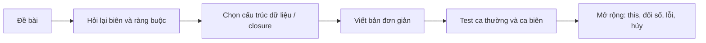

# Câu hỏi: Bài code kinh điển Frontend

Bộ này gom 16 bài code mà phỏng vấn Frontend hay đưa lên bảng hoặc ra đề live coding. Mỗi bài đi theo chuỗi: **Câu hỏi** là đề bài nói như người phỏng vấn, **Gợi ý suy luận** là các câu hỏi nhỏ dẫn từ đề tới khái niệm nền (đây chính là hướng suy luận), **Lập luận** là chuỗi nhân quả dẫn tới thiết kế lời giải, **Đáp án ngắn** nói được thành tiếng, **Nhớ** là kiến thức cốt lõi, rồi **Ví dụ** gồm lời giải đầy đủ và phần kiểm chứng có output thật. Mỗi **Hỏi xoáy** nêu thêm vì sao nó là bước tiếp theo logic. Kiến thức nền: [JavaScript runtime và event loop](/go?p=11-Frontend-Core%2Flt-01-javascript-runtime-event-loop.md), [TypeScript nâng cao](/go?p=11-Frontend-Core%2Flt-02-typescript-nang-cao.md), [Hiệu năng web](/go?p=11-Frontend-Core%2Flt-03-web-performance-core-web-vitals.md). Bài hook React: [Hooks cơ bản](/go?p=09-React%2Feasy%2Flt-02-hooks-co-ban.md). Bộ câu hỏi liên quan: [Trình duyệt và mạng cơ bản](/go?p=07-Interview-QA%2FFrontend%2Feasy%2Fqa-fe-03-browser-network-co-ban.md), [FE phỏng vấn tổng hợp](/go?p=07-Interview-QA%2FFrontend%2Fhard%2Fqa-fe-phong-van.md), [React phỏng vấn](/go?p=07-Interview-QA%2FFrontend%2Fhard%2Fqa-react-phong-van.md).

Quy ước nhãn ví dụ:

- **_Đã chạy thử bằng Node_**: code JavaScript thuần đã chạy bằng Node.js v22 trong môi trường soạn tài liệu, output ghi bên dưới là output thật. Các bài có thời gian (`setTimeout`) có thể lệch vài mili giây giữa các lần chạy, nhưng thứ tự và kết luận không đổi.
- **_Minh họa_**: code React hoặc cấu hình cần môi trường khác (React, trình duyệt), chưa chạy ở đây. Riêng phần cơ chế của chúng, nếu mô phỏng được bằng JavaScript thuần thì có kèm bản mô phỏng đã chạy.

Cách đọc đề live coding: luôn hỏi lại ba điều trước khi gõ (đầu vào hợp lệ gồm những gì, có cần `this` và đối số hay không, xử lý lỗi và biên thế nào). Sau đó viết bản đơn giản chạy đúng, rồi mới mở rộng.



**Tóm tắt:**

- Bộ bài live coding xoay quanh closure và timer: debounce, throttle, memoize, EventEmitter, sleep và retry.
- Debounce chờ yên lặng rồi chạy một lần, throttle giới hạn tần suất; cả hai lưu timer trong closure và cần giữ `this` lẫn đối số.
- Deep clone phải xử lý vòng reference (dùng `WeakMap`), `Date`, `Map`, `Set`; `JSON.stringify` không đủ.
- Curry dựa vào `fn.length`, compose và pipe khác nhau ở chiều chạy; `Promise.all` và `allSettled` giữ đúng thứ tự kết quả dù xong lệch nhau.
- LRU cache dùng `Map` vì nó giữ thứ tự chèn: `get` xóa rồi đặt lại key, `put` vượt dung lượng thì bỏ key đầu tiên.
- Hay bị hỏi xoáy: `off` không gỡ được hàm `once` (vì wrapper), hàm bound vẫn dùng được với `new`, `new` tự cài khi constructor trả về object.
- Luôn hỏi lại biên và ràng buộc trước khi gõ; giới hạn concurrency, cleanup của `useEffect` trong `useDebounce`, và key cache của memoize là chỗ dễ sai.

## 1. Debounce: vì sao gõ nhanh chỉ gọi API một lần?

**Phải thuộc:** Câu này là câu cốt lõi, gặp rất thường xuyên.

**Câu hỏi:** Ô tìm kiếm gọi API mỗi lần `input` thay đổi nên gõ 5 ký tự là 5 request. Hãy viết `debounce(fn, wait)` để chỉ gọi sau khi người dùng ngừng gõ `wait` ms.

**Gợi ý suy luận:**
- Mỗi lần được gọi lại trong khoảng chờ thì lần hẹn giờ trước phải làm gì?
- Biến giữ id của timer phải sống qua nhiều lần gọi, vậy nó nằm ở đâu (closure)?
- Hàm trả về được gọi như method (`obj.onInput(...)`) thì `this` và đối số phải đi đâu?

**Lập luận:** Ý tưởng là "mỗi lần gọi làm lại đồng hồ". Vì mỗi lần gọi phải hủy hẹn giờ cũ, ta cần nhớ id của timer giữa các lần gọi. Biến đó phải nằm ngoài hàm trả về nhưng riêng cho mỗi bản debounce, nên dùng closure. Vì hàm trả về có thể được dùng làm event handler hoặc method, nó phải là `function` thường để nhận `this`, và dùng rest args để chuyển đủ đối số cho `fn` thật. Kết quả: chỉ lần gọi cuối cùng, sau `wait` ms yên lặng, mới chạy `fn` với đối số của lần cuối.

**Đáp án ngắn:** Debounce giữ một timer trong closure, mỗi lần gọi thì `clearTimeout` rồi đặt lại `setTimeout`. Chỉ khi hết `wait` ms không có lần gọi mới thì `fn` chạy, với `this` và đối số của lần gọi cuối.

**Nhớ:** Debounce hợp với "chỉ quan tâm trạng thái cuối" (tìm kiếm, resize xong). Gốc closure và timer: [JavaScript runtime](/go?p=11-Frontend-Core%2Flt-01-javascript-runtime-event-loop.md).

**Ví dụ:**

```js
function debounce(fn, wait) {
  let timer = null;
  return function (...args) {
    clearTimeout(timer);
    timer = setTimeout(() => { timer = null; fn.apply(this, args); }, wait);
  };
}
```

Kiểm chứng cùng với throttle ở câu 2 (file thử chung):

```text
debounce goi voi 5
```

_Đã chạy thử bằng Node._ Năm lần gọi cách nhau 10 ms với `wait = 50` chỉ chạy `fn` một lần, với đối số cuối là 5.

**Hỏi xoáy 1:** Làm sao thêm tùy chọn `leading` (gọi ngay lần đầu) và `cancel`?
**Vì sao hỏi tiếp:** Bản cơ bản chỉ gọi ở cuối. Thực tế nút "Gửi" cần phản hồi ngay lần bấm đầu rồi chặn bấm dồn, nên người phỏng vấn kiểm tra bạn mở rộng được mà không viết lại.
**Gợi ý suy luận:** Làm sao biết "đây là lần gọi đầu trong một đợt"? Khi unmount component, timer còn treo thì sao?
**Đáp:** Dùng `timer === null` làm dấu "chưa có đợt đang chạy": nếu `leading` và `timer === null` thì gọi `fn` ngay, sau đó vẫn đặt timer để đóng đợt (khi hết `wait` đặt `timer = null`). `cancel` chỉ là `clearTimeout(timer); timer = null`. Cần `cancel` vì timer treo sau khi component bị hủy sẽ chạy `fn` trên trạng thái đã không còn, một nguồn rò rỉ và lỗi.

**Hỏi xoáy 2:** Dùng arrow function thay `function` cho hàm trả về thì lỗi gì?
**Vì sao hỏi tiếp:** Câu trả lời ở trên nhấn mạnh `this`, nên hỏi tiếp để chắc bạn hiểu nó chứ không học thuộc.
**Gợi ý suy luận:** Arrow function lấy `this` từ đâu? Khi `debounce` được gọi ở cấp module thì `this` đó là gì?
**Đáp:** Arrow function không có `this` riêng mà lấy `this` lúc định nghĩa, tức `this` của lần gọi `debounce`, không phải của chỗ handler được gọi. Nên `obj.method = debounce(fn)` sẽ mất `this = obj`. Dùng `function` thường và `fn.apply(this, args)` bên trong arrow của `setTimeout` (để giữ `this`) là cách đúng.

**Sai lầm hay gặp:** Tạo `debounce(...)` mới bên trong hàm render hoặc handler, nên mỗi lần có một closure và một timer mới, debounce không còn tác dụng. Phải tạo một lần (xem câu 16 cho React).

## 2. Throttle: vì sao scroll handler chạy đều đặn thay vì dồn cục?

**Phải thuộc:** Câu này là câu cốt lõi, gặp rất thường xuyên.

**Câu hỏi:** Event `scroll` bắn hàng trăm lần mỗi giây. Hãy viết `throttle(fn, wait)` để `fn` chạy tối đa một lần mỗi `wait` ms, và so sánh với debounce.

**Gợi ý suy luận:**
- Cần nhớ điều gì giữa các lần gọi để biết "đã đủ `wait` chưa" (thời điểm lần chạy trước)?
- Debounce chờ yên lặng, throttle thì khác ở chỗ nào về tần suất?
- Lần gọi rơi vào khoảng chờ thì bỏ đi hay hoãn tới cuối khoảng (leading và trailing)?

**Lập luận:** Throttle đảm bảo một nhịp đều, nên chỉ cần so thời điểm hiện tại với thời điểm `fn` chạy lần cuối. Vì cần nhớ `last` giữa các lần gọi, ta dùng closure như debounce. Nếu `now - last >= wait` thì chạy và cập nhật `last`, ngược lại bỏ qua. Khác debounce: debounce có thể không bao giờ chạy khi event liên tục (vì luôn bị làm lại đồng hồ), còn throttle luôn chạy đều. Bản đơn giản này là kiểu "leading": chạy ngay lần đầu và bỏ các lần trong khoảng chờ, lần gọi cuối đợt có thể bị mất. Nếu cần lần cuối thì thêm timer trailing.

**Đáp án ngắn:** Throttle lưu thời điểm chạy gần nhất, chỉ chạy `fn` khi đã qua ít nhất `wait` ms. Debounce chờ hết event rồi mới chạy một lần, throttle chạy đều theo nhịp trong lúc event còn diễn ra.

**Nhớ:** Debounce cho "kết quả cuối" (search, resize xong), throttle cho "cập nhật đều" (scroll, kéo thả, theo dõi chuột). Với hoạt ảnh theo khung hình, `requestAnimationFrame` thường hợp hơn throttle theo ms.

**Ví dụ:**

```js
function throttle(fn, wait) {
  let last = 0;
  return function (...args) {
    const now = Date.now();
    if (now - last >= wait) { last = now; fn.apply(this, args); }
  };
}
```

Kiểm chứng (cùng file với câu 1: debounce + throttle, 12 lần gọi cách nhau 10 ms, `wait = 50`):

```text
throttle da goi voi [ 1, 6, 11 ] trong >=100ms
```

_Đã chạy thử bằng Node._ Trong khoảng hơn 100 ms, `fn` chạy với các lần gọi thứ 1, 6, 11, tức xấp xỉ một lần mỗi 50 ms. Chỉ số chính xác có thể lệch một nhịp do timer không chính xác tuyệt đối.

**Hỏi xoáy 1:** Bản này mất lần gọi cuối. Làm sao đảm bảo lần cuối vẫn được chạy?
**Vì sao hỏi tiếp:** Với thanh cuộn, vị trí cuối quan trọng. Chạy đều mà bỏ trạng thái cuối cho UI sai lệch.
**Gợi ý suy luận:** Cần nhớ thêm đối số của lần gọi bị bỏ, và một timer để chạy nó khi hết khoảng chờ?
**Đáp:** Lưu `lastArgs` mỗi lần bị bỏ qua và đặt một timer (nếu chưa có) chạy `fn` với `lastArgs` sau phần `wait` còn lại. Hàm `throttle` của lodash có hai cờ `leading` và `trailing` làm đúng việc này.

**Hỏi xoáy 2:** Dùng `Date.now()` có đúng không? Đồng hồ hệ thống chỉnh lại thì sao?
**Vì sao hỏi tiếp:** Phát hiện bạn biết nguồn thời gian có sai số.
**Gợi ý suy luận:** Có đồng hồ nào luôn tăng đơn điệu không?
**Đáp:** `Date.now()` theo đồng hồ treo tường nên có thể nhảy khi sync giờ. `performance.now()` đơn điệu và chính xác hơn, nên dùng nó khi cần độ tin cậy. Với UI thì sai số này hiếm khi gây hại.

## 3. Deep clone: vì sao JSON.stringify không đủ và vòng reference làm treo?

**Phải thuộc:** Câu này là câu cốt lõi, gặp rất thường xuyên.

**Câu hỏi:** Viết `deepClone(value)` sao chép sâu một object. Nếu object có reference vòng (`a.self = a`) thì làm sao không bị lặp vô hạn, và vì sao không dùng `JSON.parse(JSON.stringify(x))`?

**Gợi ý suy luận:**
- Sao chép đệ quy một object có vòng thì gặp lại chính nó, làm sao biết "đã sao chép cái này rồi"?
- Cấu trúc dữ liệu nào ánh xạ object gốc sang bản sao mà không giữ chặt memory (WeakMap)?
- `Date`, `Map`, `Set`, `undefined`, hàm, `NaN` đi qua JSON thì ra sao?

**Lập luận:** Đệ quy đơn giản gặp vòng sẽ không dừng, nên cần sổ ghi "gốc đã gặp thì bản sao của nó là gì". Vì key là chính object gốc và ta không muốn giữ nó sống vô thời hạn, dùng `WeakMap`. Điều quan trọng là phải ghi nhận bản sao **trước** khi đi vào các property con, để khi con trỏ ngược về cha ta trả về bản sao cha đang dựng dở. Với JSON, vì nó chỉ biểu diễn được kiểu dữ liệu JSON nên `Date` thành chuỗi, `undefined` và hàm bị bỏ, `NaN` thành `null`, và vòng thì ném `TypeError`. Vì vậy các kiểu đặc biệt phải xử lý riêng.

**Đáp án ngắn:** Dùng đệ quy kèm `WeakMap` ánh xạ gốc sang bản sao, ghi vào map trước khi đệ quy vào con để xử lý vòng, và xử lý riêng `Date`, `RegExp`, `Map`, `Set`. Trình duyệt và Node hiện đại có sẵn `structuredClone`, đủ dùng cho hầu hết trường hợp (không clone được hàm).

**Nhớ:** `structuredClone` xử lý vòng, `Date`, `Map`, `Set` nhưng ném `DataCloneError` với hàm, và không giữ prototype class. Tự cài khi cần giữ prototype hoặc kiểm soát từng kiểu.

**Ví dụ:**

```js
function deepClone(value, seen = new WeakMap()) {
  if (value === null || typeof value !== 'object') return value;
  if (seen.has(value)) return seen.get(value);
  if (value instanceof Date) return new Date(value.getTime());
  if (value instanceof RegExp) return new RegExp(value.source, value.flags);
  if (value instanceof Map) {
    const m = new Map(); seen.set(value, m);
    value.forEach((v, k) => m.set(deepClone(k, seen), deepClone(v, seen)));
    return m;
  }
  if (value instanceof Set) {
    const s = new Set(); seen.set(value, s);
    value.forEach((v) => s.add(deepClone(v, seen)));
    return s;
  }
  const out = Array.isArray(value) ? [] : Object.create(Object.getPrototypeOf(value));
  seen.set(value, out);
  for (const key of Reflect.ownKeys(value)) out[key] = deepClone(value[key], seen);
  return out;
}
```

Kiểm chứng: `a` có `Date`, mảng lồng, `Map`, và `a.self = a`.

```text
true true true true
true 0
JSON.stringify: TypeError
structuredClone vong: true
structuredClone ham: DataCloneError
{"d":"1970-01-01T00:00:00.000Z","n":null}
```

_Đã chạy thử bằng Node._ Dòng 1 cho thấy bản sao khác gốc, `b.self === b` (vòng được giữ), element lồng và giá trị trong `Map` đều là bản sao mới. `JSON.stringify` ném `TypeError` với vòng. Dòng cuối: `undefined` biến mất, `Date` thành chuỗi, `NaN` thành `null`.

**Hỏi xoáy 1:** Vì sao ghi `seen.set(value, out)` trước khi đệ quy mà không phải sau?
**Vì sao hỏi tiếp:** Đây là chỗ người ta hay đặt sai thứ tự, và sai thì vòng vẫn treo.
**Gợi ý suy luận:** Khi đệ quy vào property `self` trỏ về cha, bản sao của cha đã có trong `seen` chưa nếu ghi sau?
**Đáp:** Nếu ghi sau, lúc gặp `self` thì cha chưa có trong `seen` nên đệ quy lại cha và lặp vô hạn tới tràn stack. Ghi trước thì gặp `self` sẽ trả bản sao cha đang dựng dở, vòng được dựng lại đúng.

**Hỏi xoáy 2:** Object rất sâu (hàng chục nghìn tầng) thì bản đệ quy này thế nào, và `structuredClone` có giải quyết không?
**Vì sao hỏi tiếp:** Đệ quy luôn dẫn tới câu hỏi về giới hạn stack.
**Gợi ý suy luận:** Giới hạn call stack là gì? Có thể thay đệ quy bằng vòng lặp với stack tự quản không?
**Đáp:** Đệ quy đủ sâu sẽ tràn call stack (`RangeError`). Cách tránh là duyệt lặp với stack tự quản (xem câu 9, flatten). Trong thực tế dữ liệu sâu cỡ đó hiếm, và cách thường dùng là `structuredClone`; hành vi với dữ liệu cực sâu thuộc về công cụ chạy nên kiểm tra lại theo phiên bản.

**Sai lầm hay gặp:** Dùng `Object.assign` hoặc spread rồi tưởng là deep clone (chỉ sao chép một tầng), hoặc quên kiểm tra `null` (vì `typeof null === 'object'`).

## 4. Curry: vì sao `fn.length` quyết định khi nào thực thi?

**Câu hỏi:** Viết `curry(fn)` sao cho `curry(add3)(1)(2)(3)`, `(1, 2)(3)`, `(1)(2, 3)` và `(1, 2, 3)` đều ra cùng kết quả.

**Gợi ý suy luận:**
- Làm sao biết hàm gốc cần bao nhiêu đối số (property `length`)?
- Khi chưa đủ đối số thì trả về cái gì, và các đối số đã nhận được giữ ở đâu?
- Khi đủ thì làm gì?

**Lập luận:** Hàm curry hóa cần quyết định mỗi lần được gọi: đủ đối số chưa. Vì `fn.length` cho số tham số khai báo, ta so `args.length` với nó. Nếu chưa đủ, ta trả về một hàm mới nhận thêm đối số, và vì các đối số đã có cần mang theo nên dùng closure, gộp cũ với mới rồi gọi lại chính `curried`. Nếu đủ (hoặc dư) thì gọi `fn` thật. Nhờ gộp mảng đối số, mọi cách chia nhóm đối số đều cho cùng kết quả.

**Đáp án ngắn:** Curry so số đối số đã nhận với `fn.length`: đủ thì gọi `fn`, chưa đủ thì trả hàm mới gom thêm đối số. Giới hạn: `fn.length` không đếm tham số mặc định hay rest.

**Nhớ:** Curry biến `f(a, b, c)` thành `f(a)(b)(c)`, hữu ích để dựng hàm chuyên biệt từ hàm tổng quát. `fn.length` dừng đếm tại tham số có giá trị mặc định đầu tiên.

**Ví dụ:**

```js
function curry(fn) {
  return function curried(...args) {
    if (args.length >= fn.length) return fn.apply(this, args);
    return (...more) => curried.apply(this, [...args, ...more]);
  };
}
```

Kiểm chứng:

```text
6 6 6 6
length voi default: 1
```

_Đã chạy thử bằng Node._ Bốn cách gọi cho cùng 6. Dòng sau cho thấy `function f(a, b = 2, c)` có `length` là 1, nên curry sẽ coi hàm này chỉ cần 1 đối số.

**Hỏi xoáy 1:** Hàm có tham số mặc định hoặc rest (`...rest`) thì curry thế nào?
**Vì sao hỏi tiếp:** Từ giới hạn `fn.length` vừa nói, đề tự nhiên là hỏi cách thoát.
**Gợi ý suy luận:** Nếu `length` không đáng tin thì ai biết hàm cần bao nhiêu đối số?
**Đáp:** Cho người gọi truyền số đối số tường minh: `curry(fn, arity = fn.length)`. Đó cũng là cách các thư viện như lodash làm (`_.curry(fn, arity)`).

**Hỏi xoáy 2:** Curry khác partial application ở đâu?
**Vì sao hỏi tiếp:** Hai khái niệm hay bị nhầm, và `bind` (câu 10) chính là partial.
**Gợi ý suy luận:** Mỗi lần gọi curry nhận mấy đối số, partial nhận mấy?
**Đáp:** Curry chuyển hàm nhiều tham số thành chuỗi hàm mỗi hàm một (hoặc vài) tham số, đến khi đủ thì chạy. Partial application cố định trước một số đối số và trả về hàm nhận phần còn lại trong một lần gọi. Curry có thể dùng để dựng partial.

## 5. Compose và pipe: vì sao thứ tự chạy ngược nhau?

**Câu hỏi:** Viết `compose(f, g, h)(x)` bằng `f(g(h(x)))` và `pipe(f, g, h)(x)` bằng `h(g(f(x)))`. Vì sao hai cái chỉ khác thứ tự mà cài đặt khác nhau chỗ nào?

**Gợi ý suy luận:**
- Kết quả của hàm này là đầu vào của hàm kế, vậy phép nào gộp danh sách hàm thành một giá trị (`reduce`)?
- Duyệt từ trái sang phải hay phải sang trái khác nhau ở `reduce` nào?
- Hàm đầu tiên được chạy có nên nhận nhiều đối số không?

**Lập luận:** Vì mỗi hàm nhận đầu ra của hàm trước, chuỗi hàm là một phép gộp (`reduce`) với giá trị tích lũy là kết quả trung gian. Với `pipe`, hàm đầu danh sách chạy trước nên duyệt trái sang phải bằng `reduce`. Với `compose`, hàm cuối danh sách chạy trước (theo ký hiệu toán học f sau g) nên duyệt phải sang trái bằng `reduceRight`. Vậy hai hàm chỉ khác chiều duyệt, và `pipe` thường dễ đọc hơn vì thứ tự viết trùng thứ tự chạy.

**Đáp án ngắn:** `pipe` dùng `reduce` duyệt từ trái, `compose` dùng `reduceRight`. Giá trị tích lũy là kết quả hàm trước, đưa vào hàm kế.

**Nhớ:** Compose và pipe chỉ chạy tốt khi mỗi hàm nhận một đối số (hợp với curry). Hàm đầu tiên của `pipe` thường được cho phép nhận nhiều đối số nếu cần.

**Ví dụ:**

```js
const compose = (...fns) => (x) => fns.reduceRight((acc, f) => f(acc), x);
const pipe = (...fns) => (x) => fns.reduce((acc, f) => f(acc), x);

const inc = (x) => x + 1, dbl = (x) => x * 2;
const slug = pipe((s) => s.trim(), (s) => s.toLowerCase(), (s) => s.replace(/\s+/g, '-'));
```

Kiểm chứng:

```text
compose(inc,dbl)(5) = 11
pipe(inc,dbl)(5) = 12
hello-big-world
```

_Đã chạy thử bằng Node._ `compose(inc, dbl)(5)` là `inc(dbl(5)) = 11`, còn `pipe(inc, dbl)(5)` là `dbl(inc(5)) = 12`. Ví dụ `slug` cho thấy pipe đọc như quy trình.

**Hỏi xoáy 1:** Nếu một bước trả về Promise thì pipe này hỏng ở đâu và sửa thế nào?
**Vì sao hỏi tiếp:** Dữ liệu thật thường có bước async.
**Gợi ý suy luận:** Hàm kế nhận Promise hay giá trị? Làm sao chờ giá trị trước khi gọi bước kế?
**Đáp:** Bước sau sẽ nhận một Promise thay vì giá trị. Sửa bằng cách dùng `reduce` với `acc.then(f)` (bắt đầu từ `Promise.resolve(x)`) hoặc `async` với `await` trong vòng lặp.

**Hỏi xoáy 2:** `pipe()` không truyền hàm nào thì sao?
**Vì sao hỏi tiếp:** Kiểm tra biên: danh sách rỗng.
**Gợi ý suy luận:** `reduce` với giá trị khởi tạo trên mảng rỗng trả về gì?
**Đáp:** Vì ta đưa `x` làm giá trị khởi tạo nên `pipe()(x)` trả lại `x`, đúng với hàm đồng nhất. Nếu không đưa giá trị khởi tạo thì `reduce` trên mảng rỗng ném `TypeError`.

## 6. Promise.all, allSettled, race: vì sao kết quả giữ đúng thứ tự dù xong lệch nhau?

**Phải thuộc:** Câu này là câu cốt lõi, gặp rất thường xuyên.

**Câu hỏi:** Hãy tự cài `Promise.all`, `Promise.allSettled` và `Promise.race`. Tác vụ xong không theo thứ tự đầu vào thì `all` phải trả mảng theo thứ tự nào?

**Gợi ý suy luận:**
- Mỗi Promise xong vào lúc khác nhau, vậy kết quả đặt vào mảng theo chỉ số nào?
- Biết khi nào "tất cả xong" bằng cách nào (bộ đếm)?
- `all` reject ngay khi có một lỗi, còn `allSettled` thì sao, và mảng rỗng thì sao?

**Lập luận:** Vì các Promise xong lệch thời điểm, không thể `push` theo thứ tự hoàn thành mà phải ghi vào `results[i]` theo chỉ số gốc, nên thứ tự đầu ra khớp đầu vào. Biết "tất cả xong" bằng bộ đếm tăng mỗi khi một Promise fulfill, và resolve khi đếm bằng độ dài. `reject` truyền thẳng làm `all` thất bại ở lỗi đầu tiên. `allSettled` không bao giờ reject: ta bọc từng Promise thành kết quả `{status, value|reason}` rồi dùng chính `all`. `race` chỉ cần gắn `resolve` và `reject` vào mọi Promise, ai xong trước (dù fulfill hay reject) thắng. Đầu vào có thể là giá trị thường, nên bọc `Promise.resolve(it)`. Mảng rỗng phải resolve `[]` ngay, nếu không bộ đếm không bao giờ chạm.

**Đáp án ngắn:** `all` ghi kết quả theo chỉ số, đếm số lượng đã xong, reject ở lỗi đầu tiên và resolve `[]` với mảng rỗng. `allSettled` bọc mỗi Promise thành state object rồi gọi `all`. `race` gắn `resolve`, `reject` vào tất cả, ai xong trước thắng.

**Nhớ:** `all` thất bại nhanh, `allSettled` chờ tất cả và không bao giờ reject, `race` lấy kết quả đầu tiên kể cả lỗi, `any` lấy kết quả thành công đầu tiên. Chi tiết bẫy: [JavaScript runtime](/go?p=11-Frontend-Core%2Flt-01-javascript-runtime-event-loop.md).

**Ví dụ:**

```js
function myAll(items) {
  return new Promise((resolve, reject) => {
    const arr = Array.from(items);
    const results = new Array(arr.length);
    let done = 0;
    if (arr.length === 0) return resolve(results);
    arr.forEach((it, i) => {
      Promise.resolve(it).then((v) => {
        results[i] = v;
        if (++done === arr.length) resolve(results);
      }, reject);
    });
  });
}
function myAllSettled(items) {
  return myAll(Array.from(items).map((it) =>
    Promise.resolve(it).then(
      (value) => ({ status: 'fulfilled', value }),
      (reason) => ({ status: 'rejected', reason: reason.message })
    )));
}
function myRace(items) {
  return new Promise((resolve, reject) => {
    for (const it of items) Promise.resolve(it).then(resolve, reject);
  });
}
```

Kiểm chứng (`sleep(ms, v)` resolve sau `ms`, `fail(ms, e)` reject sau `ms`):

```text
[ 'a', 2, 'c' ]
[]
all reject: loi
[
  { status: 'fulfilled', value: 'ok' },
  { status: 'rejected', reason: 'hong' }
]
race: nhanh
race reject: loi som
```

_Đã chạy thử bằng Node._ `a` xong sau 30 ms nhưng vẫn nằm đầu mảng kết quả; giá trị thường `2` được chấp nhận; `race` trả về cả trường hợp reject nếu nó xảy ra trước.

**Hỏi xoáy 1:** Khi `all` đã reject, các Promise còn lại có bị hủy không?
**Vì sao hỏi tiếp:** Hiểu nhầm "reject là dừng tất cả" gây ra lỗi thật khi bạn tưởng request kia đã bị hủy.
**Gợi ý suy luận:** Promise có cơ chế hủy không? Hủy request cần công cụ nào (xem `AbortController`)?
**Đáp:** Không. Promise không hủy được: các tác vụ còn lại vẫn chạy tới cùng, kết quả bị bỏ. Muốn dừng thật phải truyền `AbortSignal` vào từng request (xem [Trình duyệt và mạng cơ bản](/go?p=07-Interview-QA%2FFrontend%2Feasy%2Fqa-fe-03-browser-network-co-ban.md)).

**Hỏi xoáy 2:** Vì sao dùng `Promise.resolve(it)` thay vì gọi `it.then` trực tiếp?
**Vì sao hỏi tiếp:** Để chắc bạn hiểu `Promise.all` nhận cả giá trị thường và thenable.
**Gợi ý suy luận:** Số `2` có phương thức `then` không?
**Đáp:** Giá trị thường như `2` không có `then`, gọi trực tiếp sẽ lỗi. `Promise.resolve(it)` chuẩn hóa giá trị thường và thenable (object có `then`) thành Promise thật, đúng như hành vi bản gốc.

**Sai lầm hay gặp:** Dùng `results.push(v)` trong `then` (đảo thứ tự), hoặc quên trường hợp mảng rỗng khiến Promise treo mãi.

## 7. EventEmitter: vì sao `off` không gỡ được hàm `once`?

**Câu hỏi:** Cài `EventEmitter` có `on`, `off`, `once`, `emit`. Chú ý hai tình huống: gỡ một handler đã đăng ký bằng `once`, và handler tự gỡ mình trong lúc `emit` đang chạy.

**Gợi ý suy luận:**
- Cấu trúc nào ánh xạ tên event sang danh sách handler (`Map` tên sang mảng)?
- `once` thực chất là đăng ký một hàm bọc, vậy `off(name, fn)` với `fn` gốc có tìm thấy hàm bọc không?
- Nếu `emit` duyệt trực tiếp mảng đang bị sửa (do handler tự gỡ) thì có bỏ sót handler không?

**Lập luận:** Event là cặp (tên, danh sách hàm), nên dùng `Map<string, Function[]>`. `once` phải gỡ mình sau lần chạy đầu, nên ta đăng ký hàm bọc `wrapper` tự gọi `off` rồi gọi `fn` thật. Vì danh sách giữ `wrapper` chứ không phải `fn`, `off(name, fn)` sẽ không khớp, nên ta gắn `wrapper.original = fn` và để `off` so khớp cả hai. Trong `emit`, nếu handler tự gỡ làm mảng ngắn đi giữa lúc duyệt thì element kế sẽ bị bỏ sót, nên duyệt trên bản sao `[...list]`. `on` trả về hàm hủy đăng ký tiện cho cleanup (React `useEffect`).

**Đáp án ngắn:** Dùng `Map` tên sang mảng handler. `once` đăng ký hàm bọc tự gỡ và lưu `original` để `off` gỡ được. `emit` duyệt trên bản sao mảng để việc tự gỡ trong lúc phát không làm bỏ sót handler.

**Nhớ:** Pub/sub tách người phát khỏi người nghe. Mọi `on` phải có `off` tương ứng, không thì memory leak.

**Ví dụ:**

```js
class EventEmitter {
  constructor() { this.events = new Map(); }
  on(name, fn) {
    if (!this.events.has(name)) this.events.set(name, []);
    this.events.get(name).push(fn);
    return () => this.off(name, fn);
  }
  off(name, fn) {
    const list = this.events.get(name);
    if (!list) return;
    this.events.set(name, list.filter((h) => h !== fn && h.original !== fn));
  }
  once(name, fn) {
    const wrapper = (...args) => { this.off(name, wrapper); fn(...args); };
    wrapper.original = fn;
    return this.on(name, wrapper);
  }
  emit(name, ...args) {
    const list = this.events.get(name);
    if (!list) return false;
    [...list].forEach((h) => h(...args));
    return true;
  }
}
```

Kiểm chứng:

```text
h nhan 1
once nhan 1
h nhan 2
sau off emit tra ve true 0
tu huy
van chay
van chay
```

_Đã chạy thử bằng Node._ `once` chỉ chạy một lần. Sau `off`, danh sách còn 0 handler. Handler tự hủy ở lần `emit` đầu không làm handler kế bên bị bỏ sót (vẫn in "van chay" hai lần).

**Hỏi xoáy 1:** Nếu không copy mảng trong `emit`, lỗi cụ thể là gì?
**Vì sao hỏi tiếp:** Chi tiết `[...list]` có vẻ thừa, hỏi để biết bạn hiểu lý do.
**Gợi ý suy luận:** Ở bản của tôi `off` tạo mảng mới bằng `filter`, vậy mảng đang duyệt có bị đổi không? Nếu `off` dùng `splice` thì sao?
**Đáp:** Bản này `off` tạo mảng mới nên mảng đang duyệt vốn an toàn, copy là thủ thuật phòng thủ. Nếu `off` dùng `splice` trên chính mảng đang duyệt, các element dồn lên và `forEach` nhảy qua handler kế tiếp. Copy giúp đúng bất kể cách `off` cài.

**Hỏi xoáy 2:** Làm sao tránh rò rỉ khi component đăng ký rồi bị hủy?
**Vì sao hỏi tiếp:** Chuyển từ cài đặt sang cách dùng đúng trong ứng dụng.
**Gợi ý suy luận:** `on` trả về gì ở bản của tôi? Cleanup của `useEffect` chạy lúc nào?
**Đáp:** Lưu hàm hủy mà `on` trả về, và gọi nó trong cleanup (`return` của `useEffect`, hoặc `onUnmounted` ở Vue). Nếu không, emitter sống lâu giữ reference tới handler, kéo theo cả component bị hủy, gây rò rỉ và gọi vào trạng thái đã mất.

## 8. LRU cache: vì sao Map giữ được thứ tự dùng gần nhất?

**Câu hỏi:** Cài `LRUCache(capacity)` với `get` và `put` đều chạy O(1): đầy thì loại element ít được dùng gần đây nhất.

**Gợi ý suy luận:**
- Cần hai khả năng cùng lúc: tra theo key nhanh và biết element nào "cũ nhất". Cấu trúc nào của JS nhớ thứ tự chèn?
- Khi `get` một key, làm sao đánh dấu nó là "vừa dùng" mà không tốn O(n)?
- Element cũ nhất nằm đầu hay cuối thứ tự duyệt của `Map`?

**Lập luận:** `Map` của JavaScript vừa tra cứu O(1) vừa duyệt theo thứ tự chèn, nên đầu thứ tự là element cũ nhất. Để "làm mới" một key, xóa rồi chèn lại, nó chuyển về cuối thứ tự (mới nhất), cả hai thao tác O(1). Khi `put` vượt dung lượng, ta xóa key đầu tiên `map.keys().next().value`. Trường hợp `put` key đã có phải xóa rồi chèn lại để làm mới và không làm tăng kích thước. Bản kinh điển dùng hash map kết hợp danh sách liên kết đôi để có cùng độ phức tạp, ta tận dụng sẵn tính chất của `Map`.

**Đáp án ngắn:** Dùng `Map` làm nơi lưu và làm thứ tự: `get` xóa rồi đặt lại key để đưa về cuối, `put` xóa key đầu tiên khi đầy. Mọi thao tác O(1).

**Nhớ:** Bản kinh điển là hash map cộng danh sách liên kết đôi. Trong JS, `Map` giữ thứ tự chèn nên rút gọn được.

**Ví dụ:**

```js
class LRUCache {
  constructor(capacity) { this.capacity = capacity; this.map = new Map(); }
  get(key) {
    if (!this.map.has(key)) return -1;
    const v = this.map.get(key);
    this.map.delete(key); this.map.set(key, v);
    return v;
  }
  put(key, value) {
    if (this.map.has(key)) this.map.delete(key);
    else if (this.map.size >= this.capacity) this.map.delete(this.map.keys().next().value);
    this.map.set(key, value);
  }
}
```

Kiểm chứng (dung lượng 2):

```text
1
-1 [ 'a', 'c' ]
10 [ 'c', 'a' ]
-1 [ 'a', 'd' ]
```

_Đã chạy thử bằng Node._ Sau `get('a')`, key `b` thành cũ nhất nên bị loại khi thêm `c`. `put('a', 10)` làm mới `a` thay vì loại ai. Thêm `d` thì loại `c` (cũ nhất).

**Hỏi xoáy 1:** Vì sao `get` mà trả `-1` chứ không `undefined`, và nếu giá trị hợp lệ có thể là `-1` thì sao?
**Vì sao hỏi tiếp:** Lựa chọn sentinel là quyết định thiết kế API.
**Gợi ý suy luận:** Làm sao phân biệt "không có" với "có nhưng giá trị là -1"?
**Đáp:** `-1` là quy ước của đề kinh điển (giá trị luôn không âm). Thiết kế thật nên trả `undefined` hoặc cho phép `has(key)` riêng để không nhập nhằng.

**Hỏi xoáy 2:** Thêm hạn dùng (TTL) cho mỗi element thì làm sao?
**Vì sao hỏi tiếp:** Cache thật hiếm khi chỉ có LRU.
**Gợi ý suy luận:** Lưu thêm thông tin gì cùng giá trị? Kiểm tra lúc nào, hay dùng timer?
**Đáp:** Lưu `{ value, expiresAt }`, kiểm tra lazy khi `get`: quá hạn thì xóa và trả "không có". Cách này đơn giản và tránh timer cho từng key; có thể dọn định kỳ nếu cần giải phóng memory.

## 9. Flatten: vì sao đệ quy đẹp nhưng có thể tràn stack?

**Câu hỏi:** Làm phẳng mảng lồng nhau `[1, [2, [3, [4]], 5]]` có tham số độ sâu. Có cách nào không dùng đệ quy, và vì sao phải quan tâm?

**Gợi ý suy luận:**
- Với mỗi element, nếu là mảng thì làm gì, nếu không thì làm gì? Độ sâu còn lại giảm thế nào?
- Mỗi lần đệ quy tốn gì trong call stack, và mảng lồng cực sâu thì sao?
- Duyệt bằng stack tự quản thay thế call stack ra sao, thứ tự element có bị đảo không?

**Lập luận:** Element là mảng thì cần làm phẳng tiếp, ngược lại đưa vào kết quả, nên đệ quy với `depth - 1` là tự nhiên. Vì mỗi lệnh gọi đệ quy chiếm một khung trong call stack có giới hạn, mảng lồng rất sâu gây `RangeError`. Cách thay là tự quản stack: đẩy element vào, lấy ra, gặp mảng thì đẩy các con trở lại. Vì lấy từ cuối stack nên thứ tự bị đảo, cần đảo kết quả cuối. Bản lặp này không bị giới hạn bởi call stack.

**Đáp án ngắn:** Đệ quy: duyệt từng element, là mảng và còn độ sâu thì đi sâu với `depth - 1`, không thì đẩy vào kết quả. Bản lặp dùng stack tự quản, rồi đảo kết quả, tránh tràn call stack. Có sẵn `arr.flat(depth)`.

**Nhớ:** `Array.prototype.flat(Infinity)` làm phẳng hết. Đệ quy đẹp nhưng bị giới hạn call stack, lặp thì không.

**Ví dụ:**

```js
function flatten(arr, depth = Infinity) {
  const out = [];
  const walk = (list, d) => {
    for (const x of list) {
      if (Array.isArray(x) && d > 0) walk(x, d - 1); else out.push(x);
    }
  };
  walk(arr, depth);
  return out;
}
function flattenIter(arr) {
  const stack = [...arr], out = [];
  while (stack.length) {
    const x = stack.pop();
    if (Array.isArray(x)) stack.push(...x); else out.push(x);
  }
  return out.reverse();
}
```

Kiểm chứng với `[1, [2, [3, [4]], 5], []]` và một mảng lồng 20000 tầng:

```text
[ 1, 2, 3, 4, 5 ] [ 1, 2, [ 3, [ 4 ] ], 5 ] [ 1, 2, 3, 4, 5 ]
[ 1, 2, 3, 4, 5 ]
de quy: RangeError
lap: [ 0 ]
```

_Đã chạy thử bằng Node._ Độ sâu 1 chỉ mở một tầng. Với 20000 tầng, bản đệ quy ném `RangeError`, bản lặp ra đúng `[0]`. Ngưỡng tràn stack phụ thuộc môi trường chạy.

**Hỏi xoáy 1:** Khi `push(...x)` với mảng con rất lớn thì có vấn đề không?
**Vì sao hỏi tiếp:** Spread vào function call có giới hạn số đối số.
**Gợi ý suy luận:** Mỗi element spread là một đối số truyền vào `push`.
**Đáp:** Có. Spread một mảng cực lớn vào function call có thể vượt giới hạn đối số và ném `RangeError`. Với dữ liệu lớn hãy dùng vòng `for` để đẩy từng element.

**Hỏi xoáy 2:** Mảng có reference vòng (mảng chứa chính nó) thì flatten ra sao?
**Vì sao hỏi tiếp:** Nối với câu deepClone: vòng làm mọi duyệt đệ quy treo.
**Gợi ý suy luận:** Dùng lại ý tưởng "đã gặp" ở câu 3?
**Đáp:** Cả hai bản đều lặp vô hạn hoặc tràn memory. Cần `Set` các mảng đã gặp để bỏ qua khi gặp lại, hoặc từ chối đầu vào có vòng.

## 10. bind tự cài: vì sao hàm bound vẫn dùng được với `new`?

**Câu hỏi:** Cài `Function.prototype.myBind(ctx, ...preset)`. Hàm trả về cần hỗ trợ cả đối số truyền trước và khi gọi bằng `new`.

**Gợi ý suy luận:**
- `bind` cố định `this` và vài đối số đầu, vậy cần giữ gì trong closure?
- Khi hàm bound được gọi bằng `new`, `this` bên trong là object mới. Bind có còn ép `this = ctx` không?
- Làm sao biết đang bị gọi bằng `new` (`this instanceof bound`)? Còn prototype của object mới thì phải trỏ đâu?

**Lập luận:** `bind` trả về hàm mới, nhớ `ctx` và `preset` qua closure, khi gọi thì `fn.apply(ctx, [...preset, ...args])`. Với `new`, đặc tả quy định `this` là object mới và bỏ qua `ctx`, nên ta kiểm tra `this instanceof bound`: đúng thì dùng `this` này. Để object mới có quan hệ với hàm gốc (`instanceof` hoạt động, hưởng prototype), `bound.prototype` được tạo từ `fn.prototype`. Arrow function không có `prototype` nên cần kiểm `fn.prototype` trước.

**Đáp án ngắn:** `myBind` trả hàm mới gọi `fn.apply(ctx, [...preset, ...args])`. Khi bị gọi bằng `new` (`this instanceof bound`) thì bỏ `ctx` và dùng `this` mới, kèm `bound.prototype = Object.create(fn.prototype)`.

**Nhớ:** `bind` là partial application cộng cố định `this`, và `this` của hàm bound không đổi được bằng `call`/`apply` sau đó (trừ `new`). Bản này là mô phỏng, khác bản gốc ở vài chi tiết như `name` và `length`.

**Ví dụ:**

```js
Function.prototype.myBind = function (ctx, ...preset) {
  const fn = this;
  if (typeof fn !== 'function') throw new TypeError('not callable');
  function bound(...args) {
    const isNew = this instanceof bound;
    return fn.apply(isNew ? this : ctx, [...preset, ...args]);
  }
  if (fn.prototype) bound.prototype = Object.create(fn.prototype);
  return bound;
};
```

Kiểm chứng:

```text
Xin chao, An!
1 2 true true undefined
Hi, B?
```

_Đã chạy thử bằng Node._ Dòng 2: gọi `new BP(2)` với `BP = Point.myBind({ignored: true}, 1)` cho `x = 1` (từ preset), `y = 2`, `p instanceof Point` đúng, và `ctx` bị bỏ qua (`p.ignored` là `undefined`). Dòng 3 là `bind` gốc, cho cùng kiểu kết quả.

**Hỏi xoáy 1:** `call`, `apply` khác `bind` ở điểm nào, và tự cài `call` thế nào?
**Vì sao hỏi tiếp:** Ba hàm cùng họ, người phỏng vấn thường hỏi cả bộ.
**Gợi ý suy luận:** Quy tắc `this` khi gọi như method của một object?
**Đáp:** `call` và `apply` gọi ngay, `bind` trả hàm mới. Tự cài `call`: gắn hàm vào `ctx` dưới một key `Symbol` tạm, gọi như method (`ctx[key](...args)`), rồi xóa key, vì `this` của lời gọi method là object đứng trước dấu chấm.

**Hỏi xoáy 2:** Bind hai lần liên tiếp thì `this` là gì?
**Vì sao hỏi tiếp:** Kiểm tra hiểu "hàm bound không bị đổi `this`".
**Gợi ý suy luận:** Hàm bound lần hai bọc hàm bound lần một.
**Đáp:** Luôn là `ctx` của lần bind đầu. Lần bind thứ hai chỉ bọc hàm đã bound, mà hàm đó bỏ qua `this` truyền vào.

## 11. `new` tự cài: vì sao constructor trả về object thì kết quả đổi?

**Câu hỏi:** Viết `myNew(Ctor, ...args)` mô phỏng toán tử `new`. Điều gì xảy ra nếu constructor `return` một object, hoặc `return` một số?

**Gợi ý suy luận:**
- `new` tạo object mới có prototype là gì?
- Constructor chạy với `this` là object đó, vậy gọi bằng cách nào?
- Giá trị trả về của constructor ảnh hưởng thế nào đến kết quả của `new`?

**Lập luận:** Bước một: tạo object rỗng có prototype là `Ctor.prototype`, nên `Object.create(Ctor.prototype)`. Bước hai: chạy constructor với `this` là object đó nên `Ctor.apply(obj, args)`. Bước ba: nếu constructor trả về object hoặc hàm thì đó là kết quả của `new`, còn trả giá trị nguyên thủy (hoặc không trả) thì bị bỏ và kết quả là `obj`. Vì thế `new` có thể trả về object khác hẳn `this`.

**Đáp án ngắn:** Tạo object với prototype `Ctor.prototype`, gọi `Ctor` với `this` là object đó, nếu `Ctor` trả về object hoặc hàm thì dùng giá trị đó, không thì dùng object vừa tạo.

**Nhớ:** Bản mô phỏng này không bao quát `class` (class bắt buộc dùng `new`, derived class không có `this` đến khi gọi `super`), `new.target`, và constructor nội bộ như `Date`.

**Ví dụ:** (cùng file với câu 12)

```js
function myNew(Ctor, ...args) {
  if (typeof Ctor !== 'function') throw new TypeError('not a constructor');
  const obj = Object.create(Ctor.prototype);
  const result = Ctor.apply(obj, args);
  return (result !== null && (typeof result === 'object' || typeof result === 'function')) ? result : obj;
}
```

Kiểm chứng:

```text
hi Lan true true
{ b: 2 } Prim { a: 1 }
```

_Đã chạy thử bằng Node._ `Weird` trả `{ b: 2 }` nên kết quả là object đó, còn `Prim` trả số `5` nên bị bỏ và kết quả vẫn là object có `a: 1`.

**Hỏi xoáy 1:** Quên `new` khi gọi constructor thì chuyện gì xảy ra?
**Vì sao hỏi tiếp:** Hậu quả thực tế của việc hiểu `new` làm gì.
**Gợi ý suy luận:** Không có `new` thì `this` bên trong hàm là gì (chế độ strict, không strict)?
**Đáp:** Ở chế độ không strict `this` là `window` hoặc `globalThis`, nên hàm gắn property vào global. Ở strict mode `this` là `undefined` nên ném `TypeError`. Class thì luôn ném lỗi nếu thiếu `new`.

**Hỏi xoáy 2:** Prototype chain của object sinh ra bởi `myNew` kiểm tra được thế nào?
**Vì sao hỏi tiếp:** Nối sang câu `instanceof`.
**Gợi ý suy luận:** `Object.getPrototypeOf(obj)` trả về gì, và so với `Ctor.prototype`?
**Đáp:** `Object.getPrototypeOf(p) === Person.prototype` là đúng (đã in `true` ở kiểm chứng), và `instanceof` dựa chính vào chuỗi này.

## 12. instanceof tự cài: vì sao `1 instanceof Number` là false?

**Câu hỏi:** Cài `myInstanceOf(obj, Ctor)`. Giải thích vì sao `1 instanceof Number` là `false` nhưng `new Number(1) instanceof Number` là `true`, và `Symbol.hasInstance` có vai trò gì.

**Gợi ý suy luận:**
- `instanceof` thực chất so sánh cái gì với cái gì (chuỗi prototype của `obj` với `Ctor.prototype`)?
- Duyệt chuỗi dừng ở đâu? Giá trị nguyên thủy có chuỗi prototype dùng được không?
- Có thể can thiệp phép kiểm tra bằng cơ chế nào của ngôn ngữ?

**Lập luận:** Vì `instanceof` hỏi "`Ctor.prototype` có nằm trên chuỗi prototype của `obj` không", ta lấy prototype của `obj` rồi đi lên từng bậc cho tới `null`, gặp `Ctor.prototype` thì đúng. Giá trị nguyên thủy (như `1`) không phải object nên phép kiểm tra trả `false` ngay, trong khi `new Number(1)` là object có `Number.prototype` trên chuỗi. Đặc tả còn cho phép object ở bên phải tự quyết định qua phương thức `Symbol.hasInstance`; nếu có thì `instanceof` gọi nó thay vì duyệt chuỗi. Object `Object.create(null)` không có `Object.prototype` trên chuỗi nên cho `false`.

**Đáp án ngắn:** Duyệt chuỗi prototype của `obj` tìm `Ctor.prototype`. Nguyên thủy trả `false` ngay. `Symbol.hasInstance` ở vế phải cho phép tùy biến phép kiểm tra.

**Nhớ:** `instanceof` kiểm theo chuỗi prototype, không theo "kiểu". Khác realm (iframe) thì `instanceof Array` có thể sai, nên dùng `Array.isArray`.

**Ví dụ:**

```js
function myInstanceOf(obj, Ctor) {
  if (typeof Ctor !== 'function') throw new TypeError('right side not callable');
  if (obj === null || (typeof obj !== 'object' && typeof obj !== 'function')) return false;
  let proto = Object.getPrototypeOf(obj);
  while (proto !== null) {
    if (proto === Ctor.prototype) return true;
    proto = Object.getPrototypeOf(proto);
  }
  return false;
}
class Even { static [Symbol.hasInstance](n) { return n % 2 === 0; } }
```

Kiểm chứng (`class B extends A`):

```text
true true false false
false true
true false
```

_Đã chạy thử bằng Node._ Dòng 1: `new B() instanceof A` đúng, `[] instanceof Object` đúng, `1` với `Number` sai, `Object.create(null)` với `Object` sai. Dòng 2: `(1) instanceof Number` sai, `new Number(1) instanceof Number` đúng. Dòng 3: `Symbol.hasInstance` cho `2 instanceof Even` đúng, `3 instanceof Even` sai. Bản mô phỏng chưa gọi `Symbol.hasInstance`, nó chỉ mô phỏng nhánh duyệt chuỗi.

**Hỏi xoáy 1:** Vì sao dùng `Array.isArray` thay `instanceof Array`?
**Vì sao hỏi tiếp:** Câu thực tế nhất rút ra từ cơ chế prototype.
**Gợi ý suy luận:** Mỗi iframe có `Array` riêng không?
**Đáp:** Mỗi realm (iframe, worker) có `Array` và `Array.prototype` riêng, nên mảng tạo ở iframe khác không có `Array.prototype` của trang hiện tại trên chuỗi. `Array.isArray` kiểm theo "slot" nội bộ nên đúng ở mọi realm.

**Hỏi xoáy 2:** Đổi prototype của một object sau khi tạo thì `instanceof` đổi theo không?
**Vì sao hỏi tiếp:** Kiểm tra bạn hiểu `instanceof` đọc chuỗi hiện tại tại thời điểm gọi.
**Gợi ý suy luận:** `Object.setPrototypeOf` làm gì với chuỗi?
**Đáp:** Có, vì `instanceof` đọc chuỗi tại lúc gọi. Gán lại `Ctor.prototype` sau khi tạo object cũng làm object cũ không còn `instanceof Ctor`. Hiếm dùng và làm chậm engine, nên tránh.

## 13. sleep và retry: vì sao thử lại cần chờ tăng dần?

**Câu hỏi:** Viết `sleep(ms)` trả Promise, rồi `retry(fn, options)` thử lại tối đa `retries` lần khi `fn` ném lỗi, với thời gian chờ tăng dần giữa các lần. Vì sao không thử lại ngay lập tức?

**Gợi ý suy luận:**
- `sleep` là Promise resolve sau `setTimeout`. Dùng với `await` để làm gì?
- Vòng lặp nào thử lại, và lỗi cuối cùng xử lý ra sao khi hết lượt?
- Nếu mọi client cùng thử lại ngay khi server quá tải thì chuyện gì xảy ra (backoff, jitter)?

**Lập luận:** `sleep` bọc `setTimeout` thành Promise để `await` được, không chặn main thread. `retry` là vòng lặp `try/catch`: thành công thì trả ngay, lỗi thì ghi nhớ lỗi, chờ rồi thử tiếp, và hết lượt thì ném lỗi cuối. Vì nhiều client cùng thử lại ngay lập tức sẽ dồn tải vào server đang yếu, thời gian chờ tăng theo cấp số nhân (backoff `delay * factor ** attempt`). Thêm ngẫu nhiên (jitter) để các client không thử đồng loạt. Chỉ nên thử lại lỗi tạm thời (mạng, 5xx, 429), không thử lại lỗi 4xx do request sai.

**Đáp án ngắn:** `sleep` là `new Promise(r => setTimeout(r, ms))`. `retry` lặp `try/catch`, chờ `delay * factor ** attempt` giữa các lần và ném lỗi cuối nếu hết lượt. Backoff cộng jitter tránh dồn tải.

**Nhớ:** Chỉ retry thao tác idempotent (GET, hoặc POST có key idempotency), nếu không có thể trùng đơn hàng.

**Ví dụ:**

```js
const sleep = (ms) => new Promise((r) => setTimeout(r, ms));
async function retry(fn, { retries = 3, delay = 10, factor = 2 } = {}) {
  let lastErr;
  for (let attempt = 0; attempt <= retries; attempt++) {
    try { return await fn(attempt); }
    catch (e) {
      lastErr = e;
      if (attempt < retries) await sleep(delay * factor ** attempt);
    }
  }
  throw lastErr;
}
```

Kiểm chứng (hàm hỏng ở lần 0 và 1, thành công ở lần 2; trường hợp khác luôn hỏng với `retries: 1`):

```text
ok lan 2 cho >=30ms
het luot: luon hong
```

_Đã chạy thử bằng Node._ Hai lần thất bại chờ 10 ms rồi 20 ms (tổng từ 30 ms) trước lần thành công. Khi luôn hỏng, lỗi cuối cùng được ném ra.

**Hỏi xoáy 1:** Làm sao hủy retry giữa chừng khi người dùng rời trang?
**Vì sao hỏi tiếp:** Vòng retry có thể kéo dài, cần cách dừng.
**Gợi ý suy luận:** `AbortSignal` kiểm tra ở đâu trong vòng lặp?
**Đáp:** Nhận `signal`, kiểm `signal.aborted` đầu mỗi vòng và làm cho `sleep` cũng lắng nghe `abort` để thoát sớm; ném lỗi hủy thay vì thử tiếp.

**Hỏi xoáy 2:** `sleep` bằng `setTimeout` có chính xác không?
**Vì sao hỏi tiếp:** Nối với event loop: timer chỉ là mức chờ tối thiểu.
**Gợi ý suy luận:** Nếu main thread đang bận thì timer chạy lúc nào?
**Đáp:** Không chính xác tuyệt đối. `ms` là mức chờ tối thiểu, callback chỉ chạy khi call stack trống nên có thể trễ hơn. Tab nền cũng bị trình duyệt hạ tần suất timer.

## 14. Giới hạn concurrency: vì sao Promise.all trên 1000 request là nguy hiểm?

**Câu hỏi:** Có 1000 URL cần tải, `Promise.all(urls.map(fetch))` bắn cả 1000 request cùng lúc. Viết `limit(tasks, max)` chỉ cho chạy tối đa `max` tác vụ cùng lúc, kết quả vẫn đúng thứ tự.

**Gợi ý suy luận:**
- Trình duyệt và server chịu được bao nhiêu kết nối parallel, và chuyện gì khi vượt?
- Thay vì chạy theo lô, làm sao để một "làn" nhận việc mới ngay khi xong việc cũ (worker lấy việc từ chung một bộ đếm)?
- Kết quả phải đặt theo chỉ số nào?

**Lập luận:** Bắn mọi request cùng lúc có thể vượt giới hạn kết nối của trình duyệt (queue bên trong), bị server giới hạn tốc độ (429) hoặc làm nghẽn mạng, nên cần giới hạn parallel. Tạo `max` "worker", mỗi worker lặp: lấy chỉ số kế tiếp từ biến dùng chung `next`, chạy tác vụ, ghi kết quả vào `results[i]`, rồi lấy việc tiếp. Vì JavaScript một thread nên `next++` giữa các `await` không bị tranh chấp. Cách này dùng hết `max` làn liên tục, tốt hơn chia lô (lô phải chờ tác vụ chậm nhất). `Promise.all` chờ mọi worker kết thúc.

**Đáp án ngắn:** Tạo `max` worker, mỗi worker lấy tác vụ kế qua một chỉ số chung và chạy cho tới hết. Ghi kết quả theo chỉ số để đúng thứ tự, `Promise.all` chờ các worker.

**Nhớ:** Tác vụ phải là hàm trả Promise (`() => fetch(...)`), không phải Promise đã chạy sẵn, vì Promise bắt đầu chạy ngay khi tạo.

**Ví dụ:**

```js
async function limit(tasks, max) {
  const results = new Array(tasks.length);
  let next = 0;
  async function worker() {
    while (next < tasks.length) {
      const i = next++;
      results[i] = await tasks[i]();
    }
  }
  await Promise.all(Array.from({ length: Math.min(max, tasks.length) }, worker));
  return results;
}
```

Kiểm chứng (7 tác vụ, mỗi tác vụ mất 20 ms, `max = 3`, theo dõi số tác vụ đang chạy):

```text
[
   0, 10, 20, 30,
  40, 50, 60
] peak = 3
```

_Đã chạy thử bằng Node._ Số tác vụ concurrent cao nhất đúng bằng 3 và kết quả đúng thứ tự đầu vào.

**Hỏi xoáy 1:** Một tác vụ ném lỗi thì sao, các tác vụ khác tiếp tục không?
**Vì sao hỏi tiếp:** Hành vi lỗi quyết định mức dùng được trong thực tế.
**Gợi ý suy luận:** Lỗi ném trong `worker` làm `Promise.all` thế nào, các worker còn lại có dừng?
**Đáp:** `Promise.all` reject ngay, nhưng các worker còn lại vẫn tiếp tục lấy việc (Promise không hủy được). Nếu muốn tiếp tục và thu lỗi riêng, bọc từng tác vụ bằng `try/catch` và ghi `{status, ...}` như `allSettled`.

**Hỏi xoáy 2:** Vì sao chia lô (chunk) kém hơn mô hình worker?
**Vì sao hỏi tiếp:** So sánh hai cách làm phổ biến.
**Gợi ý suy luận:** Trong một lô, tác vụ nhanh xong sớm thì làn đó làm gì?
**Đáp:** Chia lô phải đợi tác vụ chậm nhất trong lô, các làn nhanh nhàn rỗi. Mô hình worker cho làn rảnh nhận việc ngay nên tổng thời gian ngắn hơn.

## 15. Memoize: vì sao key cache là phần khó nhất?

**Câu hỏi:** Viết `memoize(fn)` lưu kết quả theo đối số. Các bẫy nào khiến cache sai hoặc vô dụng?

**Gợi ý suy luận:**
- Từ nhiều đối số làm sao tạo một key duy nhất (chuỗi hóa, `JSON.stringify`, hay dùng key tự chọn)?
- Đối số là object thì hai object nội dung giống nhau có cho cùng key không?
- Hàm gốc có thuần (cùng đầu vào cho cùng đầu ra, không tác dụng phụ) không, và kết quả là Promise lỗi thì sao?

**Lập luận:** Memoize chỉ đúng với hàm thuần, vì nếu kết quả phụ thuộc trạng thái ngoài hoặc có tác dụng phụ thì trả kết quả cũ là sai. Cần chuyển tập đối số thành key: `JSON.stringify(args)` đơn giản nhưng object có cùng nội dung thì cùng key, khác thứ tự key thì khác key, và hàm, `undefined` hay vòng thì mất hoặc lỗi. Vì thế cho phép truyền `resolver` tự chọn key. Kết quả lưu trong `Map`, kiểm bằng `has` chứ không bằng giá trị trả về (vì kết quả hợp lệ có thể là `undefined`, `0`). Với hàm async, cache giữ Promise nên một Promise bị reject vẫn nằm trong cache, cần xóa khi lỗi.

**Đáp án ngắn:** Lưu kết quả trong `Map` theo key suy ra từ đối số (mặc định `JSON.stringify`, cho phép truyền `resolver`), kiểm bằng `has`. Chỉ dùng với hàm thuần, chú ý key object, thứ tự key và Promise lỗi bị cache.

**Nhớ:** Memoize đổi memory lấy thời gian, cache phát triển không giới hạn nên thêm giới hạn (LRU, câu 8) hoặc `WeakMap` cho key object. Ở React, xem `useMemo` trong [Hooks cơ bản](/go?p=09-React%2Feasy%2Flt-02-hooks-co-ban.md).

**Ví dụ:**

```js
function memoize(fn, resolver = (...a) => JSON.stringify(a)) {
  const cache = new Map();
  const m = function (...args) {
    const key = resolver(...args);
    if (cache.has(key)) return cache.get(key);
    const v = fn.apply(this, args);
    cache.set(key, v);
    return v;
  };
  m.cache = cache;
  return m;
}
```

Kiểm chứng:

```text
16 16 25 so lan tinh = 2
102334155 so lan tinh = 41
1 1 1
NaN key: NaN 1
khoa phu thuoc thu tu: 2
cache giu promise loi: 1
```

_Đã chạy thử bằng Node._ Dòng 1: `slowSq(4)` hai lần chỉ tính một lần, tổng 2 lần tính. Dòng 2: `fib(40)` memoize chỉ tính 41 lần thay vì hàng trăm triệu lời gọi, vì `fib` bên trong tự gọi bản memoize. Dòng 3: hai object cùng nội dung chung một key (có thể là điều bạn muốn hoặc không). Dòng 5: `{a:1,b:2}` và `{b:2,a:1}` ra hai key khác nhau. Dòng 6: Promise bị reject vẫn nằm trong cache (có `size` là 1), nghĩa là lần gọi sau trả lại Promise lỗi cũ.

**Hỏi xoáy 1:** Làm sao tránh cache phình mãi và giữ object sống lâu?
**Vì sao hỏi tiếp:** memory leak là hệ quả trực tiếp của cache không giới hạn.
**Gợi ý suy luận:** `WeakMap` giữ key bằng weak reference, điều kiện của key là gì? Có cấu trúc đã học nào tự đào thải (câu 8)?
**Đáp:** Dùng `WeakMap` khi key là object (cho phép thu gom rác khi object không còn dùng, nhưng không dùng được key nguyên thủy), hoặc giới hạn kích thước bằng LRU.

**Hỏi xoáy 2:** Memoize hàm async cần sửa gì?
**Vì sao hỏi tiếp:** Dòng cuối kiểm chứng cho thấy bẫy, hỏi để bạn nêu cách sửa.
**Gợi ý suy luận:** Khi Promise reject, nên giữ hay bỏ khỏi cache?
**Đáp:** Gắn `.catch` để xóa key khỏi cache khi lỗi rồi ném lại lỗi, để lần gọi sau được thử lại. Giữ Promise (chứ không giữ kết quả đã giải) có lợi là các lời gọi concurrent dùng chung một request.

## 16. useDebounce: vì sao hook phải nhờ cleanup của useEffect?

**Câu hỏi:** Viết hook `useDebounce(value, delay)` trả về giá trị chỉ đổi sau khi `value` ổn định `delay` ms. Vì sao không thể gọi `debounce(...)` trong thân component?

**Gợi ý suy luận:**
- Mỗi lần render, các biến cục bộ trong thân component có được giữ lại không?
- Nếu `value` đổi, ta muốn hủy timer của lần trước. React cho chỗ nào để dọn hiệu ứng trước khi chạy lại (cleanup của `useEffect`)?
- Giá trị debounced nên là state hay biến thường, và vì sao?

**Lập luận:** Mỗi lần render, thân component chạy lại và tạo mọi biến cục bộ mới. Nếu gọi `debounce(...)` trong thân thì mỗi render có một closure và timer mới, nên không có gì để hủy giữa các lần và debounce vô tác dụng (đây là bẫy ở câu 1). Cách đúng là coi "đợi một khoảng yên lặng" là một hiệu ứng phụ gắn với `value`: `useEffect` đặt `setTimeout` để cập nhật state `debounced`, và hàm cleanup `clearTimeout` chạy trước khi effect chạy lại hoặc khi unmount. Vì giá trị debounced làm UI phải vẽ lại khi nó đổi, nó phải là state. Kết quả: nếu `value` đổi liên tục, cleanup hủy timer cũ liên tục, chỉ timer cuối được chạy.

**Đáp án ngắn:** Giữ `debounced` trong `useState`, `useEffect` phụ thuộc `[value, delay]` đặt `setTimeout` cập nhật state và trả về cleanup `clearTimeout`. Mỗi lần `value` đổi, cleanup hủy timer cũ nên chỉ giá trị cuối cùng được áp dụng.

**Nhớ:** Cleanup của effect chạy trước effect kế tiếp và khi unmount. Dùng giá trị debounced làm dependency của effect gọi API.

**Ví dụ:** _Minh họa_ (React, chưa chạy trong môi trường này):

```jsx
import { useEffect, useState } from 'react';

export function useDebounce(value, delay = 300) {
  const [debounced, setDebounced] = useState(value);
  useEffect(() => {
    const id = setTimeout(() => setDebounced(value), delay);
    return () => clearTimeout(id);
  }, [value, delay]);
  return debounced;
}

function Search() {
  const [text, setText] = useState('');
  const q = useDebounce(text, 300);
  useEffect(() => { if (q) fetchResults(q); }, [q]);
  return <input value={text} onChange={(e) => setText(e.target.value)} />;
}
```

Phần cơ chế (cleanup hủy timer cũ) được mô phỏng bằng JavaScript thuần, gõ `r, re, rea, reac, react` cách nhau 10 ms với delay 40 ms:

```text
gia tri debounced: [ 'react' ]
```

_Đã chạy thử bằng Node_ (mô phỏng cơ chế, không phải React thật). Chỉ giá trị cuối `react` được áp dụng, vì mỗi lần "render" mới đều gọi cleanup của lần trước.

**Hỏi xoáy 1:** Vì sao debounce hàm callback (không phải giá trị) trong React cần `useRef` hoặc `useMemo`?
**Vì sao hỏi tiếp:** Có hai kiểu debounce (giá trị và hàm), và kiểu hàm dễ sai ở việc giữ nhận dạng.
**Gợi ý suy luận:** Điều gì giữ một biến sống qua các lần render? Nếu callback đọc `state` thì dễ gặp vấn đề gì (stale closure)?
**Đáp:** Hàm debounced phải được tạo một lần và giữ qua các render, bằng `useMemo`, `useRef` hoặc `useCallback` với dependency phù hợp, nếu không mỗi render có timer riêng. Callback bên trong còn phải đọc giá trị mới nhất (qua ref) để tránh stale closure, và cần `cancel` trong cleanup.

**Hỏi xoáy 2:** Trong React 18 Strict Mode ở dev, effect chạy hai lần. Hook này có hỏng không?
**Vì sao hỏi tiếp:** Kiểm tra bạn hiểu cleanup là điều kiện để effect chạy đúng.
**Gợi ý suy luận:** Strict Mode mount, unmount, mount lại. Cleanup có dọn timer của lần đầu không?
**Đáp:** Không hỏng, vì cleanup hủy timer của lần mount đầu rồi effect đặt lại. Nếu quên cleanup thì mới thấy hành vi lạ. Strict Mode chính là công cụ lộ ra thiếu cleanup (hành vi chi tiết kiểm tra lại theo phiên bản React).

**Sai lầm hay gặp:** Quên `delay` trong mảng dependency, hoặc dùng `debounce` của lodash trực tiếp trong thân component mà không giữ nó qua các render.

