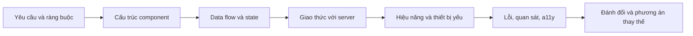
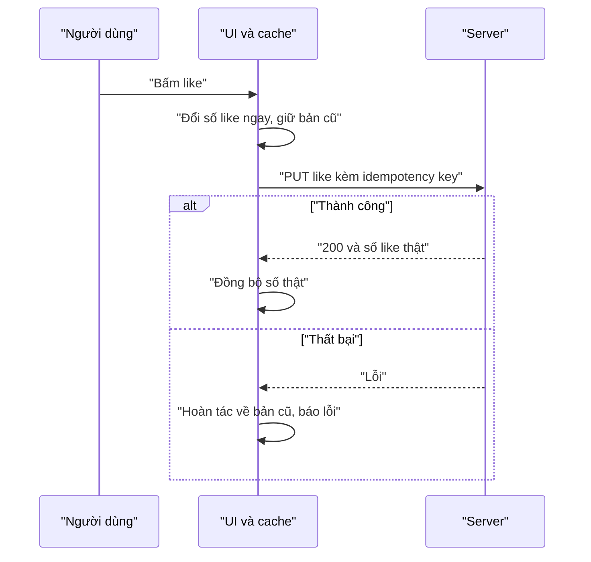
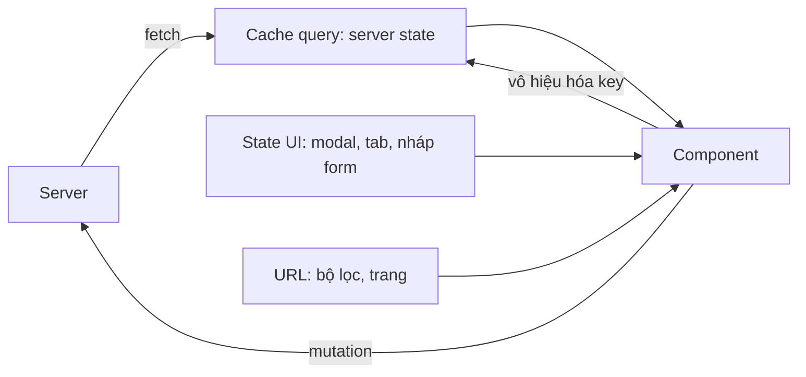

# Câu hỏi: Kiến trúc frontend và system design phía FE

Bộ câu hỏi này dành cho vòng phỏng vấn "thiết kế một màn hình/hệ thống phía frontend". Người phỏng vấn không hỏi bạn dùng thư viện nào, mà hỏi bạn **nêu được yêu cầu, vẽ được data flow và biện hộ được đánh đổi**. Mỗi câu đi theo chuỗi: **Câu hỏi** theo tình huống, **Gợi ý suy luận** (các câu hỏi nhỏ dẫn tới khái niệm nền), **Lập luận** (chuỗi nhân quả "vì A nên B"), **Đáp án ngắn** nói được thành tiếng, **Nhớ** (kiến thức cốt lõi kèm link bài gốc), rồi **Ví dụ** khi cần minh họa. Mỗi câu có hai **Hỏi xoáy** mô phỏng đúng kiểu hỏi tiếp, kèm lý do đó là bước kế tiếp hợp lý.

Quy ước nhãn ví dụ, để bạn biết mức tin cậy:

- _Đã chạy thử bằng Node_: code JavaScript thuần mô phỏng cơ chế, output là output thật khi chạy. Nó không phải thư viện thật (không có React, trình duyệt hay mạng).
- _Minh họa_: code React, CSS, config hoặc sơ đồ theo tài liệu, chưa chạy trong môi trường này. Tên API và config kiểm tra lại theo phiên bản bạn dùng.

Bài gốc để đọc cùng: [Kiến trúc frontend](/go?p=11-Frontend-Core%2Flt-05-kien-truc-frontend.md), [Web performance](/go?p=11-Frontend-Core%2Flt-03-web-performance-core-web-vitals.md), [Bảo mật frontend](/go?p=11-Frontend-Core%2Flt-04-bao-mat-frontend.md), [State management trong React](/go?p=09-React%2Fmedium%2Flt-05-state-management.md), [Routing, form, data trong React](/go?p=09-React%2Fmedium%2Flt-06-routing-forms-data.md), [Hiệu năng và kiến trúc React](/go?p=09-React%2Fhard%2Flt-10-hieu-nang-kien-truc.md). Phía backend của cùng bài toán: [Search autocomplete](/go?p=15-System%20Design%2Fmedium%2F05-search-autocomplete.md), [News feed](/go?p=15-System%20Design%2Fmedium%2F01-news-feed.md), [Chat system](/go?p=15-System%20Design%2Fmedium%2F02-chat-system.md), [Collaborative editing](/go?p=15-System%20Design%2Fhard%2F06-collaborative-editing.md), [Cloud storage](/go?p=15-System%20Design%2Fhard%2F03-cloud-storage.md). File QA liên quan: [FE phỏng vấn](/go?p=07-Interview-QA%2FFrontend%2Fhard%2Fqa-fe-phong-van.md), [React phỏng vấn](/go?p=07-Interview-QA%2FFrontend%2Fhard%2Fqa-react-phong-van.md), [Fullstack tích hợp FE và BE](/go?p=07-Interview-QA%2FFrontend%2Fhard%2Fqa-fullstack-tich-hop-fe-be.md).

Khung trả lời cho mọi bài FE system design:



Đọc sơ đồ: đi từ trái sang phải và dừng ở mỗi ô để hỏi lại người phỏng vấn con số cụ thể (số bản ghi, độ trễ, số người dùng concurrent). Câu trả lời hay thường thắng ở ô đầu và ô cuối.

**Tóm tắt:**

- Bộ câu hỏi gồm 13 tình huống system design phía FE: autocomplete, infinite scroll, optimistic update, chat, collaborative editing, dashboard realtime, upload lớn, state, micro-frontend, monorepo, design system, quan sát lỗi và hiệu năng thiết bị yếu.
- Khung trả lời chung: làm rõ yêu cầu và ràng buộc, chia component, vạch data flow và state, chọn giao thức với server, rồi hiệu năng, lỗi, a11y và đánh đổi.
- Mạng không đảm bảo thứ tự: autocomplete cần hủy hoặc bỏ qua response cũ, chat cần `clientId` và `seq`, retry phải đi kèm idempotency.
- Danh sách dài thì virtualization và cursor pagination, còn dữ liệu realtime thì gom event theo nhịp rồi mới render, không render từng event.
- Server state là snapshot có lifecycle riêng, không chép vào store toàn cục; filter và trang nên nằm ở URL.
- Hay bị hỏi xoáy: optimistic update xử lý rollback và request chồng nhau ra sao, last write wins khác OT hoặc CRDT thế nào, và micro-frontend có thật sự đáng dùng cho team nhỏ không.

## 1. Gõ nhanh vào ô tìm kiếm mà kết quả của chữ cũ lại hiện đè lên kết quả chữ mới. Thiết kế autocomplete thế nào?

**Phải thuộc:** Câu này là câu cốt lõi, gặp rất thường xuyên.

**Câu hỏi:** Ô tìm kiếm gợi ý gọi API mỗi lần gõ. Người dùng gõ "ab" nhưng danh sách lại hiện kết quả của "a". Bạn thiết kế typeahead để tránh lỗi này và giảm tải cho server ra sao?

**Gợi ý suy luận:**
- Hai request gửi đi lần lượt thì có chắc về theo đúng thứ tự không? Điều gì làm thứ tự đảo?
- Mỗi phím gõ có đáng một request không? Chờ bao lâu thì hợp lý?
- Nếu kết quả cũ đã được tải rồi, có cần gọi lại khi người dùng xóa phím để quay về chữ trước?

**Lập luận:** Vì mạng và server không đảm bảo thứ tự phản hồi, request gửi trước có thể về sau, nên UI ghi đè kết quả mới bằng kết quả cũ. Cách xử lý là gán mỗi request một số thứ tự và chỉ nhận response của request mới nhất (hoặc hủy request cũ bằng `AbortController`). Để không gửi quá nhiều, ta debounce (khoảng 150 đến 300 ms, đo theo dữ liệu thật), cộng với điều kiện tối thiểu số ký tự. Cuối cùng cache theo chuỗi truy vấn ở client nên gõ lại chữ cũ hiện tức thì, và server cache các tiền tố phổ biến.

**Đáp án ngắn:** Debounce để giảm số request, hủy hoặc bỏ qua response cũ để tránh race condition (latest wins), cache theo chuỗi truy vấn. Thêm điều hướng bàn phím và ARIA combobox để dùng được bằng bàn phím và trình đọc màn hình.

**Nhớ:** Lỗi hay gặp nhất là race, không phải thiếu debounce. Backend của bài toán: [Search autocomplete](/go?p=15-System%20Design%2Fmedium%2F05-search-autocomplete.md). Gốc FE: [Routing, form, data](/go?p=09-React%2Fmedium%2Flt-06-routing-forms-data.md).

**Ví dụ:** cơ chế "latest wins" với request về ngược thứ tự.

```js
function createSearch(fetcher) {
  let seq = 0;
  return async function search(q) {
    const id = ++seq;
    const data = await fetcher(q);
    if (id !== seq) return { stale: true, q };
    return { stale: false, q, data };
  };
}
// "a" mất 50ms, "ab" mất 10ms => "ab" về trước
```

```text
{ stale: true, q: 'a' }
{ stale: false, q: 'ab', data: 'AB' }
```

_Đã chạy thử bằng Node._ Phản hồi của "a" về sau vẫn bị loại vì `id` không còn là số mới nhất.

**Hỏi xoáy 1:** Dùng `AbortController` hủy request cũ có khác gì so với bỏ qua response cũ?

**Vì sao hỏi tiếp:** Đã có cách "bỏ qua", người phỏng vấn muốn biết bạn có hiểu phần tiết kiệm tài nguyên thật sự nằm ở đâu.

**Gợi ý suy luận:** Bỏ qua response thì request vẫn chạy tới hết ở đâu? Hủy thì ai dừng việc, và server có biết không?

**Đáp:** Bỏ qua chỉ sửa lỗi hiển thị, request vẫn chiếm kết nối và server vẫn xử lý. Hủy bằng `AbortController` đóng kết nối ở trình duyệt, tiết kiệm băng thông và slot kết nối, còn server có dừng việc hay không tùy nó phát hiện ngắt kết nối. Nên dùng cả hai: hủy để tiết kiệm, kiểm tra thứ tự để chắc đúng.

**Hỏi xoáy 2:** Kết quả cần xếp hạng theo cá nhân hóa và có lỗi chính tả thì phần nào làm ở client, phần nào ở server?

**Vì sao hỏi tiếp:** Sau khi UI đúng, câu hỏi tự nhiên là ranh giới trách nhiệm với backend.

**Gợi ý suy luận:** Client có dữ liệu toàn bộ index không? Phần nào cần dữ liệu chung, phần nào cần dữ liệu riêng người dùng?

**Đáp:** Xếp hạng và sửa lỗi chính tả cần index toàn cục nên làm ở server. Client chỉ làm việc nhẹ: highlight đoạn khớp, lịch sử tìm kiếm gần đây lưu cục bộ, và có thể lọc cục bộ khi tập dữ liệu nhỏ (vài trăm mục) để khỏi gọi mạng.

**Sai lầm hay gặp:** Quên xử lý IME (gõ tiếng Việt, tiếng Nhật) nên debounce bắn giữa lúc đang soạn dấu. Cần nghe `compositionstart` và `compositionend`.

## 2. Cuộn feed vài nghìn mục thì trình duyệt giật và tốn RAM. Infinite scroll và virtualization khác nhau chỗ nào?

**Câu hỏi:** Trang feed tải thêm khi cuộn xuống đáy. Sau vài trăm mục thì cuộn giật, memory tăng. Bạn xử lý thế nào, và infinite scroll có giống virtualization không?

**Gợi ý suy luận:**
- Infinite scroll giải quyết vấn đề "tải dữ liệu" hay "vẽ DOM"?
- Mỗi node DOM tốn gì (memory, layout, style recalculation)?
- Nếu chỉ vẽ phần nhìn thấy thì chiều cao thanh cuộn lấy từ đâu?

**Lập luận:** Vì infinite scroll chỉ quyết định **khi nào tải** thêm (thường dùng `IntersectionObserver` trên phần tử đáy), nó không giảm số node đã gắn vào DOM, nên DOM phình theo số mục đã tải. DOM lớn làm layout và style tính lại chậm, nên cuộn giật. Virtualization (windowing) chỉ gắn các mục đang trong khung nhìn cộng vài mục đệm (overscan), còn chiều cao tổng giữ bằng một phần tử đệm, nên số node gần như không đổi. Cái giá là mục cao thay đổi khó đo, tìm kiếm trong trang (Ctrl+F) và truy cập bàn phím phức tạp hơn.

**Đáp án ngắn:** Infinite scroll lo việc tải dữ liệu theo trang, virtualization lo việc chỉ vẽ phần nhìn thấy. Feed dài cần cả hai, và cần đo chiều cao mục thay đổi, giữ vị trí cuộn khi chèn thêm.

**Nhớ:** Virtualization đánh đổi khả năng tìm kiếm của trình duyệt lấy hiệu năng. Gốc: [Hiệu năng và kiến trúc React](/go?p=09-React%2Fhard%2Flt-10-hieu-nang-kien-truc.md).

**Ví dụ:** tính khoảng mục cần vẽ với chiều cao cố định.

```js
function visibleRange({ scrollTop, viewportH, itemH, total, overscan }) {
  const first = Math.max(0, Math.floor(scrollTop / itemH) - overscan);
  const last = Math.min(total - 1, Math.ceil((scrollTop + viewportH) / itemH) + overscan);
  return { first, last, rendered: last - first + 1, offsetTop: first * itemH, totalHeight: total * itemH };
}
```

```text
scrollTop 0:      first 0,    last 15,   rendered 16, totalHeight 5000000
scrollTop 250000: first 4997, last 5015, rendered 19, offsetTop 249850
```

_Đã chạy thử bằng Node._ Với 100.000 mục cao 50px, chỉ khoảng 16 đến 19 node tồn tại tại một thời điểm.

**Hỏi xoáy 1:** Mục có chiều cao không đoán trước (ảnh, văn bản dài) thì virtualization làm sao?

**Vì sao hỏi tiếp:** Ví dụ trên giả định chiều cao cố định, thực tế feed không như vậy.

**Gợi ý suy luận:** Khi chưa render thì chưa biết cao bao nhiêu, vậy lấy số ước lượng từ đâu rồi sửa khi nào?

**Đáp:** Dùng chiều cao ước lượng ban đầu, đo thật bằng `ResizeObserver` sau khi mục được vẽ rồi cập nhật bảng chiều cao. Dành sẵn tỷ lệ khung (aspect ratio) cho ảnh để tránh nhảy bố cục. Thư viện như TanStack Virtual hỗ trợ đo động, kiểm tra lại theo phiên bản.

**Hỏi xoáy 2:** Người dùng bấm vào một mục, sang trang chi tiết rồi bấm Back. Làm sao quay lại đúng vị trí cuộn?

**Vì sao hỏi tiếp:** Đây là trải nghiệm thật làm feed vô hạn dễ hỏng nhất.

**Gợi ý suy luận:** State nào cần giữ: dữ liệu đã tải, vị trí cuộn, hay cả hai? Giữ ở đâu?

**Đáp:** Phải giữ cả danh sách đã tải (cache của thư viện data fetching) và vị trí cuộn (hoặc id mục neo) rồi khôi phục khi quay lại. Chỉ khôi phục cuộn mà không có dữ liệu thì không có gì để cuộn tới.

**Sai lầm hay gặp:** Dùng `scroll` event tự đo vị trí thay cho `IntersectionObserver`, gây chạy logic liên tục trên main thread.

## 3. Người dùng bấm like rồi thấy số nhảy lại, hoặc bài mới chèn vào làm feed xô lệch khi đang đọc. Thiết kế news feed thế nào?

**Câu hỏi:** Thiết kế UI news feed: tải theo trang, like tức thì, bài mới xuất hiện trong lúc người dùng đang đọc. Bạn xử lý các tình huống nào?

**Gợi ý suy luận:**
- Phân trang bằng offset hay cursor khi feed liên tục có bài mới?
- Like có nên đợi server rồi mới đổi số không? Nếu server từ chối thì sao?
- Bài mới chèn lên đầu thì chèn thẳng hay báo "có bài mới"?

**Lập luận:** Vì feed thay đổi liên tục, phân trang offset làm lặp hoặc sót mục (xem câu 2 của file [Fullstack](/go?p=07-Interview-QA%2FFrontend%2Fhard%2Fqa-fullstack-tich-hop-fe-be.md)), nên dùng cursor. Like phải cảm giác tức thì, nên cập nhật lạc quan: đổi UI ngay, gửi request, nếu lỗi thì hoàn tác và báo. Bài mới chèn thẳng lên đầu sẽ đẩy nội dung đang đọc, nên hiện banner "có bài mới" để người dùng chủ động tải. Cuối cùng dữ liệu bài viết nên chuẩn hóa theo id (một bài chỉ lưu một chỗ) để like ở một nơi cập nhật mọi nơi hiển thị bài đó.

**Đáp án ngắn:** Cursor pagination, optimistic update cho like có rollback, banner cho bài mới thay vì chèn đè, chuẩn hóa cache theo id, virtualize khi dài, skeleton cho state tải.

**Nhớ:** Server state nên nằm trong cache của thư viện query, không sao chép sang store riêng. Gốc: [Kiến trúc frontend](/go?p=11-Frontend-Core%2Flt-05-kien-truc-frontend.md), backend: [News feed](/go?p=15-System%20Design%2Fmedium%2F01-news-feed.md).

**Ví dụ:** flow like lạc quan.



_Minh họa._

**Hỏi xoáy 1:** Người dùng bấm like rồi bỏ like liên tục thì request đi theo thứ tự nào?

**Vì sao hỏi tiếp:** Optimistic update đơn giản đổ vỡ khi có nhiều thao tác chồng nhau.

**Gợi ý suy luận:** Hai request cùng lúc có chắc kết thúc đúng thứ tự không? State cuối nên là gì: kết quả của request cuối hay của cái về cuối?

**Đáp:** Nên gộp hoặc xếp hàng thao tác theo từng bài, chỉ gửi state đích cuối cùng (liked hay không) thay vì gửi từng cú bấm, và làm endpoint đặt state (PUT) thay vì "toggle" để lặp lại vô hại. Xem thêm idempotency ở [Fullstack](/go?p=07-Interview-QA%2FFrontend%2Fhard%2Fqa-fullstack-tich-hop-fe-be.md).

**Hỏi xoáy 2:** Feed có cache cũ khi mở lại tab sau một giờ, hiển thị cái nào trước?

**Vì sao hỏi tiếp:** Sau khi xử lý thao tác, người hỏi chuyển sang độ tươi của dữ liệu.

**Gợi ý suy luận:** Hiện dữ liệu cũ ngay có tốt hơn màn trắng không? Khi nào thì cần xác thực lại?

**Đáp:** Hiện cache cũ ngay (stale-while-revalidate) rồi lấy dữ liệu mới ở nền, có mới thì báo banner thay vì xáo trộn. Đặt `staleTime` theo độ nhạy của dữ liệu.

## 4. Mạng chập chờn làm tin nhắn gửi hai lần hoặc lệch thứ tự. Chat realtime ở FE cần những cơ chế nào?

**Phải thuộc:** Câu này là câu cốt lõi, gặp rất thường xuyên.

**Câu hỏi:** Thiết kế UI chat dùng WebSocket. Khi mất mạng rồi nối lại, tin nhắn bị lặp, mất hoặc sai thứ tự. Bạn bảo đảm điều gì ở client?

**Gợi ý suy luận:**
- Tin nhắn đang gửi chưa có id từ server thì định danh bằng gì để ghép với response?
- Nếu server gửi lại tin sau khi nối lại, client nhận ra trùng bằng cách nào?
- Thứ tự hiển thị dựa vào giờ máy client hay số thứ tự do server cấp?

**Lập luận:** Vì tin nhắn gửi đi chưa có id server, client tạo `clientId` và hiển thị state "đang gửi". Khi server xác nhận, ghép theo `clientId` và gắn `seq` do server cấp, nên event lặp (replay sau reconnect) là vô hại nếu xử lý idempotent. Thứ tự dựa vào `seq` của server vì đồng hồ client không đáng tin. Khi mất kết nối, kết nối lại với backoff có jitter để tránh cả nghìn client cùng dội vào server, rồi hỏi "gửi các tin có seq lớn hơn N" để lấp lỗ hổng.

**Đáp án ngắn:** `clientId` để ghép và chống trùng, `seq` từ server để sắp xếp, reconnect với exponential backoff và jitter, sync phần bị lỡ bằng "tin sau seq cuối". Hiển thị state gửi (đang gửi, đã gửi, lỗi và nút gửi lại).

**Nhớ:** WebSocket không tự đảm bảo giao hàng hay thứ tự ở tầng ứng dụng sau khi đứt. Backend: [Chat system](/go?p=15-System%20Design%2Fmedium%2F02-chat-system.md), giao thức: [HTTP/2, HTTP/3, realtime](/go?p=03-Network-Security%2Fhard%2Flt-06-http2-3-realtime-lb.md).

**Ví dụ:** gộp event, chống trùng và backoff.

```js
function applyEvent(state, ev) {
  const byClientId = new Map(state.map(m => [m.clientId, m]));
  const existing = byClientId.get(ev.clientId);
  if (existing) {
    if (existing.status === 'sent' && ev.type === 'ack') return state;
    byClientId.set(ev.clientId, { ...existing, ...ev.msg, status: 'sent' });
  } else {
    byClientId.set(ev.clientId, { clientId: ev.clientId, ...ev.msg, status: 'sent' });
  }
  return [...byClientId.values()].sort((a, b) => (a.seq ?? Infinity) - (b.seq ?? Infinity));
}
function backoff(attempt, base = 500, cap = 30000) { return Math.min(cap, base * 2 ** attempt); }
```

```text
[ { clientId: 'c9', seq: 6, text: 'earlier', ... status: 'sent' },
  { clientId: 'c1', text: 'hi', status: 'sent', seq: 7, id: 'm7' } ]
backoff 0..7: 500, 1000, 2000, 4000, 8000, 16000, 30000, 30000
```

_Đã chạy thử bằng Node._ Ack lặp không tạo thêm tin, tin seq nhỏ hơn tự xếp lên trước. Jitter (ngẫu nhiên hóa) cộng thêm ở bản thật.

**Hỏi xoáy 1:** Vì sao cần jitter khi reconnect, chỉ backoff thôi chưa đủ sao?

**Vì sao hỏi tiếp:** Backoff là chi tiết ai cũng nói, jitter mới phân biệt người đã gặp sự cố thật.

**Gợi ý suy luận:** Nếu server sập làm 10.000 client đứt cùng lúc, mọi client có cùng lịch backoff thì chuyện gì xảy ra ở mỗi mốc thời gian?

**Đáp:** Cùng lịch backoff thì tất cả client thử lại đúng cùng thời điểm, tạo các đợt dội (thundering herd) lên server đang hồi phục. Jitter rải thời điểm thử lại, làm tải mượt hơn.

**Hỏi xoáy 2:** Tab ở nền và người dùng mở nhiều tab thì kết nối quản lý ra sao?

**Vì sao hỏi tiếp:** Hệ thống thật có nhiều tab, mỗi tab một WebSocket là lãng phí.

**Gợi ý suy luận:** Các tab cùng origin có thể chia sẻ gì? Trình duyệt có hạ ưu tiên tab nền không?

**Đáp:** Có thể dùng `SharedWorker` hoặc `BroadcastChannel` với một tab "leader" giữ kết nối rồi phát lại cho tab khác. Tab nền bị trình duyệt hạ tần suất timer, nên heartbeat cần dựa vào ping của server hơn là `setInterval` phía client, kiểm tra lại theo trình duyệt.

## 5. Hai người cùng sửa một tài liệu và nội dung của một người biến mất. Editor cộng tác dùng cơ chế gì?

**Câu hỏi:** Bạn được yêu cầu làm editor cộng tác như Google Docs. Vì sao không thể chỉ gửi "toàn bộ văn bản" lên server mỗi lần lưu, và OT với CRDT khác nhau thế nào?

**Gợi ý suy luận:**
- Hai người sửa cùng lúc trên bản cũ giống nhau, ghi đè toàn văn thì mất gì?
- Nếu gửi "thao tác" thay vì "state", hai thao tác đến theo thứ tự khác nhau thì kết quả có giống nhau không?
- Ai là nguồn thứ tự: một server trung tâm hay cấu trúc dữ liệu tự hội tụ?

**Lập luận:** Vì ghi đè toàn văn là "last write wins", người ghi sau xóa công sức người ghi trước. Gửi thao tác (chèn, xóa tại vị trí) thì giữ được cả hai, nhưng thao tác phụ thuộc vị trí nên khi áp dụng theo thứ tự khác sẽ cho kết quả khác. OT giải bằng cách biến đổi thao tác dựa trên các thao tác concurrent, cần server trung tâm sắp thứ tự. CRDT giải bằng cách thiết kế cấu trúc dữ liệu sao cho các phép trộn có tính giao hoán, kết hợp và idempotent, nên mọi bản sao hội tụ dù nhận theo thứ tự nào, kể cả offline. Cái giá của CRDT là metadata nặng hơn và nhật ký lớn dần cần dọn.

**Đáp án ngắn:** Gửi thao tác chứ không gửi toàn văn. OT cần server sắp thứ tự và biến đổi thao tác, CRDT cho phép trộn không cần trung tâm nên hợp offline nhưng tốn memory hơn. Con trỏ và hiện diện người khác (presence) là kênh riêng, không cần bền vững.

**Nhớ:** Cốt lõi là tính hội tụ, không phải tốc độ mạng. Phía server: [Collaborative editing](/go?p=15-System%20Design%2Fhard%2F06-collaborative-editing.md). Trong thực tế nên dùng thư viện đã kiểm chứng (ví dụ Yjs, Automerge), không tự viết.

**Ví dụ:** minh họa tính chất hội tụ bằng một thanh ghi LWW trộn theo (thời điểm, mã site).

```js
function merge(a, b) {
  const out = { ...a };
  for (const [k, v] of Object.entries(b)) {
    const cur = out[k];
    if (!cur || v.ts > cur.ts || (v.ts === cur.ts && v.site > cur.site)) out[k] = v;
  }
  return out;
}
// merge(A, B) và merge(B, A) có bằng nhau không? merge lại B có đổi không?
```

```text
giao hoán: true  (title thắng: Plan B)
lũy đẳng:  true
```

_Đã chạy thử bằng Node._ Đây chỉ là CRDT đơn giản cho trường dữ liệu (LWW), không phải thuật toán cho văn bản như Yjs hay RGA. Nó minh họa đúng điều kiện cần: trộn theo thứ tự nào cũng ra cùng kết quả.

**Hỏi xoáy 1:** Vì sao dùng đồng hồ máy (timestamp) để phân thắng thua có vấn đề?

**Vì sao hỏi tiếp:** Ví dụ LWW dùng `ts`, người hỏi muốn thử xem bạn có tin đồng hồ không.

**Gợi ý suy luận:** Đồng hồ hai máy có sync tuyệt đối không? Có cách đặt thứ tự không phụ thuộc giờ thật là gì?

**Đáp:** Đồng hồ máy lệch nhau nên "mới hơn" có thể sai. Thực tế dùng đồng hồ logic (Lamport hoặc vector clock) để có thứ tự nhân quả, và LWW chỉ dùng cho dữ liệu mà mất một bản ghi đồng thời là chấp nhận được.

**Hỏi xoáy 2:** Với tài liệu lớn, tải toàn bộ lịch sử CRDT khi mở có ổn không?

**Vì sao hỏi tiếp:** Điểm yếu đã nêu ở phần lập luận (nhật ký lớn dần) cần giải pháp.

**Gợi ý suy luận:** Có thể lưu state nén thay cho toàn bộ nhật ký không? Lúc mở tài liệu cần gì tối thiểu?

**Đáp:** Lưu snapshot định kỳ và chỉ phát thao tác sau snapshot, nén hoặc dọn dấu xóa (tombstone) khi mọi bản sao đã nhận. Mở tài liệu: tải snapshot rồi áp các cập nhật mới, hiển thị văn bản trước, sync nền sau.

## 6. Dashboard nhận hàng trăm event mỗi giây thì tab đứng hình. Thiết kế dashboard realtime thế nào?

**Câu hỏi:** Màn hình giám sát nhận dữ liệu qua WebSocket với khoảng 500 event mỗi giây, vẽ vài biểu đồ. Tab đứng hình và quạt máy quay. Bạn giải quyết ra sao?

**Gợi ý suy luận:**
- Màn hình làm mới tối đa bao nhiêu lần mỗi giây? Vẽ nhiều hơn số đó thì có ích gì?
- Mỗi event gây một lần setState thì tạo bao nhiêu lần render?
- Biểu đồ 10.000 điểm trên màn hình rộng 1.000 pixel thì cần vẽ hết không?

**Lập luận:** Vì màn hình chỉ làm mới khoảng 60 lần mỗi giây, vẽ 500 lần mỗi giây là lãng phí. Nên gom event vào bộ đệm (buffer) và xả theo nhịp `requestAnimationFrame` hoặc theo khoảng 100 đến 250 ms, nên số lần render phụ thuộc nhịp xả, không phụ thuộc tốc độ event. Với biểu đồ, số điểm vượt số pixel thì thừa, nên giảm mẫu (downsample, giữ cực trị mỗi nhóm để không mất đỉnh). Dữ liệu lâu hơn cửa sổ hiển thị cần loại bỏ để memory không tăng mãi (ring buffer). Nếu vẫn nặng, chuyển xử lý sang Web Worker và vẽ bằng canvas.

**Đáp án ngắn:** Gom event theo nhịp, chỉ render theo nhịp đó, giảm mẫu dữ liệu, giới hạn cửa sổ lưu trong memory, đẩy việc nặng sang worker và vẽ canvas khi cần. Báo state kết nối và độ trễ dữ liệu rõ ràng.

**Nhớ:** Tách "tốc độ nhận" khỏi "tốc độ vẽ". Gốc: [Web performance](/go?p=11-Frontend-Core%2Flt-03-web-performance-core-web-vitals.md).

**Ví dụ:** gom lô và giảm mẫu giữ cực trị.

```js
const buffer = []; let flushes = 0, applied = 0;
function onEvent(e) { buffer.push(e); }
function flush() {
  if (!buffer.length) return;
  flushes++;
  const batch = buffer.splice(0);
  applied += batch.length;
  return batch[batch.length - 1];
}
function downsample(points, buckets) {
  const size = Math.ceil(points.length / buckets), out = [];
  for (let i = 0; i < points.length; i += size) {
    const part = points.slice(i, i + size);
    out.push(part.reduce((m, p) => p < m ? p : m), part.reduce((m, p) => p > m ? p : m));
  }
  return out;
}
```

```text
{ events: 1500, renders: 2, last: { t: 999, v: 1998 } }
10000 -> 200
```

_Đã chạy thử bằng Node._ 1500 event chỉ tốn 2 lần xả. Giảm 10.000 điểm xuống 200 điểm (min và max mỗi nhóm).

**Hỏi xoáy 1:** Throttle, debounce và gom lô theo frame khác nhau thế nào, chọn cái nào ở đây?

**Vì sao hỏi tiếp:** Người hỏi kiểm tra bạn phân biệt ba công cụ hay bị lẫn.

**Gợi ý suy luận:** Cái nào chờ đến khi "im lặng" mới chạy? Cái nào chạy đều đặn tối đa N lần? Dữ liệu có được phép bỏ rơi không?

**Đáp:** Debounce chờ im lặng nên dashboard liên tục sẽ không bao giờ cập nhật. Throttle chạy đều nhưng có thể bỏ event giữa chừng. Gom lô giữ mọi event rồi áp một lần theo nhịp, hợp với dữ liệu cần cộng dồn. Ở đây nên gom lô xả theo nhịp.

**Hỏi xoáy 2:** Tab chuyển sang nền thì xử lý dữ liệu đến thế nào?

**Vì sao hỏi tiếp:** Tối ưu thật phải tính tới trường hợp không ai nhìn.

**Gợi ý suy luận:** Tab nền có cần vẽ không? Khi quay lại cần gì để không hiện dữ liệu cũ?

**Đáp:** Dừng vẽ khi `document.visibilityState` là `hidden`, vẫn có thể giữ dữ liệu tóm tắt hoặc tạm ngắt kết nối. Khi quay lại, lấy snapshot mới từ server rồi nối stream, thay vì phát lại hàng nghìn event đã lỡ.

## 7. Tải lên tệp 1 GB, đến 90% thì rớt mạng và phải làm lại từ đầu. Thiết kế upload tệp lớn thế nào?

**Câu hỏi:** Người dùng tải lên video hơn 1 GB. Mạng yếu hay đứt giữa chừng. Bạn thiết kế flow upload để tiếp tục được, có thanh tiến độ và không làm quá tải server ứng dụng?

**Gợi ý suy luận:**
- Một request duy nhất cho 1 GB thì lỗi ở byte cuối cùng làm mất gì?
- Nếu tệp đi qua server ứng dụng thì server gánh gì? Có cách đưa dữ liệu đi thẳng tới kho lưu trữ không?
- Làm sao client biết các phần nào đã lên rồi để chỉ gửi phần còn thiếu?

**Lập luận:** Vì một request lớn thất bại là mất hết, ta cắt tệp thành các phần (chunk) cỡ vài MB và gửi từng phần, nên lỗi chỉ làm lại một phần. Để server ứng dụng không phải gánh băng thông, server chỉ cấp URL ký sẵn (presigned URL) cho từng phần, client gửi thẳng lên object storage. Khi lỗi, client hỏi server "phần nào đã có", bỏ qua các phần đó rồi gửi tiếp (resume). Gửi parallel vài phần (thường 3 đến 6) để dùng hết băng thông nhưng giới hạn để không nghẽn. Cuối cùng server gọi "hoàn tất" để ghép các phần, và kiểm tra checksum để chắc nội dung đúng.

**Đáp án ngắn:** Chunking kèm resume, presigned URL để gửi thẳng lên object storage, parallel có giới hạn, retry từng chunk có backoff, tiến độ tính theo tổng byte đã xác nhận, hoàn tất và kiểm checksum ở server.

**Nhớ:** Thiết kế để mất mát có giá nhỏ: chia nhỏ và nhớ phần đã làm. Backend: [Cloud storage](/go?p=15-System%20Design%2Fhard%2F03-cloud-storage.md). Phần presigned URL và bảo mật: xem [Fullstack](/go?p=07-Interview-QA%2FFrontend%2Fhard%2Fqa-fullstack-tich-hop-fe-be.md).

**Ví dụ:** chia chunk, resume và retry.

```js
function planChunks(size, chunk) {
  const n = Math.ceil(size / chunk);
  return Array.from({ length: n }, (_, i) => ({ i, start: i * chunk, end: Math.min(size, (i + 1) * chunk) }));
}
async function withRetry(fn, max) {
  for (let a = 0; ; a++) { try { return await fn(a); } catch (e) { if (a >= max) throw e; } }
}
// tệp 1050 MB, chunk 8 MB; server báo đã có phần 0, 1, 2
```

```text
132 chunk, chunk cuối: start 1098907648, end 1101004800
con lai 129
ok sau 3 lan   (lỗi 2 lần rồi thành công)
```

_Đã chạy thử bằng Node._ Chỉ phần logic chia và thử lại, không có mạng thật. Giới hạn kích thước phần và số phần tối đa phụ thuộc dịch vụ lưu trữ, kiểm tra lại theo tài liệu của dịch vụ bạn dùng.

**Hỏi xoáy 1:** Thanh tiến độ phải tính thế nào để không nhảy lùi khi retry?

**Vì sao hỏi tiếp:** Tiến độ là phần người dùng nhìn thấy, và retry làm lộ lỗi tính toán ngây thơ.

**Gợi ý suy luận:** Nếu cộng dồn byte đã gửi (kể cả byte gửi lỗi) thì chuyện gì khi gửi lại? Nên tính theo phần đã xác nhận hay đang bay?

**Đáp:** Tính tổng byte của các phần đã xác nhận cộng tiến độ riêng của các phần đang bay, và khi một phần lỗi thì trừ phần tiến độ tạm của nó. Không bao giờ cộng dồn byte đã gửi của lần thử thất bại.

**Hỏi xoáy 2:** Dùng presigned URL thì kiểm soát loại tệp và kích thước ở đâu?

**Vì sao hỏi tiếp:** Đưa quyền ghi cho client mở ra vấn đề bảo mật.

**Gợi ý suy luận:** Client có đáng tin khi tự khai kích thước không? Điều kiện nào có thể gắn vào chính URL?

**Đáp:** Không tin client: ràng buộc loại nội dung, giới hạn kích thước và thời hạn ngắn ngay trong chữ ký (hoặc policy) của URL, đồng thời server xác minh lại metadata sau khi hoàn tất và quét tệp trước khi cho dùng. Xem [Bảo mật frontend](/go?p=11-Frontend-Core%2Flt-04-bao-mat-frontend.md).

## 8. Dữ liệu từ API được copy vào store toàn cục rồi lệch với server. Vì sao phải tách server state và client state?

**Phải thuộc:** Câu này là câu cốt lõi, gặp rất thường xuyên.

**Câu hỏi:** Dự án dùng Redux để chứa cả danh sách đơn hàng lấy từ API lẫn state mở modal. Sau một thời gian xuất hiện dữ liệu cũ và code sync rối rắm. Bạn đề xuất cấu trúc nào?

**Gợi ý suy luận:**
- Ai sở hữu dữ liệu đơn hàng: client hay server? Bản trong trình duyệt là gì của nó?
- Dữ liệu sở hữu ở nơi khác thì cần thêm những mối quan tâm nào (tải, lỗi, làm mới, hết hạn, trùng request)?
- State "modal đang mở" có những mối quan tâm đó không?

**Lập luận:** Vì dữ liệu đơn hàng thuộc về server, bản ở client chỉ là **ảnh chụp** có thể cũ, nên cần quản lý lifecycle của ảnh chụp: state tải và lỗi, thời điểm hết hạn, làm mới nền, gộp request trùng, vô hiệu hóa sau thao tác ghi. Đó là bộ vấn đề lặp lại ở mọi API, nên thư viện chuyên trách (TanStack Query, SWR, RTK Query) giải một lần. Còn UI state (modal, tab đang chọn, bản nháp form) do client sở hữu hoàn toàn, nhỏ và sync, hợp với state cục bộ hoặc store nhẹ. Nhét cả hai vào một store thì phải tự viết lại phần lifecycle ảnh chụp, và dễ lệch.

**Đáp án ngắn:** Server state là ảnh chụp dữ liệu của server, cần cache, hết hạn, làm mới nên giao cho thư viện query. Client state là state UI do client sở hữu, để ở state cục bộ hoặc store nhỏ. Đừng copy dữ liệu server vào store khác.

**Nhớ:** Phân loại state theo ai sở hữu và lifecycle. Gốc: [Phân loại state](/go?p=11-Frontend-Core%2Flt-05-kien-truc-frontend.md), [State management trong React](/go?p=09-React%2Fmedium%2Flt-05-state-management.md), [Composables và Pinia (Vue)](/go?p=10-Vue%2Fmedium%2Flt-05-composables-pinia.md).

**Ví dụ:** ranh giới hai loại state.



_Minh họa._ Filter và số trang nên nằm ở URL để chia sẻ và quay lại được, không nằm trong store.

**Hỏi xoáy 1:** Sau khi tạo đơn hàng mới, danh sách phải cập nhật. Cập nhật tay vào cache hay vô hiệu hóa rồi lấy lại?

**Vì sao hỏi tiếp:** Tách state rồi thì câu hỏi tiếp là giữ chúng nhất quán sau thao tác ghi.

**Gợi ý suy luận:** Client có biết chắc thứ tự, tổng số, trường server tự sinh của bản ghi mới không? Chi phí của một lần lấy lại là gì?

**Đáp:** Mặc định vô hiệu hóa và lấy lại, vì server mới là nguồn sự thật cho thứ tự, tổng số và trường tự sinh. Chỉ cập nhật tay (hoặc lạc quan) ở nơi cần phản hồi tức thì và đã chấp nhận rủi ro hoàn tác.

**Hỏi xoáy 2:** Khi nào store toàn cục (Redux, Pinia, Zustand) vẫn đúng?

**Vì sao hỏi tiếp:** Tránh kết luận cực đoan "không cần store nữa".

**Gợi ý suy luận:** State nào do client sở hữu và nhiều component xa nhau cùng cần, nhưng không đến từ server?

**Đáp:** Cho client state dùng chung: phiên người dùng cục bộ, giỏ hàng chưa gửi, cài đặt giao diện, state machine phức tạp của wizard. Tiêu chí là state đó có nằm trên server hay không.

**Sai lầm hay gặp:** Lưu cả object từ API vào state của form rồi sửa trực tiếp, nên hủy form vẫn làm bẩn cache. Form nên giữ bản nháp riêng.

## 9. Ba đội muốn deploy độc lập nên đề xuất micro-frontend. Khi nào đáng, và Module Federation giải quyết gì?

**Câu hỏi:** Công ty có ba đội làm chung một ứng dụng lớn, build chậm, deploy phải chờ nhau. Một người đề xuất micro-frontend với Module Federation. Bạn ủng hộ không, và rủi ro nằm ở đâu?

**Gợi ý suy luận:** 
- Vấn đề gốc là kỹ thuật (build) hay tổ chức (đội phụ thuộc nhau khi phát hành)?
- Nếu mỗi đội đóng gói riêng, thư viện dùng chung (React) bị tải mấy lần?
- Khi một phần ứng dụng lỗi hoặc đổi contract thì phần còn lại biết bằng cách nào?

**Lập luận:** Micro-frontend chủ yếu là giải pháp **tổ chức**: cho các đội phát hành độc lập, nên chỉ đáng khi chi phí phối hợp thật sự đã cao. Cái giá là mỗi lát cắt có thể kéo thêm bản sao thư viện (trang nặng hơn), UI khó đồng nhất, điều hướng và state chung phải thỏa thuận, và kiểm thử tích hợp khó hơn. Module Federation (Webpack, Rspack, và bản dùng trong Vite qua plugin) cho phép một ứng dụng nạp module của ứng dụng khác lúc chạy, và khai báo thư viện `shared` ở dạng singleton để chỉ tải một React. Nhưng nếu hai bên lệch version dependency chia sẻ thì lỗi chỉ lộ lúc chạy. Vì vậy cần interface contract rõ, phiên bản hóa, và phương án rơi về (fallback) khi remote không tải được.

**Đáp án ngắn:** Micro-frontend giải bài toán đội và phát hành độc lập, không phải bài toán kỹ thuật thuần. Module Federation nạp module lúc chạy và chia sẻ thư viện dạng singleton, nhưng thêm rủi ro lệch phiên bản, UI không nhất quán và độ phức tạp vận hành. Nếu chưa đau về tổ chức thì monorepo module hóa tốt hơn.

**Nhớ:** Thử module hóa trong một repo trước khi tách deploy. Gốc: [Micro-frontend và đánh đổi](/go?p=11-Frontend-Core%2Flt-05-kien-truc-frontend.md). Phương án thay thế cho Vue: [Pattern nâng cao và kiến trúc Vue](/go?p=10-Vue%2Fhard%2Flt-10-pattern-nang-cao-kien-truc.md).

**Ví dụ:** config host và remote với thư viện dùng chung (cú pháp theo `@module-federation`, kiểm tra lại theo phiên bản).

```js
// host/webpack.config.js (Minh họa)
new ModuleFederationPlugin({
  name: 'shell',
  remotes: { checkout: 'checkout@https://cdn.example.com/checkout/remoteEntry.js' },
  shared: {
    react: { singleton: true, requiredVersion: '^18.3.0' },
    'react-dom': { singleton: true, requiredVersion: '^18.3.0' },
  },
});
```

```js
// dùng remote kèm Error Boundary và fallback (Minh họa)
const Checkout = React.lazy(() => import('checkout/App'));
<ErrorBoundary fallback={<CheckoutUnavailable />}>
  <Suspense fallback={<Spinner />}><Checkout /></Suspense>
</ErrorBoundary>
```

_Minh họa._

**Hỏi xoáy 1:** Hai lát cắt cần dùng chung giỏ hàng. Chia sẻ state giữa micro-frontend thế nào cho đúng?

**Vì sao hỏi tiếp:** Chia sẻ state là chỗ micro-frontend thường kết dính lại thành một khối.

**Gợi ý suy luận:** Nếu mọi lát cắt import chung một store thì còn "độc lập" không? Có kênh nào lỏng hơn (event, URL, API)?

**Đáp:** Ưu tiên giao tiếp lỏng: dữ liệu thuộc server thì mỗi lát cắt tự lấy từ API, state nhỏ dùng URL hoặc event có kiểu (custom event, event bus với contract), tránh import chéo store. Giỏ hàng thật sự là dữ liệu của server nên lấy từ một API chung.

**Hỏi xoáy 2:** Nếu không muốn micro-frontend thì làm sao vẫn cho đội tách việc?

**Vì sao hỏi tiếp:** Người hỏi muốn xem bạn có phương án thấp chi phí hơn.

**Gợi ý suy luận:** Ranh giới module cưỡng chế được bằng công cụ nào? Build chậm giải bằng gì khác ngoài tách deploy?

**Đáp:** Module hóa trong một monorepo với ranh giới cưỡng chế bằng lint (không import chéo thư mục nội bộ), CODEOWNERS cho từng khu vực, build theo phần bị ảnh hưởng và cache. Giữ một lần deploy nhưng phát hành từng tính năng ẩn sau feature flag.

## 10. Sửa một thư viện nội bộ mà CI build lại cả mười ứng dụng. Monorepo cần những gì để không chậm và không rối?

**Câu hỏi:** Công ty gom nhiều ứng dụng và thư viện vào một monorepo. Sau vài tháng, CI chạy hàng chục phút và ai cũng import tùy tiện vào code của nhau. Bạn sửa thế nào?

**Gợi ý suy luận:**
- Công cụ biết ứng dụng nào phụ thuộc gói nào bằng cách nào?
- Nếu đầu vào của một tác vụ không đổi, có cần chạy lại không?
- Cái gì ngăn một gói chọc vào phần nội bộ của gói khác?

**Lập luận:** Vì monorepo lưu dependency graph giữa các gói, công cụ (Nx, Turborepo, pnpm workspaces) chỉ cần chạy tác vụ trên các gói **bị ảnh hưởng** bởi thay đổi. Vì kết quả build, lint, test là hàm của đầu vào, kết quả được cache (cục bộ hoặc từ xa), nên chạy lại cùng đầu vào chỉ là lấy từ cache. Còn việc kiểm soát import cần luật cưỡng chế bằng lint, mỗi gói chỉ xuất ra qua điểm vào công khai, và các ranh giới (ứng dụng được dùng thư viện, thư viện không được dùng ứng dụng) khai báo thành quy tắc. Cuối cùng quản lý version dependency ở một nơi để tránh nhiều bản React cùng tồn tại.

**Đáp án ngắn:** Build theo dependency graph chỉ trên phần bị ảnh hưởng, cache kết quả (cả remote), cưỡng chế ranh giới gói bằng lint và điểm vào công khai, thống nhất version dependency. Đánh đổi là công cụ và quyền sở hữu phải được quản lý.

**Nhớ:** Monorepo là cách tổ chức mã, khác với micro-frontend là cách triển khai. Gốc: [Monorepo](/go?p=11-Frontend-Core%2Flt-05-kien-truc-frontend.md).

**Ví dụ:** ranh giới và tác vụ có cache (cú pháp Turborepo minh họa, kiểm tra lại theo phiên bản).

```json
{
  "tasks": {
    "build": { "dependsOn": ["^build"], "outputs": ["dist/**"] },
    "test": { "dependsOn": ["build"] },
    "lint": {}
  }
}
```

_Minh họa._ `^build` nghĩa là build các gói mà gói này phụ thuộc trước.

**Hỏi xoáy 1:** Vì sao cache build có thể cho kết quả sai, và cách tránh?

**Vì sao hỏi tiếp:** Cache nhanh nhưng chỉ đúng nếu khai báo đủ đầu vào.

**Gợi ý suy luận:** Nếu build đọc biến môi trường hay tệp ngoài mà không khai báo thì cache key có phản ánh không?

**Đáp:** Cache key chỉ gồm đầu vào đã khai báo, nên đọc biến môi trường hoặc tệp chưa khai báo làm cache cũ bị dùng lại. Khai báo đủ đầu vào (env, file config toàn cục), và có bước kiểm tra build sạch định kỳ.

**Hỏi xoáy 2:** Hai ứng dụng cần hai bản React khác nhau thì sao?

**Vì sao hỏi tiếp:** Đây là điểm đau thật khi nâng cấp dần.

**Gợi ý suy luận:** Nâng đồng loạt hay dần dần? Cái giá của hai bản là gì khi một gói dùng chung chạy trong cả hai?

**Đáp:** Thư viện dùng chung phải tương thích cả hai (khai báo `peerDependencies` dải phiên bản) trong lúc chuyển tiếp, và đặt hạn chót để gộp về một bản. Hai bản React trong cùng một trang là điều nên tránh vì hook và context không chia sẻ được.

## 11. Mỗi đội có một nút bấm khác nhau, sửa màu thương hiệu phải đi sửa trăm chỗ. Design system giải quyết thế nào?

**Câu hỏi:** Bạn được giao xây design system. Thành phần nào đưa vào, cách đổi màu thương hiệu mà không sửa từng ứng dụng, và quản lý phiên bản ra sao?

**Gợi ý suy luận:**
- Giá trị màu, khoảng cách nên là hằng số rải rác hay một nguồn duy nhất?
- Thành phần cần khớp interface hay chỉ cần khớp hành vi và khả năng truy cập?
- Đổi API của một thành phần thì các ứng dụng đang dùng bị ảnh hưởng thế nào?

**Lập luận:** Vì giá trị hình ảnh lặp lại khắp nơi, ta gom chúng thành **design token** (màu, khoảng cách, cỡ chữ) làm nguồn duy nhất, xuất ra biến CSS để đổi thương hiệu bằng cách đổi token, nên chủ đề (sáng, tối) cũng là một bộ token khác. Thành phần được xây trên token, đóng gói hành vi và truy cập (focus, bàn phím, ARIA) một lần để mọi ứng dụng hưởng chung. Vì nhiều ứng dụng dùng nó, đổi API là thay đổi gây hỏng, nên dùng semver, changelog, bản cũ vẫn chạy được kèm cảnh báo ngừng dùng (deprecation) và codemod. Mẫu "headless" (hành vi tách khỏi giao diện) cho linh hoạt mà vẫn giữ truy cập.

**Đáp án ngắn:** Token là nguồn duy nhất cho giá trị thiết kế, thành phần gói hành vi và a11y một lần, phát hành bằng semver với lộ trình ngừng dùng và codemod. Design system là sản phẩm có người dùng nội bộ, cần tài liệu và nhận góp ý.

**Nhớ:** Token và a11y là phần lợi nhất, không phải số lượng thành phần. Gốc: [Design system](/go?p=11-Frontend-Core%2Flt-05-kien-truc-frontend.md).

**Ví dụ:** token ở hai tầng (nguyên thủy và ngữ nghĩa) cho chủ đề.

```css
:root { --blue-600: #1d4ed8; --gray-900: #111827; --white: #ffffff; }
:root { --color-action: var(--blue-600); --color-text: var(--gray-900); --color-bg: var(--white); }
[data-theme="dark"] { --color-text: #f9fafb; --color-bg: #0b1220; }
.btn { background: var(--color-action); color: #fff; padding: var(--space-2) var(--space-4); }
```

_Minh họa._ Thành phần chỉ biết token ngữ nghĩa (`--color-action`), nên đổi thương hiệu hay chế độ tối không phải sửa thành phần.

**Hỏi xoáy 1:** Một đội cần một biến thể nút mà design system chưa có. Cho phép tùy biến hay bắt chờ?

**Vì sao hỏi tiếp:** Căng thẳng giữa nhất quán và tốc độ là bài toán điều hành của design system.

**Gợi ý suy luận:** Nếu cho tùy biến tự do thì mất gì? Nếu bắt chờ thì đội làm gì khi bị chặn?

**Đáp:** Cho một đường thoát có kiểm soát (slot, biến thể khai báo, `className` có giới hạn), và quy trình đóng góp ngược nhanh. Tùy biến tự do làm mất nhất quán, bắt chờ làm đội tìm cách vòng, nên cần đường giữa có chủ sở hữu rõ.

**Hỏi xoáy 2:** Nâng phiên bản lớn của design system cho ba mươi ứng dụng thế nào?

**Vì sao hỏi tiếp:** Phiên bản hóa chỉ có ý nghĩa nếu việc nâng cấp khả thi.

**Gợi ý suy luận:** Việc nào máy làm được thay người? Cho phép hai phiên bản cùng chạy được không?

**Đáp:** Cung cấp codemod cho đổi tên và đổi API, giai đoạn ngừng dùng với cảnh báo lúc chạy, hỗ trợ bản cũ một thời gian xác định, và kênh theo dõi tiến độ từng ứng dụng.

## 12. Người dùng báo "trang trắng" nhưng log server sạch. Quản lý lỗi và quan sát frontend ra sao?

**Câu hỏi:** Khách hàng báo trang trắng, bạn không tái hiện được và server không có lỗi. Bạn dựng hệ thống nào để lần được nguyên nhân lần sau?

**Gợi ý suy luận:**
- Lỗi chạy trên máy người dùng thì ai nhìn thấy nó nếu không tự báo về?
- Mã đã được nén thì dấu vết lỗi đọc được bằng gì?
- Cần thêm ngữ cảnh gì (phiên bản, người dùng, thao tác trước đó, request) để tái hiện?

**Lập luận:** Vì lỗi xảy ra ở trình duyệt người dùng, server không thấy, nên phải có tác nhân thu lỗi (Sentry hoặc tương đương) bắt `window.onerror`, `unhandledrejection` và lỗi trong Error Boundary rồi gửi về. Mã production bị minify nên dấu vết khó đọc, nhờ source map tải lên riêng (không công khai) mà đọc được dòng gốc, và phải gắn đúng phiên bản (release) để khớp. Ngữ cảnh làm lỗi tái hiện được: breadcrumb thao tác, id request liên kết tới log server (xem trace id ở [Fullstack](/go?p=07-Interview-QA%2FFrontend%2Fhard%2Fqa-fullstack-tich-hop-fe-be.md)), phiên bản, trình duyệt. Lỗi "trang trắng" trong React thường do lỗi lúc render không có Error Boundary, nên đặt ranh giới theo vùng để một widget hỏng không kéo sập cả trang. Bổ sung đo trải nghiệm thật (RUM): web vitals từ người dùng thật, lấy mẫu để kiểm soát chi phí.

**Đáp án ngắn:** Thu lỗi tự động (onerror, unhandledrejection, Error Boundary) gửi về Sentry với source map đúng release, kèm breadcrumb và id request. RUM đo web vitals từ người dùng thật. Đặt Error Boundary theo vùng, có fallback UI, và cảnh báo theo tỷ lệ lỗi chứ không theo từng lỗi.

**Nhớ:** Dữ liệu phòng lab không thay được dữ liệu người dùng thật, và dữ liệu thu về phải tránh chứa thông tin nhạy cảm. Gốc: [Quan sát lỗi bằng Sentry](/go?p=11-Frontend-Core%2Flt-05-kien-truc-frontend.md), [Web performance](/go?p=11-Frontend-Core%2Flt-03-web-performance-core-web-vitals.md).

**Ví dụ:** Error Boundary theo vùng và báo cáo lỗi (React 18, kiểm tra lại theo phiên bản).

```jsx
class Boundary extends React.Component {
  state = { failed: false };
  static getDerivedStateFromError() { return { failed: true }; }
  componentDidCatch(error, info) { reportError(error, { componentStack: info.componentStack, area: this.props.area }); }
  render() { return this.state.failed ? this.props.fallback : this.props.children; }
}
// <Boundary area="recommendations" fallback={<Hidden />}><Recommendations /></Boundary>
```

_Minh họa._ Error Boundary không bắt lỗi trong event handler hay mã async, các lỗi đó cần `try/catch` hoặc bộ bắt toàn cục.

**Hỏi xoáy 1:** Làm sao tránh bị ngập cảnh báo, và tránh lộ dữ liệu cá nhân trong báo cáo lỗi?

**Vì sao hỏi tiếp:** Thu mọi thứ tạo hai vấn đề thật: nhiễu và rủi ro quyền riêng tư.

**Gợi ý suy luận:** Cảnh báo theo từng lần lỗi hay theo nhóm và tốc độ? Dữ liệu nào không bao giờ nên rời khỏi trình duyệt?

**Đáp:** Gom lỗi theo dấu vân tay, cảnh báo theo ngưỡng tỷ lệ hoặc lỗi mới xuất hiện sau release, lọc lỗi nhiễu từ tiện ích mở rộng. Che hoặc loại token, mật khẩu, email trước khi gửi, và đặt lấy mẫu cho replay và trace.

**Hỏi xoáy 2:** Release mới làm tăng lỗi, rollback nhanh bằng cách nào ở frontend?

**Vì sao hỏi tiếp:** Quan sát chỉ có giá trị khi dẫn tới hành động phục hồi.

**Gợi ý suy luận:** Tệp tĩnh có hash trong tên thì giữ bản cũ được không? Tính năng mới có thể tắt không cần deploy lại không?

**Đáp:** Giữ các bản build cũ (tên tệp có hash) để chuyển lại bản trước, và dùng feature flag để tắt tính năng mới mà không deploy. Cẩn thận người dùng đang mở tab với bản cũ gọi tệp đã bị xóa: giữ tệp cũ một thời gian.

## 13. Máy Android cấu hình thấp mở trang mất mười giây. Tối ưu cho thiết bị yếu bắt đầu từ đâu?

**Câu hỏi:** Số liệu RUM cho thấy nhóm người dùng máy yếu và mạng 3G có INP và LCP rất kém, dù trên máy của bạn rất nhanh. Bạn tiếp cận thế nào?

**Gợi ý suy luận:**
- Cái đo trên máy bạn khác gì cái người dùng thật gặp (CPU, mạng, memory)?
- Thời gian chậm nằm ở tải mạng, phân tích và chạy JavaScript, hay vẽ?
- Việc nào có thể không làm, hoãn lại, hoặc chia nhỏ để không chặn main thread?

**Lập luận:** Vì CPU máy yếu chậm hơn nhiều lần, chi phí chính thường là phân tích và chạy JavaScript chứ không phải mạng, nên lượng JS gửi đi quyết định trải nghiệm. Bước đầu là **đo đúng nhóm** (phân vị cao như p75 hay p95 từ RUM, giới hạn CPU và mạng khi thử), rồi đặt ngân sách (kích thước JS, thời gian tác vụ dài). Sau đó giảm việc: tách mã theo route và tải theo nhu cầu, bỏ dependency nặng, render phía server cho nội dung đầu, hoãn script bên thứ ba. Việc nặng phải chia nhỏ (nhường main thread cho đầu vào của người dùng) hoặc đẩy sang worker. Cuối cùng tối ưu ảnh (định dạng hiện đại, đúng kích thước, lazy) và giảm hiệu ứng tốn GPU.

**Đáp án ngắn:** Đo bằng dữ liệu người dùng thật ở phân vị cao, đặt ngân sách JS, giảm và chia nhỏ JavaScript, tải theo nhu cầu, nhường main thread, đẩy việc nặng sang worker, tối ưu ảnh, hoãn bên thứ ba. Giảm việc rẻ hơn tăng tốc việc.

**Nhớ:** Tối ưu theo điểm nghẽn đã đo, không theo thói quen. Gốc: [Web performance](/go?p=11-Frontend-Core%2Flt-03-web-performance-core-web-vitals.md), [Hiệu năng và kiến trúc React](/go?p=09-React%2Fhard%2Flt-10-hieu-nang-kien-truc.md), event loop: [JavaScript runtime](/go?p=11-Frontend-Core%2Flt-01-javascript-runtime-event-loop.md).

**Ví dụ:** chia việc dài để nhường main thread (Minh họa).

```js
async function processInChunks(items, handle, chunkMs = 8) {
  let start = performance.now();
  for (const item of items) {
    handle(item);
    if (performance.now() - start > chunkMs) {
      await new Promise(r => setTimeout(r, 0)); // nhường luồng chính
      start = performance.now();
    }
  }
}
```

_Minh họa._ Trình duyệt mới có `scheduler.yield()` nhưng hỗ trợ chưa đồng đều, kiểm tra lại trước khi dùng.

**Hỏi xoáy 1:** Server-side rendering có luôn giúp máy yếu không?

**Vì sao hỏi tiếp:** SSR là câu trả lời quen thuộc, cần xem bạn có biết nó không miễn phí.

**Gợi ý suy luận:** HTML có sẵn thì chữ hiện sớm, nhưng trang tương tác được khi nào? Hydration tốn gì trên CPU yếu?

**Đáp:** SSR cải thiện nội dung hiện sớm (LCP) nhưng hydration vẫn phải chạy JS trên máy yếu, nên trang trông xong mà chưa bấm được. Hydration từng phần, Server Components hoặc giảm JS tương tác mới giảm chi phí đó. Xem [SSR, RSC, Next.js](/go?p=09-React%2Fhard%2Flt-09-ssr-rsc-nextjs.md).

**Hỏi xoáy 2:** Có nên làm thích ứng theo thiết bị (ít hiệu ứng, ít dữ liệu) khi phát hiện máy yếu?

**Vì sao hỏi tiếp:** Sau tối ưu chung, người hỏi muốn biết ý tưởng thích ứng và rủi ro của nó.

**Gợi ý suy luận:** Dựa vào dấu hiệu nào để biết máy yếu? Dấu hiệu đó có đáng tin và có sẵn ở mọi trình duyệt không?

**Đáp:** Có thể tôn trọng `prefers-reduced-motion`, Save-Data và dùng gợi ý như `navigator.deviceMemory`, nhưng các API này không có ở mọi trình duyệt và chỉ là gợi ý. Thiết kế mặc định nhẹ, rồi mới tăng cường có điều kiện, thay vì mặc định nặng rồi cố giảm.

