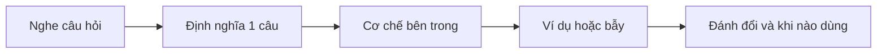

# Câu hỏi: Frontend senior

Bộ 56 câu hỏi phỏng vấn Senior Frontend không phụ thuộc framework. Mỗi câu đi theo chuỗi: câu hỏi tình huống, **gợi ý suy luận**, **lập luận** nhân quả, **đáp án ngắn** (đủ để nói trong khoảng một phút), điều cần **nhớ**, và một **câu đào sâu** mà người phỏng vấn hay hỏi tiếp. Kiến thức nền nằm ở năm bài lý thuyết: [Bài 1](/go?p=11-Frontend-Core%2Flt-01-javascript-runtime-event-loop.md), [Bài 2](/go?p=11-Frontend-Core%2Flt-02-typescript-nang-cao.md), [Bài 3](/go?p=11-Frontend-Core%2Flt-03-web-performance-core-web-vitals.md), [Bài 4](/go?p=11-Frontend-Core%2Flt-04-bao-mat-frontend.md), [Bài 5](/go?p=11-Frontend-Core%2Flt-05-kien-truc-frontend.md).

**Tóm tắt:**

- File gồm 56 câu Senior Frontend chia sáu nhóm: JavaScript, TypeScript, trình duyệt và hiệu năng, bảo mật, kiến trúc, tình huống thực tế.
- JavaScript xoay quanh event loop (task, microtask, render), `this` do cách gọi quyết định, prototype, closure gây rò rỉ memory, và các bẫy của `async/await`.
- TypeScript xoay quanh narrowing, discriminated union, generic và mapped type, cùng cách bật `strict` dần cho codebase cũ.
- Trình duyệt và hiệu năng gồm critical rendering path, Core Web Vitals (LCP, INP, CLS), layout thrashing và đo bằng dữ liệu người dùng thật thay vì lab.
- Bảo mật gồm XSS, CSRF, CSP, CORS và supply chain; ẩn UI không phải authorization, và CORS không bảo vệ server.
- Hay bị hỏi xoáy: thứ tự chạy của microtask và task, vì sao `forEach(async ...)` không chờ, INP khác FID thế nào, và khi nào micro-frontend là đáng đánh đổi.

## Bộ câu hỏi này dùng để làm gì?

Đây là ngân hàng câu hỏi chia thành sáu nhóm: JavaScript, TypeScript, trình duyệt và hiệu năng, bảo mật, kiến trúc, và tình huống thực tế. Mục đích không phải học thuộc đáp án: hãy đọc câu hỏi và gợi ý, tự suy ra lập luận, rồi mới đối chiếu và luyện câu đào sâu. Nhờ vậy bạn diễn đạt mạch lạc những gì đã hiểu ở năm bài lý thuyết.

## Người phỏng vấn senior thực sự đánh giá điều gì

Với vị trí senior, họ ít quan tâm bạn thuộc bao nhiêu API. Họ đánh giá ba thứ: bạn có **giải thích được cơ chế** (vì sao chuyện đó xảy ra), có **nêu được đánh đổi** (khi nào dùng, khi nào không), và có **chẩn đoán có hệ thống** (đo gì, theo thứ tự nào) khi gặp một tình huống mơ hồ như "trang chậm". Một câu trả lời chỉ có tên kỹ thuật mà không có lý do thường bị hỏi vặn ngay câu sau, đó chính là câu đào sâu.

## Cách ôn hiệu quả

Hãy ôn trong một đến hai tuần trước buổi phỏng vấn, sau khi đã đọc các bài lý thuyết (nếu chưa hiểu cơ chế mà đọc đáp án, bạn chỉ nhớ được câu chữ). Với mỗi câu: tự trả lời thành tiếng trước, rồi mới so với lập luận và đáp án ngắn, sau đó luyện thêm câu đào sâu. Khi trả lời, luôn đi theo trình tự sau: định nghĩa một câu, cơ chế bên trong, ví dụ hoặc bẫy, và cuối cùng là đánh đổi cùng thời điểm nên dùng.

Đọc sơ đồ: đây là khung bốn bước để mọi câu trả lời đều đủ ý. Nếu bị hỏi tiếp, bạn thường chỉ cần đào sâu thêm ở bước "cơ chế" hoặc "đánh đổi".

Ghi chú về thuật ngữ trong phần đáp án: vì mỗi đáp án ngắn được viết gọn, các từ như microtask, narrowing, discriminated union, preflight, nonce, hydration, idempotent hay strangler được giải thích ở bài lý thuyết tương ứng (xem các liên kết ở đầu trang). Nếu gặp từ nào chưa rõ, hãy quay lại bài đó trước khi luyện câu hỏi.

Ghi chú: các con số ngưỡng Core Web Vitals trong bộ này là LCP <= 2,5 s, INP <= 200 ms, CLS <= 0,1 ở phân vị 75 (web.dev). INP đã thay FID.

---

## Nhóm 1: JavaScript

**1. Đoạn code có `setTimeout(f, 0)` và `Promise.resolve().then(g)`. Vì sao `g` luôn chạy trước `f`?**

**Phải thuộc:** Câu này là câu cốt lõi, gặp rất thường xuyên.

**Gợi ý suy luận:**
- JavaScript có mấy thread chạy mã? Việc chờ được xếp ở đâu?
- Sau khi một task kết thúc, trình duyệt làm gì trước khi lấy task kế?
- `setTimeout` và `Promise.then` đẩy callback vào queue nào?

**Lập luận:** vì chỉ có một thread chạy call stack, mọi callback phải xếp hàng. `setTimeout` đưa `f` vào task queue, còn `then` đưa `g` vào microtask queue. Mỗi vòng lặp lấy một task, và sau khi task xong, engine chạy **hết** microtask rồi mới render và sang task kế. Nên `g` xong trước khi `f` được lấy ra.

**Đáp án ngắn:** event loop lấy một task, chạy xong thì làm sạch microtask queue (Promise, `queueMicrotask`), sau đó mới render và sang task tiếp. Vì vậy `Promise.then` luôn chạy trước `setTimeout(0)`.

**Nhớ:** task, microtask, render theo thứ tự đó trong mỗi vòng. Xem [Bài 1](/go?p=11-Frontend-Core%2Flt-01-javascript-runtime-event-loop.md).

**Đào sâu:** nếu microtask tự đẩy microtask mới vô hạn thì sao? Vì microtask queue phải rỗng mới thoát, nên task và render không bao giờ tới: UI đứng.

**2. Muốn animation mượt, vì sao nên dùng `requestAnimationFrame` thay `setTimeout`? Nó chạy ở thời điểm nào?**

**Gợi ý suy luận:**
- Màn hình làm mới theo tần số nào, và công việc hình ảnh nên hoàn tất lúc nào trong khung hình?
- `setTimeout` có biết khi nào khung hình tiếp theo bắt đầu không?
- Tab nền có cần vẽ không?

**Lập luận:** vì hình ảnh chỉ đổi khi trình duyệt vẽ một khung, cập nhật tốt nhất là ngay trước bước style, layout, paint của khung kế. `setTimeout` chạy theo đồng hồ riêng nên trôi lệch so với khung hình và chạy cả khi tab nền. `requestAnimationFrame` được trình duyệt gọi đúng lúc đó và dừng ở tab nền.

**Đáp án ngắn:** callback chạy ngay trước style, layout, paint của khung kế, sync với tần số quét màn hình. Nó dừng ở tab nền và không trôi lệch như `setTimeout`.

**Nhớ:** rAF gắn với chu trình render. Xem [Bài 1](/go?p=11-Frontend-Core%2Flt-01-javascript-runtime-event-loop.md).

**Đào sâu:** vì rAF gắn với render, câu kế là vì sao đọc `offsetHeight` rồi ghi style trong vòng lặp gây chậm? Vì mỗi lần đọc buộc trình duyệt tính layout sync (forced reflow).

**3. Một listener giữ lại cả mảng dữ liệu lớn dù không còn dùng. Closure gây rò rỉ memory thế nào?**

**Gợi ý suy luận:**
- Closure giữ cái gì ngoài hàm?
- Garbage collector chỉ thu hồi object nào?
- Nơi nào (listener, timer, cache) giữ closure sống lâu?

**Lập luận:** closure là hàm kèm môi trường từ vựng nơi nó được tạo, nên mọi biến được tham chiếu sống chừng nào closure còn sống. GC chỉ thu hồi thứ không còn đường tham chiếu tới. Nếu listener, timer hoặc cache còn giữ closure, object lớn bị giữ theo dù không dùng nữa: rò rỉ.

**Đáp án ngắn:** closure giữ biến của phạm vi ngoài; rò rỉ khi closure còn sống (listener, timer, cache) mà kéo theo object lớn không cần. Gỡ listener, clear timer, thu hẹp phạm vi biến.

**Nhớ:** sống lâu = còn được tham chiếu. Xem [Bài 1](/go?p=11-Frontend-Core%2Flt-01-javascript-runtime-event-loop.md).

**Đào sâu:** làm sao thấy được rò rỉ? So sánh heap snapshot trước và sau, tìm Detached DOM và object tăng.

**4. Truyền `obj.method` làm callback thì `this` bị mất. `this` được xác định thế nào?**

**Phải thuộc:** Câu này là câu cốt lõi, gặp rất thường xuyên.

**Gợi ý suy luận:**
- `this` được gán lúc định nghĩa hàm hay lúc gọi?
- `obj.m()` và `const f = obj.m; f()` khác nhau ở chỗ nào của lời gọi?
- Arrow function có `this` riêng không?

**Lập luận:** vì `this` do **cách gọi** quyết định, `obj.m()` cho `this` là `obj`, còn tách hàm ra gọi trần thì không còn object bên trái dấu chấm: strict mode cho `undefined`. Callback bị gọi bởi nơi khác nên mất `this`. Arrow function không có `this` riêng mà lấy từ phạm vi bao ngoài lúc định nghĩa, nên giải quyết được; hoặc dùng `bind`.

**Đáp án ngắn:** `this` do cách gọi quyết định: `obj.m()` là `obj`, hàm trần ở strict mode là `undefined`, `new` tạo object mới, `call/apply/bind` chỉ định tường minh. Arrow function lấy `this` từ phạm vi bao ngoài.

**Nhớ:** this là property của lời gọi, trừ arrow function. Xem [Bài 1](/go?p=11-Frontend-Core%2Flt-01-javascript-runtime-event-loop.md).

**Đào sâu:** sửa mất `this` bằng cách nào? Bọc arrow function, hoặc `bind` ở nơi truyền.

**5. Hai instance của một `class` dùng chung method ở đâu, và ghi property lên instance có sửa method không?**

**Gợi ý suy luận:**
- Khi đọc `obj.x` mà `obj` không có `x`, engine tìm ở đâu tiếp?
- Method được lưu một bản hay mỗi instance một bản?
- Ghi `obj.x = 1` tạo ở đâu?

**Lập luận:** mỗi object có `[[Prototype]]` và tra cứu đi dọc chuỗi này. `class` chỉ là cú pháp trên prototype: method nằm ở `Class.prototype` nên mọi instance dùng chung một bản. Ghi property luôn tạo trên chính instance, nên nó **che** prototype chứ không sửa prototype.

**Đáp án ngắn:** method nằm ở `Class.prototype` và chia sẻ; tra cứu đi dọc chuỗi prototype; ghi lên instance chỉ che chứ không sửa prototype.

**Nhớ:** class là đường tắt cho prototype. Xem [Bài 1](/go?p=11-Frontend-Core%2Flt-01-javascript-runtime-event-loop.md).

**Đào sâu:** vì tra cứu đi qua prototype, khi dùng object làm từ điển sẽ dính property kế thừa. `Object.create(null)` tạo object không có prototype để tránh điều đó.

**6. Vì sao thư viện phát hành ESM thì bundle nhỏ hơn bản CommonJS?**

**Gợi ý suy luận:**
- Bundler biết thứ được import ở lúc build hay lúc chạy?
- `require` có thể nằm trong `if` không? `import` thì sao?
- Nếu không biết chắc phần nào dùng, bundler có dám bỏ không?

**Lập luận:** ESM có `import/export` cố định ở đầu file nên phân tích **tĩnh** được: bundler biết hàm nào không ai dùng và bỏ đi (tree shaking). CJS nạp sync lúc chạy và `require` có thể động, nên bundler không dám bỏ gì. Vì vậy ESM cho bundle nhỏ hơn.

**Đáp án ngắn:** ESM phân tích tĩnh, binding sống, nạp async, hỗ trợ top-level await; CJS nạp lúc chạy và sao chép giá trị. Phân tích tĩnh cho phép tree shaking. Thư viện nên phát hành ESM và khai đúng `exports`, `sideEffects`.

**Nhớ:** tĩnh = bỏ được code chết. Xem [Bài 1](/go?p=11-Frontend-Core%2Flt-01-javascript-runtime-event-loop.md).

**Đào sâu:** nếu ESM hỗ trợ binding sống thì circular dependency biểu hiện thế nào? Module đọc giá trị chưa khởi tạo, gặp lỗi TDZ.

**7. Code dùng `async/await` mà lỗi không bắt được, hoặc chạy chậm bất thường. Những bẫy nào hay gặp?**

**Phải thuộc:** Câu này là câu cốt lõi, gặp rất thường xuyên.

**Gợi ý suy luận:**
- `try/catch` chỉ bắt lỗi của đoạn nào đang chạy sync trong nó?
- `forEach` có biết đợi Promise trả về không?
- Hai việc độc lập mà `await` lần lượt thì tổng thời gian là gì?

**Lập luận:** `await` mới làm `try/catch` bắt được lỗi async; quên `await` thì lỗi thoát ra ngoài. `forEach` bỏ qua giá trị trả về, nên `forEach(async ...)` không chờ. Việc độc lập mà đợi tuần tự thì thời gian cộng dồn, nên dùng `Promise.all`. `fetch` chỉ reject khi lỗi mạng, không reject với 4xx/5xx, và Promise không hủy được nên dùng `AbortController`.

**Đáp án ngắn:** quên `await` làm lỗi thoát khỏi `try/catch`; `forEach(async ...)` không chờ; `await` tuần tự cho việc độc lập làm chậm; `fetch` không reject với 4xx/5xx; hủy dùng `AbortController`.

**Nhớ:** async chỉ đúng khi mỗi Promise được await hoặc xử lý. Xem [Bài 1](/go?p=11-Frontend-Core%2Flt-01-javascript-runtime-event-loop.md).

**Đào sâu:** khi gom nhiều Promise, `Promise.all` lỗi nhanh khi một cái lỗi, `allSettled` chờ tất cả, `race` lấy cái xong đầu tiên, `any` lấy cái thành công đầu tiên.

**8. Người dùng gõ tìm kiếm liên tục, kết quả cũ hiện đè lên kết quả mới. Xử lý thế nào?**

**Phải thuộc:** Câu này là câu cốt lõi, gặp rất thường xuyên.

**Gợi ý suy luận:**
- Các request trả về theo thứ tự gửi không?
- Làm sao nói với trình duyệt bỏ request không còn cần?
- Có cách giảm số request ngay từ lúc gõ không?

**Lập luận:** mạng không đảm bảo thứ tự trả về, nên request cũ có thể về sau request mới và ghi đè. Vậy phải loại kết quả cũ: hủy request cũ bằng `AbortController` hoặc gắn id và bỏ kết quả không phải mới nhất. Debounce giảm số request từ gốc.

**Đáp án ngắn:** hủy request cũ bằng `AbortController` (hoặc bỏ kết quả có id cũ), kết hợp debounce. Thư viện cache truy vấn xử lý sẵn phần này.

**Nhớ:** race condition = thứ tự trả về khác thứ tự gửi. Xem [Bài 1](/go?p=11-Frontend-Core%2Flt-01-javascript-runtime-event-loop.md).

**Đào sâu:** debounce chờ người dùng ngừng gõ rồi mới gọi; throttle rate limiting (ví dụ mỗi 200 ms). Debounce hợp với tìm kiếm, throttle hợp với scroll.

**9. Một tác vụ parse JSON lớn làm UI đứng. Khi nào dùng Web Worker và chi phí là gì?**

**Gợi ý suy luận:**
- Tác vụ CPU nặng chạy trên thread nào làm UI đứng?
- Worker có chia sẻ memory và DOM với main thread không?
- Dữ liệu đi qua lại bằng cách nào, và tốn gì?

**Lập luận:** vì UI và JS chung một main thread, tác vụ CPU nặng chặn input và render (INP kém). Đưa việc đó sang Worker giải phóng main thread. Đổi lại Worker không chạm DOM, tốn khởi tạo, và dữ liệu phải sao chép qua structured clone (giảm bằng Transferable).

**Đáp án ngắn:** dùng cho tác vụ CPU nặng kéo dài để main thread rảnh. Chi phí: khởi tạo, sao chép dữ liệu, không truy cập DOM.

**Nhớ:** Worker đổi memory lấy sự parallel. Xem [Bài 1](/go?p=11-Frontend-Core%2Flt-01-javascript-runtime-event-loop.md).

**Đào sâu:** Service Worker khác Dedicated Worker thế nào? Service Worker đứng giữa trang và mạng (cache, offline), sống độc lập với trang; Dedicated Worker thuộc một trang và dùng để tính toán.

**10. Tab SPA dùng vài giờ thì chậm dần. Những nguyên nhân rò rỉ memory phổ biến?**

**Gợi ý suy luận:**
- Thứ gì còn được tham chiếu từ nơi sống lâu (window, store, timer) thì không bị thu?
- Khi view bị hủy mà ta không gỡ gì, điều gì vẫn còn?
- Cache toàn cục không giới hạn thì tăng thế nào?

**Lập luận:** GC chỉ thu hồi thứ không còn tham chiếu. Listener và timer không gỡ, subscription không hủy, cache tăng vô hạn và DOM bị tách còn được giữ đều tạo đường tham chiếu từ nơi sống lâu, nên memory chỉ tăng. Cách xử lý là cắt đường tham chiếu khi view hủy.

**Đáp án ngắn:** listener, timer, subscription không gỡ khi hủy view; cache vô hạn; DOM bị tách còn được tham chiếu. Gỡ bằng `AbortController`, dùng `WeakMap`/LRU, cleanup khi unmount.

**Nhớ:** rò rỉ = tham chiếu thừa. Xem [Bài 1](/go?p=11-Frontend-Core%2Flt-01-javascript-runtime-event-loop.md).

**Đào sâu:** có thể dùng `WeakRef` và `FinalizationRegistry` để tự dọn không? Không nên dựa vào, vì thời điểm GC không xác định.

---

## Nhóm 2: TypeScript

**11. Vì sao `res.json()` nên gán vào `unknown` chứ không phải `any`? Hai kiểu khác nhau thế nào?**

**Phải thuộc:** Câu này là câu cốt lõi, gặp rất thường xuyên.

**Gợi ý suy luận:**
- Dữ liệu từ ngoài có thể sai hình dạng không?
- Kiểu nào cho phép dùng giá trị mà không cần kiểm tra?
- Cái gì buộc người viết kiểm tra trước khi dùng?

**Lập luận:** dữ liệu ngoài không đáng tin, nên cần ép người dùng kiểm tra trước khi dùng. `any` tắt kiểm tra và lan sang các kiểu khác, nên lỗi lọt qua. `unknown` nhận mọi giá trị nhưng buộc narrowing, nên lỗi hình dạng bị chặn ở compiler.

**Đáp án ngắn:** `any` tắt kiểm tra và lan; `unknown` nhận mọi thứ nhưng phải narrowing trước khi dùng. Dữ liệu chưa biết (JSON, `catch`) nên là `unknown`, rồi validate.

**Nhớ:** unknown là any an toàn. Xem [Bài 2](/go?p=11-Frontend-Core%2Flt-02-typescript-nang-cao.md).

**Đào sâu:** gán `unknown` xong thì validate bằng gì? Bằng schema ở biên (xem câu 17).

**12. State tải dữ liệu mô hình bằng ba boolean (`loading`, `error`, `data`) cho phép state vô lý. Discriminated union giải quyết thế nào?**

**Gợi ý suy luận:**
- Ba boolean có bao nhiêu tổ hợp, bao nhiêu hợp lệ?
- Làm sao để compiler biết trường nào tồn tại khi `status` là giá trị nào?
- Thêm state mới thì ai nhắc bạn sửa chỗ xử lý?

**Lập luận:** ba boolean cho 8 tổ hợp mà chỉ vài cái hợp lệ, nên vừa loading vừa error là có thể. Union các kiểu có chung trường literal (`status`) cho mỗi state một hình dạng riêng, và compiler narrowing theo trường đó, nên state phi lý không biểu diễn được. Thêm kiểm tra `never` ở nhánh cuối thì thêm biến thể mới sẽ báo lỗi.

**Đáp án ngắn:** union các kiểu có chung trường literal phân biệt; compiler narrowing theo trường đó và loại bỏ state phi lý. Kiểm tra `never` bắt biến thể quên xử lý.

**Nhớ:** làm state bất hợp lệ không biểu diễn được. Xem [Bài 2](/go?p=11-Frontend-Core%2Flt-02-typescript-nang-cao.md).

**Đào sâu:** so với nhiều boolean, union thể hiện đúng các state loại trừ nhau và đi kèm dữ liệu riêng của từng state.

**13. Khi khai báo bảng config, chú thích kiểu làm mất kiểu hẹp, `as` thì có thể nói dối. Vì sao `satisfies` tốt hơn?**

**Gợi ý suy luận:**
- Chú thích `const x: T = ...` làm kiểu của `x` thành gì?
- `as T` có kiểm tra giá trị khớp T không?
- Muốn vừa kiểm tra khớp vừa giữ kiểu cụ thể thì cần gì?

**Lập luận:** chú thích kiểu nới giá trị về kiểu khai báo nên mất thông tin cụ thể. `as` chỉ khẳng định, không kiểm tra, nên có thể sai mà compiler im. `satisfies` kiểm tra giá trị khớp kiểu nhưng giữ kiểu hẹp đã suy ra, nên được cả hai điều.

**Đáp án ngắn:** `satisfies` kiểm tra khớp nhưng giữ kiểu hẹp; chú thích kiểu nới giá trị; `as` khẳng định không kiểm tra. Dùng cho config, bảng tra cứu.

**Nhớ:** satisfies = kiểm tra mà không nới. Xem [Bài 2](/go?p=11-Frontend-Core%2Flt-02-typescript-nang-cao.md).

**Đào sâu:** để có tập giá trị hẹp từ object, `as const` có thay `enum` không? Trong nhiều trường hợp có, vì cho kiểu literal mà không sinh code runtime.

**14. Hàm `getProp(obj, key)` cần kiểu trả về đúng theo key. Vì sao dùng `K extends keyof T`?**

**Gợi ý suy luận:**
- Nếu `key` là chuỗi bất kỳ, `obj[key]` có an toàn không?
- Làm sao nói với compiler rằng K chỉ là key có thật của T?
- Kiểu trả về sẽ viết thế nào để phụ thuộc K?

**Lập luận:** nếu `key` là chuỗi bất kỳ thì có thể không tồn tại trong `obj`. Ràng buộc `K extends keyof T` giới hạn K trong tập khóa hợp lệ, nên `T[K]` luôn xác định và trả về kiểu chính xác của property đó. Ràng buộc cũng cho compiler biết tập thao tác an toàn trên tham số kiểu.

**Đáp án ngắn:** để K phải là khóa hợp lệ của T, nhờ đó kiểu trả về `T[K]` chính xác (như `pick`, `getProp`).

**Nhớ:** ràng buộc generic = contract cho compiler. Xem [Bài 2](/go?p=11-Frontend-Core%2Flt-02-typescript-nang-cao.md).

**Đào sâu:** dấu hiệu một tham số kiểu thừa là gì? Nó chỉ xuất hiện một lần, nên không liên kết gì với kiểu khác.

**15. `Exclude<'a'|'b'|'c', 'a'>` ra `'b'|'c'` chứ không phải một kết quả duy nhất. Conditional type "phân phối" nghĩa là gì?**

**Gợi ý suy luận:**
- `T extends U ? X : Y` được tính cho cả union hay từng thành viên?
- Khi nào hành vi này bật và khi nào tắt?
- Kết quả của từng thành viên được gộp lại thế nào?

**Lập luận:** khi tham số kiểu trần xuất hiện bên trái `extends` và T là union, TS tách union và tính điều kiện cho từng thành viên rồi hợp kết quả. Vì vậy `Exclude` loại đúng phần tử khớp. Bọc `[T] extends [U]` làm T không còn trần nên tắt hành vi này.

**Đáp án ngắn:** với T là tham số kiểu trần và là union, kết quả tính cho từng thành viên rồi hợp lại. Tắt bằng `[T] extends [U]`.

**Nhớ:** phân phối khi T trần. Xem [Bài 2](/go?p=11-Frontend-Core%2Flt-02-typescript-nang-cao.md).

**Đào sâu:** viết `NonNullable<T>` và `ReturnType<F>` bằng `infer` để kiểm chứng cơ chế phân phối và trích kiểu.

**16. Muốn kiểu cho route `/users/${number}` và sinh kiểu event `onClick` từ `click`. Công cụ nào của TS làm được?**

**Gợi ý suy luận:**
- Làm sao duyệt mọi key của một kiểu và đổi từng cái?
- Làm sao ghép kiểu chuỗi từ các mảnh?
- Có hàm biến đổi chữ hoa/thường ở mức kiểu không?

**Lập luận:** để biến đổi từng key cần mapped type (`Partial`, `Readonly`, đổi tên key bằng `as`). Để ghép kiểu chuỗi cần template literal type, ví dụ `on${Capitalize<K>}`. Hai thứ kết hợp cho kiểu event và route có cấu trúc.

**Đáp án ngắn:** mapped type biến đổi từng key; template literal type tạo kiểu chuỗi có cấu trúc. Hữu ích cho API event và route có kiểu.

**Nhớ:** mapped = duyệt key, template = ghép chuỗi kiểu. Xem [Bài 2](/go?p=11-Frontend-Core%2Flt-02-typescript-nang-cao.md).

**Đào sâu:** rủi ro của kiểu đệ quy sâu? Làm chậm trình biên dịch và chạm giới hạn độ sâu.

**17. API đã có kiểu TS đầy đủ mà vẫn crash vì thiếu trường. Vì sao kiểu không đủ tin dữ liệu?**

**Gợi ý suy luận:**
- Kiểu TS tồn tại ở lúc biên dịch hay lúc chạy?
- Ai bảo đảm server trả đúng hình dạng?
- Làm sao có kiểm tra lúc chạy mà không viết hai lần kiểu và schema?

**Lập luận:** kiểu bị xóa khi biên dịch, nên lúc chạy không có gì kiểm tra dữ liệu thật; server có thể trả sai hình dạng. Vậy phải kiểm tra ở biên bằng schema (Zod hoặc tương đương), và suy ra kiểu từ schema để có một nguồn duy nhất. Phần còn lại tin kiểu đã validate.

**Đáp án ngắn:** kiểu bị xóa lúc chạy nên không bảo vệ dữ liệu thật. Validate ở biên bằng schema và suy ra kiểu từ schema.

**Nhớ:** TS kiểm tra lúc build, không lúc chạy. Xem [Bài 2](/go?p=11-Frontend-Core%2Flt-02-typescript-nang-cao.md).

**Đào sâu:** sinh kiểu từ OpenAPI có thay validate runtime không? Không, vì nó vẫn chỉ cho kiểu lúc build, server vẫn có thể sai.

**18. Bạn cấu hình `tsconfig` thế nào để bắt lỗi sớm trong dự án nghiêm túc?**

**Gợi ý suy luận:**
- Những lỗi phổ biến nào (null, truy cập index ngoài biên) cần được compiler bắt?
- Bundler như esbuild hay SWC có kiểm tra kiểu không?
- Cờ nào giúp mỗi file được biên dịch độc lập?

**Lập luận:** để compiler bắt nhiều lỗi nhất, bật `strict`, thêm `noUncheckedIndexedAccess` (truy cập index có thể `undefined`), cân nhắc `exactOptionalPropertyTypes`, `noImplicitOverride`. Vì bundler thường chỉ xóa kiểu, không kiểm tra, nên CI phải chạy `tsc --noEmit`. Dùng esbuild hoặc SWC thì cần `isolatedModules` và `verbatimModuleSyntax`.

**Đáp án ngắn:** bật `strict` kèm `noUncheckedIndexedAccess`, cân nhắc các cờ nghiêm hơn, và chạy `tsc --noEmit` ở CI.

**Nhớ:** bundler xóa kiểu, không kiểm tra kiểu. Xem [Bài 2](/go?p=11-Frontend-Core%2Flt-02-typescript-nang-cao.md).

**Đào sâu:** vì sao `noUncheckedIndexedAccess` không nằm trong `strict`? Vì gây nhiều thay đổi, là tùy chọn bổ sung.

---

## Nhóm 3: Trình duyệt và hiệu năng

**19. Vì sao một thẻ `<script>` đặt giữa `<head>` làm trang trắng lâu? Mô tả critical rendering path.**

**Gợi ý suy luận:**
- Trình duyệt biến HTML và CSS thành những cấu trúc nào trước khi vẽ?
- Script sync có thể sửa DOM và CSSOM, vậy parser phải làm gì khi gặp nó?
- Attribute nào cho phép script không chặn?

**Lập luận:** HTML thành DOM, CSS thành CSSOM, hợp thành render tree, rồi layout, paint, composite. Vì CSS cần có trước khi vẽ nên CSS chặn render. Script sync có thể sửa DOM, nên parser phải dừng chạy nó, và nó lại phải chờ CSS trước nó. Do đó trang trắng lâu; `defer`, `async`, `module` cho script chạy mà không chặn parser.

**Đáp án ngắn:** DOM + CSSOM tạo render tree rồi layout, paint, composite. CSS chặn render, script sync chặn parser; dùng `defer`, `async` hoặc `module` để giảm chặn.

**Nhớ:** tài nguyên chặn render nằm trên đường tới khung hình đầu. Xem [Bài 3](/go?p=11-Frontend-Core%2Flt-03-web-performance-core-web-vitals.md).

**Đào sâu:** `async` khác `defer` ở đâu? `async` chạy ngay khi tải xong, không giữ thứ tự; `defer` chạy sau khi parse xong, giữ thứ tự.

**20. Người ta nói "trang nhanh" thì đo bằng gì? Nêu ba Core Web Vitals và ngưỡng.**

**Phải thuộc:** Câu này là câu cốt lõi, gặp rất thường xuyên.

**Gợi ý suy luận:**
- Người dùng cảm nhận ba điều nào: thấy nội dung, bấm có phản hồi, bố cục có nhảy không?
- Nên đánh giá trên trung bình hay trên phần lớn người dùng?
- Mobile và desktop có chung ngưỡng được không?

**Lập luận:** ba cảm nhận tương ứng ba chỉ số: LCP (tải), INP (phản hồi), CLS (ổn định bố cục). Để không bị vài người dùng tốt che phần người dùng tệ, đánh giá ở phân vị 75, tách mobile và desktop. Ngưỡng tốt: LCP <= 2,5 s, INP <= 200 ms, CLS <= 0,1, và cả ba đạt mới coi là đạt.

**Đáp án ngắn:** LCP <= 2,5 s, INP <= 200 ms, CLS <= 0,1 ở phân vị 75, tách mobile và desktop.

**Nhớ:** mỗi chỉ số ứng với một cảm nhận. Xem [Bài 3](/go?p=11-Frontend-Core%2Flt-03-web-performance-core-web-vitals.md).

**Đào sâu:** vì sao INP thay FID? FID chỉ đo độ trễ đầu vào của tương tác đầu tiên, INP đo mọi tương tác suốt phiên.

**21. LCP của trang là 4 giây. Bạn bắt đầu từ đâu?**

**Gợi ý suy luận:**
- Từ lúc gõ URL tới khi phần tử lớn nhất hiện ra gồm những chặng nào?
- Phần tử LCP thường là gì, và trình duyệt phát hiện nó sớm hay muộn?
- Chặng nào lớn nhất thì sửa chặng đó.

**Lập luận:** vì LCP là tổng nhiều chặng, đo từng chặng trước: TTFB, độ trễ bắt đầu tải, thời gian tải, độ trễ render. Chặng lớn nhất quyết định cách sửa. Thường ảnh LCP bị phát hiện muộn hoặc tải chậm, nên đưa ảnh vào HTML với `fetchpriority="high"`, không lazy-load, nén ảnh hiện đại, dùng CDN và SSR.

**Đáp án ngắn:** tách LCP thành bốn chặng rồi xử lý chặng lớn nhất; thường là ảnh LCP có trong HTML với `fetchpriority="high"`, không lazy-load, nén tốt, CDN, SSR.

**Nhớ:** đo chặng trước khi sửa. Xem [Bài 3](/go?p=11-Frontend-Core%2Flt-03-web-performance-core-web-vitals.md).

**Đào sâu:** vì sao ảnh nền CSS hay làm LCP chậm? Trình duyệt chỉ phát hiện nó sau khi tải và phân tích CSS, tức là muộn.

**22. Người dùng bấm nút mà UI đơ nửa giây. Cải thiện INP thế nào, và vì sao Lighthouse không đo được INP?**

**Gợi ý suy luận:**
- Từ lúc bấm tới lúc thấy kết quả có những chặng nào?
- Cái gì khiến main thread bận lúc đó?
- Lighthouse có bấm vào trang không?

**Lập luận:** INP gồm input delay, processing, presentation delay. Cả ba tăng khi main thread bận bởi long task, nên giải pháp là chia nhỏ việc và nhường main thread, đưa việc nặng sang Worker, giảm phạm vi render lại, ảo hóa danh sách, giảm DOM. Vì Lighthouse chạy lab không có tương tác thật nên không có INP, và dùng TBT làm chỉ báo thay thế.

**Đáp án ngắn:** giảm long task, chia việc, dùng Worker, giảm render lại, ảo hóa danh sách. Lighthouse không có tương tác người dùng nên dùng TBT thay thế trong lab.

**Nhớ:** INP xấu = main thread bận lúc tương tác. Xem [Bài 3](/go?p=11-Frontend-Core%2Flt-03-web-performance-core-web-vitals.md).

**Đào sâu:** tương tác nào được tính? Click, tap, phím; không tính scroll và hover.

**23. Nội dung nhảy xuống khi ảnh hoặc banner tải xong. Nguyên nhân CLS và cách sửa?**

**Gợi ý suy luận:**
- Trình duyệt dành bao nhiêu chỗ cho ảnh khi chưa biết kích thước?
- Còn thứ gì đổi kích thước sau khi vẽ (font, nội dung chèn)?
- Animation kiểu nào làm đổi layout?

**Lập luận:** CLS xảy ra khi phần tử đổi vị trí sau khi đã vẽ. Ảnh thiếu kích thước, nội dung chèn muộn, font đổi, animation đổi layout đều làm kích thước thực khác chỗ đã dành. Vậy sửa là dành chỗ trước: khai `width/height` hoặc `aspect-ratio`, chừa chỗ cho nội dung muộn, preload font và `size-adjust`, animation bằng `transform`.

**Đáp án ngắn:** do ảnh, iframe thiếu kích thước, nội dung chèn muộn, font đổi, animation đổi layout. Khai kích thước trước, chừa chỗ, tối ưu font, dùng `transform`.

**Nhớ:** CLS = dành chỗ trước. Xem [Bài 3](/go?p=11-Frontend-Core%2Flt-03-web-performance-core-web-vitals.md).

**Đào sâu:** dịch chuyển do người dùng khởi tạo có tính không? Không, nếu xảy ra trong khoảng ngắn sau input.

**24. Khi nào dùng `preload`, `prefetch`, `preconnect`?**

**Gợi ý suy luận:**
- Tài nguyên cần cho trang hiện tại hay cho điều hướng sau?
- Nếu chỉ biết sắp gọi một origin nhưng chưa biết URL, bạn làm trước được gì?
- Cái gì xảy ra nếu đánh dấu quá nhiều thứ là ưu tiên cao?

**Lập luận:** ba kỹ thuật khác nhau ở mức độ biết trước. Biết chắc cần ngay cho trang này thì preload, ưu tiên cao. Chỉ có khả năng cần ở trang sau thì prefetch, ưu tiên thấp, lúc rảnh. Chỉ biết origin thì preconnect, mở sẵn kết nối. Vì băng thông có hạn, preload quá nhiều làm tranh nhau và chậm thứ thật cần.

**Đáp án ngắn:** preload cho tài nguyên cần ngay, prefetch cho điều hướng sau, preconnect mở sẵn kết nối tới origin sắp dùng. Lạm dụng preload gây tranh băng thông.

**Nhớ:** chọn theo mức độ chắc chắn sẽ cần. Xem [Bài 3](/go?p=11-Frontend-Core%2Flt-03-web-performance-core-web-vitals.md).

**Đào sâu:** vì sao preload font cần `crossorigin`? Vì font luôn được tải ở chế độ CORS, nên thiếu attribute này thì preload không khớp và font tải hai lần.

**25. Deploy bản mới mà người dùng vẫn thấy bản cũ, hoặc ngược lại cache quá ngắn. Chiến lược cache HTTP cho SPA?**

**Phải thuộc:** Câu này là câu cốt lõi, gặp rất thường xuyên.

**Gợi ý suy luận:**
- File có hash trong tên thì nội dung có bao giờ đổi không?
- HTML trỏ tới file nào, và nó phải luôn mới ra sao?
- Dữ liệu API riêng tư có được cache chung không?

**Lập luận:** file build có hash đổi tên khi đổi nội dung, nên cache rất dài và `immutable` là an toàn. HTML là cửa vào trỏ tới các hash, phải luôn mới nên `no-cache` (luôn xác thực lại). API tùy mức thay đổi, `stale-while-revalidate` cho dữ liệu chấp nhận hơi cũ, và dữ liệu riêng tư dùng `private`.

**Đáp án ngắn:** file hash: `max-age` dài kèm `immutable`; HTML: `no-cache`; API: tùy, có thể `stale-while-revalidate`; dữ liệu riêng tư: `private`.

**Nhớ:** hash trong tên file cho phép cache vĩnh viễn. Xem [Bài 3](/go?p=11-Frontend-Core%2Flt-03-web-performance-core-web-vitals.md).

**Đào sâu:** `no-cache` khác `no-store` thế nào? `no-cache` cho lưu nhưng phải xác thực lại; `no-store` không lưu.

**26. Bundle 3 MB, cắt giảm thế nào?**

**Gợi ý suy luận:**
- Làm sao biết thứ gì chiếm chỗ?
- Người dùng có cần tất cả code ngay ở trang đầu không?
- Code không dùng bị bỏ khi nào?

**Lập luận:** không đo thì không biết cắt đâu, nên chạy bundle analyzer trước. Không cần mọi thứ ở trang đầu nên chia code theo route và component nặng. Code chết bỏ được nhờ tree shaking (ESM, `sideEffects`). Còn lại thay thư viện nặng, import đường dẫn cụ thể, nén Brotli, và đặt ngân sách trong CI để không tăng lại.

**Đáp án ngắn:** analyzer, chia code theo route, tree shaking, thay thư viện nặng, import đường dẫn cụ thể, Brotli, ngân sách trong CI.

**Nhớ:** đo, chia, bỏ, giữ ngân sách. Xem [Bài 3](/go?p=11-Frontend-Core%2Flt-03-web-performance-core-web-vitals.md).

**Đào sâu:** vì sao barrel file làm tree shaking kém? Một `index` re-export tất cả khiến bundler khó chứng minh phần nào không dùng, nhất là khi có side effect.

**27. Lighthouse báo tốt nhưng CrUX báo xấu. Lab data và field data khác nhau thế nào?**

**Gợi ý suy luận:**
- Lab chạy trên cấu hình nào, mấy lần, có tương tác thật không?
- Người dùng thật có thiết bị, mạng, hành vi đa dạng thế nào?
- Dùng loại nào để phát hiện, loại nào để sửa?

**Lập luận:** lab là một cấu hình cố định, lặp lại được nên tốt cho gỡ lỗi nhưng không phản ánh thiết bị, mạng, tương tác thật. Field là người dùng thật nên là cơ sở đánh giá, nhưng khó tái hiện. Vì vậy dùng field để phát hiện, lab để tái hiện và sửa.

**Đáp án ngắn:** lab (Lighthouse, DevTools) lặp lại được để gỡ lỗi; field (CrUX, RUM) là người dùng thật và là cơ sở đánh giá. Field để phát hiện, lab để sửa.

**Nhớ:** field là sự thật, lab là công cụ. Xem [Bài 3](/go?p=11-Frontend-Core%2Flt-03-web-performance-core-web-vitals.md).

**Đào sâu:** lab tốt mà field xấu, nghi ngờ gì trước? Thiết bị yếu, mạng chậm, tương tác thật, script bên thứ ba.

**28. Một vòng lặp vừa đọc `offsetHeight` vừa ghi style khiến trang chậm. Layout thrashing là gì?**

**Gợi ý suy luận:**
- Trình duyệt thường gom thay đổi style rồi tính layout một lần. Đọc `offsetHeight` đòi hỏi gì?
- Nếu xen kẽ đọc và ghi N lần thì tính layout mấy lần?
- Sắp xếp lại thế nào để chỉ một lần?

**Lập luận:** ghi style làm layout lỗi thời, đọc layout property buộc trình duyệt tính lại sync để trả đúng giá trị. Xen kẽ N lần thì tính N lần. Vậy gom hết đọc trước rồi ghi, hoặc dời ghi vào `requestAnimationFrame`, thì chỉ tính một lần.

**Đáp án ngắn:** xen kẽ đọc layout property và ghi style buộc layout sync nhiều lần. Gom đọc trước rồi ghi, hoặc dùng `requestAnimationFrame`.

**Nhớ:** đọc layout sau khi ghi = ép tính layout. Xem [Bài 3](/go?p=11-Frontend-Core%2Flt-03-web-performance-core-web-vitals.md).

**Đào sâu:** để tránh layout hoàn toàn khi animation, dùng property chỉ cần composite: `transform`, `opacity`.

---

## Nhóm 4: Bảo mật

**29. Người dùng nhập `<script>` vào ô bình luận và nó chạy trên trang người khác. Ba loại XSS và cách chặn?**

**Phải thuộc:** Câu này là câu cốt lõi, gặp rất thường xuyên.

**Gợi ý suy luận:**
- Dữ liệu không tin cậy đi từ đâu tới đâu (DB, URL, DOM)?
- Trình duyệt chạy chuỗi như mã khi nào?
- Lớp phòng thủ chính và lớp phụ là gì?

**Lập luận:** XSS xảy ra khi dữ liệu không tin cậy bị trình duyệt hiểu là mã. Nguồn có ba kiểu: stored (lưu trong DB), reflected (phản chiếu từ request), DOM-based (client tự ghi nguồn không tin cậy vào sink). Gốc rễ là đầu ra không được xử lý theo ngữ cảnh, nên chặn bằng escape theo ngữ cảnh, tránh `innerHTML` với dữ liệu người dùng, sanitize khi cần HTML, và thêm CSP làm lớp phụ.

**Đáp án ngắn:** stored, reflected, DOM-based. Chặn bằng escape theo ngữ cảnh đầu ra, tránh `innerHTML`, sanitize khi cần HTML, kèm CSP.

**Nhớ:** XSS = dữ liệu thành mã; chặn ở đầu ra. Xem [Bài 4](/go?p=11-Frontend-Core%2Flt-04-bao-mat-frontend.md).

**Đào sâu:** framework đã tự escape, còn đường nào dính XSS? `v-html`, `dangerouslySetInnerHTML`, `href` với `javascript:`.

**30. Nếu có XSS lọt qua, làm sao hạn chế thiệt hại? CSP hoạt động ra sao?**

**Phải thuộc:** Câu này là câu cốt lõi, gặp rất thường xuyên.

**Gợi ý suy luận:**
- Trình duyệt có cách biết script nào là hợp lệ không?
- Script inline do kẻ tấn công chèn khác script của bạn ở điểm nào?
- Bật CSP chặt ngay có rủi ro gì cho trang đang chạy?

**Lập luận:** CSP là header nói với trình duyệt nguồn nào được chạy hoặc tải. Script chèn vào không có nonce hoặc hash hợp lệ nên bị chặn, miễn là không cho `unsafe-inline` và `unsafe-eval` (hai cái này mở lại cửa). Bật chặt ngay có thể làm hỏng trang đang chạy, nên deploy qua Report-Only, đọc báo cáo, rồi siết.

**Đáp án ngắn:** header cho trình duyệt biết nguồn nào được chạy. Dùng nonce hoặc hash cho script inline, tránh `unsafe-inline`, `unsafe-eval`, deploy qua Report-Only trước.

**Nhớ:** CSP là lớp phụ, không thay escape. Xem [Bài 4](/go?p=11-Frontend-Core%2Flt-04-bao-mat-frontend.md).

**Đào sâu:** nonce phải thế nào để an toàn? Ngẫu nhiên và mới mỗi response, nếu không kẻ tấn công đoán và dùng lại được.

**31. Trang lạ gửi form tới ngân hàng của bạn kèm cookie đăng nhập. SameSite giải quyết CSRF tới đâu?**

**Phải thuộc:** Câu này là câu cốt lõi, gặp rất thường xuyên.

**Gợi ý suy luận:**
- Trình duyệt tự gắn cookie vào request tới một site bất kể request xuất phát từ đâu. CSRF lợi dụng điều gì?
- Nếu cookie chỉ gửi khi request cùng site thì chuyện gì xảy ra?
- Còn trường hợp nào phải cho cookie đi cross-site?

**Lập luận:** CSRF dựa vào việc cookie được tự gửi kèm request cross-site. `SameSite=Lax` hoặc `Strict` cấm gửi cookie trong các request đó, nên chặn phần lớn CSRF. Nhưng với `SameSite=None` hoặc thao tác nhạy cảm cần thêm lớp bảo vệ, và nên khai tường minh vì mặc định khác nhau giữa trình duyệt.

**Đáp án ngắn:** `Lax` và `Strict` chặn gửi cookie ở request cross-site, loại phần lớn CSRF. Với thao tác nhạy cảm hoặc `SameSite=None` cần thêm CSRF token hoặc kiểm tra `Origin`.

**Nhớ:** SameSite chặn cookie cross-site, không thay token. Xem [Bài 4](/go?p=11-Frontend-Core%2Flt-04-bao-mat-frontend.md).

**Đào sâu:** vì sao "same-site" khác "same-origin"? Same-site chỉ so miền đăng ký (eTLD+1), bỏ qua cổng và subdomain; same-origin so cả giao thức, host, cổng.

**32. Dev backend nói "đã bật CORS nên server an toàn". Có đúng không? CORS là gì?**

**Phải thuộc:** Câu này là câu cốt lõi, gặp rất thường xuyên.

**Gợi ý suy luận:**
- Ai thực thi CORS: trình duyệt hay server?
- `curl` gọi server có bị chặn không?
- CORS chặn việc gửi request hay việc đọc response?

**Lập luận:** same-origin policy ngăn JS trang A đọc response từ origin B. CORS nới lỏng nó và do **trình duyệt** thực thi. Vì thực thi ở trình duyệt, `curl` hay server khác gọi tự do, nên CORS không bảo vệ server. Nó chặn việc JS đọc response, không chặn request tới server.

**Đáp án ngắn:** cơ chế nới lỏng same-origin policy do trình duyệt thực thi cho JS đọc response từ origin khác. Không bảo vệ server.

**Nhớ:** CORS bảo vệ người dùng khỏi trang độc, không bảo vệ server. Xem [Bài 4](/go?p=11-Frontend-Core%2Flt-04-bao-mat-frontend.md).

**Đào sâu:** preflight xảy ra khi nào, và vì sao không dùng `*` với credentials? Request không đơn giản gửi OPTIONS trước; còn `*` với credentials bị cấm vì cho mọi origin dùng thông tin đăng nhập của người dùng.

**33. Lưu token ở cookie HttpOnly hay localStorage?**

**Phải thuộc:** Câu này là câu cốt lõi, gặp rất thường xuyên.

**Gợi ý suy luận:**
- JS của trang đọc được thứ nào, thứ nào không? Nếu có XSS thì sao?
- Trình duyệt tự gửi thứ nào kèm request? Điều đó dẫn đến rủi ro nào?
- Mỗi lựa chọn cần biện pháp bổ sung nào?

**Lập luận:** HttpOnly cookie JS không đọc được nên XSS không lấy cắp được token, nhưng cookie tự gửi nên cần chống CSRF (SameSite, token). localStorage thì JS đọc được nên XSS lấy được token, nhưng nó không tự gửi nên không dính CSRF. Cân nhắc hai rủi ro, thường chọn cookie `HttpOnly; Secure; SameSite` cho phiên web và token truy cập sống ngắn.

**Đáp án ngắn:** thường chọn cookie `HttpOnly; Secure; SameSite` cho phiên web, vì XSS không đọc được; cần chống CSRF. localStorage dễ bị XSS lấy token.

**Nhớ:** HttpOnly chống đọc trộm, SameSite chống gửi nhầm. Xem [Bài 4](/go?p=11-Frontend-Core%2Flt-04-bao-mat-frontend.md).

**Đào sâu:** XSS còn làm được gì dù token HttpOnly? Gọi API thay người dùng ngay trong trình duyệt của họ.

**34. Một trang giả đặt trang của bạn trong iframe trong suốt để lừa click. Chống thế nào?**

**Gợi ý suy luận:**
- Ai quyết định trang có được nhúng không: trang nhúng hay trang bị nhúng?
- Header hay meta là nơi trình duyệt đọc chính sách này?
- JS "frame-busting" có chạy đáng tin khi kẻ tấn công kiểm soát khung chứa không?

**Lập luận:** trang bị nhúng phải tự tuyên bố ai được nhúng nó. Chính sách này do trình duyệt thực thi qua header `Content-Security-Policy: frame-ancestors` (kèm `X-Frame-Options` cho trình duyệt cũ), và không có hiệu lực ở thẻ meta. Frame-busting bằng JS có thể bị chặn bởi khung chứa nên không đáng tin.

**Đáp án ngắn:** dùng header `frame-ancestors` (kèm `X-Frame-Options`), đặt ở header chứ không ở thẻ meta.

**Nhớ:** clickjacking chống bằng header của trang bị nhúng. Xem [Bài 4](/go?p=11-Frontend-Core%2Flt-04-bao-mat-frontend.md).

**Đào sâu:** frame-busting bằng JS có đáng tin không? Không, vì có thể bị vô hiệu bằng property `sandbox` của iframe.

**35. Một gói npm phụ thuộc bị chèn mã độc. Bảo vệ chuỗi cung ứng thế nào?**

**Gợi ý suy luận:**
- Mã bạn chạy lúc cài và lúc build đến từ đâu?
- Làm sao đảm bảo mọi máy cài đúng cùng phiên bản?
- Tên gói giống tên nội bộ hay gần giống tên phổ biến thì rủi ro gì?

**Lập luận:** vì bạn chạy mã của hàng trăm gói không tự viết, phải giảm bề mặt và kiểm soát phiên bản. Khóa lockfile và dùng `npm ci` để mọi nơi cài đúng bản đã duyệt. Quét lỗ hổng (audit, Dependabot, Renovate), xem gói mới và `postinstall`. Dùng scope và registry riêng chống dependency confusion, SRI cho script CDN tĩnh, giảm số dependency.

**Đáp án ngắn:** lockfile và `npm ci`, quét lỗ hổng, xem xét gói mới và `postinstall`, scope và registry riêng, SRI cho CDN, giảm dependency.

**Nhớ:** kiểm soát phiên bản và giảm bề mặt tin cậy. Xem [Bài 4](/go?p=11-Frontend-Core%2Flt-04-bao-mat-frontend.md).

**Đào sâu:** typosquatting và dependency confusion khác nhau ở đâu? Typosquatting dùng tên gần giống gói phổ biến; dependency confusion dùng tên trùng gói nội bộ ở registry công khai với phiên bản cao hơn.

**36. Có nên để API key trong biến môi trường của bundle FE? Dữ liệu nào không được để ở client?**

**Gợi ý suy luận:**
- Ai tải được bundle của bạn?
- Biến môi trường có tiền tố công khai thì có thực sự bí mật không?
- Ẩn nút khỏi UI có chặn được người dùng gọi API không?

**Lập luận:** bundle được gửi cho mọi người, nên mọi thứ trong đó (kể cả biến có tiền tố công khai) coi như công khai. Vậy secret riêng tư (API key, mật khẩu) không được nằm ở client. Token và PII cũng không được rò qua URL, console, analytics, Sentry. Ẩn UI chỉ là trải nghiệm, authorization phải ở server.

**Đáp án ngắn:** secret riêng tư không được ở client vì mọi thứ trong bundle là công khai; không ghi token và PII vào URL, console, analytics, Sentry. Ẩn UI không phải authorization.

**Nhớ:** client là môi trường không tin cậy. Xem [Bài 4](/go?p=11-Frontend-Core%2Flt-04-bao-mat-frontend.md).

**Đào sâu:** source map công khai có rủi ro gì? Lộ mã nguồn gốc, giúp kẻ tấn công đọc logic và tìm lỗi dễ hơn.

---

## Nhóm 5: Kiến trúc

**37. Cùng một dữ liệu danh sách xuất hiện ở store, component và URL, rồi lệch nhau. Bạn phân loại state thế nào để tránh?**

**Gợi ý suy luận:**
- Dữ liệu này thuộc về ai: server, một component, hay cả trang?
- Có bản sao nào có thể tính ra từ bản gốc không?
- Người dùng có cần chia sẻ hoặc tải lại trang mà giữ nguyên state không?

**Lập luận:** lệch xảy ra vì một dữ liệu có nhiều nơi sở hữu. Nên mỗi loại state nên có một nơi: UI cục bộ, state dùng chung cục bộ, server state, state toàn cục, state trong URL, form state, state bền vững. Server state có lifecycle riêng (cache, làm mới) nên dùng thư viện cache truy vấn thay vì chép vào store. Chỉ lưu dữ liệu gốc và tính phần suy diễn, nên không có bản sao để lệch.

**Đáp án ngắn:** phân theo nguồn sở hữu và lifecycle. Server state dùng thư viện cache truy vấn thay vì chép vào store; chỉ lưu dữ liệu gốc, tính phần suy diễn.

**Nhớ:** một dữ liệu, một chủ sở hữu. Xem [Bài 5](/go?p=11-Frontend-Core%2Flt-05-kien-truc-frontend.md).

**Đào sâu:** vì sao state filter nên nằm trong URL? Để chia sẻ link, tải lại và nút back giữ nguyên filter.

**38. Team mới vào sửa một tính năng mà phải chạm năm thư mục khác nhau. Feature-based structure khắc phục thế nào, đánh đổi gì?**

**Gợi ý suy luận:**
- Khi chia theo loại kỹ thuật (components, hooks, api), một thay đổi nghiệp vụ nằm ở đâu?
- Nếu gom mọi thứ của một tính năng vào một chỗ thì ai được import vào nó?
- Điều gì ngăn các tính năng quấn vào nhau?

**Lập luận:** chia theo loại kỹ thuật rải một thay đổi ra nhiều nơi. Chia theo tính năng gom UI, API, logic, kiểu vào một thư mục và chỉ lộ public interface qua `index`, nên sửa một chỗ, dễ giao team, dễ xóa. Nhưng ranh giới chỉ giữ được khi có quy ước cho phần dùng chung và lint chặn import chéo.

**Đáp án ngắn:** chia thư mục theo tính năng, mỗi tính năng gom đủ lớp và chỉ lộ `index`. Ưu: sửa một chỗ, dễ giao team, dễ xóa. Nhược: cần quy ước phần dùng chung và lint ép ranh giới.

**Nhớ:** gom theo lý do thay đổi. Xem [Bài 5](/go?p=11-Frontend-Core%2Flt-05-kien-truc-frontend.md).

**Đào sâu:** làm sao ngăn feature import chéo? Dùng lint (ví dụ quy tắc ràng buộc import) và chỉ cho import qua `index`.

**39. Nhiều request cùng nhận 401 lúc token hết hạn và cùng gọi làm mới token. Thiết kế lớp gọi API thế nào?**

**Gợi ý suy luận:**
- Những việc nào lặp lại ở mọi lời gọi (authentication, lỗi, hủy, timeout)?
- Nếu 10 request cùng lỗi 401 thì có nên làm mới 10 lần?
- Làm sao cho các request đang chờ dùng chung một lần làm mới?

**Lập luận:** vì việc lặp lại ở mọi lời gọi nên gom vào một client tập trung: gắn authentication, chuẩn hóa lỗi, hủy, timeout, retry có chọn lọc, validate response. Với 401 concurrent, làm mới nhiều lần gây bão request và có thể vô hiệu token. Nên chia sẻ một promise làm mới: request đầu tạo, các request sau chờ cùng promise rồi thử lại.

**Đáp án ngắn:** một client tập trung lo authentication, lỗi, hủy, timeout, retry, validate. Xử lý 401 một lần duy nhất bằng cách chia sẻ một promise làm mới token.

**Nhớ:** tập trung cross-cutting concerns, dùng chung một lần làm mới. Xem [Bài 5](/go?p=11-Frontend-Core%2Flt-05-kien-truc-frontend.md).

**Đào sâu:** retry có an toàn cho POST không? Chỉ khi thao tác idempotent, ví dụ dùng idempotency key; nếu không có thể tạo trùng.

**40. Người dùng thấy trang trắng vì một component ném lỗi. Xử lý lỗi ở UI phân tầng ra sao?**

**Gợi ý suy luận:**
- Lỗi mạng, lỗi nghiệp vụ, lỗi quyền, lỗi lập trình khác nhau ở điểm nào về cách người dùng nên phản ứng?
- Lỗi trong render khác lỗi trong event handler ra sao?
- Lỗi bất ngờ nên được gửi đi đâu?

**Lập luận:** mỗi loại lỗi cần phản ứng khác: lỗi mạng và 5xx thì thử lại hoặc báo tạm thời; 4xx nghiệp vụ thì hiện thông điệp cụ thể; 401/403 thì xử lý phiên và quyền. Lỗi bất ngờ trong render thì error boundary theo vùng giữ phần còn lại của trang sống và gửi lên công cụ giám sát.

**Đáp án ngắn:** phân tầng theo loại lỗi (mạng/5xx, 4xx nghiệp vụ, 401/403, bất ngờ), error boundary theo vùng, gửi lỗi bất ngờ lên giám sát.

**Nhớ:** phản ứng theo loại lỗi, cô lập theo vùng. Xem [Bài 5](/go?p=11-Frontend-Core%2Flt-05-kien-truc-frontend.md).

**Đào sâu:** error boundary bắt loại lỗi nào, không bắt loại nào? Bắt lỗi trong render; không bắt lỗi trong event handler và async không do render.

**41. Team đã có design system nhưng các team khác vẫn tự viết button. Design system cần gì để được dùng?**

**Gợi ý suy luận:**
- Dùng design system dễ hơn hay khó hơn tự viết?
- Ai trả lời khi component có lỗi hoặc thiếu tính năng?
- Làm sao thay đổi mà không phá team đang dùng?

**Lập luận:** team chọn thứ ít ma sát nhất. Nên cần primitive có sẵn a11y, token nhất quán, tài liệu sống (Storybook) để dùng nhanh, versioning rõ để nâng cấp an toàn, quy trình đóng góp và đội sở hữu để có người chịu trách nhiệm. Thiếu một trong các thứ này, dùng khó hơn tự viết thì team sẽ rẽ nhánh.

**Đáp án ngắn:** token, primitive có sẵn a11y, tài liệu sống, versioning rõ, quy trình đóng góp và đội sở hữu. Nếu khó dùng hơn tự viết thì sẽ bị rẽ nhánh.

**Nhớ:** design system là sản phẩm có người dùng nội bộ. Xem [Bài 5](/go?p=11-Frontend-Core%2Flt-05-kien-truc-frontend.md).

**Đào sâu:** chọn headless component hay component có kiểu dáng sẵn? Headless linh hoạt kiểu dáng nhưng tốn công; có kiểu sẵn nhanh nhưng khó tùy biến.

**42. Công ty gom mười repo thành monorepo và kỳ vọng mọi thứ tự tốt lên. Monorepo giải quyết gì và không giải quyết gì?**

**Gợi ý suy luận:**
- Ở nhiều repo, đổi một gói dùng chung phải làm mấy PR?
- Gom code lại có tự ngăn gói A import bừa gói B không?
- Build toàn bộ mỗi lần có nhanh không?

**Lập luận:** đặt chung một repo giúp chia sẻ code, sync công cụ và đổi xuyên gói trong một PR. Nhưng gom lại không tự tạo ranh giới, và build chạy toàn bộ sẽ chậm dần. Nên cần quy tắc phụ thuộc, `CODEOWNERS`, cache và build theo phần bị ảnh hưởng.

**Đáp án ngắn:** giải quyết chia sẻ code, sync công cụ, thay đổi xuyên gói trong một PR; không tự giải quyết ranh giới phụ thuộc và tốc độ build, cần quy tắc, `CODEOWNERS`, cache và build theo phần ảnh hưởng.

**Nhớ:** monorepo là công cụ chia sẻ, kỷ luật vẫn phải tự có. Xem [Bài 5](/go?p=11-Frontend-Core%2Flt-05-kien-truc-frontend.md).

**Đào sâu:** pnpm workspaces, Nx, Turborepo khác nhau ở mức nhận định: pnpm lo quản lý gói, Nx và Turborepo thêm đồ thị tác vụ và cache build.

**43. Sếp đề nghị chia FE thành micro-frontend cho "hiện đại". Khi nào nên, khi nào không?**

**Gợi ý suy luận:**
- Vấn đề nó giải quyết là gì: tổ chức hay kỹ thuật?
- Mỗi micro-frontend có tải lại thư viện riêng, có chung state và authentication không?
- Một team nhỏ có cần deploy độc lập không?

**Lập luận:** micro-frontend giải quyết vấn đề tổ chức: nhiều team lớn cần deploy độc lập, hoặc nâng cấp dần ứng dụng cũ. Cái giá là tải trùng thư viện, trải nghiệm kém nhất quán, khó chia sẻ state và authentication, kiểm thử tích hợp phức tạp. Một team không có vấn đề tổ chức đó, nên monorepo kèm module thường đủ.

**Đáp án ngắn:** dùng khi nhiều team lớn cần deploy độc lập hoặc cần nâng cấp dần app cũ; đánh đổi là tải trùng, trải nghiệm kém nhất quán, khó chia sẻ state, kiểm thử tích hợp. Một team thì monorepo thường đủ.

**Nhớ:** micro-frontend đổi độ đơn giản lấy độc lập deploy. Xem [Bài 5](/go?p=11-Frontend-Core%2Flt-05-kien-truc-frontend.md).

**Đào sâu:** Module Federation giải quyết gì và tạo thêm rủi ro gì? Chia sẻ module lúc chạy giữa các bản build; rủi ro là lệch phiên bản chia sẻ và lỗi chỉ lộ lúc chạy.

**44. Code review gặp `
` làm nút. Accessibility bạn kiểm tra gì?**

**Gợi ý suy luận:**
- Người dùng chỉ bằng bàn phím hoặc trình đọc màn hình tương tác thế nào?
- `div` có được hiểu là nút không, có nhận focus không?
- ARIA nên dùng khi nào?

**Lập luận:** `div` không có ngữ nghĩa nút, không nhận focus, không bấm bằng Enter hay Space, nên người dùng bàn phím và trình đọc màn hình không dùng được. Vì vậy ưu tiên HTML ngữ nghĩa (`button`), rồi kiểm tra thao tác bàn phím, focus nhìn thấy và quản lý focus ở dialog, label cho input, `alt` có nghĩa, tương phản, `aria-live` cho thông báo động. ARIA chỉ dùng khi HTML không đủ; axe bắt phần tự động.

**Đáp án ngắn:** HTML ngữ nghĩa, bàn phím, focus, label, `alt`, tương phản, `aria-live`; ARIA chỉ khi HTML không đủ; dùng axe cho phần tự động.

**Nhớ:** ngữ nghĩa trước, ARIA sau. Xem [Bài 5](/go?p=11-Frontend-Core%2Flt-05-kien-truc-frontend.md).

**Đào sâu:** vì sao `div` có `onClick` là vấn đề? Nó không có role, không focus, không kích hoạt bằng bàn phím, nên phải tự thêm tất cả những gì `button` có sẵn.

**45. Màn hình có câu "Bạn có 1 tin nhắn" ghép bằng phép cộng, sang tiếng khác thì sai ngữ pháp. i18n làm đúng thế nào?**

**Gợi ý suy luận:**
- Thứ tự từ và dạng số nhiều có giống nhau ở mọi ngôn ngữ không?
- Ngày, số, tiền có định dạng chung không?
- Thời gian nên lưu ở múi giờ nào?

**Lập luận:** vì mỗi ngôn ngữ có thứ tự từ và quy tắc số nhiều riêng, ghép chuỗi bằng phép cộng gắn cứng ngữ pháp của một ngôn ngữ. Nên tách chuỗi, dùng thông điệp có tham số và quy tắc số nhiều, dùng `Intl` cho ngày, số, tiền, lưu thời gian UTC, hỗ trợ RTL bằng CSS logical property, tải bản dịch theo route.

**Đáp án ngắn:** tách chuỗi, thông điệp có tham số và số nhiều, dùng `Intl`, lưu UTC, CSS logical property cho RTL, tải bản dịch theo route.

**Nhớ:** không nối chuỗi, để thư viện lo ngữ pháp. Xem [Bài 5](/go?p=11-Frontend-Core%2Flt-05-kien-truc-frontend.md).

**Đào sâu:** vì sao không ghép chuỗi bằng phép cộng? Vì thứ tự từ và số nhiều khác giữa các ngôn ngữ, nên một công thức cộng không dịch được.

---

## Nhóm 6: Tình huống thực tế

**46. Sếp báo "trang chậm". Bạn làm gì đầu tiên?**

**Phải thuộc:** Câu này là câu cốt lõi, gặp rất thường xuyên.

**Gợi ý suy luận:**
- "Chậm" ở đâu, với ai, lúc nào?
- Dữ liệu nào cho biết chỉ số nào kém trên người dùng thật?
- Làm sao tái hiện và biết sửa chỗ nào lớn nhất?

**Lập luận:** vì "chậm" mơ hồ, trước hết phải định vị: dùng dữ liệu field (RUM, CrUX) để biết chỉ số nào kém và nhóm thiết bị nào. Tái hiện bằng lab với throttling. Rồi phân tích theo đoạn (TTFB, tài nguyên chặn, long task, layout), sửa phần lớn nhất, đo lại và đặt ngân sách để không quay lại.

**Đáp án ngắn:** định vị bằng dữ liệu field, tái hiện bằng lab, phân tích theo đoạn, sửa phần lớn nhất, đo lại, đặt ngân sách.

**Nhớ:** đo trước, sửa sau, giữ ngân sách. Xem [Bài 3](/go?p=11-Frontend-Core%2Flt-03-web-performance-core-web-vitals.md).

**Đào sâu:** "chậm" lúc tải đầu hay lúc tương tác? Tải đầu thì nhìn LCP, TTFB, bundle; tương tác thì nhìn INP, long task, render lại.

**47. Bundle quá lớn, bạn xử lý ra sao?**

**Gợi ý suy luận:**
- Làm sao biết thủ phạm?
- Người dùng cần mọi thứ ở trang đầu không?
- Làm sao giữ nó không phình lại?

**Lập luận:** chạy bundle analyzer để tìm thủ phạm (thư viện lớn, dependency lặp, locale, polyfill). Rồi chia theo route, lazy load phần nặng, thay hoặc bỏ thư viện, sửa tree shaking. Cuối cùng thêm `size-limit` vào CI để chặn tăng lại.

**Đáp án ngắn:** analyzer, chia theo route, lazy load, thay thư viện, sửa tree shaking, `size-limit` trong CI.

**Nhớ:** đo, cắt, canh gác. Xem [Bài 3](/go?p=11-Frontend-Core%2Flt-03-web-performance-core-web-vitals.md).

**Đào sâu:** làm sao biết một thư viện có tree-shake được không? Xem nó phát hành ESM, khai `sideEffects`, và kiểm bằng analyzer sau khi import một hàm.

**48. "Lỗi chỉ xảy ra trên production". Điều tra thế nào?**

**Gợi ý suy luận:**
- Production khác máy bạn ở những điểm nào?
- Stack trace của code đã minify có đọc được không?
- Có thể tái hiện bằng build giống production không?

**Lập luận:** production khác local ở minify, biến môi trường, cache, CDN, flag, dữ liệu thật, phiên bản trình duyệt. Nên xem Sentry (số lần, release, trình duyệt, breadcrumb) và dùng source map để thấy stack gốc, đối chiếu khác biệt, rồi tái hiện bằng build production cục bộ.

**Đáp án ngắn:** xem Sentry và source map, so sánh khác biệt môi trường, tái hiện bằng build production cục bộ.

**Nhớ:** tìm điểm khác biệt giữa môi trường. Xem [Bài 5](/go?p=11-Frontend-Core%2Flt-05-kien-truc-frontend.md).

**Đào sâu:** source map quản lý thế nào để không lộ mã nguồn? Tải lên Sentry và không phục vụ công khai.

**49. Người dùng báo "bấm nút mà không phản hồi".**

**Gợi ý suy luận:**
- Có thứ gì chặn main thread lúc bấm?
- Handler có chạy không, có ném lỗi bị nuốt không?
- Request có đang treo mà UI không cho dấu hiệu?

**Lập luận:** phản hồi gồm bấm, chạy handler, gọi mạng, cập nhật UI; hỏng ở khâu nào thì nghi khâu đó. Long task chặn main thread (INP), handler ném lỗi bị nuốt, request treo không có loading, hoặc phần tử khác che nút. Kiểm tra bằng DevTools Performance, console, tab Network; sửa bằng phản hồi tức thì và vô hiệu hóa nút khi đang gửi.

**Đáp án ngắn:** nghi long task, lỗi bị nuốt, request treo không loading, phần tử che nút. Kiểm bằng Performance, console, Network; thêm phản hồi tức thì và khóa nút khi gửi.

**Nhớ:** chia chuỗi bấm tới hiển thị thành khâu, định vị khâu hỏng. Xem [Bài 3](/go?p=11-Frontend-Core%2Flt-03-web-performance-core-web-vitals.md).

**Đào sâu:** chống bấm đúp gửi trùng thế nào? Client khóa nút khi đang gửi; server dùng idempotency key để chặn trùng.

**50. Màn hình nháy, layout nhảy khi tải.**

**Gợi ý suy luận:**
- Hiện tượng này tương ứng chỉ số nào?
- Công cụ nào chỉ ra phần tử gây dịch chuyển?
- Thường do thứ gì chưa có kích thước lúc vẽ lần đầu?

**Lập luận:** layout nhảy là CLS. Dùng DevTools (Layout Shift Regions, track Experience) để chỉ ra phần tử gây dịch chuyển. Nguyên nhân thường là ảnh thiếu kích thước, font swap, nội dung chèn muộn, nên sửa bằng kích thước khai sẵn, chừa chỗ và tối ưu font.

**Đáp án ngắn:** đó là CLS; tìm phần tử gây dịch chuyển bằng DevTools; sửa bằng khai kích thước, chừa chỗ, tối ưu font.

**Nhớ:** CLS sửa bằng dành chỗ trước. Xem [Bài 3](/go?p=11-Frontend-Core%2Flt-03-web-performance-core-web-vitals.md).

**Đào sâu:** skeleton có giúp CLS không? Có, nếu cùng kích thước với nội dung thật.

**51. Ứng dụng ngốn RAM, tab chậm dần sau vài giờ.**

**Gợi ý suy luận:**
- Triệu chứng chậm dần theo thời gian gợi ý điều gì về memory?
- So sánh hai thời điểm cho biết gì?
- Những đường tham chiếu thừa thường nằm ở đâu?

**Lập luận:** chậm dần theo thời gian là dấu hiệu rò rỉ: memory chỉ tăng mà GC không thu được. Chụp heap snapshot ở hai thời điểm và so sánh để thấy object tăng và Detached DOM, rồi truy ngược tới listener, timer, subscription, cache không giới hạn. Sửa bằng cleanup đúng và giới hạn cache.

**Đáp án ngắn:** nghi rò rỉ; so sánh heap snapshot hai thời điểm, tìm Detached DOM và object tăng; sửa bằng cleanup và giới hạn cache.

**Nhớ:** rò rỉ = memory tăng không giảm. Xem [Bài 1](/go?p=11-Frontend-Core%2Flt-01-javascript-runtime-event-loop.md).

**Đào sâu:** vì sao đồ thị heap răng cưa đi lên là rò rỉ? Mỗi lần GC xuống nhưng đáy mỗi lần cao hơn, tức là phần không thu được tăng dần.

**52. Danh sách 10.000 dòng bị giật.**

**Gợi ý suy luận:**
- Trình duyệt phải tạo bao nhiêu phần tử DOM và layout bao nhiêu?
- Người dùng nhìn thấy bao nhiêu dòng cùng lúc?
- Một dòng đổi có cần render lại cả danh sách không?

**Lập luận:** nhiều DOM làm layout và render đắt. Người dùng chỉ thấy một phần nhỏ nên ảo hóa (chỉ render phần nhìn thấy) hoặc phân trang. Tránh render lại cả danh sách khi một dòng đổi, dùng `content-visibility`, dời xử lý nặng sang Worker; và đo trước bằng DevTools Performance.

**Đáp án ngắn:** ảo hóa hoặc phân trang, tránh render lại toàn bộ, `content-visibility`, Worker; đo trước bằng Performance.

**Nhớ:** chỉ làm việc cho thứ nhìn thấy. Xem [Bài 3](/go?p=11-Frontend-Core%2Flt-03-web-performance-core-web-vitals.md).

**Đào sâu:** ảo hóa làm hỏng điều gì? Tìm kiếm trong trang, a11y, chiều cao thay đổi.

**53. Phát hành tính năng lớn có rủi ro, làm thế nào?**

**Gợi ý suy luận:**
- Làm sao tách việc deploy mã khỏi việc bật tính năng?
- Nếu hỏng, tắt nhanh bằng cách nào?
- Làm sao biết tính năng đang tốt hay xấu?

**Lập luận:** nếu bật cho mọi người cùng lúc thì lỗi ảnh hưởng tất cả. Feature flag tách deploy khỏi bật: bật dần theo tỷ lệ, có kill switch để tắt tức thì, theo dõi lỗi và Web Vitals theo flag, kèm release rollback nhanh. Flag không dọn thành mã chết nên phải dọn sau khi ổn định.

**Đáp án ngắn:** feature flag bật dần theo tỷ lệ, có kill switch, theo dõi lỗi và Web Vitals theo flag, rollback nhanh, dọn flag sau.

**Nhớ:** tách deploy khỏi release. Xem [Bài 5](/go?p=11-Frontend-Core%2Flt-05-kien-truc-frontend.md).

**Đào sâu:** rủi ro của flag ở client? Người dùng đọc được giá trị flag nên không phải authorization.

**54. Sau deploy, một số người dùng thấy trang trắng hoặc lỗi tải chunk.**

**Gợi ý suy luận:**
- HTML cũ trỏ tới file hash nào?
- Bản mới đã xóa file cũ chưa?
- Người dùng giữ tab mở từ trước có thể gặp gì?

**Lập luận:** HTML cũ (cache hoặc tab mở lâu) trỏ tới file hash của bản trước; nếu deploy xóa file đó thì tải chunk lỗi, nên trang trắng. Vậy giữ file bản trước vài phiên bản, HTML `no-cache`, bắt lỗi tải chunk và tải lại có kiểm soát, báo lên Sentry.

**Đáp án ngắn:** HTML cũ trỏ tới chunk đã bị xóa. Giữ file vài bản trước, HTML `no-cache`, bắt lỗi chunk và tải lại có kiểm soát, báo Sentry.

**Nhớ:** deploy không được xóa file mà phiên cũ còn cần. Xem [Bài 3](/go?p=11-Frontend-Core%2Flt-03-web-performance-core-web-vitals.md).

**Đào sâu:** triển khai atomic cho tài nguyên tĩnh? Tải tài nguyên mới lên trước, rồi mới đổi HTML trỏ tới bản mới.

**55. Điểm Lighthouse cao nhưng người dùng phàn nàn chậm.**

**Gợi ý suy luận:**
- Lighthouse chạy trên thiết bị, mạng nào, có tương tác không?
- Người dùng thật có thiết bị và script bên thứ ba ra sao?
- Chỉ số nào Lighthouse không đo được?

**Lập luận:** Lighthouse là lab một cấu hình, không có tương tác nên không đo INP. Người dùng thật có thiết bị yếu hơn, mạng chậm hơn và script bên thứ ba. Nên xem dữ liệu field ở phân vị 75 theo thiết bị, kiểm tra tương tác thật và đo RUM.

**Đáp án ngắn:** Lighthouse là lab, không đo INP. Xem field ở phân vị 75 theo thiết bị, kiểm tra tương tác thật và third-party script, đo RUM.

**Nhớ:** điểm lab không bằng trải nghiệm thật. Xem [Bài 3](/go?p=11-Frontend-Core%2Flt-03-web-performance-core-web-vitals.md).

**Đào sâu:** vì sao tránh "chơi điểm" Lighthouse? Tối ưu cho điểm thay vì người dùng sẽ làm điểm đẹp mà trải nghiệm không đổi.

**56. Dẫn dắt nâng cấp dần codebase JS cũ lên TypeScript và công nghệ mới thế nào?**

**Gợi ý suy luận:**
- Viết lại một lần rủi ro gì?
- Làm sao đảm bảo hành vi không đổi khi sửa?
- Làm sao chuyển từng phần mà vẫn chạy?

**Lập luận:** viết lại cả một lần rủi ro cao, đóng băng tính năng và khó đo tiến độ. Nên chia nhỏ theo module (`allowJs`, `checkJs`, siết `strict` từng thư mục), khóa hành vi bằng test trước khi sửa, dùng mẫu strangler để thay từng phần, và đo tác động bằng chỉ số rõ ràng.

**Đáp án ngắn:** chia nhỏ theo module, siết `strict` dần, khóa hành vi bằng test, dùng strangler, đo tác động; tránh viết lại một lần.

**Nhớ:** thay dần, có test và chỉ số. Xem [Bài 2](/go?p=11-Frontend-Core%2Flt-02-typescript-nang-cao.md).

**Đào sâu:** thuyết phục team và quản lý thế nào? Trình bày bằng số liệu (lỗi, thời gian sửa), đề xuất bước nhỏ có thể đo.

---

Quay về [mục lục FE-Common](/go?p=11-Frontend-Core%2Findex.md).

