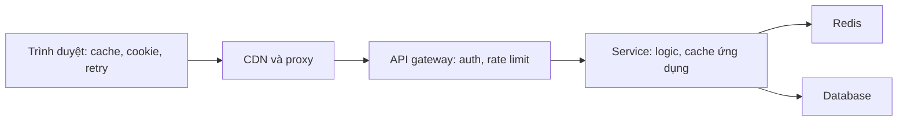
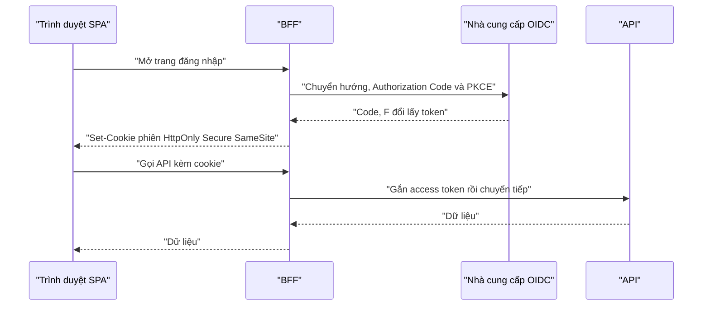
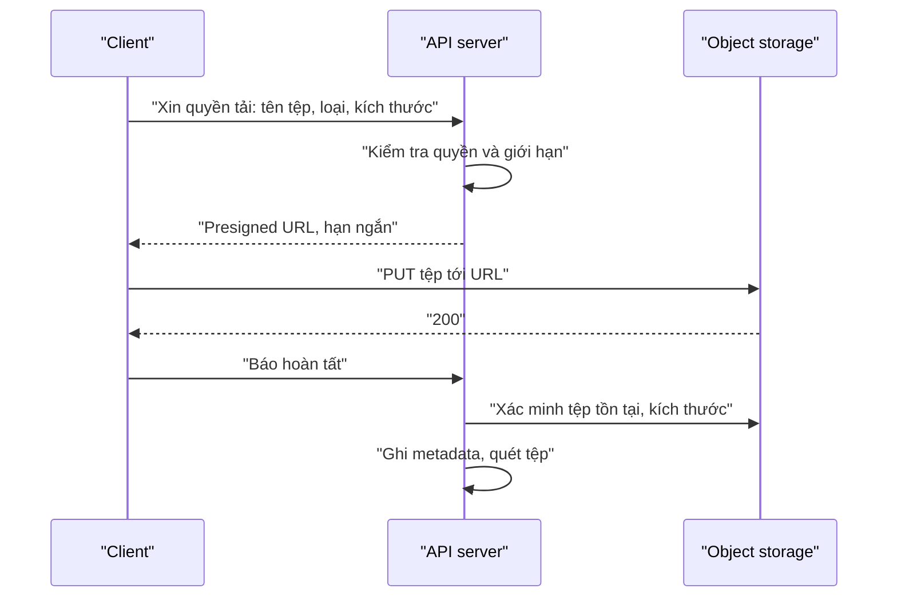

# Câu hỏi: Fullstack, nối frontend với backend

Bộ câu hỏi này dành cho vị trí Fullstack hoặc Frontend mid-senior, tập trung vào **chỗ nối** giữa trình duyệt và máy chủ: API contract, xác thực, cache, lỗi và quan sát. Hầu hết sự cố khó nằm ở đường nối này chứ không nằm riêng ở FE hay BE. Mỗi câu đi theo chuỗi: **Câu hỏi** theo tình huống, **Gợi ý suy luận** (các câu hỏi nhỏ dẫn tới khái niệm nền), **Lập luận** (chuỗi nhân quả "vì A nên B"), **Đáp án ngắn** nói được thành tiếng, **Nhớ** (kiến thức cốt lõi kèm link bài gốc), rồi **Ví dụ** khi cần. Mỗi câu có hai **Hỏi xoáy** mô phỏng đúng kiểu hỏi tiếp, kèm lý do đó là bước kế tiếp hợp lý.

Quy ước nhãn ví dụ:

- _Đã chạy thử bằng Node_: JavaScript thuần mô phỏng cơ chế, output là thật. Nó không phải server, trình duyệt hay thư viện thật.
- _Minh họa_: code, header, config hoặc sơ đồ theo đặc tả, chưa chạy trong môi trường này. Tên header, giá trị mặc định và hành vi trình duyệt kiểm tra lại theo phiên bản.

Bài gốc để đọc cùng. Frontend: [Kiến trúc frontend](/go?p=11-Frontend-Core%2Flt-05-kien-truc-frontend.md), [Bảo mật frontend](/go?p=11-Frontend-Core%2Flt-04-bao-mat-frontend.md), [Web performance](/go?p=11-Frontend-Core%2Flt-03-web-performance-core-web-vitals.md), [Routing, form, data (React)](/go?p=09-React%2Fmedium%2Flt-06-routing-forms-data.md). Backend: [REST API thực chiến](/go?p=01-Spring-Boot%2Fmedium%2Flt-33-rest-api-thuc-chien.md), [Spring Security và JWT](/go?p=01-Spring-Boot%2Fmedium%2Flt-06-spring-security-jwt.md), [OAuth2 và OIDC](/go?p=01-Spring-Boot%2Fmedium%2Flt-20-oauth2-oidc.md), [Distributed lock và idempotency](/go?p=01-Spring-Boot%2Fhard%2Flt-26-distributed-lock-idempotency.md), [Resilience](/go?p=01-Spring-Boot%2Fhard%2Flt-32-resilience-chiu-loi.md), [Observability](/go?p=01-Spring-Boot%2Fmedium%2Flt-19-observability.md), [JPA hiệu năng](/go?p=01-Spring-Boot%2Fhard%2Flt-34-jpa-hieu-nang-khoa-cache.md), [Index và tối ưu truy vấn](/go?p=02-Database%2Fmedium%2Flt-03-index-toi-uu-truy-van.md), [Cache pattern với Redis](/go?p=06-Distributed-Systems%2FRedis%2Fmedium%2Flt-03-cache-pattern-van-de-cache.md), [Xác thực phiên và token](/go?p=03-Network-Security%2Fmedium%2Flt-05-xac-thuc-phien-token.md), [HTTP chi tiết](/go?p=03-Network-Security%2Feasy%2Flt-02-http-chi-tiet.md), [Realtime và load balancer](/go?p=03-Network-Security%2Fhard%2Flt-06-http2-3-realtime-lb.md), [CI/CD](/go?p=04-DevOps%2Fmedium%2Flt-03-ci-cd.md). File QA liên quan: [Kiến trúc FE và system design](/go?p=07-Interview-QA%2FFrontend%2Fhard%2Fqa-fe-10-kien-truc-frontend-system-design.md), [FE phỏng vấn](/go?p=07-Interview-QA%2FFrontend%2Fhard%2Fqa-fe-phong-van.md).

Một request đi qua nhiều tầng, và mỗi tầng có cơ chế riêng cho cache, lỗi, authentication:



Đọc sơ đồ: khi trả lời, hãy chỉ ra bạn đang nói về tầng nào. Cùng một từ "cache" hay "retry" ở mỗi tầng có hậu quả khác nhau.

**Tóm tắt:**

- File gồm 13 câu về chỗ nối giữa trình duyệt và server: chọn REST, GraphQL hay tRPC, pagination, session và JWT, logout, CORS, presigned URL, realtime, cache, idempotency, retry, waterfall và N+1, đổi API không phá client, correlation id.
- Mỗi request đi qua nhiều tầng (trình duyệt, CDN, gateway, service, Redis, DB), mỗi tầng có cache, lỗi và authentication riêng, nên lỗi hay nằm ở ranh giới giữa các tầng.
- Cursor pagination ổn định hơn offset khi dữ liệu thay đổi, vì offset xác định trang bằng vị trí nên bản ghi chèn vào làm lặp hoặc mất mục.
- Token lưu ở `localStorage` lộ khi có XSS; ưu tiên cookie `HttpOnly` kèm `SameSite`, và nhớ logout phải thu hồi phía server.
- Thao tác tạo mới phải idempotent (idempotency key) trước khi bật retry, và retry cần backoff kèm jitter để không gây retry storm.
- Hay bị hỏi xoáy: `*` trong CORS với cookie, vì sao xóa cache một tầng vẫn thấy bản cũ, và thứ tự an toàn khi đổi contract (backend thêm trước, client chuyển sau, backend bỏ cuối).

## 1. Mobile cần ít trường, web cần nhiều trường, và ba màn hình phải gọi sáu endpoint. Chọn REST, GraphQL hay tRPC?

**Câu hỏi:** Đội đang dùng REST. Màn hình dashboard phải gọi sáu endpoint rồi tự ghép, mobile thì tải thừa dữ liệu. Có người đề xuất GraphQL, người khác đề xuất tRPC. Bạn chọn thế nào và dựa vào đâu?

**Gợi ý suy luận:**
- Vấn đề thật là over-fetching (thừa), under-fetching (thiếu, phải gọi nhiều lần), hay thiếu kiểu dữ liệu chung giữa FE và BE?
- Ai là bên dùng API: nhiều client khác ngôn ngữ, hay chỉ một FE TypeScript cùng repo?
- API công khai cần cache bằng CDN và dễ debug thì phương án nào thuận?

**Lập luận:** Vì REST gắn mỗi tài nguyên với một URL, nó tận dụng được cache HTTP, CDN và công cụ phổ biến, nhưng khi màn hình cần dữ liệu ghép thì dễ phải gọi nhiều lần hoặc nhận thừa. GraphQL cho client khai báo đúng trường cần trong một request, nên giải được thừa và thiếu, nhưng đổi lại là một endpoint POST khó cache bằng CDN, truy vấn tùy ý có thể nặng (cần giới hạn độ sâu và chi phí), và dễ sinh N+1 ở resolver. tRPC dùng kiểu TypeScript chia sẻ trực tiếp giữa FE và BE nên không cần viết schema, rất tiện cho một monorepo TypeScript, nhưng nó gắn chặt hai đầu và không phù hợp API công khai cho nhiều ngôn ngữ. Lựa chọn tùy bên dùng, không có cái nào "tốt hơn" tuyệt đối. Giải pháp trung gian cho dashboard là thêm một endpoint tổng hợp (BFF) phía server.

**Đáp án ngắn:** REST cho API công khai và cache dễ, GraphQL khi nhiều client cần hình dạng dữ liệu khác nhau và chấp nhận chi phí vận hành, tRPC khi FE và BE cùng TypeScript trong một repo. Trước khi đổi công nghệ, hãy thử một endpoint tổng hợp (BFF) cho màn hình nặng.

**Nhớ:** Công nghệ API phải theo bên tiêu thụ và nhu cầu cache. Gốc: [REST API thực chiến](/go?p=01-Spring-Boot%2Fmedium%2Flt-33-rest-api-thuc-chien.md), [API và microservices](/go?p=15-System%20Design%2Fmedium%2Flt-07-api-microservices.md).

**Ví dụ:** contract lỗi nhất quán, dùng cho mọi lựa chọn (theo dạng Problem Details, RFC 9457, kiểm tra lại theo phiên bản).

```json
{
  "type": "https://api.example.com/errors/validation",
  "title": "Dữ liệu không hợp lệ",
  "status": 422,
  "traceId": "4bf92f3577b34da6a3ce929d0e0e4736",
  "errors": [{ "field": "email", "code": "INVALID_FORMAT" }]
}
```

_Minh họa._ Mã lỗi (`code`) cho máy xử lý, `title` cho người đọc, `traceId` để lần log (xem câu 14).

**Hỏi xoáy 1:** GraphQL có giải quyết được N+1 không, hay chuyển nó sang chỗ khác?

**Vì sao hỏi tiếp:** Người hỏi muốn thấy bạn biết lợi ích ở FE có thể thành nợ ở BE.

**Gợi ý suy luận:** Mỗi trường lồng nhau có resolver riêng thì mỗi bản ghi cha gọi bao nhiêu lần xuống DB? Có cách gom không?

**Đáp:** GraphQL chuyển nguy cơ N+1 vào resolver: mỗi bản ghi cha có thể kích hoạt một truy vấn cho trường con. Giải bằng DataLoader (gom và cache theo lô trong một request) hoặc join ở tầng dữ liệu. Xem câu 11.

**Hỏi xoáy 2:** API contract có nên sinh kiểu TypeScript tự động không, và từ đâu?

**Vì sao hỏi tiếp:** Contract chỉ có giá trị nếu hai bên không lệch nhau âm thầm.

**Gợi ý suy luận:** Nguồn sự thật là code hay đặc tả? Lệch thì phát hiện ở lúc build hay lúc chạy?

**Đáp:** Có: từ đặc tả (OpenAPI, schema GraphQL) sinh kiểu và client, hoặc dùng kiểu chung như tRPC. Lệch sẽ lộ ở lúc build thay vì lúc chạy. Cần thêm kiểm thử contract trong CI, vì kiểu chỉ phản ánh hình dạng, không phản ánh ngữ nghĩa.

## 2. Người dùng thấy bài bị lặp hoặc mất khi cuộn qua trang. Phân trang cursor khác offset chỗ nào?

**Phải thuộc:** Câu này là câu cốt lõi, gặp rất thường xuyên.

**Câu hỏi:** API danh sách dùng `?page=2&size=20`. Khi có bài mới được thêm trong lúc người dùng đang cuộn, họ thấy một bài xuất hiện hai lần. Vì sao và sửa thế nào?

**Gợi ý suy luận:**
- Offset đếm "bỏ qua N bản ghi đầu" theo thứ tự hiện tại. Thứ tự đó đổi khi có bản ghi chèn vào đầu thì sao?
- Nếu thay vì "vị trí" ta dùng "mốc" là bản ghi cuối đã xem, thì kết quả có phụ thuộc số bản ghi chèn phía trước không?
- Truy vấn bỏ qua một triệu bản ghi (offset lớn) làm gì ở database?

**Lập luận:** Vì offset xác định trang bằng vị trí, khi một bản ghi mới chèn vào đầu, mọi bản ghi dịch xuống một vị trí, nên bản ghi cuối trang trước lại xuất hiện ở đầu trang sau (lặp). Xóa thì ngược lại làm sót. Cursor xác định trang bằng "lấy các bản ghi sau mốc X" nên không phụ thuộc số bản ghi phía trước, và vì truy vấn dùng điều kiện trên cột có index (`WHERE id < :cursor ORDER BY id DESC LIMIT n`) nên chi phí không tăng theo độ sâu, khác với offset phải duyệt rồi bỏ qua N dòng. Cái giá: không nhảy thẳng tới trang bất kỳ và cần sort key ổn định, duy nhất (nên thêm id làm tie-breaker).

**Đáp án ngắn:** Offset lặp hoặc sót khi dữ liệu thay đổi và chậm khi trang sâu. Cursor dùng mốc bản ghi cuối, ổn định và nhanh nhờ index, nhưng không nhảy tới trang tùy ý. Dùng offset cho dữ liệu nhỏ, tĩnh, cần số trang. Dùng cursor cho feed.

**Nhớ:** Phân trang phải đi cùng thứ tự sắp xếp ổn định, duy nhất. Gốc: [Index và tối ưu truy vấn](/go?p=02-Database%2Fmedium%2Flt-03-index-toi-uu-truy-van.md), [REST API thực chiến](/go?p=01-Spring-Boot%2Fmedium%2Flt-33-rest-api-thuc-chien.md).

**Ví dụ:** cùng một lần chèn, hai kiểu phân trang cho kết quả khác nhau.

```js
let db = Array.from({length: 10}, (_, i) => ({ id: 10 - i })); // mới nhất trước: 10..1
const offsetPage = (off, lim) => db.slice(off, off + lim).map(x => x.id);
const cursorPage = (after, lim) => db.filter(x => after == null || x.id < after).slice(0, lim).map(x => x.id);
const p1o = offsetPage(0, 4), p1c = cursorPage(null, 4);
db.unshift({ id: 11 }); // bài mới đến giữa hai lần tải
const p2o = offsetPage(4, 4), p2c = cursorPage(p1c.at(-1), 4);
```

```text
offset [ 10, 9, 8, 7 ] [ 7, 6, 5, 4 ]   <- 7 bị lặp
cursor [ 10, 9, 8, 7 ] [ 6, 5, 4, 3 ]   <- liền mạch
```

_Đã chạy thử bằng Node._ Offset lặp bản ghi 7 vì mọi thứ dịch một vị trí.

**Hỏi xoáy 1:** Cursor nên là id thô hay chuỗi mờ (opaque)?

**Vì sao hỏi tiếp:** Chi tiết contract quyết định bạn có đổi được cài đặt về sau.

**Gợi ý suy luận:** Nếu client tự dựng cursor từ id thì sau này đổi sang sắp xếp theo hai cột có hỏng không?

**Đáp:** Dùng chuỗi mờ (ví dụ encoding base64 của các giá trị sort key) và coi nó là đồ vật server cấp, client chỉ trả lại nguyên vẹn. Nhờ đó server đổi sort key mà không phá client. Không tin nội dung cursor, xác thực lại phía server.

**Hỏi xoáy 2:** Giao diện cần "đi tới trang 50" và hiển thị tổng số trang thì sao?

**Vì sao hỏi tiếp:** Đây là ràng buộc sản phẩm làm cursor thuần không đủ.

**Gợi ý suy luận:** Đếm tổng số có rẻ trên bảng lớn không? Người dùng có thật sự cần trang 50?

**Đáp:** Nếu thật sự cần, dùng offset với giới hạn độ sâu, hoặc số trang gần đúng, tách việc đếm tổng ra (cache hoặc ước lượng). Thường sản phẩm có thể thay bằng filter và tìm kiếm tốt hơn là nhảy trang sâu.

## 3. SPA lưu JWT ở localStorage thì bị lộ khi có XSS. Session, JWT và OIDC chọn thế nào cho SPA?

**Phải thuộc:** Câu này là câu cốt lõi, gặp rất thường xuyên.

**Câu hỏi:** Một SPA đăng nhập bằng email, mật khẩu và nhận JWT lưu ở `localStorage`. Bảo mật yêu cầu đổi. Bạn đề xuất kiến trúc authentication nào?

**Gợi ý suy luận:**
- Mã JavaScript trên trang đọc được `localStorage`. Nếu trang bị chèn script độc (XSS), kẻ tấn công lấy được gì?
- Cookie `HttpOnly` thì JavaScript có đọc được không? Đổi lại nó gặp loại tấn công nào?
- Nếu đăng nhập qua nhà cung cấp danh tính (Google, Keycloak) thì SPA có nên tự cầm bí mật không?

**Lập luận:** Vì mọi script chạy trong trang đọc được `localStorage`, một lỗ hổng XSS làm lộ token và kẻ tấn công dùng nó từ bất kỳ đâu. Cookie `HttpOnly` thì JavaScript không đọc được, nên XSS không đánh cắp được token, nhưng vì trình duyệt tự gắn cookie vào request, ta phải chống CSRF (`SameSite`, token chống CSRF). Với SPA hiện đại, mẫu an toàn thường là **BFF** (backend for frontend): máy chủ nhỏ cùng site giữ token OIDC phía server, cấp cho trình duyệt một cookie phiên `HttpOnly`, nên token không bao giờ nằm trong JavaScript. Dùng OIDC với Authorization Code và PKCE khi đăng nhập qua nhà cung cấp danh tính, vì SPA là client công khai không giữ được bí mật. Session phía server dễ thu hồi, JWT thân gọn cho stateless authentication nhưng khó thu hồi trước hạn.

**Đáp án ngắn:** Tránh để token dài hạn trong `localStorage`. Ưu tiên cookie phiên `HttpOnly`, `Secure`, `SameSite` (qua BFF nếu dùng OIDC) cộng chống CSRF. Dùng Authorization Code với PKCE cho đăng nhập qua nhà cung cấp danh tính. Chọn session khi cần thu hồi tức thì, JWT khi cần stateless authentication giữa dịch vụ.

**Nhớ:** Mỗi chỗ lưu token đổi một loại rủi ro lấy một loại khác (XSS và CSRF). Gốc: [Bảo mật frontend](/go?p=11-Frontend-Core%2Flt-04-bao-mat-frontend.md), [Xác thực phiên và token](/go?p=03-Network-Security%2Fmedium%2Flt-05-xac-thuc-phien-token.md), [OAuth2 và OIDC](/go?p=01-Spring-Boot%2Fmedium%2Flt-20-oauth2-oidc.md), [Spring Security và JWT](/go?p=01-Spring-Boot%2Fmedium%2Flt-06-spring-security-jwt.md).

**Ví dụ:** flow BFF với OIDC.



_Minh họa._

**Hỏi xoáy 1:** `SameSite=Lax` đã chặn CSRF chưa, có cần thêm gì?

**Vì sao hỏi tiếp:** Chọn cookie thì CSRF là vấn đề tiếp theo bắt buộc phải trả lời.

**Gợi ý suy luận:** `Lax` chặn những loại request chéo site nào, và những request nào vẫn đi qua? Còn subdomain khác thì sao?

**Đáp:** `Lax` chặn cookie trên phần lớn request chéo site không an toàn (POST từ trang khác), nhưng không bảo vệ trước tấn công từ cùng site (subdomain bị chiếm) và có điều kiện riêng với điều hướng GET. Nên thêm token chống CSRF hoặc kiểm tra `Origin`, và không dùng GET để thay đổi dữ liệu.

**Hỏi xoáy 2:** Nếu bắt buộc dùng Bearer token trong header (không dùng BFF) thì giảm thiểu rủi ro thế nào?

**Vì sao hỏi tiếp:** Không phải lúc nào cũng dựng được BFF, người hỏi muốn xem phương án thực dụng.

**Gợi ý suy luận:** Làm access token sống ngắn thì thiệt hại khi lộ thay đổi sao? Lưu ở memory thay vì ổ đĩa được gì?

**Đáp:** Giữ access token sống ngắn ở memory (không ghi `localStorage`), refresh token xoay vòng nằm trong cookie `HttpOnly`, và giảm bề mặt XSS bằng Content Security Policy và thoát dữ liệu. Chấp nhận rủi ro còn lại và nói rõ cho người hỏi.

## 4. Người dùng bấm đăng xuất nhưng token cũ vẫn dùng được, và refresh token bị đánh cắp. Thiết kế refresh và logout thế nào?

**Câu hỏi:** Access token sống 15 phút, refresh token sống 30 ngày. Khi người dùng đăng xuất, hoặc khi nghi ngờ refresh token bị lộ, hệ thống cần làm gì?

**Gợi ý suy luận:**
- JWT tự chứa hạn dùng và được kiểm bằng chữ ký, vậy server "thu hồi" nó trước hạn bằng cách nào?
- Nếu mỗi lần làm mới ta cấp refresh token mới và vô hiệu bản cũ, thì khi bản cũ bị dùng lại điều đó cho ta biết gì?
- Hai tab cùng làm mới một lúc thì điều gì xảy ra?

**Lập luận:** Vì access token JWT được kiểm bằng chữ ký mà không hỏi server, nó vẫn hợp lệ đến hết hạn dù đã đăng xuất, nên ta để nó sống ngắn và thu hồi ở refresh token (lưu phía server). Mỗi lần làm mới đổi refresh token sang bản mới (xoay vòng) và đánh dấu bản cũ đã dùng. Nếu bản cũ bị trình lại, vì chỉ có hai khả năng là chủ thật hoặc kẻ trộm đang dùng cùng một họ token, hệ thống thu hồi cả họ (phát hiện tái sử dụng) bắt đăng nhập lại. Logout là xóa họ refresh token phía server và xóa cookie ở client; cần thu hồi tức thì access token thì dùng danh sách thu hồi ngắn hạn (denylist) hoặc kiểm tra phiên khi thao tác nhạy cảm. Hai tab làm mới concurrent gây trình lại token cũ nên client phải tuần tự hóa việc làm mới (một yêu cầu dùng chung) hoặc server cho phép cửa sổ ân hạn ngắn.

**Đáp án ngắn:** Access token ngắn hạn, refresh token lưu phía server và xoay vòng, phát hiện tái sử dụng thì thu hồi cả họ. Logout xóa họ token ở server. Client chỉ cho một lần làm mới chạy tại một thời điểm.

**Nhớ:** Thu hồi nằm ở refresh token, không phải ở access token. Gốc: [Xác thực phiên và token](/go?p=03-Network-Security%2Fmedium%2Flt-05-xac-thuc-phien-token.md), [Spring Security chuyên sâu](/go?p=01-Spring-Boot%2Fhard%2Flt-35-spring-security-chuyen-sau.md).

**Ví dụ:** xoay vòng và phát hiện tái sử dụng.

```js
const family = { current: 'r1', used: new Set(), revoked: false };
let n = 1;
function refresh(token) {
  if (family.revoked) return 'denied: family revoked';
  if (family.used.has(token)) { family.revoked = true; return 'REUSE detected: revoke family'; }
  if (token !== family.current) return 'denied: unknown';
  family.used.add(token); family.current = 'r' + (++n);
  return 'ok, new refresh ' + family.current;
}
```

```text
refresh('r1') -> ok, new refresh r2
refresh('r2') -> ok, new refresh r3
refresh('r1') -> REUSE detected: revoke family    (kẻ trộm trình bản cũ)
refresh('r3') -> denied: family revoked           (chủ thật phải đăng nhập lại)
```

_Đã chạy thử bằng Node._ Chỉ mô phỏng logic họ token, không có chữ ký, hạn hay lưu trữ thật.

**Hỏi xoáy 1:** Vì sao chủ thật cũng bị đăng xuất khi phát hiện tái sử dụng, có quá tay không?

**Vì sao hỏi tiếp:** Đây là đánh đổi bảo mật và trải nghiệm trong chính cơ chế bạn vừa nêu.

**Gợi ý suy luận:** Server có phân biệt được ai là chủ thật trong hai bên trình cùng một token không?

**Đáp:** Server không phân biệt được, nên chọn phía an toàn là thu hồi cả họ. Tác hại với chủ thật là phải đăng nhập lại, rẻ hơn nhiều so với để kẻ trộm giữ phiên. Giảm tình huống nhầm bằng cách serialize việc làm mới ở client.

**Hỏi xoáy 2:** Đăng xuất ở một thiết bị có nên đăng xuất mọi thiết bị?

**Vì sao hỏi tiếp:** Phạm vi thu hồi là quyết định sản phẩm có hệ quả kỹ thuật.

**Gợi ý suy luận:** Mỗi thiết bị một họ token hay chung một họ? Khi đổi mật khẩu thì sao?

**Đáp:** Mỗi thiết bị một họ token để đăng xuất từng thiết bị được. Có thêm hành động "đăng xuất mọi nơi" (thu hồi tất cả họ), và tự động làm khi đổi mật khẩu hoặc nghi ngờ bị xâm nhập.

## 5. Gọi API từ domain khác báo lỗi CORS, thêm `*` vào header thì cookie vẫn không gửi. Chuyện gì đang xảy ra?

**Phải thuộc:** Câu này là câu cốt lõi, gặp rất thường xuyên.

**Câu hỏi:** SPA ở `app.example.com` gọi `api.example.com`. Console báo lỗi CORS. Bạn thêm `Access-Control-Allow-Origin: *` thì hết lỗi chặn nhưng cookie đăng nhập không được gửi. Giải thích và sửa.

**Gợi ý suy luận:**
- CORS do ai thực thi: server hay trình duyệt? Nó bảo vệ ai?
- Request nào kích hoạt preflight (OPTIONS) và trình duyệt kiểm gì trong đó?
- Gửi kèm cookie chéo origin cần phía client và phía server khai báo gì, và vì sao `*` không đi cùng được?

**Lập luận:** Vì CORS là cơ chế **trình duyệt** thực thi để bảo vệ người dùng khỏi trang lạ đọc dữ liệu từ origin khác, server chỉ khai báo chính sách bằng header. Request "không đơn giản" (phương thức khác GET, POST thường, hoặc có header tùy chỉnh như `Authorization`) khiến trình duyệt gửi preflight OPTIONS để hỏi quyền trước. Gửi cookie chéo origin cần cả `fetch(..., { credentials: 'include' })` ở client và `Access-Control-Allow-Credentials: true` ở server. Vì cho phép mọi origin cùng lúc với credentials là quá nguy hiểm, trình duyệt cấm dùng `*` khi có credentials, nên server phải trả chính xác origin được phép (từ danh sách trắng) và thêm `Vary: Origin`. Còn `app.` và `api.example.com` là chung **site** nhưng khác **origin**, nên cookie `SameSite=Lax` vẫn được gửi (cùng site) nhưng CORS vẫn áp dụng. Khác site thì `SameSite=None; Secure` mới gửi được, và nhiều trình duyệt chặn cookie bên thứ ba, nên tốt nhất là cùng site hoặc đặt API sau cùng origin qua proxy.

**Đáp án ngắn:** CORS do trình duyệt thực thi, server chỉ khai báo. Có credentials thì phải trả đúng origin (không dùng `*`), `Allow-Credentials: true` và `credentials: 'include'`. Ưu tiên cùng origin qua reverse proxy để khỏi cần CORS.

**Nhớ:** CORS không phải cơ chế authentication, và không bảo vệ server khỏi request không từ trình duyệt. Gốc: [HTTP chi tiết](/go?p=03-Network-Security%2Feasy%2Flt-02-http-chi-tiet.md), [Bảo mật frontend](/go?p=11-Frontend-Core%2Flt-04-bao-mat-frontend.md).

**Ví dụ:** config đúng cho cookie chéo origin cùng site (Minh họa).

```http
OPTIONS /orders  (preflight)
Origin: https://app.example.com
Access-Control-Request-Method: POST
Access-Control-Request-Headers: content-type

HTTP/1.1 204
Access-Control-Allow-Origin: https://app.example.com
Access-Control-Allow-Credentials: true
Access-Control-Allow-Methods: GET, POST, PUT
Access-Control-Allow-Headers: content-type
Access-Control-Max-Age: 600
Vary: Origin
```

```js
fetch('https://api.example.com/orders', { method: 'POST', credentials: 'include', headers: { 'content-type': 'application/json' }, body: '{}' });
```

_Minh họa._

**Hỏi xoáy 1:** Request qua `curl` không bị CORS chặn, vậy CORS có bảo vệ API không?

**Vì sao hỏi tiếp:** Hiểu lầm phổ biến là coi CORS như tường lửa.

**Gợi ý suy luận:** Ai thực thi chính sách? Kẻ tấn công có buộc phải dùng trình duyệt không?

**Đáp:** Không. CORS chỉ ngăn trang web lạ đọc response bằng trình duyệt của nạn nhân. Bảo vệ API vẫn cần authentication, authorization, rate limiting ở server.

**Hỏi xoáy 2:** Mỗi request đều có preflight làm chậm thì giảm thế nào?

**Vì sao hỏi tiếp:** Hiệu năng là hệ quả thực tế của CORS.

**Gợi ý suy luận:** Preflight có cache được không, trong bao lâu? Có cách tránh hẳn không?

**Đáp:** Đặt `Access-Control-Max-Age` để trình duyệt nhớ kết quả preflight (trình duyệt giới hạn trần, kiểm tra lại theo trình duyệt). Hoặc bỏ CORS bằng cách phục vụ SPA và API cùng origin qua reverse proxy.

## 6. Tệp ảnh đi qua server ứng dụng làm nghẽn băng thông. Presigned URL hoạt động ra sao và rủi ro gì?

**Câu hỏi:** Người dùng tải ảnh lên, hiện tại ảnh đi qua server API rồi mới sang kho lưu trữ. Server tốn băng thông và bị nghẽn khi có nhiều người tải. Bạn thiết kế lại thế nào?

**Gợi ý suy luận:**
- Server ứng dụng có thật sự cần "chạm" vào byte của tệp không, hay chỉ cần cho phép và ghi nhận?
- Làm sao cho client ghi thẳng lên kho mà không đưa secret key của kho cho client?
- Sau khi tệp đã lên kho, server biết bằng cách nào để cập nhật cơ sở dữ liệu?

**Lập luận:** Vì server ứng dụng chỉ cần quyết định "ai được tải gì", nó có thể cấp một **URL đã ký** (presigned URL) có thời hạn ngắn, ràng buộc một đường dẫn, phương thức, và có thể cả loại nội dung và kích thước. Client gửi thẳng tệp tới object storage bằng URL đó, nên băng thông không qua server ứng dụng. Secret key của kho vẫn nằm ở server, URL chỉ có quyền hẹp và ngắn hạn. Sau khi tải xong, client báo "hoàn tất" (hoặc kho phát event) để server xác minh và ghi metadata; không tin client tự khai tệp đã lên. Rủi ro: URL bị chia sẻ khi còn hạn, nên giữ hạn ngắn, ràng buộc điều kiện, và quét tệp trước khi cho phép dùng.

**Đáp án ngắn:** Server cấp presigned URL hẹp quyền và ngắn hạn, client tải thẳng lên object storage, rồi server xác minh sau khi tải xong. Kiểm tra loại, kích thước, quét mã độc và không tin metadata do client khai.

**Nhớ:** Tách "cấp quyền" khỏi "chuyển dữ liệu". Chi tiết chunk và resume xem [Upload tệp lớn](/go?p=07-Interview-QA%2FFrontend%2Fhard%2Fqa-fe-10-kien-truc-frontend-system-design.md), backend: [Cloud storage](/go?p=15-System%20Design%2Fhard%2F03-cloud-storage.md).

**Ví dụ:** flow cấp URL và xác minh (Minh họa).



**Hỏi xoáy 1:** CORS có ảnh hưởng gì khi client PUT thẳng lên kho?

**Vì sao hỏi tiếp:** Request chéo origin lên kho là điểm tích hợp hay hỏng thật.

**Gợi ý suy luận:** Kho là origin khác với trang. Ai cần khai báo quy tắc CORS?

**Đáp:** Có, kho là origin khác nên cần config CORS trên chính kho (cho phép origin của SPA, phương thức PUT, các header cần). Lỗi này nhìn từ client giống hệt lỗi mạng, nên khi gặp hãy kiểm tra config CORS của kho trước.

**Hỏi xoáy 2:** Người dùng tải xong nhưng không bao giờ báo "hoàn tất". Hệ thống xử lý tệp mồ côi thế nào?

**Vì sao hỏi tiếp:** Flow hai bước luôn có state dở dang.

**Gợi ý suy luận:** Cái gì ghi nhận ý định tải? Cái gì dọn những ý định không bao giờ hoàn tất?

**Đáp:** Ghi bản ghi ở state "đang chờ" lúc cấp URL, nhận event từ kho để xác nhận thay vì chỉ tin client, và có tác vụ định kỳ (hoặc quy tắc lifecycle của kho) dọn các tệp và bản ghi chờ quá hạn.

## 7. Cần cập nhật state đơn hàng theo thời gian thực. Polling, SSE hay WebSocket?

**Câu hỏi:** Trang theo dõi đơn hàng cần hiện state mới trong vài giây. Bạn chọn polling, Server-Sent Events hay WebSocket, và dựa vào đâu?

**Gợi ý suy luận:**
- Dữ liệu chảy một chiều (server đến client) hay hai chiều?
- Kết nối dài sống qua proxy, load balancer và hạ tầng cân bằng thế nào?
- Khi đứt kết nối, client làm sao biết mình đã lỡ gì?

**Lập luận:** Vì state đơn hàng chỉ chảy từ server xuống, một kênh một chiều là đủ. Polling đơn giản nhất, dùng HTTP thường nên hợp cache và hạ tầng sẵn có, nhưng lãng phí request rỗng và có độ trễ bằng chu kỳ hỏi. SSE giữ một kết nối HTTP mở để server đẩy event, có tự kết nối lại và `Last-Event-ID` để tiếp tục đúng chỗ, nhưng chỉ một chiều và dùng văn bản. WebSocket hai chiều, ít chi phí mỗi tin, hợp chat và game, nhưng phải tự lo kết nối lại, lấp đoạn bị lỡ, xác thực và load balancer (kết nối dài giữ state trên một máy). Tăng độ phức tạp chỉ khi nhu cầu đòi hỏi.

**Đáp án ngắn:** Một chiều và ít tần suất thì polling hoặc SSE, hai chiều tần suất cao thì WebSocket. Dù chọn gì cũng cần kết nối lại, cách lấp phần lỡ (cursor hoặc `Last-Event-ID`) và xử lý nhiều kết nối ở load balancer.

**Nhớ:** Chọn giao thức đơn giản nhất đủ nhu cầu. Gốc: [HTTP/2, HTTP/3 và realtime](/go?p=03-Network-Security%2Fhard%2Flt-06-http2-3-realtime-lb.md), chat ở FE: [Chat realtime](/go?p=07-Interview-QA%2FFrontend%2Fhard%2Fqa-fe-10-kien-truc-frontend-system-design.md).

**Ví dụ:** SSE ở client (Minh họa).

```js
const es = new EventSource('/api/orders/42/events', { withCredentials: true });
es.addEventListener('status', e => updateOrder(JSON.parse(e.data)));
es.onerror = () => { /* trình duyệt tự nối lại, gửi Last-Event-ID */ };
```

_Minh họa._ `EventSource` không cho đặt header tùy ý, nên authentication thường bằng cookie, kiểm tra lại theo trình duyệt.

**Hỏi xoáy 1:** Hàng chục nghìn kết nối dài thì load balancer và server cần gì?

**Vì sao hỏi tiếp:** Hạ tầng cho kết nối dài khác hạ tầng cho request ngắn.

**Gợi ý suy luận:** Kết nối giữ state trên một máy thì tin từ máy khác đến người dùng đó bằng cách nào?

**Đáp:** Cần giới hạn kết nối mở trên mỗi máy, timeout nhàn rỗi và heartbeat hợp lý ở proxy, và một bus phát tin giữa các máy (pub/sub như Redis) để tin tới đúng máy giữ kết nối của người dùng.

**Hỏi xoáy 2:** Mạng đứt hai phút, quay lại thì client hiển thị gì?

**Vì sao hỏi tiếp:** Chuyển từ "kênh sống" sang "đúng dữ liệu" là điểm phân biệt senior.

**Gợi ý suy luận:** Phát lại toàn bộ event lỡ hay lấy state hiện tại?

**Đáp:** Thường lấy state hiện tại từ API (snapshot) rồi nối lại stream, vì phát lại mọi event lỡ tốn kém và không cần với dữ liệu "state". Chỉ cần phát lại khi thứ tự và từng event có ý nghĩa (chat).

## 8. Sửa dữ liệu xong mà người dùng vẫn thấy bản cũ, xóa cache chỗ nào cũng chưa hết. Caching nhiều tầng làm việc ra sao?

**Câu hỏi:** Bạn cập nhật giá sản phẩm nhưng một số người dùng vẫn thấy giá cũ hàng giờ. Cache có thể nằm ở đâu, và thiết kế sao để kiểm soát được?

**Gợi ý suy luận:**
- Từ trình duyệt đến database, kể tên các nơi có thể giữ bản sao.
- Header nào cho mỗi tầng biết được lưu bao lâu và có dùng chung được không?
- Làm sao xác thực "bản cũ còn đúng không" mà không tải lại toàn bộ?

**Lập luận:** Vì một response đi qua trình duyệt, CDN, tầng cache ứng dụng (Redis) và có thể cache của DB, mỗi tầng giữ bản sao theo quy tắc riêng, nên "xóa cache" ở một tầng không đủ. Header `Cache-Control` quyết định mỗi tầng lưu thế nào (`max-age`, `s-maxage` cho cache dùng chung, `private` cho dữ liệu riêng tư, `no-store` cho dữ liệu nhạy cảm). Khi hết hạn, `ETag` cùng `If-None-Match` cho phép hỏi lại và nhận `304` không kèm nội dung. Với tệp tĩnh có hash trong tên, đặt hạn rất dài và đổi tên khi nội dung đổi, nên không cần xóa cache. Với dữ liệu động, đặt thời gian sống ngắn kèm xóa chủ động (purge) hoặc đổi cache key, và chấp nhận có khoảng không nhất quán rồi nói rõ với sản phẩm.

**Đáp án ngắn:** Cache nằm ở trình duyệt, CDN, ứng dụng, database, mỗi tầng có chính sách riêng. Dùng `Cache-Control` và `ETag` hợp lý, đặt tên tệp tĩnh theo hash, dữ liệu động thì TTL ngắn cộng vô hiệu hóa chủ động. Biết rõ độ cũ chấp nhận được là bao lâu.

**Nhớ:** Khó nhất của cache là vô hiệu hóa, nên thiết kế key và thời hạn từ đầu. Gốc: [Caching và CDN](/go?p=15-System%20Design%2Feasy%2Flt-03-caching-cdn.md), [Cache pattern](/go?p=06-Distributed-Systems%2FRedis%2Fmedium%2Flt-03-cache-pattern-van-de-cache.md), [Web performance](/go?p=11-Frontend-Core%2Flt-03-web-performance-core-web-vitals.md).

**Ví dụ:** xác thực có điều kiện bằng ETag.

```js
const crypto = require('crypto');
const etag = body => '"' + crypto.createHash('sha1').update(body).digest('hex').slice(0, 12) + '"';
function handle(reqEtag, body) {
  const e = etag(body);
  return reqEtag === e ? { status: 304, bytes: 0 } : { status: 200, bytes: Buffer.byteLength(body), etag: e };
}
```

```text
lần 1:           { status: 200, bytes: 17, etag: '"d6e318459dd5"' }
lần 2 (cùng ETag): { status: 304, bytes: 0 }
nội dung đổi:    200
```

_Đã chạy thử bằng Node._ Mô phỏng logic so ETag, không có HTTP thật. Giá trị ETag phụ thuộc nội dung.

**Hỏi xoáy 1:** `no-cache` và `no-store` khác nhau thế nào?

**Vì sao hỏi tiếp:** Hai tên dễ nhầm và nhầm thì lộ dữ liệu hoặc mất hiệu năng.

**Gợi ý suy luận:** Một cái cho phép lưu nhưng bắt hỏi lại, cái kia cấm lưu. Cái nào hợp trang tài khoản?

**Đáp:** `no-cache` cho phép lưu nhưng phải xác thực lại với server trước khi dùng. `no-store` cấm lưu ở mọi tầng. Dữ liệu nhạy cảm dùng `no-store`, dữ liệu thay đổi thường xuyên nhưng không nhạy dùng `no-cache` kèm ETag.

**Hỏi xoáy 2:** Cache stampede (nhiều request cùng lúc khi cache hết hạn) xử lý ra sao?

**Vì sao hỏi tiếp:** Tầng ứng dụng có vấn đề riêng khi cache hết hạn đồng loạt.

**Gợi ý suy luận:** Nếu mọi key hết hạn cùng giây thì database nhận gì? Có cách để chỉ một request đi tính lại không?

**Đáp:** Thêm jitter vào TTL, lock tính lại để chỉ một request làm mới còn các request khác chờ hoặc dùng bản cũ (stale-while-revalidate). Xem [Cache pattern](/go?p=06-Distributed-Systems%2FRedis%2Fmedium%2Flt-03-cache-pattern-van-de-cache.md).

## 9. Người dùng bấm "Thanh toán" hai lần vì mạng chậm, và bị trừ tiền hai lần. Optimistic UI kết hợp idempotency key ra sao?

**Phải thuộc:** Câu này là câu cốt lõi, gặp rất thường xuyên.

**Câu hỏi:** Mạng chậm nên người dùng bấm lại, hoặc client tự thử lại sau khi hết thời gian chờ, và đơn hàng bị tạo hai lần. Bạn thiết kế FE và BE để an toàn?

**Gợi ý suy luận:**
- Khi hết thời gian chờ, client biết request đã thất bại hay chỉ không biết kết quả?
- Nếu gửi lại cùng một thao tác, server phân biệt "thao tác mới" với "thao tác cũ gửi lại" bằng gì?
- Optimistic UI hiện kết quả trước, nếu cuối cùng thất bại thì UI làm gì?

**Lập luận:** Vì hết thời gian chờ không cho biết server đã xử lý chưa, thử lại có thể tạo bản ghi thứ hai. Giải pháp là client sinh một **idempotency key** (ví dụ UUID) cho mỗi thao tác logic và gửi trong header, server lưu key cùng kết quả đầu tiên, nên lần gửi lại cùng key trả về kết quả cũ thay vì xử lý lần nữa. Key phải sinh một lần cho một ý định và giữ nguyên qua các lần thử lại, và server nên so khớp nội dung request để bắt trường hợp cùng key nhưng khác nội dung. Ở FE, vô hiệu hóa nút khi đang gửi giảm bấm đúp nhưng không đủ vì retry tự động và nhiều tab. Optimistic UI hiện kết quả ngay, giữ state "đang xác nhận", và hoàn tác kèm thông báo khi server từ chối.

**Đáp án ngắn:** Client sinh idempotency key cho mỗi ý định và dùng lại khi thử lại, server lưu kết quả theo key để lần lặp trả kết quả cũ. Optimistic UI hiện ngay nhưng giữ khả năng hoàn tác. Nút vô hiệu hóa chỉ là phần phụ.

**Nhớ:** Idempotency phải đảm bảo ở server, nút khóa ở UI không thay được. Gốc: [Distributed lock và idempotency](/go?p=01-Spring-Boot%2Fhard%2Flt-26-distributed-lock-idempotency.md), [Routing, form, data](/go?p=09-React%2Fmedium%2Flt-06-routing-forms-data.md).

**Ví dụ:** server lưu kết quả theo key.

```js
const store = new Map(); let charges = 0;
function createOrder(key, body) {
  const hit = store.get(key);
  if (hit) return { ...hit.res, replayed: true, conflict: hit.hash !== JSON.stringify(body) };
  charges++;
  const res = { orderId: 'o' + charges, total: body.total };
  store.set(key, { hash: JSON.stringify(body), res });
  return res;
}
```

```text
{ orderId: 'o1', total: 50 }
{ orderId: 'o1', total: 50, replayed: true, conflict: false }   <- client gửi lại
{ orderId: 'o1', total: 50, replayed: true, conflict: true }    <- cùng key, nội dung khác
charges 1
```

_Đã chạy thử bằng Node._ Mô phỏng trong memory một tiến trình. Thực tế cần lưu bền, có hạn dùng, và xử lý hai request cùng key đến đồng thời (lock hoặc ràng buộc duy nhất ở database).

**Hỏi xoáy 1:** Hai request cùng key đến gần như đồng thời thì sao, kiểm tra rồi ghi có an toàn không?

**Vì sao hỏi tiếp:** Ví dụ trên là single-thread, hệ thật có đua tranh.

**Gợi ý suy luận:** Giữa "kiểm tra chưa có" và "ghi" có khoảng hở không? Ràng buộc nào của database đóng được khoảng hở đó?

**Đáp:** Không an toàn nếu kiểm tra rồi ghi tách rời. Dùng ràng buộc duy nhất trên key (INSERT thất bại thì biết có người đang xử lý) hoặc distributed lock, trả "đang xử lý" hoặc chờ kết quả.

**Hỏi xoáy 2:** Method nào của HTTP vốn idempotent, có cần key cho chúng?

**Vì sao hỏi tiếp:** Phân biệt idempotent theo đặc tả với idempotent theo cài đặt.

**Gợi ý suy luận:** GET, PUT, DELETE theo đặc tả thì sao, còn POST? Cài đặt PUT sai có làm mất tính chất đó không?

**Đáp:** Theo đặc tả GET, PUT, DELETE là idempotent còn POST thì không, nên key cần cho POST tạo mới. Nhưng tính chất này phụ thuộc cài đặt (PUT cộng dồn số lượng thì không còn idempotent), nên thiết kế endpoint "đặt state đích" thay vì "cộng thêm".

## 10. Một lỗi chập chờn ở database làm cả hệ thống sập vì retry chồng retry. Retry xuyên tầng nên làm thế nào?

**Câu hỏi:** Database chậm trong một phút. Trình duyệt, API gateway và service đều tự thử lại ba lần, và sự cố lan rộng hơn nhiều so với lỗi ban đầu. Vì sao và sửa ra sao?

**Gợi ý suy luận:**
- Nếu mỗi tầng trong ba tầng thử tối đa ba lần thì một thao tác người dùng có thể thành bao nhiêu lần gọi xuống DB?
- Thử lại ngay lập tức vào hệ thống đang quá tải thì giúp hay làm nặng thêm?
- Loại lỗi nào đáng thử lại, loại nào không?

**Lập luận:** Vì retry ở mỗi tầng nhân với nhau, ba tầng với ba lần thử cho tối đa 3 x 3 x 3 = 27 lần gọi xuống tầng cuối từ một thao tác, nên khi hệ thống đã chậm, retry khuếch đại tải và biến sự cố nhỏ thành sập (retry storm). Quy tắc là chỉ một tầng (thường tầng gần nguồn lỗi nhất, hoặc tầng ngoài cùng) thử lại, các tầng còn lại báo lỗi nhanh. Mỗi lần thử cách nhau bằng backoff mũ cộng jitter để rải tải, có ngân sách retry (tỷ lệ tối đa trên tổng request) và circuit breaker để ngừng gọi khi đích đang hỏng. Chỉ thử lại lỗi tạm thời (timeout, 503, 429 theo `Retry-After`) và thao tác idempotent (xem câu 9), không thử lại lỗi 4xx của client.

**Đáp án ngắn:** Retry nhân qua các tầng nên khuếch đại sự cố. Chỉ một tầng thử lại, có backoff với jitter, ngân sách retry và circuit breaker, chỉ cho lỗi tạm thời và thao tác idempotent.

**Nhớ:** Retry là vay tải từ tương lai của hệ thống đang yếu. Gốc: [Resilience](/go?p=01-Spring-Boot%2Fhard%2Flt-32-resilience-chiu-loi.md), [Sự cố, SRE và observability](/go?p=04-DevOps%2Fhard%2Flt-07-su-co-sre-observability.md).

**Ví dụ:** khuếch đại, jitter và ngân sách retry.

```js
const layers = 3, attemptsPerLayer = 3;
console.log(attemptsPerLayer ** layers);                 // lần gọi tối đa xuống DB
function backoffFullJitter(attempt, base = 100, cap = 5000, rnd = Math.random) {
  return Math.floor(rnd() * Math.min(cap, base * 2 ** attempt));
}
class Budget {
  constructor(ratio) { this.ratio = ratio; this.req = 0; this.ret = 0; }
  onRequest() { this.req++; }
  canRetry() { if (this.ret < this.req * this.ratio) { this.ret++; return true; } return false; }
}
```

```text
27
backoff với rnd cố định 0.5, lần 0..3: [50, 100, 200, 400]
retry được phép trên 100 request với ngân sách 10%: 10
```

_Đã chạy thử bằng Node._ Mô phỏng tính toán, `rnd` được cố định để output lặp lại được.

**Hỏi xoáy 1:** Timeout của từng tầng nên đặt ra sao so với nhau?

**Vì sao hỏi tiếp:** Retry và timeout luôn đi cùng nhau, và đặt lệch thì vô nghĩa.

**Gợi ý suy luận:** Nếu tầng trong chờ lâu hơn tầng ngoài thì tầng ngoài bỏ cuộc khi tầng trong vẫn đang làm. Điều đó gây gì?

**Đáp:** Timeout tầng ngoài phải lớn hơn tổng của tầng trong (kể cả retry), nếu không tầng ngoài bỏ cuộc trong khi công việc phía trong vẫn chạy, lãng phí tài nguyên và có thể xử lý trùng. Truyền hạn chót (deadline) xuống các tầng là cách gọn.

**Hỏi xoáy 2:** Nên báo gì cho người dùng khi hệ thống đang suy giảm?

**Vì sao hỏi tiếp:** Kỹ thuật phục hồi xong thì còn trải nghiệm.

**Gợi ý suy luận:** Thử lại vô hạn trong im lặng hay báo rõ và cho chọn? Có chức năng nào hạ cấp được không?

**Đáp:** Báo rõ state và cho thử lại thủ công, hạ cấp có kiểm soát (ẩn khối phụ như gợi ý, giữ chức năng cốt lõi), và hiển thị dữ liệu cache nếu có kèm cảnh báo độ cũ.

## 11. Mở trang mất ba giây dù từng API đều nhanh. Waterfall ở FE và N+1 ở BE là gì?

**Câu hỏi:** Từng API trả về dưới 100 ms nhưng trang vẫn mất ba giây mới đủ dữ liệu, và API danh sách lại chậm dần khi số bản ghi tăng. Hai hiện tượng này có liên quan không?

**Gợi ý suy luận:**
- Request B cần kết quả của request A thì chúng chạy nối tiếp hay parallel? Cái gì làm chúng bị nối tiếp ngoài ý muốn?
- Lấy 20 bài rồi lấy tác giả từng bài thì tổng số truy vấn là bao nhiêu?
- Hai vấn đề cùng là "quá nhiều vòng đi về", ở tầng nào mỗi cái?

**Lập luận:** Vì mỗi vòng đi về có độ trễ cố định, nối tiếp nhiều request làm cộng dồn (waterfall), ví dụ component cha tải xong mới render con rồi con mới gọi API. Cách sửa là khởi chạy các request độc lập parallel, tải trước dữ liệu theo route, hoặc gộp bằng endpoint tổng hợp. Ở BE, N+1 là cùng bản chất: một truy vấn lấy danh sách rồi N truy vấn lấy phần phụ, nên thời gian tăng theo N. Cách sửa là nạp theo lô (join, `IN`, DataLoader) để còn vài truy vấn. Cả hai là quá nhiều vòng đi về, một ở mạng giữa trình duyệt và server, một giữa server và database.

**Đáp án ngắn:** Waterfall là các request phụ thuộc nối tiếp ở FE, sửa bằng chạy parallel và tải trước. N+1 là một truy vấn cộng N truy vấn phụ ở BE, sửa bằng nạp theo lô. Cùng nguyên nhân: nhiều vòng đi về tính theo kích thước dữ liệu.

**Nhớ:** Đo bằng số vòng đi về, không chỉ thời gian từng cái. Gốc: [JPA hiệu năng](/go?p=01-Spring-Boot%2Fhard%2Flt-34-jpa-hieu-nang-khoa-cache.md), [JPA bên trong](/go?p=01-Spring-Boot%2Fmedium%2Flt-16-jpa-internals.md), [Routing, form, data](/go?p=09-React%2Fmedium%2Flt-06-routing-forms-data.md).

**Ví dụ:** đếm truy vấn và so sánh tuần tự với parallel.

```js
let queries = 0;
const posts = Array.from({ length: 20 }, (_, i) => ({ id: i, authorId: i % 5 }));
const getAuthor = id => { queries++; return { id }; };
const getAuthors = ids => { queries++; return ids.map(id => ({ id })); };
queries++; posts.forEach(p => getAuthor(p.authorId));          // N+1
// batch: queries = 1; getAuthors([...new Set(posts.map(p => p.authorId))]);
// FE: await a; await b; await c  so với  await Promise.all([a, b, c])
```

```text
N+1 queries: 21
batched queries: 2
sequential ~ 300 ms
parallel ~ 100 ms
```

_Đã chạy thử bằng Node._ Thời gian dùng `setTimeout` 100 ms giả lập độ trễ, số liệu chỉ để so tương đối.

**Hỏi xoáy 1:** Làm sao phát hiện N+1 trước khi lên production?

**Vì sao hỏi tiếp:** Biết bệnh nhưng phải có cách chặn ở quy trình.

**Gợi ý suy luận:** Cái gì đếm được số truy vấn của một request trong test?

**Đáp:** Ghi log hoặc đếm số câu SQL mỗi request ở môi trường test và đặt ngưỡng trong kiểm thử tích hợp, kết hợp công cụ theo dõi truy vấn của APM.

**Hỏi xoáy 2:** Gộp mọi thứ vào một endpoint tổng hợp có nhược điểm gì?

**Vì sao hỏi tiếp:** Giải pháp gộp có chi phí riêng cần cân nhắc.

**Gợi ý suy luận:** Một phần chậm hoặc lỗi thì cả phản hồi chịu ảnh hưởng thế nào? Cache ra sao?

**Đáp:** Phản hồi chậm bằng phần chậm nhất, một phần lỗi dễ làm hỏng cả khối nếu không thiết kế trả từng phần, và khó cache mịn. Giữ endpoint tổng hợp cho màn hình đã đo là nghẽn, cho phép từng phần thất bại độc lập.

## 12. Backend đổi tên một trường và app di động bản cũ ngừng hoạt động. Versioning, tương thích ngược và cách phát hành an toàn?

**Câu hỏi:** BE đổi `name` thành `fullName` và deploy. Web mới ổn, nhưng app di động bản cũ hiển thị "undefined". Bạn thay đổi API và phát hành thế nào để không xảy ra điều này?

**Gợi ý suy luận:**
- Client cũ và server mới cùng tồn tại bao lâu, và ai kiểm soát việc nâng cấp client?
- Thay đổi nào chỉ thêm, thay đổi nào làm hỏng client hiện có?
- Làm sao đưa tính năng mới ra mà không buộc mọi người dùng nhận ngay?

**Lập luận:** Vì client web cập nhật ngay còn app di động tồn tại nhiều phiên bản trong nhiều tháng, server phải tương thích với cả client cũ. Thay đổi cộng thêm (thêm trường, thêm endpoint) an toàn nếu client "đọc khoan dung" (bỏ qua trường lạ), còn đổi tên, xóa trường hoặc đổi kiểu là thay đổi phá vỡ. Cách an toàn là mở rộng rồi thu hẹp: thêm `fullName` parallel với `name`, theo dõi mức dùng bản cũ, thông báo ngừng dùng rồi mới bỏ. Với thay đổi không tránh khỏi phá vỡ, dùng phiên bản trong URL hoặc header. Về phát hành, feature flag tách "deploy mã" khỏi "bật tính năng", cho phép bật dần theo tỷ lệ phần trăm và tắt ngay không cần deploy lại, nên một pipeline CI/CD tự động và rollback nhanh cộng flag giảm rủi ro mỗi lần phát hành.

**Đáp án ngắn:** Giữ tương thích ngược: chỉ thêm, đọc khoan dung ở client, đổi tên theo kiểu mở rộng rồi thu hẹp, phiên bản hóa cho thay đổi phá vỡ. Phát hành bằng CI/CD tự động, feature flag bật dần theo tỷ lệ và có đường rollback.

**Nhớ:** Thứ tự an toàn khi đổi contract: backend thêm trước, client chuyển sau, backend bỏ cuối cùng. Gốc: [Feature flag và CI cho frontend](/go?p=11-Frontend-Core%2Flt-05-kien-truc-frontend.md), [CI/CD](/go?p=04-DevOps%2Fmedium%2Flt-03-ci-cd.md), [REST API thực chiến](/go?p=01-Spring-Boot%2Fmedium%2Flt-33-rest-api-thuc-chien.md).

**Ví dụ:** client cũ với thay đổi cộng thêm so với đổi tên, và cờ bật theo tỷ lệ ổn định.

```js
const crypto = require('crypto');
function bucket(userId, flag) {
  const h = crypto.createHash('sha256').update(flag + ':' + userId).digest();
  return h.readUInt32BE(0) % 100;
}
const on = pct => Array.from({ length: 10000 }, (_, i) => bucket('u' + i, 'new-checkout') < pct).filter(Boolean).length;
const oldClient = r => `Xin chao ${r.name}`;
console.log(oldClient({ id: 1, name: 'An', avatarUrl: 'x' }));   // thêm trường
console.log(oldClient({ id: 1, fullName: 'An' }));               // đổi tên
```

```text
Xin chao An
Xin chao undefined
5%: 526  25%: 2552  50%: 5037  (trên 10000 người dùng)
cùng một người dùng luôn rơi vào cùng nhóm: true
người trong nhóm 5% đều nằm trong nhóm 25%: true
```

_Đã chạy thử bằng Node._ Hash ổn định theo (cờ, người dùng) nên một người không nhảy qua lại khi tăng tỷ lệ. Số người tính được xấp xỉ tỷ lệ, không chính xác tuyệt đối.

**Hỏi xoáy 1:** Feature flag có rủi ro gì khi để tồn tại lâu?

**Vì sao hỏi tiếp:** Công cụ giảm rủi ro cũng mang nợ riêng.

**Gợi ý suy luận:** Hai cờ tương tác với nhau thì số tổ hợp cần kiểm thử là bao nhiêu? Cờ đã bật 100% còn cần nhánh cũ không?

**Đáp:** Cờ tồn tại lâu làm số tổ hợp kiểm thử tăng và nhánh cũ thành mã chết. Đặt chủ sở hữu và hạn xóa cho mỗi cờ, dọn cờ sau khi bật hoàn toàn, và phân biệt cờ phát hành (tạm thời) với cờ vận hành (có thể tồn tại lâu).

**Hỏi xoáy 2:** Migration database và code cần phối hợp thế nào để deploy không gián đoạn?

**Vì sao hỏi tiếp:** Tương thích ngược không chỉ ở API mà còn ở schema.

**Gợi ý suy luận:** Trong lúc deploy cuốn chiếu, bản mã cũ và mới cùng chạy trên cùng một schema. Schema phải phù hợp với cả hai không?

**Đáp:** Dùng mẫu mở rộng rồi thu hẹp ở cả schema: thêm cột mới tùy chọn, mã mới ghi cả hai, chuyển đọc, rồi mới bỏ cột cũ ở lần sau. Không đổi tên hay xóa cột trong cùng lần deploy mã đang chạy parallel.

## 13. Một request lỗi 500 đi qua trình duyệt, gateway và ba service. Làm sao lần ra nguyên nhân bằng một mã?

**Câu hỏi:** Người dùng báo thanh toán lỗi lúc 10:42. Request đi qua SPA, gateway, service đơn hàng, service thanh toán rồi database. Bạn tìm đúng dòng log và đoạn chậm bằng cách nào?

**Gợi ý suy luận:**
- Mỗi tầng ghi log riêng, vậy cái gì nối các dòng log của cùng một request lại với nhau?
- Mã đó do ai sinh và phải được truyền qua mỗi lần gọi như thế nào?
- Làm sao người dùng, hoặc đội hỗ trợ, đưa mã đó cho kỹ sư?

**Lập luận:** Vì mỗi tầng ghi log độc lập, cần một **mã tương quan** đi cùng request qua mọi tầng. Chuẩn W3C Trace Context định nghĩa header `traceparent` gồm phiên bản, mã trace (cố định cho cả hành trình), mã span (mỗi bước mới một mã) và cờ lấy mẫu. Tầng đầu sinh trace id nếu chưa có, mỗi tầng giữ nguyên trace id, tạo span mới và truyền xuống tầng sau, đồng thời ghi trace id vào mọi dòng log. Nên khi có lỗi, tìm theo trace id cho ra toàn bộ log và cây span với thời gian từng bước, chỉ ra đoạn chậm. Ở FE, tạo hoặc nhận trace id cho các request quan trọng, đính vào báo cáo lỗi (Sentry) và hiển thị mã lỗi (hoặc trace id) cho người dùng gửi cho hỗ trợ. Server trả `traceId` trong response lỗi (xem câu 1) để FE không cần đoán.

**Đáp án ngắn:** Truyền trace id (W3C `traceparent`) qua mọi tầng, ghi vào mọi dòng log và báo cáo lỗi FE, thu span bằng công cụ trace phân tán. Hiển thị mã tham chiếu cho người dùng để hỗ trợ tra cứu.

**Nhớ:** Log, metric, trace bổ sung nhau, và trace id là sợi chỉ nối chúng. Gốc: [Observability](/go?p=01-Spring-Boot%2Fmedium%2Flt-19-observability.md), [Sự cố, SRE và observability](/go?p=04-DevOps%2Fhard%2Flt-07-su-co-sre-observability.md), [Quan sát lỗi bằng Sentry](/go?p=11-Frontend-Core%2Flt-05-kien-truc-frontend.md).

**Ví dụ:** tạo `traceparent` và span con.

```js
const crypto = require('crypto');
function newTraceparent() { return `00-${crypto.randomBytes(16).toString('hex')}-${crypto.randomBytes(8).toString('hex')}-01`; }
function childOf(tp) { const [v, trace, , flags] = tp.split('-'); return `${v}-${trace}-${crypto.randomBytes(8).toString('hex')}-${flags}`; }
const tp = newTraceparent(), child = childOf(tp);
const re = /^00-[0-9a-f]{32}-[0-9a-f]{16}-[0-9a-f]{2}$/;
console.log(re.test(tp), re.test(child), tp.split('-')[1] === child.split('-')[1], tp.split('-')[2] !== child.split('-')[2]);
```

```text
true true true true
```

_Đã chạy thử bằng Node._ Bốn giá trị: định dạng đúng, span con đúng định dạng, cùng trace id, khác span id. Chỉ minh họa định dạng, không thay cho thư viện OpenTelemetry.

**Hỏi xoáy 1:** Ghi trace id vào mọi log có đủ không, thiếu gì để thật sự lần được?

**Vì sao hỏi tiếp:** Mã nối chỉ có ích nếu được truyền đúng ở mọi biên.

**Gợi ý suy luận:** Qua queue tin nhắn hay tác vụ nền thì header HTTP còn đi theo không? Ai chuyển mã đó?

**Đáp:** Phải truyền ngữ cảnh qua mọi biên: lời gọi HTTP, queue (đặt trace id vào attribute của message), tác vụ async, thread mới. Thiếu ở một biên là chuỗi trace đứt, và log tầng đó mất liên kết.

**Hỏi xoáy 2:** Có nên lấy mẫu trace, và lấy mẫu theo cách nào để không bỏ lỡ lỗi?

**Vì sao hỏi tiếp:** Chi phí thu trace ở quy mô lớn buộc phải cân nhắc.

**Gợi ý suy luận:** Quyết định lấy mẫu ở đầu (trước khi biết kết quả) hay cuối (sau khi biết lỗi, độ trễ) khác nhau thế nào?

**Đáp:** Lấy mẫu đầu rẻ nhưng có thể bỏ sót đúng request lỗi. Lấy mẫu cuối cho giữ toàn bộ trace lỗi hoặc chậm nhưng tốn bộ đệm hơn. Thực tế thường kết hợp: tỷ lệ thấp cho thường, giữ toàn bộ lỗi và request chậm. Kiểm tra lại theo công cụ bạn dùng.

