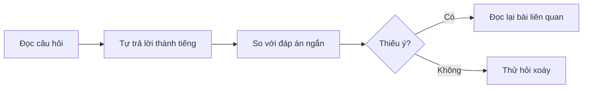

# Câu hỏi: React phỏng vấn mid-senior

45 câu chia theo nhóm. Mỗi câu đi theo chuỗi: câu hỏi tình huống, **gợi ý suy luận** (các câu hỏi nhỏ dẫn tới khái niệm nền), **lập luận** nhân quả, **đáp án ngắn** (nói được trong 20 đến 40 giây), **nhớ** và một **hỏi xoáy** mà người phỏng vấn thường hỏi tiếp. Học kèm các bài: [Bài 1](/go?p=09-React%2Feasy%2Flt-01-tu-duy-react-render.md), [Bài 2](/go?p=09-React%2Feasy%2Flt-02-hooks-co-ban.md), [Composition](/go?p=09-React%2Feasy%2Flt-25-composition.md), [Memo hóa](/go?p=09-React%2Fmedium%2Flt-32-memo-hoa.md), [Bài 5](/go?p=09-React%2Fmedium%2Flt-05-state-management.md), [Bài 6](/go?p=09-React%2Fmedium%2Flt-06-routing-forms-data.md), [Bài 7](/go?p=09-React%2Fmedium%2Flt-07-testing-react.md), [Bài 8](/go?p=09-React%2Fhard%2Flt-08-fiber-concurrent.md), [Bài 9](/go?p=09-React%2Fhard%2Flt-09-ssr-rsc-nextjs.md), [Bài 10](/go?p=09-React%2Fhard%2Flt-10-hieu-nang-kien-truc.md).

**Tóm tắt:**

- File gồm 45 câu React mid-senior chia bảy nhóm: render và reconciliation, hooks, state management, performance, concurrent, SSR với RSC và Next.js, testing.
- Render gồm hai pha: render thuần (có thể bị ngắt hoặc lặp) và commit chạm DOM; effect chạy sau commit nên không dùng để suy ra dữ liệu.
- Hooks: mảng dependency quyết định effect chạy lại, `useLayoutEffect` chạy sync trước paint, và stale closure là lỗi hay gặp nhất.
- State chia theo người sở hữu và lifecycle: server state dùng thư viện cache truy vấn, client state mới đưa vào store.
- Performance và concurrent dựa trên Fiber (tạm dừng được), `useTransition` và `useSyncExternalStore` chống tearing.
- Hay bị hỏi xoáy: vì sao `memo` đôi khi không có tác dụng, RSC khác SSR ra sao, và Server Action là endpoint POST công khai nên phải tự authentication và authorization.

## Cách dùng bộ câu hỏi này

Phỏng vấn vị trí senior hiếm khi hỏi "hàm này nhận tham số gì". Người phỏng vấn muốn biết bạn hiểu **cơ chế** bên dưới và biết lập luận **đánh đổi**: dùng cái này được gì, mất gì, khi nào nên và không nên. Vì vậy bộ câu hỏi dưới đây được chia thành bảy nhóm, mỗi câu có chuỗi suy luận để bạn tự dựng lại đáp án và một câu hỏi xoáy mô phỏng đúng kiểu hỏi tiếp của người phỏng vấn.

Bạn dùng nó để ôn trước buổi phỏng vấn, hoặc để tự kiểm tra sau mỗi bài lý thuyết. Cách học hiệu quả nhất: đọc câu hỏi, che phần còn lại, tự đi theo các gợi ý suy luận để dựng đáp án thành tiếng, rồi mới so. Khi trả lời, luyện theo bốn bước: định nghĩa ngắn, cơ chế hoạt động, một ví dụ, rồi đánh đổi. Nếu bạn trả lời được câu hỏi xoáy mà không cần nhìn đáp án thì mới coi là nắm chắc.

## Từ khóa hay gặp trong các câu trả lời

Một số thuật ngữ xuất hiện nhiều lần ở phần đáp án. Nếu chưa chắc nghĩa, hãy đọc bài tương ứng trước khi luyện.

| Từ khóa | Nghĩa ngắn gọn | Bài chi tiết |
|---|---|---|
| Reconciliation | So sánh cây element mới với cũ để quyết định cập nhật DOM | [Bài 1](/go?p=09-React%2Feasy%2Flt-01-tu-duy-react-render.md) |
| Snapshot | Giá trị state, props cố định trong một lần render | [Bài 1](/go?p=09-React%2Feasy%2Flt-01-tu-duy-react-render.md) |
| Stale closure | Hàm đọc giá trị của render cũ vì thiếu dependency | [Bài 2](/go?p=09-React%2Feasy%2Flt-02-hooks-co-ban.md) |
| Colocation | Đặt state gần nơi dùng để giảm re-render lan rộng | [Composition](/go?p=09-React%2Feasy%2Flt-25-composition.md) |
| Fiber, lane | Cấu trúc render ngắt được và nhãn ưu tiên cập nhật | [Bài 8](/go?p=09-React%2Fhard%2Flt-08-fiber-concurrent.md) |
| Tearing | UI đọc hai giá trị khác nhau của một store ngoài trong cùng lần render | [Bài 8](/go?p=09-React%2Fhard%2Flt-08-fiber-concurrent.md) |
| Hydration | Gắn React vào HTML do server sinh để trang tương tác được | [Bài 9](/go?p=09-React%2Fhard%2Flt-09-ssr-rsc-nextjs.md) |
| RSC payload | Mô tả cây component server gửi cho client, không phải HTML | [Bài 9](/go?p=09-React%2Fhard%2Flt-09-ssr-rsc-nextjs.md) |
| IDOR | Truy cập tài nguyên người khác bằng cách đổi id trong request | [Bài 9](/go?p=09-React%2Fhard%2Flt-09-ssr-rsc-nextjs.md) |
| Virtualization | Chỉ render phần danh sách đang nằm trong khung nhìn | [Bài 10](/go?p=09-React%2Fhard%2Flt-10-hieu-nang-kien-truc.md) |
| MSW | Thư viện giả lập API ở tầng mạng cho test và dev | [Bài 7](/go?p=09-React%2Fmedium%2Flt-07-testing-react.md) |

Đọc sơ đồ: vòng lặp này lặp lại cho đến khi bạn trả lời trơn tru cả câu chính lẫn câu hỏi xoáy. Đừng chỉ đọc đáp án, vì khi bị hỏi tiếp bạn sẽ không có chỗ dựa.

## Nhóm 1: Render và reconciliation

### 1. Bạn đặt `console.log` trong thân component và thấy nó chạy hai lần ở dev, hoặc chạy rồi UI vẫn chưa đổi. Quá trình render gồm những pha nào?

**Phải thuộc:** Câu này là câu cốt lõi, gặp rất thường xuyên.

**Gợi ý suy luận:**
- Ai kích hoạt một lần cập nhật, và việc "tính ra UI mới" khác việc "ghi vào DOM" ở chỗ nào?
- Nếu pha tính toán có thể bị bỏ dở rồi làm lại, nó phải có tính chất gì?

**Lập luận:** Vì tính UI mới (gọi component, tạo cây element) chưa đụng DOM, React có thể hủy hoặc lặp lại nó mà không hậu quả, đó là lý do thân component có thể chạy nhiều lần. Chỉ khi chốt xong mới sang pha ghi DOM, pha này phải sync để người dùng không thấy state nửa vời. Nên có ba pha: trigger, render, commit (kèm layout effect), rồi passive effect chạy sau.

**Đáp án ngắn:** Trigger, render (thuần, có thể bị ngắt hoặc lặp), commit (sync cập nhật DOM, chạy layout effect), sau đó passive effect.

**Nhớ:** Render thuần, side effect để cho commit/effect. [Bài 1](/go?p=09-React%2Feasy%2Flt-01-tu-duy-react-render.md).

**Hỏi xoáy:** Vì sao render phải thuần? Đây là hệ quả trực tiếp: nếu render có tác dụng phụ mà React được phép chạy lại hoặc bỏ, tác dụng phụ sẽ lặp hoặc rò rỉ.

### 2. Một component cha đổi state làm cả cây con nhấp nháy render. Component render lại khi nào?

**Phải thuộc:** Câu này là câu cốt lõi, gặp rất thường xuyên.

**Gợi ý suy luận:**
- Ba nguồn kích hoạt render của một component là gì?
- "Props đổi" là nguyên nhân hay chỉ là biểu hiện?

**Lập luận:** Vì React gọi lại hàm component khi state của nó đổi, khi cha render lại, hoặc khi context nó đọc đổi. Cha render thì mặc định mọi con được gọi lại, kể cả khi props giống hệt, nên "props đổi" chỉ là hệ quả của cha render. Do đó `memo` (so props) mới có ý nghĩa để cắt lan truyền từ cha.

**Đáp án ngắn:** State của nó đổi, cha render lại, hoặc context nó đọc đổi. Props đổi chỉ là hệ quả của cha render.

**Nhớ:** Render lan xuống con mặc định. [Bài 1](/go?p=09-React%2Feasy%2Flt-01-tu-duy-react-render.md).

**Hỏi xoáy:** Làm sao con không render lại mà không dùng `memo`? Bước tiếp theo logic: nếu cha chỉ render lại do state của nó, phần JSX truyền qua `children` đã được tạo ở nơi khác nên không bị tạo lại, hoặc đưa state xuống con.

### 3. Dữ liệu đổi ít chỗ nhưng React không dựng lại toàn bộ cây. Reconciliation làm điều gì?

**Gợi ý suy luận:**
- So sánh hai cây tổng quát tốn bao nhiêu, và React cần chấp nhận giả định gì để rẻ hơn?
- Hai element khác type thì còn giữ được state cũ không?

**Lập luận:** Vì so hai cây tổng quát tốn khoảng O(n^3), React dùng hai giả định: khác type thì cây con khác nhau, và danh sách được nhận diện bằng key. Nhờ đó chỉ so từng cặp cùng vị trí, tổng chi phí O(n). Khác type thì hủy và dựng lại (mất state), cùng type thì giữ instance và cập nhật props.

**Đáp án ngắn:** React so cây mới với cũ bằng heuristic O(n): khác type thì hủy và dựng lại, cùng type thì giữ instance và cập nhật, danh sách dựa vào key.

**Nhớ:** Heuristic đánh đổi độ chính xác lấy tốc độ.

**Hỏi xoáy:** Vì sao không cần O(n^3)? Vì hai giả định ở trên cắt bớt phép so sánh chéo giữa các nhánh.

### 4. Xóa dòng đầu danh sách thì ô input của dòng sau "nhảy" sang dòng khác. Vì sao cần key, và index key sai ở đâu?

**Phải thuộc:** Câu này là câu cốt lõi, gặp rất thường xuyên.

**Gợi ý suy luận:**
- React dựa vào cái gì để biết dòng cũ và dòng mới là cùng một thực thể?
- Nếu danh tính là vị trí, khi xóa thì dòng nào "thừa hưởng" state của dòng nào?

**Lập luận:** Vì state nội bộ (input, focus) gắn với instance, mà instance được khớp theo key. Với key là index, danh tính gắn với vị trí: xóa dòng 0 thì dòng 1 cũ trở thành index 0 và nhận state của dòng 0 cũ. Kết quả state gắn nhầm dòng. Key ổn định theo dữ liệu thì mỗi dòng giữ đúng instance khi chèn, xóa, đảo.

**Đáp án ngắn:** Key cho React biết phần tử nào là cùng thực thể giữa các lần render. Index gắn danh tính với vị trí nên chèn, xóa, đảo làm state gắn nhầm dòng.

**Nhớ:** Key là danh tính, không phải thứ để dập cảnh báo. [Bài 1](/go?p=09-React%2Feasy%2Flt-01-tu-duy-react-render.md).

**Hỏi xoáy:** Khi nào index chấp nhận được? Khi danh sách tĩnh, không sắp xếp, không chèn xóa và dòng không có state: lúc đó vị trí chính là danh tính.

### 5. Chuyển từ user A sang user B nhưng form vẫn giữ dữ liệu của A. Làm sao reset sạch state khi prop đổi?

**Gợi ý suy luận:**
- Khi cùng type và cùng vị trí, React giữ hay dựng lại instance?
- Làm thế nào ép React coi nó là một thực thể khác?

**Lập luận:** Vì cùng type, cùng vị trí thì React giữ instance nên state cũ còn. Danh tính do key quyết định, nên đổi `key` (ví dụ `key={userId}`) buộc React hủy và dựng instance mới với state khởi tạo. Cách này gọn hơn effect gọi `setState(initial)` vì effect chỉ chạy sau một lần render với dữ liệu cũ.

**Đáp án ngắn:** Đổi `key` của component theo prop đó, React dựng instance mới. Tốt hơn effect reset state.

**Nhớ:** Key cũng là công cụ reset state.

**Hỏi xoáy:** Chi phí là gì? Là hủy và dựng lại toàn bộ cây con, mất cả state hợp lệ khác bên trong.

### 6. Gọi `setCount(count + 1)` ba lần liên tiếp mà count chỉ tăng 1. Vì sao?

**Phải thuộc:** Câu này là câu cốt lõi, gặp rất thường xuyên.

**Gợi ý suy luận:**
- Trong một lần render, biến `count` có đổi giá trị giữa các dòng code không?
- Dạng updater `c => c + 1` nhận giá trị từ đâu?

**Lập luận:** Vì state là snapshot cố định của lần render, cả ba dòng đọc cùng `count`, nên ba lần đều đặt cùng giá trị. Updater thì React xếp hàng và truyền kết quả của lần trước vào lần sau, nên cộng dồn đúng.

**Đáp án ngắn:** State là snapshot của lần render nên cả ba lần đọc cùng giá trị. Dùng `setCount(c => c + 1)` để cộng dồn theo queue.

**Nhớ:** Snapshot + updater. [Bài 1](/go?p=09-React%2Feasy%2Flt-01-tu-duy-react-render.md).

**Hỏi xoáy:** Updater bị gọi mấy lần trong StrictMode? Hai lần ở dev để lộ updater không thuần, nên updater phải thuần.

### 7. Cập nhật state trong `setTimeout` ở React 17 render hai lần, ở 18 chỉ một. Automatic batching khác thế nào?

**Gợi ý suy luận:**
- Batching gom những cập nhật nào vào một render?
- React 17 chỉ biết "đang trong handler của React" bằng cách nào?

**Lập luận:** Vì React 17 gom dựa trên việc đang chạy trong event handler của chính nó, ngoài đó (timeout, promise) mỗi `setState` render riêng. Từ 18 với `createRoot`, mọi cập nhật trong cùng tick được gom bất kể nguồn, nên ít render hơn.

**Đáp án ngắn:** Từ 18 với `createRoot`, mọi cập nhật cùng tick (timeout, promise, native handler) gom thành một render; 17 chỉ gom trong handler của React.

**Nhớ:** Cần `createRoot` mới có hành vi mới.

**Hỏi xoáy:** Khi nào cần `flushSync`? Khi phải đọc DOM đã cập nhật ngay, đổi lại mất lợi ích gom và có thể chậm.

## Nhóm 2: Hooks

### 8. Một `setInterval` trong effect luôn in giá trị state cũ. Stale closure là gì?

**Phải thuộc:** Câu này là câu cốt lõi, gặp rất thường xuyên.

**Gợi ý suy luận:**
- Hàm được tạo trong một render "nhìn thấy" giá trị nào?
- Effect với dependency rỗng chạy lại bao nhiêu lần, và hàm bên trong là của render nào?

**Lập luận:** Vì mỗi render tạo ra hàm mới capture snapshot của chính nó. Effect không liệt kê dependency chỉ giữ hàm của lần render đầu, nên đọc mãi giá trị cũ. Do đó có ba cách: dùng updater để không phải đọc state, liệt kê đủ dependency, hoặc đọc qua ref/`useEffectEvent`.

**Đáp án ngắn:** Hàm capture giá trị của render tạo ra nó; thiếu dependency thì đọc giá trị cũ. Sửa bằng updater, đủ dependency, hoặc ref/`useEffectEvent`.

**Nhớ:** Closure + snapshot. [Bài 2](/go?p=09-React%2Feasy%2Flt-02-hooks-co-ban.md).

**Hỏi xoáy:** Vì sao không tắt `exhaustive-deps`? Vì cảnh báo chính là chỗ phát hiện stale closure, tắt đi là giấu bug chứ không sửa.

### 9. Đặt `useState` trong `if` thì app lỗi lạ. Vì sao hooks không được gọi có điều kiện?

**Phải thuộc:** Câu này là câu cốt lõi, gặp rất thường xuyên.

**Gợi ý suy luận:**
- Hook không có tên, vậy React phân biệt `useState` thứ nhất với thứ hai bằng gì?
- Nếu một render bỏ qua một hook thì các hook sau lệch ra sao?

**Lập luận:** Vì React lưu hook thành danh sách theo thứ tự gọi trên fiber, danh tính của hook là vị trí. Gọi có điều kiện làm thứ tự đổi giữa các render nên hook sau đọc nhầm slot, state gắn sai. Vì vậy phải gọi vô điều kiện ở cấp cao nhất.

**Đáp án ngắn:** React lưu hook theo thứ tự gọi trong danh sách trên fiber; thứ tự đổi thì state gắn sai slot.

**Nhớ:** Hook = vị trí trong danh sách. [Hooks Best Practices](/go?p=09-React%2Fmedium%2Flt-35-hooks-best-practices.md).

**Hỏi xoáy:** `use()` ở React 19 vì sao được ngoại lệ? Vì nó không dùng danh sách slot như `useState`, nó đọc promise/context theo cách không phụ thuộc thứ tự lưu trữ đó.

### 10. Có người dùng `useEffect` để tính `fullName` từ `firstName` và `lastName`. Khi nào KHÔNG nên dùng effect?

**Phải thuộc:** Câu này là câu cốt lõi, gặp rất thường xuyên.

**Gợi ý suy luận:**
- Effect sinh ra để làm gì: sync với thứ nằm trong hay ngoài React?
- Giá trị suy ra từ state/props cần thêm một lần render nữa không?

**Lập luận:** Vì effect chạy sau commit, dùng nó để suy ra dữ liệu buộc thêm một render với giá trị cũ rồi mới đúng. Dữ liệu suy ra thì tính ngay khi render; phản ứng với thao tác người dùng thì đặt trong handler; reset state thì dùng key. Effect chỉ dành cho sync với hệ thống ngoài (mạng, DOM API, timer).

**Đáp án ngắn:** Không dùng khi chỉ suy ra dữ liệu từ props/state, khi phản ứng thao tác người dùng, hay reset state. Effect để sync với hệ thống ngoài.

**Nhớ:** "You might not need an effect." [Bài 2](/go?p=09-React%2Feasy%2Flt-02-hooks-co-ban.md).

**Hỏi xoáy:** Ví dụ refactor? `const fullName = first + ' ' + last` trong render, bỏ state và effect. Đây là bước kiểm tra bạn áp dụng được lập luận trên.

### 11. Component unmount mà vẫn thấy request cũ ghi state. Cleanup của effect chạy khi nào?

**Gợi ý suy luận:**
- Effect của render cũ cần dọn gì trước khi effect của render mới chạy?
- Cleanup đọc giá trị của render nào?

**Lập luận:** Vì mỗi effect thiết lập một đăng ký/kết nối gắn với giá trị của render đó, trước khi chạy effect mới (dependency đổi) hoặc khi unmount, React phải gọi cleanup của lần trước với giá trị cũ. StrictMode ở dev chạy thêm vòng setup, cleanup, setup để lộ effect thiếu cleanup.

**Đáp án ngắn:** Trước lần chạy effect kế tiếp khi dependency đổi và khi unmount, với giá trị của render cũ. StrictMode dev mô phỏng thêm một vòng.

**Nhớ:** Effect phải đối xứng: setup và cleanup. [Bài 2](/go?p=09-React%2Feasy%2Flt-02-hooks-co-ban.md).

**Hỏi xoáy:** Race condition khi fetch trong effect tránh thế nào? Dùng cleanup để huỷ (`AbortController`) hoặc đặt cờ bỏ qua kết quả cũ.

### 12. Lưu id của `setTimeout` thì nên dùng `useRef` hay `useState`?

**Gợi ý suy luận:**
- Giá trị này có cần hiện lên UI không?
- Đổi nó có nên gây render?

**Lập luận:** Vì ref giữ giá trị mutable qua các render mà ghi vào nó không kích hoạt render, nó hợp với thứ không hiển thị: DOM node, timer id, giá trị trước. Nếu dùng state cho timer id thì mỗi lần đặt sẽ render thừa. Đọc hoặc ghi `ref.current` trong render phá tính thuần.

**Đáp án ngắn:** `useRef` giữ giá trị mutable không gây render, dùng cho DOM node, timer id, giá trị trước; không đọc hoặc ghi trong render.

**Nhớ:** Cần hiển thị thì state, không thì ref. [Bài 2](/go?p=09-React%2Feasy%2Flt-02-hooks-co-ban.md).

**Hỏi xoáy:** Vì sao `ref.current` không dùng cho dữ liệu hiển thị? Vì đổi nó không kích hoạt render nên UI không cập nhật.

### 13. Bọc `useCallback` quanh handler mà con vẫn render lại. `useMemo` và `useCallback` khác gì, khi nào có lợi?

**Phải thuộc:** Câu này là câu cốt lõi, gặp rất thường xuyên.

**Gợi ý suy luận:**
- Một hàm mới mỗi render và hàm được memo khác nhau ở điều gì với bước so sánh props?
- Con có đang `memo` không?

**Lập luận:** Vì `useMemo` giữ kết quả, `useCallback` giữ tham chiếu hàm, cả hai chỉ giữ ổn định giữa các render. Nếu con không `memo`, nó vẫn render khi cha render dù props ổn định, nên `useCallback` một mình vô ích. Chỉ có lợi khi giá trị đó đi vào con đã `memo`, nằm trong dependency của hook khác, hoặc phép tính nặng đo được.

**Đáp án ngắn:** Memo kết quả so với memo hàm. Chỉ có lợi khi truyền cho con đã `memo`, làm dependency hook khác, hoặc tính toán nặng đo được.

**Nhớ:** Memo là công cụ giữ tham chiếu, không tự cắt render. [Memo hóa](/go?p=09-React%2Fmedium%2Flt-32-memo-hoa.md).

**Hỏi xoáy:** Vì sao `useCallback` một mình vô ích? Chính là kết luận ở trên: không có ai so sánh tham chiếu đó.

### 14. Form có sáu trường liên quan và nhiều chuyển state. `useState` hay `useReducer`?

**Gợi ý suy luận:**
- Các trường có đổi cùng nhau theo quy tắc không?
- Logic cập nhật nên nằm rải rác hay một chỗ test được?

**Lập luận:** Vì state độc lập đơn giản thì `useState` đủ gọn. Khi nhiều trường liên quan và chuyển state có quy tắc, rải `setX` khắp nơi dễ sinh state bất khả thi. Reducer gom logic thành hàm thuần (state, action) nên test và đọc dễ hơn.

**Đáp án ngắn:** `useState` cho state đơn giản độc lập; `useReducer` khi nhiều trường liên quan, chuyển state phức tạp, muốn tập trung và test logic.

**Nhớ:** Reducer = logic cập nhật thuần, tập trung. [useReducer và các hook nâng cao khác](/go?p=09-React%2Fmedium%2Flt-33-usereducer-hooks-khac.md).

**Hỏi xoáy:** Tách state và dispatch ra hai Context để làm gì? `dispatch` ổn định nên consumer chỉ dùng dispatch không render lại khi state đổi.

### 15. Tooltip nhấp nháy ở vị trí sai trong một khung hình rồi mới nhảy đúng. `useLayoutEffect` khác `useEffect` thế nào?

**Gợi ý suy luận:**
- `useEffect` chạy trước hay sau khi trình duyệt vẽ?
- Muốn đo DOM rồi chỉnh trước khi người dùng thấy thì cần chạy lúc nào?

**Lập luận:** Vì `useEffect` chạy sau paint, người dùng thấy khung đầu sai rồi mới thấy khung chỉnh (flicker). `useLayoutEffect` chạy sync sau khi DOM cập nhật và trước paint, nên đo và chỉnh xong trước khi hiện. Nhưng vì nó chặn paint, không nên làm việc nặng, và không có ý nghĩa khi SSR vì không có DOM.

**Đáp án ngắn:** Chạy sync sau cập nhật DOM và trước paint, dùng để đo và chỉnh layout tránh flicker; chặn paint nên không làm việc nặng.

**Nhớ:** Mặc định `useEffect`, chỉ hạ xuống layout khi thấy flicker. [useReducer và các hook nâng cao khác](/go?p=09-React%2Fmedium%2Flt-33-usereducer-hooks-khac.md).

**Hỏi xoáy:** Điều gì xảy ra khi SSR? Server không có DOM nên không chạy effect, React cảnh báo (ở các bản cũ), nên dùng `useEffect` hoặc render điều kiện.

### 16. Review một custom hook, bạn nhìn vào những gì?

**Gợi ý suy luận:**
- Mỗi lời gọi hook có chia sẻ state với lời gọi khác không?
- Hook trả về hàm: tham chiếu có ổn định không?

**Lập luận:** Vì custom hook chỉ là hàm gọi hook khác, mỗi lời gọi tạo state riêng. Hook tốt có một trách nhiệm, tên nói rõ ý định, API gọn, có cleanup, trả hàm ổn định khi người dùng cần đưa vào dependency, và không chạm `window` trong render.

**Đáp án ngắn:** Một trách nhiệm, tên rõ, API gọn, có cleanup, tham chiếu trả về ổn định khi cần, không chạm `window` trong render. Mỗi lời gọi có state riêng.

**Nhớ:** Hook chia sẻ logic, không chia sẻ state. [Custom Hook](/go?p=09-React%2Fmedium%2Flt-34-custom-hook.md).

**Hỏi xoáy:** Làm sao chia sẻ state thật giữa hai component? Vì state riêng theo lời gọi, phải nâng state lên, dùng Context hoặc store ngoài.

## Nhóm 3: State management

### 17. Team nhét dữ liệu API vào Redux và luôn lệch với server. Phân loại state trong app React thế nào?

**Phải thuộc:** Câu này là câu cốt lõi, gặp rất thường xuyên.

**Gợi ý suy luận:**
- Ai sở hữu dữ liệu này: UI hay một hệ thống bên ngoài?
- Dữ liệu có thể cũ đi không?

**Lập luận:** Vì mỗi loại state có người sở hữu và lifecycle khác nhau nên cần công cụ khác nhau: local UI (`useState`), shared client (store), server (cache có stale/refetch), URL (chia sẻ, back/forward), form. Nhét server state vào store client buộc bạn tự làm cache, sync, loading, lỗi, nên hay lệch.

**Đáp án ngắn:** Local UI, shared client, server, URL, form; mỗi loại một công cụ phù hợp. Sai lầm kinh điển là nhét server state vào store client.

**Nhớ:** Chọn công cụ theo loại state. [Bài 5](/go?p=09-React%2Fmedium%2Flt-05-state-management.md).

**Hỏi xoáy:** Ví dụ state nên ở URL? Filter, trang, tab: vì người dùng muốn chia sẻ link, đánh dấu và dùng back/forward.

### 18. Đổi một trường trong Context mà cả app render lại, bọc `memo` cũng không cứu. Vì sao?

**Phải thuộc:** Câu này là câu cốt lõi, gặp rất thường xuyên.

**Gợi ý suy luận:**
- Context so sánh `value` bằng cách nào?
- Consumer có chọn được "chỉ phần tôi dùng" không?

**Lập luận:** Vì mọi consumer đăng ký vào cả `value`; khi `value` đổi theo `Object.is`, tất cả render lại dù chỉ dùng một phần, và `memo` chỉ so props nên không chặn được. Đặc biệt `value={{a, b}}` tạo object mới mỗi render nên luôn "đổi". Giảm bằng tách context, memo value, hoặc dùng store có selector.

**Đáp án ngắn:** Mọi consumer render lại khi `value` đổi theo `Object.is`, `memo` không chặn. Tách context, memo value hoặc dùng store có selector.

**Nhớ:** Context không có selector. [Bài 5](/go?p=09-React%2Fmedium%2Flt-05-state-management.md).

**Hỏi xoáy:** Vì sao `value={{a, b}}` nguy hiểm? Object mới mỗi lần cha render nên mọi consumer render theo dù a, b không đổi.

### 19. Khi nào chọn Redux Toolkit, khi nào Zustand?

**Gợi ý suy luận:**
- Quy mô đội và nhu cầu quy ước, middleware, devtools?
- Bạn chấp nhận bao nhiêu boilerplate?

**Lập luận:** Vì RTK cho cấu trúc chặt (slice, middleware, devtools mạnh) hợp đội lớn, logic phức tạp; Zustand tối giản, selector sẵn, hợp client state gọn. Lựa theo chi phí quy ước so với tốc độ phát triển.

**Đáp án ngắn:** RTK cho đội lớn cần quy ước, middleware, devtools mạnh; Zustand cho client state gọn, ít boilerplate, có selector.

**Nhớ:** Chọn theo quy mô, không theo mốt. [Bài 5](/go?p=09-React%2Fmedium%2Flt-05-state-management.md).

**Hỏi xoáy:** Immer trong RTK hoạt động ra sao? Bọc draft proxy cho bạn "mutate", rồi sinh state bất biến mới, chỉ đúng trong reducer của `createSlice`.

### 20. Có người hỏi vì sao không tự `fetch` trong effect cho nhanh. TanStack Query giải quyết gì?

**Gợi ý suy luận:**
- Tự fetch trong effect bạn phải tự làm những việc gì (cache, trùng request, retry)?
- Dữ liệu server khi nào được coi là cũ?

**Lập luận:** Vì dữ liệu server do bên ngoài sở hữu và có thể cũ, cần cache theo key, gộp request trùng, retry, refetch nền, invalidate sau mutation và state loading/error. Thư viện làm hộ nên thay phần lớn Redux dùng cho dữ liệu API.

**Đáp án ngắn:** Cache theo query key, dedupe, retry, refetch nền, invalidate, mutation và state loading/error.

**Nhớ:** Server state cần thư viện chuyên dụng. [Bài 5](/go?p=09-React%2Fmedium%2Flt-05-state-management.md).

**Hỏi xoáy:** `staleTime` khác `gcTime`? Vì "cũ khi nào" và "giữ cache bao lâu khi không ai dùng" là hai câu hỏi khác nhau: staleTime quyết định lúc refetch, gcTime quyết định lúc xóa cache.

### 21. Bấm "thích" muốn UI đổi ngay, lỗi thì quay lại. Làm optimistic update đúng cách?

**Gợi ý suy luận:**
- Nếu request thất bại, bạn cần gì để quay về state trước?
- Một refetch đang chạy có thể ghi đè thay đổi lạc quan không?

**Lập luận:** Vì cập nhật cache ngay trước khi server trả lời, cần tránh refetch đang bay ghi đè, nên hủy query liên quan, lưu snapshot để rollback, rồi cập nhật cache (`onMutate`). Lỗi thì khôi phục snapshot (`onError`), xong thì invalidate để sync với server (`onSettled`).

**Đáp án ngắn:** `onMutate`: hủy query, lưu snapshot, cập nhật cache; `onError`: rollback; `onSettled`: invalidate. React 19 có `useOptimistic` cho trường hợp cục bộ.

**Nhớ:** Snapshot để rollback. [Bài 5](/go?p=09-React%2Fmedium%2Flt-05-state-management.md).

**Hỏi xoáy:** Hai mutation chồng nhau thì sao? Snapshot của cái sau có thể đã chứa thay đổi lạc quan của cái trước, rollback sai, nên cần invalidate cuối cùng.

### 22. Người dùng A thấy dữ liệu của người dùng B sau khi SSR. Vì sao store module-level nguy hiểm?

**Gợi ý suy luận:**
- Module được nạp mấy lần trong một process server?
- Nhiều request concurrent dùng chung biến toàn cục thì chuyện gì xảy ra?

**Lập luận:** Vì module chỉ nạp một lần và các request cùng process chia sẻ nó, dữ liệu request này ghi vào store module-level sẽ lộ sang request khác. Nên phải tạo store theo từng request.

**Đáp án ngắn:** Module dùng chung giữa các request nên dữ liệu người này có thể lộ sang người khác; tạo store theo request.

**Nhớ:** Server stateless theo request. [Bài 9](/go?p=09-React%2Fhard%2Flt-09-ssr-rsc-nextjs.md).

**Hỏi xoáy:** Zustand xử lý SSR thế nào? Tạo store qua factory và cấp qua Context cho mỗi request, thay vì một store toàn cục.

## Nhóm 4: Performance

### 23. Sếp bảo "trang này chậm, tối ưu đi". Bạn xử lý thế nào?

**Gợi ý suy luận:**
- Loại chậm nào: tải, render thừa, render nặng?
- Có đo trên production build không?

**Lập luận:** Vì mỗi loại chậm cần cách sửa khác, phải đo trước (Profiler với production build, Performance panel) để xác định nút thắt. Sau đó sửa cấu trúc (rẻ, bền) trước, memo sau, rồi đo lại.

**Đáp án ngắn:** Đo bằng Profiler và Performance panel, phân loại render thừa/nặng/JS lớn, sửa cấu trúc trước, memo sau, đo lại.

**Nhớ:** Không đo thì không tối ưu. [Bài 10](/go?p=09-React%2Fhard%2Flt-10-hieu-nang-kien-truc.md).

**Hỏi xoáy:** Đọc flamegraph và "why did this render" cho biết gì? Component nào tốn bao lâu và vì lý do gì (state, props, hooks) nó render, chính là dữ kiện chọn cách sửa.

### 24. Cách rẻ nhất để giảm re-render là gì?

**Gợi ý suy luận:**
- Render lan từ chỗ nào xuống chỗ nào?
- Nếu state đổi ở nơi nhỏ hơn thì phạm vi lan ra sao?

**Lập luận:** Vì render lan từ component có state xuống con, hạ state xuống sát nơi dùng (colocation) thu nhỏ phạm vi. Truyền JSX qua `children` thì phần tử đó được tạo ở cha ngoài, không bị tạo lại khi wrapper đổi state.

**Đáp án ngắn:** Colocate state gần nơi dùng và truyền JSX qua `children` để cập nhật không lan sang nhánh không liên quan.

**Nhớ:** Sửa cấu trúc trước khi memo. [Composition](/go?p=09-React%2Feasy%2Flt-25-composition.md).

**Hỏi xoáy:** Vì sao `children` không render lại khi state wrapper đổi? Vì element `children` là cùng tham chiếu do cha ngoài tạo, React thấy giống nên bỏ qua.

### 25. `React.memo` bọc khắp nơi mà app không nhanh hơn. Nó so sánh thế nào, khi nào phản tác dụng?

**Gợi ý suy luận:**
- So sánh props nông nghĩa là gì với object/hàm mới?
- Chi phí của việc so sánh so với chi phí render lại component nhẹ?

**Lập luận:** Vì `memo` so từng prop bằng `Object.is`, props là object/hàm mới mỗi render thì luôn "khác", so sánh chỉ tốn thêm. Component nhẹ thì render còn rẻ hơn so sánh và memory lưu. Nên chỉ lợi khi props ổn định và render đắt.

**Đáp án ngắn:** So nông từng prop bằng `Object.is`. Phản tác dụng khi props luôn đổi hoặc component nhẹ.

**Nhớ:** Memo có chi phí. [Memo hóa](/go?p=09-React%2Fmedium%2Flt-32-memo-hoa.md).

**Hỏi xoáy:** Khi nào cần `arePropsEqual`? Hiếm, khi props là cấu trúc sâu mà bạn biết cách so rẻ hơn, nhưng dễ sai nên thường tránh.

### 26. Bundle đầu 2MB. Code splitting làm thế nào và đánh đổi gì?

**Gợi ý suy luận:**
- Phần nào người dùng chưa cần ngay?
- Tách ra thì lúc cần phải làm gì?

**Lập luận:** Vì không cần tải mã chưa dùng, tách theo route, tương tác, thư viện nặng bằng `lazy` + `Suspense`. Đổi lại phần tách phải tải khi cần nên thêm request và fallback; giảm chờ bằng prefetch.

**Đáp án ngắn:** `lazy` + `Suspense`, tách theo route, tương tác, thư viện nặng; đổi lại thêm request và fallback, giảm bằng prefetch.

**Nhớ:** Tách theo ranh giới "chưa cần". [Bài 10](/go?p=09-React%2Fhard%2Flt-10-hieu-nang-kien-truc.md).

**Hỏi xoáy:** Làm sao tìm thư viện làm phình bundle? Dùng công cụ phân tích bundle (visualizer) để xem module nào chiếm dung lượng, chính là bước đo trước khi tách.

### 27. Bảng 10.000 dòng cuộn giật. Khi nào dùng virtualization?

**Gợi ý suy luận:**
- Chi phí tăng theo số node DOM thế nào?
- Dòng không thấy được có cần tồn tại trong DOM không?

**Lập luận:** Vì chi phí theo số node, chỉ render phần nhìn thấy giữ DOM nhỏ. Hệ quả là mất tìm kiếm trên trang, ảnh hưởng a11y và khó với chiều cao động. Danh sách vừa phải thì phân trang đơn giản hơn.

**Đáp án ngắn:** Danh sách hàng nghìn dòng, chỉ render vùng nhìn thấy. Đánh đổi tìm trên trang, a11y, chiều cao động; danh sách vừa thì phân trang.

**Nhớ:** Chỉ dùng khi danh sách thật sự lớn. [Bài 10](/go?p=09-React%2Fhard%2Flt-10-hieu-nang-kien-truc.md).

**Hỏi xoáy:** `react-window` và `@tanstack/react-virtual` khác nhau? `react-window` gọn, component dựng sẵn; `@tanstack/react-virtual` là hook headless, linh hoạt hơn. Chọn theo mức tùy biến cần có.

### 28. Bật React Compiler thì còn cần `useMemo` không?

**Gợi ý suy luận:**
- Memo thủ công đang giữ ổn định cái gì, và compiler có thể phân tích để làm hộ không?
- Điều kiện nào để phân tích an toàn?

**Lập luận:** Vì compiler hiểu data flow lúc build và thêm memo hóa mịn nếu code tuân quy tắc (thuần, không mutate), nên nhu cầu memo tay giảm. Nó không giảm bundle hay sửa thuật toán chậm; component vi phạm quy tắc bị bỏ qua.

**Đáp án ngắn:** Plugin build tự memo hóa nếu code tuân quy tắc React, giảm `useMemo`/`useCallback` tay; không giảm bundle hay sửa thuật toán chậm.

**Nhớ:** Compiler cần code thuần. [Bài 10](/go?p=09-React%2Fhard%2Flt-10-hieu-nang-kien-truc.md).

**Hỏi xoáy:** Điều gì làm compiler bỏ qua component? Vi phạm quy tắc như mutate props/state hoặc đọc ref trong render, nên bật lint để phát hiện.

### 29. Core Web Vitals liên quan React ra sao?

**Gợi ý suy luận:**
- LCP, INP, CLS đo điều gì?
- Phần nào của React ảnh hưởng đến từng chỉ số?

**Lập luận:** Vì LCP đo lúc nội dung chính hiện, nó chịu ảnh hưởng của JS và tải dữ liệu (SSR, ảnh ưu tiên giúp). INP đo độ trễ tương tác, nên render nặng trong handler làm xấu đi. CLS đo dịch chuyển layout, xảy ra khi nội dung đến muộn mà không giữ chỗ.

**Đáp án ngắn:** LCP chịu JS và tải dữ liệu, INP chịu render nặng trong handler, CLS chịu layout shift khi nội dung đến muộn.

**Nhớ:** Xem [Core Web Vitals](/go?p=11-Frontend-Core%2Flt-03-web-performance-core-web-vitals.md).

**Hỏi xoáy:** Transition cải thiện INP thế nào? Đánh dấu cập nhật nặng là không gấp để tương tác ngay được xử lý trước, nối với nhóm Concurrent bên dưới.

## Nhóm 5: Concurrent

### 30. Vì sao React viết lại bộ render thành Fiber?

**Gợi ý suy luận:**
- Stack reconciler đệ quy có dừng giữa chừng được không?
- Muốn tạm dừng và tiếp tục thì cần lưu thông tin ở đâu?

**Lập luận:** Vì đệ quy dùng call stack không dừng giữa chừng được, cập nhật lớn chặn main thread. Fiber biểu diễn công việc thành cấu trúc duyệt bằng con trỏ, có thể tạm dừng, nhường cho việc gấp rồi tiếp tục.

**Đáp án ngắn:** Fiber là cấu trúc dữ liệu và thuật toán duyệt cây bằng con trỏ, cho phép tạm dừng và tiếp tục, thay stack reconciler sync.

**Nhớ:** [Bài 8](/go?p=09-React%2Fhard%2Flt-08-fiber-concurrent.md).

**Hỏi xoáy:** Vì sao cần hai cây `current` và `workInProgress`? Để dựng bản mới ở nền mà không đụng cái đang hiển thị, xong mới hoán đổi.

### 31. Concurrent rendering có làm app nhanh hơn không?

**Gợi ý suy luận:**
- Tổng khối lượng việc có giảm không?
- Cái gì thay đổi: tổng thời gian hay thứ tự và khả năng ngắt?

**Lập luận:** Vì tổng việc không giảm, nó không tăng tốc thuần. Nó cho phép ưu tiên cập nhật gấp (gõ phím) trước cập nhật nặng và ngắt cập nhật nặng, nên UI phản hồi tốt hơn.

**Đáp án ngắn:** Không nhanh hơn về tổng thời gian; nó làm UI phản hồi tốt hơn nhờ ưu tiên và ngắt được cập nhật nặng.

**Nhớ:** Responsive, không phải faster. [Bài 8](/go?p=09-React%2Fhard%2Flt-08-fiber-concurrent.md).

**Hỏi xoáy:** Điều kiện bật là gì? Dùng `createRoot` của React 18+ và dùng các API concurrent (transition, deferred value).

### 32. Ô tìm kiếm lọc danh sách nặng làm gõ bị khựng. `useTransition` và `useDeferredValue` khác nhau?

**Phải thuộc:** Câu này là câu cốt lõi, gặp rất thường xuyên.

**Gợi ý suy luận:**
- Bạn có sở hữu hàm `setState` gây ra cập nhật nặng không?
- Cập nhật nào cần gấp, cập nhật nào được phép chậm?

**Lập luận:** Vì cả hai đánh dấu một cập nhật là không gấp để React ngắt nó khi có việc gấp hơn. Khi bạn gọi `setState` thì bọc nó bằng `useTransition` (có `isPending`); khi giá trị đến từ props và bạn không có setter thì dùng `useDeferredValue`.

**Đáp án ngắn:** `useTransition` bọc `setState` và cho `isPending`; `useDeferredValue` bọc một giá trị khi không sở hữu setState. Cả hai đánh dấu công việc không gấp.

**Nhớ:** [Bài 8](/go?p=09-React%2Fhard%2Flt-08-fiber-concurrent.md).

**Hỏi xoáy:** Vì sao `memo` con khi dùng `useDeferredValue`? Nếu không, con vẫn render lại với giá trị cũ khi cha render nên không có lợi.

### 33. Trong render ngắt được, hai phần UI hiện hai giá trị khác nhau của cùng store. Tearing là gì và cách giải?

**Gợi ý suy luận:**
- Nếu render bị tạm dừng giữa chừng, store ngoài có thể đổi trong lúc đó không?
- Làm sao đảm bảo mọi phần đọc cùng một phiên bản?

**Lập luận:** Vì render có thể bị ngắt, store ngoài React có thể đổi giữa chừng, nên phần render trước và sau thấy hai giá trị (tearing). `useSyncExternalStore` đọc snapshot nhất quán và buộc cập nhật sync khi store đổi, loại bỏ tearing.

**Đáp án ngắn:** Tearing là UI đọc hai giá trị khác nhau của store ngoài trong cùng một render. `useSyncExternalStore` dùng snapshot nhất quán và cập nhật sync.

**Nhớ:** [Bài 8](/go?p=09-React%2Fhard%2Flt-08-fiber-concurrent.md).

**Hỏi xoáy:** Yêu cầu với `getSnapshot`? Phải trả cùng giá trị (cùng tham chiếu) nếu store chưa đổi, nếu không React lặp vô hạn.

### 34. Suspense hoạt động thế nào và `use()` ở React 19 thêm gì?

**Gợi ý suy luận:**
- Component cần dữ liệu chưa sẵn thì làm gì để React biết?
- Nếu promise là object mới mỗi render thì chuyện gì xảy ra?

**Lập luận:** Vì component chưa có dữ liệu "treo" (ném promise), Suspense gần nhất hiện fallback đến khi sẵn. `use(promise)` đọc promise trong render và gọi được có điều kiện. Promise phải ổn định giữa các render, nếu tạo mới mỗi lần thì mỗi render lại treo, vòng lặp.

**Đáp án ngắn:** Component treo khi chưa có dữ liệu, Suspense gần nhất hiện fallback. `use(promise)` đọc promise trong render, gọi được có điều kiện; promise phải ổn định.

**Nhớ:** [Bài 8](/go?p=09-React%2Fhard%2Flt-08-fiber-concurrent.md).

**Hỏi xoáy:** Hậu quả khi tạo promise mới mỗi lần render? Mỗi render treo lại, fallback hiện mãi, vì React coi đó là dữ liệu khác chưa sẵn.

## Nhóm 6: SSR, RSC, Next.js

### 35. Trang tin tức, trang dashboard cá nhân, trang landing: CSR, SSR, SSG, ISR chọn thế nào?

**Gợi ý suy luận:**
- HTML được tạo ở đâu và khi nào trong mỗi chế độ?
- Dữ liệu cần tươi đến mức nào, có cần SEO không?

**Lập luận:** Vì bốn chế độ khác nhau ở nơi và thời điểm tạo HTML, chọn theo độ tươi dữ liệu, SEO và tải server. Nội dung ít đổi dùng SSG hoặc ISR (tái tạo định kỳ), dữ liệu theo từng người dùng cần SSR hoặc CSR.

**Đáp án ngắn:** Khác nhau ở nơi và thời điểm tạo HTML. Chọn theo độ tươi dữ liệu, SEO, tải server; nội dung ít đổi dùng SSG hoặc ISR.

**Nhớ:** [Bài 9](/go?p=09-React%2Fhard%2Flt-09-ssr-rsc-nextjs.md).

**Hỏi xoáy:** ISR cho dữ liệu cũ trong bao lâu? Tối đa đến khoảng revalidate đã đặt, rồi phục vụ bản cũ trong khi tái tạo nền.

### 36. Console báo "Hydration failed". Hydration là gì và mismatch vì đâu?

**Phải thuộc:** Câu này là câu cốt lõi, gặp rất thường xuyên.

**Gợi ý suy luận:**
- Hydration có dựng lại DOM không, hay đối chiếu?
- Điều gì khiến output render ở server và lần đầu ở client khác nhau?

**Lập luận:** Vì hydration render lại ở client rồi đối chiếu với HTML sẵn có để gắn event, hai bên phải ra cùng output. Mismatch khi output đầu khác nhau: thời gian, random, API trình duyệt (`window`), hoặc HTML sai cấu trúc.

**Đáp án ngắn:** Gắn React vào HTML sẵn có bằng cách render lại và đối chiếu. Mismatch khi output đầu khác nhau: thời gian, random, API trình duyệt, HTML sai cấu trúc.

**Nhớ:** Output đầu tiên phải xác định. [Bài 9](/go?p=09-React%2Fhard%2Flt-09-ssr-rsc-nextjs.md).

**Hỏi xoáy:** React 18+ xử lý mismatch thế nào? Thường cảnh báo và có thể chuyển phần lệch sang render client thay vì vá DOM, nên sửa nguyên nhân.

### 37. Server Components khác SSR chỗ nào?

**Phải thuộc:** Câu này là câu cốt lõi, gặp rất thường xuyên.

**Gợi ý suy luận:**
- Component chạy ở đâu và mã của nó có gửi tới trình duyệt không?
- SSR tạo gì: HTML hay mô tả component?

**Lập luận:** Vì RSC chỉ chạy trên server, mã của nó không vào bundle, có thể async và đọc DB trực tiếp. SSR là tạo HTML ban đầu (kể cả cho Client Component), rồi vẫn hydrate. Hai thứ trực giao nên dùng cùng nhau.

**Đáp án ngắn:** RSC chạy chỉ trên server, không vào bundle, có thể async và đọc DB; SSR tạo HTML ban đầu. Hai thứ bổ trợ nhau.

**Nhớ:** [Bài 9](/go?p=09-React%2Fhard%2Flt-09-ssr-rsc-nextjs.md).

**Hỏi xoáy:** RSC payload chứa gì? Mô tả cây component server và tham chiếu tới Client Component, không phải HTML thuần.

### 38. Đặt `"use client"` ở layout gốc thì cả app vào bundle client. Nó đánh dấu gì?

**Gợi ý suy luận:**
- Ranh giới này áp dụng cho file hay cho từng component?
- Dữ liệu đi qua ranh giới phải có tính chất gì?

**Lập luận:** Vì nó đánh dấu ranh giới module: file đó và những gì nó import thuộc bundle client. Props qua ranh giới phải tuần tự hóa được (hàm thường không qua). Server Component truyền vào Client Component qua `children` được. Đặt ở gốc kéo mọi thứ bên dưới vào client, mất lợi ích RSC.

**Đáp án ngắn:** Ranh giới module: file và phần import thuộc bundle client. Props qua ranh giới phải tuần tự hóa; Server Component truyền qua `children`.

**Nhớ:** Đặt ranh giới càng thấp càng tốt. [Bài 9](/go?p=09-React%2Fhard%2Flt-09-ssr-rsc-nextjs.md).

**Hỏi xoáy:** Vì sao không đặt ở layout gốc? Vì toàn bộ cây con thành client, bundle phình và mất đọc DB trực tiếp trên server.

### 39. Dữ liệu trang không cập nhật dù đã đổi DB. Các tầng cache của Next.js App Router?

**Gợi ý suy luận:**
- Trong một request, kết quả `fetch` giống nhau có được dùng lại không, và ở các tầng nào kết quả được giữ lâu hơn?
- Mặc định có thay đổi theo phiên bản không?

**Lập luận:** Vì có nhiều tầng giữ kết quả ở các phạm vi khác nhau: request memoization (trong một request), data cache, full route cache (server) và router cache (client). Mặc định đổi theo phiên bản (Next 15 không cache `fetch` mặc định), Next 16 có Cache Components với `"use cache"`. Gặp dữ liệu cũ phải biết đang bị tầng nào giữ.

**Đáp án ngắn:** Request memoization, data cache, full route cache, router cache; mặc định thay đổi theo phiên bản, Next 16 có Cache Components.

**Nhớ:** Kiểm tra theo phiên bản đang dùng. [Bài 9](/go?p=09-React%2Fhard%2Flt-09-ssr-rsc-nextjs.md).

**Hỏi xoáy:** Làm sao biết route tĩnh hay động? Xem kết quả build (ký hiệu tĩnh/động) vì dùng cookies, headers hoặc dữ liệu không cache sẽ làm route động.

### 40. Server Action nhận `userId` từ form. Nó có an toàn mặc định không?

**Gợi ý suy luận:**
- Server Action thực chất là loại endpoint gì ở phía mạng?
- Ai có thể gọi nó và gửi giá trị tùy ý?

**Lập luận:** Vì Server Action là endpoint POST công khai, kẻ tấn công có thể gọi trực tiếp với dữ liệu tùy ý, nên không an toàn mặc định. Mỗi action phải có authentication, authorization, validate đầu vào, và không tin id hay role gửi từ client.

**Đáp án ngắn:** Không. Nó là endpoint POST công khai; phải có authentication, authorization, validate trong từng action, không tin id hay role từ client.

**Nhớ:** [Bài 9](/go?p=09-React%2Fhard%2Flt-09-ssr-rsc-nextjs.md).

**Hỏi xoáy:** IDOR trong action trông thế nào? Nhận `orderId` từ client và sửa đơn mà không kiểm tra đơn đó thuộc người dùng hiện tại.

### 41. Streaming SSR mang lại gì?

**Gợi ý suy luận:**
- Phần chậm có nên chặn toàn bộ trang?
- Ranh giới Suspense đóng vai trò gì ở server?

**Lập luận:** Vì phần chậm không nên chặn phần nhanh, server gửi vỏ trang trước, phần chậm gửi sau theo ranh giới Suspense, client hydrate chọn lọc. Nên TTFB và FCP tốt hơn.

**Đáp án ngắn:** Gửi vỏ trang trước, phần chậm sau theo ranh giới Suspense, hydrate chọn lọc; cải thiện TTFB và FCP.

**Nhớ:** [Bài 9](/go?p=09-React%2Fhard%2Flt-09-ssr-rsc-nextjs.md).

**Hỏi xoáy:** Bots và SEO ảnh hưởng ra sao? Nội dung đến sau vẫn nằm trong HTML cuối nên bot đọc được, nhưng cần kiểm tra bot cụ thể và mã state.

## Nhóm 7: Testing

### 42. Test hay vỡ khi đổi tên class dù hành vi không đổi. Triết lý của React Testing Library?

**Gợi ý suy luận:**
- Người dùng thấy và làm gì: class hay role/label/text?
- Test gắn với chi tiết cài đặt thì khi refactor sẽ ra sao?

**Lập luận:** Vì người dùng tương tác qua nội dung hiển thị, test nên truy vấn theo role, label, text và kiểm kết quả DOM. Test không phụ thuộc cài đặt nên bền khi refactor.

**Đáp án ngắn:** Test như người dùng: truy vấn theo role, label, text, kiểm kết quả DOM, tránh chi tiết cài đặt.

**Nhớ:** [Bài 7](/go?p=09-React%2Fmedium%2Flt-07-testing-react.md).

**Hỏi xoáy:** Thứ tự ưu tiên query? `getByRole` trước, rồi label, text, và `testId` là phương án cuối.

### 43. Vì sao dùng MSW thay vì mock `fetch`?

**Gợi ý suy luận:**
- Mock `fetch` bỏ qua phần nào của code app?
- Chặn ở tầng mạng thì code gọi API chạy thật hay giả?

**Lập luận:** Vì chặn ở tầng mạng nên code app (client, serializer, xử lý lỗi) chạy thật, chỉ server là giả. Handler tái dùng cho test, Storybook, dev, và dễ giả lập lỗi.

**Đáp án ngắn:** Chặn ở tầng mạng nên code app chạy thật; handler dùng lại cho test, Storybook, dev; dễ giả lập lỗi.

**Nhớ:** [Bài 7](/go?p=09-React%2Fmedium%2Flt-07-testing-react.md).

**Hỏi xoáy:** `onUnhandledRequest: "error"` để làm gì? Để request chưa có handler làm test lỗi, tránh gọi mạng thật hay quên mock.

### 44. Cảnh báo "not wrapped in act(...)" nói lên điều gì?

**Gợi ý suy luận:**
- Test kết thúc trước hay sau khi state cập nhật xong?
- Cách nào chờ state cuối thay vì ép `act`?

**Lập luận:** Vì có cập nhật state xảy ra ngoài vùng test đang chờ, test có thể kiểm tra trước khi UI ổn định. Sửa bằng chờ state cuối (`findBy`, `waitFor`), không bọc `act` bừa để dập cảnh báo.

**Đáp án ngắn:** Có cập nhật state nằm ngoài vùng test chờ. Sửa bằng chờ state cuối (`findBy`, `waitFor`), không bọc `act` bừa.

**Nhớ:** [Bài 7](/go?p=09-React%2Fmedium%2Flt-07-testing-react.md).

**Hỏi xoáy:** Khi nào cần `act` thủ công? Khi tự gọi hàm đổi state ngoài RTL (như `renderHook` gọi hàm hoặc tiến fake timers).

### 45. Chiến lược test cho ứng dụng React?

**Gợi ý suy luận:**
- Loại test nào rẻ, nhanh, loại nào đắt, chậm?
- Hành trình nào đáng tốn chi phí E2E?

**Lập luận:** Vì chi phí và độ chập chờn tăng theo độ cao của tháp test, nên nhiều test tích hợp (RTL + MSW), unit cho logic thuần, ít E2E (Playwright) cho hành trình then chốt, công cụ tĩnh làm nền.

**Đáp án ngắn:** Nhiều test tích hợp (RTL + MSW), unit cho logic thuần, ít E2E cho hành trình then chốt, công cụ tĩnh làm nền.

**Nhớ:** [Bài 7](/go?p=09-React%2Fmedium%2Flt-07-testing-react.md).

**Hỏi xoáy:** Làm sao giữ E2E ổn định? Auto-wait, locator theo role, dữ liệu seed cố định, không sleep cứng, cô lập test.

## Mẹo trả lời

| Mẹo | Ý |
|---|---|
| Nêu đánh đổi | Senior không nói "luôn luôn", mà nói "khi nào, giá nào" |
| Dẫn ví dụ thực tế | Một bug hay một lần tối ưu bạn đã làm |
| Phân biệt phiên bản | Nói rõ chỗ khác nhau giữa React 18 và 19, Next 14, 15, 16 |
| Thừa nhận chỗ không chắc | Nói cách bạn sẽ tra tài liệu |

