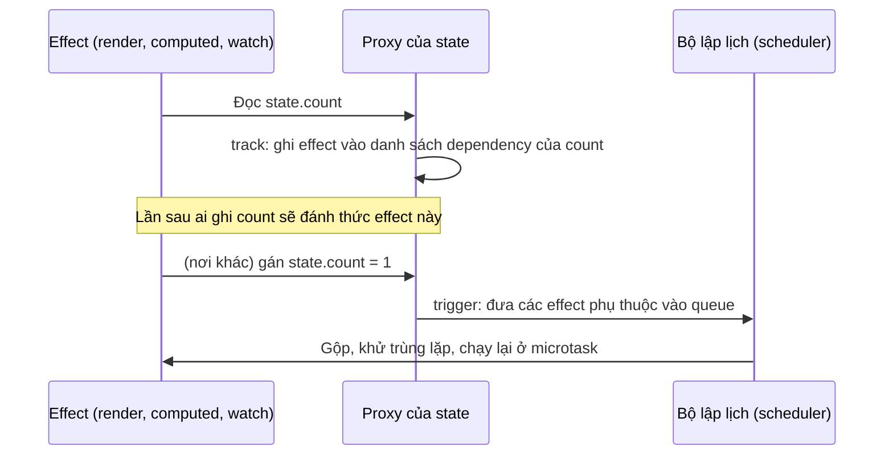
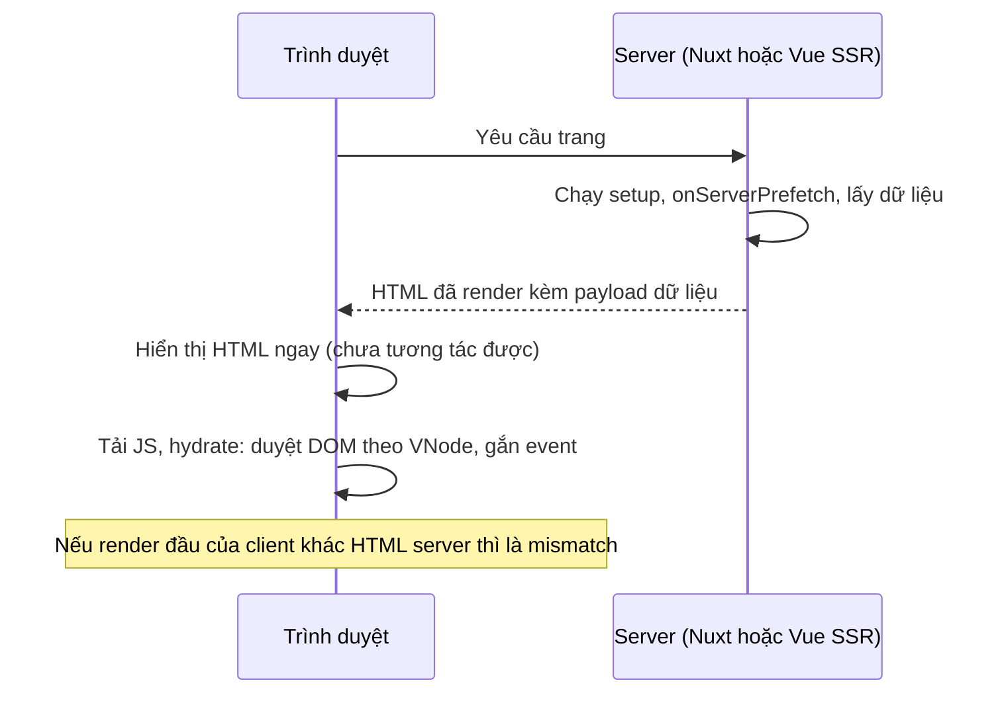
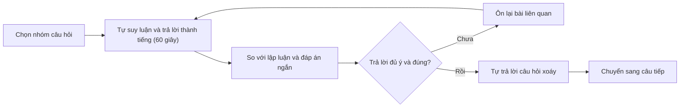

# Câu hỏi: Vue phỏng vấn mid-senior

Bộ 46 câu hỏi chia theo bảy nhóm. Mỗi câu được viết theo chuỗi **câu hỏi tình huống, gợi ý suy luận, lập luận, đáp án ngắn** (nói được trong 30 đến 60 giây), **kiến thức cần nhớ** và **hỏi xoáy** mà người phỏng vấn thường hỏi tiếp. Bài liên quan được ghi để ôn lại.

**Tóm tắt:**

- File gồm 46 câu Vue 3.5 mid-senior chia bảy nhóm: reactivity, rendering, component, state và router, hiệu năng, SSR, testing.
- Reactivity dựa trên `Proxy`: đọc property thì `track` ghi effect, ghi thì `trigger` đưa job vào queue, nên Vue 3 bắt được cả thêm và xóa property mà Vue 2 không bắt được.
- Cập nhật DOM là bất đồng bộ qua queue ở microtask, vì vậy cần `nextTick` để đọc DOM mới, và nhiều lần gán chỉ tạo một job.
- `computed` là effect lazy có cache theo dependency; `watch` chỉ phụ thuộc nguồn bạn chỉ định, còn `watchEffect` tự thu thập dependency.
- Rendering nhanh nhờ compiler: hoist nút tĩnh, patch flag cho nút động, nên chỉ diff đúng phần động.
- Hay bị hỏi xoáy: destructure `reactive` làm mất reactivity thế nào, `toRefs` và `storeToRefs` khác nhau, hydration mismatch xuất hiện khi nào, và vì sao module scope trong SSR rò dữ liệu giữa các request.

## Bộ câu hỏi này dùng để làm gì?

Đây là ngân hàng câu hỏi phỏng vấn Vue 3.5 ở mức mid-senior, phủ các mảng reactivity, rendering, component, state và router, hiệu năng, SSR và testing. Nó không dạy lại từ đầu mà giúp bạn kiểm tra xem mình đã nắm kiến thức của 10 bài lý thuyết đến mức nói ra được hay chưa.

Lý do cần luyện riêng: phỏng vấn ở cấp senior không chấm bạn thuộc bao nhiêu cú pháp, mà chấm khả năng **giải thích cơ chế và đánh đổi**. Biết `computed` có cache là chưa đủ, người phỏng vấn muốn nghe vì sao nó cache được và khi nào cache đó bị vô hiệu. Vì vậy mỗi câu ở dưới không chỉ có đáp án mà còn có chuỗi suy luận từ hiện tượng tới kiến thức nền, để bạn tự suy ra đáp án thay vì học thuộc.

Thời điểm hợp lý để dùng là 1 đến 2 tuần trước buổi phỏng vấn, sau khi bạn đã học xong các bài lý thuyết. Cách làm: đọc câu hỏi, che phần dưới và tự suy luận thành tiếng, mở từng gợi ý nếu bí, so với lập luận và đáp án ngắn, rồi tự trả lời câu hỏi xoáy. Câu nào bí thì quay lại bài liên quan được ghi ở đầu mỗi nhóm.

## Các khái niệm cần biết trước khi luyện

Nhiều câu dưới đây dùng chung một nhóm từ khóa. Nếu chưa chắc nghĩa của chúng, hãy đọc nhanh bảng sau để câu trả lời chuẩn không bị khó hiểu.

| Từ khóa | Nghĩa đơn giản | Vì sao quan trọng |
|---|---|---|
| Effect | Một hàm mà Vue chạy và theo dõi xem nó đọc dữ liệu reactive nào. Render của component, `computed`, `watch` đều là effect. | Là đơn vị mà reactivity chạy lại khi dữ liệu đổi (Câu 1, 7). |
| `track` / `trigger` | `track` ghi lại "effect này đang đọc property kia"; `trigger` báo "property vừa bị ghi, hãy chạy lại các effect đã đăng ký". | Cốt lõi của câu hỏi reactivity, xuất hiện lại ở `computed`, `watch`, `shallowRef`. |
| `Proxy` | Object bọc ngoài một object, cho phép chặn thao tác đọc, ghi, xóa property. | Vì sao Vue 3 bắt được cả thêm/xóa property mà Vue 2 không bắt được (Câu 2). |
| Patch flags, block tree, hoist | Các dấu hiệu mà compiler gắn lúc build để runtime chỉ so sánh phần động của template, bỏ qua phần tĩnh. | Giải thích vì sao Vue 3 nhanh mà không cần virtual DOM so sánh toàn cây (Câu 11). |
| Diff, `key` | Diff là bước so sánh cây VNode cũ và mới để biết cập nhật DOM tối thiểu; `key` là định danh để diff nhận ra item nào là item nào. | Sai `key` thì state của input hoặc component con gắn nhầm item (Câu 12). |
| `flush` | Thời điểm watcher chạy so với lần render: `pre`, `post` hoặc `sync`. | Quyết định bạn đọc được DOM cũ hay mới (Câu 10). |
| Hydration, mismatch | Hydration là việc client dùng lại HTML do server sinh ra rồi gắn event vào; mismatch là khi lần render đầu của client khác HTML server. | Mismatch gây cảnh báo, giật UI hoặc hỏng tương tác (Câu 36). |
| Cross-request state | State nằm ở module scope trên server, bị mọi request của mọi người dùng dùng chung. | Có thể làm lộ dữ liệu người này cho người khác (Câu 38). |
| Server state và client state | Server state là bản sao dữ liệu thuộc về server (có thể cũ, cần làm mới); client state là state chỉ tồn tại ở giao diện. | Chọn sai công cụ sẽ phải tự viết lại cache, retry, dedupe (Câu 24). |
| MSW (Mock Service Worker) | Thư viện chặn request ở tầng mạng và trả dữ liệu giả, để code gọi API chạy thật. | Test sát thực tế hơn mock cả module API (Câu 45). |
| Test pyramid | Mô hình nhiều test nhỏ và nhanh ở đáy, ít test E2E chậm ở đỉnh. | Khung trả lời cho câu chiến lược test (Câu 41). |

Hai cơ chế dưới đây là nền cho khoảng một phần ba bộ câu hỏi, nên đáng vẽ ra để nhớ.

Câu hỏi reactivity (Nhóm 1) hầu như luôn quay về vòng lặp track và trigger sau.

Đọc sơ đồ: effect đọc thì được ghi tên, ghi thì các effect đã ghi tên bị xếp hàng. Việc gộp và khử trùng lặp là lý do nhiều lần gán liên tiếp chỉ render một lần (Câu 5), và `flush` (Câu 10) chính là chọn điểm trong queue này để watcher chạy.

Nhóm SSR (Nhóm 6) xoay quanh việc cùng một code chạy hai nơi, theo trình tự sau.

Đọc sơ đồ: người dùng thấy nội dung sớm nhờ HTML từ server, nhưng chỉ bấm được sau khi hydrate xong. Vì client phải dựng lại đúng cây đó, mọi thứ ngẫu nhiên, thời gian hay `window` ở lần render đầu đều có nguy cơ gây mismatch.

## Cách dùng bộ câu hỏi

Cấu trúc trả lời nên theo: **định nghĩa ngắn, cơ chế, đánh đổi, ví dụ thực tế**. Tránh liệt kê API mà không giải thích vì sao.

---

## Nhóm 1: Reactivity (Bài [1](../../../10-Vue/easy/lt-01-reactivity-vue3.md), [4](../../../10-Vue/medium/lt-04-computed-watch-rendering.md))

### Câu 1. Bạn gán `state.count++` ở một nơi, và một component ở nơi khác tự vẽ lại. Vue biết phải vẽ lại component đó bằng cách nào?

**Phải thuộc:** Câu này là câu cốt lõi, gặp rất thường xuyên.
**Gợi ý suy luận:**
- Để biết "ai cần chạy lại", Vue phải biết ai đã đọc `count`. Việc đọc đó bị chặn ở đâu (Proxy `get`)?
- Khi đọc, thông tin "effect nào đang chạy" được ghi vào đâu (`track`, dependency table)?
- Khi ghi thì cái bảng đó được dùng ra sao (`trigger`)?

**Lập luận:** Vì state được bọc trong `Proxy`, mọi lần đọc property trong lúc một effect đang chạy đều đi qua `get`, nên Vue ghi lại "effect này phụ thuộc `count`" (`track`). Phép gán đi qua `set`, nên Vue tra bảng và xếp các effect đã ghi tên vào queue (`trigger`). Render của component, `computed` và `watch` đều là effect, nên component trên được chạy lại.
**Đáp án ngắn:** Vue dùng `Proxy` bọc object. Đọc trong effect thì `track` ghi dependency, ghi thì `trigger` lập lịch chạy lại các effect đó. Render, `computed`, `watch` đều là effect.
**Nhớ:** Đọc thì track, ghi thì trigger. Xem [Bài 1](/go?p=10-Vue%2Feasy%2Flt-01-reactivity-vue3.md).
**Hỏi xoáy:** Nếu effect có nhánh `if` mà nhánh sau không được đọc, nó có phụ thuộc biến trong nhánh đó không? Có vì sao? (Phụ thuộc được thu thập lại sau mỗi lần chạy, nên nhánh không đọc thì không phụ thuộc.) Dependency table lưu thế nào? (`WeakMap` theo target, `Map` theo key, rồi tập effect; dùng `WeakMap` để target hết người giữ thì được thu gom.)

### Câu 2. Ở Vue 2, thêm một property mới vào object không làm UI cập nhật, còn Vue 3 thì có. Điều gì ở cơ chế bên dưới tạo ra khác biệt đó?
**Gợi ý suy luận:**
- Vue 2 "gắn" reactivity vào từng property đã tồn tại lúc khởi tạo (`Object.defineProperty`). Property chưa tồn tại thì sao?
- `Proxy` chặn thao tác ở mức nào (cả object, không theo từng key)?
- Vì sao `Proxy` không giả lập được bằng polyfill?

**Lập luận:** `defineProperty` chỉ cài getter/setter cho các key đã có, nên key thêm sau, xóa key, hay gán theo index mảng không đi qua getter/setter nào, vì vậy Vue 2 cần `Vue.set`. `Proxy` chặn thao tác trên cả object (`get`, `set`, `has`, `deleteProperty`), nên thêm hay xóa key đều bị bắt. Proxy lại bọc lười: object lồng bên trong chỉ được proxy khi truy cập tới, không duyệt đệ quy lúc khởi tạo, và hỗ trợ cả `Map`, `Set`.
**Đáp án ngắn:** Vue 2 dùng `Object.defineProperty` nên không bắt được thêm/xóa key hay index mảng. Vue 3 dùng `Proxy` bắt mọi thao tác, proxy lười khi truy cập, hỗ trợ `Map`, `Set`.
**Nhớ:** Proxy chặn cả object, defineProperty chỉ chặn key có sẵn.
**Hỏi xoáy:** Vậy hệ quả với trình duyệt cũ? Proxy không polyfill được hoàn toàn vì là cơ chế của engine, nên Vue 3 không chạy trên IE11.

### Câu 3. Cùng là "biến reactive", bạn chọn `ref` hay `reactive`? Chuyện gì xảy ra khi bạn gán lại cả biến?

**Phải thuộc:** Câu này là câu cốt lõi, gặp rất thường xuyên.
**Gợi ý suy luận:**
- `reactive` trả về Proxy của chính object. Nếu bạn gán biến sang object khác, Proxy cũ còn ai giữ không?
- Primitive (số, chuỗi) không bọc Proxy được. Vậy `ref` giải quyết bằng cách nào (hộp có `.value`)?
- Hộp `ref` đi đâu cũng là cùng một hộp. Điều đó giúp gì khi truyền hàm?

**Lập luận:** Proxy chỉ theo dõi thao tác trên chính nó, nên khi bạn gán biến `state = {...}` hoặc destructure, liên kết với Proxy cũ đứt, reactivity mất. `ref` là một hộp ổn định: người dùng luôn thao tác qua `.value`, nên gán lại cả giá trị, kể cả primitive, vẫn kích hoạt `trigger`. Vì thế mặc định chọn `ref`; `reactive` chỉ hợp khi object cố định và bạn muốn bỏ `.value`.
**Đáp án ngắn:** Mặc định dùng `ref`: mọi kiểu, gán lại được, truyền đi không mất reactivity. `reactive` chỉ cho object và mất reactivity khi gán lại biến hoặc destructure.
**Nhớ:** `ref` là hộp, `reactive` là vỏ bọc chính object.
**Hỏi xoáy:** `ref` chứa object thì bên trong là gì? (`reactive` của object đó.) Unwrap `.value` tự động ở đâu? (Trong template và property của `reactive`; không unwrap với phần tử mảng reactive.)

### Câu 4. Bạn viết `const { count } = state` rồi `state.count++` nhưng giao diện dùng `count` không đổi. Vì sao và sửa thế nào?

**Phải thuộc:** Câu này là câu cốt lõi, gặp rất thường xuyên.
**Gợi ý suy luận:**
- Dòng destructure thực chất làm gì với một primitive (đọc một lần, copy giá trị)?
- Sau đó `count` còn đi qua `get` của Proxy không?
- Muốn giữ liên kết, ta cần giữ thứ gì thay vì giá trị (ref trỏ vào property, hoặc getter)?

**Lập luận:** Destructure đọc `state.count` đúng một lần rồi sao chép giá trị số vào biến thường. Biến đó không còn đi qua Proxy, nên không có `track` hay `trigger` nào gắn với nó. Để giữ liên kết, phải giữ một tham chiếu "sống": `toRef`, `toRefs` tạo ref trỏ về property gốc, hoặc truyền getter `() => state.count`.
**Đáp án ngắn:** Primitive bị copy ra khỏi Proxy lúc destructure nên mất liên kết. Dùng `toRefs`, `toRef` hoặc truyền getter.
**Nhớ:** Reactivity nằm ở lần đọc qua Proxy, không nằm ở giá trị.
**Hỏi xoáy:** Props destructure ở Vue 3.5 thì sao? (Compiler viết lại thành `props.x` nên vẫn reactive, nhưng `watch(x, ...)` vẫn phải bọc `() => x` vì đối số của `watch` được đánh giá một lần.)

### Câu 5. Bạn gán state ba lần liên tiếp rồi đọc ngay DOM nhưng vẫn thấy giá trị cũ, và component chỉ vẽ lại đúng một lần. Điều gì đang diễn ra, và làm sao đọc được DOM mới?

**Phải thuộc:** Câu này là câu cốt lõi, gặp rất thường xuyên.
**Gợi ý suy luận:**
- Nếu mỗi lần gán đều vẽ lại ngay thì tốn gì? Vue đã chọn cách nào để tránh (xếp hàng, gộp)?
- Queue được xả lúc nào so với code sync đang chạy (microtask)?
- Muốn "chờ sau lần xả đó" thì cần một promise như thế nào?

**Lập luận:** `trigger` không chạy effect ngay mà đưa job vào queue và khử trùng lặp job cùng một component, nên ba lần gán chỉ để lại một job. Queue được xả ở microtask, tức sau khi code sync hiện tại xong, nên lúc đọc ngay DOM vẫn là bản cũ. `nextTick` trả về promise resolve sau lần xả kế tiếp, nên `await nextTick()` rồi mới đọc.
**Đáp án ngắn:** Cập nhật DOM được gộp và chạy ở microtask. `nextTick` trả promise resolve sau lần flush, để đọc DOM đã cập nhật.
**Nhớ:** Gộp và hoãn là lý do render rẻ; `nextTick` là cách chờ.
**Hỏi xoáy:** Nếu cần watcher chạy ngay khi ghi thì sao? (`flush: 'sync'`: không gộp, nên mỗi lần ghi chạy một lần, chi phí cao.)

### Câu 6. Bạn nhét một instance bản đồ hoặc biểu đồ vào `ref` và ứng dụng chậm hoặc lỗi lạ. Vì sao, và `shallowRef` với `markRaw` giúp gì?
**Gợi ý suy luận:**
- `ref` chứa object thì bọc bằng gì, sâu đến đâu (`reactive`, đệ quy khi truy cập)?
- Instance thư viện ngoài có tự quản lý state nội bộ không? Bọc Proxy thì có hệ quả gì (so sánh danh tính, chi phí)?
- Một bên chỉ theo dõi việc gán `.value`, một bên cấm proxy hẳn: hai việc đó khác nhau thế nào?

**Lập luận:** `ref` làm object bên trong thành `reactive` sâu, nên mọi lần truy cập property lồng nhau đều tốn track và instance ngoài bị bọc Proxy, có thể hỏng khi so sánh danh tính. `shallowRef` chỉ theo dõi gán lại `.value`, phù hợp dữ liệu lớn chỉ thay cả giá trị. `markRaw` đánh dấu object không bao giờ bị proxy, phù hợp instance chart, map.
**Đáp án ngắn:** `shallowRef` chỉ theo dõi việc gán lại `.value`, dùng cho dữ liệu lớn thay thế nguyên khối. `markRaw` cấm proxy object, dùng cho instance thư viện ngoài.
**Nhớ:** Giảm độ sâu theo dõi khi dữ liệu lớn hoặc không thuộc về Vue.
**Hỏi xoáy:** Mutate bên trong `shallowRef` thì UI cập nhật thế nào? (Không tự cập nhật; gọi `triggerRef` hoặc gán lại `.value`.) `Object.freeze` có tác dụng gì? (Vue bỏ qua object đóng băng nên cũng tránh proxy.)

### Câu 7. Component đã bị gỡ khỏi màn hình nhưng memory vẫn tăng. Những thứ gì Vue dọn giúp bạn, và những thứ gì bạn phải tự dọn?
**Gợi ý suy luận:**
- Effect tạo trong `setup` được gắn vào đâu để biết lúc nào dừng (scope của component)?
- Listener `window`, `setInterval`, subscription nằm ngoài Vue: ai biết để dừng chúng?
- Effect tạo ngoài `setup` (module, timer) thì thuộc scope nào?

**Lập luận:** Vì effect tạo trong `setup` được gắn vào scope component, khi component hủy scope tự dừng các effect (render, `computed`, `watch`). Tài nguyên ngoài Vue thì scope không biết, nên bạn phải dọn trong `onUnmounted`, `onScopeDispose` hoặc `onWatcherCleanup` (3.5). Effect tạo ngoài scope không có chủ nên cần bọc bằng `effectScope` và `stop()`.
**Đáp án ngắn:** Effect trong `setup` tự dừng khi component hủy. Listener, timer, subscription phải dọn bằng `onUnmounted`, `onScopeDispose` hay `onWatcherCleanup`; effect ngoài scope cần `effectScope`.
**Nhớ:** Vue chỉ dọn thứ nó sở hữu.
**Hỏi xoáy:** `onWatcherCleanup` khác tham số `onCleanup` thế nào? (Phải gọi sync trong watcher, chỉ có từ 3.5.) Tìm rò rỉ bằng gì? (Heap snapshot, so sánh trước và sau khi mount/unmount.)

---

## Nhóm 2: Rendering (Bài [4](../../../10-Vue/medium/lt-04-computed-watch-rendering.md))

### Câu 8. Bạn có giá trị `fullName` ghép từ hai ô nhập. Nên viết bằng `computed`, method hay `watch`, và vì sao?

**Phải thuộc:** Câu này là câu cốt lõi, gặp rất thường xuyên.
**Gợi ý suy luận:**
- Giá trị này được "dẫn xuất" từ dữ liệu khác, hay là một hành động cần làm khi dữ liệu đổi?
- Nếu template đọc nó 10 lần mà nguồn không đổi, có cần tính lại 10 lần không (cache)?
- Effect của `computed` biết dependency nhờ cơ chế nào (track/trigger giống Câu 1)?

**Lập luận:** `fullName` chỉ phụ thuộc hai ô nhập, nên nó là giá trị dẫn xuất. `computed` là effect lười: chỉ tính khi có người đọc, rồi cache cho đến khi một dependency đổi, nên đọc 10 lần chỉ tính một lần. Method chạy lại mỗi lần gọi. `watch` dùng cho tác dụng phụ (gọi API, ghi `localStorage`) khi dữ liệu đổi, không phải để sinh giá trị.
**Đáp án ngắn:** `computed` lazy và có cache, tính lại khi dependency đổi, phải thuần. Method chạy mỗi lần gọi. `watch` dành cho tác dụng phụ.
**Nhớ:** Dẫn xuất thì `computed`, tác dụng phụ thì `watch`.
**Hỏi xoáy:** Nếu kết quả mới bằng kết quả cũ thì effect phụ thuộc có chạy lại? (Từ 3.4 thì không, vì so sánh giá trị trước khi báo.) Khi nào cần writable computed? (Khi muốn gán ngược lại vào nguồn, như `v-model` trên giá trị dẫn xuất.)

### Câu 9. Bạn cần gọi API mỗi khi `id` đổi. Dùng `watch` hay `watchEffect`? Nếu `id` đổi nhanh, request cũ về sau thì sao?
**Gợi ý suy luận:**
- `watch` được nói rõ nguồn, còn `watchEffect` tự đoán nguồn: cái nào chạy ngay, cái nào lazy?
- Với `async`, phần code sau `await` đầu tiên có còn nằm trong lúc effect đang `track` không?
- Request cũ về chậm hơn request mới thì ghi đè kết quả thế nào, và hủy nó bằng gì?

**Lập luận:** `watch` chỉ phụ thuộc nguồn bạn chỉ định, lazy và có giá trị cũ/mới. `watchEffect` chạy ngay và tự thu thập dependency, nhưng chỉ phần đọc sync trước `await` đầu tiên được `track`, vì sau `await` effect không còn "đang chạy". Về race condition: nếu không hủy, request cũ về sau có thể ghi đè dữ liệu của request mới, nên mỗi lần chạy lại phải dọn lần trước bằng `onCleanup` kèm `AbortController`.
**Đáp án ngắn:** `watch` chỉ định nguồn, lazy, có giá trị cũ/mới. `watchEffect` tự thu thập dependency và chạy ngay; với async, chỉ phụ thuộc đọc trước `await` đầu tiên được theo dõi. Chống race bằng `onCleanup` và `AbortController`.
**Nhớ:** Track chỉ xảy ra khi effect đang chạy sync.
**Hỏi xoáy:** 3.5 thêm gì? (`deep` dạng số, `pause` và `resume` cho watcher; `once` đã có từ 3.4.)

### Câu 10. Watcher của bạn đọc `el.offsetHeight` nhưng luôn ra chiều cao cũ. Giá trị `flush` nào giúp, và cái giá phải trả là gì?
**Gợi ý suy luận:**
- Nhìn lại queue ở Câu 5: watcher mặc định chạy trước hay sau lần render?
- Muốn thấy DOM mới thì watcher phải chạy ở điểm nào trong queue?
- Nếu watcher chạy ngay trong lúc ghi (không gộp), nhiều lần ghi sẽ kéo theo gì?

**Lập luận:** `flush: 'pre'` (mặc định) chạy trước render của component và được gộp, nên DOM lúc đó vẫn cũ. `post` đẩy watcher sang sau khi DOM cập nhật, nên đọc được kích thước mới (`watchPostEffect`). `sync` chạy ngay lúc ghi và không gộp, nên N lần ghi thì chạy N lần, tốn kém.
**Đáp án ngắn:** `pre` chạy trước render và gộp; `post` chạy sau khi DOM cập nhật để đọc DOM mới; `sync` chạy ngay mỗi lần ghi, không gộp, chi phí cao.
**Nhớ:** `flush` chọn điểm chạy watcher trong queue.
**Hỏi xoáy:** Khi nào `sync` chấp nhận được? (Cần sync tuyệt đối, ít lần ghi.) Watcher `pre` đổi state làm render lại thì sao? (Job mới được xếp vào cùng lượt xả; vòng lặp vô hạn bị Vue cảnh báo.)

### Câu 11. Vue 3 vẫn dùng virtual DOM mà nhanh hơn Vue 2 rõ rệt. Phần nào được làm sẵn lúc build để runtime đỡ việc?
**Gợi ý suy luận:**
- Template cố định cấu trúc: compiler có biết được chỗ nào chắc chắn không đổi không?
- Nếu biết một nút chỉ đổi `class`, runtime cần so sánh những gì (patch flags)?
- Chỉ gom các nút động vào một mảng phẳng thì runtime duyệt gì (block tree)?

**Lập luận:** Vì template là ngôn ngữ hạn chế, compiler phân tích tĩnh được phần nào cố định. Nó hoist nút tĩnh ra ngoài (tạo một lần), gắn patch flag cho nút động (ví dụ "chỉ text đổi"), và gom nút động của mỗi block thành mảng phẳng (block tree). Nhờ vậy runtime bỏ qua phần tĩnh và chỉ so sánh đúng property động, thay vì diff toàn cây.
**Đáp án ngắn:** SFC biên dịch lúc build ra render function. Compiler gắn patch flags, hoist nút tĩnh, dùng block tree, cache handler, nên runtime chỉ so sánh phần động.
**Nhớ:** Việc nặng chuyển từ runtime sang compile time.
**Hỏi xoáy:** Render function viết tay mất gì? (Các tối ưu do compiler suy ra.) Static stringification? (Cụm nút tĩnh lớn được gộp thành một chuỗi HTML để tạo nhanh.)

### Câu 12. Danh sách có ô nhập, bạn xóa dòng đầu nhưng chữ gõ dở lại hiện ở dòng khác. Vì sao, và `key` phải chọn thế nào?

**Phải thuộc:** Câu này là câu cốt lõi, gặp rất thường xuyên.
**Gợi ý suy luận:**
- Khi so sánh danh sách cũ và mới, Vue dựa vào gì để nhận ra "đây là cùng một item"?
- Nếu key là index thì sau khi xóa dòng đầu, item B có index mấy, và Vue ghép nó với DOM nào?
- State của ô nhập nằm ở đâu (trong DOM/component được tái sử dụng)?

**Lập luận:** Khi không có key hoặc dùng index, Vue ghép phần tử cũ và mới theo vị trí. Xóa dòng đầu làm mọi item dịch lên một index, nên Vue giữ lại DOM/component cũ ở từng vị trí và chỉ đổi dữ liệu, còn state nội tại (chữ trong ô nhập, state component con) ở lại vị trí cũ, tức gắn nhầm item. Key ổn định theo danh tính item (id) cho Vue ghép đúng item, nên state đi theo item.
**Đáp án ngắn:** `key` cho diff nhận ra item nào di chuyển, thêm, xóa để giữ đúng state. Dùng index thì khi đổi thứ tự hoặc chèn, state gắn nhầm item. Dùng id ổn định.
**Nhớ:** Key là danh tính, không phải vị trí.
**Hỏi xoáy:** Muốn ép tạo lại component thì làm gì? (Đổi `key`, vì key khác thì coi là node khác.) Khi đổi thứ tự Vue dùng thuật toán gì? (Xử lý hai đầu, rồi dãy con tăng dài nhất để giảm số lần di chuyển DOM.)

### Câu 13. Một panel bật tắt liên tục, một panel khác ít khi mở và nặng. Chọn `v-if` hay `v-show` cho từng cái? Và vì sao `v-if` cùng `v-for` trên một phần tử gây lỗi?

**Phải thuộc:** Câu này là câu cốt lõi, gặp rất thường xuyên.
**Gợi ý suy luận:**
- Một cái tạo/hủy cây, một cái chỉ đổi CSS `display`: chi phí chuyển và chi phí khởi tạo khác nhau thế nào?
- Với `v-if` và `v-for` cùng nút, Vue 3 đánh giá cái nào trước? Khi đó biến lặp có tồn tại chưa?

**Lập luận:** `v-if` hủy cây khi false nên khởi tạo lười và tốn chuyển đổi; `v-show` luôn giữ DOM, đổi `display` rất rẻ nhưng trả chi phí khởi tạo từ đầu. Vì vậy panel bật tắt liên tục chọn `v-show`, panel nặng ít mở chọn `v-if`. Ở Vue 3 `v-if` có ưu tiên cao hơn `v-for`, nên điều kiện được đánh giá trước khi biến lặp tồn tại và không truy cập được; cách đúng là lọc bằng `computed` rồi `v-for`.
**Đáp án ngắn:** `v-if` tạo/hủy, chuyển đắt nhưng khởi tạo lười; `v-show` đổi `display`, chuyển rẻ. `v-if` ưu tiên hơn `v-for` ở Vue 3 nên không dùng chung, hãy lọc bằng `computed`.
**Nhớ:** Chuyển nhiều thì `v-show`, hiếm thì `v-if`.
**Hỏi xoáy:** `v-show` trên `<template>` được không? (Không.) Tác động tới hook? (`v-if` kích hoạt mounted/unmounted mỗi lần; `v-show` thì không.)

### Câu 14. Bảng 10.000 dòng chậm, đồng nghiệp đề xuất `v-memo`. Nó bỏ qua việc gì, và điều gì có thể hỏng nếu dùng sai?
**Gợi ý suy luận:**
- Bình thường mỗi lần render lại, cây con được so sánh. `v-memo` cho phép bỏ bước nào?
- Nó quyết định "bỏ qua" dựa trên gì (dependency array, `Object.is`)?
- Nếu quên một giá trị cần thiết trong mảng đó thì sao?

**Lập luận:** `v-memo="[a, b]"` nói rằng cây con chỉ phụ thuộc a và b. Nếu cả hai giữ nguyên theo `Object.is`, Vue bỏ qua việc patch cả cây con. Nếu cây con thực sự đọc thêm giá trị c mà bạn quên đưa vào mảng, c đổi nhưng Vue không patch, nên UI cũ. Do đó chỉ dùng khi đã đo thấy cần.
**Đáp án ngắn:** `v-memo` bỏ qua patch cây con khi dependency array không đổi (so `Object.is`). Dùng cho danh sách rất lớn sau khi đo; quên phụ thuộc thì UI cũ.
**Nhớ:** Tối ưu bằng cách hứa với Vue; hứa sai thì UI sai.
**Hỏi xoáy:** Khác `v-once` thế nào? (`v-once` render một lần, không bao giờ cập nhật.) Vì sao thường tách component là đủ? (Component con chỉ re-render khi props đổi, nên đã có "memo" tự nhiên.)

---

## Nhóm 3: Component (Bài [2](../../../10-Vue/easy/lt-02-component-props-events-slots.md), [3](../../../10-Vue/easy/lt-03-api-styles-lifecycle.md), [10](../../../10-Vue/hard/lt-10-pattern-nang-cao-kien-truc.md))

### Câu 15. Component con sửa trực tiếp một prop và trình duyệt cảnh báo. Vì sao Vue cấm, và nếu con sửa một property bên trong object prop thì sao?

**Phải thuộc:** Câu này là câu cốt lõi, gặp rất thường xuyên.
**Gợi ý suy luận:**
- Khi dữ liệu có thể bị sửa từ nhiều nơi, muốn tìm "ai đã đổi nó" thì khó hay dễ?
- Prop là bản của cha hay của con? Nếu cha render lại thì giá trị con sửa còn không?
- Object truyền qua prop là tham chiếu: sửa bên trong thì cha có bị đổi không?

**Lập luận:** Data flow một chiều giúp truy vết: chỉ chủ sở hữu state mới sửa nó, các nơi khác chỉ đọc và đề nghị đổi qua emit. Gán prop sẽ bị cảnh báo vì giá trị đó sẽ bị ghi đè khi cha render lại. Sửa property bên trong object prop thì không bị chặn (cùng tham chiếu, đổi luôn dữ liệu của cha) nhưng phá trace flow, nên là anti-pattern. Con nên `emit` hoặc dùng `defineModel`.
**Đáp án ngắn:** Để data flow truy vết được: chỉ chủ state sửa. Gán prop bị cảnh báo; mutate object bên trong không bị chặn nhưng là anti-pattern. Con `emit` hoặc dùng `defineModel`.
**Nhớ:** Xuống bằng props, lên bằng emit.
**Hỏi xoáy:** Cần state cục bộ khởi tạo từ prop thì làm sao? (`ref(props.x)` chỉ lấy giá trị đầu; muốn sync thì dùng `computed` hoặc `watch`.)

### Câu 16. Bạn muốn `<MyInput v-model="name" />` mà không viết tay prop và emit. `defineModel` làm thay những gì, và nếu cha không bind thì sao?
**Gợi ý suy luận:**
- `v-model` trên component thực chất là cặp nào (prop `modelValue` và event `update:modelValue`)?
- Ref hai chiều làm gì khi bạn gán `.value` (đọc từ prop, ghi thì emit)?
- Nếu cha không truyền gì thì giá trị lưu ở đâu?

**Lập luận:** `v-model` là đường tắt cho prop cộng event cập nhật. `defineModel` khai báo cặp đó và trả về một ref: đọc thì lấy từ prop, ghi `.value` thì emit `update:...`. Khi cha không bind, không có prop để đọc nên nó giữ giá trị cục bộ như một state riêng. Có thể khai báo nhiều model theo tên và nhận modifier.
**Đáp án ngắn:** Khai báo prop `modelValue` (hoặc tên chỉ định) và event `update:` tương ứng, trả ref hai chiều: ghi thì emit, cha không bind thì như state cục bộ.
**Nhớ:** `v-model` là prop xuống cộng emit lên.
**Hỏi xoáy:** Modifier tùy biến thế nào? (Destructure tuple thứ hai kèm `get`/`set` để biến đổi giá trị.) Trước 3.4 làm gì? (Tự viết prop, emit hoặc `computed` có `get`/`set`.)

### Câu 17. Con muốn cho cha quyết định cách hiển thị từng dòng danh sách. Slot thường có đủ không, và biến nào cha truy cập được trong nội dung slot?
**Gợi ý suy luận:**
- Nội dung bên trong thẻ con được viết ở file của ai? Biên dịch trong scope của ai?
- Muốn dữ liệu của con đến được nội dung đó thì phải truyền bằng đường nào (slot props)?
- Slot là hàm hay giá trị có sẵn? Điều đó nói gì về thời điểm render?

**Lập luận:** Nội dung slot được viết ở cha nên được biên dịch trong scope của cha, và chỉ thấy dữ liệu của cha. Muốn dữ liệu con ra ngoài thì con phải truyền tường minh qua slot props; đó là scoped slot, để cha quyết định cách hiển thị. Vì slot được biên dịch thành hàm, nó chỉ chạy khi con gọi, tức là lười.
**Đáp án ngắn:** Slot cho cha đưa nội dung; scoped slot cho con đưa dữ liệu ra để cha quyết định hiển thị. Nội dung slot biên dịch trong scope của cha, chỉ thấy dữ liệu con qua slot props, và là hàm nên lười.
**Nhớ:** Dữ liệu thuộc scope nơi code được viết.
**Hỏi xoáy:** `defineSlots` làm gì ở runtime? (Không gì, chỉ gắn kiểu.) Renderless component hay composable? (Composable nhẹ hơn khi chỉ chia sẻ logic; renderless khi cần cả cấu trúc template.)

### Câu 18. Bạn bọc `<input>` trong `BaseInput` và `class`, `placeholder` truyền từ ngoài tự xuất hiện ở thẻ root, nhưng bạn lại muốn chúng rơi vào `<input>` bên trong. Cơ chế nào đang chạy và chỉnh nó ra sao?
**Gợi ý suy luận:**
- Property không khai báo là prop hay emit thì đi đâu (`$attrs`)?
- Mặc định chúng được gắn vào phần tử nào (root)? Có cách tắt mặc định đó không?
- Component nhiều root thì Vue biết gắn vào đâu?

**Lập luận:** Vì attribute không nằm trong `props` hay `emits` được gom vào `$attrs`, Vue gắn chúng vào phần tử root, với `class` và `style` được merge. Để chuyển xuống phần tử khác, đặt `inheritAttrs: false` và `v-bind="$attrs"` lên phần tử đích. Component nhiều root thì Vue không đoán được nên bạn phải tự bind.
**Đáp án ngắn:** Attribute và listener không khai báo rơi xuống root; `class`, `style` được merge. Dùng `inheritAttrs: false` với `v-bind="$attrs"` để chuyển xuống phần tử khác.
**Nhớ:** `$attrs` là phần dư chưa khai báo.
**Hỏi xoáy:** `$listeners` của Vue 2 đâu rồi? (Gộp vào `$attrs`.) Wrapper `BaseInput` nên làm gì? (Tắt kế thừa và bind `$attrs` vào `<input>`.)

### Câu 19. Hai mixin cùng định nghĩa `loading` và component dùng chúng bị lỗi khó lần ra. Composable giải quyết vấn đề đó thế nào, và Options với Composition API khác nhau ở đâu?

**Phải thuộc:** Câu này là câu cốt lõi, gặp rất thường xuyên.
**Gợi ý suy luận:**
- Mixin trộn property vào component: bạn nhìn code có biết `loading` đến từ đâu không? Hai mixin trùng tên thì sao?
- Composable là một hàm: giá trị trả về được bạn đặt tên thế nào, truyền tham số được không?
- Options chia code theo loại (data, methods), Composition chia theo gì?

**Lập luận:** Mixin hợp nhất vào cùng một không gian tên nên nguồn gốc mờ, tên trùng thì ghi đè, và không nhận tham số. Composable là hàm trả về giá trị mà bạn tự đặt tên khi destructure, nên nguồn rõ, đổi tên được để tránh xung đột, nhận tham số, và kiểu suy ra tốt. Options tổ chức theo loại, Composition tổ chức theo logic nên gom code liên quan lại một chỗ. Cả hai chạy trên cùng một runtime.
**Đáp án ngắn:** Options tổ chức theo loại, Composition theo logic và tái sử dụng bằng composable. Mixin có nguồn gốc mờ, xung đột tên, không tham số hóa; composable giải quyết cả ba và có kiểu tốt.
**Nhớ:** Composable là hàm tường minh, mixin là trộn ngầm.
**Hỏi xoáy:** Dùng cả hai trong một component được không? (Được, cùng runtime.) Migrate dự án Options lớn thế nào? (Dần dần: code mới dùng Composition, tách logic lặp thành composable.)

### Câu 20. Cha có con, bạn log trong `mounted` của cả hai thì con in trước cha. Vì sao, và thứ tự khi cập nhật và hủy là gì?

**Phải thuộc:** Câu này là câu cốt lõi, gặp rất thường xuyên.
**Gợi ý suy luận:**
- Để cha `mounted`, DOM của cha phải hoàn chỉnh. DOM của cha chứa gì (cây con)?
- Vậy con phải xong trước hay sau cha?
- Với unmount, cha bắt đầu hủy trước rồi hủy con: thứ tự "before" và "after" khác nhau ra sao?

**Lập luận:** Cha chỉ mounted khi toàn bộ cây con đã mounted, nên con `mounted` trước cha, còn `beforeMount` đi từ cha xuống. Cập nhật tương tự: `beforeUpdate` cha trước, `updated` con trước. Hủy: `beforeUnmount` cha trước rồi tới con, còn `unmounted` con xong rồi mới đến cha.
**Đáp án ngắn:** Mount: cha `beforeMount`, con `beforeMount`, con `mounted`, cha `mounted`. Update: `beforeUpdate` cha trước, `updated` con trước. Unmount: `beforeUnmount` cha rồi con, `unmounted` con trước cha.
**Nhớ:** "Before" đi xuống, "sau" đi lên.
**Hỏi xoáy:** Hook nào chạy trên SSR? (Chỉ `setup`, `onServerPrefetch`; xem Câu 39.) Vì sao đổi state trong `onUpdated` nguy hiểm? (Đổi state gây render lại, rồi lại `onUpdated`, dễ thành vòng lặp.)

### Câu 21. Theme hoặc form context cần xuống sâu nhiều tầng mà bạn không muốn truyền props qua từng tầng. `provide/inject` làm được, nhưng làm thế nào cho đúng và không biến nó thành global state bừa bãi?
**Gợi ý suy luận:**
- Dữ liệu provide gắn với cây component nào, và ai có quyền sửa nó?
- Nếu mọi con cháu đều sửa được giá trị inject, truy vết sẽ ra sao (nhớ Câu 15)?
- Kiểu của giá trị inject được biết bằng cách nào?

**Lập luận:** `provide/inject` gắn với cây component, nên hợp cho ngữ cảnh theo cây (theme, form, tab group). Để giữ một nguồn ghi, provide ref ở dạng `readonly` cùng hàm đổi, tương tự data flow một chiều ở Câu 15. Dùng `InjectionKey<T>` để có kiểu. Với state nghiệp vụ dùng toàn app thì dùng Pinia, không dùng provide.
**Đáp án ngắn:** Dùng cho ngữ cảnh gắn với cây component. Dùng `InjectionKey` có kiểu, provide ref `readonly` cùng hàm đổi để chỉ một nguồn ghi. Không thay Pinia cho state nghiệp vụ.
**Nhớ:** Provide cho ngữ cảnh theo cây, Pinia cho state toàn cục.
**Hỏi xoáy:** `app.provide` dùng ở đâu? (Plugin, cấp toàn app.) Thiếu provider thì sao? (Nhận `undefined` kèm cảnh báo; đặt giá trị mặc định hoặc ném lỗi rõ ràng.)

---

## Nhóm 4: State và Router (Bài [5](../../../10-Vue/medium/lt-05-composables-pinia.md), [6](../../../10-Vue/medium/lt-06-router-forms.md))

### Câu 22. Pinia cho hai cách viết store. Chúng khác nhau ở đâu, và nếu bạn quên `return` một `ref` trong setup store thì mất gì?
**Gợi ý suy luận:**
- Option store có `state`, `getters`, `actions` rõ ràng: Pinia nhận biết từng loại dễ hay khó?
- Setup store là một hàm như composable: Pinia biết cái nào là state, getter, action bằng cách nào (kiểu của thứ được return)?
- Thứ không được return thì SSR, DevTools và plugin persist có thấy không?

**Lập luận:** Option store khai báo tường minh nên Pinia biết ngay đâu là state, và cho sẵn `$reset`. Setup store là hàm: Pinia duyệt giá trị trả về, `ref` thành state, `computed` thành getter, hàm thành action. Vì Pinia chỉ nhìn được thứ được `return`, state quên return sẽ không được serialize cho SSR, không hiện trong DevTools và plugin persist không thấy. Setup store linh hoạt hơn (dùng `watch`, composable) nhưng phải tự viết reset.
**Đáp án ngắn:** Option store giống Options API, có `$reset`. Setup store giống composable: `ref` là state, `computed` là getter, hàm là action, phải `return` mọi state dùng chung và tự viết reset. Setup linh hoạt hơn.
**Nhớ:** Pinia chỉ biết những gì được khai báo hoặc return.
**Hỏi xoáy:** Vì sao Pinia thay Vuex? (Bỏ mutation, API gọn, kiểu TypeScript tốt, hợp Composition API.)

### Câu 23. Bạn viết `const { count } = useCounterStore()` và `count` mất cập nhật. Vì sao, và `storeToRefs` khác gì `toRefs`?
**Gợi ý suy luận:**
- Store là loại object gì (`reactive`)? Destructure một `reactive` thì xảy ra gì (Câu 4)?
- Cần biến state thành ref giữ liên kết. Còn action thì sao, có cần ref không?
- `toRefs` áp dụng cho toàn bộ property: nó sẽ đụng cả những gì không phải state không?

**Lập luận:** Store là `reactive`, nên destructure primitive làm mất liên kết giống Câu 4. `storeToRefs` tạo ref cho state và getter để destructure vẫn reactive. Action là hàm không cần reactivity nên lấy trực tiếp từ store. `toRefs(store)` cũng tạo ref cho cả action và property nội bộ, nên không phù hợp bằng.
**Đáp án ngắn:** `storeToRefs` tạo ref cho state và getter để destructure mà giữ reactivity vì store là `reactive`. Action lấy trực tiếp từ store.
**Nhớ:** State và getter qua `storeToRefs`, action destructure thẳng.
**Hỏi xoáy:** Vì sao không `toRefs(store)`? (Nó bọc cả action và property nội bộ, còn `storeToRefs` chỉ lấy state và getter.)

### Câu 24. Có state danh sách sản phẩm lấy từ API, filter đang chọn, state mở modal và thông tin đăng nhập. Mỗi thứ để ở đâu, và vì sao không nhét hết vào Pinia?
**Gợi ý suy luận:**
- State này sinh ra ở đâu và ai là nguồn sự thật (server, URL, component, toàn app)?
- Dữ liệu từ server có thể cũ, cần làm mới, retry, gộp request trùng: store tay có làm sẵn không?
- Filter người dùng muốn chia sẻ link thì nên nằm ở đâu?

**Lập luận:** Chọn công cụ theo nguồn sự thật: local thì `ref`; filter muốn chia sẻ link thì `route.query`; dữ liệu server thì TanStack Query hoặc `useFetch`; ngữ cảnh theo cây thì provide/inject; client state toàn app (đăng nhập) thì Pinia. Server state là bản sao có thể cũ, cần stale, invalidate, retry, dedupe, nên copy vào store nghĩa là tự viết lại tất cả, và dễ lệch với server.
**Đáp án ngắn:** Local `ref`; URL `route.query`; server state TanStack Query hoặc `useFetch`; trong cây provide/inject; global client Pinia. Đừng copy server data vào store.
**Nhớ:** Chọn công cụ theo nơi nguồn sự thật nằm.
**Hỏi xoáy:** Vì sao server state khác client state? (Có thể cũ, cần stale/invalidate/retry/dedupe.) Filter nên ở đâu? (Trong URL, để chia sẻ và back/forward hoạt động.)

### Câu 25. Người dùng bấm link sang trang khác, trang cũ đang có form chưa lưu, và bạn còn guard kiểm quyền. Chúng chạy theo thứ tự nào, và guard trả về gì để chặn hay chuyển hướng?

**Phải thuộc:** Câu này là câu cốt lõi, gặp rất thường xuyên.
**Gợi ý suy luận:**
- Logic hợp lý: rời trang cũ hỏi trước, rồi kiểm quyền toàn cục, rồi theo route, rồi mới xác nhận. Các guard map vào thứ tự đó thế nào?
- Guard ở component, ở route record và toàn cục khác nhau ở phạm vi nào?
- Guard "cho qua", "chặn", "chuyển hướng" được biểu diễn bằng giá trị trả về nào?

**Lập luận:** Router đi từ "rời" tới "đến": `beforeRouteLeave` (component cũ), `beforeEach` (toàn cục), `beforeRouteUpdate` (nếu tái sử dụng), `beforeEnter` (route), resolve async component, `beforeResolve`, rồi sau khi điều hướng xong `afterEach`. Guard trả `false` thì hủy, trả địa chỉ thì chuyển hướng, `undefined` hoặc `true` thì cho qua.
**Đáp án ngắn:** `beforeRouteLeave`, `beforeEach`, `beforeRouteUpdate`, `beforeEnter`, resolve async component, `beforeRouteEnter`, `beforeResolve`, rồi `afterEach`. Trả `false` để hủy, địa chỉ để chuyển hướng, `undefined` để cho qua.
**Nhớ:** Từ rời trang cũ tới xác nhận trang mới.
**Hỏi xoáy:** Vì sao không nên dùng `next()`? (Dễ quên gọi hoặc gọi hai lần; giá trị trả về đơn giản hơn.) Kiểm quyền ở client có đủ? (Không, người dùng bỏ qua được client; phải kiểm ở server.)

### Câu 26. Từ `/user/1` bấm sang `/user/2`, URL đổi mà dữ liệu không tải lại. Vì sao `onMounted` không chạy, và có mấy cách sửa?
**Gợi ý suy luận:**
- Hai URL đó khớp cùng route record. Vue Router tạo mới component hay tái sử dụng instance?
- Nếu instance được tái sử dụng thì hook nào chạy (không có mounted lần nữa)?
- Muốn phản ứng khi `params` đổi thì quan sát thứ gì?

**Lập luận:** Cùng route record nên router tái sử dụng instance để tiết kiệm, vì vậy `onMounted` không chạy lại. Phải phản ứng với thay đổi: `watch(() => route.params.id)`, `onBeforeRouteUpdate`, hoặc đổi `:key="route.fullPath"` để ép tạo lại (như Câu 12).
**Đáp án ngắn:** Cùng route record nên instance được tái sử dụng, `onMounted` không chạy lại. Dùng `watch(() => route.params.id)`, `onBeforeRouteUpdate`, hoặc `:key="route.fullPath"`.
**Nhớ:** Cùng route record thì tái sử dụng instance.
**Hỏi xoáy:** `:key` so với `watch`? (`:key` đơn giản nhưng tạo lại làm mất state; `watch` giữ state, điều khiển chi tiết hơn.)

### Câu 27. Với trang chi tiết sản phẩm, bạn tải dữ liệu trước khi chuyển trang hay sau? Cái nào hợp trong tình huống nào?
**Gợi ý suy luận:**
- Nếu tải trước, người dùng thấy gì trong lúc chờ (vẫn ở trang cũ)?
- Nếu chuyển trước rồi tải, cần hiển thị gì trong lúc chờ (skeleton)?
- Nếu dữ liệu không tồn tại thì chặn ngay hay hiển thị lỗi sau?

**Lập luận:** Tải sau điều hướng cho cảm giác phản hồi tức thì vì trang mới hiện ngay với skeleton. Tải trước điều hướng hợp khi cần quyết định có vào trang hay không (ví dụ 404 thì chuyển sang trang lỗi). Với params đổi nhanh, request cũ về sau có thể ghi đè, giống Câu 9; thư viện cache như TanStack Query xử lý giúp việc này và gộp request trùng.
**Đáp án ngắn:** Sau điều hướng (skeleton) cho UX nhanh; trước điều hướng khi cần chặn vào trang nếu không có dữ liệu. Thư viện cache giúp tránh race và trùng request.
**Nhớ:** Phản hồi nhanh thì tải sau, cần chặn thì tải trước.
**Hỏi xoáy:** Chống race khi params đổi nhanh? (Hủy hoặc bỏ qua kết quả cũ bằng `onCleanup`, hoặc dùng key theo params.) 404 do dữ liệu không tồn tại? (Phát hiện sau khi tải rồi chuyển hướng sang trang không tìm thấy, hoặc kiểm trong guard.)

### Câu 28. Client báo form hợp lệ nhưng server từ chối, hoặc ngược lại. Làm sao để hai bên không lệch luật?
**Gợi ý suy luận:**
- Luật validate được định nghĩa ở mấy nơi? Nếu hai nơi thì chúng lệch khi nào?
- Client validate có đáng tin không (người dùng bỏ qua được)?
- Lỗi server trả về thì hiển thị ở đâu cho người dùng?

**Lập luận:** Nếu luật viết riêng hai nơi, chúng sẽ lệch theo thời gian, nên dùng một schema (Zod) làm nguồn sự thật, suy kiểu bằng `z.infer` và nối vào VeeValidate hoặc FormKit. Vì client validate chỉ để trải nghiệm tốt, server vẫn phải validate lại; lỗi server ánh xạ ngược về từng field. Hiện lỗi sau khi field `touched` để không làm phiền người dùng sớm.
**Đáp án ngắn:** Dùng schema (Zod) làm nguồn sự thật, suy kiểu bằng `z.infer`, nối vào VeeValidate hoặc FormKit. Server luôn validate lại; lỗi server ánh xạ về field. Hiện lỗi sau `touched`.
**Nhớ:** Một schema, hai nơi dùng, server là quyết định cuối.
**Hỏi xoáy:** VeeValidate hay FormKit? (VeeValidate nhẹ, linh hoạt; FormKit nhiều thành phần dựng sẵn.) Chặn submit đúp? (Khóa nút trong lúc đang gửi và xử lý idempotent ở server.)

---

## Nhóm 5: Hiệu năng (Bài [8](../../../10-Vue/hard/lt-08-hieu-nang-rendering.md))

### Câu 29. Sếp bảo "trang chậm". Bạn bắt đầu từ đâu, và vì sao không nên sửa ngay chỗ nghi ngờ nhất?
**Gợi ý suy luận:**
- "Chậm" có thể là tải, render, dữ liệu hay tính toán: làm sao biết là cái nào (cần số đo)?
- Nếu sửa nhiều thứ cùng lúc, bạn biết thứ nào có tác dụng không?
- Chỉ số nào phản ánh trải nghiệm người dùng (LCP, INP, CLS)?

**Lập luận:** Trực giác về điểm nghẽn thường sai, nên phải đo trước: Lighthouse cho tải, Vue DevTools và Chrome Performance cho render, bundle visualizer cho kích thước. Đo xong thì xác định nút thắt thuộc loại nào, sửa đúng một thứ rồi đo lại để biết nó có tác dụng và không gây hồi quy.
**Đáp án ngắn:** Đo trước (Lighthouse, DevTools, Performance, bundle visualizer), xác định nút thắt, sửa một thứ rồi đo lại.
**Nhớ:** Đo, sửa một thứ, đo lại.
**Hỏi xoáy:** Chỉ số nào theo dõi? (LCP, INP, CLS.) Kể một lần tối ưu thực tế có số liệu trước và sau.

### Câu 30. Màn hình cần hiển thị 50.000 dòng. Vì sao đừng vẽ hết, và bạn thay bằng gì?
**Gợi ý suy luận:**
- Mỗi dòng tạo bao nhiêu DOM node và VNode? 50.000 dòng thì memory và layout ra sao?
- Người dùng có nhìn thấy cùng lúc 50.000 dòng không? Vậy chỉ cần vẽ phần nào?
- Dữ liệu lớn bọc `reactive` sâu thì tốn gì (Câu 6)?

**Lập luận:** Số DOM node tỷ lệ với số dòng nên chi phí render và layout rất lớn, trong khi người dùng chỉ thấy vài chục dòng. Cách đúng là không lấy hết: phân trang hoặc lọc phía server. Nếu cần cuộn liên tục thì virtual scrolling chỉ vẽ phần nhìn thấy, dữ liệu để `shallowRef` tránh proxy sâu, và `content-visibility` cho phần ngoài màn hình.
**Đáp án ngắn:** Ưu tiên phân trang hoặc lọc phía server. Nếu cần cuộn liên tục thì virtual scrolling, dữ liệu `shallowRef`, `content-visibility` cho phần ngoài màn hình.
**Nhớ:** Chỉ vẽ cái nhìn thấy.
**Hỏi xoáy:** Đánh đổi của virtual list? (Ctrl+F không tìm được phần chưa vẽ, a11y, chiều cao dòng thay đổi.)

### Câu 31. Gõ vào một ô nhập thì cả bảng bên cạnh vẽ lại. Con re-render chính xác khi nào, và bạn giảm bằng cách nào?
**Gợi ý suy luận:**
- Component con chạy lại render khi nào (props đổi theo so sánh nông, slot động, state nó đọc đổi)?
- Nếu cha tạo object hoặc mảng mới mỗi lần render rồi truyền xuống thì con thấy gì (props mới theo `Object.is`)?
- State đổi nhanh nên đặt ở đâu để chỉ phần nhỏ vẽ lại?

**Lập luận:** Con chỉ re-render khi một dependency của nó đổi: props khác theo so sánh nông, slot động, hoặc state nó đọc. Object/mảng tạo mới mỗi lần render thì luôn "khác" dù nội dung giống, nên làm con vẽ lại thừa. Vì vậy giữ props ổn định, truyền đúng trường cần, cô lập state đổi nhanh vào component nhỏ, dùng `computed`, và `v-memo` khi đã đo.
**Đáp án ngắn:** Giữ props ổn định (không tạo object, mảng mới mỗi lần render), truyền đúng trường cần, cô lập state đổi nhanh vào component nhỏ, dùng `computed`, `v-memo` khi đã đo.
**Nhớ:** Con vẽ lại khi props, slot hoặc state nó đọc đổi.
**Hỏi xoáy:** Vì sao truyền object tạo mới mỗi lần render làm con vẽ lại? (Tham chiếu mới thì so sánh nông luôn thấy khác, dù nội dung giống.)

### Câu 32. Bundle ban đầu quá nặng vì có chart và modal ít dùng. Bạn tách ra thế nào, và nếu sau deploy chunk cũ bị xóa thì chuyện gì xảy ra?
**Gợi ý suy luận:**
- Người dùng có cần code của modal ngay khi mở trang không? Tải khi cần (dynamic import) tiết kiệm gì?
- Trong lúc tải chunk, UI cần hiển thị gì, và tải lỗi thì sao?
- Tên file chunk đổi theo hash sau mỗi lần build: trang đang mở còn trỏ tới file cũ thì sao?

**Lập luận:** Code chỉ cần khi tương tác thì không nên nằm trong bundle đầu. `defineAsyncComponent` kèm dynamic import tách nó thành chunk tải khi cần, có `loadingComponent`, `delay`, `errorComponent`, `timeout`. Route cấp trang luôn lazy; modal, chart nặng lazy theo tương tác. Xem bundle trước khi tách. Sau deploy, tab đang mở trỏ tới chunk cũ đã bị xóa nên tải lỗi: cần bắt lỗi và tải lại trang.
**Đáp án ngắn:** Tách component thành chunk tải khi cần bằng `defineAsyncComponent` với loading, error, delay, timeout. Route cấp trang luôn lazy; modal, chart nặng lazy theo tương tác. Xem bundle trước khi tách.
**Nhớ:** Đừng tải sớm thứ chưa cần.
**Hỏi xoáy:** Lỗi tải chunk sau deploy? (Bắt lỗi import và reload.) Lazy hydration 3.5? (Hoãn hydrate component async đến khi hiển thị, rảnh hoặc tương tác.)

### Câu 33. Bạn muốn hiển thị fallback trong lúc cây con đang chờ dữ liệu, và muốn giữ state tab khi chuyển qua lại. Hai thành phần nào làm việc đó và có lưu ý gì?
**Gợi ý suy luận:**
- Component con có `await` ở top-level hoặc là async component: cha biết nó "đang chờ" bằng cách nào?
- Khi ẩn một component, mặc định nó bị hủy. Muốn giữ instance sống thì cái giá là gì (memory, dữ liệu cũ)?
- Làm sao biết lúc nó quay lại để làm mới?

**Lập luận:** `Suspense` gom các dependency async của cây con và hiển thị fallback đến khi xong; tính năng này vẫn được ghi là thử nghiệm. `KeepAlive` giữ instance khi ẩn nên giữ được state, nhưng tốn memory và dữ liệu có thể cũ, vì vậy dùng `max` giới hạn số lượng và `onActivated` để làm mới khi quay lại.
**Đáp án ngắn:** `Suspense` hiển thị fallback khi cây con có dependency async; tính năng thử nghiệm. `KeepAlive` giữ instance khi ẩn, dùng `max` và `onActivated` để tránh tốn memory và dữ liệu cũ.
**Nhớ:** Giữ sống thì phải trả bằng memory và độ tươi dữ liệu.
**Hỏi xoáy:** `include` khớp theo gì? (Tên component.) Lỗi trong `Suspense` bắt thế nào? (`onErrorCaptured` ở cha.)

### Câu 34. Modal đặt trong một thẻ cha có `overflow: hidden` hoặc `transform` thì bị cắt hay lệch vị trí. `Teleport` giải quyết thế nào mà props và events vẫn hoạt động?
**Gợi ý suy luận:**
- Các CSS property như `overflow`, `transform`, `z-index` phụ thuộc vị trí trong cây DOM hay cây component?
- Nếu chuyển DOM sang `body`, quan hệ cha con trong cây component có đổi không?
- Điều gì xảy ra nếu đích tồn tại ở client nhưng chưa có trong HTML server?

**Lập luận:** CSS bị ảnh hưởng bởi tổ tiên trong DOM, nên đặt modal ra `body` thoát khỏi `overflow` và `transform` của cha. `Teleport` chỉ đổi nơi DOM được gắn, còn quan hệ cha con logic giữ nguyên, nên props, provide/inject và events vẫn chạy. Vì phải có đích khi gắn, với SSR cần xử lý riêng.
**Đáp án ngắn:** `Teleport` render nội dung ở vị trí DOM khác (thường `body`) để thoát `overflow`, `transform`, `z-index` của cha, nhưng vẫn là con logic nên props, provide/inject, events giữ nguyên.
**Nhớ:** Đổi chỗ DOM, không đổi quan hệ component.
**Hỏi xoáy:** Teleport với SSR? (Đích phải tồn tại, cần xử lý riêng.) `defer` trong 3.5? (Cho phép teleport tới đích render sau trong cùng lượt.)

---

## Nhóm 6: SSR (Bài [9](../../../10-Vue/hard/lt-09-ssr-nuxt-hydration.md))

### Câu 35. Một trang blog, một dashboard sau đăng nhập và một trang sản phẩm cần SEO lẫn dữ liệu thay đổi. Bạn chọn CSR, SSR, SSG hay ISR cho từng loại?
**Gợi ý suy luận:**
- Bốn cách khác nhau ở một điều: HTML được tạo vào lúc nào (trình duyệt, mỗi request, lúc build, build rồi làm mới định kỳ)?
- Trang có cần bot tìm kiếm đọc được không? Nội dung có cá nhân hóa không?
- Nội dung đổi nhanh hay chậm?

**Lập luận:** Dashboard sau đăng nhập không cần SEO, cá nhân hóa mạnh, nên CSR là đủ. Blog ít đổi, ai cũng thấy giống nhau, nên SSG tạo trước lúc build. Trang cần SEO mà thường đổi hoặc cá nhân hóa thì SSR, tạo HTML mỗi request. ISR hoặc SWR ở giữa: tạo trước rồi làm mới theo chu kỳ. Nuxt cho chọn theo từng route bằng `routeRules`.
**Đáp án ngắn:** Khác nhau ở thời điểm tạo HTML. CSR cho ứng dụng sau đăng nhập, SSG cho nội dung ít đổi, SSR cho trang hay đổi hoặc cá nhân hóa cần SEO, ISR/SWR cho giữa hai loại. Nuxt chọn theo từng route bằng `routeRules`.
**Nhớ:** Chọn theo thời điểm tạo HTML và mức độ đổi.
**Hỏi xoáy:** ISR phụ thuộc nền tảng thế nào? (Cần hạ tầng hỗ trợ cache và làm mới.) Chi phí của SSR? (Tốn CPU server mỗi request, TTFB phụ thuộc server.)

### Câu 36. Console báo "hydration mismatch" dù trang hiển thị bình thường. Hydration làm gì, và những thứ nào ở lần render đầu khiến client khác server?

**Phải thuộc:** Câu này là câu cốt lõi, gặp rất thường xuyên.
**Gợi ý suy luận:**
- Client không vẽ lại từ đầu mà dùng lại HTML của server rồi gắn event: nó dựa vào điều kiện nào để biết "khớp"?
- Server không có `window`, không biết múi giờ hay locale của người dùng, và có thể sinh số ngẫu nhiên khác client.
- HTML không hợp lệ bị trình duyệt tự sửa thì cây DOM có còn giống VNode không?

**Lập luận:** Hydration duyệt DOM có sẵn parallel với cây VNode mà client dựng, rồi gắn tương tác. Điều kiện để khớp là cây VNode lần render đầu ở client phải giống HTML server. Nếu lần render đầu dùng giá trị ngẫu nhiên, thời gian, `window`, locale khác nhau, hoặc HTML sai cấu trúc bị trình duyệt tự sửa, hai cây lệch nhau, nên có mismatch.
**Đáp án ngắn:** Client dùng lại HTML server, duyệt DOM theo VNode để gắn tương tác. Mismatch khi lần render đầu của client khác server: ngẫu nhiên, thời gian, `window`, HTML không hợp lệ, locale.
**Nhớ:** Lần render đầu của client phải giống server.
**Hỏi xoáy:** `useId` giải quyết gì? (ID ổn định giữa server và client.) Khi nào dùng `data-allow-mismatch`? (Khi chấp nhận sai khác có chủ ý, như giờ hiện tại.)

### Câu 37. Trong Nuxt, bạn gọi `$fetch` trong `setup` và thấy API được gọi hai lần. `useFetch` và `useAsyncData` tránh điều đó thế nào?
**Gợi ý suy luận:**
- `setup` chạy ở cả server và client. Nếu server đã lấy dữ liệu rồi, client cần làm gì để khỏi lấy lại (payload nhúng trong HTML)?
- `$fetch` có biết đến payload đó không?
- Muốn cache và dedupe thì cần có định danh cho request là gì (key)?

**Lập luận:** `$fetch` là hàm gọi mạng thuần, không biết payload SSR, nên đặt trong `setup` nó chạy ở server rồi chạy lại ở client, tức hai lần. `useAsyncData` lưu kết quả vào payload gắn với một key và client đọc lại thay vì gọi lại. `useFetch` là `useAsyncData` cộng `$fetch` và tự sinh key. Vì vậy dùng `useFetch` hoặc `useAsyncData` khi tải dữ liệu cho trang, còn `$fetch` cho event như bấm nút.
**Đáp án ngắn:** `useFetch` là `useAsyncData` cộng `$fetch`, tích hợp payload SSR nên client không fetch lại, tự sinh key. `useAsyncData` cho logic tùy ý. `$fetch` cho event; dùng trong `setup` sẽ fetch hai lần.
**Nhớ:** Dữ liệu trang đi qua payload, event dùng `$fetch`.
**Hỏi xoáy:** `lazy`, `server`, `transform`, `getCachedData` làm gì? (Không chặn điều hướng, có chạy ở server hay không, biến đổi kết quả, tái dùng cache.) `dedupe` mặc định? (Hủy request cũ khi gọi lại.)

### Câu 38. Một người dùng mở trang và thấy tên của người dùng khác. Điều gì ở server có thể gây ra, và sửa thế nào?

**Phải thuộc:** Câu này là câu cốt lõi, gặp rất thường xuyên.
**Gợi ý suy luận:**
- Process server phục vụ nhiều request trong cùng lifecycle. Biến ở module scope được tạo mấy lần (một lần, khi import)?
- Ở trình duyệt mỗi người một tab riêng, còn ở server thì ai dùng chung process?
- Cần state "mỗi request một bản" thì nó phải được tạo ở đâu?

**Lập luận:** Module chỉ được import một lần mỗi process, nên biến ở module scope tồn tại suốt lifecycle server và mọi request đọc ghi chung. Request của A ghi tên vào đó thì request của B thấy được. Vậy state phải tạo theo từng request: `useState` của Nuxt, Pinia tạo theo request, và factory tạo app mới mỗi request.
**Đáp án ngắn:** Server phục vụ nhiều request trong một process, nên state ở module scope chia sẻ giữa mọi người dùng và có thể lộ dữ liệu. Dùng `useState`, Pinia theo request, factory tạo app mỗi request.
**Nhớ:** Module scope trên server là dùng chung.
**Hỏi xoáy:** Rò memory ở server khác client? (Process sống lâu và nhiều request, rò nhỏ cũng tích lũy.) Cache toàn cục theo user rủi ro gì? (Lộ dữ liệu và tăng memory không giới hạn.)

### Câu 39. Bạn đặt `window.innerWidth` trong `setup` và trang SSR văng lỗi. Hook nào chạy trên server, và chỗ an toàn để chạm vào `window` là đâu?
**Gợi ý suy luận:**
- Server không có trình duyệt: nó có DOM hay `window` không?
- `onMounted` cần DOM đã gắn: nó có thể chạy ở server không?
- Làm sao ngăn một đoạn code chỉ chạy ở client?

**Lập luận:** Trên server không có DOM nên không có mount, nghĩa là các hook gắn với DOM (`onMounted`, `onUpdated`...) không chạy; chỉ `setup` và `onServerPrefetch` chạy. `window` không tồn tại ở đó nên truy cập trong `setup` gây lỗi. Đặt nó vào `onMounted` (chỉ chạy ở client) hoặc kiểm tra môi trường client.
**Đáp án ngắn:** `setup` và `onServerPrefetch` chạy trên server. Không có `onMounted` hay hook DOM, nên truy cập `window` phải đặt trong `onMounted` hoặc kiểm tra môi trường client.
**Nhớ:** Server không có DOM.
**Hỏi xoáy:** `<ClientOnly>` và `.client.vue` dùng khi nào? (Phần chỉ chạy được ở client.) Timer tạo ở server dọn được không? (Không có `unmounted` ở server nên không dọn tự động; tránh tạo timer ở `setup`.)

### Câu 40. Trang SSR hiển thị nhanh nhưng bấm chưa được trong vài giây vì JS hydrate quá nặng. Làm sao giảm lượng JS phải hydrate?
**Gợi ý suy luận:**
- Hydrate nghĩa là chạy lại logic cho toàn trang. Phần nào thực sự cần tương tác?
- Phần nào chỉ hiển thị, hoặc chỉ cần khi cuộn tới?
- Giảm gì thì giảm cả JS tải về lẫn công hydrate?

**Lập luận:** Chi phí hydrate tỷ lệ với lượng component phải chạy, nên giảm bằng cách hoãn hoặc bỏ phần không cần: lazy hydration của Vue 3.5 (`hydrateOnVisible`, `hydrateOnIdle`...) hoãn đến khi hiển thị hoặc rảnh; islands và server components của Nuxt (thử nghiệm) không gửi JS cho phần tĩnh; `ClientOnly` cho phần chỉ client; tách async component và giảm dependency.
**Đáp án ngắn:** Lazy hydration của Vue 3.5, islands và server components của Nuxt (thử nghiệm), `ClientOnly` cho phần chỉ client, tách async component và giảm dependency.
**Nhớ:** Chỉ hydrate phần cần tương tác, đúng lúc cần.
**Hỏi xoáy:** Đánh đổi của islands? (State chung khó, props phải serialize được.)

---

## Nhóm 7: Testing (Bài [7](../../../10-Vue/medium/lt-07-testing-vue.md))

### Câu 41. Bạn có 5 phút để nói chiến lược test cho một ứng dụng Vue. Test nhiều ở tầng nào, ít ở tầng nào, và vì sao?
**Gợi ý suy luận:**
- Test chạy nhanh và ít gãy thì viết được nhiều; test chậm, tốn dựng môi trường thì nên ít. Tầng nào nhanh, tầng nào chậm?
- Test bám vào chi tiết cài đặt thì khi refactor có gãy không?
- Cái gì mới thực sự cần bảo vệ (hành vi người dùng thấy)?

**Lập luận:** Chi phí và độ chập chờn tăng theo độ cao của tầng test, nên làm hình kim tự tháp: nhiều unit nhanh ở đáy (composable, store, schema), vừa đủ component và integration với Vitest cùng MSW, ít E2E cho flow then chốt. Test hành vi quan sát được thay vì chi tiết cài đặt thì refactor không làm test gãy oan.
**Đáp án ngắn:** Test pyramid: nhiều unit nhanh, vừa đủ component và integration với Vitest cùng MSW, ít E2E cho flow then chốt. Test hành vi quan sát được, không test chi tiết cài đặt.
**Nhớ:** Nhiều ở đáy, ít ở đỉnh, test hành vi.
**Hỏi xoáy:** Khác "testing trophy"? (Trophy nghiêng nhiều về integration.) Điều gì làm test chập chờn? (Phụ thuộc thời gian, mạng thật, dữ liệu dùng chung, thứ tự chạy.)

### Câu 42. Cùng test một nút bấm, bạn có thể truy cập `wrapper.vm` bằng Vue Test Utils hoặc tìm theo role bằng Testing Library. Hai cách khác nhau ở triết lý nào, và khi refactor cái nào ít gãy hơn?
**Gợi ý suy luận:**
- Người dùng thật tìm nút bằng gì (nhãn, chữ, vai trò) chứ không bằng tên biến nội bộ.
- Test chạm vào `vm` hay state nội bộ sẽ ra sao khi bạn đổi cách cài đặt?
- Thứ nào cần kiểm trực tiếp ở component dùng chung (emit, slot)?

**Lập luận:** Testing Library ép tương tác như người dùng (role, label, text), nên bám vào hành vi, ít gãy khi refactor và khuyến khích a11y. VTU cho quyền truy cập sâu (wrapper, props, emitted, `vm`) nên tiện nhưng dễ dính chi tiết nội bộ. Vì vậy màn hình nghiệp vụ dùng Testing Library, còn component dùng chung kiểm emit và slot bằng VTU.
**Đáp án ngắn:** VTU cho truy cập wrapper, props, emitted, `vm`; Testing Library ép tương tác như người dùng nên ít gãy khi refactor và khuyến khích a11y. Màn hình nghiệp vụ dùng Testing Library, component dùng chung kiểm emit và slot bằng VTU.
**Nhớ:** Test như người dùng, ít dependency nội bộ.
**Hỏi xoáy:** `mount` hay `shallowMount`? (Ưu tiên `mount` để gần thực tế; `shallowMount` khi cần cô lập.) Vì sao phải `await trigger`? (DOM cập nhật async, xem Câu 5.)

### Câu 43. Composable của bạn dùng `onMounted` hoặc `inject`, gọi trực tiếp trong test thì báo lỗi hoặc cảnh báo. Vì sao, và test thế nào?
**Gợi ý suy luận:**
- Lifecycle hook và `inject` cần "component hiện tại" để biết gắn vào đâu. Gọi ngoài component thì có gì?
- Vậy cần dựng một component nào đó làm chủ cho composable trong test?
- Muốn kiểm cleanup thì phải làm gì với component đó (unmount)?

**Lập luận:** Composable thuần (chỉ `ref`, `computed`) không cần chủ nên gọi trực tiếp. Composable dùng hook hoặc `inject` cần instance component hiện hành, nên helper `withSetup` mount một component giả gọi composable trong `setup`, rồi `unmount` để kiểm cleanup. `watch` chạy async nên cần `await nextTick()` trước khi kiểm.
**Đáp án ngắn:** Composable thuần gọi trực tiếp. Composable dùng hook hoặc `inject` cần component chủ, ví dụ helper `withSetup`, rồi `unmount` để kiểm cleanup. `watch` cần `await nextTick()`.
**Nhớ:** Hook cần component chủ.
**Hỏi xoáy:** Test debounce thế nào? (Fake timers, tua thời gian.)

### Câu 44. Component của bạn đọc store Pinia và `useRoute`. Làm sao test mà các test không ảnh hưởng nhau và không gọi API thật?
**Gợi ý suy luận:**
- Store là singleton theo Pinia đang active: nếu test này để lại state thì test sau thấy gì?
- Action gọi API thật trong test có mong muốn không? Nên làm gì với action mặc định?
- Router thật cần chế độ lịch sử nào để chạy ngoài trình duyệt, và cần đợi gì trước khi kiểm?

**Lập luận:** Để cô lập, mỗi test tạo Pinia mới: store thuần dùng `setActivePinia(createPinia())`; component dùng `createTestingPinia` với `initialState`, action bị stub mặc định để không gọi API. Router dùng `createMemoryHistory` (không cần trình duyệt), `await router.isReady()` rồi mới kiểm, test guard bằng `push`.
**Đáp án ngắn:** Store thuần: `setActivePinia(createPinia())` mỗi test. Component: `createTestingPinia` với `initialState`, action stub mặc định. Router: `createMemoryHistory`, `await router.isReady()`, test guard bằng `push`.
**Nhớ:** Mỗi test một bản state mới.
**Hỏi xoáy:** Khi nào để `stubActions: false`? (Khi muốn chạy logic action thật.) Mock `useRoute` hay dùng router thật nhỏ? (Router thật nhỏ gần thực tế hơn.)

### Câu 45. Test gọi API qua Axios, bạn có thể mock cả module `api.js` hoặc dùng MSW. Điều gì bị bỏ sót nếu mock module, và MSW khắc phục ra sao?
**Gợi ý suy luận:**
- Code thật đi qua những lớp nào giữa component và mạng (interceptor, serialize, thư viện cache)?
- Nếu thay cả module bằng hàm giả thì các lớp đó có được chạy không?
- Chặn ở tầng mạng thì lớp nào còn nguyên?

**Lập luận:** Mock module thay đúng chỗ bạn muốn kiểm, nên interceptor, serialize và cả retry của thư viện không được chạy, test dễ xanh trong khi bản thật lỗi. MSW chặn ở tầng mạng, nên code client (Axios, fetch, TanStack Query) chạy thật và chỉ phần server bị giả, độ trung thực cao và dùng lại được cho dev và Storybook.
**Đáp án ngắn:** MSW chặn ở tầng mạng nên code client chạy thật, độ trung thực cao, dùng lại cho dev và Storybook. Mock module bỏ qua interceptor và serialize.
**Nhớ:** Giả ở ranh giới ngoài cùng, không giả ở giữa.
**Hỏi xoáy:** `onUnhandledRequest: 'error'` để làm gì? (Phát hiện request chưa được mock.) Tắt `retry` của Query trong test vì sao? (Retry làm test chậm và chậm báo lỗi.)

### Câu 46. Bạn chọn Playwright hay Cypress cho E2E, và làm sao để E2E không chập chờn?
**Gợi ý suy luận:**
- Test chạy parallel, nhiều trình duyệt, nhiều tab: công cụ nào mạnh ở đâu?
- Test chờ bằng `sleep` thì vì sao dễ chập chờn (thời gian thực tế dao động)?
- Test dùng dữ liệu chung thì chạy parallel gây gì?

**Lập luận:** Playwright mạnh về parallel, đa trình duyệt, nhiều tab; Cypress có debug trực quan. Chập chờn đến từ phụ thuộc thời gian và dữ liệu chung, nên nguyên tắc: tìm phần tử theo role hoặc label, mỗi test độc lập tự seed dữ liệu, chờ điều kiện chứ không `sleep`, giới hạn ở đường đi quan trọng, mock dịch vụ ngoài.
**Đáp án ngắn:** Playwright mạnh về parallel, đa trình duyệt, nhiều tab; Cypress có debug trực quan. Nguyên tắc: locator theo role hoặc label, test độc lập tự seed, không `sleep`, giới hạn ở đường đi quan trọng, mock dịch vụ ngoài.
**Nhớ:** Độc lập, chờ theo điều kiện, ít mà chắc.
**Hỏi xoáy:** Đăng nhập ở mỗi test thế nào? (Lưu storage state hoặc đăng nhập qua API.) Giảm chập chờn? (Chờ điều kiện, dữ liệu riêng, mock dịch vụ ngoài.)

---

## Bảng ôn nhanh

| Chủ đề | Quy tắc nhớ |
|---|---|
| Reactivity | Đọc thì track, ghi thì trigger; giữ nguyên vỏ ref khi truyền |
| computed vs watch | Dẫn xuất thì computed, tác dụng phụ thì watch |
| key | Định danh item, không dùng index khi danh sách đổi |
| Props, emits | Xuống bằng props, lên bằng emit |
| State | Phân loại trước, chọn công cụ sau; server state có cache riêng |
| Hiệu năng | Đo, sửa một thứ, đo lại |
| SSR | Code phải chạy được hai nơi; module state là state dùng chung |
| Test | Test hành vi, mock ở tầng mạng, E2E ít mà chắc |

Liên quan: [Web Performance](/go?p=11-Frontend-Core%2Flt-03-web-performance-core-web-vitals.md), [TypeScript nâng cao](/go?p=11-Frontend-Core%2Flt-02-typescript-nang-cao.md), [Bảo mật frontend](/go?p=11-Frontend-Core%2Flt-04-bao-mat-frontend.md).

