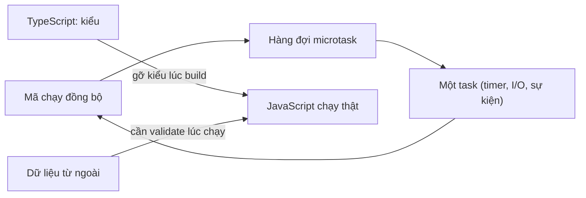
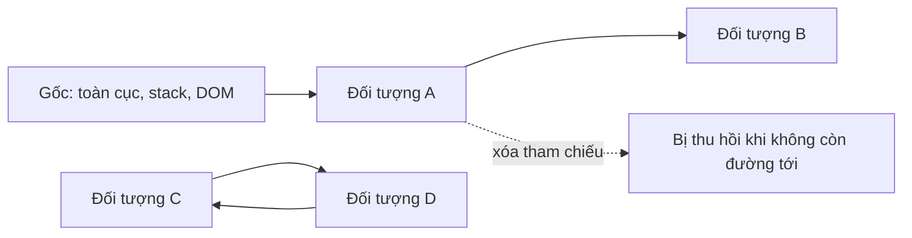

# Câu hỏi: JavaScript nâng cao và TypeScript

Bộ này gồm 15 câu cho vị trí Frontend/Fullstack mid-senior. Mỗi câu đi theo chuỗi: **Câu hỏi** như người phỏng vấn nói, **Gợi ý suy luận** (các câu hỏi nhỏ dẫn tới khái niệm nền, không đưa kết luận), **Lập luận** (chuỗi nhân quả "vì A nên B"), **Đáp án ngắn** (nói được thành tiếng trong 20 đến 40 giây), **Nhớ** (kiến thức cốt lõi kèm link bài gốc), rồi **Ví dụ** nếu cần minh họa. Mỗi câu có hai **Hỏi xoáy**, mỗi hỏi xoáy ghi rõ vì sao nó là bước kế tiếp hợp lý.

Cách ôn hiệu quả: đọc câu hỏi, che phần còn lại, tự trả lời theo các gợi ý, rồi mới so với lập luận. Nếu bạn trả lời được hỏi xoáy mà không nhìn đáp án thì mới coi là nắm chắc.

Quy ước nhãn ví dụ, để biết mức tin cậy:

- **_Đã chạy thử bằng Node_**: code JavaScript hoặc TypeScript đã chạy thật trong sandbox bằng Node 22, output là thật. Với TypeScript, Node chỉ **gỡ chú thích kiểu** rồi chạy (không có `tsc`), nên các ví dụ này kiểm chứng hành vi lúc chạy, không kiểm chứng việc compiler báo lỗi kiểu.
- **_Minh họa_**: code theo đặc tả và tài liệu, chưa chạy trong môi trường này (ví dụ lỗi compile của TypeScript, thao tác trong DevTools). Thông báo lỗi chỉ là dạng tiêu biểu, câu chữ có thể khác theo phiên bản TypeScript.

Kiến thức gốc: [Lý thuyết 1: JavaScript runtime và event loop](/go?p=11-Frontend-Core%2Flt-01-javascript-runtime-event-loop.md), [Lý thuyết 2: TypeScript nâng cao](/go?p=11-Frontend-Core%2Flt-02-typescript-nang-cao.md). Câu hỏi tổng hợp mức cao hơn: [Frontend phỏng vấn](/go?p=07-Interview-QA%2FFrontend%2Fhard%2Fqa-fe-phong-van.md). Bộ tiếp theo về hiệu năng: [Hiệu năng web](/go?p=07-Interview-QA%2FFrontend%2Fmedium%2Fqa-fe-06-hieu-nang-web.md).



Đọc sơ đồ: nửa trên là vòng event loop (câu 1 đến 4), nửa dưới nhắc rằng kiểu TypeScript biến mất trước khi chạy, nên dữ liệu từ ngoài phải được kiểm tra bằng code thật (câu 15).

**Tóm tắt:**

- Event loop: sau mỗi task engine xả sạch microtask (`then`, `await`) rồi mới render hoặc nhận task mới; `then` trả Promise làm chuỗi chậm thêm vài lượt.
- Parallel hay tuần tự do bạn tạo Promise lúc nào chứ không do `await`; chọn `all`, `allSettled`, `race`, `any` theo việc có chấp nhận lỗi một phần hay không.
- Proxy bắt được mọi thao tác trên object (kể cả property thêm sau), `Reflect` giữ đúng `this` và giá trị trả về; đó là lý do Vue 3 bỏ `defineProperty`.
- Tính sống chết trong GC là "còn tới được từ root", không phải "còn được dùng"; `WeakMap` giữ key bằng weak reference nên không duyệt được và không có `size`.
- ESM có import tĩnh nên bundler tree-shake được, còn CJS dùng `require` động nên khó; ESM là live binding, CJS là bản copy.
- TypeScript: kiểu bị gỡ khi build, nên dữ liệu từ ngoài (API) vẫn phải validate lúc chạy; `as` và type guard chỉ là lời hứa với compiler.
- Hay bị hỏi xoáy: `type` hay `interface`, `unknown` hay `any`, và exhaustive check bằng `never` trong `switch` over union.

## 1. Vì sao log của `Promise.then` luôn in trước `setTimeout(0)`, và `await` xếp vào đâu?

**Phải thuộc:** Câu này là câu cốt lõi, gặp rất thường xuyên.

**Câu hỏi:** Có một đoạn code trộn code sync, `setTimeout(..., 0)`, `Promise.then`, `queueMicrotask` và `async/await`. Bạn đoán thứ tự in ra thế nào, và giải thích bằng mô hình nào?

**Gợi ý suy luận:**
- JavaScript chạy trên một thread, vậy code sync hiện tại phải xong trước khi gì khác chen vào được không?
- Callback của timer và callback của Promise nằm ở cùng một queue hay hai queue?
- Sau khi một task xong, engine làm sạch queue nào trước khi nhận task kế tiếp?
- Dòng sau `await` thực chất là gì đối với Promise?

**Lập luận:** Vì chỉ có một call stack, code sync luôn chạy hết trước. Callback của `setTimeout` được đưa vào task queue (macrotask) khi hết giờ, còn callback của `then`, `queueMicrotask` và phần code sau `await` được đưa vào microtask queue. Quy tắc của event loop: sau mỗi task, và ngay khi stack rỗng, engine chạy **toàn bộ** microtask (kể cả microtask mới sinh ra trong lúc chạy) rồi mới lấy task kế tiếp. Do đó dù timer là 0 ms, nó vẫn phải đợi hết microtask. Phần sau `await` chỉ là `then` ngầm trên Promise, nên cũng thuộc microtask và xếp theo thứ tự đăng ký.

**Đáp án ngắn:** Code sync chạy trước, rồi hết microtask queue (`then`, `queueMicrotask`, sau `await`), rồi mới tới task kế tiếp như `setTimeout`. Timer 0 ms vẫn là task nên luôn sau Promise.

**Nhớ:** Sau mỗi task: làm sạch microtask rồi mới render hoặc nhận task mới. Gốc: [Event loop](/go?p=11-Frontend-Core%2Flt-01-javascript-runtime-event-loop.md).

**Ví dụ:** thứ tự in ra của một đoạn trộn lẫn.

```js
console.log('1 sync');
setTimeout(() => console.log('6 timeout'), 0);
Promise.resolve().then(() => { console.log('3 then A'); }).then(() => console.log('5 then A2'));
queueMicrotask(() => console.log('4 queueMicrotask'));
(async () => { console.log('2 async start'); await null; console.log('4b after await'); })();
console.log('2b sync end');
```

```text
1 sync
2 async start
2b sync end
3 then A
4 queueMicrotask
4b after await
5 then A2
6 timeout
```

_Đã chạy thử bằng Node._ Chú ý `then A2` chỉ được xếp vào queue sau khi `then A` xong, nên nó đứng sau các microtask đã có sẵn.

**Hỏi xoáy 1:** Nếu trong một microtask lại xếp thêm microtask mới liên tục thì trang có bị đơ không?

**Vì sao hỏi tiếp:** Bạn vừa nói engine chạy "toàn bộ" microtask kể cả cái mới sinh ra. Hệ quả logic là queue đó có thể không bao giờ cạn.

**Gợi ý suy luận:** Khi nào event loop mới được phép render và nhận event click? Nếu microtask tự sinh microtask vô hạn thì điều kiện đó có xảy ra không?

**Đáp:** Có. Render và task kế tiếp chỉ xảy ra khi hàng microtask rỗng, mà vòng tự sinh không bao giờ rỗng, nên timer, click và vẽ đều bị đói. Đây là lý do việc nặng được chia nhỏ bằng task (`setTimeout`, `scheduler.postTask`, `MessageChannel`), không phải bằng `Promise.then`.

**Hỏi xoáy 2:** `async` function trả về gì, và `await` một giá trị không phải Promise thì có "đợi" không?

**Vì sao hỏi tiếp:** Câu trên coi `await` là `then` ngầm; người phỏng vấn kiểm tra bạn có hiểu "nhường quyền" ngay cả khi không có gì để đợi.

**Gợi ý suy luận:** `await 5` được bọc thành gì? Code sau nó chạy ngay hay ở lượt microtask kế?

**Đáp:** Hàm `async` luôn trả về Promise. `await v` bọc `v` thành Promise đã resolve rồi tiếp tục code ở một microtask, nên luôn nhường ít nhất một lượt cho code sync bên ngoài, kể cả khi `v` là số thường.

**Sai lầm hay gặp:** Tin rằng `setTimeout(fn, 0)` chạy "ngay lập tức". Nó chỉ chạy sau khi stack rỗng, microtask sạch, và (trong trình duyệt) còn bị kẹp tối thiểu vài mili giây khi lồng nhiều tầng.

## 2. Vì sao `then` trả về một Promise lại làm chuỗi chậm thêm vài lượt?

**Câu hỏi:** Hai chuỗi Promise chạy parallel, một chuỗi có `then` trả về `Promise.resolve('x')`. Vì sao các log xen kẽ không như bạn tưởng? Và vì sao `then` không `return` lại cho `undefined`?

**Gợi ý suy luận:**
- Promise mới do `then` trả về được resolve bằng giá trị trả về của callback. Nếu giá trị đó là một Promise thì sao?
- Resolve bằng một thenable cần thêm bước nào để "nối" hai Promise?
- Callback không `return` thì giá trị đi tiếp là gì? Còn `throw` thì sao?
- Executor của `new Promise` chạy sync hay async, và gọi `resolve` hai lần thì sao?

**Lập luận:** Promise trả về bởi `then` được resolve theo giá trị callback trả ra. Nếu giá trị là Promise (thenable), engine phải xếp thêm một microtask để gọi `then` của nó rồi mới nối kết quả, và thường thêm một lượt nữa khi kết quả đó được chuyển tiếp. Vì thế mỗi `return Promise` thêm khoảng hai lượt microtask so với `return` giá trị thường, và chuỗi kia kịp chạy xen vào. Callback không `return` thì Promise kế nhận `undefined`, còn `throw` biến Promise kế thành rejected nên nhảy tới `catch` gần nhất. Executor chạy sync ngay khi `new Promise`, và Promise chỉ đổi trạng thái đúng một lần: các lần `resolve`, `reject` sau bị bỏ qua.

**Đáp án ngắn:** Trả về Promise trong `then` tốn thêm lượt microtask để nối, nên thứ tự xen kẽ có thể khác trực giác. Executor chạy sync, Promise chỉ settle một lần, quên `return` thì giá trị kế tiếp là `undefined`.

**Nhớ:** Đừng dựa vào số lượt microtask chính xác để viết logic; chỉ cần nhớ nó có thật. Gốc: [Promise và async/await](/go?p=11-Frontend-Core%2Flt-01-javascript-runtime-event-loop.md).

**Ví dụ:** hai chuỗi xen kẽ và các quy tắc settle.

```js
const p = Promise.resolve();
p.then(() => { console.log('a1'); return Promise.resolve('x'); }).then(() => console.log('a2'));
p.then(() => console.log('b1')).then(() => console.log('b2')).then(() => console.log('b3')).then(() => console.log('b4'));
```

```text
a1
b1
b2
b3
a2
b4
```

_Đã chạy thử bằng Node._ `a2` bị đẩy lùi sau `b3` vì `return Promise.resolve('x')` tốn thêm lượt. Thêm một thử nghiệm nhỏ về quy tắc settle:

```js
const p = new Promise((res, rej) => { res(1); res(2); rej(new Error('x')); console.log('executor chay dong bo'); });
p.then(v => console.log('value', v));
Promise.resolve(1).then(v => { v + 1 }).then(v => console.log('khong return:', v));
Promise.resolve(1).then(() => { throw new Error('boom') }).catch(e => e.message).then(v => console.log('sau catch:', v));
```

```text
executor chay dong bo
value 1
khong return: undefined
sau catch: boom
```

_Đã chạy thử bằng Node._

**Hỏi xoáy 1:** `catch` đặt giữa chuỗi thì các `then` sau nó có chạy không?

**Vì sao hỏi tiếp:** Ví dụ trên có `catch` rồi `then` vẫn in ra. Người phỏng vấn muốn bạn nói rõ `catch` "khôi phục" chuỗi.

**Gợi ý suy luận:** `catch(fn)` tương đương `then(undefined, fn)`. Promise do nó trả về mang trạng thái nào nếu `fn` trả giá trị bình thường?

**Đáp:** Có chạy. `catch` trả về Promise fulfilled với giá trị mà handler trả ra, nên chuỗi tiếp tục như bình thường. Muốn lỗi đi tiếp thì phải `throw` lại trong `catch`.

**Hỏi xoáy 2:** Promise bị reject mà không ai `catch` thì chuyện gì xảy ra?

**Vì sao hỏi tiếp:** Từ chuyện `throw` và `catch`, câu tự nhiên là lỗi nuốt mất hay nổi lên.

**Gợi ý suy luận:** Engine có biết "chưa có handler" ở thời điểm reject không, hay phải đợi hết lượt microtask? Trình duyệt và Node báo bằng event nào?

**Đáp:** Sau khi hết lượt microtask mà vẫn không có handler, runtime phát event `unhandledrejection` (trình duyệt) hoặc `unhandledRejection` (Node; mặc định từ Node 15 tiến trình sẽ thoát với lỗi nếu không có handler, kiểm tra lại theo phiên bản). Khi chạy thử, `Promise.reject(new Error('quen catch'))` đã kích hoạt `unhandledRejection` đúng như vậy. Nên gắn `catch` hoặc dùng `try/catch` với `await`, và có một handler toàn cục để ghi log.

## 3. Ba request độc lập mà trang mất gấp ba thời gian. Vì sao, và chọn `all`, `allSettled`, `race`, `any` thế nào?

**Phải thuộc:** Câu này là câu cốt lõi, gặp rất thường xuyên.

**Câu hỏi:** Trang dashboard gọi ba API độc lập bằng `await` lần lượt trong vòng lặp và rất chậm. Bạn sửa thế nào, và nếu một API lỗi thì chọn combinator nào?

**Gợi ý suy luận:**
- `await` trong vòng lặp có khiến request thứ hai chỉ bắt đầu sau khi request thứ nhất xong không?
- Promise bắt đầu chạy lúc được tạo hay lúc được `await`?
- Bạn muốn "một lỗi là hỏng cả" hay "lỗi nào cũng được ghi nhận"? Hay chỉ cần "cái nhanh nhất" hoặc "cái thành công đầu tiên"?

**Lập luận:** Promise bắt đầu chạy ngay khi được tạo, còn `await` chỉ là chỗ đợi kết quả. Nếu bạn tạo rồi `await` từng cái một thì cái sau chỉ được tạo sau khi cái trước xong, nên tổng thời gian là tổng ba request. Tạo cả ba trước rồi đợi chung bằng `Promise.all` thì chúng chạy chồng nhau, tổng thời gian chỉ bằng request chậm nhất. Còn chọn combinator phụ thuộc vào ý nghĩa lỗi: `all` thất bại ngay khi một cái lỗi (phù hợp khi thiếu một mảnh là vô nghĩa); `allSettled` luôn đợi hết và cho trạng thái từng cái (phù hợp dashboard hiển thị từng phần); `race` lấy kết quả đầu tiên kể cả lỗi (hợp với timeout); `any` lấy cái thành công đầu tiên (hợp với nhiều mirror).

**Đáp án ngắn:** Tạo các Promise độc lập cùng lúc rồi đợi bằng `Promise.all` để chạy parallel. Chọn `allSettled` khi cho phép lỗi từng phần, `race` cho timeout, `any` cho cái thành công đầu tiên.

**Nhớ:** Parallel hay tuần tự do bạn tạo Promise lúc nào, không do `await`. Gốc: [Các bẫy Promise](/go?p=11-Frontend-Core%2Flt-01-javascript-runtime-event-loop.md).

**Ví dụ:** tuần tự so với parallel và bốn combinator.

```js
const sleep = (ms, v, fail) => new Promise((res, rej) => setTimeout(() => fail ? rej(new Error(v)) : res(v), ms));
(async () => {
  let t = Date.now();
  for (const ms of [50, 50, 50]) await sleep(ms, ms);
  console.log('tuan tu ~', Math.round((Date.now() - t) / 50) * 50, 'ms');
  t = Date.now();
  await Promise.all([50, 50, 50].map(ms => sleep(ms, ms)));
  console.log('song song ~', Math.round((Date.now() - t) / 50) * 50, 'ms');
  console.log(await Promise.allSettled([sleep(10, 'ok'), sleep(10, 'loi', true)]).then(r => r.map(x => x.status)));
  console.log(await Promise.race([sleep(30, 'cham'), sleep(10, 'nhanh')]));
  console.log(await Promise.any([sleep(10, 'e1', true), sleep(20, 'thanh cong')]));
})();
```

```text
tuan tu ~ 150 ms
song song ~ 50 ms
[ 'fulfilled', 'rejected' ]
nhanh
thanh cong
```

_Đã chạy thử bằng Node._ Thời gian đã làm tròn vì phụ thuộc máy.

**Hỏi xoáy 1:** `Promise.all` bị reject sớm thì các request còn lại có bị hủy không?

**Vì sao hỏi tiếp:** Ta vừa nói `all` "thất bại ngay". Người phỏng vấn muốn biết bạn có nhầm "thất bại" với "dừng việc đang chạy".

**Gợi ý suy luận:** Promise có cơ chế hủy sẵn không? Muốn hủy request `fetch` thì dùng gì?

**Đáp:** Không hủy. Promise không có khái niệm hủy, các request còn lại vẫn chạy và tốn băng thông; kết quả của chúng chỉ bị bỏ qua. Muốn hủy thật phải truyền `AbortController.signal` vào `fetch` và gọi `abort()` khi cần.

**Hỏi xoáy 2:** `array.forEach(async (x) => { await save(x) })` rồi `await` ngay sau đó có đợi được không?

**Vì sao hỏi tiếp:** Đây là lỗi phổ biến nhất khi áp dụng kiến thức vừa rồi vào vòng lặp.

**Gợi ý suy luận:** `forEach` có dùng giá trị trả về của callback không? Vậy ai giữ các Promise?

**Đáp:** Không. `forEach` bỏ qua Promise mà callback trả về, nên không có gì để đợi. Dùng `await Promise.all(items.map(save))` cho parallel, hoặc `for...of` với `await` cho tuần tự. Nếu cần giới hạn số request concurrent thì dùng queue có giới hạn, đừng bắn một nghìn request cùng lúc.

**Sai lầm hay gặp:** `await` trong `map` rồi quên `Promise.all`, kết quả là mảng Promise chưa settle.

## 4. Vì sao hàm generator có thể "dừng giữa chừng", và nó liên quan gì tới `for...of` và `async/await`?

**Câu hỏi:** Bạn viết bộ sinh id tăng dần vô hạn mà không dùng biến toàn cục, hoặc duyệt một danh sách phân trang mà chỉ tải trang khi cần. Dùng cơ chế nào của JavaScript?

**Gợi ý suy luận:**
- Một hàm thường chạy một mạch tới `return`. Muốn nó tạm dừng và giữ lại biến cục bộ thì cần gì?
- `for...of` và spread (`...`) gọi vào object bằng giao thức nào?
- Nếu vòng `for...of` bị `break` giữa chừng thì ai dọn tài nguyên?

**Lập luận:** Generator (`function*`) trả về một object iterator thay vì chạy ngay. Mỗi lần gọi `next()`, thân hàm chạy tới `yield` kế tiếp, giữ nguyên biến cục bộ rồi nhường ra giá trị; `next(x)` còn đưa ngược giá trị `x` vào chỗ `yield`. Đây chính là giao thức iterator (`next()` trả `{ value, done }`) mà `for...of`, spread, destructuring và `Array.from` đều dựa vào qua `Symbol.iterator`. Vì giá trị được sinh theo yêu cầu (lazy), chuỗi vô hạn khả thi: bạn chỉ lấy bao nhiêu thì tính bấy nhiêu. Khi vòng lặp thoát sớm (`break`, `return`, lỗi), engine gọi `return()` của iterator, nên khối `finally` trong generator được chạy để dọn dẹp. Phiên bản `async function*` kết hợp với `for await...of` áp dụng cùng ý tưởng cho dữ liệu đến async, như các trang API.

**Đáp án ngắn:** Generator là hàm tạm dừng được tại `yield` và giữ trạng thái, trả về iterator. `for...of` và spread dùng giao thức iterator (`Symbol.iterator`, `next`), còn `async function*` với `for await` dùng cho dữ liệu async.

**Nhớ:** Lazy và dọn dẹp nhờ `return()` khi thoát sớm. Gốc: [Event loop và async](/go?p=11-Frontend-Core%2Flt-01-javascript-runtime-event-loop.md).

**Ví dụ:** generator hai chiều, iterator tự viết có dọn dẹp, chuỗi vô hạn lazy và phân trang async.

```js
function* idGen() { let i = 1; while (true) { const reset = yield i++; if (reset) i = 1; } }
const g = idGen();
console.log(g.next().value, g.next().value, g.next(true).value, g.next().value);
const range = { from: 1, to: 3, [Symbol.iterator]() { let c = this.from, t = this.to; return { next: () => c <= t ? { value: c++, done: false } : { value: undefined, done: true }, return() { console.log('cleanup'); return { done: true }; } }; } };
console.log([...range]);
for (const x of range) { if (x === 2) break; }
function* take(it, n) { let i = 0; for (const v of it) { if (i++ >= n) return; yield v; } }
function* naturals() { let n = 0; try { while (true) yield n++; } finally { console.log('naturals dong'); } }
console.log([...take(naturals(), 3)]);
async function* pages() { for (let p = 1; p <= 3; p++) { await null; yield [p * 10, p * 10 + 1]; } }
(async () => { for await (const items of pages()) console.log('page', items); })();
```

```text
1 2 1 2
[ 1, 2, 3 ]
cleanup
naturals dong
[ 0, 1, 2 ]
page [ 10, 11 ]
page [ 20, 21 ]
page [ 30, 31 ]
```

_Đã chạy thử bằng Node._ `cleanup` chỉ in ở lần `break`, không in ở lần spread chạy hết. `naturals dong` in dù vòng vô hạn, vì `take` thoát sớm kéo theo `return()`.

**Hỏi xoáy 1:** `async/await` có liên quan gì tới generator?

**Vì sao hỏi tiếp:** Tạm dừng rồi tiếp tục sau khi có kết quả nghe giống `await`. Người phỏng vấn muốn bạn nối hai khái niệm.

**Gợi ý suy luận:** Nếu mỗi `yield` là một Promise, và có hàm chạy iterator, đợi Promise rồi gọi `next(kết quả)` thì ta được gì?

**Đáp:** Về ý tưởng, `async/await` là generator cộng một bộ chạy tự động đợi Promise rồi đưa kết quả ngược vào (đây là cách các thư viện như `co` từng làm trước khi có cú pháp riêng). Trong engine hiện đại nó là cơ chế riêng, nhưng mô hình tư duy "hàm tạm dừng và được đánh thức bằng microtask" là giống nhau.

**Hỏi xoáy 2:** Object thường (`{}`) không dùng được với `for...of`. Vì sao, và làm sao cho nó dùng được?

**Vì sao hỏi tiếp:** Ta nói `for...of` dựa vào `Symbol.iterator`; hệ quả là object thiếu nó sẽ bị từ chối.

**Gợi ý suy luận:** `for...of` tìm phương thức nào trên object? Cách ngắn nhất để cài phương thức đó là gì?

**Đáp:** Object thường không có `[Symbol.iterator]`, nên `for...of` ném `TypeError: ... is not iterable`. Bạn thêm `*[Symbol.iterator]() { yield ... }` (generator làm iterator cho gọn), hoặc duyệt `Object.entries(obj)`.

## 5. Vì sao Vue 3 dùng Proxy, và Proxy đi cùng `Reflect` để làm gì?

**Câu hỏi:** Tôi muốn bắt mọi thao tác đọc, ghi, xóa property của một object, kể cả property thêm sau. `Object.defineProperty` làm được không? Và vì sao trong handler của Proxy người ta hay gọi `Reflect.get`, `Reflect.set`?

**Gợi ý suy luận:**
- `defineProperty` cần biết trước tên property, vậy property mới thêm hoặc xóa đi có bị bắt không?
- Proxy chặn thao tác ở mức nào: từng property hay cả object?
- Khi object có getter dùng `this`, `this` đó phải trỏ vào target hay vào proxy để việc theo dõi chạy đúng?
- `Reflect` cung cấp phiên bản hàm của thao tác nào, và giá trị trả về có ích gì với `set`?

**Lập luận:** `defineProperty` gắn getter/setter lên từng property đã biết, nên property thêm sau, `delete` và chỉ số mảng không bị bắt (Vue 2 phải có `Vue.set`). Proxy bọc cả object và chặn thao tác ở mức object qua các "trap" (`get`, `set`, `has`, `deleteProperty`, `ownKeys`...), nên bắt được mọi thao tác, kể cả property mới. Trong trap, ta cần thực hiện thao tác mặc định rồi mới thêm logic; `Reflect` có đúng hàm tương ứng cho từng trap, và tham số `receiver` giữ `this` đúng là proxy khi gặp getter hoặc inheritance, nên các truy cập lồng bên trong getter cũng đi qua proxy và được theo dõi. `Reflect.set` còn trả `true/false` đúng như trap yêu cầu, tránh lỗi ở chế độ strict.

**Đáp án ngắn:** Proxy bắt thao tác ở mức object nên bắt được property thêm sau, `delete` và `in`, còn `defineProperty` chỉ bắt property đã khai báo. `Reflect` thực hiện thao tác mặc định đúng ngữ nghĩa (đúng `receiver`, đúng giá trị trả về) bên trong trap.

**Nhớ:** Proxy cho hook cấp object, `Reflect` giữ đúng `this` và giá trị trả về. Gốc: [Reactivity Vue 3](/go?p=10-Vue%2Feasy%2Flt-01-reactivity-vue3.md).

**Ví dụ:** proxy ghi log, kiểm tra dữ liệu, giấu property, và vai trò của `receiver`.

```js
const target = { name: 'a', age: 1 };
const log = [];
const p = new Proxy(target, {
  get(t, k, r) { log.push('get ' + String(k)); return Reflect.get(t, k, r); },
  set(t, k, v, r) { if (k === 'age' && typeof v !== 'number') throw new TypeError('age phai la so'); return Reflect.set(t, k, v, r); },
  has(t, k) { return k !== 'secret' && Reflect.has(t, k); },
  deleteProperty(t, k) { log.push('delete ' + String(k)); return Reflect.deleteProperty(t, k); },
});
p.name; p.age = 5; delete p.name;
console.log(log, target, 'secret' in p);
try { p.age = 'x'; } catch (e) { console.log(e.message); }
const base = { _v: 1, get v() { return this._v; } };
const child = Object.create(base); child._v = 99;
console.log(Reflect.get(base, 'v', child), base.v);
```

```text
[ 'get name', 'delete name' ] { age: 5 } false
age phai la so
99 1
```

_Đã chạy thử bằng Node._ Dòng cuối: cùng getter `v` nhưng `receiver = child` làm `this._v` đọc 99 thay vì 1. Đó là cách Proxy giữ ngữ cảnh khi gặp getter hoặc inheritance.

**Hỏi xoáy 1:** Có object nào mà bọc Proxy vào rồi gọi phương thức thì hỏng không?

**Vì sao hỏi tiếp:** Proxy "trong suốt" chỉ khi mọi thao tác đều đi qua trap. Người phỏng vấn muốn bạn biết ranh giới của nó.

**Gợi ý suy luận:** `Map` và `class` có trường private lưu dữ liệu ở đâu, và có nằm trên proxy không?

**Đáp:** Có. Phương thức của `Map`, `Set`, `Date` và trường private `#x` cần `this` là object gốc có slot nội bộ, nhưng khi gọi qua proxy thì `this` là proxy, nên ném `TypeError`. Vue xử lý bằng cách có handler riêng cho collection. Cách thông thường là `bind` hàm về target hoặc không bọc các kiểu đó.

**Hỏi xoáy 2:** Proxy làm object bị bọc sâu thì có tự động reactive lồng nhau không, và chi phí là gì?

**Vì sao hỏi tiếp:** Ví dụ trên chỉ bọc một tầng. Object thật có nhiều tầng lồng.

**Gợi ý suy luận:** Khi nào nên tạo proxy cho object con: lúc khởi tạo cả cây hay lúc có ai đọc tới nó?

**Đáp:** Không tự động: trap `get` phải tự bọc giá trị con là object. Làm lazy (bọc khi đọc) tránh duyệt cả cây ngay từ đầu, và Vue 3 làm như vậy. Chi phí: mỗi truy cập qua trap chậm hơn truy cập thẳng, và `proxy !== target` (so sánh danh tính cần để ý, nên giữ cache từ target tới proxy để cùng một con luôn trả cùng một proxy).

**Sai lầm hay gặp:** Quên `return true` trong trap `set` (strict mode ném `TypeError`), hoặc gán thẳng `t[k] = v` thay vì `Reflect.set` làm sai `this` với setter inherited.

## 6. Vì sao `WeakMap` không có `size` và không duyệt được, và nó giúp tránh rò rỉ thế nào?

**Câu hỏi:** Tôi muốn gắn dữ liệu phụ (cache, metadata) vào các element DOM hoặc object mà không sửa chúng. Dùng `Map` thì có vấn đề gì, `WeakMap` khác ở đâu, và `WeakRef` dùng khi nào?

**Gợi ý suy luận:**
- `Map` giữ key bằng strong reference. Nếu bạn bỏ mọi reference khác tới key đó thì key có bị thu hồi không?
- Nếu entry có thể biến mất bất cứ lúc nào do GC, thì `size` và việc duyệt có còn ổn định, đoán trước được không?
- Khóa của `WeakMap` phải thuộc loại giá trị nào để có "sống hay chết" mà theo dõi?
- `WeakRef` giữ một weak reference: `deref()` trả về gì sau khi object bị thu hồi?

**Lập luận:** `Map` giữ strong reference tới key, nên key còn trong `Map` thì không bao giờ bị thu hồi, đây là rò rỉ kinh điển khi dùng `Map` làm cache gắn với lifecycle object khác. `WeakMap` giữ key bằng weak reference: khi không còn strong reference nào khác tới key thì entry bị GC thu hồi cùng giá trị. Vì thời điểm thu hồi do engine quyết định và không lặp lại được, spec không cho `size`, `keys()` hay duyệt (tránh lộ hành vi GC), và key bắt buộc là object (hoặc symbol không đăng ký). `WeakRef` mở rộng ý đó cho một giá trị đơn lẻ: `deref()` trả object nếu còn, `undefined` nếu đã bị thu hồi. `FinalizationRegistry` cho callback sau khi thu hồi, nhưng không đảm bảo thời điểm hay việc nó chạy, nên chỉ dùng cho dọn dẹp bổ trợ.

**Đáp án ngắn:** `Map` giữ key mạnh nên làm rò rỉ; `WeakMap` giữ key bằng weak reference nên entry tự biến mất khi key hết reference, và vì thế không có `size`, không duyệt được. `WeakRef` là weak reference tới một object, đọc bằng `deref()` có thể trả `undefined`.

**Nhớ:** Dùng `WeakMap` để gắn dữ liệu phụ vào object của người khác; đừng dựa vào `WeakRef` hay finalizer cho logic đúng sai. Gốc: [Memory và rò rỉ](/go?p=11-Frontend-Core%2Flt-01-javascript-runtime-event-loop.md).

**Ví dụ:** so sánh `Map` với `WeakMap` về giữ memory, và hành vi của `WeakRef`.

```js
// b4.js: node --expose-gc
global.gc();
const strong = new Map(); const weak = new WeakMap();
function mk(n) { for (let i = 0; i < n; i++) { const o = { buf: new Array(1000).fill(i) }; strong.set(o, i); weak.set(o, i); } }
const before = process.memoryUsage().heapUsed;
mk(2000);
global.gc();
console.log('Map size', strong.size, 'heap tang ~MB', ((process.memoryUsage().heapUsed - before) / 1e6).toFixed(1));
strong.clear(); global.gc();
console.log('sau clear ~MB', ((process.memoryUsage().heapUsed - before) / 1e6).toFixed(1));
```

```text
Map size 2000 heap tang ~MB 16.3
sau clear ~MB 0.4
```

_Đã chạy thử bằng Node (cờ `--expose-gc`)._ Hai object cùng được thêm vào `Map` và `WeakMap`; sau GC, memory chỉ được giữ bởi `Map` (con số MB thay đổi theo máy). Còn `WeakRef`:

```js
let obj = { big: new Array(1e5).fill(1) };
const ref = new WeakRef(obj);
console.log('truoc', !!ref.deref());
obj = null;
setTimeout(async () => { global.gc(); await new Promise(r => setTimeout(r, 50)); console.log('sau gc', ref.deref()); }, 10);
```

```text
truoc true
sau gc undefined
```

_Đã chạy thử bằng Node (cờ `--expose-gc`)._ Nếu không ép `gc()` thì thời điểm `deref()` thành `undefined` là không đoán trước được. Với `WeakRef`, spec còn đảm bảo `deref()` trả cùng một kết quả trong cùng một lượt chạy sync (object được giữ sống tới hết lượt).

**Hỏi xoáy 1:** Khi nào `WeakMap` thật sự đáng dùng trong code frontend?

**Vì sao hỏi tiếp:** Biết cơ chế chưa đủ, phải chỉ ra tình huống thật.

**Gợi ý suy luận:** Dữ liệu phụ gắn theo element DOM hoặc theo object do thư viện khác tạo: ai sở hữu lifecycle của key?

**Đáp:** Khi lifecycle dữ liệu phụ phải đi theo lifecycle key mà bạn không quản lý: cache kết quả tính theo object, metadata cho element DOM, dữ liệu private cho class theo kiểu cũ. Đây cũng là cách Vue lưu bản đồ từ target sang proxy (`reactiveMap`).

**Hỏi xoáy 2:** Vậy sao không dùng `WeakRef` làm cache cho tiện?

**Vì sao hỏi tiếp:** `WeakRef` nghe như "cache tự dọn", nên người ta hay lạm dụng.

**Gợi ý suy luận:** Nếu engine thu hồi object sớm hơn bạn mong, hay giữ lâu hơn, hành vi chương trình có còn tất định không?

**Đáp:** Không nên dựa vào nó cho tính đúng. Thời điểm GC không đảm bảo và khác nhau giữa engine, nên chương trình có thể chạy khác nhau giữa các lần. Tài liệu MDN cũng khuyên tránh `WeakRef` và finalizer khi có cách khác. Cache nên có chính sách rõ ràng (LRU, TTL).

## 7. Trang SPA dùng lâu thì chậm dần và RAM tăng. Bạn tìm và sửa memory leak thế nào?

**Câu hỏi:** Người dùng mở trang quản trị cả ngày, tab phình lên vài trăm MB rồi giật. Bạn điều tra từng bước ra sao, và những nguồn rò rỉ phổ biến nào bạn sẽ nghi trước?

**Gợi ý suy luận:**
- GC chỉ thu hồi object không còn "đường tới được" từ gốc. Vậy "rò rỉ" thực chất là object còn đường tới mà bạn không cần nữa. Con đường đó thường đi qua đâu?
- Thao tác nào lặp lại (mở, đóng một màn hình) làm memory tăng mà không giảm sau khi GC?
- DevTools cho công cụ nào để so sánh hai thời điểm và chỉ ra "ai đang giữ" object?

**Lập luận:** Vì GC thu hồi dựa trên khả năng tới được từ các gốc (biến toàn cục, stack, DOM đang gắn), mọi rò rỉ là một strong reference còn sót lại ở đâu đó. Nguồn thường gặp: listener hoặc `setInterval` đăng ký mà không gỡ khi component bị hủy (callback giữ closure, closure giữ cả object lớn); biến toàn cục hoặc module cache chỉ thêm không bớt; `Map` dùng làm cache không giới hạn; closure giữ biến lớn không cần; DOM bị gỡ khỏi trang nhưng vẫn còn một biến JavaScript trỏ tới (detached DOM); subscription store hoặc `fetch` không hủy. Cách điều tra: lặp một thao tác (mở rồi đóng một màn hình) vài lần, chụp **Heap snapshot** trước và sau, dùng chế độ so sánh để tìm object tăng số lượng, rồi mở phần **Retainers** để thấy chuỗi reference đang giữ nó. Sửa bằng cách gỡ reference đúng chỗ: cleanup trong `useEffect`/`onUnmounted`, `AbortController`, `WeakMap` cho dữ liệu phụ, giới hạn kích thước cache.

**Đáp án ngắn:** Rò rỉ là còn strong reference tới thứ không dùng nữa: listener, timer, cache, closure, DOM bị gỡ. Tôi lặp thao tác, chụp heap snapshot so sánh, nhìn Retainers để biết ai giữ, rồi thêm cleanup đúng chỗ.

**Nhớ:** Tìm bằng Heap snapshot (so sánh) và Retainers; sửa bằng cleanup, `AbortController`, `WeakMap`, giới hạn cache. Gốc: [memory leak](/go?p=11-Frontend-Core%2Flt-01-javascript-runtime-event-loop.md).

**Ví dụ:** ba nguồn rò rỉ trong component, và cách sửa (React).

```jsx
// Minh họa: có rò rỉ
useEffect(() => {
  window.addEventListener('resize', onResize);   // không gỡ
  const id = setInterval(poll, 1000);            // không clear
  bigCache.set(userId, hugeObject);              // bigCache là Map cấp module, chỉ thêm
}, []);

// Sửa
useEffect(() => {
  const controller = new AbortController();
  window.addEventListener('resize', onResize, { signal: controller.signal });
  const id = setInterval(poll, 1000);
  return () => { controller.abort(); clearInterval(id); };
}, []);
```

_Minh họa_ (cần trình duyệt và DevTools để đo thật). `addEventListener` nhận `signal` nên một lần `abort()` gỡ listener cho gọn. Với cache dùng `Map` có giới hạn kích thước, hoặc `WeakMap` nếu key là object.

**Hỏi xoáy 1:** Biểu đồ memory có hình răng cưa (tăng rồi giảm) thì có phải rò rỉ không?

**Vì sao hỏi tiếp:** Nhìn biểu đồ là bước đầu tiên, và người phỏng vấn hỏi bạn có phân biệt "dùng nhiều" với "rò rỉ".

**Gợi ý suy luận:** GC chạy theo chu kỳ. Điểm thấp của mỗi chu kỳ sau GC có xu hướng đi lên hay đi ngang?

**Đáp:** Răng cưa là bình thường: object ngắn hạn được tạo rồi GC thu hồi. Rò rỉ là khi các điểm thấp sau GC cứ tăng dần qua nhiều lần lặp thao tác. Trước khi đo nên ép GC (nút thùng rác trong DevTools) để loại nhiễu.

**Hỏi xoáy 2:** Closure nào gây rò rỉ mà người ta hay bỏ sót?

**Vì sao hỏi tiếp:** Closure là cơ chế sinh ra reference ngầm, khó thấy bằng mắt.

**Gợi ý suy luận:** Closure giữ cả scope hay chỉ biến nó dùng? Hai hàm cùng scope có chung một vùng giữ không?

**Đáp:** Engine thường chỉ giữ biến mà closure thực sự dùng, nhưng nếu trong cùng scope có hàm khác (kể cả `eval` hoặc hàm dùng biến lớn) thì biến lớn đó có thể được giữ chung theo từng engine, nên kết quả khác nhau. Kinh nghiệm an toàn: đừng để callback sống lâu (listener, timer, subscription) bắt phải biến lớn; gán `null` hoặc tách hàm khi không cần nữa.

**Sai lầm hay gặp:** Cho rằng "đã có GC thì không rò rỉ". GC chỉ dọn thứ không tới được; thứ bạn vô tình còn trỏ tới thì nó giữ mãi.

## 8. Garbage collector của JavaScript quyết định "object này có thể xóa" như thế nào?

**Câu hỏi:** Hai object trỏ vòng vào nhau và không ai khác dùng, có bị thu hồi không? Và vì sao việc GC đôi khi gây giật hình?

**Gợi ý suy luận:**
- Đếm số reference tới mỗi object có xử lý được vòng tròn không?
- Nếu bắt đầu từ các "gốc" rồi đi theo mọi reference, object nào còn "sống"?
- Phần lớn object chết sớm. Điều này gợi ý chia heap thế nào để dọn rẻ hơn?
- GC phải dừng code JavaScript trong lúc nó làm việc ở mức nào thì người dùng mới không thấy?

**Lập luận:** Đếm reference không xử lý được vòng tròn (hai bên luôn có số đếm khác 0), nên engine hiện đại dùng **mark and sweep**: bắt đầu từ các gốc (biến toàn cục, stack, object DOM đang dùng), đánh dấu mọi thứ tới được, rồi thu hồi phần còn lại. Do đó vòng tròn không ai reference từ ngoài sẽ bị thu hồi. Vì quan sát "đa số object chết trẻ", V8 chia heap thành thế hệ trẻ (dọn thường xuyên, rẻ, bằng cách chép những object còn sống) và thế hệ già (dọn thưa hơn, đắt hơn). Việc đánh dấu cần thao tác trên đồ thị object nên có thể làm dừng main thread; để giảm giật, V8 chia nhỏ (incremental), chạy parallel hoặc concurrent trên thread phụ. Chi tiết cụ thể phụ thuộc phiên bản engine, kiểm tra lại theo phiên bản.

**Đáp án ngắn:** GC dùng mark and sweep: từ các gốc đánh dấu mọi thứ tới được và thu hồi phần còn lại, nên vòng reference không ai giữ vẫn bị dọn. V8 chia thế hệ trẻ và già và dùng GC incremental, concurrent để giảm pause.

**Nhớ:** "Còn tới được từ gốc" quyết định sống chết, không phải "còn được dùng". Gốc: [Memory và rò rỉ](/go?p=11-Frontend-Core%2Flt-01-javascript-runtime-event-loop.md).

**Ví dụ:** sơ đồ tư duy tới được từ gốc.



_Minh họa._ C và D trỏ vòng vào nhau nhưng không có đường từ gốc tới, nên cả hai bị thu hồi dù số đếm reference của mỗi bên khác 0. Còn A và B vẫn sống vì có đường từ gốc.

**Hỏi xoáy 1:** Vậy gán `obj = null` có "giải phóng memory ngay" không?

**Vì sao hỏi tiếp:** Nếu sống chết do "còn tới được", người ta tưởng gán `null` là xóa tức thì.

**Gợi ý suy luận:** Việc gán chỉ làm gì với đường reference, và khi nào GC mới chạy?

**Đáp:** Gán `null` chỉ cắt một đường reference. Object thành "không tới được" nhưng chỉ được thu hồi ở lần GC kế tiếp, thời điểm do engine quyết định. Nó có ích khi object nằm trong biến sống lâu (module, closure), còn biến cục bộ ra khỏi scope là tự hết.

**Hỏi xoáy 2:** Vì sao không nên tạo hàng triệu object nhỏ tạm thời trong vòng lặp nóng (ví dụ mỗi frame)?

**Vì sao hỏi tiếp:** Nối GC với hiệu năng frame, câu kết tự nhiên của chủ đề này.

**Gợi ý suy luận:** Nhiều object tạm làm thế hệ trẻ đầy nhanh, kéo theo điều gì xảy ra thường xuyên?

**Đáp:** Tạo nhiều rác làm GC thế hệ trẻ chạy dày, có thể rơi vào giữa frame và gây giật. Với đoạn code nóng (animation, xử lý dữ liệu lớn), tái sử dụng object hoặc dùng `TypedArray`, tránh sinh mảng và object tạm mỗi lần lặp, sau khi đo và thấy GC là vấn đề thật.

## 9. ESM và CommonJS khác nhau ở đâu, và vì sao ESM tree-shake được còn CJS thì khó?

**Câu hỏi:** Cùng là "module" nhưng `import` và `require` cho kết quả khác khi export biến thay đổi hoặc khi circular dependency. Hai hệ khác nhau thế nào, và tại sao bundler ưu tiên ESM?

**Gợi ý suy luận:**
- `require` là một function call lúc chạy. `import` khai báo ở mức cú pháp: điều đó khác gì về việc phân tích tĩnh trước khi chạy?
- Khi `export let count` thay đổi sau đó, nơi `import` có thấy giá trị mới không? Với `module.exports = { count }` thì sao?
- Nếu bundler biết trước chính xác tên nào được import thì nó làm được gì với phần còn lại?

**Lập luận:** CJS nạp bằng `require()` lúc chạy: sync, và `module.exports` là một object sao chép giá trị tại thời điểm gán, nên đổi biến gốc sau đó không phản ánh vào nơi đã destructure. ESM dùng `import/export` khai báo tĩnh ở mức cú pháp, nên công cụ biết dependency graph và danh sách tên export mà không cần chạy code. Hệ quả: bundler loại được export không ai dùng (tree shaking), còn CJS với `require` động và `module.exports` gán tùy ý thì phân tích tĩnh rất hạn chế. ESM còn dùng **live binding**: tên import là reference sống tới biến gốc (chỉ đọc), nên thấy giá trị mới; có top-level `await` và tải async. Với circular dependency, CJS trả về object `exports` còn dở dang (đọc được giá trị chưa gán), còn ESM các binding tồn tại nhưng ở trạng thái chưa khởi tạo (temporal dead zone) nên đọc sớm ném `ReferenceError`.

**Đáp án ngắn:** CJS nạp động lúc chạy, trả bản sao giá trị export; ESM khai báo tĩnh, dùng live binding chỉ đọc và hỗ trợ tải async. Vì ESM phân tích tĩnh được nên bundler tree-shake được, CJS thì khó.

**Nhớ:** ESM: tĩnh, live binding, async; CJS: động, bản sao, sync. Gốc: [ESM và CommonJS](/go?p=11-Frontend-Core%2Flt-01-javascript-runtime-event-loop.md).

**Ví dụ:** live binding, bản sao giá trị, circular dependency.

```js
// counter.mjs
export let count = 0;
export function inc() { count++; }
// main.mjs
import { count, inc } from './counter.mjs';
console.log(count); inc(); console.log(count);
try { count = 5; } catch (e) { console.log(e.constructor.name); }
console.log(typeof require, typeof module);
// c.cjs
let count = 0;
module.exports = { count, inc() { count++; } };
// main.cjs
const { count, inc } = require('./c.cjs'); console.log(count); inc(); console.log(count);
```

```text
0
1
TypeError
undefined undefined
0
0
```

_Đã chạy thử bằng Node._ ESM thấy `count` tăng thành 1 và không gán lại được (`TypeError`); CJS đã sao chép `0` nên vẫn 0. Circular dependency:

```text
CJS (a.cjs <-> b.cjs): b thay a.done = false   rồi   a thay b.done = true
ESM (ea.mjs <-> eb.mjs): eb: ReferenceError    rồi   ea chay, b = B
```

_Đã chạy thử bằng Node._ Ở CJS, `b` nhìn thấy `a.exports` dở dang (`done` còn `false`) và không lỗi; ở ESM, `eb` đọc `a` khi chưa khởi tạo nên `ReferenceError`.

**Hỏi xoáy 1:** Có dùng `require` để nạp một file ESM được không, và ngược lại?

**Vì sao hỏi tiếp:** Hai hệ có mô hình tải khác nhau (sync và async), nên phối hợp chúng là vấn đề thực tế khi nâng cấp dự án.

**Gợi ý suy luận:** ESM có thể có top-level `await`. Một lời gọi `require` sync xử lý nó thế nào? Còn từ ESM gọi sang CJS thì sao?

**Đáp:** Từ ESM, `import` một file CJS luôn được (thường lấy `default` là `module.exports`). Ngược lại, trước đây CJS chỉ nạp ESM bằng `import()` async; các bản Node 22 gần đây hỗ trợ `require` module ESM không có top-level `await`, nhưng điều này thay đổi theo phiên bản Node, kiểm tra lại theo phiên bản. Khi chạy thử ở trên, `require('./counter.mjs')` thành công trên Node 22.

**Hỏi xoáy 2:** Thư viện của bạn xuất bản cả ESM và CJS, người dùng vẫn bundle ra kích thước lớn. Vì sao?

**Vì sao hỏi tiếp:** Từ lý thuyết tree shaking, câu hỏi thực tế là tại sao nó đôi khi không xảy ra.

**Gợi ý suy luận:** Bundler cần tin file ESM nào là "không có side effect". Trường nào trong `package.json` nói điều đó, và `exports` chọn bản nào?

**Đáp:** Có thể bundler nạp bản CJS qua trường `main`/`require` thay vì bản ESM (`module`/`exports` với điều kiện `import`), hoặc package không khai báo `"sideEffects": false` nên bundler giữ lại cả file phòng side effect, hoặc code lại gọi hàm ngay lúc nạp. Kiểm tra bằng bundle analyzer và sửa `exports`, `sideEffects`.

## 10. `type` hay `interface`: khi nào khác nhau thật sự?

**Phải thuộc:** Câu này là câu cốt lõi, gặp rất thường xuyên.

**Câu hỏi:** Đội đang tranh luận dùng `type` hay `interface` cho props và model. Hai thứ này khác nhau ở những điểm nào có hậu quả thật, và bạn chọn thế nào?

**Gợi ý suy luận:**
- Cái nào mô tả được union (`A | B`), tuple, kiểu nguyên thủy; cái nào chỉ mô tả hình dạng object?
- Khai báo hai lần cùng tên: một bên gộp lại, bên kia báo lỗi. Bên nào là bên nào, và khi nào gộp là có ích?
- Mở rộng kiểu: `extends` và `&` khác nhau ra sao khi hai bên xung đột property?

**Lập luận:** `interface` chỉ mô tả hình dạng object (hoặc hàm, class) và **gộp khai báo** (declaration merging): hai `interface Window` cùng tên được hợp lại, nên thư viện dùng nó để cho người dùng mở rộng (ví dụ bổ sung `Window`, kiểu của Express request). `type` là bí danh cho bất kỳ kiểu nào (union, tuple, mapped, conditional, nguyên thủy) nhưng không gộp, khai báo lại cùng tên là lỗi. Với mở rộng, `interface extends` báo lỗi ngay nếu property xung đột, còn `&` giao hai kiểu và để property xung đột thành `never` âm thầm, nên `interface` cho thông báo lỗi sớm hơn và rõ hơn. Từ đó quy tắc thực dụng: mô tả hình dạng object công khai có thể mở rộng thì dùng `interface`; mọi thứ cần union, tuple, mapped, conditional thì phải dùng `type`; nhất quán trong dự án quan trọng hơn lựa chọn nào.

**Đáp án ngắn:** Khác biệt thật: `type` biểu diễn được union, tuple, mapped, conditional; `interface` gộp khai báo và báo lỗi xung đột khi `extends`. Chọn `interface` cho hình dạng object có thể mở rộng, `type` cho phần còn lại, và giữ nhất quán.

**Nhớ:** Declaration merging chỉ có ở `interface`; union và tuple chỉ có ở `type`. Gốc: [TypeScript nâng cao](/go?p=11-Frontend-Core%2Flt-02-typescript-nang-cao.md).

**Ví dụ:** hai điểm khác nhau thật (kiểm tra bằng compiler).

```ts
interface Config { port: number }
interface Config { host: string }            // gộp: Config có port và host

type Id = string | number;                    // chỉ type mới viết được union
type Pair = [string, number];                 // tuple

interface A { x: number }
interface B extends A { x: string }          // lỗi ngay: x không tương thích với A

// không lỗi, x là number & string = never
type A2 = { x: number }; type B2 = A2 & { x: string };
```

_Minh họa_ (cần `tsc` để thấy lỗi compile). Dòng `interface B extends A` bị báo lỗi ngay chỗ khai báo; `B2` chỉ lộ vấn đề khi bạn thử dùng `x`.

**Hỏi xoáy 1:** Có khác biệt về hiệu năng compile hay về lỗi khi so sánh không?

**Vì sao hỏi tiếp:** Người phỏng vấn muốn thấy bạn biết lý do ngoài sở thích cho việc ưu tiên `interface`.

**Gợi ý suy luận:** Với kiểu giao `&` lớn, compiler phải làm gì mỗi lần so sánh, và với `interface` thì sao?

**Đáp:** Hướng dẫn của TypeScript nêu rằng `interface` được cache theo tên và kiểm tra quan hệ `extends` nhanh hơn so với giao nhiều kiểu, nên với dự án lớn có thể có lợi. Đây là lời khuyên theo trường hợp chung, nên đo trên dự án của bạn nếu build chậm.

**Hỏi xoáy 2:** `type` có "mở rộng" được như `interface` không?

**Vì sao hỏi tiếp:** Bạn đã nói `type` không gộp. Vậy muốn thêm property cho kiểu cũ thì làm thế nào?

**Gợi ý suy luận:** Phép giao `&` tạo kiểu mới hay sửa kiểu cũ?

**Đáp:** `type` mở rộng bằng cách tạo kiểu mới: `type Admin = User & { role: 'admin' }`. Nó không sửa kiểu gốc và không gộp, nên không thể "vá" kiểu của thư viện khác như `interface`.

## 11. Generics giải quyết điều gì, và `extends` trong generic có nghĩa gì?

**Câu hỏi:** Hàm `first(arr: any[])` trả `any` nên mất kiểu. Làm sao để trả đúng kiểu element, và nếu tôi cần hàm lấy `obj[key]` với `key` phải thuộc `obj` thì viết thế nào?

**Gợi ý suy luận:**
- Muốn "kiểu đầu vào quyết định kiểu đầu ra", ta cần khai báo một biến kiểu. Biến đó được suy ra từ đâu?
- `extends` ở generic khác `extends` ở class thế nào: nó là ràng buộc hay inheritance?
- `keyof T` cho ra tập nào, và làm sao ràng buộc `K` thuộc tập đó?

**Lập luận:** Generic là tham số hóa theo kiểu: `function first<T>(arr: T[]): T | undefined` giữ liên hệ giữa đầu vào và đầu ra mà `any` đã cắt đứt. Kiểu `T` được **suy ra** từ đối số gọi hàm nên thường không cần viết tay. `T extends U` là **ràng buộc**: chỉ chấp nhận kiểu gán được cho `U`, đổi lại trong thân hàm bạn dùng được các thành viên của `U`. Hàm `get<T, K extends keyof T>(obj: T, key: K): T[K]` bắt `key` phải là tên property của `obj` và kiểu trả về là kiểu đúng của property đó (indexed access). Ràng buộc cho phép gõ sai bị bắt lúc compile mà vẫn tổng quát.

**Đáp án ngắn:** Generic cho hàm hay kiểu "mang theo" kiểu của đầu vào sang đầu ra thay vì `any`. `extends` đặt ràng buộc cho tham số kiểu, như `K extends keyof T` để `key` chỉ nhận tên property thật.

**Nhớ:** Dùng generic khi cần liên hệ giữa các kiểu; đừng dùng khi một kiểu cụ thể là đủ. Gốc: [Generics và ràng buộc](/go?p=11-Frontend-Core%2Flt-02-typescript-nang-cao.md).

**Ví dụ:** hàm `get` an toàn kiểu.

```ts
function get<T, K extends keyof T>(obj: T, key: K): T[K] { return obj[key]; }
const user = { id: 1, name: 'An' };
const name = get(user, 'name');     // kiểu string
const id = get(user, 'id');         // kiểu number
// get(user, 'age');                // lỗi: 'age' không thuộc keyof typeof user
console.log(name, id);
```

```text
An 1
```

_Đã chạy thử bằng Node_ (chỉ kiểm chứng phần chạy; Node không kiểm tra kiểu, nên dòng bị chú thích sẽ báo lỗi ở `tsc`).

**Hỏi xoáy 1:** Khi nào generic bị lạm dụng?

**Vì sao hỏi tiếp:** Sau khi biết công dụng, người phỏng vấn hỏi ranh giới.

**Gợi ý suy luận:** Nếu tham số kiểu chỉ xuất hiện đúng một lần trong chữ ký thì nó có đang liên hệ hai thứ nào với nhau không?

**Đáp:** Khi tham số kiểu chỉ xuất hiện một lần thì nó không nối gì với gì, thường thay bằng chính ràng buộc là đủ (`f(x: T)` với `T extends Foo` chỉ cần `f(x: Foo)`). Generic phải có ít nhất hai chỗ dùng để nối đầu vào với đầu ra hoặc hai tham số với nhau.

**Hỏi xoáy 2:** Giá trị mặc định cho kiểu generic và suy luận từ `const` hoạt động thế nào?

**Vì sao hỏi tiếp:** Thực tế API thường cần cho người dùng bỏ trống tham số kiểu hoặc giữ kiểu literal.

**Gợi ý suy luận:** Nếu không suy ra được `T` thì lấy gì? Với `'a'` thì `T` là `string` hay `'a'`?

**Đáp:** Dùng `<T = string>` để đặt mặc định khi không suy ra được. `<const T>` (TypeScript 5.0 trở lên) bảo compiler giữ kiểu literal của đối số thay vì mở rộng thành `string`. Kiểm tra lại theo phiên bản TypeScript đang dùng.

## 12. Làm sao cho `switch` quên một biến thể của union thì báo lỗi lúc compile? (narrowing và `never`)

**Câu hỏi:** Tôi có `type Shape = circle | rect`, sau đó thêm `tri`. Làm sao để mọi `switch` trên `Shape` chưa xử lý `tri` bị báo lỗi, chứ không âm thầm chạy sai?

**Gợi ý suy luận:**
- Làm sao cho compiler biết nhánh nào của union đang xét sau khi kiểm tra một trường?
- Sau khi đã loại hết các biến thể bằng `case`, phần còn lại của kiểu là gì?
- Gán một giá trị cho biến kiểu `never` thì được khi nào?

**Lập luận:** Union có phân biệt (discriminated union) cho mỗi biến thể một trường literal chung (`kind`). Khi bạn kiểm tra `s.kind === 'circle'` (hoặc `switch`), TypeScript **thu hẹp (narrow)** `s` về biến thể tương ứng nên truy cập `s.r` an toàn. Qua mỗi `case`, kiểu còn lại trong nhánh sau nhỏ dần; khi mọi biến thể đã được xử lý, ở `default` kiểu của `s` là `never` (tập rỗng). Gán `s` cho biến kiểu `never` chỉ hợp lệ khi `s` thực sự là `never`; nếu bạn thêm biến thể `tri` mà chưa có `case`, `s` ở `default` là `tri` chứ không phải `never`, nên phép gán báo lỗi compile đúng chỗ cần sửa. Ngoài `===` trên trường, các cách narrowing khác gồm `typeof`, `instanceof`, `in`, truthiness và hàm type guard `x is T`.

**Đáp án ngắn:** Dùng union có trường phân biệt `kind`, để `switch` thu hẹp từng biến thể. Ở `default` gán giá trị cho biến kiểu `never`; thêm biến thể mới mà chưa xử lý thì kiểu ở đó khác `never` và compiler báo lỗi.

**Nhớ:** Discriminated union + `never` ở `default` = kiểm tra đầy đủ lúc compile. Gốc: [Narrowing và union có phân biệt](/go?p=11-Frontend-Core%2Flt-02-typescript-nang-cao.md).

**Ví dụ:** hàm `area` kiểm tra đầy đủ, và type guard.

```ts
type Shape = { kind: 'circle'; r: number } | { kind: 'rect'; w: number; h: number };
function area(s: Shape): number {
  switch (s.kind) {
    case 'circle': return Math.PI * s.r ** 2;
    case 'rect': return s.w * s.h;
    default: { const _x: never = s; throw new Error('unhandled ' + JSON.stringify(_x)); }
  }
}
console.log(area({ kind: 'rect', w: 2, h: 3 }).toFixed(1));
try { area({ kind: 'tri' } as any); } catch (e) { console.log((e as Error).message); }
function isString(x: unknown): x is string { return typeof x === 'string'; }
console.log(isString((JSON.parse('{"id": "7"}') as { id: unknown }).id));
```

```text
6.0
unhandled {"kind":"tri"}
true
```

_Đã chạy thử bằng Node_ (phần chạy). Khi thêm `{ kind: 'tri' }` vào `Shape` mà chưa có `case`, dòng `const _x: never = s` sẽ báo lỗi ở `tsc` (_minh họa_). Dòng `throw` ở `default` là lưới an toàn lúc chạy cho dữ liệu sai kiểu như ví dụ `as any`.

**Hỏi xoáy 1:** `x is string` khác trả về `boolean` thường ở đâu, và nó có thể sai không?

**Vì sao hỏi tiếp:** Từ narrowing tự động, người phỏng vấn chuyển sang narrowing do người viết hứa.

**Gợi ý suy luận:** Compiler có kiểm tra thân hàm có đúng là chỉ trả `true` khi `x` là string không?

**Đáp:** `x is string` khiến chỗ gọi thu hẹp kiểu khi hàm trả `true`. Compiler tin lời hứa, không kiểm tra thân hàm, nên bạn viết sai thì vẫn compile (type guard nói dối). Hãy giữ type guard đơn giản, có test.

**Hỏi xoáy 2:** `Array.filter(Boolean)` có thu hẹp bỏ `undefined` khỏi mảng không?

**Vì sao hỏi tiếp:** Một tình huống thực tế mà narrowing không tự hoạt động như người ta kỳ vọng.

**Gợi ý suy luận:** `Boolean` là hàm trả `boolean` hay type guard? Muốn thu hẹp thì cần chữ ký nào?

**Đáp:** Theo mặc định không, vì `Boolean` trả `boolean`, không phải type guard, nên kiểu vẫn là `(T | undefined)[]`. Hãy truyền một type guard rõ ràng, ví dụ `(x): x is T => x != null`. Từ TypeScript 5.5 compiler có thể suy ra type guard cho một số hàm đơn giản, kiểm tra lại theo phiên bản.

## 13. Union, intersection, utility, mapped và conditional types: dựng kiểu từ kiểu khác thế nào?

**Câu hỏi:** Tôi có kiểu `User` đầy đủ và cần kiểu cho form sửa (mọi trường tùy chọn, trừ id), kiểu cho bản "chỉ đọc", và kiểu `Getters` đổi `name` thành `getName`. Bạn tạo chúng thế nào mà không chép lại từng trường?

**Gợi ý suy luận:**
- Union (`|`) và giao (`&`) khác nhau thế nào về tập giá trị chấp nhận được?
- Các utility như `Partial`, `Pick`, `Omit`, `Readonly`, `Record` thực chất được dựng từ hai khái niệm nào?
- Mapped type duyệt qua tập key bằng cú pháp nào, và làm sao đổi tên key?
- Conditional type `T extends U ? X : Y` dùng `infer` để làm gì?

**Lập luận:** Union `A | B` là giá trị thuộc A **hoặc** B (chỉ dùng chắc chắn phần chung cho tới khi narrowing), còn giao `A & B` là giá trị có **cả** property của A và B. Utility types chỉ là mapped type hoặc conditional type có sẵn: `Partial<T>` là `{ [K in keyof T]?: T[K] }`, `Readonly<T>` thêm `readonly`, `Pick` chọn tập key, `Omit` loại tập key, `Record<K, V>` dựng object từ tập key. Mapped type duyệt các key bằng `[K in keyof T]`, và mệnh đề `as` đổi key (kết hợp template literal type như `` `get${Capitalize<K>}` ``). Conditional type rẽ nhánh theo quan hệ kiểu, và `infer` bắt một phần kiểu trong nhánh để dùng lại (ví dụ `ReturnType<T>`). Khi `T` là một tham số kiểu trần và là union, conditional type **phân phối** theo từng element.

**Đáp án ngắn:** Dựng từ kiểu gốc bằng utility (`Partial`, `Pick`, `Omit`, `Readonly`) vốn là mapped type, và mapped type có `as` để đổi key. Conditional type với `infer` cho phép rẽ nhánh và bắt kiểu con, và nó phân phối trên union.

**Nhớ:** Chỉ khai báo kiểu gốc một nơi, các kiểu khác suy ra từ nó. Gốc: [Conditional, mapped, utility types](/go?p=11-Frontend-Core%2Flt-02-typescript-nang-cao.md).

**Ví dụ:** form sửa, getters và conditional phân phối.

```ts
type User = { id: number; name: string; age: number };
type EditForm = Partial<Omit<User, 'id'>> & Pick<User, 'id'>;
type Getters<T> = { [K in keyof T as `get${Capitalize<string & K>}`]: () => T[K] };
// { getId: () => number; getName: () => string; getAge: () => number }
type UserGetters = Getters<User>;

type ElementOf<T> = T extends (infer U)[] ? U : never;
type A = ElementOf<string[] | number[]>;   // string | number  (phân phối trên union)
type B = [string[] | number[]] extends [any[]] ? 1 : 0;  // bọc [] để tắt phân phối
```

_Minh họa_ (cần `tsc`; kết quả kiểu ghi trong chú thích theo hành vi của TypeScript 5.x).

**Hỏi xoáy 1:** `Omit<A | B, 'x'>` có cho kết quả như mong đợi không?

**Vì sao hỏi tiếp:** Ta nói conditional phân phối trên union, nhưng `Omit` lại không phải conditional.

**Gợi ý suy luận:** `Omit` dựa trên `Pick` và `keyof`. `keyof (A | B)` lấy key chung hay tất cả?

**Đáp:** Không như mong đợi: `Omit` không phân phối, `keyof (A | B)` chỉ lấy key chung nên các biến thể bị san phẳng, mất khác biệt. Muốn giữ từng biến thể thì viết utility phân phối: `type DistributiveOmit<T, K extends PropertyKey> = T extends unknown ? Omit<T, K> : never`.

**Hỏi xoáy 2:** Kiểu quá phức tạp thì gây hại gì, và khi nào dừng?

**Vì sao hỏi tiếp:** Quyền năng của hệ kiểu dễ bị lạm dụng, người phỏng vấn hỏi phán đoán kỹ thuật của bạn.

**Gợi ý suy luận:** Ai đọc thông báo lỗi, và compiler tốn gì khi phải giải kiểu đệ quy sâu?

**Đáp:** Kiểu quá thông minh cho thông báo lỗi khó đọc, làm IDE và build chậm, và khó bảo trì. Dừng khi kiểu khó hơn đoạn code nó bảo vệ; thà thêm một kiểu rõ ràng và test kiểu (`expectTypeOf`) hơn một kiểu một dòng không ai hiểu.

## 14. `any`, `unknown`, `never` khác nhau thế nào, và `strict` bật những gì?

**Phải thuộc:** Câu này là câu cốt lõi, gặp rất thường xuyên.

**Câu hỏi:** Hàm nhận dữ liệu từ ngoài, bạn gán `any` hay `unknown`? Và một dự án cũ chuyển sang `strict: true` thì mong đợi gì?

**Gợi ý suy luận:**
- Một giá trị `any` còn được kiểm tra khi dùng không? Một giá trị `unknown` thì sao?
- Kiểu nào là "tập mọi giá trị", kiểu nào là "tập rỗng", và hệ quả với gán và với hàm không bao giờ trả về?
- `strictNullChecks` đổi điều gì về việc `null` và `undefined` có nằm trong mọi kiểu hay không?

**Lập luận:** `any` tắt kiểm tra kiểu: dùng gì cũng được và lỗi trôi xuống runtime, lại lây sang mọi biểu thức nó chạm vào. `unknown` là kiểu "chưa biết": nhận mọi giá trị nhưng muốn dùng phải thu hẹp (`typeof`, type guard, validate), nên an toàn và ép bạn kiểm tra. `never` là tập rỗng: không có giá trị nào, dùng cho hàm luôn ném lỗi hoặc ngõ cụt của narrowing (câu 12). Cờ `strict` là bộ cờ gồm nhiều kiểm tra, trong đó quan trọng nhất là `strictNullChecks` (loại `null`, `undefined` khỏi mọi kiểu trừ khi khai báo), `noImplicitAny`, `strictFunctionTypes`, `strictBindCallApply`, `strictPropertyInitialization`, `useUnknownInCatchVariables`, `alwaysStrict`, `noImplicitThis` (danh sách chính xác kiểm tra theo phiên bản TypeScript). Ngoài `strict`, các cờ đáng bật thêm là `noUncheckedIndexedAccess` (truy cập mảng và index trả về `T | undefined`) và `exactOptionalPropertyTypes`, hai cờ này **không** nằm trong `strict`.

**Đáp án ngắn:** `any` tắt kiểm tra, `unknown` nhận mọi thứ nhưng bắt thu hẹp trước khi dùng, `never` là tập rỗng. Dữ liệu từ ngoài gán `unknown`. `strict` bật bộ kiểm tra gồm `strictNullChecks`, `noImplicitAny` và các cờ liên quan; nên thêm `noUncheckedIndexedAccess`.

**Nhớ:** `unknown` thay cho `any` ở biên hệ thống; `strict` bật dần theo từng cờ khi migrate. Gốc: [Cấu hình strict](/go?p=11-Frontend-Core%2Flt-02-typescript-nang-cao.md).

**Ví dụ:** vì sao `unknown` an toàn hơn.

```ts
// biên dịch được, nổ ở runtime
function parseA(raw: string) { const d: any = JSON.parse(raw); return d.user.name.toUpperCase(); }
function parseU(raw: string) {
  const d: unknown = JSON.parse(raw);
  if (typeof d === 'object' && d !== null && 'user' in d) return 'co user';
  throw new Error('sai hinh dang');
}
try { parseA('{}'); } catch (e) { console.log('any:', (e as Error).constructor.name); }
try { parseU('{}'); } catch (e) { console.log('unknown:', (e as Error).message); }
```

```text
any: TypeError
unknown: sai hinh dang
```

_Đã chạy thử bằng Node_ (hành vi chạy). Với `any`, `tsc` không báo lỗi gì ở `d.user.name`, lỗi `TypeError` chỉ xuất hiện khi chạy; với `unknown`, bạn buộc phải kiểm tra rồi mới đụng tới nội dung.

**Hỏi xoáy 1:** Bật `strict` cho dự án 200 nghìn dòng thì làm sao khỏi dừng cả đội?

**Vì sao hỏi tiếp:** Biết cờ chưa đủ, người phỏng vấn senior hỏi cách triển khai.

**Gợi ý suy luận:** Có thể bật từng cờ riêng lẻ không? Có thể áp theo thư mục hoặc theo file mới không?

**Đáp:** Bật từng cờ một (bắt đầu `noImplicitAny`, rồi `strictNullChecks`) và sửa theo đợt; dùng `// @ts-expect-error` có chú thích thay cho `any` để đếm nợ kỹ thuật; hoặc dùng một tsconfig `strict` riêng cho thư mục mới và mở rộng dần. Trong CI, chặn việc thêm lỗi mới thay vì đòi sạch ngay.

**Hỏi xoáy 2:** `as` (type assertion) khác khai báo kiểu `: T` và `satisfies` thế nào?

**Vì sao hỏi tiếp:** Khi chống `any`, người ta thường chuyển qua `as` và vô tình lặp lại vấn đề cũ.

**Gợi ý suy luận:** Ai chịu trách nhiệm kiểm tra: compiler hay bạn? Và kiểu suy ra có bị nới rộng không?

**Đáp:** `: T` kiểm tra giá trị khớp `T` và coi nó là `T`. `as T` bảo compiler tin bạn, không kiểm tra thật (như `any` trá hình, dễ giấu lỗi). `satisfies T` (TypeScript 4.9 trở lên) kiểm tra giá trị khớp `T` nhưng giữ kiểu suy ra cụ thể hơn, nên phù hợp với object cấu hình.

## 15. Khai báo `interface User` cho kết quả API rồi, vì sao vẫn có lỗi chạy do dữ liệu sai hình dạng?

**Câu hỏi:** Response từ backend khai kiểu `User` đúng như tài liệu, nhưng một hôm `user.id` là chuỗi và trang vỡ, trong khi `tsc` vẫn xanh. Chuyện gì xảy ra, và bạn thiết kế lớp gọi API thế nào?

**Gợi ý suy luận:**
- Kiểu TypeScript tồn tại ở giai đoạn nào: compile hay chạy? Nó có kiểm tra dữ liệu từ mạng không?
- `fetch(...).then(r => r.json())` trả về kiểu gì, và ép sang `User` bằng gì?
- Muốn "kiểu" và "kiểm tra thật" luôn khớp thì nên có một nguồn khai báo duy nhất ở đâu?

**Lập luận:** Kiểu bị gỡ hoàn toàn khi compile, nên lúc chạy không còn gì kiểm tra hình dạng JSON. `r.json()` trả `any` (hoặc `unknown` nếu bạn ép), và việc viết `as User` chỉ là lời hứa không được thực thi. Dữ liệu sai hình dạng đi qua compile rồi vỡ ở nơi dùng. Giải pháp: coi mọi dữ liệu qua mạng là `unknown`, rồi **validate lúc chạy** ở biên hệ thống bằng một schema (Zod, Valibot...) và suy ra kiểu TypeScript từ schema đó (`z.infer`), để kiểu và kiểm tra là một nguồn duy nhất. Lỗi validate được xử lý tập trung (ghi log, báo người dùng) thay vì nổ rải rác. Dùng thêm union có phân biệt cho response (`{ ok: true; data } | { ok: false; error }`) để mọi nơi dùng buộc phải xử lý nhánh lỗi.

**Đáp án ngắn:** Kiểu chỉ có lúc compile, không kiểm tra JSON thật. Coi response là `unknown`, validate bằng schema (Zod) ở biên rồi suy ra kiểu từ schema, và mô hình hóa kết quả bằng union có phân biệt để buộc xử lý lỗi.

**Nhớ:** Kiểm tra ở biên, tin tưởng bên trong. Gốc: [Kiểu cho API và Zod](/go?p=11-Frontend-Core%2Flt-02-typescript-nang-cao.md).

**Ví dụ:** hàm kiểm tra tay (không cần thư viện) và schema với Zod.

```ts
function parseUser(x: unknown): { id: number } {
  if (typeof x === 'object' && x && typeof (x as any).id === 'number') return x as { id: number };
  throw new Error('sai hinh dang');
}
try { parseUser(JSON.parse('{"id":"7"}')); } catch (e) { console.log((e as Error).message); }
```

```text
sai hinh dang
```

_Đã chạy thử bằng Node_ (hành vi chạy). Với thư viện, cùng ý tưởng ngắn hơn:

```ts
import { z } from 'zod';
const UserSchema = z.object({ id: z.number(), name: z.string() });
type User = z.infer<typeof UserSchema>;            // kiểu suy ra từ schema
const user: User = UserSchema.parse(await res.json());   // ném lỗi nếu sai hình dạng
```

_Minh họa_ (cần cài `zod`, API `parse` và `z.infer` theo Zod phổ biến, kiểm tra lại theo phiên bản).

**Hỏi xoáy 1:** Validate toàn bộ response lớn có tốn không, và có thể bỏ qua nơi nào?

**Vì sao hỏi tiếp:** Giải pháp trên có chi phí; senior phải cân nhắc.

**Gợi ý suy luận:** Dữ liệu từ backend do chính đội mình kiểm soát có cùng mức rủi ro với dữ liệu từ bên thứ ba không?

**Đáp:** Có chi phí CPU, nhưng thường nhỏ so với mạng. Ưu tiên validate ở biên không tin cậy (bên thứ ba, input người dùng, `localStorage`), còn API nội bộ có thể sinh kiểu từ OpenAPI và validate chọn lọc. Đừng bỏ qua phần dữ liệu mà lỗi sẽ vỡ UI hoặc gây vấn đề bảo mật.

**Hỏi xoáy 2:** Làm sao tránh nhầm hai id cùng là `string`, như truyền ngược `userId` và `orderId`?

**Vì sao hỏi tiếp:** Cùng chủ đề "kiểu bảo vệ dữ liệu", nhưng là lỗi do kiểu quá lỏng thay vì thiếu kiểm tra.

**Gợi ý suy luận:** TypeScript so sánh kiểu theo cấu trúc hay theo tên? Làm sao làm hai `string` "khác nhau" về cấu trúc?

**Đáp:** Vì so sánh theo cấu trúc nên hai `string` luôn khớp nhau. Dùng **branded type**: `type UserId = string & { readonly __brand: 'UserId' }`, tạo qua một hàm duy nhất, khi đó truyền `OrderId` vào chỗ `UserId` là lỗi compile. Thương lượng chi phí: thêm một hàm tạo và ép kiểu ở một chỗ.

**Sai lầm hay gặp:** Viết `as User` sau `r.json()` rồi coi như đã xong; hoặc dùng `Partial<User>` khắp nơi cho tiện, làm mất khả năng kiểm tra trường bắt buộc.

