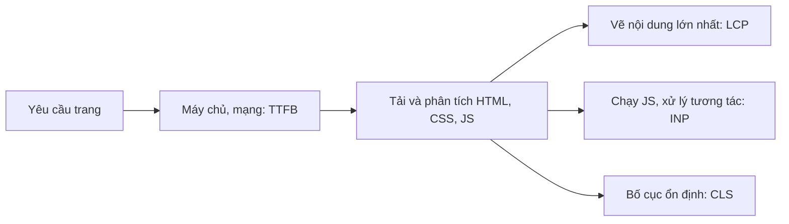
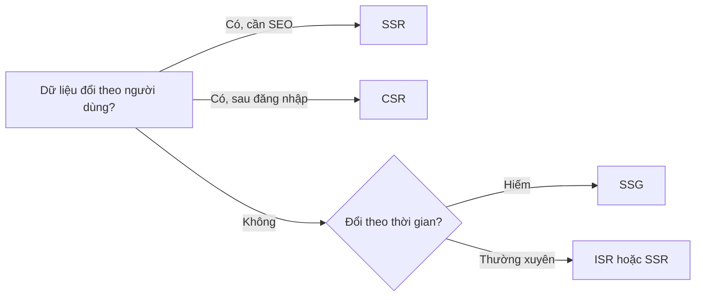

# Câu hỏi: Hiệu năng web

Bộ này gồm 13 câu cho vị trí Frontend/Fullstack mid-senior. Mỗi câu đi theo chuỗi: **Câu hỏi** như người phỏng vấn nói, **Gợi ý suy luận** (các câu hỏi nhỏ dẫn tới khái niệm nền, không đưa kết luận), **Lập luận** (chuỗi nhân quả "vì A nên B"), **Đáp án ngắn** (nói được thành tiếng), **Nhớ** (kiến thức cốt lõi kèm link bài gốc), rồi **Ví dụ** nếu cần. Mỗi câu có hai **Hỏi xoáy**, kèm lý do vì sao nó là bước kế tiếp.

Cách ôn: đọc câu hỏi, che phần còn lại, tự đi theo các gợi ý để dựng đáp án thành tiếng, rồi mới so. Câu hiệu năng luôn kết thúc bằng "đo ở đâu và đo cái gì", nên hãy luyện nói số liệu và công cụ, không chỉ tên kỹ thuật.

Quy ước nhãn ví dụ:

- **_Đã chạy thử bằng Node_**: code JavaScript chạy thật trong sandbox bằng Node 22, output là thật (con số thời gian phụ thuộc máy). Node không có DOM hay trình duyệt, nên các thử nghiệm này mô phỏng **cơ chế** (event queue, thread phụ), không đo Web Vitals thật.
- **_Minh họa_**: HTML, CSS, cấu hình, thao tác DevTools theo tài liệu, chưa chạy trong môi trường này. Ngưỡng và hành vi phụ thuộc phiên bản trình duyệt hoặc framework thì ghi "kiểm tra lại theo phiên bản".

Kiến thức gốc: [Lý thuyết 3: Hiệu năng web và Core Web Vitals](/go?p=11-Frontend-Core%2Flt-03-web-performance-core-web-vitals.md). Liên quan: [React hiệu năng và kiến trúc](/go?p=09-React%2Fhard%2Flt-10-hieu-nang-kien-truc.md), [React SSR, RSC, Next.js](/go?p=09-React%2Fhard%2Flt-09-ssr-rsc-nextjs.md), [Vue hiệu năng rendering](/go?p=10-Vue%2Fhard%2Flt-08-hieu-nang-rendering.md), [Vue SSR, Nuxt](/go?p=10-Vue%2Fhard%2Flt-09-ssr-nuxt-hydration.md). Bộ trước: [JavaScript nâng cao và TypeScript](/go?p=07-Interview-QA%2FFrontend%2Fmedium%2Fqa-fe-05-javascript-nang-cao-typescript.md). Tổng hợp mức cao: [Frontend phỏng vấn](/go?p=07-Interview-QA%2FFrontend%2Fhard%2Fqa-fe-phong-van.md).



Đọc sơ đồ: ba chỉ số nằm ở ba giai đoạn khác nhau của cùng một hành trình tải. Chẩn đoán đúng là biết chỉ số nào đỏ, rồi đi ngược về giai đoạn tương ứng.

**Tóm tắt:**

- Hiệu năng bắt đầu từ đo: LCP (tải), INP (phản hồi), CLS (ổn định), đánh giá ở phân vị 75 của dữ liệu thật; lab chỉ để chẩn đoán.
- LCP chia thành TTFB, resource load delay, resource load time và render delay; biết phần nào chậm mới biết sửa ở đâu.
- INP xấu thường do long task trên main thread (task quá 50 ms); chữa bằng chia nhỏ task và chuyển việc nặng khỏi main thread.
- CLS do element không có kích thước, font swap, nội dung chèn muộn; chữa bằng khai báo `width` và `height` hoặc `aspect-ratio` và chừa chỗ trước.
- `defer` cho mã ứng dụng, `async` cho mã độc lập; preload, prefetch, preconnect có chi phí nên dùng sai còn làm chậm hơn.
- File build có hash trong tên thì cache vĩnh viễn, còn HTML phải revalidate; CSR, SSR, SSG, ISR đánh đổi LCP, INP và TTFB khác nhau.
- Hay bị hỏi xoáy: virtualization và đánh đổi, Web Worker giúp phản hồi chứ không "tăng tốc" (chi phí sao chép dữ liệu), và quy trình đi từ đo tới chống tụt lại.

## 1. Người dùng nói "trang chậm". Bạn đo theo những chỉ số nào, và "tốt" nghĩa là gì?

**Phải thuộc:** Câu này là câu cốt lõi, gặp rất thường xuyên.

**Câu hỏi:** Sếp bảo trang chủ chậm. Bạn không được đoán, bạn chọn chỉ số nào để biến "chậm" thành con số, và ngưỡng nào là đạt?

**Gợi ý suy luận:**
- "Chậm" có ít nhất ba nghĩa với người dùng: tải lâu, bấm không phản hồi, giật bố cục. Mỗi nghĩa tương ứng một loại chỉ số nào?
- Một con số trung bình có phản ánh trải nghiệm của người dùng tệ nhất không? Nên dùng phân vị nào?
- Chỉ số đo trên một người dùng thật và chỉ số đo bằng công cụ trong phòng thí nghiệm khác nhau ở đâu?

**Lập luận:** Ba nghĩa của "chậm" ứng với ba Core Web Vitals: **LCP** (thời điểm element nội dung lớn nhất hiện ra, đo tốc độ tải), **INP** (độ trễ của tương tác chậm nhất tới lần vẽ kế tiếp, đo độ phản hồi) và **CLS** (tổng điểm dịch chuyển bố cục bất ngờ, đo độ ổn định). Ngưỡng "tốt" theo web.dev: LCP tối đa 2,5 giây, INP tối đa 200 ms, CLS tối đa 0,1, đánh giá ở **phân vị 75** của các lượt tải thật, tách mobile và desktop, vì trung bình che mất nhóm người dùng chậm. Vì trải nghiệm phụ thuộc thiết bị và mạng, ngoài số đo trong phòng thí nghiệm (lab: Lighthouse, môi trường cố định, lặp lại được) còn cần số đo từ người dùng thật (field: RUM, CrUX). INP chỉ có ở field vì cần tương tác thật. Kiểm tra lại ngưỡng theo công bố mới nhất của Google khi ôn thi.

**Đáp án ngắn:** Dùng LCP (tải), INP (phản hồi), CLS (ổn định). Ngưỡng tốt là LCP không quá 2,5 s, INP không quá 200 ms, CLS không quá 0,1 ở phân vị 75 của người dùng thật. Lab để chẩn đoán, field để biết sự thật.

**Nhớ:** INP đã thay FID, và chỉ đo được ở field. Gốc: [Ngưỡng Core Web Vitals](/go?p=11-Frontend-Core%2Flt-03-web-performance-core-web-vitals.md).

**Ví dụ:** đo ba chỉ số từ người dùng thật bằng thư viện `web-vitals`.

```js
import { onLCP, onINP, onCLS } from 'web-vitals';

function send(metric) {
  navigator.sendBeacon('/rum', JSON.stringify({
    name: metric.name, value: metric.value, id: metric.id, rating: metric.rating,
  }));
}
onLCP(send); onINP(send); onCLS(send);
```

_Minh họa_ (chạy trong trình duyệt; API theo thư viện `web-vitals`, kiểm tra lại theo phiên bản). Gửi về server rồi tính phân vị 75 theo trang và loại thiết bị.

**Hỏi xoáy 1:** Vì sao Lighthouse không cho ra INP?

**Vì sao hỏi tiếp:** Bạn vừa nói INP chỉ có ở field; người phỏng vấn kiểm tra bạn hiểu lý do.

**Gợi ý suy luận:** INP lấy tương tác chậm nhất trong cả lifecycle trang. Lighthouse tải trang rồi dừng, có ai bấm gì không?

**Đáp:** Lighthouse chỉ tải trang trong kịch bản cố định, không có tương tác thật của người dùng nên không tính INP. Nó dùng **TBT** (Total Blocking Time) làm chỉ số thay thế trong lab, có tương quan với INP nhưng không phải cùng một thứ. Trong DevTools, bạn có thể tự bấm rồi xem tab Performance hoặc dùng Chrome UX Report để xem INP thật.

**Hỏi xoáy 2:** Lighthouse xanh mà dữ liệu người dùng thật đỏ, bạn tin cái nào?

**Vì sao hỏi tiếp:** Hệ quả trực tiếp của sự khác nhau lab và field.

**Gợi ý suy luận:** Lighthouse chạy trên máy nào, mạng nào, với cache nào? Người dùng thật có dùng điện thoại cũ, mạng yếu, trang sau đăng nhập không?

**Đáp:** Tin dữ liệu thật vì đó là điều Google dùng để đánh giá và là trải nghiệm thật. Lab xanh chỉ nói rằng trong điều kiện cố định bạn ổn. Tìm nguyên nhân bằng cách tách dữ liệu thật theo thiết bị, quốc gia, trang, rồi tái hiện trong lab bằng cách giả lập CPU chậm và mạng chậm.

## 2. LCP là 4 giây. Bạn tìm xem phần nào chậm bằng cách nào?

**Câu hỏi:** Báo cáo cho thấy LCP của trang sản phẩm là 4 giây. Bạn xác định thời gian đó bị tiêu ở đâu, rồi sửa gì?

**Gợi ý suy luận:**
- Từ lúc bấm link tới lúc element lớn nhất hiện, có những chặng nào nối tiếp nhau?
- Nếu element LCP là ảnh, ảnh có được trình duyệt phát hiện sớm trong HTML, hay chỉ lộ ra sau khi chạy JavaScript?
- Mỗi chặng cần cách sửa khác nhau. Cái gì sửa chặng đầu (server), cái gì sửa chặng cuối (vẽ)?

**Lập luận:** LCP được chia thành bốn chặng nối tiếp (theo web.dev): **TTFB** (thời gian tới byte đầu của HTML), **trễ bắt đầu tải tài nguyên** (từ TTFB tới lúc bắt đầu tải ảnh), **thời gian tải tài nguyên**, và **trễ vẽ** (từ khi tải xong tới khi vẽ). Vì LCP là tổng bốn chặng, bạn phải biết chặng nào chiếm nhiều nhất rồi mới sửa. TTFB lớn thì sửa server, cache, CDN, giảm redirect. Trễ bắt đầu tải lớn thường do ảnh nằm sau JS (ảnh nền CSS hoặc render phía client) hoặc có `loading="lazy"` trên ảnh đầu trang, sửa bằng cách đặt ảnh trong HTML, `<link rel="preload">` hoặc `fetchpriority="high"`. Thời gian tải lớn thì sửa kích thước ảnh, định dạng hiện đại (WebP, AVIF), CDN. Trễ vẽ lớn thì CSS hoặc JS chặn render, hay font chặn hiển thị chữ. Công cụ: tab Performance của DevTools (nhãn LCP và các phần), Lighthouse, và `web-vitals` bản attribution cho dữ liệu thật.

**Đáp án ngắn:** Tách LCP thành TTFB, trễ bắt đầu tải, thời gian tải và trễ vẽ rồi sửa chặng lớn nhất. Hay gặp nhất là ảnh LCP phát hiện muộn hoặc bị lazy, sửa bằng ảnh trong HTML, `fetchpriority="high"` và preload.

**Nhớ:** Không bao giờ để `loading="lazy"` trên ảnh LCP. Gốc: [LCP](/go?p=11-Frontend-Core%2Flt-03-web-performance-core-web-vitals.md).

**Ví dụ:** ảnh hero đúng và sai.

```html
<!-- Sai: ảnh nền CSS, chỉ phát hiện sau khi CSS tải và áp dụng; lại còn lazy -->
<div class="hero"></div>


<!-- Đúng: ảnh trong HTML, ưu tiên cao, kích thước rõ ràng, nhiều độ phân giải -->

```

_Minh họa_ (hành vi theo đặc tả HTML và web.dev; kiểm tra bằng DevTools).

**Hỏi xoáy 1:** TTFB 1,2 giây là lỗi của frontend hay backend?

**Vì sao hỏi tiếp:** Chặng đầu của LCP thường nằm ngoài code UI, người phỏng vấn muốn biết bạn cộng tác thế nào.

**Gợi ý suy luận:** Trong 1,2 giây có những phần nào: DNS, kết nối, TLS, xử lý server? Frontend ảnh hưởng được phần nào?

**Đáp:** Cả hai. Phía frontend và hạ tầng có thể giảm redirect, bật CDN, cache HTML ở biên, dùng HTTP/2 hoặc 3 và `preconnect` tới nguồn thứ ba; phần xử lý server (truy vấn chậm, render SSR nặng) là của backend. Dùng thẻ `Server-Timing` để chia rõ server tốn bao lâu.

**Hỏi xoáy 2:** Element LCP thay đổi giữa các lần tải thì sao?

**Vì sao hỏi tiếp:** Trên thực tế, đo hai lần ra hai kết quả khác hẳn nhau.

**Gợi ý suy luận:** Element lớn nhất trong khung nhìn phụ thuộc kích thước màn hình, banner động, nội dung cá nhân hóa. Vậy cần cố định điều gì để so sánh công bằng?

**Đáp:** LCP là element lớn nhất tại thời điểm đó và có thể đổi theo khung nhìn hay nội dung động. Cố định điều kiện đo (cùng thiết bị giả lập, cùng trạng thái đăng nhập), và ghi nhận element LCP (attribution) để biết nó là ảnh hay đoạn văn.

## 3. Người dùng bấm nút mà 600 ms sau mới phản hồi. INP nói gì, và vì sao long task là thủ phạm?

**Phải thuộc:** Câu này là câu cốt lõi, gặp rất thường xuyên.

**Câu hỏi:** Bấm nút lọc, UI đứng gần một giây. Bạn giải thích bằng mô hình nào, và chia nhỏ công việc dài thế nào?

**Gợi ý suy luận:**
- Trình duyệt chạy JavaScript và vẽ trên cùng main thread. Nếu một đoạn JS chạy 400 ms thì lúc đó nó vẽ và nhận click được không?
- INP gồm ba phần: trễ nhận event, thời gian xử lý, trễ trình bày. Phần nào do một task dài kéo lên?
- Chia nhỏ công việc nghĩa là cho main thread chỗ nào để xen vào?

**Lập luận:** Vì JS và vẽ chia sẻ một thread, một **long task** (task chạy quá 50 ms theo định nghĩa của Long Tasks API) chặn mọi việc khác: click xếp hàng chờ (tăng trễ nhận event) và việc vẽ phản hồi bị trì hoãn. INP đo từ lúc người dùng tương tác tới lần vẽ kế tiếp, nên task dài, handler nặng hoặc render phức tạp đều đẩy nó lên. Cách chữa là chia việc thành nhiều task nhỏ và **nhường main thread** giữa chừng để trình duyệt xử lý input và vẽ. Công cụ: `scheduler.yield()` (nơi hỗ trợ, kiểm tra lại theo trình duyệt), `scheduler.postTask`, hoặc `setTimeout(0)` và `MessageChannel` làm phương án dự phòng. Ngoài ra giảm việc phải làm (debounce input, `useTransition` hay `startTransition` trong React để đánh dấu cập nhật không gấp, virtualization), hoặc đẩy tính toán sang Web Worker (câu 12). Lưu ý nhường bằng `Promise.then` **không** hiệu quả vì microtask không cho trình duyệt vẽ (xem [câu 1 của bộ JavaScript](/go?p=07-Interview-QA%2FFrontend%2Fmedium%2Fqa-fe-05-javascript-nang-cao-typescript.md)).

**Đáp án ngắn:** Long task chặn main thread nên click chờ và khung hình không vẽ được, làm INP tăng. Chia công việc thành các task nhỏ và nhường main thread giữa các phần bằng `scheduler.yield` hoặc `setTimeout`, hoặc đẩy việc nặng sang worker.

**Nhớ:** Nhường bằng task, không bằng microtask. Gốc: [INP](/go?p=11-Frontend-Core%2Flt-03-web-performance-core-web-vitals.md).

**Ví dụ:** cùng khối lượng, một task dài so với chia nhỏ; đo khoảng trễ lớn nhất của một timer 5 ms đại diện cho "việc cần chen vào" như xử lý click.

```js
const work = () => { let s = 0; for (let i = 0; i < 2e6; i++) s += Math.sqrt(i); return s; };
const yieldToMain = () => new Promise(r => setTimeout(r, 0));
async function run(label, chunked) {
  let maxGap = 0, last = Date.now();
  const iv = setInterval(() => { const n = Date.now(); maxGap = Math.max(maxGap, n - last); last = n; }, 5);
  const start = Date.now();
  for (let i = 0; i < 60; i++) { work(); if (chunked) await yieldToMain(); }
  if (!chunked) await yieldToMain();
  clearInterval(iv);
  console.log(label, 'tong ~', Date.now() - start, 'ms, khoang tre lon nhat cua timer ~', maxGap, 'ms');
}
(async () => { await run('mot task dai   :', false); await run('chia moi 1 lan :', true); })();
```

```text
mot task dai   : tong ~ 377 ms, khoang tre lon nhat cua timer ~ 376 ms
chia moi 1 lan : tong ~ 452 ms, khoang tre lon nhat cua timer ~ 9 ms
```

_Đã chạy thử bằng Node._ Chia nhỏ làm tổng thời gian dài hơn một chút (452 so với 377 ms) nhưng "việc cần chen vào" chỉ chờ tối đa khoảng 9 ms thay vì 376 ms. Đó chính là đánh đổi: tổng hơi chậm, nhưng UI phản hồi.

**Hỏi xoáy 1:** Chia nhỏ làm tổng thời gian chậm hơn, vậy có đáng không?

**Vì sao hỏi tiếp:** Ví dụ trên cho thấy cái giá thật; người phỏng vấn muốn bạn bảo vệ quyết định bằng tiêu chí đúng.

**Gợi ý suy luận:** Người dùng cảm nhận độ phản hồi hay tổng thời gian hoàn tất? Việc nào bắt buộc chạy xong trước khi phản hồi?

**Đáp:** Đáng, vì INP đo độ phản hồi chứ không đo thời gian hoàn tất. Hãy làm phần cần thiết cho phản hồi nhìn thấy được trước (cập nhật nút, hiện spinner), rồi nhường luồng, rồi làm phần còn lại (phân tích, gửi log). Chỉ chia khi task thực sự dài, đừng chia thành hàng nghìn task nhỏ.

**Hỏi xoáy 2:** Bạn tìm ra task dài nằm ở đâu trong một ứng dụng lớn?

**Vì sao hỏi tiếp:** Biết chia nhỏ chưa đủ, phải biết chỉ ra nơi cần chia.

**Gợi ý suy luận:** DevTools hiển thị task dài thế nào? Có công cụ nào cho biết hàm nào tốn thời gian?

**Đáp:** Mở tab Performance, ghi lại khi thực hiện tương tác chậm, tìm task có dấu đỏ ở góc (dài hơn 50 ms) và nhìn biểu đồ ngọn lửa (flame chart) để thấy hàm nào chiếm nhiều thời gian; hoặc dùng bản attribution của `web-vitals` ghi lại element và script gây tương tác chậm trên dữ liệu thật.

## 4. Trang bị nhảy bố cục khi tải xong. CLS do đâu, và chữa thế nào?

**Câu hỏi:** Người dùng sắp bấm nút "Mua" thì nội dung phía trên bật xuống, nút trượt đi và họ bấm nhầm. Nguyên nhân thường gặp và cách chữa?

**Gợi ý suy luận:**
- Trình duyệt tính bố cục khi chưa biết kích thước ảnh, quảng cáo, font. Khi kích thước thật tới thì điều gì xảy ra?
- Nội dung chèn thêm phía trên nội dung đang xem có đẩy phần dưới không?
- Làm sao báo trước cho trình duyệt dành sẵn chỗ?

**Lập luận:** CLS cộng điểm cho mỗi lần element nhìn thấy được tự dịch vị trí mà không do thao tác người dùng. Vì trình duyệt dựng bố cục sớm với thông tin thiếu, khi ảnh không khai báo kích thước tải xong, nó bung ra và đẩy nội dung bên dưới. Tương tự với quảng cáo hoặc banner chèn muộn, nội dung tải bằng JS chèn lên trên, và web font đổi chữ làm thay đổi chiều rộng và cao dòng khi thay font dự phòng. Cách chữa đều là **dành chỗ trước**: khai báo `width` và `height` (hoặc `aspect-ratio`) cho ảnh và video, đặt chiều cao tối thiểu cho vùng quảng cáo hoặc nội dung nạp muộn, chèn nội dung mới bên dưới vùng đang xem hoặc theo thao tác người dùng, và dùng `font-display` kèm font dự phòng có số đo gần với font thật. Với animation, dùng `transform` thay vì property ảnh hưởng bố cục như `top` hay `height`.

**Đáp án ngắn:** Nội dung không có kích thước biết trước (ảnh, quảng cáo, font, nội dung chèn muộn) làm bố cục dịch chuyển. Chữa bằng cách dành chỗ trước: `width`/`height` hoặc `aspect-ratio`, chiều cao tối thiểu, và animate bằng `transform`.

**Nhớ:** Dịch chuyển do người dùng thao tác (như mở menu) không tính vào CLS. Gốc: [CLS](/go?p=11-Frontend-Core%2Flt-03-web-performance-core-web-vitals.md).

**Ví dụ:** dành chỗ cho ảnh và vùng quảng cáo.

```html

<div class="ad-slot" style="min-height:250px"></div>
<style>
  .card-thumb { aspect-ratio: 16 / 9; width: 100%; object-fit: cover; }
  @font-face { font-family: Brand; src: url(/brand.woff2) format('woff2'); font-display: swap; }
</style>
```

_Minh họa_. Với `max-width:100%;height:auto` cộng property `width`/`height`, trình duyệt tính được tỉ lệ khung trước khi ảnh tải.

**Hỏi xoáy 1:** `font-display: swap` có làm CLS tốt hơn không?

**Vì sao hỏi tiếp:** Font là nguồn dịch chuyển hay bị bỏ sót, và `swap` hay bị tin là "giải pháp".

**Gợi ý suy luận:** `swap` hiện chữ bằng font dự phòng rồi thay bằng font thật. Việc thay đó có đổi kích thước chữ không?

**Đáp:** Không tự động tốt hơn: `swap` tránh chữ vô hình (tốt cho LCP) nhưng việc thay font có thể làm dòng chữ đổi chiều rộng và gây dịch chuyển. Giảm bằng cách chọn font dự phòng gần số đo, dùng `size-adjust` cùng các descriptor liên quan trong `@font-face` cho font dự phòng, preload font quan trọng, và subset font (kiểm tra hỗ trợ theo trình duyệt).

**Hỏi xoáy 2:** CLS được tính cả lifecycle trang hay chỉ lúc tải?

**Vì sao hỏi tiếp:** Nhiều người chỉ nghĩ tới lúc tải.

**Gợi ý suy luận:** Cuộn xuống rồi một ảnh lazy bung ra, có tính không? CLS gom các dịch chuyển theo "cửa sổ phiên" thế nào?

**Đáp:** CLS tính trong cả lifecycle trang, gom các dịch chuyển gần nhau thành "cửa sổ phiên" và lấy cửa sổ có điểm lớn nhất. Ảnh lazy bung ra khi cuộn cũng gây CLS nếu không dành chỗ, nên quy tắc `width`/`height` áp dụng cả cho ảnh lazy.

## 5. `async`, `defer`, `type="module"` cho script khác nhau thế nào, và thế nào là render blocking?

**Phải thuộc:** Câu này là câu cốt lõi, gặp rất thường xuyên.

**Câu hỏi:** Thẻ `<script>` trong `<head>` làm trang trắng lâu. Vì sao, và ba cách `async`, `defer`, module khác nhau thế nào?

**Gợi ý suy luận:**
- Trình duyệt dựng DOM từ HTML từng phần. Gặp `<script>` thường thì phải làm gì trước khi tiếp tục?
- Tải script và chạy script là hai việc: việc nào có thể parallel với phân tích HTML?
- Thứ tự thực thi giữa nhiều script có cần giữ không?

**Lập luận:** Script thường (không attribute) **chặn trình phân tích HTML**: trình duyệt dừng, tải script, chạy xong mới đọc tiếp, nên đặt trong `<head>` làm trang trắng lâu. CSS cũng chặn vẽ (render blocking) vì cần biết style trước khi vẽ, và script chạy sau CSS đang chờ phải đợi CSS. `defer` tải parallel với việc phân tích HTML và chạy **sau khi phân tích xong**, theo đúng thứ tự trong tài liệu. `async` tải parallel và chạy **ngay khi tải xong**, không đảm bảo thứ tự, có thể chen vào lúc đang phân tích. `type="module"` mặc định hành xử như `defer`. Từ đó: mã ứng dụng dùng `defer` hoặc module; mã độc lập (analytics) dùng `async`; chỉ giữ script chặn khi thực sự cần chạy trước khi vẽ. CSS quan trọng cho phần đầu trang có thể nhúng inline (critical CSS), phần còn lại tải sau.

**Đáp án ngắn:** Script thường chặn phân tích HTML. `defer` tải parallel và chạy sau khi phân tích xong theo thứ tự; `async` chạy ngay khi tải xong, không đảm bảo thứ tự; module mặc định như `defer`.

**Nhớ:** `defer` cho mã ứng dụng, `async` cho mã độc lập. Gốc: [Critical rendering path](/go?p=11-Frontend-Core%2Flt-03-web-performance-core-web-vitals.md).

**Ví dụ:** ba cách nạp.

```html
<script src="/vendor.js"></script>              <!-- chặn: tránh -->
<script src="/app.js" defer></script>           <!-- song song, chạy sau khi phân tích xong, đúng thứ tự -->
<script src="/analytics.js" async></script>     <!-- song song, chạy ngay khi tải xong -->
<script type="module" src="/main.js"></script>  <!-- như defer theo mặc định -->
```

_Minh họa_ (hành vi theo đặc tả HTML).

**Hỏi xoáy 1:** CSS có chặn việc phân tích HTML không?

**Vì sao hỏi tiếp:** Sau script, CSS là thứ chặn kế tiếp, và hai thứ hay bị lẫn.

**Gợi ý suy luận:** Việc chặn vẽ khác việc chặn phân tích ra sao? Script đứng sau thẻ CSS thì phải chờ gì?

**Đáp:** CSS chặn **vẽ** chứ thường không chặn phân tích HTML; nhưng một script đứng sau CSS chưa tải xong sẽ phải đợi CSS vì script có thể đọc style, nên gián tiếp chặn phân tích. Vì thế giữ CSS đầu trang nhỏ, tách CSS không cần ngay bằng `media` hoặc nạp trễ.

**Hỏi xoáy 2:** Nhiều framework đã tự đặt `defer`/module. Vậy còn gì để tối ưu?

**Vì sao hỏi tiếp:** Biết cơ chế nhưng hỏi thực tế còn việc gì.

**Gợi ý suy luận:** Script nạp xong rồi chạy tốn bao nhiêu CPU? Script bên thứ ba có nằm trong ngân sách của bạn không?

**Đáp:** Nạp sớm không có nghĩa là chạy rẻ: kích thước JS, thời gian phân tích, thực thi và hydration vẫn ảnh hưởng LCP và INP. Việc cần làm là giảm lượng JS ngay từ đầu (câu 6, 7) và kiểm soát script bên thứ ba (tải sau tương tác, hoặc chuyển xuống worker).

## 6. Bundle quá lớn: bạn phân tích và giảm bằng cách nào (code splitting, tree shaking)?

**Câu hỏi:** Bundle chính 1,8 MB, trang đầu chậm trên điện thoại. Bạn xem cái gì đầu tiên, và giảm bằng những kỹ thuật nào?

**Gợi ý suy luận:**
- Trước khi cắt, làm sao biết thứ gì chiếm dung lượng?
- Người dùng ở trang chủ có cần mã của trang quản trị không? Tách theo ranh giới nào?
- Bundler loại được export không dùng khi nào, và điều gì làm nó từ chối loại?

**Lập luận:** Nền tảng là nhìn trước khi cắt: dùng bundle analyzer (như `webpack-bundle-analyzer`, `rollup-plugin-visualizer`, hoặc báo cáo của Vite) để thấy thư viện và module nào lớn. **Code splitting** tách bundle theo ranh giới mà người dùng không cần ngay (route, modal, tab, tính năng hiếm) bằng `import()` động, để chỉ tải phần cần cho màn hình hiện tại. **Tree shaking** loại bỏ export không được dùng, nhưng chỉ khi bundler phân tích tĩnh được, tức mã là ESM (xem [câu 9 bộ JavaScript](/go?p=07-Interview-QA%2FFrontend%2Fmedium%2Fqa-fe-05-javascript-nang-cao-typescript.md)) và package khai báo `"sideEffects": false` khi an toàn. Nhập cả thư viện lớn chỉ để dùng một hàm (ví dụ `import _ from 'lodash'`) làm mất tác dụng nên nhập đường dẫn từng hàm hoặc bản ESM. Thêm vào: thay thư viện nặng bằng thư viện nhẹ, nén Brotli hoặc gzip, nhắm trình duyệt hiện đại để giảm polyfill, tách vendor để cache lâu. Đặt **performance budget** (ví dụ giới hạn JS ban đầu) trong CI để không phình lại.

**Đáp án ngắn:** Dùng bundle analyzer để biết cái gì lớn, rồi code splitting bằng `import()` theo route hoặc tính năng, tree shaking bằng ESM và `sideEffects`, thay thư viện nặng, nén Brotli, và đặt ngân sách trong CI.

**Nhớ:** Đo trước (analyzer), cắt theo ranh giới người dùng, giữ ESM để tree-shake. Gốc: [Bundle splitting và tree shaking](/go?p=11-Frontend-Core%2Flt-03-web-performance-core-web-vitals.md).

**Ví dụ:** tách theo route bằng import động và nhập có chọn lọc.

```jsx
import { lazy, Suspense } from 'react';
const Admin = lazy(() => import('./pages/Admin'));      // chỉ tải khi vào route admin

// Nhập cả thư viện (khó tree-shake): import _ from 'lodash'; _.debounce(...)
import debounce from 'lodash-es/debounce';              // chỉ kéo một hàm

export function Routes() {
  return <Suspense fallback={<p>Đang tải...</p>}><Admin /></Suspense>;
}
```

_Minh họa_ (React; Vue dùng `defineAsyncComponent` hoặc `() => import()` trong router).

**Hỏi xoáy 1:** Tách quá nhiều chunk nhỏ có gây hại không?

**Vì sao hỏi tiếp:** Cắt nhiều không phải lúc nào cũng tốt, người phỏng vấn muốn thấy bạn biết đánh đổi.

**Gợi ý suy luận:** Mỗi chunk thêm một request mạng và có thể tạo "thác nước" (waterfall) request (chunk này cần chunk kia). Khi nào chi phí đó vượt lợi ích?

**Đáp:** Có. Quá nhiều chunk nhỏ làm tăng số request và độ trễ, nén kém hơn, và dễ tạo dependency chain (waterfall). Giải pháp: tách theo ranh giới có ý nghĩa, `prefetch` chunk có khả năng cần tiếp theo, và đo lại bằng tab Network.

**Hỏi xoáy 2:** Tree shaking không hoạt động với package của bạn. Bạn kiểm tra gì?

**Vì sao hỏi tiếp:** Từ lý thuyết đến gỡ lỗi thực tế.

**Gợi ý suy luận:** Package xuất ESM hay CJS? Có khai báo side effects không? Code có gọi hàm ngay lúc nạp không?

**Đáp:** Kiểm tra package có bản ESM và `exports`/`module` trỏ đúng, có `"sideEffects": false` (hoặc danh sách file có side effect), và mã có tránh side effect ở mức module (gọi hàm, gán toàn cục ngay lúc nạp). Rồi đối chiếu bằng analyzer để thấy phần chưa bị loại.

## 7. Lazy loading ảnh và route: khi nào có lợi, khi nào làm tệ hơn?

**Câu hỏi:** Thêm `loading="lazy"` cho mọi ảnh và `lazy()` cho mọi route, nhưng LCP lại xấu đi. Vì sao, và nguyên tắc chọn gì lazy?

**Gợi ý suy luận:**
- Lazy là "hoãn tải cho tới khi cần". Element nào cần ngay khi trang hiện ra?
- Hoãn tải ảnh trong khung nhìn đầu tiên thì LCP thay đổi thế nào?
- Tải muộn một route có thể gây khoảng chờ khi người dùng bấm. Làm sao giảm?

**Lập luận:** Lazy loading giảm lượng tải ban đầu bằng cách chỉ tải thứ chưa cần. Nhưng ảnh trong khung nhìn đầu tiên (đặc biệt ảnh LCP) cần hiện ngay; nếu bị lazy, trình duyệt phải chờ bố cục xong mới biết ảnh nằm trong khung nhìn rồi mới tải, nên LCP chậm đi. Vậy nguyên tắc: ảnh dưới màn hình đầu thì lazy (`loading="lazy"`), ảnh trên màn hình đầu thì không lazy và có thể thêm `fetchpriority="high"`. Với route, `lazy()` tách mã nhưng tạo khoảng chờ khi điều hướng lần đầu; giảm bằng cách **prefetch** chunk khi người dùng rê chuột lên link hoặc khi trình duyệt rảnh, và hiển thị khung chờ (skeleton) thay vì trang trắng. Cũng nhớ khai báo kích thước cho ảnh lazy để không gây CLS (câu 4).

**Đáp án ngắn:** Lazy cho ảnh và route dưới màn hình hoặc ít dùng; không lazy cho ảnh LCP và nội dung đầu trang. Với route, kết hợp prefetch khi hover và skeleton để người dùng không thấy khoảng chờ.

**Nhớ:** Lazy ảnh LCP là một trong những lỗi hay gặp nhất. Gốc: [Ảnh và font](/go?p=11-Frontend-Core%2Flt-03-web-performance-core-web-vitals.md).

**Ví dụ:** ảnh lazy và prefetch route khi hover.

```html


```

```jsx
const loadSettings = () => import('./pages/Settings');
const Settings = lazy(loadSettings);
// gọi import trước để chunk vào cache
<Link to="/settings" onMouseEnter={loadSettings}>Cài đặt</Link>
```

_Minh họa_ (React; `import()` lặp lại dùng lại kết quả đã nạp).

**Hỏi xoáy 1:** Làm sao kiểm tra ảnh nào đang là LCP và có bị lazy không?

**Vì sao hỏi tiếp:** Biết nguyên tắc nhưng phải biết kiểm chứng.

**Gợi ý suy luận:** DevTools hiển thị element LCP ở đâu? Lighthouse có kiểm toán riêng về việc này không?

**Đáp:** Trong tab Performance, nhãn LCP chỉ tới element; kiểm tra property `loading` của nó. Lighthouse có cảnh báo "Largest Contentful Paint image was lazily loaded" khi gặp, kiểm tra lại theo phiên bản.

**Hỏi xoáy 2:** Lazy loading thư viện trình duyệt hỗ trợ (`loading="lazy"`) so với dùng `IntersectionObserver` tự viết?

**Vì sao hỏi tiếp:** Câu hỏi chọn công cụ sau khi hiểu nguyên tắc.

**Gợi ý suy luận:** Tính năng nội tại của trình duyệt có tự quyết ngưỡng tải trước không? Khi nào cần kiểm soát thủ công?

**Đáp:** Nên ưu tiên property gốc vì đơn giản và trình duyệt tự điều chỉnh ngưỡng. Dùng `IntersectionObserver` khi cần hành vi tùy biến: lazy cho nền CSS, video, nội dung động, tải khi cuộn gần tới, hoặc cần theo dõi hiển thị.

## 8. `preload`, `prefetch`, `preconnect` đều "tải sớm". Khác nhau thế nào và dùng sai thì sao?

**Câu hỏi:** Bạn thêm `preload` cho mười tài nguyên và trang chậm hơn. Ba gợi ý này khác nhau thế nào, và dùng sai gây hại ra sao?

**Gợi ý suy luận:**
- Một gợi ý nói "cần ngay trang này", một gợi ý nói "có thể cần cho trang sau", một gợi ý chỉ thiết lập kết nối. Cái nào là cái nào?
- Băng thông và queue tải có hạn. Gợi ý quá nhiều tài nguyên "ưu tiên cao" thì thứ thực sự quan trọng ra sao?
- Preload mà tài nguyên không được dùng sớm thì trình duyệt phản ứng thế nào?

**Lập luận:** `preload` bảo trình duyệt tải ngay một tài nguyên **chắc chắn cần** cho trang hiện tại với ưu tiên cao (ví dụ ảnh LCP, font quan trọng), thường dùng khi tài nguyên bị phát hiện muộn. `prefetch` tải ở **mức ưu tiên thấp, lúc rảnh** cho điều hướng trong tương lai. `preconnect` chỉ làm trước DNS, TCP và TLS tới một nguồn (chẳng hạn CDN, API bên thứ ba), chưa tải gì. Vì băng thông và queue có hạn, preload quá nhiều làm tài nguyên thật sự quan trọng phải tranh chấp; preload tài nguyên không dùng trong thời gian ngắn bị trình duyệt cảnh báo trong console và vẫn tốn băng thông. Preconnect quá nhiều nguồn cũng tốn kết nối mở sẵn. Vì vậy dùng ít và có chủ đích, đo bằng DevTools.

**Đáp án ngắn:** `preload` tải ngay thứ cần cho trang hiện tại với ưu tiên cao; `prefetch` tải lúc rảnh cho trang sau; `preconnect` chỉ thiết lập kết nối sớm. Dùng quá nhiều làm tranh chấp băng thông và có thể làm chậm thứ quan trọng.

**Nhớ:** Preload cho thứ chắc chắn dùng sớm, prefetch cho điều có khả năng cần, preconnect cho nguồn bên ngoài. Gốc: [Preload, prefetch, preconnect](/go?p=11-Frontend-Core%2Flt-03-web-performance-core-web-vitals.md).

**Ví dụ:** ba gợi ý trong `<head>`.

```html
<link rel="preconnect" href="https://cdn.example.com" crossorigin>
<link rel="preload" as="image" href="/hero.avif" fetchpriority="high">
<link rel="preload" as="font" type="font/woff2" href="/brand.woff2" crossorigin>
<link rel="prefetch" href="/assets/checkout.js" as="script">
```

_Minh họa_. Font preload phải có `crossorigin` ngay cả khi cùng nguồn, nếu không trình duyệt tải hai lần. Kiểm tra lại theo trình duyệt về hỗ trợ `prefetch` và `fetchpriority`.

**Hỏi xoáy 1:** Khi nào `preload` cho tài nguyên mà HTML đã có sẵn thẻ `` là thừa?

**Vì sao hỏi tiếp:** Người ta hay preload mọi thứ "cho chắc".

**Gợi ý suy luận:** Trình duyệt có quét HTML sớm để tìm ảnh không? Khi nào nó không tìm thấy kịp?

**Đáp:** Trình duyệt có bộ quét trước (preload scanner) nên ảnh nằm sẵn trong HTML với `src` thường được phát hiện sớm, preload là thừa. Preload hữu ích khi tài nguyên bị lộ muộn: ảnh nền CSS, font khai báo trong CSS, ảnh do JS tạo. Khi đó preload (hoặc `fetchpriority`) rút ngắn "trễ bắt đầu tải" của LCP.

**Hỏi xoáy 2:** `prefetch` có gây tốn dữ liệu di động không?

**Vì sao hỏi tiếp:** Tải thứ người dùng có thể không bao giờ mở là chi phí thật.

**Gợi ý suy luận:** Ai chịu chi phí băng thông? Có thể điều kiện hóa theo điều kiện mạng không?

**Đáp:** Có, vì tải thứ có thể không dùng. Giảm bằng cách chỉ prefetch khi khả năng cao (hover link, trang thường dẫn tới), tôn trọng chế độ tiết kiệm dữ liệu (`navigator.connection.saveData`, kiểm tra hỗ trợ theo trình duyệt), và tránh prefetch khi mạng yếu.

## 9. Chiến lược cache cho file build có hash trong tên và cho file HTML, và vai trò của CDN?

**Phải thuộc:** Câu này là câu cốt lõi, gặp rất thường xuyên.

**Câu hỏi:** Sau mỗi lần deploy, một số người dùng vẫn thấy bản cũ, trong khi bạn muốn người dùng cũ không phải tải lại file không đổi. Bạn đặt cache thế nào, và CDN giúp gì?

**Gợi ý suy luận:**
- File có hash trong tên (`app.3f9c1.js`): nếu nội dung đổi thì tên đổi không? Vậy nó có thể cache bao lâu?
- HTML là điểm vào trỏ tới các file có hash. Nếu HTML bị cache lâu thì chuyện gì xảy ra sau deploy?
- Khi cache hết hạn, "hỏi lại server xem có đổi không" tiết kiệm được gì so với tải lại?

**Lập luận:** Vì tên file có hash đổi mỗi khi nội dung đổi, một URL luôn trỏ tới đúng một nội dung, nên có thể cache **rất lâu** và không bao giờ cần kiểm tra lại (`Cache-Control: public, max-age=31536000, immutable`). HTML là điểm vào chứa reference tới tên file mới, nên không được cache lâu ở trình duyệt: nếu không, người dùng giữ HTML cũ trỏ tới file cũ. Với HTML dùng `no-cache` (nghĩa là luôn **revalidate** với server) kèm `ETag` hoặc `Last-Modified`, để khi không đổi server trả `304` không có thân, tiết kiệm băng thông. `stale-while-revalidate` cho phép trả bản cũ ngay rồi cập nhật ngầm, giảm độ trễ. **CDN** đặt bản sao gần người dùng nên giảm TTFB và độ trễ, nhận tải thay server gốc, và thường nén Brotli; cần chiến lược xóa cache (purge) cho HTML khi deploy.

**Đáp án ngắn:** File có hash cache một năm và `immutable`; HTML dùng `no-cache` với `ETag` để luôn revalidate. CDN đưa bản sao gần người dùng, giảm TTFB và tải cho server gốc.

**Nhớ:** Hash trong tên cho phép cache vĩnh viễn; HTML phải revalidate. `no-cache` không có nghĩa "không lưu". Gốc: [Cache HTTP và CDN](/go?p=11-Frontend-Core%2Flt-03-web-performance-core-web-vitals.md).

**Ví dụ:** header theo loại file.

```http
# /assets/app.3f9c1.js
Cache-Control: public, max-age=31536000, immutable

# /index.html
Cache-Control: no-cache
ETag: "v42"

# API có thể dùng lại ngắn hạn
Cache-Control: public, max-age=60, stale-while-revalidate=300
```

_Minh họa_ (theo đặc tả HTTP caching; một số CDN đọc thêm `s-maxage`, kiểm tra theo nhà cung cấp).

**Hỏi xoáy 1:** `no-cache` và `no-store` khác nhau thế nào?

**Vì sao hỏi tiếp:** Tên gọi gây hiểu nhầm nhất trong chủ đề cache.

**Gợi ý suy luận:** Một cái cho phép lưu nhưng buộc revalidate; cái kia cấm lưu hẳn. Cái nào dành cho dữ liệu nhạy cảm?

**Đáp:** `no-cache` cho phép lưu nhưng phải revalidate với server trước khi dùng. `no-store` cấm lưu hẳn, dành cho dữ liệu nhạy cảm (trang tài khoản, token). Nhầm hai cái này là lỗi cấu hình hay gặp.

**Hỏi xoáy 2:** Người dùng đang mở trang cũ, bạn deploy, chunk lazy cũ bị xóa khỏi server. Chuyện gì xảy ra?

**Vì sao hỏi tiếp:** Tính hash thay đổi tên file có mặt trái ngay khi deploy.

**Gợi ý suy luận:** HTML cũ trỏ tới chunk tên cũ, server không còn file đó. Làm sao tránh?

**Đáp:** Import động tới chunk cũ trả `404` và trang lỗi. Giảm bằng cách giữ các tài sản cũ trên CDN một thời gian sau deploy, bắt lỗi nạp chunk để tải lại trang, hoặc thông báo "có phiên bản mới".

## 10. Danh sách 100.000 dòng làm trình duyệt đứng. Virtualization giải quyết thế nào và đánh đổi gì?

**Câu hỏi:** Bảng dữ liệu 100.000 dòng cuộn giật và mở rất lâu. Vì sao, và virtualization (windowing) làm gì để khắc phục?

**Gợi ý suy luận:**
- Mỗi dòng là nhiều nút DOM. Tạo, bố cục và vẽ cả trăm nghìn nút tốn gì?
- Tại một thời điểm người dùng thấy được bao nhiêu dòng?
- Nếu chỉ dựng các dòng đang thấy, làm sao thanh cuộn vẫn có chiều dài của cả danh sách?

**Lập luận:** Chi phí tạo DOM, tính bố cục và vẽ tăng theo số nút, và memory cũng vậy, nên 100.000 dòng làm main thread bận lâu (INP và thời gian tải xấu). Người dùng chỉ thấy khoảng vài chục dòng, nên virtualization chỉ dựng các dòng trong khung nhìn cộng vài dòng đệm (overscan) và bỏ qua phần còn lại. Để thanh cuộn thể hiện đúng tổng chiều cao, một element bao có chiều cao bằng `tổng số dòng x chiều cao dòng`, còn các dòng đang dựng được dịch xuống đúng vị trí bằng `transform` hoặc đệm. Khi cuộn, tính lại khoảng `[first, last]` từ `scrollTop` và cập nhật. Đánh đổi: phức tạp hơn khi dòng có chiều cao thay đổi (cần đo hoặc ước lượng), tìm kiếm trên trang bằng Ctrl+F không thấy dòng chưa dựng, khả năng truy cập (trợ năng) cần chú ý, và cuộn nhanh có thể thấy khoảng trắng thoáng qua. Thư viện thường dùng: TanStack Virtual, react-window, react-virtuoso, vue-virtual-scroller (kiểm tra lại theo phiên bản).

**Đáp án ngắn:** Chỉ render các dòng trong khung nhìn cộng vài dòng đệm, và giữ chiều cao tổng bằng một element bao để thanh cuộn đúng. Đánh đổi: dòng chiều cao biến thiên khó hơn, Ctrl+F và trợ năng bị ảnh hưởng.

**Nhớ:** Số nút DOM đang dựng giữ gần như không đổi dù dữ liệu lớn. Gốc: [Danh sách dài](/go?p=09-React%2Fhard%2Flt-10-hieu-nang-kien-truc.md).

**Ví dụ:** phép tính khoảng nhìn thấy (lõi của mọi thư viện virtualization).

```js
function visibleRange({ scrollTop, viewport, itemHeight, total, overscan = 3 }) {
  const first = Math.max(0, Math.floor(scrollTop / itemHeight) - overscan);
  const last = Math.min(total - 1, Math.ceil((scrollTop + viewport) / itemHeight) + overscan);
  return { first, last, count: last - first + 1, offsetY: first * itemHeight, totalHeight: total * itemHeight };
}
console.log(visibleRange({ scrollTop: 0, viewport: 600, itemHeight: 40, total: 100000 }));
console.log(visibleRange({ scrollTop: 40000, viewport: 600, itemHeight: 40, total: 100000 }));
```

```text
{ first: 0, last: 18, count: 19, offsetY: 0, totalHeight: 4000000 }
{ first: 997, last: 1018, count: 22, offsetY: 39880, totalHeight: 4000000 }
```

_Đã chạy thử bằng Node._ (Output đã xuống dòng gọn lại cho dễ đọc.) Dù có 100.000 dòng, chỉ cần dựng khoảng 19 đến 22 dòng và tổng chiều cao 4.000.000 px được giữ bằng element bao.

**Hỏi xoáy 1:** Khi nào không nên virtualize?

**Vì sao hỏi tiếp:** Virtualization có chi phí phức tạp, người phỏng vấn muốn bạn không dùng như búa.

**Gợi ý suy luận:** Nếu danh sách chỉ vài trăm dòng, chi phí DOM còn là vấn đề không? Có phương án rẻ hơn không?

**Đáp:** Danh sách vài trăm dòng thường không cần: tối ưu render (key ổn định, `memo`) hoặc phân trang là đủ. Virtualization đáng khi có hàng nghìn dòng trở lên, hoặc mỗi dòng nặng. Cũng cân nhắc phân trang hoặc "tải thêm" nếu người dùng không thật sự cần cuộn tất cả.

**Hỏi xoáy 2:** Dòng có chiều cao khác nhau thì tính vị trí thế nào?

**Vì sao hỏi tiếp:** Công thức trên giả định chiều cao cố định; đời thực không như vậy.

**Gợi ý suy luận:** Khi chưa dựng thì chưa đo được. Có thể ước lượng rồi sửa khi đo thật không?

**Đáp:** Ước lượng chiều cao ban đầu, đo thực tế bằng `ResizeObserver` sau khi dựng, lưu vào cache và điều chỉnh vị trí. Thư viện như TanStack Virtual hỗ trợ đo động. Nếu được, thiết kế chiều cao cố định hoặc theo vài mức để đơn giản.

## 11. CSR, SSR, SSG, ISR: chọn chiến lược render nào, và tác động tới LCP, INP, TTFB?

**Câu hỏi:** Một trang sản phẩm, một trang bảng điều khiển sau đăng nhập, một trang blog. Bạn chọn chiến lược render nào cho mỗi trang và vì sao?

**Gợi ý suy luận:**
- HTML được tạo ở đâu và lúc nào: trong trình duyệt khi truy cập, trên server khi có request, hay lúc build?
- Dữ liệu có đổi theo từng người dùng, hay giống nhau cho mọi người và hiếm đổi?
- Có cần công cụ tìm kiếm đọc nội dung ban đầu không? Trang sau đăng nhập có cần không?
- Sau khi HTML tới, phải làm gì để trang tương tác được?

**Lập luận:** **CSR** gửi HTML gần rỗng rồi trình duyệt tải và chạy JS để dựng UI: server rẻ, nhưng người dùng thấy nội dung chậm (LCP muộn) vì phải qua tải JS, chạy, rồi gọi API; phù hợp trang sau đăng nhập không cần SEO. **SSR** dựng HTML trên server cho mỗi request nên nội dung có sẵn ngay (LCP tốt), hữu ích cho dữ liệu theo người dùng hoặc luôn mới, nhưng TTFB phụ thuộc thời gian server và trang cần **hydration** (gắn JS vào HTML) mới tương tác được. **SSG** dựng HTML lúc build, phục vụ như file tĩnh từ CDN (TTFB rất thấp), hợp trang ít đổi như blog, tài liệu. **ISR** (khái niệm của Next.js) là SSG kèm tái tạo trang theo chu kỳ hoặc theo yêu cầu, cân bằng giữa nhanh và tương đối mới, hợp danh mục sản phẩm. Vậy chọn theo hai câu hỏi: dữ liệu đổi theo người dùng hay theo thời gian, và có cần nội dung sẵn cho SEO và LCP không. Chi tiết tên API và hành vi phụ thuộc framework và phiên bản (Next.js App Router, Nuxt), kiểm tra lại theo phiên bản.

**Đáp án ngắn:** Trang sản phẩm: SSG/ISR hoặc SSR tùy độ tươi dữ liệu. Dashboard sau đăng nhập: CSR là đủ. Blog: SSG. SSR/SSG cho nội dung sẵn (LCP, SEO) nhưng cần hydration; CSR rẻ hơn ở server nhưng chậm hiển thị.

**Nhớ:** Chọn theo độ tươi của dữ liệu và nhu cầu SEO, và nhớ hydration là chi phí mà SSR/SSG vẫn phải trả. Gốc: [SSR, RSC và Next.js](/go?p=09-React%2Fhard%2Flt-09-ssr-rsc-nextjs.md), [SSR và Nuxt](/go?p=10-Vue%2Fhard%2Flt-09-ssr-nuxt-hydration.md).

**Ví dụ:** so sánh nhanh.



_Minh họa_ (sơ đồ ra quyết định, không phải quy tắc tuyệt đối).

**Hỏi xoáy 1:** SSR cho nội dung hiện sớm rồi, vì sao INP vẫn có thể xấu?

**Vì sao hỏi tiếp:** Nhiều người nghĩ SSR giải quyết mọi chỉ số.

**Gợi ý suy luận:** HTML đã hiện nhưng chưa có JS thì bấm được không? Hydration chạy trên thread nào và tốn bao nhiêu?

**Đáp:** HTML có sẵn chỉ cải thiện hiển thị. Bấm được chỉ sau khi hydrate, và hydrate toàn trang là một công việc dài trên main thread, nên tương tác sớm bị trễ hoặc bị bỏ. Giảm bằng cách gửi ít JS hơn (Server Components, islands), hydrate từng phần hoặc khi rảnh, và chia nhỏ công việc (câu 3). Chi tiết theo [React hiệu năng](/go?p=09-React%2Fhard%2Flt-10-hieu-nang-kien-truc.md) và [Vue hiệu năng](/go?p=10-Vue%2Fhard%2Flt-08-hieu-nang-rendering.md).

**Hỏi xoáy 2:** Trong ISR, người dùng đầu tiên sau khi hết hạn có thấy bản cũ không?

**Vì sao hỏi tiếp:** Hiểu cách ISR "tươi" quyết định có chọn nó cho dữ liệu nhạy cảm với thời gian không.

**Gợi ý suy luận:** Mô hình "stale-while-revalidate" áp cho trang: trả bản cũ rồi tái tạo ngầm hay chờ tạo mới?

**Đáp:** Thông thường, request sau khi hết hạn nhận bản cũ ngay trong khi bản mới được tạo ngầm, và người kế tiếp thấy bản mới. Vì thế ISR không hợp với dữ liệu đòi hỏi luôn chính xác tức thì (giá, tồn kho tới từng giây) trừ khi dùng tái tạo theo yêu cầu. Kiểm tra hành vi theo phiên bản Next.js.

## 12. Khi nào chuyển việc tính toán sang Web Worker, và tốn kém gì?

**Câu hỏi:** Ứng dụng phân tích một tệp CSV lớn ngay trong trình duyệt và đứng hình vài giây. Bạn chuyển sang Web Worker thế nào, và có giới hạn nào?

**Gợi ý suy luận:**
- Nếu việc nặng chạy trên một thread khác thì main thread còn rảnh để phản hồi người dùng không?
- Hai thread không chia sẻ biến. Dữ liệu đi qua lại bằng cách nào, và sao chép lớn có tốn không?
- Worker có truy cập DOM được không?

**Lập luận:** Vì main thread vừa chạy JS vừa vẽ, một phép tính nặng khiến UI đứng; chạy nó trong **Web Worker** (thread riêng, `postMessage` để trao đổi) giữ main thread rảnh, nên INP tốt hơn. Đổi lại, Worker có phạm vi toàn cục riêng, **không truy cập DOM**, và dữ liệu đi qua `postMessage` được **sao chép** bằng structured clone (tốn thời gian và memory với dữ liệu lớn). Để tránh sao chép, dùng object **transferable** như `ArrayBuffer` (chuyển quyền sở hữu, bản gốc bị vô hiệu) hoặc `SharedArrayBuffer` (chia sẻ memory, đòi điều kiện cô lập origin và sync bằng `Atomics`). Việc khởi tạo worker và giao tiếp có chi phí cố định, nên chỉ đáng cho công việc đủ nặng (hàng chục mili giây trở lên), không đáng cho việc nhỏ. Thư viện như Comlink làm giao tiếp giống gọi hàm.

**Đáp án ngắn:** Đưa việc tính toán nặng, không cần DOM, sang Web Worker để main thread vẫn phản hồi. Dữ liệu qua `postMessage` bị sao chép nên dữ liệu lớn dùng transferable (`ArrayBuffer`), và worker không truy cập DOM.

**Nhớ:** Worker chỉ đáng với việc đủ nặng; chi phí sao chép có thể ăn hết lợi ích. Gốc: [Web Worker](/go?p=11-Frontend-Core%2Flt-01-javascript-runtime-event-loop.md).

**Ví dụ:** mô phỏng bằng `worker_threads` của Node (cùng ý tưởng với Web Worker): tính toán nặng trong flow khác, main thread vẫn chạy timer; và chi phí sao chép so với chuyển quyền sở hữu.

```js
// Luồng chính: tính nặng ở worker, đo độ trễ lớn nhất của timer 5 ms
import { Worker, isMainThread, parentPort, workerData } from 'node:worker_threads';
if (isMainThread) {
  const t0 = Date.now(); let max = 0, last = Date.now();
  const iv = setInterval(() => { const n = Date.now(); max = Math.max(max, n - last); last = n; }, 5);
  const w = new Worker(new URL(import.meta.url), { workerData: { n: 3e7 } });
  w.on('message', (m) => { clearInterval(iv); console.log('worker xong sau ~', Date.now() - t0, 'ms; main thread tre lon nhat ~', max, 'ms'); });
} else {
  let s = 0; for (let i = 0; i < workerData.n; i++) s += Math.sqrt(i); parentPort.postMessage(s);
}
```

```text
worker xong sau ~ 171 ms; main thread tre lon nhat ~ 9 ms
```

_Đã chạy thử bằng Node._ Việc tính mất khoảng 171 ms nhưng main thread chỉ trễ tối đa khoảng 9 ms. Phần chi phí truyền dữ liệu:

```js
const big = Array.from({ length: 5e5 }, (_, i) => ({ id: i, v: 'x' + i }));
let t = performance.now(); structuredClone(big); console.log('structuredClone 500k obj ~', Math.round(performance.now() - t), 'ms');
const buf = new ArrayBuffer(1e8); t = performance.now();
structuredClone(buf, { transfer: [buf] }); console.log('transfer 100MB ~', (performance.now() - t).toFixed(2), 'ms', 'goc con', buf.byteLength);
```

```text
structuredClone 500k obj ~ 730 ms
transfer 100MB ~ 0.43 ms goc con 0
```

_Đã chạy thử bằng Node._ Sao chép nửa triệu object tốn hàng trăm mili giây (và nó chạy trên main thread!), còn chuyển quyền sở hữu 100 MB gần như không tốn gì và bản gốc về 0 byte. Con số phụ thuộc máy; trình duyệt dùng cùng cơ chế structured clone.

**Hỏi xoáy 1:** Worker có làm trang tải nhanh hơn không?

**Vì sao hỏi tiếp:** Hiểu nhầm phổ biến: worker là "tăng tốc", trong khi nó giúp phản hồi.

**Gợi ý suy luận:** Worker giảm tổng công việc, hay chỉ chuyển nó sang thread khác? Nó có chi phí khởi tạo không?

**Đáp:** Không hẳn. Worker không giảm tổng công việc, nó chỉ đưa việc ra khỏi main thread, có lợi cho INP và độ mượt. Chi phí khởi tạo và truyền dữ liệu có thể làm tải ban đầu chậm hơn. Đo cả hai.

**Hỏi xoáy 2:** Còn việc cần DOM mà nặng (như dựng bảng lớn) thì sao?

**Vì sao hỏi tiếp:** Giới hạn lớn nhất của worker là DOM, và câu này kiểm tra bạn có đường thay thế.

**Gợi ý suy luận:** Việc nào trong đó là tính toán thuần tách được, việc nào bắt buộc chạm DOM?

**Đáp:** Tách phần tính toán thuần (sắp xếp, lọc, phân tích) vào worker, còn phần ghi DOM ở main thread và giảm bằng virtualization (câu 10) và chia nhỏ task (câu 3). Có thể dùng `OffscreenCanvas` để vẽ canvas trong worker (kiểm tra hỗ trợ theo trình duyệt).

## 13. Một trang chậm cụ thể: bạn đi theo trình tự nào từ "đo" tới "chống tụt lại"?

**Câu hỏi:** Bạn nhận một trang thương mại điện tử chậm, không có thông tin gì thêm. Bạn làm theo trình tự nào, và làm sao để nó không chậm lại sau vài tháng?

**Gợi ý suy luận:**
- Bắt đầu bằng đo hay bằng sửa? Số liệu thật từ người dùng nói gì trước tiên?
- Trong ba chỉ số, cái nào đỏ, và nó dẫn tới nhóm nguyên nhân nào ở các câu trên?
- Sau khi sửa, làm sao biết thật sự tốt hơn và giữ được?

**Lập luận:** Vì tối ưu theo cảm tính hay gây mất công mà không có hiệu quả, bước đầu là **đo**: lấy dữ liệu thật (CrUX, RUM) để biết chỉ số nào đỏ, nhóm thiết bị nào và trang nào tệ nhất. Tiếp theo **chẩn đoán** bằng lab: nếu LCP đỏ thì tách bốn chặng (câu 2); INP đỏ thì tìm long task và handler nặng (câu 3); CLS đỏ thì tìm element dịch chuyển (câu 4). Rồi **sửa theo tác động lớn nhất trước**: ảnh LCP và tài nguyên chặn render (câu 2, 5), JS thừa (câu 6), cache và CDN (câu 9). Sau đó **xác minh** bằng đo lại trong lab và theo dõi dữ liệu thật qua vài ngày (field cần thời gian cập nhật). Cuối cùng **chống tụt lại**: đặt performance budget và kiểm tra Lighthouse hoặc kích thước bundle trong CI, theo dõi RUM với cảnh báo, và cho mọi tính năng mới một câu hỏi "nó thêm bao nhiêu JS".

**Đáp án ngắn:** Đo bằng dữ liệu thật để biết chỉ số nào đỏ, chẩn đoán đúng chặng bằng DevTools, sửa theo tác động lớn nhất, đo lại, rồi đặt performance budget và giám sát RUM để không tụt lại.

**Nhớ:** Đo, chẩn đoán, sửa, xác minh, chống tụt lại. Gốc: [Performance budget và đo lường](/go?p=11-Frontend-Core%2Flt-03-web-performance-core-web-vitals.md).

**Ví dụ:** ngân sách trong CI (ví dụ minh họa với Lighthouse CI).

```json
{
  "ci": { "assert": { "assertions": {
    "largest-contentful-paint": ["error", { "maxNumericValue": 2500 }],
    "cumulative-layout-shift": ["error", { "maxNumericValue": 0.1 }],
    "total-blocking-time": ["warn", { "maxNumericValue": 300 }]
  } } }
}
```

_Minh họa_ (cấu hình theo Lighthouse CI, kiểm tra lại tên key theo phiên bản; ngưỡng là ví dụ, tự đặt theo trang của bạn). Lưu ý: kết quả lab dao động nên chạy nhiều lần và so sánh xu hướng.

**Hỏi xoáy 1:** Sửa xong mà chỉ số thật mãi không đổi. Chuyện gì?

**Vì sao hỏi tiếp:** Sau bước xác minh, câu hỏi tự nhiên là khi số liệu không phản ánh nỗ lực.

**Gợi ý suy luận:** Dữ liệu thật tính trên bao lâu? Cache người dùng cũ còn bản cũ không? Có đang sửa sai chỗ không?

**Đáp:** Dữ liệu thật như CrUX tính trên cửa sổ khoảng 28 ngày nên cần thời gian mới phản ánh. Kiểm tra bản mới đã đến người dùng (cache), kiểm tra bạn sửa đúng nhóm trang và thiết bị đang đỏ, và so RUM của mình theo từng ngày thay vì chờ CrUX.

**Hỏi xoáy 2:** Đội muốn thêm một SDK quảng cáo bên thứ ba nặng. Bạn phản ứng thế nào?

**Vì sao hỏi tiếp:** Chống tụt lại là chuyện kỹ thuật lẫn thương lượng.

**Gợi ý suy luận:** Nó thêm bao nhiêu JS và long task? Có cách nạp trễ hoặc cô lập không?

**Đáp:** Đo tác động trước (kích thước, long task, ảnh hưởng LCP và INP), rồi đàm phán: nạp sau khi trang tương tác hoặc sau event, dùng `async`, cô lập bằng iframe hoặc worker nếu được, dành chỗ cố định cho vùng quảng cáo để tránh CLS, và đặt ngưỡng ngân sách để thương lượng bằng số liệu thay vì cảm tính.

