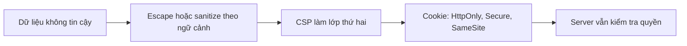
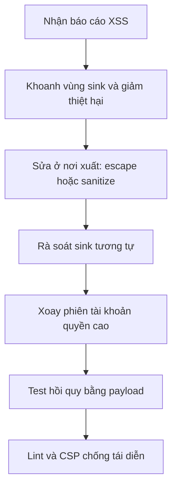

# Câu hỏi: Bảo mật frontend

Mỗi câu đi theo chuỗi suy luận: **Câu hỏi** như người phỏng vấn nói, **Gợi ý suy luận** (các câu hỏi nhỏ dẫn tới khái niệm nền), **Lập luận** (chuỗi nhân quả "vì A nên B"), **Đáp án ngắn** nói được thành tiếng, **Nhớ** (kiến thức cốt lõi kèm link bài gốc), rồi **Ví dụ** nếu cần. Mỗi **Hỏi xoáy** nêu thêm vì sao nó là bước kế tiếp logic. Cách học tốt nhất: che phần lập luận, tự trả lời thành tiếng, rồi mới so.

Kiến thức gốc: [Bảo mật frontend](/go?p=11-Frontend-Core%2Flt-04-bao-mat-frontend.md). Phần phía server và mô hình tấn công tổng quát: [OWASP và bảo mật web](/go?p=03-Network-Security%2Fmedium%2Flt-04-owasp-web-security.md), [Authentication, session, token](/go?p=03-Network-Security%2Fmedium%2Flt-05-xac-thuc-phien-token.md), [HTTPS và TLS](/go?p=03-Network-Security%2Fmedium%2Flt-03-https-tls.md). Bộ câu hỏi tổng hợp liên quan: [Frontend phỏng vấn](/go?p=07-Interview-QA%2FFrontend%2Fhard%2Fqa-fe-phong-van.md).

Quy ước nhãn ví dụ:

- **_Đã chạy thử bằng Node_**: code JavaScript thuần, chạy trong sandbox bằng Node 22, output là thật. Node không có DOM và không có trình duyệt, nên ví dụ chỉ mô phỏng phần logic (escape, kiểm tra URL, hash), không mô phỏng việc trình duyệt thực thi script.
- **_Minh họa_**: code HTML, header, React, Vue hoặc config theo tài liệu, chưa chạy ở đây. Chi tiết phụ thuộc phiên bản trình duyệt và thư viện, hãy kiểm tra lại theo phiên bản bạn dùng.



Đọc sơ đồ: không lớp nào đủ một mình. Frontend giảm bề mặt tấn công và thiệt hại, còn quyết định cuối cùng về quyền luôn nằm ở server.

**Tóm tắt:**

- Gốc của mọi lỗ hổng injection là trộn dữ liệu không tin cậy vào code/markup; cách chặn là escape đúng theo ngữ cảnh (HTML, attribute, URL, JS, CSS), không có một hàm escape dùng mọi nơi.
- XSS có ba loại (stored, reflected, DOM-based) khác nhau ở nơi payload đi vào; React và Vue tự escape nhưng vẫn dính XSS qua `dangerouslySetInnerHTML`, `v-html`, `href` kiểu `javascript:` và sink DOM.
- Rich text phải sanitize theo allowlist (DOMPurify) ở nơi xuất; CSP là lớp thứ hai, dùng nonce hoặc hash thay cho `unsafe-inline`, deploy bằng Report-Only trước.
- CSRF khai thác việc trình duyệt tự gửi cookie; `SameSite` giảm rủi ro nhưng không thay CSRF token, và "site" khác "origin".
- CORS chỉ quyết định JS có đọc được response hay không, không bảo vệ server; bảo vệ API thật cần authentication, authorization và CSRF.
- Hay bị hỏi xoáy: cookie HttpOnly hay `localStorage` cho token (HttpOnly chặn đọc, không chặn XSS dùng session); `startsWith` kiểm tra redirect vẫn thủng; secret trong biến môi trường frontend là công khai.
- Quyết định về quyền luôn nằm ở server; frontend chỉ giảm bề mặt tấn công và thiệt hại, theo kiểu phòng thủ nhiều lớp.

## 1. Ba loại XSS: vì sao cùng là chèn script mà cách chặn khác nhau?

**Phải thuộc:** Câu này là câu cốt lõi, gặp rất thường xuyên.

**Câu hỏi:** Một ô tìm kiếm, một ô bình luận và một đoạn code đọc `location.hash` đều có thể bị chèn script. Ba trường hợp đó khác nhau thế nào, và cách chặn có giống nhau không?

**Gợi ý suy luận:**
- Payload đi từ đâu tới trang: từ database, từ URL của request, hay từ chính JavaScript của client đọc nguồn?
- Server có tham gia vào việc đưa payload vào HTML không?
- Điểm chung nằm ở đâu: dữ liệu không tin cậy đi tới đâu thì trình duyệt coi nó là mã?

**Lập luận:** XSS xảy ra khi chuỗi do kẻ tấn công kiểm soát bị trình duyệt hiểu là HTML hoặc JS thay vì văn bản. Vì chỗ "hiểu nhầm" chỉ xảy ra ở nơi ghi ra trang (sink), cách phân loại dựa trên **nguồn** payload. Stored: payload nằm trong database nên mọi người xem trang đều dính, nguy hiểm nhất vì không cần lừa ai bấm link. Reflected: payload nằm trong request (thường là query) rồi server phản chiếu lại, nên kẻ tấn công phải lừa nạn nhân mở link. DOM-based: server không dính, JS của client đọc nguồn như `location.hash`, `postMessage` rồi ghi vào sink như `innerHTML`, nên lỗi chỉ thấy khi đọc code client. Vì gốc là một (sink hiểu chuỗi là mã), cách chặn cũng xoay quanh một ý: ghi dữ liệu dưới dạng văn bản, và chỉ cho HTML đi qua khi đã sanitize. Khác nhau ở chỗ cần sửa: stored và reflected sửa ở nơi render (server hoặc template), DOM-based sửa ở code client.

**Đáp án ngắn:** Stored lưu payload ở server, reflected phản chiếu từ request, DOM-based xảy ra hoàn toàn ở client khi JS ghi nguồn không tin cậy vào sink nguy hiểm. Cả ba chặn bằng cách coi dữ liệu là văn bản (escape theo ngữ cảnh), sanitize nếu bắt buộc cho HTML, và CSP làm lớp thứ hai.

**Nhớ:** Phân loại theo nguồn, chặn theo sink. Xem bảng loại và danh sách sink ở [Bảo mật frontend](/go?p=11-Frontend-Core%2Flt-04-bao-mat-frontend.md).

**Ví dụ:** ba nguồn, một sink.

```html
<!-- Minh họa -->
<!-- Stored: server render bình luận lấy từ DB, không escape -->
<div class="comment"></div>

<script>
  // DOM-based: không có server nào dính vào
  document.querySelector("#welcome").innerHTML = location.hash.slice(1);
  // Cách sửa: coi là văn bản
  document.querySelector("#welcome").textContent = decodeURIComponent(location.hash.slice(1));
</script>
```

_Minh họa._ Dòng `innerHTML` là sink, `location.hash` là nguồn. Chỉ cần đổi sink sang `textContent` là payload thành văn bản vô hại.

**Hỏi xoáy 1:** Vì sao nói stored XSS nguy hiểm hơn reflected dù cùng chạy script?
**Vì sao hỏi tiếp:** Sau khi phân loại, người phỏng vấn muốn biết bạn đánh giá mức độ rủi ro dựa vào điều kiện tấn công chứ không chỉ thuộc tên.
**Gợi ý suy luận:** Nạn nhân phải làm gì để dính? Phạm vi nạn nhân là một người hay mọi người xem trang? Kẻ tấn công cần giữ link sống không?
**Đáp:** Reflected cần lừa từng nạn nhân bấm link độc, phạm vi theo số link gửi được. Stored chỉ cần chèn một lần, mọi người (kể cả admin xem trang quản trị) dính khi mở trang bình thường, nên phạm vi và khả năng leo quyền lớn hơn nhiều.

**Hỏi xoáy 2:** Ứng dụng SPA React thuần gọi API trả JSON. Có còn XSS reflected không?
**Vì sao hỏi tiếp:** Nhiều người nghĩ XSS là chuyện của server render, nên câu này kiểm tra bạn hiểu XSS theo sink chứ không theo công nghệ.
**Gợi ý suy luận:** HTML ban đầu do ai sinh ra? Dữ liệu từ API đi vào DOM qua đường nào? Có chỗ nào tắt escape của framework không?
**Đáp:** Reflected kiểu cổ điển (server ghép query vào HTML) hiếm đi vì HTML là shell tĩnh. Nhưng DOM-based và stored vẫn còn: dữ liệu API chứa HTML mà bạn render bằng `dangerouslySetInnerHTML`, hoặc URL từ API gán vào `href`. Bề mặt chuyển từ template của server sang các API "tắt escape" ở client.

**Sai lầm hay gặp:** Cho rằng "dùng React thì hết XSS". React chỉ escape khi nội suy thường, không bảo vệ gì ở `dangerouslySetInnerHTML`, `href` hay `eval`.

## 2. React và Vue đã tự escape, vì sao ứng dụng vẫn dính XSS?

**Phải thuộc:** Câu này là câu cốt lõi, gặp rất thường xuyên.

**Câu hỏi:** Team bạn dùng React, ai cũng bảo "framework escape rồi". Vậy một pentest vẫn tìm ra XSS, chúng thường nằm ở đâu?

**Gợi ý suy luận:**
- Khi bạn viết `{userName}` framework làm gì với chuỗi, và nó làm điều đó bằng cách nào (tạo text node hay ghép chuỗi HTML)?
- API nào của framework có tên cảnh báo rõ là bỏ qua cơ chế đó?
- Chuỗi URL được đặt vào `href` có phải HTML không, và `javascript:` thì sao?

**Lập luận:** Framework tạo text node cho nội suy thường, text node không bao giờ được parse thành HTML, nên `<script>` trở thành chữ. Vậy rủi ro chỉ còn ở nơi đường đó bị bỏ qua. Thứ nhất, các API chèn HTML thô (`dangerouslySetInnerHTML`, `v-html`, `innerHTML` trực tiếp qua ref) đưa chuỗi vào parser HTML, escape không còn. Thứ hai, attribute chứa URL (`href`, `src`, `action`) không bị escape theo nghĩa HTML vì chuỗi `javascript:alert(1)` không có ký tự đặc biệt nào, nhưng trình duyệt thực thi nó khi click, nên cần kiểm tra giao thức. Thứ ba, code ngoài framework: `eval`, `new Function`, `setTimeout(string)`, gắn script từ chuỗi. Thứ tư, thư viện bên thứ ba render HTML (markdown, editor, tooltip) và `postMessage` từ iframe. Như vậy, khi review, tìm chính các điểm bỏ qua escape này là nhanh nhất.

**Đáp án ngắn:** Framework chỉ escape khi nội suy thường. XSS còn ở HTML thô (`dangerouslySetInnerHTML`, `v-html`), URL `javascript:` trong `href`, `eval` và thư viện render HTML. Cần allowlist giao thức URL và sanitize HTML.

**Nhớ:** Tìm sink "tắt escape" khi review. Xem mục sink và `safeUrl` trong [Bảo mật frontend](/go?p=11-Frontend-Core%2Flt-04-bao-mat-frontend.md).

**Ví dụ:** kiểm tra URL bằng allowlist giao thức.

```js
function safeUrl(u) {
  try {
    const url = new URL(u, "https://app.example.com");
    return ["http:", "https:", "mailto:"].includes(url.protocol) ? url.href : "#";
  } catch {
    return "#";
  }
}
for (const u of ["https://a.com/x", "/profile", "javascript:alert(1)", "JaVaScRiPt:alert(1)", " javascript:alert(1)", "data:text/html,<script>1</script>", "mailto:a@b.c"]) {
  console.log(JSON.stringify(u).padEnd(48), "->", safeUrl(u));
}
```

```text
"https://a.com/x"                                -> https://a.com/x
"/profile"                                       -> https://app.example.com/profile
"javascript:alert(1)"                            -> #
"JaVaScRiPt:alert(1)"                            -> #
" javascript:alert(1)"                           -> #
"data:text/html,<script>1</script>"              -> #
"mailto:a@b.c"                                   -> mailto:a@b.c
```

_Đã chạy thử bằng Node._ Hàm `URL` chuẩn hóa chữ hoa và khoảng trắng đầu chuỗi, nên các biến thể ngụy trang của `javascript:` đều lộ ra giao thức thật. Dùng allowlist (chỉ cho vài giao thức) an toàn hơn denylist (chặn `javascript:`) vì denylist luôn sót biến thể.

**Hỏi xoáy 1:** Vì sao dùng allowlist giao thức thay vì regex chặn chuỗi `javascript:`?
**Vì sao hỏi tiếp:** Ví dụ trên cho thấy có nhiều cách viết, nên câu tự nhiên là vì sao không vá từng cách.
**Gợi ý suy luận:** Trình duyệt chuẩn hóa chuỗi trước khi hiểu giao thức như thế nào? Số cách ngụy trang có hữu hạn không?
**Đáp:** Trình duyệt bỏ khoảng trắng đầu, không phân biệt hoa thường, thậm chí bỏ một số ký tự điều khiển, nên regex trên chuỗi thô dễ bị lách. Parse bằng `URL` rồi so với tập giao thức cho phép thì mọi thứ lạ đều bị từ chối theo mặc định.

**Hỏi xoáy 2:** `target="_blank"` có liên quan gì đến bảo mật khi gắn link từ dữ liệu người dùng?
**Vì sao hỏi tiếp:** Vẫn đang nói về link người dùng cung cấp, nhưng đây là rủi ro khác loại: trang đích điều khiển ngược trang gốc.
**Gợi ý suy luận:** Trang mở bằng link có tham chiếu lại tới trang mở nó qua object nào? Trình duyệt hiện đại mặc định ra sao?
**Đáp:** Trang đích có thể truy cập `window.opener` để điều hướng trang gốc sang trang giả (reverse tabnabbing). Trình duyệt hiện đại mặc định coi `target="_blank"` như có `noopener`, nhưng vẫn nên ghi `rel="noopener noreferrer"` để rõ ràng và an toàn với trình duyệt cũ (kiểm tra lại theo phiên bản).

**Sai lầm hay gặp:** Sanitize bằng cách tự viết regex xóa thẻ `<script>`. Payload như `` hay `<svg onload=...>` không cần thẻ script.

## 3. "Escape" nghĩa là gì, và vì sao một hàm escape không dùng được ở mọi nơi?

**Câu hỏi:** Bạn có hàm `escapeHtml`. Đồng nghiệp dùng nó để đưa dữ liệu vào cả nội dung HTML, attribute, URL và trong thẻ `<script>`. Chỗ nào đúng, chỗ nào sai?

**Gợi ý suy luận:**
- Mỗi ngữ cảnh (nội dung, attribute, URL, JS, CSS) có tập ký tự "đặc biệt" giống nhau không?
- Ký tự nào cho phép thoát khỏi ngữ cảnh hiện tại để sang ngữ cảnh mới?
- Vậy hàm escape phải biết điều gì về nơi dữ liệu sẽ đi vào?

**Lập luận:** Escape là biến ký tự đặc biệt của một ngữ cảnh thành dạng vô hại ở chính ngữ cảnh đó, để dữ liệu không thoát ra thành cú pháp. Vì mỗi ngữ cảnh có cú pháp riêng nên ký tự thoát cũng khác: trong nội dung HTML là `<` và `&`, trong attribute có dấu ngoặc bọc thì thêm `"` hoặc `'`, trong URL là percent-encoding, trong chuỗi JS là `\` và dấu nháy, trong CSS lại khác nữa. Do đó một hàm không phù hợp cho mọi nơi: `escapeHtml` đúng cho nội dung và attribute có ngoặc, nhưng không giúp gì khi chuỗi nằm trong `href` (cần kiểm giao thức) hoặc bên trong `<script>` (nên truyền qua JSON hoặc attribute `data-*`). Cách làm an toàn nhất là không ghép chuỗi mà dùng API encoding giùm: `textContent`, `setAttribute`, `encodeURIComponent`, hoặc template của framework.

**Đáp án ngắn:** Escape là vô hiệu ký tự đặc biệt theo đúng ngữ cảnh đầu ra. Mỗi ngữ cảnh (HTML, attribute, URL, JS, CSS) cần cách riêng, nên tốt nhất là dùng API an toàn của framework thay vì tự ghép chuỗi.

**Nhớ:** Escape khi xuất ra, theo ngữ cảnh, không escape "một lần ở đầu vào". Xem [Bảo mật frontend](/go?p=11-Frontend-Core%2Flt-04-bao-mat-frontend.md).

**Ví dụ:** cùng payload, thoát khỏi attribute.

```js
function escapeHtml(s) {
  return String(s).replace(/[&<>"']/g, (c) => ({ "&": "&amp;", "<": "&lt;", ">": "&gt;", '"': "&quot;", "'": "&#39;" }[c]));
}
const payload = '';
console.log("raw    :", `<p>${payload}</p>`);
console.log("escaped:", `<p>${escapeHtml(payload)}</p>`);
const attr = '" onmouseover="alert(1)';
console.log("attr sai   :", `<input value="${attr}">`);
console.log("attr dung  :", `<input value="${escapeHtml(attr)}">`);
```

```text
raw    : <p></p>
escaped: <p>&lt;img src=x onerror=&quot;alert(1)&quot;&gt;</p>
attr sai   : <input value="" onmouseover="alert(1)">
attr dung  : <input value="&quot; onmouseover=&quot;alert(1)">
```

_Đã chạy thử bằng Node._ Dòng "attr sai" cho thấy dấu `"` đóng attribute sớm và mở attribute `onmouseover` mới. Escape dấu `"` chặn việc thoát đó. Hàm này chỉ minh họa nguyên lý, trong dự án hãy dùng thư viện và template của framework.

**Hỏi xoáy 1:** Vì sao không nên "escape khi lưu vào database" để cho an toàn?
**Vì sao hỏi tiếp:** Nếu escape theo ngữ cảnh đầu ra, câu hỏi tự nhiên là vì sao không làm một lần sớm cho tiện.
**Gợi ý suy luận:** Cùng một dữ liệu sẽ được xuất ra những nơi nào (web, email, CSV, PDF)? Escape HTML có đúng cho các nơi đó không?
**Đáp:** Lúc lưu chưa biết dữ liệu sẽ đi vào ngữ cảnh nào, escape sớm làm hỏng dữ liệu (hiện `&amp;` ở chỗ khác) và vẫn sai ngữ cảnh khác. Nên lưu dữ liệu nguyên bản (và validate đầu vào theo nghiệp vụ), escape khi xuất.

**Hỏi xoáy 2:** Validate đầu vào có thay được escape đầu ra không?
**Vì sao hỏi tiếp:** Phân biệt hai lớp phòng thủ hay bị gộp thành một.
**Gợi ý suy luận:** Tên như `O'Brien` hợp lệ nhưng chứa ký tự đặc biệt thì xử lý ở đâu? Validate trả lời câu hỏi nào?
**Đáp:** Validate trả lời "dữ liệu có đúng dạng nghiệp vụ không" (độ dài, định dạng), giảm bề mặt tấn công. Escape trả lời "ghi ra ngữ cảnh này thế nào cho an toàn". Dữ liệu hợp lệ vẫn có thể chứa ký tự nguy hiểm nên cả hai đều cần.

## 4. Bắt buộc render HTML người dùng nhập (rich text): làm thế nào cho an toàn?

**Câu hỏi:** Sản phẩm có trình soạn thảo rich text, nội dung lưu dạng HTML và hiển thị cho người khác. Bạn không thể escape hết. Thiết kế thế nào?

**Gợi ý suy luận:**
- Nếu không escape được, cần chọn lọc: cho phép thẻ nào và attribute nào, từ chối phần còn lại. Đó là allowlist hay denylist?
- Sanitize ở lúc lưu, lúc xuất, hay cả hai, và quy tắc phòng thủ nào nói rằng đừng tin lần kiểm tra cũ?
- Có định dạng trung gian nào (markdown, JSON của editor) không cho script tồn tại ngay từ đầu?

**Lập luận:** Vì mục tiêu là giữ định dạng (đậm, danh sách, link) mà bỏ mã chạy được, ta dùng sanitizer theo allowlist: chỉ giữ thẻ và attribute đã biết an toàn, mọi thứ lạ bị bỏ. Allowlist an toàn hơn denylist vì kẻ tấn công cần tìm một thứ bạn chưa nghĩ tới, còn allowlist chặn mặc định. Sanitize phải làm bằng thư viện đã được kiểm chứng như DOMPurify, vì parser HTML của trình duyệt có nhiều quirk (mutation XSS: chuỗi an toàn khi parse lần một lại thành nguy hiểm khi serialize rồi parse lần hai), tự viết regex gần như chắc chắn sai. Nên sanitize ở nơi xuất (hoặc cả hai), vì quy tắc sanitize và thư viện thay đổi, nội dung cũ trong database có thể đã lọt từ trước. Lớp bổ trợ: CSP để script lọt qua cũng không chạy, và nếu được thì lưu định dạng trung gian (markdown, JSON như ProseMirror) rồi render bằng component, không có HTML thô nào.

**Đáp án ngắn:** Dùng sanitizer allowlist đã kiểm chứng như DOMPurify, sanitize ở nơi xuất, cấu hình hẹp số thẻ và attribute, thêm CSP làm lớp sau. Nếu có thể, lưu markdown hoặc JSON thay vì HTML để không phải tin HTML.

**Nhớ:** Không tự viết sanitizer, allowlist hơn denylist, sanitize ở nơi xuất. Chi tiết: [Bảo mật frontend, mục Sanitize HTML](/go?p=11-Frontend-Core%2Flt-04-bao-mat-frontend.md).

**Ví dụ:** React với DOMPurify (cấu hình hẹp).

```tsx
// Minh họa
import DOMPurify from "dompurify";

const ALLOWED = { ALLOWED_TAGS: ["b", "i", "em", "strong", "a", "p", "ul", "ol", "li", "br"], ALLOWED_ATTR: ["href"] };

export function RichText({ html }: { html: string }) {
  const clean = DOMPurify.sanitize(html, ALLOWED);
  return <div dangerouslySetInnerHTML={{ __html: clean }} />;
}
```

_Minh họa._ Nên bọc trong một component duy nhất để cả dự án chỉ có một chỗ gọi `dangerouslySetInnerHTML`, dễ review. Tên tùy chọn của DOMPurify kiểm tra lại theo phiên bản.

**Hỏi xoáy 1:** Mutation XSS là gì, và vì sao nó khiến sanitize bằng regex không đủ?
**Vì sao hỏi tiếp:** Lập luận trên dựa vào việc "parser có quirk", người phỏng vấn muốn thấy bạn hiểu quirk đó ở mức khái niệm.
**Gợi ý suy luận:** Sanitizer parse chuỗi thành cây rồi serialize lại. Nếu trình duyệt parse chuỗi serialize đó ra cây khác thì sao?
**Đáp:** Mutation XSS khai thác việc cây DOM sau serialize rồi parse lại không giống cây ban đầu, nên phần kiểm tra thấy "an toàn" nhưng phần hiển thị thấy mã. Cần thư viện cập nhật thường xuyên, theo dõi bản vá, và không sửa HTML sau khi đã sanitize.

**Hỏi xoáy 2:** Trusted Types giúp gì thêm?
**Vì sao hỏi tiếp:** Sau sanitize ở một chỗ, câu hỏi là làm sao ép cả codebase đi qua chỗ đó.
**Gợi ý suy luận:** Nếu trình duyệt từ chối gán chuỗi thường vào sink nguy hiểm, chỉ nhận object "đã được duyệt" thì sao?
**Đáp:** Với CSP `require-trusted-types-for 'script'` (hỗ trợ không đồng đều giữa trình duyệt, kiểm tra lại), việc gán chuỗi thô vào `innerHTML` bị chặn, chỉ giá trị do policy đã đăng ký tạo ra mới được qua. Nhờ đó DOM XSS bị dồn về vài điểm policy nhỏ dễ audit.

**Sai lầm hay gặp:** Sanitize rồi lại nối thêm chuỗi vào kết quả, hoặc sanitize ở lúc lưu một lần rồi tin mãi.

## 5. CSP hoạt động ra sao, nonce khác hash thế nào, vì sao tránh `unsafe-inline`?

**Câu hỏi:** Lỡ có một lỗ XSS lọt qua code review. Có cách nào để script của kẻ tấn công vẫn không chạy? Nó hoạt động ra sao và bật vào production thế nào để không làm hỏng trang?

**Gợi ý suy luận:**
- Nếu server nói trước cho trình duyệt "chỉ chạy script từ nguồn này", script chèn vào có thuộc danh sách đó không?
- Script inline hợp lệ của chính bạn thì phân biệt với script inline do kẻ tấn công chèn bằng cách nào (một giá trị bí mật đổi mỗi lần, hay dấu vân tay nội dung)?
- Deploy policy chặt vào trang đang chạy có thể làm gì, và có chế độ chỉ báo cáo không?

**Lập luận:** CSP là header mà trình duyệt thực thi: chỉ nạp và chạy tài nguyên khớp danh sách cho phép. Vì script do XSS chèn thường là inline hoặc đến từ nguồn lạ, một policy không cho phép cả hai làm lỗ XSS mất tác dụng ngay cả khi lọt. Vấn đề là script inline hợp lệ của bạn cũng bị chặn. `unsafe-inline` cho phép tất cả inline, nên cũng cho phép payload của kẻ tấn công, làm CSP gần như vô dụng với XSS. Thay vào đó có hai cách phân biệt inline hợp lệ. Nonce: server sinh chuỗi ngẫu nhiên mới cho mỗi response, đặt trong header và trong attribute `nonce` của thẻ script hợp lệ, kẻ tấn công không đoán được vì mỗi lần một khác. Hash: tính SHA-256 của nội dung script rồi đặt vào policy, phù hợp script tĩnh, nhưng đổi một ký tự là hash đổi. Nonce cần HTML sinh động theo request (SSR), hash hợp với HTML tĩnh. Để deploy an toàn, bắt đầu bằng `Content-Security-Policy-Report-Only` để thu báo cáo vi phạm, sửa dần rồi mới bật enforce.

**Đáp án ngắn:** CSP là header chỉ cho trình duyệt chạy script từ nguồn cho phép, nên XSS lọt qua cũng khó chạy. Tránh `unsafe-inline`, dùng nonce (ngẫu nhiên mỗi response) hoặc hash (dấu vân tay nội dung), deploy bằng Report-Only trước.

**Nhớ:** CSP là lớp thứ hai, không thay escape. Nonce phải ngẫu nhiên và mới mỗi response. Chi tiết: [Bảo mật frontend, mục CSP](/go?p=11-Frontend-Core%2Flt-04-bao-mat-frontend.md).

**Ví dụ:** sinh nonce và hash.

```js
const crypto = require("crypto");
const nonce = crypto.randomBytes(16).toString("base64");
console.log("nonce length (bytes 16 -> b64 chars):", nonce.length);
const inline = 'console.log("hi")';
const hash = crypto.createHash("sha256").update(inline).digest("base64");
console.log(`CSP hash: script-src 'sha256-${hash}'`);
const changed = crypto.createHash("sha256").update(inline + " ").digest("base64");
console.log("doi 1 ky tu -> hash khac:", hash !== changed);
```

```text
nonce length (bytes 16 -> b64 chars): 24
CSP hash: script-src 'sha256-TMFma7PHrBUjZEUKY/MwBLuX3/HrQe2+A1FmjMS7ppA='
doi 1 ky tu -> hash khac: true
```

_Đã chạy thử bằng Node._ Nonce khác nhau mỗi lần chạy (chỉ độ dài cố định), hash thì cố định theo nội dung.

```text
Content-Security-Policy: default-src 'self'; script-src 'nonce-R4nd0m' 'strict-dynamic'; object-src 'none'; base-uri 'none'; frame-ancestors 'none'
```

_Minh họa._ Header mẫu theo hướng dẫn "strict CSP". Giá trị nonce thật phải sinh mới mỗi response, và hỗ trợ `strict-dynamic` kiểm tra lại theo trình duyệt.

**Hỏi xoáy 1:** App dùng Next.js hoặc Vite, CSP với nonce làm khó ở đâu?
**Vì sao hỏi tiếp:** Nonce cần HTML sinh theo request, trong khi nhiều SPA phát HTML tĩnh qua CDN.
**Gợi ý suy luận:** HTML tĩnh có thể nhúng nonce khác nhau mỗi request không? Có cách nào khác để cho phép script hợp lệ?
**Đáp:** HTML tĩnh cache ở CDN không có nonce mỗi request, nên dùng hash (build tool sinh hash cho inline script) hoặc cho CDN/edge chèn nonce. Với SSR, framework thường hỗ trợ truyền nonce qua middleware, nhưng thường làm trang không cache được tĩnh, đó là đánh đổi cần cân nhắc.

**Hỏi xoáy 2:** Vì sao `script-src 'self'` còn chưa đủ chắc?
**Vì sao hỏi tiếp:** Hỏi mức độ tin cậy của danh sách cho phép, không chỉ cú pháp.
**Gợi ý suy luận:** Nếu trong nguồn "self" có endpoint JSONP hoặc file upload của người dùng được phục vụ cùng origin thì sao? Nếu cho phép cả CDN chung thì sao?
**Đáp:** Kẻ tấn công có thể dùng một file thuộc nguồn được phép (ảnh/JS upload cùng origin, JSONP, thư viện có gadget trên CDN chung) làm bàn đạp. Vì vậy strict CSP dựa vào nonce hoặc hash thay vì danh sách domain là hướng được khuyến nghị.

**Sai lầm hay gặp:** Dùng nonce cố định trong file config, hoặc thêm `unsafe-inline` để "cho chạy được" rồi quên gỡ.

## 6. Vì sao kẻ tấn công không cần đánh cắp cookie mà vẫn thực hiện được hành động thay bạn (CSRF)?

**Phải thuộc:** Câu này là câu cốt lõi, gặp rất thường xuyên.

**Câu hỏi:** Bạn đã đăng nhập ngân hàng bằng cookie phiên. Mở một trang lạ có form tự submit tới `bank.com/transfer`, tiền vẫn chuyển được. Điều gì cho phép việc này, và chặn bằng cách nào?

**Gợi ý suy luận:**
- Khi trình duyệt gửi request tới `bank.com`, nó quyết định đính cookie dựa vào trang đang mở hay dựa vào đích đến?
- Kẻ tấn công có đọc được response không, và họ có cần đọc không?
- Muốn phân biệt request thật với request giả, ta cần một giá trị mà trang giả không biết được. Giá trị đó đến từ đâu?

**Lập luận:** Cookie được trình duyệt tự đính theo đích đến, bất kể trang nào phát ra request. Vì vậy trang `evil.com` chỉ cần khiến trình duyệt gửi request tới `bank.com` (form, ảnh, `fetch`), cookie phiên đi kèm tự động và server tưởng người dùng thật làm. Kẻ tấn công không đọc được response (same-origin policy chặn), nhưng với hành động ghi (chuyển tiền, đổi email) họ không cần đọc. Gốc của vấn đề là authentication chỉ dựa vào thứ trình duyệt tự gửi. Cách chặn là thêm một thứ trình duyệt không tự gửi và trang lạ không biết: CSRF token (server sinh, gắn vào form hoặc header, so khớp), hoặc kiểm tra `Origin`, hoặc `SameSite` để cookie không đi kèm request từ site khác. Token chỉ có tác dụng khi kẻ tấn công không đọc được nó, tức là phụ thuộc vào same-origin policy.

**Đáp án ngắn:** CSRF lợi dụng việc trình duyệt tự đính cookie theo đích đến. Chặn bằng CSRF token (hoặc kiểm tra Origin) cộng `SameSite` cho cookie, chỉ áp dụng cho các hành động đổi state, và không bao giờ đổi state bằng GET.

**Nhớ:** Token phải khó đoán, gắn với phiên và không nằm trong cookie tự gửi (trừ mẫu double submit có kiểm tra). Xem [Bảo mật frontend, mục CSRF](/go?p=11-Frontend-Core%2Flt-04-bao-mat-frontend.md) và [OWASP](/go?p=03-Network-Security%2Fmedium%2Flt-04-owasp-web-security.md).

**Ví dụ:** mẫu double submit cookie, so sánh hằng số thời gian.

```js
const crypto = require("crypto");
function same(a, b) {
  const x = Buffer.from(a), y = Buffer.from(b);
  return x.length === y.length && crypto.timingSafeEqual(x, y);
}
const cookieToken = crypto.randomBytes(32).toString("hex");
console.log("hop le (header = cookie):", same(cookieToken, cookieToken));
console.log("ke tan cong khong biet token:", same(cookieToken, crypto.randomBytes(32).toString("hex")));
```

```text
hop le (header = cookie): true
ke tan cong khong biet token: false
```

_Đã chạy thử bằng Node._ Ở thực tế, trang của bạn đọc token (từ endpoint hoặc cookie không HttpOnly) và gửi lại trong header `X-CSRF-Token`; trang lạ không đọc được cookie của bạn nên không tạo được header khớp. Phiên bản an toàn hơn là token ký gắn với session.

**Hỏi xoáy 1:** SPA gọi API bằng `Authorization: Bearer` trong header thì có cần lo CSRF không?
**Vì sao hỏi tiếp:** Xác nhận bạn hiểu CSRF phụ thuộc cơ chế tự gửi của cookie chứ không phải loại ứng dụng.
**Gợi ý suy luận:** Trình duyệt có tự thêm header `Authorization` vào request từ trang lạ không? Token này nằm ở đâu?
**Đáp:** Header tùy chỉnh không tự đính, nên CSRF cổ điển không áp dụng khi token nằm ở header do JS của bạn đặt. Đổi lại token phải được lưu ở nơi JS đọc được, nên rủi ro dồn sang XSS (xem câu 9).

**Hỏi xoáy 2:** Server chỉ nhận `Content-Type: application/json` có chặn được CSRF không?
**Vì sao hỏi tiếp:** Một mẹo hay được nghe, kiểm tra bạn có hiểu mối liên hệ với CORS preflight không.
**Gợi ý suy luận:** Form HTML gửi được kiểu content nào? `fetch` với JSON có cần preflight không (câu 8)?
**Đáp:** Form chỉ gửi được ba kiểu content đơn giản, còn `fetch` với `application/json` kích hoạt preflight và bị chặn nếu server không cho phép origin đó. Nhưng đây là phòng thủ gián tiếp, dễ vỡ nếu server lỏng lẻo (nhận cả `text/plain`, config CORS rộng), nên không thay thế token hoặc kiểm tra Origin.

**Sai lầm hay gặp:** Cho rằng chỉ POST mới cần bảo vệ CSRF hoặc dùng GET để đổi state (xóa, thanh toán), rồi bị kích hoạt bằng một thẻ ``.

## 7. Đã đặt cookie `SameSite`. Còn cần CSRF token không, và "site" khác "origin" thế nào?

**Câu hỏi:** Cookie phiên của bạn có `SameSite=Lax`. Đồng nghiệp bảo "xong rồi, bỏ CSRF token đi". Bạn phản biện hay đồng ý, và `api.example.com` với `app.example.com` có tính là cùng site không?

**Gợi ý suy luận:**
- Origin gồm những thành phần nào, và site thì gộp những gì lại?
- `Strict`, `Lax`, `None` khác nhau ở việc có gửi cookie trong những loại điều hướng và request chéo site nào?
- Lỗi ở subdomain cùng site, hoặc trình duyệt cũ, thì sao?

**Lập luận:** Origin là bộ ba giao thức, host, cổng. Site rộng hơn: giao thức cộng miền đăng ký được (eTLD+1, ví dụ `example.com`), bỏ qua subdomain và cổng. Vì vậy `app.example.com` và `api.example.com` khác origin nhưng cùng site. `SameSite` xét theo **site**: `Strict` không gửi cookie trong mọi request từ site khác, `Lax` (mặc định ở trình duyệt hiện đại khi không ghi, kiểm tra lại theo phiên bản) chỉ gửi trong điều hướng cấp cao dùng phương thức an toàn như GET khi người dùng bấm link, `None` luôn gửi (bắt buộc kèm `Secure`). Với `Lax`, form POST từ trang lạ không mang cookie, chặn phần lớn CSRF kiểu cổ điển. Nhưng `SameSite` không thay token hoàn toàn: một lỗi XSS hoặc trang takeover subdomain cùng site vẫn gửi được request cùng site mang cookie, còn GET đổi state vẫn bị qua mặt bởi điều hướng cấp cao, và có ngoại lệ lịch sử như cookie mới được cho gửi POST trong thời gian ngắn ở một số trình duyệt. Kết luận: đặt `SameSite` làm lớp nền và giữ token hoặc kiểm tra Origin cho hành động nhạy cảm.

**Đáp án ngắn:** Site là giao thức cộng miền đăng ký, rộng hơn origin, nên subdomain cùng site vẫn gửi cookie. `SameSite=Lax` giảm mạnh CSRF nhưng không thay hoàn toàn token, vì lỗi trong cùng site, GET đổi state và khác biệt trình duyệt vẫn tồn tại.

**Nhớ:** SameSite xét site, CORS xét origin. Bộ cookie tốt: `HttpOnly; Secure; SameSite=Lax` (hoặc `Strict`), có thể thêm tiền tố `__Host-`. Xem [Bảo mật frontend](/go?p=11-Frontend-Core%2Flt-04-bao-mat-frontend.md).

**Ví dụ:** so sánh origin của các cặp URL.

```js
const o = (u) => new URL(u).origin;
const pairs = [
  ["https://app.example.com", "https://api.example.com"],
  ["https://app.example.com", "https://app.example.com:8443"],
  ["https://app.example.com", "http://app.example.com"],
  ["https://app.example.com/a", "https://app.example.com/b"],
];
for (const [a, b] of pairs) console.log(a.padEnd(28), b.padEnd(32), "cung origin:", o(a) === o(b));
```

```text
https://app.example.com      https://api.example.com          cung origin: false
https://app.example.com      https://app.example.com:8443     cung origin: false
https://app.example.com      http://app.example.com           cung origin: false
https://app.example.com/a    https://app.example.com/b        cung origin: true
```

_Đã chạy thử bằng Node._ Hai dòng đầu và ba đều khác origin. Riêng dòng đầu vẫn **cùng site** (cùng `example.com`), nhưng Node không có danh sách eTLD (public suffix list) nên ví dụ chỉ chứng minh phần origin.

```text
Set-Cookie: __Host-session=abc123; Path=/; Secure; HttpOnly; SameSite=Lax
```

_Minh họa._ Tiền tố `__Host-` ép cookie có `Secure`, `Path=/` và không có `Domain`, khóa nó vào đúng host.

**Hỏi xoáy 1:** Khi nào buộc dùng `SameSite=None`?
**Vì sao hỏi tiếp:** Biết `Lax` mặc định thì câu kế tiếp là trường hợp thật sự cần chéo site.
**Gợi ý suy luận:** Cookie nào cần đi theo request từ trang của site khác (widget nhúng, SSO qua iframe)? Điều kiện đi kèm là gì?
**Đáp:** Khi cookie phải gửi trong ngữ cảnh bên thứ ba, ví dụ widget nhúng hoặc đăng nhập chéo site, và bắt buộc có `Secure`. Khi đó SameSite không bảo vệ nữa, phải dùng CSRF token. Cookie bên thứ ba còn bị trình duyệt hạn chế thêm, kiểm tra lại chính sách hiện hành.

**Hỏi xoáy 2:** Kiểm tra header `Origin` ở server thì ổn hơn token hay kém hơn?
**Vì sao hỏi tiếp:** Một lựa chọn thay thế thường dùng, nên cần biết giới hạn.
**Gợi ý suy luận:** Trình duyệt có gắn `Origin` vào mọi request không? Kẻ tấn công có thể giả `Origin` từ trình duyệt không?
**Đáp:** Trình duyệt gắn `Origin` cho request đổi state và kẻ tấn công không sửa được nó từ trang web, nên kiểm tra khớp allowlist rất hiệu quả và không cần lưu token. Nhược điểm: có request thiếu `Origin` (một số trường hợp cũ), nên thường kết hợp với `Sec-Fetch-Site` hoặc token.

## 8. CORS có bảo vệ server không? Preflight xảy ra khi nào?

**Phải thuộc:** Câu này là câu cốt lõi, gặp rất thường xuyên.

**Câu hỏi:** Bạn thấy lỗi "blocked by CORS policy" trong console và đồng nghiệp bảo "bật CORS cho `*` là hết lỗi". Hiểu CORS thế nào cho đúng, và nó có bảo vệ API của bạn không?

**Gợi ý suy luận:**
- Same-origin policy chặn điều gì: việc gửi request hay việc đọc response?
- Ai áp dụng quy tắc CORS: server hay trình duyệt, và ai quyết định cho phép?
- Request nào gây tác dụng phụ ngay dù trình duyệt sau đó không cho JS đọc kết quả, và request nào phải hỏi trước?

**Lập luận:** Same-origin policy mặc định cấm JS ở origin A đọc response của origin B. CORS là cách server B nới lỏng việc đó bằng header (`Access-Control-Allow-Origin`), và **trình duyệt** là bên thực thi. Vì vậy CORS bảo vệ người dùng khỏi việc trang lạ đọc dữ liệu họ có quyền xem, chứ không bảo vệ server: `curl`, Postman hay script của kẻ tấn công không chịu CORS, và request "đơn giản" (GET, và POST với form-encoded) vẫn được gửi đi, server vẫn xử lý, chỉ là JS không đọc được kết quả. Request không đơn giản (phương thức như PUT, DELETE, header tùy chỉnh như `Authorization`, `Content-Type: application/json`) kích hoạt preflight: trình duyệt gửi `OPTIONS` hỏi trước, server cho phép thì mới gửi request thật. Do đó "sửa lỗi CORS" bằng `*` chỉ mở quyền đọc cho mọi origin, và với `credentials` thì `*` thậm chí bị cấm, buộc trả đúng origin. Muốn bảo vệ API thật thì cần authentication và authorization ở server.

**Đáp án ngắn:** CORS là cơ chế trình duyệt nới same-origin policy theo header của server, không phải hàng rào bảo vệ server (curl bỏ qua nó). Preflight `OPTIONS` xảy ra với request không đơn giản. Bảo vệ API thật bằng authentication, authorization và CSRF.

**Nhớ:** CORS cấp quyền đọc, không cấp quyền gọi. Đừng phản chiếu mù quáng `Origin` thành `Allow-Origin` khi có credentials. Xem [Bảo mật frontend, mục CORS](/go?p=11-Frontend-Core%2Flt-04-bao-mat-frontend.md).

**Ví dụ:** quy tắc "request đơn giản" rút gọn.

```js
const SAFE_METHODS = ["GET", "HEAD", "POST"];
const SAFE_HEADERS = ["accept", "accept-language", "content-language", "content-type"];
const SAFE_CT = ["application/x-www-form-urlencoded", "multipart/form-data", "text/plain"];
function needsPreflight(method, headers = {}) {
  if (!SAFE_METHODS.includes(method)) return true;
  for (const [k, v] of Object.entries(headers)) {
    const key = k.toLowerCase();
    if (!SAFE_HEADERS.includes(key)) return true;
    if (key === "content-type" && !SAFE_CT.includes(v.split(";")[0].trim().toLowerCase())) return true;
  }
  return false;
}
const cases = [["GET", {}], ["POST", { "Content-Type": "application/x-www-form-urlencoded" }], ["POST", { "Content-Type": "application/json" }], ["GET", { Authorization: "Bearer x" }], ["DELETE", {}], ["PUT", { "Content-Type": "text/plain" }]];
for (const [m, h] of cases) console.log(m.padEnd(7), JSON.stringify(h).padEnd(50), "preflight:", needsPreflight(m, h));
```

```text
GET     {}                                                 preflight: false
POST    {"Content-Type":"application/x-www-form-urlencoded"} preflight: false
POST    {"Content-Type":"application/json"}                preflight: true
GET     {"Authorization":"Bearer x"}                       preflight: true
DELETE  {}                                                 preflight: true
PUT     {"Content-Type":"text/plain"}                      preflight: true
```

_Đã chạy thử bằng Node._ Đây là bản rút gọn của đặc tả Fetch (còn quy tắc về `Range`, độ dài giá trị header và các header cấm), chỉ để nhớ nguyên lý.

**Hỏi xoáy 1:** Vì sao khi gửi cookie chéo origin thì `Access-Control-Allow-Origin: *` bị cấm?
**Vì sao hỏi tiếp:** Gắn CORS với cookie, nối lại với CSRF ở câu trước.
**Gợi ý suy luận:** `*` kết hợp với credentials nghĩa là mọi trang đọc được dữ liệu riêng của người dùng. Khi đó cần khai báo gì thêm?
**Đáp:** Với `fetch(..., { credentials: "include" })`, server phải trả origin cụ thể và `Access-Control-Allow-Credentials: true`, nếu không trình duyệt từ chối. Server nên so khớp `Origin` với allowlist chứ không phản chiếu bất kỳ giá trị nào, đồng thời thêm `Vary: Origin` để cache không trộn.

**Hỏi xoáy 2:** Lỗi CORS ở dev, giải quyết bằng proxy của Vite hay webpack dev server có phải là cách "né bảo mật" không?
**Vì sao hỏi tiếp:** Thực tế dev hay dùng proxy, câu này kiểm tra bạn hiểu CORS là chuyện của trình duyệt.
**Gợi ý suy luận:** Nếu trình duyệt chỉ nói chuyện với dev server cùng origin, request tới API thật do ai gửi? Server-to-server có CORS không?
**Đáp:** Trình duyệt gọi cùng origin với dev server, dev server chuyển tiếp tới API (server tới server không có CORS), nên lỗi biến mất mà không nới quyền gì. Chỉ là tiện lợi cho dev, production cần cùng origin qua reverse proxy hoặc config CORS đúng.

**Sai lầm hay gặp:** Cho CORS là "tường lửa" nên thả lỏng authentication ở API vì "chỉ app mình gọi".

## 9. Lưu access token ở cookie HttpOnly hay `localStorage`?

**Câu hỏi:** Frontend đăng nhập xong nhận token. Bạn đặt nó ở đâu, và "HttpOnly là an toàn tuyệt đối" có đúng không?

**Gợi ý suy luận:**
- JS chạy trên trang đọc được những nơi lưu nào, và cookie `HttpOnly` thì sao?
- Nếu có XSS, kẻ tấn công làm được những gì khi token đọc được và khi không đọc được?
- Nếu token nằm trong cookie, nguy cơ nào của câu 6 quay lại?

**Lập luận:** `localStorage` đọc được bởi mọi JS cùng origin, nên một lỗ XSS (kể cả từ một thư viện bên thứ ba) đánh cắp được token và dùng ở bất cứ đâu, kể cả sau khi nạn nhân rời trang. Cookie `HttpOnly` thì JS không đọc được, nên token không bị lấy đi, nhưng XSS vẫn **dùng** được phiên ngay trong trình duyệt nạn nhân: gửi request, trình duyệt tự đính cookie. Vậy HttpOnly giảm thiệt hại (không đánh cắp mang đi, phiên ngắn lại) chứ không biến XSS thành vô hại. Đổi lại, cookie tự được gửi nên cần phòng CSRF (`SameSite`, token, kiểm tra Origin), còn `localStorage` với header `Authorization` thì miễn nhiễm CSRF nhưng phơi XSS. Thực hành hay dùng: access token ngắn hạn giữ trong memory JS, refresh token trong cookie `HttpOnly; Secure; SameSite` và có xoay vòng (rotation), hoặc mẫu BFF (backend for frontend) giữ token ở server, trình duyệt chỉ giữ cookie phiên.

**Đáp án ngắn:** Ưu tiên cookie `HttpOnly; Secure; SameSite` (hoặc BFF) vì XSS không lấy đi được token, kèm biện pháp chống CSRF. `localStorage` đơn giản nhưng XSS đọc được toàn bộ. HttpOnly không chặn XSS dùng phiên, nên vẫn phải chống XSS.

**Nhớ:** Không có nơi lưu nào chống được XSS, chỉ có nơi lưu giảm thiệt hại. Xem [Bảo mật frontend, mục Lưu token](/go?p=11-Frontend-Core%2Flt-04-bao-mat-frontend.md) và [Authentication, session, token](/go?p=03-Network-Security%2Fmedium%2Flt-05-xac-thuc-phien-token.md).

**Ví dụ:** payload JWT đọc được mà không cần bí mật.

```js
const header = Buffer.from(JSON.stringify({ alg: "HS256", typ: "JWT" })).toString("base64url");
const body = Buffer.from(JSON.stringify({ sub: "42", role: "admin", email: "a@b.c", exp: 1900000000 })).toString("base64url");
const token = header + "." + body + ".signature_khong_can_biet";
const decoded = JSON.parse(Buffer.from(token.split(".")[1], "base64url").toString());
console.log("khong can secret van doc duoc payload:", decoded);
```

```text
khong can secret van doc duoc payload: { sub: '42', role: 'admin', email: 'a@b.c', exp: 1900000000 }
```

_Đã chạy thử bằng Node._ Phần payload của JWT chỉ được encode dạng base64url chứ không phải encrypt, ai có token cũng đọc được, nên không đặt dữ liệu nhạy cảm vào đó. Chữ ký chỉ chứng minh không bị sửa. Vì vậy phía client chỉ dùng nội dung token để hiển thị, không để quyết định bảo mật (ví dụ ẩn nút theo `role` là UX, server vẫn phải kiểm tra).

**Hỏi xoáy 1:** Nếu chọn cookie HttpOnly, frontend làm sao biết người dùng đã đăng nhập chưa?
**Vì sao hỏi tiếp:** Hệ quả thiết kế trực tiếp của việc JS không đọc được token.
**Gợi ý suy luận:** JS không đọc cookie, vậy lấy trạng thái đăng nhập từ đâu? Khi hết hạn thì xử lý ra sao?
**Đáp:** Gọi endpoint như `/api/me` để lấy thông tin người dùng và trạng thái, coi 401 là đã hết phiên. Lưu cờ đăng nhập trong state (không phải nguồn tin cậy), và tự động làm mới token qua refresh endpoint khi gặp 401, tránh gọi đồng thời nhiều refresh.

**Hỏi xoáy 2:** Token trong memory (biến JS) mất khi tải lại trang, xử lý thế nào?
**Vì sao hỏi tiếp:** Chọn phương án an toàn hơn thì phải trả lời được bài toán trải nghiệm.
**Gợi ý suy luận:** Nếu refresh token nằm trong cookie HttpOnly, lúc khởi động app có thể xin access token mới bằng gì?
**Đáp:** Khi tải trang, app gọi endpoint refresh (cookie tự gửi) để lấy access token mới vào memory. XSS vẫn dùng được trong lúc trang mở nhưng không lấy token mang đi lâu dài, và refresh token xoay vòng giúp phát hiện token bị đánh cắp.

**Sai lầm hay gặp:** Nói "dùng HttpOnly là hết lo XSS", hoặc lưu thông tin phiên nhạy cảm vào `sessionStorage` cho rằng "an toàn hơn" (vẫn đọc được bởi JS cùng origin).

## 10. Trang của bạn bị nhúng trong iframe của site khác, người dùng bị lừa bấm. Đó là gì và chặn thế nào?

**Câu hỏi:** Kẻ tấn công đặt trang của bạn trong một iframe trong suốt, đè lên nút "Nhận quà" của họ. Người dùng bấm tưởng là nhận quà nhưng thực ra bấm "Xóa tài khoản" của bạn. Chặn ra sao?

**Gợi ý suy luận:**
- Trang bị nhúng có nhận biết được mình đang nằm trong frame không, và ai quyết định có cho nhúng?
- Header nào cho server nói "đừng cho site khác nhúng tôi"?
- Tại sao chỉ dùng JS "frame busting" là không đủ?

**Lập luận:** Clickjacking dựa trên việc trang của bạn hiển thị trong frame của site khác, kẻ tấn công che nó và dẫn dụ nhấp chuột nên hành động được thực hiện bằng phiên thật của nạn nhân. Vì quyết định cho nhúng thuộc về chủ trang, server cần báo cho trình duyệt từ chối render trong frame lạ: `Content-Security-Policy: frame-ancestors 'none'` (hoặc `'self'`, hoặc danh sách origin) là chuẩn hiện hành, `X-Frame-Options: DENY` hoặc `SAMEORIGIN` là cách cũ nhưng còn hỗ trợ rộng. Đoạn JS kiểm tra `top !== self` thì kẻ tấn công vô hiệu được (attribute `sandbox` của iframe chặn script điều hướng), nên không đáng dựa vào. Cho các hành động đặc biệt nhạy cảm thêm bước xác nhận (nhập lại mật khẩu) để một cú nhấp không đủ.

**Đáp án ngắn:** Clickjacking là lừa người dùng bấm vào trang bạn đang ẩn trong iframe. Chặn bằng header `frame-ancestors` của CSP (và `X-Frame-Options` cho tương thích), JS frame busting không đáng tin.

**Nhớ:** Header của server quyết định, không phải JS. Xem [Bảo mật frontend, mục Clickjacking](/go?p=11-Frontend-Core%2Flt-04-bao-mat-frontend.md).

**Ví dụ:**

```text
Content-Security-Policy: frame-ancestors 'self' https://partner.example.com
X-Frame-Options: SAMEORIGIN
```

_Minh họa._ Nếu có cả hai, trình duyệt hiện đại ưu tiên `frame-ancestors`. `X-Frame-Options` không hỗ trợ danh sách origin tùy ý, nên khi cần cho một đối tác nhúng phải dùng CSP.

**Hỏi xoáy 1:** Nếu sản phẩm cần cho khách hàng nhúng widget của mình vào site của họ thì sao?
**Vì sao hỏi tiếp:** Chặn tuyệt đối không phải lúc nào cũng khả thi, nên cần chiến lược cho trường hợp thật.
**Gợi ý suy luận:** Chỉ cho phép những origin nào, và có nên tách trang nhúng được khỏi trang nhạy cảm?
**Đáp:** Tách đường dẫn: trang widget cho phép `frame-ancestors` theo danh sách origin đã đăng ký, mọi trang còn lại (đăng nhập, đổi mật khẩu) vẫn `'none'`. Widget không nên có hành động phá hủy chỉ bằng một cú nhấp.

**Hỏi xoáy 2:** Attribute `sandbox` và `allow` của iframe dùng để làm gì khi **bạn** nhúng nội dung lạ?
**Vì sao hỏi tiếp:** Đổi chiều: bạn là bên nhúng, bảo vệ trang của mình khỏi nội dung nhúng.
**Gợi ý suy luận:** Nội dung bên trong frame có nên chạy script, mở popup, truy cập cùng origin?
**Đáp:** `sandbox` mặc định tắt gần hết quyền (script, form, popup, same-origin) và bạn bật lại từng quyền tối thiểu cần dùng. Không kết hợp `allow-scripts` với `allow-same-origin` cho nội dung lạ cùng origin, vì khi đó frame có thể tự gỡ sandbox.

## 11. Open redirect: link `?next=` có gì nguy hiểm, vì sao kiểm tra `startsWith` vẫn thủng?

**Câu hỏi:** Sau đăng nhập bạn chuyển người dùng tới `?next=/orders`. Kẻ tấn công gửi link `login?next=https://evil.com`. Tác hại là gì và kiểm tra thế nào cho đúng?

**Gợi ý suy luận:**
- Người dùng tin domain nào khi bấm link, và cuối cùng họ đứng ở trang nào?
- Cách so sánh URL nào là đúng: so chuỗi hay phân tích rồi so origin?
- Những dạng URL nào trình duyệt coi là tuyệt đối dù không bắt đầu bằng `http`?

**Lập luận:** Open redirect khiến trang uy tín của bạn thành bàn đạp: người dùng thấy domain của bạn trong link và tin tưởng, nhưng bị đưa sang trang giả để lấy mật khẩu hoặc mã OAuth. Nó cũng có thể bị dùng để lách danh sách cho phép redirect_uri trong OAuth. Cách kiểm tra bằng chuỗi (`startsWith("https://app.example.com")`) thủng vì `https://app.example.com.evil.com` cũng bắt đầu như vậy, và vì có các dạng như `//evil.com` (protocol-relative) hay `/\evil.com` mà trình duyệt chuẩn hóa thành URL tuyệt đối. Do đó phải parse bằng `URL` với origin gốc, so sánh `origin` sau khi chuẩn hóa, và chỉ giữ lại đường dẫn. Cách đơn giản nhất: chỉ nhận đường dẫn nội bộ hoặc ánh xạ qua danh sách tên đích (`next=orders`).

**Đáp án ngắn:** Open redirect cho phép dùng domain uy tín dẫn nạn nhân sang trang lừa đảo. Parse URL, so `origin` với origin của app (hoặc allowlist), và chỉ giữ path, đừng so sánh chuỗi.

**Nhớ:** Parse rồi so sánh origin, không so tiền tố chuỗi. Gốc: [OWASP và bảo mật web](/go?p=03-Network-Security%2Fmedium%2Flt-04-owasp-web-security.md).

**Ví dụ:**

```js
function safeRedirect(next, origin = "https://app.example.com") {
  try {
    const u = new URL(next, origin);
    if (u.origin !== origin) return "/";
    return u.pathname + u.search + u.hash;
  } catch {
    return "/";
  }
}
for (const n of ["/orders?id=1", "https://evil.com/phish", "//evil.com/phish", "/\\evil.com", "https://app.example.com.evil.com/", "javascript:alert(1)", "https://app.example.com/ok#x"]) {
  console.log(JSON.stringify(n).padEnd(44), "->", safeRedirect(n));
}
const bad = (n) => n.startsWith("https://app.example.com");
console.log("startsWith sai:", bad("https://app.example.com.evil.com/"));
```

```text
"/orders?id=1"                               -> /orders?id=1
"https://evil.com/phish"                     -> /
"//evil.com/phish"                           -> /
"/\\evil.com"                                -> /
"https://app.example.com.evil.com/"          -> /
"javascript:alert(1)"                        -> /
"https://app.example.com/ok#x"               -> /ok#x
startsWith sai: true
```

_Đã chạy thử bằng Node._ Dòng cuối cho thấy kiểm tra tiền tố cho kết quả `true` với domain của kẻ tấn công. Cách `URL` chuẩn hóa `\` và `//` khớp với cách trình duyệt hiểu (Node dùng bộ phân tích WHATWG URL giống trình duyệt).

**Hỏi xoáy 1:** Vì sao redirect sau đăng nhập trong OAuth cần khớp chính xác `redirect_uri`?
**Vì sao hỏi tiếp:** Hậu quả nặng nhất của open redirect nằm ở flow OAuth.
**Gợi ý suy luận:** Nếu nhà cung cấp cho khớp tiền tố hoặc wildcard, kẻ tấn công điều hướng authorization code tới đâu?
**Đáp:** Mã hoặc token đi theo `redirect_uri`; nếu cho wildcard hay khớp tiền tố, kẻ tấn công trỏ tới một trang redirect mở của bạn rồi sang domain của họ cùng mã. Đăng ký URI chính xác và dùng PKCE giảm thiệt hại. Chi tiết flow ở [Authentication, session, token](/go?p=03-Network-Security%2Fmedium%2Flt-05-xac-thuc-phien-token.md).

**Hỏi xoáy 2:** Phần redirect phía client (`window.location = next`) khác gì redirect phía server về mặt rủi ro?
**Vì sao hỏi tiếp:** Chuyển trọng tâm sang code frontend của bạn.
**Gợi ý suy luận:** Gán `location` bằng chuỗi `javascript:` thì sao? Cùng một hàm kiểm tra dùng được cả hai nơi không?
**Đáp:** Phía client còn thêm rủi ro `javascript:` (biến thành DOM XSS), nên hàm kiểm tra phải đảm bảo giao thức là `http(s)` cùng origin. Dùng một hàm chung ở cả server và client để không lệch quy tắc.

## 12. Một gói npm dependency bị cài mã độc. Giảm rủi ro supply chain thế nào?

**Câu hỏi:** Dự án có hàng trăm dependency gián tiếp. Một gói nhỏ bị chiếm tài khoản maintainer và phát hành bản độc. Bạn phòng ngừa và phát hiện ra sao?

**Gợi ý suy luận:**
- Bạn đã kiểm soát được mã nào: chỉ code của bạn, hay cả cây dependency cùng script chạy lúc cài?
- Khoảng phiên bản `^` làm gì khi cài mới, và lockfile bảo đảm điều gì?
- Với script tải từ CDN, làm sao biết nội dung không bị đổi?

**Lập luận:** Mỗi dependency (kể cả gián tiếp) chạy với quyền như code của bạn, và nhiều gói chạy script `postinstall` ngay lúc cài, có thể đánh cắp biến môi trường ở máy dev hoặc CI. Vì vậy cần giảm số dependency, cố định phiên bản đã duyệt, và kiểm soát thay đổi. Lockfile ghi phiên bản chính xác và hash toàn vẹn, `npm ci` (hoặc tương đương) cài đúng lockfile thay vì tự nâng bản, nên bản độc mới phát hành không tự lọt vào build. Review diff lockfile trong PR, chạy công cụ quét lỗ hổng (`npm audit`, Dependabot, Renovate) và cân nhắc thời gian "chờ" trước khi nâng bản mới để cộng đồng kịp phát hiện. Tắt script cài đặt không cần thiết (`--ignore-scripts` hoặc allowlist) nếu quy trình cho phép. Với script từ CDN, Subresource Integrity (`integrity` kèm hash) khiến trình duyệt từ chối nếu nội dung đổi. Cuối cùng giới hạn thiệt hại: secret tối thiểu quyền ở CI, CSP hạn chế nơi script gửi dữ liệu đi (`connect-src`).

**Đáp án ngắn:** Giảm và duyệt dependency, dùng lockfile với `npm ci`, review diff lockfile, quét lỗ hổng tự động, hạn chế script cài đặt, dùng SRI cho script CDN và CSP để giới hạn đường thoát dữ liệu.

**Nhớ:** Lockfile cố định phiên bản đã duyệt, SRI cố định nội dung CDN. Xem [Bảo mật frontend, mục Chuỗi cung ứng](/go?p=11-Frontend-Core%2Flt-04-bao-mat-frontend.md).

**Ví dụ:** tạo giá trị SRI.

```js
const crypto = require("crypto");
const file = "export const x=1;\n";
console.log("SRI:", "sha384-" + crypto.createHash("sha384").update(file).digest("base64"));
```

```text
SRI: sha384-uUBsjP42bZL9Ab0+HyBwkUUYmQcgcPllpkx01GV88Qm4k/Mvw8xaNCFsg2ajPxUH
```

_Đã chạy thử bằng Node._ Hash chỉ đúng với nội dung này. Trong HTML:

```html
<!-- Minh họa -->
<script src="https://cdn.example.com/lib.min.js"
        integrity="sha384-...giá trị tính từ đúng file..."
        crossorigin="anonymous"></script>
```

_Minh họa._ Attribute `crossorigin` cần có để trình duyệt kiểm tra tích hợp với tài nguyên chéo origin, và nhà cung cấp CDN phải gửi header CORS phù hợp.

**Hỏi xoáy 1:** Dependabot tự mở PR nâng phiên bản liên tục, có làm tăng rủi ro không?
**Vì sao hỏi tiếp:** Hai mục tiêu đối nghịch: cập nhật để vá lỗ hổng, và không nhận bản độc mới.
**Gợi ý suy luận:** Bản mới có đi qua CI và review không? Bản độc thường được phát hiện sau bao lâu?
**Đáp:** PR tự động vẫn qua review và CI, nên không merge mù. Giữ nhịp nâng cấp đều, ưu tiên bản vá bảo mật, nhóm các nâng cấp nhỏ, và đặt thời gian chờ ngắn cho bản vừa phát hành (trừ bản vá khẩn) để phát hiện sớm bản bị chiếm.

**Hỏi xoáy 2:** `npm audit` báo 0 lỗ hổng thì có an toàn không?
**Vì sao hỏi tiếp:** Kiểm tra bạn không đồng nhất "không có CVE" với "không có mã độc".
**Gợi ý suy luận:** Audit dựa vào cơ sở dữ liệu nào, nó biết về gói mới bị chiếm ngay hôm nay không?
**Đáp:** Audit đối chiếu với lỗ hổng đã công bố, không phát hiện được mã độc mới hoặc hành vi lạ. Cần thêm lớp hạn chế quyền, review lockfile, và theo dõi thông báo từ nhà cung cấp gói.

## 13. Secret có được để trong biến môi trường của frontend không?

**Câu hỏi:** Bạn đặt `VITE_STRIPE_SECRET=sk_live_...` trong `.env` cho tiện, build xong chạy tốt. Sai chỗ nào?

**Gợi ý suy luận:**
- Bundle được gửi tới đâu, ai đọc được nó, và minify/obfuscate có tính là che giấu không?
- Biến môi trường nào được build tool nhúng vào bundle, và vì sao tool dùng tiền tố như `VITE_`, `NEXT_PUBLIC_`?
- Nếu một API key thật sự cần cho tính năng, nó nên nằm ở phía nào?

**Lập luận:** Bundle là file tải về trình duyệt, nên mọi giá trị trong đó người dùng đọc được (mở DevTools hoặc `curl` file JS). Minify chỉ đổi tên biến, không encrypt, và source map làm việc đọc dễ hơn. Build tool chỉ nhúng các biến có tiền tố công khai (như `VITE_`, `NEXT_PUBLIC_`) chính là để cảnh báo: thứ có tiền tố đó là công khai. Do đó đặt secret key vào biến có tiền tố là đưa nó cho mọi người. Key thật sự bí mật (Stripe secret, DB key, signing key) chỉ tồn tại ở server (hoặc BFF, serverless function) và client gọi server. Có loại key "publishable" được thiết kế để công khai (ví dụ publishable key của Stripe, Google Maps key) nhưng phải giới hạn bằng domain và quota. Nếu lỡ lộ, coi như đã bị lộ vĩnh viễn: thu hồi và rotate key, vì xóa khỏi bundle mới không xóa được bản cache hay bản đã bị sao chép.

**Đáp án ngắn:** Mọi thứ trong bundle đều công khai. Chỉ đưa vào giá trị công khai hoặc khóa giới hạn domain, còn secret để ở server hoặc BFF. Lộ rồi thì phải rotate key.

**Nhớ:** Biến có tiền tố `VITE_` hoặc `NEXT_PUBLIC_` là công khai. Xem [Bảo mật frontend, mục Dữ liệu nhạy cảm ở client](/go?p=11-Frontend-Core%2Flt-04-bao-mat-frontend.md).

**Ví dụ:** quét nhanh bundle tìm mẫu key (ý tưởng cho bước CI).

```js
const patterns = {
  awsKey: /AKIA[0-9A-Z]{16}/,
  privateKey: /-----BEGIN (RSA |EC )?PRIVATE KEY-----/,
  bearer: /sk_live_[A-Za-z0-9]{10,}/,
};
const bundle = `var a="https://api.x.com";var key="sk_live_abcdefghij1234";`;
for (const [n, r] of Object.entries(patterns)) console.log(n.padEnd(11), r.test(bundle));
```

```text
awsKey      false
privateKey  false
bearer      true
```

_Đã chạy thử bằng Node._ Mẫu regex chỉ là ví dụ (key trong chuỗi là giả). Trong thực tế dùng công cụ chuyên dụng như gitleaks hoặc trufflehog cho cả repo, lẫn bundle build ra.

**Hỏi xoáy 1:** Source map có nên đưa lên production không?
**Vì sao hỏi tiếp:** Sau khi biết bundle công khai, câu tiếp là phần "giúp đọc" nó.
**Gợi ý suy luận:** Source map chứa gì, và bạn cần nó để làm việc gì (báo lỗi)? Có cách nào dùng mà không công khai?
**Đáp:** Source map để lộ mã nguồn gốc (tên file, comment, logic), không làm lộ thêm so với bundle theo nghĩa bảo mật nhưng giúp đọc dễ hơn. Cách làm phổ biến: sinh source map, tải riêng lên công cụ báo lỗi (Sentry), không phục vụ công khai. Điều quan trọng hơn là không để secret trong code. Chi tiết ở [qa-fe-08](/go?p=07-Interview-QA%2FFrontend%2Fmedium%2Fqa-fe-08-testing-tooling-build.md).

**Hỏi xoáy 2:** Ẩn nút "Xóa" cho người không phải admin ở frontend có phải kiểm soát truy cập không?
**Vì sao hỏi tiếp:** Cùng nguyên lý "client không tin cậy" nhưng ở lớp authorization.
**Gợi ý suy luận:** Người dùng có gọi API trực tiếp bằng curl được không? Server có biết nút nào đang hiện không?
**Đáp:** Đó chỉ là UX. Người dùng bỏ qua UI và gọi API trực tiếp, nên server phải kiểm tra quyền cho từng request, bao gồm kiểm tra quyền sở hữu tài nguyên (tránh IDOR, đổi `id` để đọc dữ liệu người khác).

## 14. `postMessage` và iframe: kiểm tra gì trước khi tin một thông điệp?

**Câu hỏi:** Trang của bạn nhận `window.addEventListener("message", ...)` từ iframe thanh toán rồi cập nhật trạng thái đơn hàng. Có rủi ro gì, và code nhận cần kiểm tra những gì?

**Gợi ý suy luận:**
- Trang nào cũng gửi được `postMessage` tới cửa sổ của bạn không?
- Attribute nào của event cho biết nguồn gửi, và so sánh thế nào cho đúng?
- Khi gửi thông điệp đi, tham số `targetOrigin` dùng để làm gì, vì sao `"*"` nguy hiểm?

**Lập luận:** `postMessage` là cầu nối có chủ đích giữa các origin, nhưng người nhận mặc định không biết ai gửi. Nếu code nhận tin tưởng mọi thông điệp, bất kỳ trang nào mở được cửa sổ của bạn (hoặc nhúng nó) đều gửi dữ liệu giả, như "đơn hàng đã thanh toán". Vì vậy phải kiểm tra `event.origin` bằng so sánh **chính xác** với origin mong đợi (không dùng `includes` hay `endsWith` mơ hồ, vì `evil-example.com` lọt), và còn kiểm tra `event.source` khi cần, rồi validate hình dạng dữ liệu. Phía gửi cũng cần đặt `targetOrigin` cụ thể thay vì `"*"`, vì nếu cửa sổ đích đã chuyển sang origin khác, dữ liệu nhạy cảm đi tới sai nơi. Cuối cùng, dữ liệu từ thông điệp là nguồn không tin cậy, nên đừng ghi vào `innerHTML` (DOM XSS ở câu 1), và quyết định tiền bạc luôn xác nhận lại từ server.

**Đáp án ngắn:** Kiểm tra `event.origin` bằng so sánh chính xác, validate dữ liệu, không tin kết quả cho quyết định quan trọng mà không xác nhận ở server. Khi gửi, đặt `targetOrigin` cụ thể thay vì `"*"`.

**Nhớ:** Mọi nguồn ngoài (URL, `postMessage`, storage) là dữ liệu không tin cậy. Xem [Bảo mật frontend](/go?p=11-Frontend-Core%2Flt-04-bao-mat-frontend.md).

**Ví dụ:**

```js
const TRUSTED = "https://pay.example.com";
function handleMessage(event) {
  if (event.origin !== TRUSTED) return "bo qua: sai origin";
  const data = event.data;
  if (!data || typeof data.orderId !== "string" || data.status !== "paid") return "bo qua: sai dang";
  return "chap nhan, can xac nhan lai tu server: " + data.orderId;
}
console.log(handleMessage({ origin: "https://evil.com", data: { orderId: "1", status: "paid" } }));
console.log(handleMessage({ origin: "https://pay.example.com.evil.com", data: { orderId: "1", status: "paid" } }));
console.log(handleMessage({ origin: TRUSTED, data: { orderId: 1 } }));
console.log(handleMessage({ origin: TRUSTED, data: { orderId: "A1", status: "paid" } }));
```

```text
bo qua: sai origin
bo qua: sai origin
bo qua: sai dang
chap nhan, can xac nhan lai tu server: A1
```

_Đã chạy thử bằng Node._ Hàm xử lý nhận object giả lập event, nên chỉ chứng minh logic kiểm tra, không thay cho việc test trong trình duyệt thật.

**Hỏi xoáy 1:** Đã so khớp `origin` chính xác rồi, vì sao vẫn phải validate dữ liệu?
**Vì sao hỏi tiếp:** Origin chứng minh nguồn, không chứng minh nội dung đúng hoặc an toàn.
**Gợi ý suy luận:** Nếu chính iframe tin cậy bị XSS thì thông điệp nó gửi ra có an toàn không?
**Đáp:** Nguồn tin cậy vẫn có thể bị lỗi hoặc bị chiếm, nên dữ liệu phải qua schema validation (kiểu, độ dài, giá trị cho phép) và không được dùng trực tiếp làm HTML hay URL điều hướng.

**Hỏi xoáy 2:** Attribute `sandbox` của iframe thanh toán ảnh hưởng thế nào đến `postMessage`?
**Vì sao hỏi tiếp:** Nối câu 10 với câu này: cô lập frame có làm origin của nó thay đổi?
**Gợi ý suy luận:** Frame sandbox mà không có `allow-same-origin` thì origin của nó là gì?
**Đáp:** Không có `allow-same-origin` thì frame có origin "opaque" (hiện là chuỗi `null`), nên kiểm tra `event.origin` theo domain sẽ không khớp. Lúc đó cần cấu hình lại đúng quyền, hoặc kiểm tra `event.source` kết hợp kênh riêng (`MessageChannel`).

## 15. Bị báo có XSS trên production: ưu tiên xử lý và phòng thủ nhiều lớp ra sao?

**Câu hỏi:** Pentester gửi báo cáo: ô "ghi chú đơn hàng" cho chèn HTML và chạy script ở trang quản trị. Bạn xử lý theo thứ tự nào, và sau đó cải thiện hệ thống ra sao để lỗi tương tự khó xảy ra lại?

**Gợi ý suy luận:**
- Việc nào chặn thiệt hại ngay, việc nào sửa gốc, việc nào chống tái diễn?
- Dữ liệu độc đã nằm trong database thì sửa code có đủ không?
- Những lớp nào ta đã biết trong bộ câu hỏi này, và mỗi lớp giảm thiệt hại ở bước nào?

**Lập luận:** Vì lỗi đang bị khai thác được, việc đầu tiên là khoanh vùng và giảm thiệt hại: xác định sink (code nào render ghi chú), bật hoặc siết CSP nếu nhanh, và nếu cần tạm tắt tính năng. Tiếp theo sửa gốc: render ghi chú bằng cách nội suy an toàn của framework hoặc sanitize ở nơi xuất, vì sửa ở nơi xuất tự động xử lý cả dữ liệu cũ đã lưu (nếu chỉ sửa chỗ nhập, payload cũ vẫn nằm trong database). Sau đó rà soát: tìm các sink tương tự (`grep` `dangerouslySetInnerHTML`, `v-html`, `innerHTML`), kiểm tra các nơi hiển thị cùng dữ liệu (email, báo cáo, trang admin). Vì phiên của admin có thể đã bị lạm dụng, cần xem log và xoay phiên, token của các tài khoản có quyền cao. Cuối cùng chống tái diễn bằng nhiều lớp: lint rule cấm `innerHTML` và `dangerouslySetInnerHTML` ngoài một component được duyệt, CSP nonce, cookie `HttpOnly; Secure; SameSite`, quét tĩnh và kiểm thử bảo mật trong CI, viết test hồi quy bằng chính payload đó. Mỗi lớp giả định lớp trước có thể thủng.

**Đáp án ngắn:** Khoanh vùng và giảm thiệt hại trước, sửa ở nơi xuất để xử lý cả dữ liệu cũ, rà soát sink tương tự, xoay phiên nếu nghi ngờ bị lạm dụng, rồi thêm lớp phòng thủ (lint, CSP, cookie, test hồi quy).

**Nhớ:** Phòng thủ nhiều lớp, sửa ở nơi xuất, luôn viết test hồi quy cho lỗi đã gặp. Tổng quan: [Bảo mật frontend](/go?p=11-Frontend-Core%2Flt-04-bao-mat-frontend.md) và [OWASP](/go?p=03-Network-Security%2Fmedium%2Flt-04-owasp-web-security.md).

**Ví dụ:** thứ tự xử lý.



_Minh họa._ Thứ tự có thể đảo hai bước giữa tùy tình huống, nguyên tắc là giảm thiệt hại trước, rồi sửa gốc, rồi chống tái diễn.

**Hỏi xoáy 1:** Làm sao nói với người phỏng vấn rằng bạn cân bằng giữa bảo mật và tiến độ?
**Vì sao hỏi tiếp:** Kiến thức đúng chưa đủ, senior còn phải sắp ưu tiên.
**Gợi ý suy luận:** Lỗi nào khai thác dễ và hậu quả nặng? Biện pháp nào rẻ mà hiệu quả cao (lint rule, một component bọc HTML thô)?
**Đáp:** Xếp theo khả năng bị khai thác nhân hậu quả, làm trước những biện pháp rẻ mà bao phủ rộng (component bọc HTML duy nhất, lint rule, header), để những việc tốn công (Trusted Types, strict CSP toàn bộ) vào lộ trình có kiểm soát bằng Report-Only.

**Hỏi xoáy 2:** Bạn kiểm tra lại rằng bản sửa thực sự hiệu quả bằng cách nào?
**Vì sao hỏi tiếp:** Đóng vòng: sửa xong phải chứng minh.
**Gợi ý suy luận:** Test nào tái hiện payload cũ? Có kiểm tra ở tầng trình duyệt thật không?
**Đáp:** Viết test hồi quy: render component với payload và khẳng định nó hiện thành văn bản, không có phần tử hoặc attribute nguy hiểm. Thêm một test E2E bằng trình duyệt thật cho trang quản trị, và theo dõi báo cáo CSP vi phạm sau khi deploy (xem [qa-fe-08](/go?p=07-Interview-QA%2FFrontend%2Fmedium%2Fqa-fe-08-testing-tooling-build.md) về test).

**Sai lầm hay gặp:** Vá đúng một chỗ nhập liệu mà bỏ sót các nơi khác cùng hiển thị dữ liệu đó, hoặc vá ở frontend khi lỗ nằm ở API (người dùng gửi thẳng tới API).

