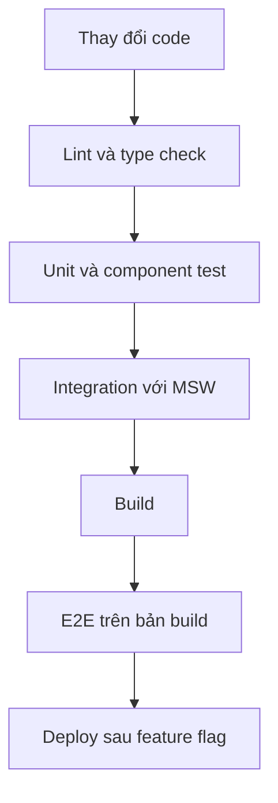
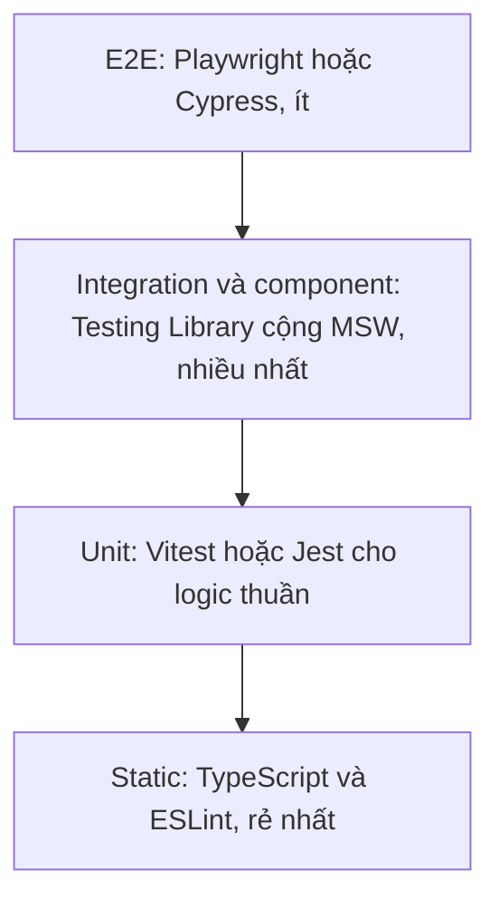
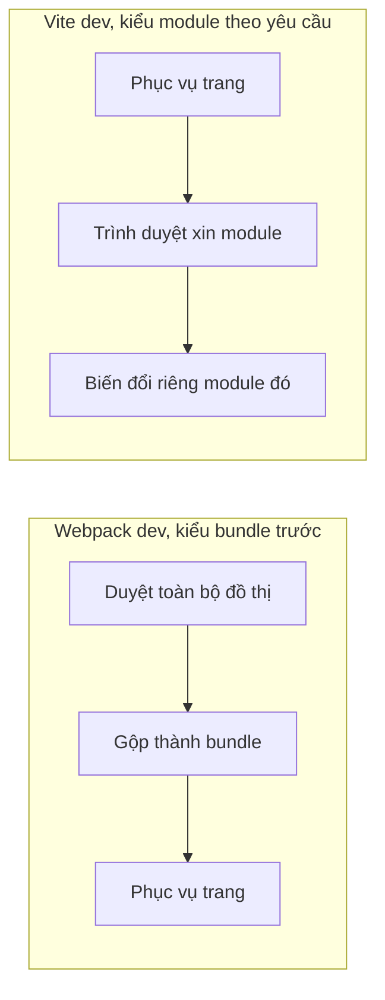
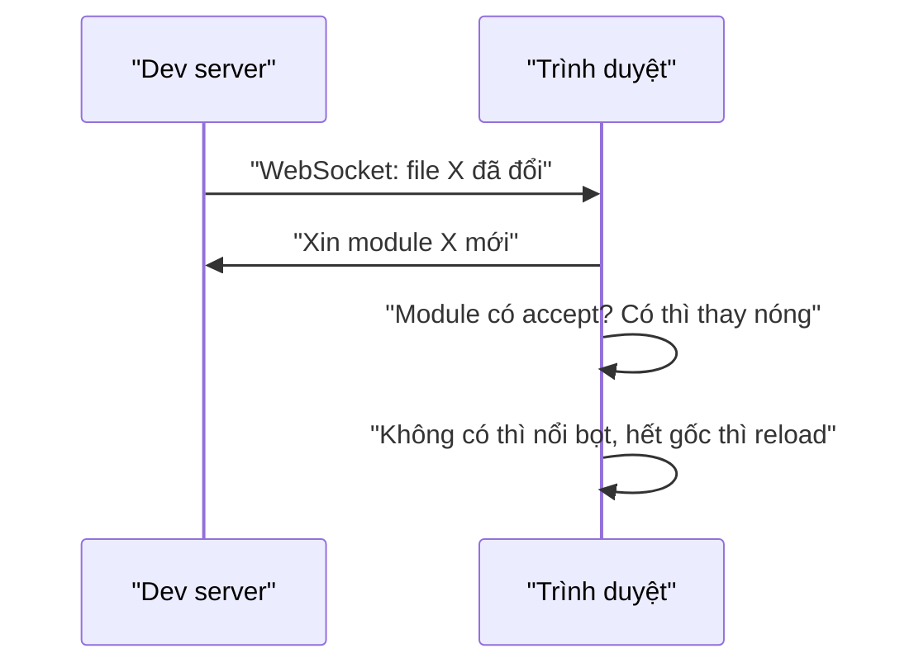

# Câu hỏi: Testing, tooling và build frontend

Mỗi câu đi theo chuỗi suy luận: **Câu hỏi** như người phỏng vấn nói, **Gợi ý suy luận** (câu hỏi nhỏ dẫn tới khái niệm nền), **Lập luận** (chuỗi nhân quả "vì A nên B"), **Đáp án ngắn** nói được thành tiếng, **Nhớ** (kiến thức cốt lõi kèm link bài gốc), rồi **Ví dụ** nếu cần. Mỗi **Hỏi xoáy** có thêm "Vì sao hỏi tiếp", gợi ý và đáp. Cách học: che phần lập luận, tự nói thành tiếng, rồi mới so.

Kiến thức gốc: [Testing React](/go?p=09-React%2Fmedium%2Flt-07-testing-react.md), [Testing Vue](/go?p=10-Vue%2Fmedium%2Flt-07-testing-vue.md), [Kiến trúc frontend](/go?p=11-Frontend-Core%2Flt-05-kien-truc-frontend.md) (monorepo, feature flag, CI), [Hiệu năng web](/go?p=11-Frontend-Core%2Flt-03-web-performance-core-web-vitals.md). Liên quan: [Bảo mật frontend](/go?p=07-Interview-QA%2FFrontend%2Fmedium%2Fqa-fe-07-bao-mat-frontend.md), [Frontend phỏng vấn](/go?p=07-Interview-QA%2FFrontend%2Fhard%2Fqa-fe-phong-van.md).

Quy ước nhãn ví dụ:

- **_Đã chạy thử bằng Node_**: code JavaScript thuần chạy trong sandbox bằng Node 22, output là thật. Nó mô phỏng nguyên lý (bộ chạy test, giả lập mạng, VLQ, hash), không phải Vitest, Vite hay Playwright thật.
- **_Minh họa_**: code React, Vue, config công cụ, YAML. Chưa chạy ở đây vì không có các gói đó, và API đổi theo phiên bản nên hãy kiểm tra lại tài liệu của bản bạn dùng.



Đọc sơ đồ: bước càng về sau càng chậm và đắt, nên chặn lỗi ở bước rẻ nhất có thể, và chỉ giữ ở bước đắt những thứ chỉ bước đó mới kiểm được.

**Tóm tắt:**

- Kim tự tháp test: nhiều test rẻ cho logic, ít test đắt cho flow sống còn; test mock hết dependency rồi chỉ kiểm tra lời gọi hàm là test "mock chính nó", không có giá trị.
- Testing Library truy vấn theo role và văn bản như người dùng thấy, nên không vỡ khi đổi class hay cấu trúc DOM; `userEvent` mô phỏng chuỗi event thật tốt hơn `fireEvent`.
- MSW chặn ở tầng mạng nên code ứng dụng chạy y nguyên; mock `fetch` trực tiếp dễ lệch với API contract thật, cần contract test hoặc type sinh từ OpenAPI.
- Fake timer giúp test debounce không phải chờ thật; test flaky thường do sleep cố định, state dùng chung, mạng ngoài và thời gian, sửa bằng cách ly state và chờ có điều kiện.
- Vite nhanh ở dev nhờ ES module phục vụ theo yêu cầu và pre-bundling dependency; production vẫn bundle; HMR hot update module nhưng giữ state là bonus của plugin.
- Hay bị hỏi xoáy: tree shaking cần ESM và `sideEffects`; source map lên production lộ code nguồn; Monorepo kèm cache có thể sai nếu thiếu input trong cache key.
- CI xếp bước rẻ trước và chạy parallel; feature flag tách deploy khỏi release, chia phần trăm bằng hash tất định, và flag cũ là nợ kỹ thuật phải dọn.

## 1. Kim tự tháp test: vì sao không viết toàn E2E, và test nào là "test mock chính nó"?

**Phải thuộc:** Câu này là câu cốt lõi, gặp rất thường xuyên.

**Câu hỏi:** Sếp muốn "test tự động đầy đủ". Bạn nên viết loại test nào, tỉ lệ ra sao, và làm sao biết một unit test không có giá trị?

**Gợi ý suy luận:**
- Mỗi tầng (unit, component, integration, E2E) chạy nhanh hay chậm, và khi hỏng thì chỉ ra chỗ lỗi chính xác đến đâu?
- Tầng nào gần với cách người dùng thật dùng hệ thống nhất, tầng nào gần code nhất?
- Nếu mock hết mọi dependency rồi chỉ kiểm tra "hàm A có gọi hàm B", ta đang kiểm điều gì?

**Lập luận:** Test cho ta độ tin cậy nhưng tốn thời gian chạy và công bảo trì. Tầng thấp (unit) nhanh, ổn định, chỉ ra đúng hàm hỏng, nhưng không chứng minh các phần ghép đúng với nhau. Tầng cao (E2E) chứng minh flow thật chạy được qua trình duyệt, nhưng chậm, dễ chập chờn, và hỏng thì phải điều tra. Vì vậy ta dùng nhiều test rẻ cho logic, ít test đắt cho các flow sống còn: đó là kim tự tháp. Với frontend, nhiều đội dùng mô hình "trophy": phần lớn là test component và integration (render component thật, giả lập mạng ở biên), vì giá trị lớn nhất nằm ở việc các phần ghép đúng cho người dùng. Một test mà mock tất cả dependency rồi chỉ khẳng định các lời gọi hàm nội bộ thì chỉ lặp lại cài đặt: refactor không đổi hành vi cũng làm nó đỏ, và lỗi thật vẫn lọt. Thước đo tốt là: nếu hành vi người dùng thấy hỏng thì test phải đỏ, nếu chỉ đổi cấu trúc nội bộ thì test phải xanh.

**Đáp án ngắn:** Nhiều test rẻ cho logic thuần, nhiều test component và integration cho hành vi người dùng, ít E2E cho flow sống còn. Test tốt đỏ khi hành vi hỏng và xanh khi chỉ refactor, test mock tất cả chỉ kiểm cài đặt.

**Nhớ:** Chọn tầng theo "lỗi nào cần bắt". Xem mục test pyramid ở [Testing React](/go?p=09-React%2Fmedium%2Flt-07-testing-react.md) và [Testing Vue](/go?p=10-Vue%2Fmedium%2Flt-07-testing-vue.md).

**Ví dụ:** phân tầng và công cụ thường gặp.



_Minh họa._ Tầng static (kiểu và lint) là lớp rẻ nhất và thường bị quên, nó bắt cả một lớp lỗi mà không cần viết test nào.

**Hỏi xoáy 1:** Độ phủ (coverage) 90% có nghĩa là test tốt không?
**Vì sao hỏi tiếp:** Người phỏng vấn muốn kiểm tra bạn có hiểu coverage chỉ đo "dòng đã chạy" chứ không đo "đã kiểm đúng".
**Gợi ý suy luận:** Dòng được chạy có đồng nghĩa với việc có `expect` kiểm kết quả không?
**Đáp:** Không. Coverage chỉ cho biết phần chưa chạy, không chứng minh phần đã chạy được khẳng định đúng. Dùng nó để tìm vùng chưa test, đặt ngưỡng hợp lý (không đuổi 100%), và kết hợp mutation testing hoặc review test.

**Hỏi xoáy 2:** Khi nào unit test có giá trị cao nhất ở frontend?
**Vì sao hỏi tiếp:** Sau khi hạ thấp unit test mock, cần nói rõ chỗ nó thật sự đáng viết.
**Gợi ý suy luận:** Hàm nào có nhiều nhánh, ít dependency, dễ sai ở biên (định dạng tiền, tính giá, validate)?
**Đáp:** Logic thuần có nhiều nhánh và giá trị biên: tính toán, định dạng, reducer, validator, parser. Không phụ thuộc DOM hay mạng nên rất nhanh và chỉ ra đúng lỗi.

**Sai lầm hay gặp:** Test snapshot toàn bộ cây DOM rồi bấm `-u` mỗi khi đỏ, khiến test mất khả năng cảnh báo.

## 2. Testing Library khuyên truy vấn theo vai trò và văn bản. Vì sao không chọn bằng `className` hay test id?

**Phải thuộc:** Câu này là câu cốt lõi, gặp rất thường xuyên.

**Câu hỏi:** Test hỏng sau khi đổi tên class CSS dù UI không đổi gì. Triết lý của Testing Library giải quyết chuyện này ra sao?

**Gợi ý suy luận:**
- Người dùng tìm nút bằng cách nào: theo class, hay theo vai trò và nhãn nhìn thấy?
- Nếu test dùng đúng cách đó thì chi tiết nào của cài đặt không còn ảnh hưởng?
- Truy vấn theo vai trò còn kiểm thêm điều gì ngầm về khả năng tiếp cận?

**Lập luận:** Test càng gắn với chi tiết cài đặt (class, cấu trúc DOM, state nội bộ) thì càng dễ vỡ khi refactor dù hành vi không đổi, và càng không phản ánh trải nghiệm thật. Testing Library theo nguyên tắc "test giống cách người dùng dùng phần mềm": tìm phần tử bằng vai trò (`getByRole("button", { name: "Lưu" })`), nhãn, văn bản, và tương tác bằng event giống thật. Vì tìm bằng vai trò cần phần tử có vai trò và tên truy cập đúng, bài test vô tình kiểm luôn ngữ nghĩa HTML: nếu bạn dùng `div` làm nút, truy vấn thất bại và bạn phát hiện lỗi a11y sớm. Test id (`getByTestId`) là lối thoát cuối cùng khi không có cách nào khác, vì nó không nói gì về những gì người dùng thấy.

**Đáp án ngắn:** Test hành vi theo góc nhìn người dùng: truy vấn theo role, label, text, không theo class hay state nội bộ. Test bền hơn khi refactor và ngầm kiểm ngữ nghĩa a11y.

**Nhớ:** Thứ tự ưu tiên truy vấn: role, label, text, rồi mới tới test id. Xem [Testing React, mục Triết lý của RTL](/go?p=09-React%2Fmedium%2Flt-07-testing-react.md) và [Testing Vue, mục VTU và Testing Library](/go?p=10-Vue%2Fmedium%2Flt-07-testing-vue.md).

**Ví dụ:**

```tsx
// Minh họa (React, Vitest, Testing Library)
import { render, screen } from "@testing-library/react";
import userEvent from "@testing-library/user-event";

test("gui form khi nhap email hop le", async () => {
  const user = userEvent.setup();
  const onSubmit = vi.fn();
  render(<SubscribeForm onSubmit={onSubmit} />);

  await user.type(screen.getByLabelText("Email"), "an@example.com");
  await user.click(screen.getByRole("button", { name: "Đăng ký" }));

  expect(onSubmit).toHaveBeenCalledWith({ email: "an@example.com" });
});
```

_Minh họa._ Không có class hay id nào, đổi UI không làm test vỡ chừng nào nhãn và nút còn đúng.

**Hỏi xoáy 1:** `getBy`, `queryBy`, `findBy` chọn cái nào, khi nào?
**Vì sao hỏi tiếp:** Sau khi biết truy vấn theo vai trò, cần biết các biến thể xử lý tồn tại và async.
**Gợi ý suy luận:** Phần tử có sẵn, chắc chắn không có, hay sẽ xuất hiện sau một lúc?
**Đáp:** `getBy` khi phần tử phải có ngay (ném lỗi nếu không), `queryBy` để khẳng định nó không có (trả `null`), `findBy` khi nó xuất hiện async (đợi, trả Promise). Dùng `queryBy` mới khẳng định "không có" được.

**Hỏi xoáy 2:** `userEvent` khác `fireEvent` ở chỗ nào?
**Vì sao hỏi tiếp:** Liên quan trực tiếp tới nguyên tắc "giống người dùng".
**Gợi ý suy luận:** Người dùng bấm một nút có chỉ gây một event `click` không (còn hover, focus, mousedown)?
**Đáp:** `fireEvent` phát đúng một event tách rời, còn `userEvent` mô phỏng chuỗi event của hành động thật (focus, nhấn phím, nhả chuột), nên bắt được lỗi mà `fireEvent` bỏ lỡ. Ưu tiên `userEvent`.

**Sai lầm hay gặp:** Test state nội bộ của component (`wrapper.vm.count`, `instance.state`), bị vỡ ngay khi đổi cách quản lý state.

## 3. Mock `fetch` trong từng test khác gì dùng MSW?

**Phải thuộc:** Câu này là câu cốt lõi, gặp rất thường xuyên.

**Câu hỏi:** Test của bạn dùng `vi.spyOn(global, "fetch")` cho mỗi test, và hễ đổi từ `fetch` sang `axios` hoặc thêm header là mọi test đỏ. Có cách nào tốt hơn?

**Gợi ý suy luận:**
- Mock ở đâu thì code ứng dụng "thấy" mình đang gọi mạng thật: ở hàm gọi hay ở tầng mạng?
- Nếu mock ở tầng mạng, đổi thư viện HTTP có ảnh hưởng test không?
- Cùng một bộ mock có dùng lại cho dev, test, Storybook được không?

**Lập luận:** Khi mock hàm `fetch` ta phải nhớ cách code gọi (tham số, thứ tự), nên test gắn với cài đặt: đổi thư viện hoặc thêm bước là phải sửa test. MSW chặn ở tầng mạng và trả response theo "contract" (phương thức, đường dẫn, response), nên code ứng dụng chạy y như thật, từ `fetch` hay `axios` đều đi qua cùng chỗ. Vì handler mô tả API chứ không mô tả cách gọi, ta tái sử dụng được ở test, dev (không cần backend) và Storybook, và dễ mô phỏng trạng thái lỗi (500, chậm, mất mạng). Lập luận đi qua việc đặt biên mock ở nơi ổn định nhất: HTTP contract ít đổi hơn cách gọi bên trong.

**Đáp án ngắn:** MSW mock ở tầng mạng nên code ứng dụng và thư viện HTTP chạy thật, test chỉ phụ thuộc API contract. Mock ở hàm `fetch` làm test gắn với cài đặt và vỡ khi đổi thư viện.

**Nhớ:** Mock ở biên ổn định nhất của hệ thống. Xem [Testing React, mục MSW](/go?p=09-React%2Fmedium%2Flt-07-testing-react.md) và [Testing Vue, mục Mock API bằng MSW](/go?p=10-Vue%2Fmedium%2Flt-07-testing-vue.md).

**Ví dụ:** mô phỏng ý tưởng: bảng handler theo method và path, code ứng dụng không đổi.

```js
const handlers = [
  { method: "GET", path: "/api/users/1", reply: () => ({ status: 200, body: { id: 1, name: "An" } }) },
  { method: "GET", path: "/api/users/2", reply: () => ({ status: 500, body: { message: "boom" } }) },
];
const realFetch = globalThis.fetch;
globalThis.fetch = async (url, opts = {}) => {
  const u = new URL(url, "http://localhost");
  const m = (opts.method || "GET").toUpperCase();
  const h = handlers.find((x) => x.method === m && x.path === u.pathname);
  if (!h) throw new Error("unhandled request: " + m + " " + u.pathname);
  const r = h.reply();
  return new Response(JSON.stringify(r.body), { status: r.status, headers: { "content-type": "application/json" } });
};

async function getUserName(id) {
  const res = await fetch(`/api/users/${id}`);
  if (!res.ok) return "loi: " + res.status;
  return (await res.json()).name;
}
console.log(await getUserName(1));
console.log(await getUserName(2));
try { await getUserName(3); } catch (e) { console.log(e.message); }
globalThis.fetch = realFetch;
```

```text
An
loi: 500
unhandled request: GET /api/users/3
```

_Đã chạy thử bằng Node (file .mjs, dùng top-level await)._ Đây **không phải MSW thật**: MSW chặn bằng Service Worker ở trình duyệt hoặc cơ chế chặn request ở Node. Ví dụ chỉ minh họa việc contract tách khỏi code ứng dụng, và "request chưa khai báo thì báo lỗi" (tương ứng tùy chọn `onUnhandledRequest: "error"`).

**Hỏi xoáy 1:** Test cần kiểm tra component hiện thông báo lỗi khi API trả 500. Làm bằng MSW thế nào?
**Vì sao hỏi tiếp:** Giá trị thật của MSW là dựng được các tình huống khó tái hiện.
**Gợi ý suy luận:** Làm sao ghi đè handler mặc định chỉ trong một test, và dọn lại sau test?
**Đáp:** Dùng `server.use(...)` để thêm handler tạm trả lỗi trong test đó, và `server.resetHandlers()` trong `afterEach` để các test sau quay về mặc định. Tên API kiểm tra lại theo phiên bản MSW (v2 dùng `http` và `HttpResponse`).

**Hỏi xoáy 2:** Mock hết mạng rồi thì làm sao biết frontend và backend khớp contract?
**Vì sao hỏi tiếp:** Giới hạn của mock: nó đúng theo điều bạn tin, không theo điều backend làm thật.
**Gợi ý suy luận:** Ai đảm bảo response mock giống response thật khi backend đổi?
**Đáp:** Cần một nguồn sự thật chung: sinh kiểu và handler từ OpenAPI, hoặc contract test (như Pact), và một vài E2E chạy với backend thật hoặc môi trường staging. Mock tốt đến đâu cũng không thay được kiểm chứng contract.

## 4. Vitest hay Jest: chọn thế nào cho dự án Vite hoặc dự án cũ?

**Câu hỏi:** Dự án mới dùng Vite, đội đang quen Jest. Có nên đổi sang Vitest không, và đổi thì mất gì?

**Gợi ý suy luận:** Test runner cần biến đổi TypeScript, JSX, import ảnh, alias. Nếu build đã có cấu hình cho việc đó trong Vite, ta có muốn dùng lại không? API hai bên giống nhau tới đâu?

**Lập luận:** Test chạy code ứng dụng, nên cần biên dịch giống lúc build (TypeScript, JSX, alias, biến môi trường). Với Jest ta phải cấu hình thêm bộ biến đổi riêng (babel-jest, ts-jest hoặc SWC) song song với config build, dễ lệch nhau. Vitest dùng chính pipeline của Vite, nên một config, cùng alias, cùng plugin, và hỗ trợ ESM nguyên bản, chế độ watch nhanh nhờ đồ thị module của Vite. API cố ý gần với Jest (`describe`, `it`, `expect`, `vi` thay `jest`), nên chuyển đổi thường nhẹ. Đánh đổi: hệ sinh thái Jest lâu đời hơn (nhiều công cụ, tài liệu), Vitest mới hơn và vài API mock khác tinh tế (module hoisting, mock ESM), còn nếu dự án không dùng Vite thì lợi thế "dùng chung config" mất đi. Kiểm tra lại tương thích theo phiên bản.

**Đáp án ngắn:** Dự án dùng Vite thì Vitest tiện hơn vì dùng chung config và ESM, API gần Jest nên chuyển dễ. Dự án lớn đã ổn với Jest thì không cần đổi chỉ vì mốt.

**Nhớ:** Môi trường test nên biên dịch như lúc build. Xem [Testing React, mục Cấu hình Vitest](/go?p=09-React%2Fmedium%2Flt-07-testing-react.md) và [Testing Vue, mục Vitest cơ bản](/go?p=10-Vue%2Fmedium%2Flt-07-testing-vue.md).

**Ví dụ:**

```ts
// Minh họa: vitest.config.ts
import { defineConfig } from "vitest/config";
import react from "@vitejs/plugin-react";

export default defineConfig({
  plugins: [react()],
  test: {
    environment: "jsdom",
    setupFiles: ["./src/test/setup.ts"],
    globals: false,
  },
});
```

_Minh họa._ Có thể nhúng `test` vào `vite.config.ts` thay vì tách file. `jsdom` hoặc `happy-dom` là DOM giả chạy trong Node, không phải trình duyệt thật.

**Hỏi xoáy 1:** `jsdom` thiếu gì so với trình duyệt thật, khi nào test vô hại ở jsdom lại lỗi ở trình duyệt?
**Vì sao hỏi tiếp:** Biết giới hạn môi trường test quyết định khi nào cần E2E hoặc browser mode.
**Gợi ý suy luận:** jsdom có tính layout (kích thước, vị trí) và vẽ CSS không? Những API nào (IntersectionObserver, ResizeObserver) nó thiếu?
**Đáp:** jsdom không có layout thật, nên kích thước bằng 0, và thiếu hoặc giả một số API trình duyệt. Hành vi phụ thuộc layout, CSS, focus phức tạp chỉ kiểm chắc ở trình duyệt thật (Playwright, hoặc chế độ trình duyệt của Vitest, kiểm tra lại theo phiên bản).

**Hỏi xoáy 2:** `vi.mock` được "hoist" lên đầu file nghĩa là gì và gây bẫy gì?
**Vì sao hỏi tiếp:** Một trong các lỗi mock hay gặp nhất khi viết test mô-đun ESM.
**Gợi ý suy luận:** `import` được xử lý trước hay sau code thường trong file? Biến khai báo ngay trên `vi.mock` có tồn tại lúc factory chạy không?
**Đáp:** Công cụ kéo `vi.mock` lên trước các `import` để mock có hiệu lực khi module được nạp. Hệ quả: factory không dùng được biến khai báo bên dưới (chưa tồn tại), muốn dùng phải bọc bằng `vi.hoisted`.

## 5. Test debounce hoặc timer mà không phải chờ thật: dùng giả lập thời gian thế nào?

**Câu hỏi:** Ô tìm kiếm debounce 300ms. Test của bạn `await sleep(350)` nên chậm và đôi khi hỏng. Làm sao test nhanh và ổn định?

**Gợi ý suy luận:**
- Nếu thời gian là thứ ta điều khiển được, ta còn cần chờ thật không?
- Giả lập timer thay thế những API nào, và phải khôi phục khi nào?
- Giả lập timer có thể xung đột với Promise và `await`, vì sao?

**Lập luận:** Chờ thật khiến test chậm (nhân với số test) và phụ thuộc tải máy nên chập chờn. Fake timers thay `setTimeout`, `setInterval`, `Date` bằng bản do test điều khiển: gọi `advanceTimersByTime(300)` thì mọi timer tới hạn trong 300ms chạy ngay, tức thời. Vì mọi thứ phụ thuộc thời gian đã được ta tiến từng bước, kết quả tất định. Cần nhớ bật trước khi tạo timer và khôi phục sau test (nếu không rò sang test khác), và khi component có Promise hoặc cập nhật async phải dùng phiên bản `async` của hàm tiến thời gian để microtask kịp chạy.

**Đáp án ngắn:** Dùng fake timers: tiến thời gian bằng lệnh thay vì chờ, nhanh và tất định. Bật trước khi tạo timer, khôi phục sau test, dùng bản async khi có Promise.

**Nhớ:** Đừng bao giờ `sleep` cố định trong test. Xem [Testing React, mục Test async](/go?p=09-React%2Fmedium%2Flt-07-testing-react.md).

**Ví dụ:** bộ chạy test có sẵn của Node cũng có mock timers.

```js
import { test, mock } from "node:test";
import assert from "node:assert/strict";

function debounce(fn, ms) {
  let id;
  return (...args) => { clearTimeout(id); id = setTimeout(() => fn(...args), ms); };
}

test("debounce chi goi 1 lan sau 300ms", () => {
  mock.timers.enable({ apis: ["setTimeout"] });
  const calls = [];
  const d = debounce((v) => calls.push(v), 300);
  d("a"); d("ab"); d("abc");
  mock.timers.tick(299);
  assert.deepEqual(calls, []);
  mock.timers.tick(1);
  assert.deepEqual(calls, ["abc"]);
  mock.timers.reset();
});
```

```text
ok 1 - debounce chi goi 1 lan sau 300ms
# pass 1
# fail 0
```

_Đã chạy thử bằng Node (`node --test`, Node 22)._ Test chạy gần như tức thời dù mô phỏng 300ms. Trong Vitest dùng `vi.useFakeTimers()` và `vi.advanceTimersByTime`, ý tưởng tương tự.

**Hỏi xoáy 1:** Fake timers làm `waitFor` hoặc `findBy` bị treo, vì sao?
**Vì sao hỏi tiếp:** Hai cơ chế chờ (polling theo thời gian thật và đồng hồ giả) va nhau.
**Gợi ý suy luận:** `waitFor` thăm dò lại bằng timer. Nếu timer bị đóng băng thì sao?
**Đáp:** Thăm dò dựa vào timer nên nếu timer bị đóng băng nó không bao giờ thử lại. Cách xử lý: chỉ bật fake timers cho đoạn cần, hoặc tiến thời gian thủ công trong khi chờ, hoặc cấu hình thư viện nhận biết fake timers (kiểm tra theo phiên bản).

**Hỏi xoáy 2:** Test code dùng `new Date()` (hạn dùng, "5 phút trước") thì cố định thế nào?
**Vì sao hỏi tiếp:** Thời gian hiện tại là dependency ẩn khác, cùng họ với timer.
**Gợi ý suy luận:** Nếu "bây giờ" đổi từng giây thì kết quả test đổi theo không?
**Đáp:** Đặt đồng hồ hệ thống cố định (`vi.setSystemTime`) hoặc tiêm `now` như tham số để hàm thuần. Đưa thời gian vào như tham số là thiết kế dễ test nhất.

## 6. Playwright hay Cypress cho E2E, và E2E nên kiểm cái gì?

**Câu hỏi:** Đội cần E2E cho flow đăng nhập và thanh toán. Chọn công cụ nào, và chạy bao nhiêu test E2E là hợp lý?

**Gợi ý suy luận:**
- Công cụ chạy bên trong trình duyệt hay điều khiển trình duyệt từ bên ngoài, và hệ quả lên đa tab, đa origin?
- E2E chạy chậm và đắt, vậy chỉ nên giữ những flow nào?
- Selector nên bám vào đâu để test bền?

**Lập luận:** Cypress chạy script ngay trong trình duyệt, trải nghiệm gỡ lỗi tương tác rất tốt, nhưng từng có giới hạn với đa tab và đa origin. Playwright điều khiển trình duyệt từ bên ngoài qua giao thức, hỗ trợ nhiều trình duyệt (Chromium, Firefox, WebKit), đa tab, đa ngữ cảnh, chạy parallel và trace viewer. Cả hai đều tự đợi phần tử sẵn sàng (auto-wait), đó là điểm mấu chốt giúp giảm chập chờn. Vì E2E đắt, ta giữ chúng cho các flow sống còn (đăng nhập, thanh toán, flow doanh thu), phần còn lại để tầng dưới. Selector nên theo vai trò và nhãn như Testing Library (`getByRole`), không theo class hay cấu trúc DOM. Lựa chọn công cụ phụ thuộc nhu cầu (đa trình duyệt, đa tab, kinh nghiệm đội), tính năng đổi nhanh nên kiểm tra lại theo phiên bản.

**Đáp án ngắn:** Playwright mạnh về đa trình duyệt, đa tab và chạy parallel, Cypress mạnh về trải nghiệm gỡ lỗi. Giữ E2E ít và cho flow sống còn, dùng selector theo vai trò, dựa vào auto-wait.

**Nhớ:** E2E kiểm các phần ghép lại trong trình duyệt thật, đừng dùng nó cho logic nhỏ. Xem [Testing React, mục E2E với Playwright](/go?p=09-React%2Fmedium%2Flt-07-testing-react.md) và [Testing Vue, mục E2E](/go?p=10-Vue%2Fmedium%2Flt-07-testing-vue.md).

**Ví dụ:**

```ts
// Minh họa (Playwright)
import { test, expect } from "@playwright/test";

test("dang nhap thanh cong", async ({ page }) => {
  await page.goto("/login");
  await page.getByLabel("Email").fill("an@example.com");
  await page.getByLabel("Mật khẩu").fill("secret123");
  await page.getByRole("button", { name: "Đăng nhập" }).click();
  await expect(page.getByRole("heading", { name: "Tổng quan" })).toBeVisible();
});
```

_Minh họa._ `expect(...).toBeVisible()` tự thử lại tới khi đúng hoặc hết thời gian, không cần `sleep`.

**Hỏi xoáy 1:** E2E nên chạy với backend thật hay mock?
**Vì sao hỏi tiếp:** Đánh đổi giữa độ chân thực và độ ổn định.
**Gợi ý suy luận:** Backend thật có dữ liệu ổn định không? Bạn cần kiểm contract thật hay chỉ flow UI?
**Đáp:** Có hai tầng: vài E2E "smoke" chạy với backend thật trên môi trường kiểm thử để kiểm contract, còn phần lớn E2E UI giả lập mạng cho nhanh và ổn định. Dữ liệu phải được tạo lại tất định mỗi lần chạy.

**Hỏi xoáy 2:** Làm sao xử lý đăng nhập lặp lại ở mọi test E2E?
**Vì sao hỏi tiếp:** Giảm thời gian chạy mà không hy sinh độ tin cậy.
**Gợi ý suy luận:** Đăng nhập qua UI ở mỗi test tốn bao nhiêu? Có thể lưu state phiên không?
**Đáp:** Đăng nhập một lần (qua API hoặc UI), lưu storage state (cookie, localStorage) rồi các test dùng lại. Chỉ riêng test về đăng nhập mới đi qua UI.

## 7. Test đôi khi xanh đôi khi đỏ (flaky): tìm nguyên nhân và sửa thế nào?

**Phải thuộc:** Câu này là câu cốt lõi, gặp rất thường xuyên.

**Câu hỏi:** CI đỏ ngẫu nhiên, chạy lại thì xanh. Mọi người bắt đầu bấm "re-run". Bạn xử lý ra sao?

**Gợi ý suy luận:**
- Test phụ thuộc vào thứ gì không tất định: thời gian chờ cố định, thứ tự chạy, dữ liệu dùng chung, mạng ngoài, animation?
- Chờ theo thời gian khác chờ theo điều kiện thế nào?
- Cách ly: hai test dùng chung state có ảnh hưởng nhau không?

**Lập luận:** Test flaky có kết quả khác nhau với cùng code, nghĩa là có nguồn không tất định chen vào. Nguồn phổ biến nhất là chờ cố định (`sleep(60)`): thao tác async nhanh chậm tùy tải máy, nên có lúc đủ lúc không. Cách sửa là chờ theo điều kiện (`findBy`, `waitFor`, auto-wait của Playwright), vì điều kiện thật sự là cái ta cần, không phải thời gian. Nguồn khác: test dùng chung state (database, storage, biến toàn cục, mock chưa reset) nên kết quả phụ thuộc thứ tự, sửa bằng cách ly mỗi test và dọn trong `afterEach`; gọi dịch vụ ngoài thật, sửa bằng mock hoặc môi trường tất định; animation và hiệu ứng, sửa bằng tắt animation ở môi trường test; thời gian hiện tại, sửa bằng đồng hồ cố định. Retry chỉ nên là biện pháp tạm và phải đi kèm thống kê (đánh dấu test hay phải retry), vì nó che giấu lỗi chứ không sửa.

**Đáp án ngắn:** Flaky do nguồn không tất định: sleep cố định, state dùng chung, mạng ngoài, thời gian, animation. Sửa bằng chờ theo điều kiện, cô lập test, mock mạng, đồng hồ cố định. Retry chỉ là tạm, phải theo dõi.

**Nhớ:** Chờ điều kiện, không chờ thời gian. Xem [Testing React, mục Test async](/go?p=09-React%2Fmedium%2Flt-07-testing-react.md) và câu hỏi "Làm sao E2E ổn định" trong cùng bài.

**Ví dụ:** hai cách chờ một việc có thời gian ngẫu nhiên 20 đến 100ms, lặp 200 lần.

```js
const sleep = (ms) => new Promise((r) => setTimeout(r, ms));
async function loadData() { await sleep(20 + Math.random() * 80); return "done"; }
async function waitFor(cond, { timeout = 1000, interval = 10 } = {}) {
  const start = Date.now();
  while (true) {
    const v = cond();
    if (v) return v;
    if (Date.now() - start > timeout) throw new Error("timeout");
    await sleep(interval);
  }
}
(async () => {
  let flakyFail = 0, stableFail = 0;
  const N = 200;
  for (let i = 0; i < N; i++) {
    let state = "loading";
    loadData().then(() => (state = "done"));
    await sleep(60);
    if (state !== "done") flakyFail++;
    let s2 = "loading";
    loadData().then(() => (s2 = "done"));
    try { await waitFor(() => s2 === "done"); } catch { stableFail++; }
  }
  console.log(`sleep co dinh 60ms: fail ${flakyFail}/${N} lan (khong on dinh)`);
  console.log(`waitFor dieu kien : fail ${stableFail}/${N} lan`);
})();
```

```text
sleep co dinh 60ms: fail 97/200 lan (khong on dinh)
waitFor dieu kien : fail 0/200 lan
```

_Đã chạy thử bằng Node._ Số lần fail của cách `sleep` thay đổi giữa các lần chạy (do ngẫu nhiên), nhưng luôn khác 0 với khoảng này, trong khi chờ điều kiện không fail.

**Hỏi xoáy 1:** Test chỉ hỏng khi chạy cả bộ, chạy riêng thì xanh. Nghi ngờ gì trước?
**Vì sao hỏi tiếp:** Phân loại flaky theo triệu chứng giúp khoanh vùng.
**Gợi ý suy luận:** Test nào chạy trước đã để lại state gì (mock, timer, DOM, storage)?
**Đáp:** Rò state giữa các test: mock không reset, fake timers chưa khôi phục, DOM chưa dọn, biến module dùng chung, dữ liệu trong storage. Chạy với thứ tự ngẫu nhiên hoặc chạy lặp để tái hiện, rồi thêm dọn trong `afterEach`.

**Hỏi xoáy 2:** Nên đặt chính sách gì cho test flaky ở đội?
**Vì sao hỏi tiếp:** Chuyển từ kỹ thuật sang quy trình, mức senior.
**Gợi ý suy luận:** Test hay đỏ ngẫu nhiên làm đội mất niềm tin vào CI như thế nào?
**Đáp:** Coi flaky là lỗi: cách ly (quarantine) khỏi nhánh chính rồi sửa trong thời hạn, theo dõi tỉ lệ flaky, không cho "re-run cho tới xanh" thành thói quen. CI không tin được thì không ai tin cảnh báo của nó.

## 8. Vì sao Vite khởi động nhanh hơn webpack ở dev, và production có khác không?

**Câu hỏi:** Dự án webpack mất một phút mới mở được dev server, chuyển Vite thì vài giây. Điều gì tạo ra khác biệt, và có phải Vite luôn nhanh hơn?

**Gợi ý suy luận:**
- Webpack dev phải làm gì với toàn bộ ứng dụng trước khi phục vụ trang đầu tiên?
- Trình duyệt hiện đại hiểu `import` gốc (ES modules), vậy có cần gộp trước không?
- Dependency trong `node_modules` hiếm đổi và có nhiều file, xử lý chúng thế nào cho hiệu quả?

**Lập luận:** Dev server kiểu bundle-first phải duyệt và gộp cả dependency graph trước khi trả trang đầu, nên thời gian khởi động tăng theo quy mô ứng dụng. Vite tận dụng việc trình duyệt hiểu ES module: server phục vụ từng module theo yêu cầu và chỉ biến đổi file mà trang đang cần, nên khởi động gần như không phụ thuộc quy mô. Dependency bên thứ ba được tiền gộp một lần bằng công cụ biên dịch nhanh (esbuild, Go; kiểm tra lại theo phiên bản vì Vite đang chuyển dần sang Rolldown viết bằng Rust), để tránh hàng trăm request cho một thư viện nhỏ file. Với production Vite vẫn gộp (bundle) để giảm số request, tách chunk, tree shaking và minify. Do đó dev và production dùng hai đường khác nhau, có thể tạo khác biệt hành vi hiếm gặp, nên phải kiểm trên bản build (`vite build` rồi `vite preview`). Ngoài tốc độ, lựa chọn còn phụ thuộc hệ sinh thái: webpack có nhiều plugin và Module Federation (micro-frontend), dự án cũ có thể không đáng chuyển.

**Đáp án ngắn:** Vite không gộp toàn bộ ứng dụng ở dev, nó phục vụ ES module theo yêu cầu và tiền gộp dependency một lần, nên khởi động nhanh. Production vẫn bundle, nên cần kiểm tra bản build.

**Nhớ:** Dev không gộp, production gộp. Xem [Kiến trúc frontend](/go?p=11-Frontend-Core%2Flt-05-kien-truc-frontend.md) và [Hiệu năng web](/go?p=11-Frontend-Core%2Flt-03-web-performance-core-web-vitals.md) về tác động của bundle tới tải trang.

**Ví dụ:**



_Minh họa._ Sơ đồ chỉ thể hiện ý tưởng, cả hai công cụ đều có tối ưu riêng (cache, lazy compilation) làm khoảng cách thay đổi theo phiên bản.

**Hỏi xoáy 1:** Vì sao Vite cần "pre-bundling" dependency dù trình duyệt đã hiểu ES module?
**Vì sao hỏi tiếp:** Chỗ hay bị hiểu nhầm là "Vite không gộp gì cả".
**Gợi ý suy luận:** Nhiều gói npm là CommonJS, trình duyệt hiểu CommonJS không? Một thư viện có hàng trăm file nhỏ thì tạo bao nhiêu request?
**Đáp:** Nhiều gói còn ở dạng CommonJS mà trình duyệt không chạy được, nên cần chuyển sang ESM. Gộp thư viện thành ít file cũng tránh "thác request" khi một gói chia hàng trăm module.

**Hỏi xoáy 2:** Hành vi dev khác production là loại lỗi nào, và phòng thế nào?
**Vì sao hỏi tiếp:** Hệ quả trực tiếp của việc hai đường xử lý khác nhau.
**Gợi ý suy luận:** Thứ gì chỉ xảy ra khi gộp, minify, chia chunk, tree shake?
**Đáp:** Lỗi thứ tự khởi tạo module, code có side effect bị tree shaking cắt, biến môi trường khác nhau, đường dẫn tài nguyên. Chạy E2E hoặc ít nhất smoke test trên bản `build` và `preview` trong CI.

## 9. HMR hoạt động thế nào, và vì sao đôi khi sửa file mà state bị mất hoặc trang tải lại cả trang?

**Câu hỏi:** Bạn sửa một component, trình duyệt cập nhật mà không tải lại, và state form vẫn còn. Nhưng sửa file khác thì cả trang reload. HMR làm gì, và quy tắc nào quyết định?

**Gợi ý suy luận:**
- Dev server báo cho trình duyệt điều gì khi file đổi, và bằng kênh nào (kết nối thường trực)?
- Module mới thay module cũ được khi nào: khi có ai đó "chấp nhận" cập nhật, và nếu không ai chấp nhận thì sao?
- Plugin framework (React Fast Refresh, Vue) giúp giữ state bằng cách nào?

**Lập luận:** Dev server theo dõi file, khi một file đổi nó biến đổi lại module đó rồi đẩy thông báo qua WebSocket tới trình duyệt. Trình duyệt tải module mới và cần biết ai xử lý việc thay thế. Cơ chế HMR cho mỗi module khai báo "chấp nhận" cập nhật (accept). Nếu module đã đổi không tự chấp nhận, cập nhật nổi bọt lên các module import nó; khi tới gốc mà vẫn không ai chấp nhận thì buộc tải lại toàn trang. Plugin framework tự đăng ký chấp nhận cho file component: React Fast Refresh thay hàm component và giữ state của hook nếu hợp lệ, Vue thay định nghĩa component và giữ phần lớn state. File không phải component thuần (export hỗn hợp, file có side effect) thường làm nổi bọt lên và reload cả trang, và Fast Refresh sẽ khởi tạo lại state khi file có thay đổi không an toàn (ví dụ đổi thứ tự hook). Hiểu vậy giải thích vì sao tách component ra file riêng, chỉ export component, thì HMR hoạt động tốt hơn.

**Đáp án ngắn:** Server đẩy thông báo qua WebSocket, trình duyệt tải module mới và thay thế nếu có module chấp nhận cập nhật. Không ai chấp nhận thì nổi bọt lên và tải lại cả trang. Plugin framework giúp giữ state cho component.

**Nhớ:** HMR là cơ chế hot update module, giữ state là bonus của plugin framework. Chi tiết thay đổi theo công cụ, kiểm tra lại tài liệu theo phiên bản.

**Ví dụ:**



_Minh họa._ Sơ đồ rút gọn, bỏ qua bước dev server biến đổi module và kiểm dependency graph.

**Hỏi xoáy 1:** Sửa state ban đầu trong `useState(0)` thành `useState(5)` nhưng UI vẫn hiện 0 sau HMR. Vì sao?
**Vì sao hỏi tiếp:** Nối cơ chế "giữ state" với hành vi dễ gây hiểu lầm.
**Gợi ý suy luận:** Nếu state được giữ lại, giá trị khởi tạo mới còn được dùng không?
**Đáp:** Khi giữ state, giá trị khởi tạo mới không được áp dụng vì state đã tồn tại. Muốn thấy giá trị mới phải tải lại trang hoặc đổi component thành dạng buộc khởi tạo lại (React có cách đánh dấu reset, kiểm tra theo phiên bản).

**Hỏi xoáy 2:** HMR có chạy ở production không?
**Vì sao hỏi tiếp:** Phân biệt công cụ dev với bản build.
**Gợi ý suy luận:** Bản build có dev server và WebSocket đó không? Điều gì giúp cập nhật bản mới cho người dùng?
**Đáp:** Không, HMR chỉ có ở dev server. Production cập nhật bằng deploy bản mới và tên file có hash nội dung để cache không giữ bản cũ.

## 10. Tree shaking cắt code thừa bằng cách nào, và vì sao `sideEffects` quan trọng?

**Câu hỏi:** Bạn import đúng một hàm từ thư viện tiện ích nhưng bundle tăng hàng trăm KB. Tree shaking đã hỏng ở đâu?

**Gợi ý suy luận:**
- Để biết export nào không dùng, công cụ cần phân tích tĩnh được import, export. Cú pháp module nào cho phép điều đó?
- Một module có thể chạy code ngay khi nạp (đăng ký, ghi biến toàn cục). Nếu cắt bỏ nó, chương trình có đổi hành vi không?
- Thư viện nói cho bundler biết module nào "thuần" bằng cách nào?

**Lập luận:** ES module có `import` và `export` khai báo tĩnh, nên bundler phân tích được export nào không ai dùng và bỏ nó (CommonJS với `require` động thì khó). Nhưng bỏ cả module chỉ an toàn nếu nạp module đó không có tác dụng phụ. Một module có thể chạy code ngay khi nạp, như đăng ký polyfill, sửa prototype hay in log, nên bundler thận trọng giữ lại những module không chắc "thuần". Trường `"sideEffects": false` trong `package.json` của thư viện là lời hứa "nạp module của tôi không có tác dụng phụ, an toàn bỏ nếu không dùng export". Thiếu lời hứa này, hoặc gói chỉ phát hành CommonJS, hoặc import "cả thư viện" qua file gộp, thì code thừa vẫn vào bundle. Nên nếu bundle lớn: kiểm tra định dạng gói (có ESM không), import có tên theo từng hàm, và dùng công cụ phân tích bundle để thấy cái gì chiếm chỗ. Ngược lại, khai báo `sideEffects: false` sai cho file CSS hoặc polyfill sẽ làm chúng bị cắt nhầm, nên phải liệt kê các file có tác dụng phụ.

**Đáp án ngắn:** Tree shaking dựa vào cú pháp ESM tĩnh để bỏ export không dùng, và cần `sideEffects` để biết an toàn bỏ cả module. Thiếu ESM hoặc khai báo, code thừa vẫn vào bundle.

**Nhớ:** ESM cộng `sideEffects` cộng import có tên. Phân tích bundle trước khi đoán. Xem [Hiệu năng web](/go?p=11-Frontend-Core%2Flt-03-web-performance-core-web-vitals.md).

**Ví dụ:** vì sao bundler phải thận trọng: module nạp lên là chạy code, dù không dùng export nào.

```js
// lib.mjs
console.log("[lib] module lib duoc thuc thi (side effect)");
export const used = () => "used";
export const unused = () => "unused";

// main.mjs
import { used } from "./lib.mjs";
console.log(used());
```

```text
[lib] module lib duoc thuc thi (side effect)
used
```

_Đã chạy thử bằng Node (hai file .mjs)._ Dù `unused` không được dùng, dòng log vẫn chạy khi nạp `lib.mjs`. Nếu bundler cắt cả module vì "không dùng gì" thì dòng log biến mất và hành vi đổi. Đó là lý do cần lời hứa `sideEffects`. Node không làm tree shaking, ví dụ chỉ minh họa vấn đề cần giải quyết.

```json
{
  "name": "my-ui-lib",
  "type": "module",
  "sideEffects": ["*.css", "./src/polyfills.js"]
}
```

_Minh họa._ Liệt kê rõ các file có tác dụng phụ, để phần còn lại được cắt an toàn.

**Hỏi xoáy 1:** `import _ from "lodash"` và `import debounce from "lodash/debounce"` khác nhau gì?
**Vì sao hỏi tiếp:** Ví dụ kinh điển cho "import cả thư viện" so với "import một phần".
**Gợi ý suy luận:** Gói `lodash` là CommonJS một cục, còn `lodash-es` thì sao?
**Đáp:** Gói `lodash` gốc là CommonJS, import cả gói thì khó cắt. Import đường dẫn riêng từng hàm hoặc dùng `lodash-es` (ESM) cho bundler cắt được. Kiểm tra bằng công cụ phân tích bundle thay vì tin.

**Hỏi xoáy 2:** Cùng một mục tiêu giảm bundle, tree shaking khác code splitting thế nào?
**Vì sao hỏi tiếp:** Hai kỹ thuật hay bị lẫn.
**Gợi ý suy luận:** Một cái bỏ code không dùng, cái kia làm gì với code vẫn cần nhưng chưa cần ngay?
**Đáp:** Tree shaking loại bỏ code không bao giờ dùng. Code splitting (dynamic `import()`) chia code vẫn cần thành chunk tải khi cần, ví dụ theo route. Hai kỹ thuật bổ sung cho nhau.

## 11. Source map giúp gì, và đưa lên production có nguy hiểm không?

**Câu hỏi:** Sentry báo lỗi ở `main.8f3a.js:1:48213`. Làm sao biết đó là dòng nào trong code gốc, và source map có lộ mã nguồn không?

**Gợi ý suy luận:** Bundle sau minify chỉ có một dòng dài, vậy cần thông tin gì để quay về file và dòng gốc? Thông tin đó nằm ở đâu, ai tải nó? Ai đọc được nó nếu để công khai?

**Lập luận:** Minify và gộp làm mã chạy khác mã bạn viết, nên vị trí lỗi trong bundle vô nghĩa với người đọc. Source map là file JSON ánh xạ từng vị trí (dòng, cột) trong file sinh ra về file, dòng, cột gốc, bằng chuỗi `mappings` encode VLQ base64, thường kèm tên biến gốc. DevTools hoặc công cụ báo lỗi dùng nó để hiển thị mã gốc. Vì source map chứa mã gốc (hoặc đủ để dựng lại), để công khai thì ai cũng đọc được mã nguồn, không phải một lỗ hổng tự thân nhưng làm kẻ tấn công dễ phân tích hơn, và bạn không nên dựa vào "mã bị minify" như một lớp bảo mật. Cách làm phổ biến: sinh source map ở build, tải lên công cụ báo lỗi, không phục vụ công khai (hoặc chỉ cho IP nội bộ). Quan trọng hơn là không để secret trong code, xem [Bảo mật frontend](/go?p=07-Interview-QA%2FFrontend%2Fmedium%2Fqa-fe-07-bao-mat-frontend.md).

**Đáp án ngắn:** Source map ánh xạ vị trí trong bundle về mã gốc để gỡ lỗi. Nó chứa mã nguồn nên không nên phục vụ công khai ở production, hãy tải lên công cụ báo lỗi, và đừng lưu secret trong code.

**Nhớ:** Source map là thứ để gỡ lỗi, không phải lớp bảo mật. Xem [Kiến trúc frontend](/go?p=11-Frontend-Core%2Flt-05-kien-truc-frontend.md) (quan sát lỗi bằng Sentry).

**Ví dụ:** giải mã vài đoạn VLQ trong `mappings`.

```js
const B64 = "ABCDEFGHIJKLMNOPQRSTUVWXYZabcdefghijklmnopqrstuvwxyz0123456789+/";
function decodeSegment(seg) {
  const out = [];
  let shift = 0, val = 0;
  for (const ch of seg) {
    const d = B64.indexOf(ch);
    const cont = d & 32;
    val += (d & 31) << shift;
    if (cont) { shift += 5; }
    else { out.push(val & 1 ? -(val >> 1) : val >> 1); shift = 0; val = 0; }
  }
  return out;
}
for (const s of ["AAAA", "SAASA", "CAAC", "AACA"]) console.log(s.padEnd(6), "->", JSON.stringify(decodeSegment(s)));
```

```text
AAAA   -> [0,0,0,0]
SAASA  -> [9,0,0,9,0]
CAAC   -> [1,0,0,1]
AACA   -> [0,0,1,0]
```

_Đã chạy thử bằng Node._ Mỗi đoạn là các số tương đối: cột trong file sinh ra, chỉ số file nguồn, dòng gốc, cột gốc, và (tùy chọn) chỉ số tên. Số tương đối so với đoạn trước nên mapping gọn. Bản cài đặt này chỉ để hiểu nguyên lý, dùng thư viện cho việc thật.

**Hỏi xoáy 1:** Vì sao tên file bundle có hash (`main.8f3a.js`) và nó liên quan gì tới cache?
**Vì sao hỏi tiếp:** Từ tên file trong báo lỗi, tự nhiên hỏi vì sao tên có chuỗi lạ.
**Gợi ý suy luận:** Nếu tên file cố định và cache dài hạn, người dùng có nhận bản mới không? Nếu nội dung đổi thì hash đổi không?
**Đáp:** Hash tính từ nội dung nên đổi nội dung thì đổi tên, cho phép cache rất lâu (`immutable`) mà vẫn nhận bản mới khi deploy. File `index.html` thì không cache lâu vì nó trỏ tới tên file mới.

**Hỏi xoáy 2:** Làm sao ghép đúng source map với đúng bản deploy khi có nhiều bản?
**Vì sao hỏi tiếp:** Vấn đề vận hành thực tế của việc tải source map lên Sentry.
**Gợi ý suy luận:** Báo lỗi biết bản nào đang chạy bằng thông tin gì?
**Đáp:** Gắn mã phát hành (release, thường là commit hash) vào cả bản build và lúc tải source map, để công cụ báo lỗi ghép đúng. Sai release thì vị trí hiện ra sai.

## 12. Monorepo giải quyết gì, và khi nào nó làm mọi thứ tệ hơn?

**Câu hỏi:** Công ty có 3 ứng dụng web dùng chung component và thư viện tiện ích, mỗi cái một repo, đang copy code qua lại. Bạn đề xuất gì và cần lưu ý gì?

**Gợi ý suy luận:** Khi sửa thư viện dùng chung, các ứng dụng nhận bản sửa thế nào ở mô hình nhiều repo? Nếu mọi thứ ở một repo, việc build lại tất cả mỗi lần commit có chấp nhận được không, và có cách nào chỉ build phần bị ảnh hưởng?

**Lập luận:** Ở nhiều repo, thay đổi thư viện phải publish, rồi từng ứng dụng nâng phiên bản, nên chậm và dễ lệch phiên bản. Monorepo đặt các gói trong một repo với workspace (pnpm, npm, yarn): các gói tham chiếu nhau cục bộ, một commit sửa thư viện và các ứng dụng dùng nó cùng lúc, dễ refactor xuyên gói và sync dependency. Cái giá là thời gian build, test nhân lên theo số gói, nên cần công cụ điều phối (Turborepo, Nx) hiểu dependency graph: chỉ chạy tác vụ cho gói bị ảnh hưởng (affected) và cache kết quả theo hash đầu vào (cả cache từ xa cho CI). Cần ranh giới rõ (gói nào được import gói nào), kiểm soát bằng lint, và quy ước phiên bản (một phiên bản chung hay độc lập). Monorepo không phải thuốc thần: đội nhỏ một ứng dụng thì overhead công cụ không đáng, và quyền truy cập, quy trình release phức tạp hơn khi nhiều đội dùng chung repo. Chi tiết ở [Kiến trúc frontend, mục Monorepo](/go?p=11-Frontend-Core%2Flt-05-kien-truc-frontend.md).

**Đáp án ngắn:** Monorepo với workspace giúp chia sẻ code và sửa xuyên gói trong một commit. Cần công cụ như Turborepo hoặc Nx để chỉ chạy phần bị ảnh hưởng và cache. Không đáng cho dự án nhỏ một ứng dụng.

**Nhớ:** Lợi ích đến cùng chi phí điều phối build. Xem [Kiến trúc frontend, mục Monorepo](/go?p=11-Frontend-Core%2Flt-05-kien-truc-frontend.md).

**Ví dụ:**

```yaml
# Minh họa: pnpm-workspace.yaml
packages:
  - "apps/*"
  - "packages/*"
```

```json
{
  "name": "@acme/web",
  "dependencies": { "@acme/ui": "workspace:*" }
}
```

_Minh họa._ `workspace:*` (cú pháp của pnpm) trỏ tới gói cục bộ thay vì tải từ registry. Cú pháp khác nhau giữa các trình quản lý gói, kiểm tra lại theo phiên bản.

**Hỏi xoáy 1:** Một thư viện chung dùng bởi cả app và test, circular dependency giữa hai gói xuất hiện. Hậu quả là gì?
**Vì sao hỏi tiếp:** Hậu quả của việc thiếu ranh giới trong monorepo.
**Gợi ý suy luận:** Nếu A cần B và B cần A, cái nào build trước? Cache theo hash đầu vào còn hoạt động không?
**Đáp:** Circular dependency làm đồ thị tác vụ không có thứ tự hợp lệ và phá cache chính xác, nên các công cụ báo lỗi. Sửa bằng tách phần chung ra gói thứ ba, giống nguyên tắc tách trách nhiệm.

**Hỏi xoáy 2:** Cache build từ xa ở CI có rủi ro gì?
**Vì sao hỏi tiếp:** Tối ưu tốc độ luôn có mặt trái về độ đúng.
**Gợi ý suy luận:** Nếu đầu vào thật của một tác vụ không nằm trong hash (biến môi trường), kết quả cache có đúng không?
**Đáp:** Nếu đầu vào ảnh hưởng kết quả không được khai báo vào cache key (biến môi trường, file config) thì cache trả kết quả sai mà không báo. Phải khai báo đầy đủ đầu vào, và bảo vệ cache khỏi bị ghi bởi nguồn không tin cậy (supply chain, xem [qa-fe-07](/go?p=07-Interview-QA%2FFrontend%2Fmedium%2Fqa-fe-07-bao-mat-frontend.md)).

## 13. ESLint và Prettier khác nhau thế nào, và vì sao hai công cụ hay "cãi nhau"?

**Câu hỏi:** Đội cãi nhau về dấu chấm phẩy và thụt lề trong mỗi PR review. Bạn thiết lập thế nào để chấm dứt, và `eslint` với `prettier` dùng cho việc gì?

**Gợi ý suy luận:** Quy tắc nào về "đúng sai" (biến chưa dùng, hook dùng sai chỗ) và quy tắc nào về "hình thức" (xuống dòng, ngoặc)? Nếu hai công cụ cùng chạm vào định dạng thì chuyện gì xảy ra?

**Lập luận:** ESLint phân tích code để tìm lỗi và quy ước (biến không dùng, `==`, quy tắc hooks, sinh lỗi tiềm ẩn), một số quy tắc tự sửa được. Prettier chỉ định dạng: in lại code theo một phong cách cố định, ít tùy chọn để chấm dứt tranh cãi. Vì cả hai từng có quy tắc định dạng, chúng có thể mâu thuẫn và sửa qua lại. Cách chung: để Prettier lo toàn bộ định dạng và tắt các quy tắc định dạng của ESLint (bằng `eslint-config-prettier`), ESLint chỉ lo lỗi logic. Rồi tự động hóa: chạy lúc lưu file trong editor, lúc commit (lint-staged với husky hoặc lefthook) cho file thay đổi, và lúc CI làm hàng rào cuối (không tin hook cục bộ vì có thể bị bỏ qua). TypeScript kiểm kiểu là bước riêng (`tsc --noEmit`). Khi đội thấy tranh cãi mất thì vấn đề đã chuyển thành quy ước máy thực thi, không còn là chuyện cá nhân. Kiểm tra lại theo phiên bản vì ESLint 9 dùng cấu hình "flat config" và hệ sinh thái đang thay đổi.

**Đáp án ngắn:** ESLint tìm lỗi và vi phạm quy ước, Prettier chỉ định dạng. Để Prettier lo hình thức, tắt quy tắc định dạng của ESLint, chạy tự động ở editor, pre-commit và CI.

**Nhớ:** Máy thực thi quy ước thì review tập trung vào thiết kế. Xem [Kiến trúc frontend, mục CI cho frontend](/go?p=11-Frontend-Core%2Flt-05-kien-truc-frontend.md).

**Ví dụ:**

```js
// Minh họa: eslint.config.js (flat config)
import js from "@eslint/js";
import tseslint from "typescript-eslint";
import reactHooks from "eslint-plugin-react-hooks";
import prettier from "eslint-config-prettier";

export default [
  js.configs.recommended,
  ...tseslint.configs.recommended,
  { plugins: { "react-hooks": reactHooks }, rules: { "react-hooks/rules-of-hooks": "error", "react-hooks/exhaustive-deps": "warn" } },
  prettier, // đặt cuối để tắt quy tắc định dạng xung đột
];
```

_Minh họa._ Tên gói và cách cấu hình phiên bản mới có thể đổi (ví dụ cách bật plugin hooks), kiểm tra tài liệu hiện hành.

**Hỏi xoáy 1:** Vì sao `react-hooks/exhaustive-deps` đáng bật ở mức lỗi, không chỉ cảnh báo?
**Vì sao hỏi tiếp:** Ví dụ một quy tắc lint bắt lỗi logic thật chứ không chỉ phong cách.
**Gợi ý suy luận:** Thiếu dependency trong `useEffect` dẫn tới stale closure (xem bài React cơ bản). Lint bắt được lúc nào?
**Đáp:** Nó phát hiện thiếu dependency, nguồn của stale closure và lỗi khó thấy khi chạy. Cảnh báo dễ bị bỏ qua nên nhiều đội đặt thành lỗi trong CI, và chỉ tắt từng dòng có lý do kèm comment.

**Hỏi xoáy 2:** Lint chạy chậm trên repo lớn thì làm gì?
**Vì sao hỏi tiếp:** Công cụ chất lượng phải đủ nhanh nếu không sẽ bị bỏ.
**Gợi ý suy luận:** Cần lint toàn repo mỗi lần commit không? Có cache không?
**Đáp:** Lint chỉ file thay đổi ở pre-commit, dùng cache của ESLint, và để CI lint toàn bộ có cache theo công cụ monorepo. Quy tắc cần thông tin kiểu (type-aware) thì chậm hơn nên bật có chọn lọc.

## 14. Pipeline CI cho frontend nên gồm những bước nào, theo thứ tự nào?

**Câu hỏi:** Thiết kế CI cho một ứng dụng React và API. Pipeline có những bước gì, vì sao thứ tự đó, và làm sao giữ nó nhanh?

**Gợi ý suy luận:** Bước nào nhanh và bắt nhiều lỗi nhất, nên chạy trước để thất bại sớm? Bước nào cần bản build? Bước nào có thể chạy parallel? Cái gì có thể cache giữa các lần chạy?

**Lập luận:** CI phải trả lời nhanh "thay đổi này có an toàn để merge không". Vì thất bại sớm tiết kiệm thời gian, ta xếp các bước rẻ trước: cài dependency đúng lockfile (`npm ci`), rồi type check và lint (giây tới phút), rồi unit và component test, rồi build. Bước build tạo bản giống production để kiểm kích thước bundle (đặt ngưỡng ngân sách hiệu năng) và để E2E chạy trên chính bản build, vì lỗi chỉ lộ khi gộp (câu 8). Các bước độc lập (lint, test, type check) chạy parallel, E2E tách job vì chậm. Giữ nhanh bằng cache dependency và kết quả build, chạy tác vụ theo phần bị ảnh hưởng (câu 12), và chia test thành nhiều máy. Thêm quét bảo mật dependency (câu 12 ở [qa-fe-07](/go?p=07-Interview-QA%2FFrontend%2Fmedium%2Fqa-fe-07-bao-mat-frontend.md)) và quét secret. Cuối cùng, nhánh chính được bảo vệ: PR phải xanh mới merge, và deploy đi qua môi trường preview, rồi release có thể bật dần bằng feature flag (câu 15).

**Đáp án ngắn:** Cài theo lockfile, type check và lint, unit và component test, build, E2E trên bản build, quét bảo mật. Bước rẻ trước, chạy parallel và cache để nhanh, và bảo vệ nhánh chính bằng điều kiện bắt buộc xanh.

**Nhớ:** Thất bại sớm và rẻ, bản build là thứ đáng kiểm nhất. Xem [Kiến trúc frontend, mục CI cho frontend](/go?p=11-Frontend-Core%2Flt-05-kien-truc-frontend.md).

**Ví dụ:**

```yaml
# Minh họa: GitHub Actions rút gọn
name: ci
on: [pull_request]
jobs:
  check:
    runs-on: ubuntu-latest
    steps:
      - uses: actions/checkout@v4
      - uses: actions/setup-node@v4
        with: { node-version: 22, cache: npm }
      - run: npm ci
      - run: npm run typecheck
      - run: npm run lint
      - run: npm test -- --run
      - run: npm run build
  e2e:
    needs: check
    runs-on: ubuntu-latest
    steps:
      - uses: actions/checkout@v4
      - uses: actions/setup-node@v4
        with: { node-version: 22, cache: npm }
      - run: npm ci
      - run: npx playwright install --with-deps
      - run: npm run build && npx playwright test
```

_Minh họa._ Phiên bản action và cú pháp kiểm tra lại theo tài liệu hiện hành. Ở thực tế có thể tách `check` thành nhiều job để chạy parallel.

**Hỏi xoáy 1:** Vì sao dùng `npm ci` thay `npm install` trong CI?
**Vì sao hỏi tiếp:** Chi tiết nhỏ nhưng thể hiện hiểu lockfile.
**Gợi ý suy luận:** Một lệnh cài theo lockfile, một lệnh có thể cập nhật lockfile. Cái nào tái lập được?
**Đáp:** `npm ci` cài đúng theo lockfile và báo lỗi nếu `package.json` lệch lockfile, nên bản build tái lập được và không tự nhận bản dependency mới. `npm install` có thể thay đổi cây dependency.

**Hỏi xoáy 2:** Ngân sách bundle (bundle budget) trong CI để làm gì?
**Vì sao hỏi tiếp:** Nối CI với hiệu năng: lỗi hiệu năng cũng cần hàng rào tự động.
**Gợi ý suy luận:** Ai để ý khi một PR thêm 200 KB? Nếu không có kiểm tra tự động thì sao?
**Đáp:** Đặt ngưỡng kích thước (hoặc điểm Lighthouse) và làm CI đỏ khi vượt, để mỗi PR thấy tác động lên hiệu năng thay vì phát hiện sau khi người dùng phàn nàn. Xem [Hiệu năng web](/go?p=11-Frontend-Core%2Flt-03-web-performance-core-web-vitals.md).

## 15. Feature flag: bật dần tính năng mới an toàn thế nào, và nợ kỹ thuật nó để lại?

**Câu hỏi:** Tính năng thanh toán mới cần ra mắt cho 10% người dùng trước, lỗi thì tắt ngay mà không deploy lại. Thiết kế cờ thế nào, và có rủi ro gì?

**Gợi ý suy luận:** Deploy code và bật (release) tính năng khác nhau thế nào? Chia 10% người dùng sao cho cùng một người luôn thấy cùng một phiên bản? Cờ không dọn thì tích tụ gì?

**Lập luận:** Feature flag tách "đưa code lên production" khỏi "cho người dùng thấy", nên ta merge sớm, deploy thường xuyên, và quyết định bật/tắt khi vận hành, kể cả tắt tức thì khi có sự cố. Để chia phần trăm, ta hash cặp (tên cờ, id người dùng) ra số 0 đến 99 và bật nếu số đó nhỏ hơn phần trăm: hash tất định nên cùng người dùng luôn nhận kết quả như nhau (không "nhấp nháy" giữa hai phiên bản), và khi tăng từ 10% lên 50%, nhóm cũ vẫn nằm trong nhóm mới. Trộn tên cờ vào hash để các cờ khác nhau không chọn cùng một nhóm người. Rủi ro: cờ là nhánh code nên số tổ hợp tăng, cần test cả hai nhánh; cờ lâu ngày không dọn thành nợ kỹ thuật, nên mỗi cờ cần chủ sở hữu và hạn gỡ; việc đánh giá cờ ở client có thể bị người dùng thấy và đổi, nên không dùng cờ phía client để kiểm soát quyền hay thứ nhạy cảm, quyết định đó ở server.

**Đáp án ngắn:** Cờ tách deploy khỏi release. Chia phần trăm bằng hash tất định (tên cờ cộng id người dùng) để người dùng nhất quán và nhóm cũ giữ nguyên khi tăng tỉ lệ. Dọn cờ cũ đúng hạn, và đừng dùng cờ phía client làm kiểm soát quyền.

**Nhớ:** Cờ là nợ có hạn dùng. Xem [Kiến trúc frontend, mục Feature flag](/go?p=11-Frontend-Core%2Flt-05-kien-truc-frontend.md).

**Ví dụ:** chia phần trăm bằng hash.

```js
const crypto = require("crypto");
function bucket(userId, flag) {
  const h = crypto.createHash("sha256").update(flag + ":" + userId).digest().readUInt32BE(0);
  return h % 100;
}
function enabled(userId, flag, percent) { return bucket(userId, flag) < percent; }

const users = Array.from({ length: 10000 }, (_, i) => "u" + i);
for (const p of [0, 10, 50, 100]) {
  console.log(`rollout ${String(p).padStart(3)}%:`, users.filter((u) => enabled(u, "new-checkout", p)).length, "/ 10000");
}
console.log("on dinh voi cung user:", enabled("u42", "new-checkout", 50) === enabled("u42", "new-checkout", 50));
const at10 = new Set(users.filter((u) => enabled(u, "new-checkout", 10)));
console.log("tang 10% -> 50% giu nguyen nhom cu:", [...at10].every((u) => enabled(u, "new-checkout", 50)));
```

```text
rollout   0%: 0 / 10000
rollout  10%: 1059 / 10000
rollout  50%: 5037 / 10000
rollout 100%: 10000 / 10000
on dinh voi cung user: true
tang 10% -> 50% giu nguyen nhom cu: true
```

_Đã chạy thử bằng Node._ Tỉ lệ thực tế xấp xỉ phần trăm đặt (1059 so với 1000 mong đợi) vì hash phân bố gần đều nhưng không chính xác tuyệt đối.

**Hỏi xoáy 1:** Cờ thay đổi lúc đang dùng trang, UI có nên đổi ngay không?
**Vì sao hỏi tiếp:** Hệ quả trải nghiệm của cờ động.
**Gợi ý suy luận:** Người dùng đang giữa một flow nhiều bước thì chuyển phiên bản giữa chừng gây gì?
**Đáp:** Thường chỉ đánh giá cờ lúc khởi tạo phiên hoặc lúc vào flow, và giữ nguyên cho tới hết flow, tránh đổi giữa chừng làm hỏng state. Cập nhật khi tải lại trang là đủ cho đa số tính năng.

**Hỏi xoáy 2:** Làm sao kiểm thử khi có cờ?
**Vì sao hỏi tiếp:** Cờ nhân số nhánh cần kiểm.
**Gợi ý suy luận:** Hai trạng thái bật và tắt đều là hành vi thật trên production, vậy test cần bao nhiêu nhánh?
**Đáp:** Test cả hai nhánh cho các flow chính (tiêm giá trị cờ trong test hoặc đặt qua cấu hình), và khi gỡ cờ thì xóa luôn nhánh cũ cùng test của nó. Test cho nhánh sắp bỏ nên được xóa đi cùng, tránh nợ.

**Sai lầm hay gặp:** Để cờ "tạm thời" sống vài năm, hoặc lồng nhiều cờ vào nhau tới mức không ai biết tổ hợp nào đang chạy ở production.

