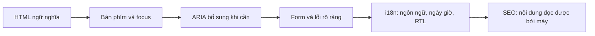

# Câu hỏi: Accessibility, i18n và SEO cơ bản

Mỗi câu đi theo chuỗi suy luận: **Câu hỏi** như người phỏng vấn nói, **Gợi ý suy luận** (câu hỏi nhỏ dẫn tới khái niệm nền), **Lập luận** (chuỗi nhân quả "vì A nên B"), **Đáp án ngắn** nói được thành tiếng, **Nhớ** (kiến thức cốt lõi kèm link bài gốc), rồi **Ví dụ** nếu cần. Mỗi **Hỏi xoáy** có "Vì sao hỏi tiếp", gợi ý và đáp. Cách học: che phần lập luận, tự nói thành tiếng, rồi mới so.

Kiến thức gốc: [Kiến trúc frontend](/go?p=11-Frontend-Core%2Flt-05-kien-truc-frontend.md) (mục Accessibility và i18n), [Hiệu năng web](/go?p=11-Frontend-Core%2Flt-03-web-performance-core-web-vitals.md), [Routing, forms, data (React)](/go?p=09-React%2Fmedium%2Flt-06-routing-forms-data.md), [Router và forms (Vue)](/go?p=10-Vue%2Fmedium%2Flt-06-router-forms.md), [Testing React](/go?p=09-React%2Fmedium%2Flt-07-testing-react.md) (mục Accessibility trong test). Liên quan: [Bảo mật frontend](/go?p=07-Interview-QA%2FFrontend%2Fmedium%2Fqa-fe-07-bao-mat-frontend.md), [Testing và build](/go?p=07-Interview-QA%2FFrontend%2Fmedium%2Fqa-fe-08-testing-tooling-build.md), [Frontend phỏng vấn](/go?p=07-Interview-QA%2FFrontend%2Fhard%2Fqa-fe-phong-van.md).

Quy ước nhãn ví dụ:

- **_Đã chạy thử bằng Node_**: code JavaScript thuần chạy trong sandbox bằng Node 22, output là thật. Phần `Intl` phụ thuộc dữ liệu ICU/CLDR của phiên bản Node, nên chuỗi định dạng (dấu cách, tên tháng) có thể khác ở trình duyệt hoặc phiên bản khác, hãy kiểm tra lại theo môi trường.
- **_Minh họa_**: HTML, ARIA, CSS, React, YAML theo đặc tả và tài liệu, chưa chạy ở đây vì cần trình duyệt và trình đọc màn hình thật. Hành vi của screen reader khác nhau giữa NVDA, JAWS, VoiceOver, TalkBack, nên luôn kiểm tra bằng công cụ thật.



Đọc sơ đồ: a11y, i18n và SEO cùng xuất phát từ một ý, đó là nội dung và cấu trúc phải **đọc được bởi máy** (trình đọc màn hình, công cụ dịch, bot tìm kiếm). Làm tốt HTML ngữ nghĩa giải quyết phần lớn cả ba.

**Tóm tắt:**

- Phần tử HTML ngữ nghĩa (`button`, `a`, `input`) tặng sẵn role, focus bàn phím, Enter/Space và state; `div onClick` mất hết nên không thay được.
- ARIA chỉ bổ sung ngữ nghĩa vào cây khả năng tiếp cận, không thêm hành vi bàn phím; dùng sai tệ hơn không dùng ("không có ARIA tốt hơn ARIA sai").
- Bàn phím và focus: thứ tự Tab theo DOM, focus phải nhìn thấy được, `tabindex="0"` hoặc `-1` thay vì số dương; SPA đổi route phải chuyển focus và thông báo cho screen reader.
- Modal đúng nghĩa cần focus trap, Esc, trả focus và vô hiệu nền (`inert`); tablist dùng phím mũi tên, combobox dùng `aria-activedescendant`.
- Độ tương phản tối thiểu 4.5:1 cho chữ thường và 3:1 cho chữ lớn và thành phần UI; không dùng màu làm tín hiệu duy nhất; cập nhật động cần vùng live.
- Hay bị hỏi xoáy: validate form và gắn lỗi bằng `aria-describedby`; không ghép chuỗi câu để i18n; dùng `Intl` và lưu thời điểm ở UTC; đổi sang RTL thì dùng logical property.
- SEO cho SPA: bot cần HTML đầy đủ, liên kết thật `<a href>` và status code đúng (tránh soft 404), nên dùng SSR hoặc SSG cho trang cần index.

## 1. Vì sao `<div onClick>` không thay được `<button>`?

**Phải thuộc:** Câu này là câu cốt lõi, gặp rất thường xuyên.

**Câu hỏi:** Đồng nghiệp làm nút bằng `<div class="btn" onClick={save}>`, nhìn y hệt nút thật. Người dùng bàn phím không bấm được. Điều gì đã mất, và tại sao?

**Gợi ý suy luận:**
- Một phần tử `button` được trình duyệt tặng sẵn những hành vi nào mà `div` không có (focus bằng Tab, kích hoạt bằng Enter và Space)?
- Trình đọc màn hình biết một phần tử là "nút" từ đâu?
- Để làm `div` giống nút, bạn phải thêm bao nhiêu thứ, và có thể quên thứ nào?

**Lập luận:** Trình duyệt dựng cây khả năng tiếp cận (accessibility tree) từ DOM: mỗi phần tử có vai trò (role), tên (name), state. `button` mặc định có role nút, nằm trong thứ tự Tab, kích hoạt được bằng Enter và Space, có state vô hiệu hóa. `div` không có gì trong số đó, nên người dùng bàn phím không tới được, trình đọc màn hình đọc nó như văn bản thường. Muốn "vá", ta phải thêm `role="button"`, `tabindex="0"`, bắt phím Enter và Space, kiểu focus, state `disabled`, mà thiếu một thứ là hỏng với một nhóm người dùng. Vì HTML ngữ nghĩa cho tất cả những thứ đó miễn phí và đúng chuẩn, nguyên tắc đầu tiên là dùng đúng phần tử gốc (`button`, `a`, `input`, `label`, `nav`, `main`, `ul`) trước khi nghĩ tới ARIA. Lợi ích kéo theo là SEO và công cụ dịch cũng hiểu cấu trúc trang tốt hơn.

**Đáp án ngắn:** `button` có sẵn role, focus bàn phím, Enter và Space, state vô hiệu. `div` phải tự cài lại hết nên dễ thiếu. Dùng phần tử HTML đúng nghĩa trước, ARIA chỉ để bổ sung.

**Nhớ:** Phần tử gốc đúng nghĩa cho role, focus, phím miễn phí. Xem mục Accessibility ở [Kiến trúc frontend](/go?p=11-Frontend-Core%2Flt-05-kien-truc-frontend.md).

**Ví dụ:**

```html
<!-- Minh họa: sai -->
<div class="btn" onclick="save()">Lưu</div>

<!-- Minh họa: vá thủ công (vẫn dễ thiếu: disabled, Space, focus style) -->
<div class="btn" role="button" tabindex="0" onclick="save()"
     onkeydown="if (event.key === 'Enter' || event.key === ' ') save()">Lưu</div>

<!-- Minh họa: đúng -->
<button type="button" onclick="save()">Lưu</button>
```

_Minh họa._ Bản "vá" còn thiếu xử lý Space gây cuộn trang, state `aria-disabled` và kiểu focus, trong khi `button` làm đúng cả ba.

**Hỏi xoáy 1:** Khi nào dùng `<a>`, khi nào `<button>`?
**Vì sao hỏi tiếp:** Hai phần tử tương tác nhất hay bị dùng lẫn, và phân biệt chúng thể hiện hiểu về ngữ nghĩa.
**Gợi ý suy luận:** Một cái đưa bạn tới nơi khác, một cái làm một hành động tại chỗ. Mở tab mới chuột giữa thì cái nào cần?
**Đáp:** `a` với `href` là điều hướng (tới trang hoặc vùng khác), hỗ trợ mở tab mới, sao chép link. `button` là hành động (gửi, mở menu, bật tắt). Dùng `a` không `href` để chạy hành động là sai ngữ nghĩa, và `button` để chuyển trang làm mất hành vi của link.

**Hỏi xoáy 2:** Thứ tự heading (`h1` tới `h6`) quan trọng ra sao, chọn theo kích thước chữ được không?
**Vì sao hỏi tiếp:** Một lỗi ngữ nghĩa phổ biến khác: chọn thẻ theo UI thay vì theo cấu trúc.
**Gợi ý suy luận:** Người dùng screen reader có thể nhảy giữa các heading để lướt trang. Nếu cấu trúc lộn xộn thì sao?
**Đáp:** Heading tạo "mục lục" mà người dùng screen reader và bot dùng để lướt. Chọn cấp theo cấu trúc nội dung (một `h1`, không nhảy cấp), còn kích thước chữ chỉnh bằng CSS.

**Sai lầm hay gặp:** Xóa viền focus (`outline: none`) vì "xấu" mà không thay bằng kiểu khác, khiến người dùng bàn phím mất dấu vị trí.

## 2. ARIA dùng khi nào, và vì sao nói "không có ARIA tốt hơn ARIA sai"?

**Phải thuộc:** Câu này là câu cốt lõi, gặp rất thường xuyên.

**Câu hỏi:** Bạn thấy code đầy `role`, `aria-label` rải khắp nơi. Khi nào cần ARIA, và dùng sai thì hại ra sao?

**Gợi ý suy luận:**
- ARIA chỉ thay đổi điều gì: hành vi thật hay thông tin gửi cho công nghệ hỗ trợ?
- Nếu bạn khai báo `role="tab"` mà không viết xử lý phím mũi tên, người dùng thấy gì?
- Quy tắc đầu tiên của ARIA: khi nào không nên dùng nó?

**Lập luận:** ARIA chỉ thêm hoặc đổi **thông tin** trong cây khả năng tiếp cận (role, tên, state, quan hệ), nó không thêm hành vi bàn phím hay UI nào. Vì vậy khi dùng, ta cam kết với người dùng rằng widget hoạt động đúng như role khai báo: `role="tab"` hứa hẹn có điều hướng bằng mũi tên, `aria-expanded` hứa state đúng. Nếu hứa mà không làm, người dùng screen reader nghe "tab" rồi bấm phím mà không có gì xảy ra, tệ hơn không khai báo gì. Quy tắc thực hành: nếu có phần tử HTML gốc làm được việc đó thì dùng nó (câu 1), chỉ dùng ARIA cho widget phức tạp mà HTML không có (combobox, tab, tree), cho state động (`aria-expanded`, `aria-selected`, `aria-current`), và để cấp tên khi không có chữ nhìn thấy (`aria-label`, `aria-labelledby`). Tên truy cập (accessible name) lấy theo thứ tự ưu tiên của đặc tả (ARIA labelledby, label, nội dung), nên kiểm tra thật bằng công cụ chứ đừng đoán.

**Đáp án ngắn:** ARIA chỉ thêm thông tin cho công nghệ hỗ trợ, không thêm hành vi. Ưu tiên HTML gốc, dùng ARIA cho widget phức tạp và state động, và nếu khai báo role thì phải cài đủ hành vi bàn phím tương ứng.

**Nhớ:** Dùng HTML gốc trước, ARIA khai báo thì phải giữ lời hứa. Kiểm tra lại mẫu thiết kế trong tài liệu ARIA Authoring Practices.

**Ví dụ:**

```html
<!-- Minh họa -->
<!-- Nút chỉ có icon: cần tên -->
<button type="button" aria-label="Đóng thông báo">
  <svg aria-hidden="true" focusable="false">...</svg>
</button>

<!-- Trạng thái động của nút mở menu -->
<button type="button" aria-expanded="false" aria-controls="menu-1">Menu</button>
<ul id="menu-1" hidden>...</ul>

<!-- Link của trang hiện tại trong điều hướng -->
<a href="/orders" aria-current="page">Đơn hàng</a>
```

_Minh họa._ `aria-hidden="true"` trên icon để trình đọc không đọc thêm, tên đến từ `aria-label` của nút. Cập nhật `aria-expanded` bằng JS khi bật tắt, nếu quên thì thông tin sai.

**Hỏi xoáy 1:** `aria-label` và `aria-labelledby` khác nhau, chọn thế nào?
**Vì sao hỏi tiếp:** Cách cấp tên là chi tiết thường gặp nhất khi review a11y.
**Gợi ý suy luận:** Đã có chữ hiển thị trên trang làm nhãn chưa? Dịch thuật có áp dụng cho chuỗi trong attribute không?
**Đáp:** `aria-labelledby` trỏ tới phần tử đã có chữ nhìn thấy, nên nhãn và UI luôn khớp và theo bản dịch của trang. `aria-label` là chuỗi tự do dùng khi không có chữ hiển thị (nút icon), nhớ đưa nó vào hệ thống i18n.

**Hỏi xoáy 2:** `aria-hidden="true"` lên một phần tử có thể tiêu điểm thì chuyện gì xảy ra?
**Vì sao hỏi tiếp:** Một cách dùng ARIA hay gây lỗi nặng mà ít ai thấy.
**Gợi ý suy luận:** Phần tử bị giấu khỏi trình đọc nhưng vẫn nhận focus bằng Tab, người dùng screen reader nghe gì?
**Đáp:** Focus rơi vào phần tử mà trình đọc coi như không tồn tại, người dùng nghe im lặng hoặc nội dung lạc lõng. Không đặt `aria-hidden` lên vùng chứa phần tử focus được, hãy dùng `hidden`, `inert` hoặc ẩn bằng CSS (`display: none`) để cả hai (nhìn và nghe) cùng ẩn.

## 3. Bàn phím: thứ tự Tab, focus nhìn thấy được, và `tabindex` dùng thế nào?

**Phải thuộc:** Câu này là câu cốt lõi, gặp rất thường xuyên.

**Câu hỏi:** Kiểm tra a11y cơ bản nhất mà không cần công cụ: bỏ chuột, chỉ dùng Tab. Bạn tìm những lỗi nào, và `tabindex` nên dùng giá trị nào?

**Gợi ý suy luận:**
- Thứ tự Tab mặc định theo thứ tự nào, và CSS (flex `order`, định vị tuyệt đối) có đổi nó không?
- Giá trị `tabindex` 0, -1, và số dương khác nhau thế nào?
- Làm sao người dùng biết đang đứng ở đâu?

**Lập luận:** Thứ tự Tab mặc định đi theo thứ tự DOM, nên nếu CSS sắp xếp hiển thị khác thứ tự DOM thì focus nhảy lung tung so với mắt nhìn. Cách đúng là sắp thứ tự DOM đúng với thứ tự hiển thị. `tabindex="0"` đưa một phần tử vào thứ tự Tab tự nhiên (dành cho widget tự dựng, hiếm khi cần nếu dùng phần tử gốc), `tabindex="-1"` cho phép focus bằng JS nhưng không đứng trong chuỗi Tab (dùng cho mục tiêu focus lập trình, như tiêu đề trang mới), còn số dương ép thứ tự riêng và gần như luôn gây rối khi trang thay đổi nên tránh. Vì người dùng bàn phím cần biết vị trí hiện tại, kiểu focus phải nhìn thấy được: thay `outline: none` bằng kiểu rõ ràng, thường dùng `:focus-visible` để chỉ hiện khi dùng bàn phím. Cuối cùng, mọi tính năng dùng chuột (hover, kéo thả, menu) cần có đường bàn phím tương đương, và nên có liên kết "bỏ qua tới nội dung chính" đầu trang để khỏi phải Tab qua cả thanh điều hướng.

**Đáp án ngắn:** Thứ tự Tab theo DOM, giữ DOM khớp thứ tự hiển thị. Dùng `tabindex="0"` hoặc `-1`, tránh số dương, luôn giữ kiểu focus nhìn thấy (`:focus-visible`), cho đường bàn phím cho mọi chức năng và liên kết bỏ qua điều hướng.

**Nhớ:** Kiểm tra bằng bàn phím là bài test a11y rẻ nhất. Xem [Kiến trúc frontend](/go?p=11-Frontend-Core%2Flt-05-kien-truc-frontend.md).

**Ví dụ:**

```css
/* Minh họa */
:focus-visible {
  outline: 3px solid #0b5fff;
  outline-offset: 2px;
}
.skip-link {
  position: absolute;
  left: -9999px;
}
.skip-link:focus {
  left: 8px;
  top: 8px;
}
```

```html
<!-- Minh họa -->
<a class="skip-link" href="#main">Bỏ qua tới nội dung chính</a>
<nav>...</nav>
<main id="main" tabindex="-1">...</main>
```

_Minh họa._ Liên kết bỏ qua ẩn ngoài màn hình và hiện khi nhận focus. `tabindex="-1"` trên `main` để focus lập trình vào được ở một số trình duyệt.

**Hỏi xoáy 1:** `:focus` và `:focus-visible` khác nhau thế nào?
**Vì sao hỏi tiếp:** Chi tiết khiến nhiều đội xóa focus ring vì "bấm chuột cũng hiện".
**Gợi ý suy luận:** Người bấm chuột vào nút có cần vòng focus lớn không? Người dùng bàn phím thì sao?
**Đáp:** `:focus-visible` chỉ áp dụng khi trình duyệt cho rằng người dùng cần dấu hiệu rõ (thường là bàn phím), nên giải quyết phàn nàn thẩm mỹ mà vẫn giữ a11y. Không cần `outline: none`.

**Hỏi xoáy 2:** Menu hiện khi hover có vấn đề gì với a11y?
**Vì sao hỏi tiếp:** Ví dụ điển hình của chức năng chỉ có đường chuột.
**Gợi ý suy luận:** Người dùng bàn phím, màn hình cảm ứng không có hover. Điều gì kích hoạt menu cho họ?
**Đáp:** Không có hover thì menu không mở được, nên cần mở bằng click hoặc Enter (nút với `aria-expanded`), đóng bằng Esc, và nội dung hiện khi hover cũng phải hiện khi focus. Nội dung bật lên phải có thể giữ lại và tắt được theo tiêu chí WCAG.

## 4. SPA đổi route nhưng người dùng screen reader không biết trang đã đổi. Xử lý focus thế nào?

**Câu hỏi:** Ở trang truyền thống mỗi lần chuyển trang trình duyệt tải lại, trình đọc màn hình đọc tiêu đề mới. SPA chỉ thay nội dung. Người dùng mù nghe thấy gì, và bạn sửa ra sao?

**Gợi ý suy luận:**
- Khi trang không tải lại, focus nằm ở đâu sau khi bấm một link?
- Có những cách nào báo cho người dùng biết nội dung đã đổi (đặt focus vào vùng mới, cập nhật tiêu đề tài liệu, vùng live)?
- Sau khi đóng một dialog, focus nên về đâu?

**Lập luận:** Ở SPA, bấm link chỉ thay nội dung, focus vẫn ở link cũ (có khi link bị gỡ khỏi DOM nên focus rơi về `body`), và trình đọc không có tín hiệu "trang mới". Người dùng bàn phím phải Tab lại từ đầu, người dùng screen reader không biết gì đã đổi. Vì vậy sau mỗi lần đổi route ta cần chủ động: cập nhật `document.title` (nó là thứ trình đọc đọc khi tải trang), chuyển focus vào tiêu đề chính của trang mới (`h1` với `tabindex="-1"`) hoặc vùng nội dung để việc đọc bắt đầu từ đúng chỗ, và có thể thông báo qua vùng live. Cùng nguyên tắc cho dialog: khi mở thì chuyển focus vào trong, khi đóng thì **trả focus về phần tử đã mở nó**, vì nếu không focus mất và người dùng phải tìm lại vị trí. Nhiều thư viện router và framework (như Next.js có bộ thông báo route) hỗ trợ một phần, nhưng nên kiểm tra thực tế bằng bàn phím và trình đọc.

**Đáp án ngắn:** Sau khi đổi route phải tự quản lý focus: cập nhật tiêu đề tài liệu, đưa focus tới tiêu đề hoặc nội dung chính mới, và với dialog thì trả focus về nút đã mở. Nếu không, người dùng bàn phím và screen reader mất ngữ cảnh.

**Nhớ:** Focus là "con trỏ" của người dùng bàn phím, phải chuyển nó có chủ đích. Xem [Routing, forms, data (React)](/go?p=09-React%2Fmedium%2Flt-06-routing-forms-data.md) và [Router và forms (Vue)](/go?p=10-Vue%2Fmedium%2Flt-06-router-forms.md).

**Ví dụ:**

```tsx
// Minh họa (React): đưa focus tới h1 sau khi đổi route
import { useEffect, useRef } from "react";
import { useLocation } from "react-router-dom";

export function PageTitle({ children }: { children: string }) {
  const ref = useRef<HTMLHeadingElement>(null);
  const { pathname } = useLocation();

  useEffect(() => {
    document.title = `${children} | Cửa hàng`;
    ref.current?.focus();
  }, [pathname, children]);

  return <h1 ref={ref} tabIndex={-1}>{children}</h1>;
}
```

_Minh họa._ Không nên chuyển focus ở lần render đầu tiên của trang (người dùng chưa điều hướng), cần điều kiện phân biệt, và kiểu focus của `h1` có thể ẩn vì không phải điều khiển.

**Hỏi xoáy 1:** Khi cập nhật danh sách sau lọc (không đổi route), thông báo cho người dùng screen reader thế nào?
**Vì sao hỏi tiếp:** Cùng vấn đề "nội dung đổi mà không ai báo" ở quy mô nhỏ hơn.
**Gợi ý suy luận:** Kết quả đổi nhưng focus vẫn ở ô lọc. Có cần chuyển focus, hay chỉ cần thông báo một dòng?
**Đáp:** Không chuyển focus (làm gián đoạn việc gõ), thay vào đó dùng vùng live (`aria-live="polite"` hoặc `role="status"`) thông báo "Tìm thấy 12 kết quả". Câu 9 nói kỹ hơn.

**Hỏi xoáy 2:** Vì sao trả focus về nút đã mở dialog lại quan trọng?
**Vì sao hỏi tiếp:** Chi tiết thường bị bỏ ở câu dialog.
**Gợi ý suy luận:** Khi dialog bị gỡ khỏi DOM mà focus đang ở trong nó, focus đi đâu?
**Đáp:** Focus rơi về đầu tài liệu, người dùng bàn phím phải Tab lại từ đầu trang. Lưu `document.activeElement` trước khi mở, và `focus()` lại vào đó khi đóng.

## 5. Dialog modal đúng nghĩa: focus trap, Esc, và phần nền xử lý ra sao?

**Phải thuộc:** Câu này là câu cốt lõi, gặp rất thường xuyên.

**Câu hỏi:** Bạn dựng một modal xác nhận xóa. Ngoài việc nó hiện ra giữa màn hình, cần làm gì thêm để người dùng bàn phím và screen reader dùng được?

**Gợi ý suy luận:**
- Khi modal mở, người dùng Tab có được "chui" ra nội dung phía sau không, và nên như vậy không?
- Nội dung phía sau nên bị làm sao đối với trình đọc màn hình?
- Phím nào đóng modal, và focus ban đầu nên đặt ở đâu?

**Lập luận:** Modal nghĩa là phần nền tạm thời không tương tác được. Vì vậy: khi mở, đưa focus vào trong (thường vào tiêu đề hoặc nút an toàn nhất, ví dụ "Hủy" ở hộp xác nhận xóa), giữ focus xoay vòng trong dialog (focus trap) để Tab và Shift+Tab không thoát ra nền, cho phép đóng bằng Esc, và khi đóng trả focus về nút đã mở (câu 4). Phần nền cần vô hiệu cho cả bàn phím và trình đọc: attribute `inert` trên nền, hoặc dùng phần tử `<dialog>` mở bằng `showModal()` (trình duyệt tự làm nền inert, bắt Esc, và xử lý một phần focus), thay vì tự dựng `div`. Dialog cần `role="dialog"` hoặc `alertdialog` với `aria-modal="true"` và tên (`aria-labelledby` trỏ tới tiêu đề) nếu dùng `div`. Tự viết focus trap dễ sai nên nên dùng phần tử `<dialog>` hoặc thư viện đã kiểm chứng (Radix, React Aria, Headless UI), kiểm tra lại hỗ trợ theo trình duyệt mục tiêu.

**Đáp án ngắn:** Đặt focus vào trong khi mở, giữ focus xoay vòng, đóng bằng Esc, trả focus về nút mở, làm nền inert, gán role và tên. Ưu tiên `<dialog>` với `showModal()` hoặc thư viện đã kiểm chứng.

**Nhớ:** Modal = bẫy focus có kiểm soát + nền không tương tác + trả focus. Xem [Kiến trúc frontend](/go?p=11-Frontend-Core%2Flt-05-kien-truc-frontend.md).

**Ví dụ:** logic xoay vòng của focus trap.

```js
function nextIndex(current, count, shift) {
  return shift ? (current - 1 + count) % count : (current + 1) % count;
}
const items = ["Dong", "Huy", "Luu"];
let i = 2;
console.log("o 'Luu', Tab      ->", items[nextIndex(i, 3, false)]);
i = 0;
console.log("o 'Dong', Shift+Tab ->", items[nextIndex(i, 3, true)]);
```

```text
o 'Luu', Tab      -> Dong
o 'Dong', Shift+Tab -> Luu
```

_Đã chạy thử bằng Node._ Chỉ chứng minh phép tính chỉ số xoay vòng. Focus trap thật còn phải tìm danh sách phần tử focus được (không bị ẩn hay vô hiệu) mỗi lần Tab, đó là chỗ tự viết dễ sai.

```html
<!-- Minh họa: phần tử dialog gốc -->
<dialog id="confirm" aria-labelledby="confirm-title">
  <h2 id="confirm-title">Xóa đơn hàng?</h2>
  <p>Hành động này không hoàn tác.</p>
  <form method="dialog">
    <button value="cancel" autofocus>Hủy</button>
    <button value="ok">Xóa</button>
  </form>
</dialog>
<script>
  document.querySelector("#confirm").showModal();
</script>
```

_Minh họa._ `showModal()` làm nền inert và bắt Esc. `autofocus` đặt focus ban đầu vào nút an toàn. Hành vi chi tiết kiểm tra lại theo trình duyệt.

**Hỏi xoáy 1:** Vì sao không nên chỉ phủ một lớp nền tối rồi coi là "modal"?
**Vì sao hỏi tiếp:** Nhiều modal tự dựng chỉ có hiệu ứng thị giác.
**Gợi ý suy luận:** Lớp nền chặn chuột, còn bàn phím và screen reader thì sao?
**Đáp:** Lớp phủ chỉ chặn chuột. Người dùng bàn phím vẫn Tab ra nền, trình đọc vẫn đọc nội dung phía sau, nên "modal" chỉ có trên mắt. Cần `inert` hoặc `aria-hidden` trên nền cùng focus trap.

**Hỏi xoáy 2:** Toast hoặc popover không chặn thao tác có phải là dialog không?
**Vì sao hỏi tiếp:** Phân biệt các loại lớp phủ để dùng đúng mẫu.
**Gợi ý suy luận:** Nội dung có buộc người dùng phản hồi ngay không? Có nên cướp focus không?
**Đáp:** Không. Toast thông báo không cướp focus, dùng vùng live (câu 9). Popover là lớp nổi không chặn nền và không cần bẫy focus. Chỉ dùng mẫu dialog khi nội dung đòi hỏi quyết định trước khi tiếp tục.

## 6. Tab, và vì sao tablist dùng phím mũi tên chứ không Tab qua từng tab?

**Câu hỏi:** Bạn dựng bộ tab (Tổng quan, Đơn hàng, Cài đặt). Theo mẫu chuẩn, người dùng bàn phím di chuyển giữa các tab bằng mũi tên chứ không phải Tab. Vì sao, và cài đặt thế nào?

**Gợi ý suy luận:**
- Nếu mỗi tab là một điểm dừng Tab, người dùng phải bấm Tab bao nhiêu lần để qua cả nhóm tới nội dung?
- Làm sao cả nhóm chỉ chiếm một điểm dừng Tab nhưng vẫn chọn được từng tab?
- Role nào gắn cho vùng chứa, từng tab, và panel, và chúng liên kết nhau thế nào?

**Lập luận:** Một widget gồm nhiều mục cùng loại (tab, menu, danh sách tùy chọn) nếu mỗi mục là một điểm dừng Tab thì người dùng bàn phím phải bấm Tab rất nhiều lần chỉ để đi qua nó. Mẫu chuẩn gom cả nhóm thành **một** điểm dừng Tab, và di chuyển bên trong bằng phím mũi tên. Kỹ thuật là roving tabindex: tab đang chọn có `tabindex="0"`, các tab còn lại `tabindex="-1"`, khi nhấn mũi tên thì chuyển `tabindex` và `focus()`. Home và End nhảy tới đầu và cuối, và quay vòng ở hai đầu. Về ngữ nghĩa: `role="tablist"` cho vùng chứa, `role="tab"` cho từng tab với `aria-selected` và `aria-controls` trỏ tới panel, `role="tabpanel"` với `aria-labelledby` trỏ ngược tab. Vì đây là lời hứa hành vi (câu 2), phải làm đủ phím, nếu không thì đừng khai báo role.

**Đáp án ngắn:** Gom nhóm thành một điểm dừng Tab bằng roving tabindex và dùng mũi tên (cộng Home, End) để chuyển giữa các tab. Gắn role tablist, tab, tabpanel và `aria-selected`, `aria-controls`.

**Nhớ:** Widget nhiều mục = một điểm dừng Tab + mũi tên bên trong. Kiểm tra lại mẫu trong ARIA Authoring Practices.

**Ví dụ:** logic chọn tab theo phím.

```js
function onKey(key, idx, n) {
  switch (key) {
    case "ArrowRight": return (idx + 1) % n;
    case "ArrowLeft": return (idx - 1 + n) % n;
    case "Home": return 0;
    case "End": return n - 1;
    default: return idx;
  }
}
const tabs = ["Tong quan", "Don hang", "Cai dat"];
let idx = 0;
for (const k of ["ArrowRight", "ArrowRight", "ArrowRight", "ArrowLeft", "End", "Home", "Tab"]) {
  idx = onKey(k, idx, tabs.length);
  console.log(k.padEnd(11), "-> tab dang chon:", tabs[idx]);
}
```

```text
ArrowRight  -> tab dang chon: Don hang
ArrowRight  -> tab dang chon: Cai dat
ArrowRight  -> tab dang chon: Tong quan
ArrowLeft   -> tab dang chon: Cai dat
End         -> tab dang chon: Cai dat
Home        -> tab dang chon: Tong quan
Tab         -> tab dang chon: Tong quan
```

_Đã chạy thử bằng Node._ Phím `Tab` trả về nguyên chỉ số vì nó rời khỏi nhóm, không thuộc logic bên trong. Đây chỉ là phần tính chỉ số, phần gắn `tabindex`, `aria-selected` và focus thật nằm ở DOM.

```html
<!-- Minh họa -->
<div role="tablist" aria-label="Tài khoản">
  <button role="tab" id="t1" aria-selected="true" aria-controls="p1" tabindex="0">Tổng quan</button>
  <button role="tab" id="t2" aria-selected="false" aria-controls="p2" tabindex="-1">Đơn hàng</button>
</div>
<div role="tabpanel" id="p1" aria-labelledby="t1">...</div>
<div role="tabpanel" id="p2" aria-labelledby="t2" hidden>...</div>
```

**Hỏi xoáy 1:** Nên "kích hoạt tự động" khi mũi tên chuyển focus, hay phải nhấn Enter mới đổi panel?
**Vì sao hỏi tiếp:** Một lựa chọn thiết kế thật trong mẫu tab, cần cân bằng giữa nhanh và tốn.
**Gợi ý suy luận:** Nếu panel tải dữ liệu chậm, mỗi lần lướt qua một tab có gây tải không?
**Đáp:** Tự kích hoạt tiện khi panel hiện ngay, nhưng nếu tải nặng thì người dùng lướt qua tab sẽ gây tải liên tục, lúc đó dùng kích hoạt thủ công (Enter hoặc Space). Mẫu cho phép cả hai, chọn theo chi phí hiển thị panel.

**Hỏi xoáy 2:** Vì sao nên dùng thư viện headless (Radix, React Aria, Headless UI, Reka UI) thay vì tự viết?
**Vì sao hỏi tiếp:** Chốt lại chiến lược thực tế cho widget phức tạp.
**Gợi ý suy luận:** Số trường hợp phím, focus, ARIA, trình đọc mà mẫu chuẩn phải xử lý có nhiều không?
**Đáp:** Hành vi bàn phím và ARIA của widget phức tạp có rất nhiều trường hợp biên và khác nhau giữa trình đọc. Thư viện headless đã gói các hành vi đó và để bạn tự lo UI. Tự viết chỉ khi có lý do rõ và có test với công cụ thật.

## 7. Combobox (ô gợi ý): vì sao khó, và `aria-activedescendant` để làm gì?

**Câu hỏi:** Ô tìm kiếm có danh sách gợi ý. Người dùng gõ, dùng mũi tên chọn gợi ý, Enter xác nhận, nhưng focus vẫn phải ở ô nhập để gõ tiếp. Làm sao cho screen reader biết gợi ý nào đang được chọn?

**Gợi ý suy luận:**
- Nếu mũi tên chuyển focus thật sang từng gợi ý thì người dùng còn gõ tiếp được không?
- Có cách nào để "focus ảo": focus giữ ở input nhưng trình đọc biết mục đang chọn?
- Các state nào cần báo (danh sách mở hay đóng, số kết quả)?

**Lập luận:** Combobox đòi hỏi hai điều mâu thuẫn: người dùng vẫn gõ vào ô (nên focus thật phải ở input) và đồng thời duyệt các gợi ý bằng mũi tên. Giải pháp ARIA là giữ focus thật ở input, còn mục đang được đánh dấu thì khai báo qua `aria-activedescendant` trỏ tới `id` của gợi ý đó, nên trình đọc đọc mục này như thể nó đang có focus. Input mang `role="combobox"` với `aria-expanded` (danh sách mở hay đóng), `aria-controls` (trỏ tới danh sách `role="listbox"`), và `aria-autocomplete`. Từng gợi ý là `role="option"` với `aria-selected`. Phím: mũi tên lên xuống đổi mục đang chọn (và cập nhật `aria-activedescendant`), Enter chọn, Esc đóng danh sách. Vì có số kết quả thay đổi khi gõ, nên thêm một vùng live thông báo "5 gợi ý" (câu 9). Phức tạp và dễ sai nên nên dùng thành phần đã kiểm chứng, và nếu chỉ cần chọn trong danh sách ngắn, thẻ `<select>` hoặc `<input list>` với `<datalist>` đơn giản hơn nhiều.

**Đáp án ngắn:** Giữ focus thật ở input, dùng `role="combobox"`, `aria-expanded`, `aria-controls` và `aria-activedescendant` trỏ tới option đang chọn, danh sách `role="listbox"`. Thông báo số kết quả bằng vùng live. Ưu tiên `<select>` hoặc thư viện đã kiểm chứng.

**Nhớ:** Focus ảo bằng `aria-activedescendant` để vừa gõ vừa duyệt. Tài liệu mẫu: ARIA Authoring Practices, kiểm tra lại theo phiên bản.

**Ví dụ:**

```html
<!-- Minh họa -->
<label for="city">Thành phố</label>
<input id="city" role="combobox" aria-expanded="true" aria-controls="city-list"
       aria-autocomplete="list" aria-activedescendant="opt-2" />
<ul id="city-list" role="listbox">
  <li id="opt-1" role="option">Hà Nội</li>
  <li id="opt-2" role="option" aria-selected="true">Hải Phòng</li>
  <li id="opt-3" role="option">Huế</li>
</ul>
<div role="status" aria-live="polite">3 gợi ý</div>
```

_Minh họa._ Ví dụ chỉ thể hiện các attribute. Cập nhật `aria-activedescendant`, `aria-selected`, cuộn mục đang chọn vào tầm nhìn đều do JS.

**Hỏi xoáy 1:** Vì sao `<select>` gốc thường tốt hơn một dropdown tự dựng?
**Vì sao hỏi tiếp:** Nguyên tắc chọn công cụ đơn giản nhất đáp ứng nhu cầu.
**Gợi ý suy luận:** Select gốc đã có bàn phím, trình đọc, và UI di động chưa? Bạn cần tùy biến UI tới mức nào?
**Đáp:** `<select>` có sẵn bàn phím, trình đọc, bộ chọn tối ưu cho di động. Tự dựng chỉ khi cần UI hoặc tìm kiếm mà `select` không cho, và khi đó phải tự gánh toàn bộ hành vi.

**Hỏi xoáy 2:** Danh sách gợi ý hiển thị trong portal (gắn ở cuối `body`) có ảnh hưởng gì tới a11y?
**Vì sao hỏi tiếp:** Chi tiết kỹ thuật hay gặp khi dùng thư viện popover.
**Gợi ý suy luận:** `aria-controls` và `aria-activedescendant` trỏ bằng `id`. Thứ tự DOM và focus có còn khớp?
**Đáp:** Quan hệ `id` vẫn hoạt động qua portal, nhưng thứ tự đọc và Tab của DOM có thể không khớp vị trí hiển thị. Cần đảm bảo input và danh sách liên kết rõ ràng và test bằng trình đọc thật.

## 8. Độ tương phản màu: tính bằng gì, và vì sao không dùng màu làm tín hiệu duy nhất?

**Câu hỏi:** Nhà thiết kế chọn chữ xám nhạt trên nền trắng vì "đẹp". Kiểm tra a11y báo lỗi tương phản. Con số nào quyết định, và tính ra sao?

**Gợi ý suy luận:**
- Độ tương phản là tỉ số giữa đại lượng nào của hai màu?
- Chữ nhỏ và chữ lớn có cùng ngưỡng không?
- Nếu lỗi form chỉ thể hiện bằng viền đỏ, người mù màu thấy gì?

**Lập luận:** Tương phản đo bằng tỉ số độ sáng tương đối (relative luminance) của hai màu, tính từ giá trị RGB đã hiệu chỉnh gamma, theo công thức `(L sáng hơn + 0,05) / (L tối hơn + 0,05)`. Theo WCAG 2.x mức AA đòi tối thiểu 4,5:1 cho chữ thường và 3:1 cho chữ lớn (và thành phần UI, biểu tượng có ý nghĩa). Vì thị lực mỗi người khác nhau, ngưỡng này bảo đảm người thị lực yếu hoặc dùng màn hình dưới ánh nắng vẫn đọc được. Cũng vì người mù màu không phân biệt một số cặp màu, màu không bao giờ nên là tín hiệu duy nhất: lỗi form cần thêm biểu tượng hoặc chữ ("Email không hợp lệ"), liên kết trong đoạn văn cần gạch chân hoặc dấu hiệu khác ngoài màu, biểu đồ cần nhãn hoặc hoa văn. WCAG 3 đang phát triển cách đo khác (APCA), nên kiểm tra tiêu chuẩn đang áp dụng theo hợp đồng hoặc luật địa phương.

**Đáp án ngắn:** Tương phản là tỉ số độ sáng tương đối của hai màu, AA cần 4,5:1 cho chữ thường và 3:1 cho chữ lớn và thành phần UI. Đừng dùng màu làm tín hiệu duy nhất, thêm chữ hoặc biểu tượng.

**Nhớ:** Kiểm tra tương phản ở giai đoạn thiết kế token màu, không chờ tới cuối. Xem [Kiến trúc frontend](/go?p=11-Frontend-Core%2Flt-05-kien-truc-frontend.md) (Design system).

**Ví dụ:** tính tỉ số tương phản.

```js
function lum(hex) {
  const n = parseInt(hex.slice(1), 16);
  const c = [(n >> 16) & 255, (n >> 8) & 255, n & 255].map((v) => {
    v /= 255;
    return v <= 0.03928 ? v / 12.92 : Math.pow((v + 0.055) / 1.055, 2.4);
  });
  return 0.2126 * c[0] + 0.7152 * c[1] + 0.0722 * c[2];
}
function ratio(a, b) {
  const [x, y] = [lum(a), lum(b)].sort((p, q) => q - p);
  return (x + 0.05) / (y + 0.05);
}
for (const [fg, bg] of [["#000000", "#ffffff"], ["#767676", "#ffffff"], ["#777777", "#ffffff"], ["#999999", "#ffffff"], ["#0b5fff", "#ffffff"]]) {
  const r = ratio(fg, bg);
  console.log(fg, "tren", bg, "=", r.toFixed(2), r >= 4.5 ? "dat AA van ban thuong" : r >= 3 ? "chi dat AA chu lon/UI" : "khong dat");
}
```

```text
#000000 tren #ffffff = 21.00 dat AA van ban thuong
#767676 tren #ffffff = 4.54 dat AA van ban thuong
#777777 tren #ffffff = 4.48 chi dat AA chu lon/UI
#999999 tren #ffffff = 2.85 khong dat
#0b5fff tren #ffffff = 5.13 dat AA van ban thuong
```

_Đã chạy thử bằng Node._ `#767676` là xám sáng nhất còn đạt 4,5:1 trên nền trắng, chỉ nhích một bước (`#777777`) là rớt. Công thức theo WCAG 2.x.

**Hỏi xoáy 1:** State hover, focus, disabled có cần đạt tương phản không?
**Vì sao hỏi tiếp:** Hay bị bỏ sót vì chỉ kiểm màu state mặc định.
**Gợi ý suy luận:** Dấu hiệu focus là thành phần UI mang thông tin. Điều khoản nào áp dụng?
**Đáp:** Dấu hiệu focus và viền của điều khiển phải đạt 3:1 với màu liền kề. Phần tử vô hiệu hóa được miễn yêu cầu tương phản chữ, nhưng không nên làm mờ tới mức người dùng không nhận ra nó tồn tại.

**Hỏi xoáy 2:** Chế độ tối và `prefers-reduced-motion`, `prefers-color-scheme` liên quan gì?
**Vì sao hỏi tiếp:** Mở rộng từ màu sang tùy chọn người dùng trên hệ điều hành.
**Gợi ý suy luận:** Người nhạy với chuyển động có muốn animation nhiều không? Hai bộ màu sáng tối cần kiểm riêng?
**Đáp:** Tôn trọng `prefers-reduced-motion` (giảm hoặc tắt animation lớn, parallax), hỗ trợ `prefers-color-scheme`. Mỗi bộ màu cần kiểm tương phản riêng, vì cặp đạt ở chế độ sáng có thể rớt ở chế độ tối.

## 9. Cập nhật không tải lại trang (toast, kết quả lọc, lỗi): làm sao screen reader đọc được?

**Câu hỏi:** Người dùng bấm "Lưu", góc màn hình hiện toast "Đã lưu". Người dùng screen reader không nghe gì. Sửa thế nào, và `aria-live` có những mức nào?

**Gợi ý suy luận:**
- Trình đọc chỉ đọc nơi có focus, hay cũng theo dõi một số vùng thay đổi nội dung?
- Thông tin nào cần ngắt lời người dùng ngay, thông tin nào chờ lúc rảnh?
- Vùng live cần có mặt trong DOM từ lúc nào để thay đổi được đọc?

**Lập luận:** Trình đọc màn hình đọc nơi có focus, và không tự biết nội dung ở chỗ khác vừa đổi. Vùng live (live region) là vùng ta đánh dấu để trình đọc **theo dõi** và đọc khi nội dung bên trong đổi. `aria-live="polite"` (hay `role="status"`) đợi trình đọc nói xong mới đọc, hợp với "Đã lưu", số kết quả lọc. `aria-live="assertive"` (hay `role="alert"`) ngắt lời ngay, chỉ dành cho lỗi cấp bách vì nó gián đoạn người dùng. Một điểm kỹ thuật dễ sai: nhiều trình đọc chỉ phát hiện thay đổi trong vùng live **đã tồn tại** từ trước, nên vùng nên có sẵn trong DOM (rỗng) rồi mới đổi nội dung, thay vì chèn vùng mới kèm chữ cùng lúc (hành vi khác nhau giữa các trình đọc, cần kiểm thật). Cũng đừng thông báo quá nhiều, vì chữ liên tục thay đổi gây nhiễu hơn là giúp.

**Đáp án ngắn:** Dùng vùng live: `role="status"` hoặc `aria-live="polite"` cho thông tin thường, `role="alert"` cho lỗi gấp. Vùng nên có sẵn trong DOM trước khi đổi nội dung, và chỉ thông báo những gì cần thiết.

**Nhớ:** Live region là cách "nói" khi không thể chuyển focus. Xem [Kiến trúc frontend](/go?p=11-Frontend-Core%2Flt-05-kien-truc-frontend.md).

**Ví dụ:**

```tsx
// Minh họa (React): vùng status có sẵn, chỉ đổi nội dung
export function Toaster({ message }: { message: string }) {
  return (
    <div role="status" aria-live="polite" className="toast-region">
      {message}
    </div>
  );
}
```

_Minh họa._ Component luôn render thẻ `div` (kể cả khi `message` rỗng) để vùng tồn tại trước khi nội dung đổi. Hiển thị đẹp (animation, vị trí) là chuyện CSS, tách khỏi thông báo cho trình đọc.

**Hỏi xoáy 1:** Thông báo lỗi submit form nên dùng `role="alert"` hay chuyển focus?
**Vì sao hỏi tiếp:** Hai cách báo lỗi hợp lệ nhưng khác nhau về hiệu quả.
**Gợi ý suy luận:** Sau khi submit lỗi, người dùng cần biết lỗi ở đâu để sửa. Cái nào giúp tới đúng chỗ?
**Đáp:** Nên chuyển focus tới ô lỗi đầu tiên hoặc tới khối tóm tắt lỗi (có liên kết nhảy tới từng ô), vì nó vừa báo lỗi vừa đưa người dùng tới nơi sửa. Vùng alert đơn thuần báo mà không dẫn đường. Xem thêm câu 10.

**Hỏi xoáy 2:** Kiểm thử a11y tự động bắt được bao nhiêu, và cần gì ngoài axe?
**Vì sao hỏi tiếp:** Nhận thức giới hạn của công cụ tự động.
**Gợi ý suy luận:** Công cụ có biết tên nút có hợp lý không, thứ tự focus có dễ dùng không?
**Đáp:** Công cụ tự động (axe, Lighthouse, `jest-axe` hay plugin eslint a11y) bắt được lỗi cơ học như thiếu nhãn, tương phản, role sai, nhưng chỉ phần nhỏ vấn đề a11y thực tế (thường được nói là dưới nửa, kiểm tra lại số liệu hiện hành). Cần thêm kiểm tay bằng bàn phím, kiểm với trình đọc thật, và test người dùng. Gắn axe vào CI như hàng rào cơ bản, xem [Testing React](/go?p=09-React%2Fmedium%2Flt-07-testing-react.md).

## 10. Form và lỗi: nhãn, thông báo lỗi và thời điểm validate thế nào cho đúng?

**Câu hỏi:** Form đăng ký dùng placeholder thay nhãn và hiện lỗi màu đỏ dưới ô. Người dùng screen reader không biết ô nào lỗi vì sao. Thiết kế lại thế nào?

**Gợi ý suy luận:**
- Placeholder biến mất khi gõ, vậy nó có thay được nhãn không?
- Thông báo lỗi liên kết với ô nhập bằng cách nào để trình đọc đọc cùng lúc?
- Nên validate lúc nào để không làm phiền người đang gõ dở?

**Lập luận:** Nhãn phải luôn nhìn thấy và gắn với ô: `<label for>` (hoặc bọc quanh) tạo tên truy cập cho ô, bấm vào nhãn cũng focus ô (vùng bấm lớn hơn). Placeholder biến mất khi gõ, thường nhạt, và không phải nhãn đáng tin, nên chỉ dùng cho ví dụ gợi ý. Lỗi cần nằm trong cây khả năng tiếp cận gắn với ô: `aria-invalid="true"` trên ô lỗi, và `aria-describedby` trỏ tới thông báo lỗi (và gợi ý định dạng), nên khi focus vào ô trình đọc đọc "Email, không hợp lệ, Email phải có ký tự @". Thông báo cần là chữ cụ thể nói **cách sửa**, không chỉ màu đỏ (câu 8). Về thời điểm: validate khi blur hoặc khi submit, không báo lỗi lúc người dùng mới gõ ký tự đầu, và sau khi đã báo lỗi thì xóa lỗi ngay khi dữ liệu đúng. Khi submit thất bại, đưa focus tới ô lỗi đầu hoặc khối tóm tắt lỗi có liên kết (câu 9). Dùng đúng `type` và `autocomplete` (`email`, `tel`, `one-time-code`, `current-password`) để trình duyệt và trình quản lý mật khẩu hỗ trợ, và validation phía server vẫn bắt buộc vì kiểm tra client chỉ là tiện lợi.

**Đáp án ngắn:** Mỗi ô có `label` thật, lỗi là chữ cụ thể gắn qua `aria-describedby` và `aria-invalid`, validate khi blur hoặc submit, khi submit lỗi đưa focus tới lỗi đầu. Dùng đúng `type` và `autocomplete`, validate lại ở server.

**Nhớ:** Nhãn, lỗi, focus là ba mảnh của form dùng được. Xem [Routing, forms, data (React)](/go?p=09-React%2Fmedium%2Flt-06-routing-forms-data.md) và [Router và forms (Vue)](/go?p=10-Vue%2Fmedium%2Flt-06-router-forms.md).

**Ví dụ:**

```html
<!-- Minh họa -->
<div>
  <label for="email">Email</label>
  <input id="email" name="email" type="email" autocomplete="email"
         aria-invalid="true" aria-describedby="email-hint email-error" required />
  <p id="email-hint">Ví dụ: an@example.com</p>
  <p id="email-error">Email phải có ký tự @ và tên miền.</p>
</div>
```

_Minh họa._ Khi hợp lệ, bỏ `aria-invalid` và ẩn (xóa khỏi DOM) thông báo lỗi, đồng thời cập nhật `aria-describedby` để không còn trỏ vào phần tử không tồn tại.

**Hỏi xoáy 1:** Attribute `required` gốc của HTML và validate bằng JS: dùng cái nào?
**Vì sao hỏi tiếp:** Chọn giữa cơ chế sẵn có của trình duyệt và tùy biến.
**Gợi ý suy luận:** Thông báo mặc định của trình duyệt có thống nhất, dịch tốt, tùy biến được không? Nó có tiếp cận được không?
**Đáp:** Validation gốc truy cập tốt nhưng UI khó tùy biến và thông báo theo ngôn ngữ trình duyệt. Thường dùng thư viện form (React Hook Form, VeeValidate) cho trải nghiệm thống nhất, nhưng phải tự gắn `aria-*` và focus như trên. Server luôn là nơi kiểm tra cuối.

**Hỏi xoáy 2:** Nút submit nên `disabled` khi form chưa hợp lệ không?
**Vì sao hỏi tiếp:** Thói quen phổ biến nhưng có hệ quả a11y và UX.
**Gợi ý suy luận:** Nút vô hiệu không nhận focus và trình đọc có thể bỏ qua. Người dùng biết vì sao không bấm được không?
**Đáp:** Nút `disabled` không giải thích được lý do và khó khám phá bằng bàn phím. Thường tốt hơn là để nút bấm được, và khi bấm thì hiện lỗi cụ thể cùng chuyển focus tới lỗi. Trường hợp cần vô hiệu hóa (đang gửi, tránh bấm đúp) thì dùng state đang gửi có thông báo.

**Sai lầm hay gặp:** Gắn nhãn bằng chữ nằm cạnh ô mà không liên kết (`label` thiếu `for`), hoặc dùng `div` làm ô nhập.

## 11. i18n khác l10n ở đâu, và vì sao không được ghép chuỗi câu bằng cách nối?

**Câu hỏi:** Code có `"Bạn có " + n + " tin nhắn mới"`. Khi thêm tiếng Anh và tiếng Nga, bản dịch bị sai ngữ pháp. Vấn đề ở đâu, và ICU message format giải quyết thế nào?

**Gợi ý suy luận:**
- Thứ tự từ, số nhiều, giống ngữ pháp có giống nhau giữa các ngôn ngữ không?
- Nếu tách câu thành mảnh rồi nối, người dịch có đủ ngữ cảnh để dịch đúng không?
- Số lượng dạng số nhiều của tiếng Việt, tiếng Anh, tiếng Nga có bằng nhau không?

**Lập luận:** Internationalization (i18n) là thiết kế phần mềm để hỗ trợ nhiều ngôn ngữ và vùng mà không sửa logic, localization (l10n) là việc thích ứng cụ thể cho từng ngôn ngữ và vùng (dịch, định dạng, quy ước). Nối chuỗi lỗi vì mỗi ngôn ngữ có thứ tự từ, giống, và quy tắc số nhiều khác: tiếng Việt không chia số nhiều (một dạng), tiếng Anh có hai dạng (một, nhiều), tiếng Nga có bốn (one, few, many, other) và tiếng Ả Rập sáu. Vì vậy câu phải là **một đơn vị** chứa tham số cho người dịch thấy trọn ngữ cảnh. ICU message format là cú pháp chuẩn cho đơn vị đó: `{count, plural, one {# tin nhắn} other {# tin nhắn}}`, và mỗi ngôn ngữ cung cấp đúng các dạng của mình, còn trình duyệt tính dạng nào nhờ `Intl.PluralRules`. Vì cú pháp này có sẵn trong các thư viện (react-intl, FormatJS, vue-i18n hỗ trợ cú pháp tương tự, kiểm tra lại theo phiên bản), ta không tự viết. Ngoài ra chuỗi đưa vào file tài nguyên có key ổn định, kèm mô tả cho người dịch, và không nhét HTML hay logic vào chuỗi dịch.

**Đáp án ngắn:** i18n là thiết kế để hỗ trợ nhiều ngôn ngữ, l10n là thích ứng cho từng ngôn ngữ. Không nối chuỗi vì ngữ pháp và số nhiều khác nhau, dùng chuỗi nguyên câu có tham số theo ICU message format với `plural` và `Intl.PluralRules`.

**Nhớ:** Một câu là một đơn vị dịch, số nhiều theo quy tắc từng ngôn ngữ. Xem mục i18n ở [Kiến trúc frontend](/go?p=11-Frontend-Core%2Flt-05-kien-truc-frontend.md).

**Ví dụ:** số nhiều theo ngôn ngữ.

```js
for (const loc of ["vi", "en", "ru", "ar", "ja"]) {
  const pr = new Intl.PluralRules(loc);
  const cats = [0, 1, 2, 3, 5, 11, 21, 100, 1.5].map((n) => n + ":" + pr.select(n));
  console.log(loc.padEnd(3), pr.resolvedOptions().pluralCategories.join(","), "|", cats.join(" "));
}
function fmt(loc, forms, n) {
  const cat = new Intl.PluralRules(loc).select(n);
  return (forms[cat] || forms.other).replace("#", n);
}
const en = { one: "# file", other: "# files" };
const vi = { other: "# tệp" };
const ru = { one: "# файл", few: "# файла", many: "# файлов", other: "# файла" };
for (const n of [1, 2, 5, 21]) console.log(n, "|", fmt("en", en, n), "|", fmt("vi", vi, n), "|", fmt("ru", ru, n));
```

```text
vi  other | 0:other 1:other 2:other 3:other 5:other 11:other 21:other 100:other 1.5:other
en  one,other | 0:other 1:one 2:other 3:other 5:other 11:other 21:other 100:other 1.5:other
ru  few,many,one,other | 0:many 1:one 2:few 3:few 5:many 11:many 21:one 100:many 1.5:other
ar  few,many,one,two,zero,other | 0:zero 1:one 2:two 3:few 5:few 11:many 21:many 100:other 1.5:other
ja  other | 0:other 1:other 2:other 3:other 5:other 11:other 21:other 100:other 1.5:other
1 | 1 file | 1 tệp | 1 файл
2 | 2 files | 2 tệp | 2 файла
5 | 5 files | 5 tệp | 5 файлов
21 | 21 files | 21 tệp | 21 файл
```

_Đã chạy thử bằng Node._ Hàm `fmt` là mô phỏng rất đơn giản, không phải ICU đầy đủ (thiếu `select`, lồng nhau, định dạng số). Số `21` trong tiếng Nga rơi vào `one` chứ không phải `many`, chính là lý do không thể "thêm s" bằng quy tắc `n === 1`.

```ts
// Minh họa: ICU message trong file tài nguyên
const messages = {
  en: { inbox: "{count, plural, =0 {No messages} one {# message} other {# messages}}" },
  vi: { inbox: "{count, plural, =0 {Không có tin nhắn} other {# tin nhắn}}" },
};
```

**Hỏi xoáy 1:** Vì sao `{count, plural, ...}` của tiếng Việt chỉ cần `other` nhưng vẫn phải có?
**Vì sao hỏi tiếp:** Chi tiết đặc tả hay làm lỗi build khi thiếu dạng.
**Gợi ý suy luận:** `other` là dạng gì trong mọi ngôn ngữ?
**Đáp:** `other` là dạng bắt buộc làm mặc định cho mọi giá trị không thuộc dạng khác, mọi ngôn ngữ đều có. Tiếng Việt chỉ có dạng này, nên chuỗi chỉ có `other` là đủ (và `=0` nếu muốn câu riêng cho số không).

**Hỏi xoáy 2:** Chuỗi dịch có HTML hoặc component bên trong (ví dụ link trong câu) thì xử lý thế nào?
**Vì sao hỏi tiếp:** Tình huống thực tế khi câu chứa phần tử, đụng cả nguyên tắc "một câu một đơn vị" lẫn bảo mật.
**Gợi ý suy luận:** Nếu cắt câu quanh cái link thì có lặp lại lỗi nối chuỗi không? Chèn HTML từ bản dịch có rủi ro gì (xem [qa-fe-07](/go?p=07-Interview-QA%2FFrontend%2Fmedium%2Fqa-fe-07-bao-mat-frontend.md))?
**Đáp:** Dùng thẻ giữ chỗ trong chuỗi (như `<link>chữ</link>`) và thư viện thay bằng component, giữ nguyên câu cho người dịch. Không dùng `dangerouslySetInnerHTML` với chuỗi dịch từ nguồn không tin cậy vì bản dịch cũng là dữ liệu đầu vào.

## 12. Ngày giờ, số và tiền tệ: vì sao dùng `Intl` thay vì tự định dạng, và bẫy múi giờ là gì?

**Câu hỏi:** UI hiện "03/04/2026". Người Mỹ đọc là ngày 4 tháng 3, người Việt đọc là ngày 3 tháng 4. Làm sao hiển thị đúng cho từng người, và `new Date("2026-03-10")` có bẫy gì?

**Gợi ý suy luận:**
- Thứ tự ngày tháng, dấu phân cách số, vị trí ký hiệu tiền tệ có phụ thuộc vùng không?
- Một thời điểm có một giá trị tuyệt đối; hiển thị nó ở múi giờ nào là quyết định riêng. Ta lưu gì và hiển thị gì?
- Chuỗi ngày không kèm giờ được parse theo múi giờ nào?

**Lập luận:** Quy ước định dạng thay đổi theo vùng (thứ tự ngày tháng năm, dấu phân cách hàng nghìn và thập phân, vị trí và ký hiệu tiền tệ), và việc tự nối chuỗi chỉ đúng với một vùng. API `Intl` của trình duyệt (`DateTimeFormat`, `NumberFormat`, `RelativeTimeFormat`, `ListFormat`, `Collator`) đã có sẵn dữ liệu quy ước (CLDR), nên ta chỉ truyền locale và tùy chọn, không phải mang thư viện nặng cho phần lớn nhu cầu. Về thời gian, nguyên tắc là **lưu thời điểm ở dạng không phụ thuộc múi giờ** (UTC, thường là chuỗi ISO có hậu tố `Z` hoặc epoch) và chỉ chuyển sang múi giờ người dùng khi hiển thị. Bẫy: chuỗi chỉ có ngày (`"2026-03-10"`) được `Date` hiểu là nửa đêm UTC, nên ở múi giờ phía tây UTC (như Mỹ) nó hiện thành ngày 9, còn chuỗi có giờ mà không có múi giờ (`"2026-03-10T00:00"`) được hiểu là giờ **địa phương**. Với "ngày sinh" hay "ngày hạn" (không phải thời điểm) nên lưu và xử lý như ngày thuần, không biến thành `Date` để tránh lệch. Ngoài ra, sắp xếp tên có dấu nên dùng `Intl.Collator`, vì `sort()` mặc định so mã ký tự và đẩy `Ă`, `Đ` ra cuối.

**Đáp án ngắn:** Dùng `Intl` với locale của người dùng thay vì tự ghép chuỗi. Lưu thời điểm ở UTC, hiển thị theo múi giờ người dùng. Cẩn thận chuỗi ngày không kèm giờ, vì `Date` hiểu nó là UTC. Sắp xếp chuỗi theo locale bằng `Intl.Collator`.

**Nhớ:** Lưu UTC, hiển thị theo locale và múi giờ. Ngày thuần khác thời điểm. Xem [Kiến trúc frontend](/go?p=11-Frontend-Core%2Flt-05-kien-truc-frontend.md).

**Ví dụ:**

```js
const d = new Date(Date.UTC(2026, 2, 10, 23, 30, 0));
for (const [loc, tz] of [["vi-VN", "Asia/Ho_Chi_Minh"], ["en-US", "America/New_York"], ["en-GB", "Europe/London"], ["ja-JP", "Asia/Tokyo"]]) {
  console.log(loc.padEnd(6), tz.padEnd(20), new Intl.DateTimeFormat(loc, { dateStyle: "medium", timeStyle: "short", timeZone: tz }).format(d));
}
const n = 1234567.891;
console.log("vi-VN", new Intl.NumberFormat("vi-VN").format(n), "|", new Intl.NumberFormat("vi-VN", { style: "currency", currency: "VND" }).format(1500000));
console.log("en-US", new Intl.NumberFormat("en-US").format(n), "|", new Intl.NumberFormat("en-US", { style: "currency", currency: "USD" }).format(1500.5));
console.log("de-DE", new Intl.NumberFormat("de-DE").format(n), "|", new Intl.NumberFormat("de-DE", { style: "currency", currency: "EUR" }).format(1500.5));
console.log("new Date('2026-03-10') UTC:", new Date("2026-03-10").toISOString());
console.log("new Date('2026-03-10T00:00') -> UTC:", new Date("2026-03-10T00:00").toISOString());
const words = ["Đà Nẵng", "Hà Nội", "An Giang", "Zalo", "Ăn", "Ba"];
console.log("sort mac dinh :", [...words].sort().join(", "));
console.log("Collator vi   :", [...words].sort(new Intl.Collator("vi").compare).join(", "));
```

```text
vi-VN  Asia/Ho_Chi_Minh     06:30 11 thg 3, 2026
en-US  America/New_York     Mar 10, 2026, 7:30 PM
en-GB  Europe/London        10 Mar 2026, 23:30
ja-JP  Asia/Tokyo           2026/03/11 8:30
vi-VN 1.234.567,891 | 1.500.000 ₫
en-US 1,234,567.891 | $1,500.50
de-DE 1.234.567,891 | 1.500,50 €
new Date('2026-03-10') UTC: 2026-03-10T00:00:00.000Z
new Date('2026-03-10T00:00') -> UTC: 2026-03-09T17:00:00.000Z
sort mac dinh : An Giang, Ba, Hà Nội, Zalo, Ăn, Đà Nẵng
Collator vi   : An Giang, Ăn, Ba, Đà Nẵng, Hà Nội, Zalo
```

_Đã chạy thử bằng Node._ Cùng một thời điểm UTC hiện thành bốn chuỗi, thậm chí bốn ngày khác nhau. Hai dòng `new Date(...)` chạy ở sandbox có múi giờ UTC+7, nên dòng sau lệch 7 giờ so với UTC, ở máy khác ra kết quả khác (đúng như điều ta cảnh báo). Định dạng chính xác (dấu cách, `thg`) phụ thuộc dữ liệu CLDR của Node, kiểm tra lại ở trình duyệt đích.

**Hỏi xoáy 1:** Khi nào cần thư viện ngày (date-fns, Luxon, Day.js, Temporal) thay vì chỉ `Intl`?
**Vì sao hỏi tiếp:** `Intl` chỉ **định dạng**, không **tính toán** thời gian.
**Gợi ý suy luận:** Cộng 1 tháng, so sánh hai ngày, chuyển giờ mùa hè, parse chuỗi tự do thì `Intl` làm được không?
**Đáp:** `Intl` không cộng trừ thời gian, không parse chuỗi tùy ý, không xử lý nhập nhằng múi giờ. Khi cần tính toán hoặc parse thì dùng thư viện, hoặc API `Temporal` (đang được chuẩn hóa, kiểm tra lại mức hỗ trợ trình duyệt theo phiên bản).

**Hỏi xoáy 2:** Locale của người dùng lấy từ đâu, và có nên lưu ngôn ngữ UI cùng định dạng ngày giờ làm một không?
**Vì sao hỏi tiếp:** Quyết định thiết kế đầu tiên khi bật i18n.
**Gợi ý suy luận:** Người Việt sống ở Mỹ có thể muốn UI tiếng Việt nhưng giờ 24h? Nguồn nào cho biết ưu tiên của họ?
**Đáp:** Nguồn thường dùng: lựa chọn đã lưu của người dùng, rồi header `Accept-Language` hoặc `navigator.languages`, rồi mặc định. Ngôn ngữ UI và định dạng vùng là hai tùy chọn có thể tách, và nên cho người dùng đổi.

## 13. RTL và bố cục đa ngôn ngữ: những gì hỏng khi thêm tiếng Ả Rập hoặc chuỗi dài?

**Câu hỏi:** Sản phẩm sắp thêm tiếng Ả Rập và tiếng Đức. Bố cục có gì dễ vỡ, và làm sao CSS không phải viết hai bản?

**Gợi ý suy luận:**
- Với ngôn ngữ viết từ phải sang trái, "đầu dòng" nằm bên nào, và `margin-left` có còn đúng ý không?
- Tiếng Đức hay có từ dài, so với tiếng Anh thì chuỗi dịch dài hơn hay ngắn hơn?
- Biểu tượng mũi tên hay hướng có cần lật không?

**Lập luận:** Bố cục viết cứng theo trái và phải (`margin-left`, `padding-right`, `text-align: left`, `float`) gắn với một chiều viết, nên khi UI chuyển sang RTL, mọi khoảng cách và căn lề lệch theo. Giải pháp là **logical property** của CSS: `margin-inline-start`, `padding-inline-end`, `text-align: start`, `inset-inline-start`, hướng theo chiều viết của tài liệu, nên một bản CSS dùng cho cả hai chiều. Chiều đặt bằng attribute `dir` (và `lang`) trên thẻ gốc, `dir="rtl"` cho Ả Rập, Do Thái, Ba Tư, và flexbox, grid tự đảo theo chiều. Cần xét thêm: biểu tượng chỉ hướng (mũi tên quay lại) cần lật, còn logo, số, biểu tượng không có hướng thì không; nội dung hai chiều lẫn (văn bản RTL chứa số hoặc tên Latin) cần attribute `dir="auto"` hoặc phần tử `<bdi>` để không đảo dấu câu. Với chuỗi dài, bản dịch thường dài hơn bản tiếng Anh (thường nói tới 30% hoặc hơn, kiểm tra theo từng cặp ngôn ngữ), nên không cố định chiều rộng của nút, cho phép xuống dòng, thử bằng giả ngôn ngữ (pseudo-locale) kéo dài chuỗi, và chọn phông chữ có đủ ký tự cho từng chữ viết.

**Đáp án ngắn:** Dùng logical property (`inline-start`, `inline-end`) thay cho trái phải, đặt `lang` và `dir` ở gốc, lật biểu tượng chỉ hướng, xử lý văn bản hai chiều, và thiết kế chừa chỗ cho chuỗi dài hơn, thử bằng pseudo-locale.

**Nhớ:** Logic thay vì vật lý: `start` và `end` thay cho `left` và `right`. Xem [Kiến trúc frontend](/go?p=11-Frontend-Core%2Flt-05-kien-truc-frontend.md).

**Ví dụ:**

```css
/* Minh họa */
.card {
  margin-inline-start: 16px;     /* thay margin-left */
  padding-inline: 12px 20px;     /* start 12px, end 20px */
  text-align: start;             /* thay text-align: left */
  border-inline-start: 4px solid #0b5fff;
}
html[dir="rtl"] .icon-arrow-back { transform: scaleX(-1); }
```

```html
<!-- Minh họa -->
<html lang="ar" dir="rtl">
  ...
  <p>Đơn hàng <bdi>#A-1042</bdi> đã giao.</p>
</html>
```

_Minh họa._ `<bdi>` cô lập một đoạn có thể có chiều khác, để dấu câu quanh nó không bị đảo. Nhãn tiếng Việt chỉ minh họa cấu trúc.

```js
for (const l of ["ar", "he", "vi", "fa"]) {
  const loc = new Intl.Locale(l);
  const ti = loc.getTextInfo ? loc.getTextInfo() : loc.textInfo;
  console.log(l, ti && ti.direction);
}
```

```text
ar rtl
he rtl
vi ltr
fa rtl
```

_Đã chạy thử bằng Node 22._ `Intl.Locale` có thể cho biết chiều chữ (API `getTextInfo` hoặc property `textInfo` tùy phiên bản môi trường, nên mã mẫu thử cả hai). Dùng để chọn `dir`, kiểm tra hỗ trợ ở trình duyệt đích.

**Hỏi xoáy 1:** Pseudo-localization là gì và giúp phát hiện lỗi nào sớm?
**Vì sao hỏi tiếp:** Kỹ thuật thực tế để kiểm i18n trước khi có bản dịch thật.
**Gợi ý suy luận:** Nếu thay mọi chuỗi bằng bản kéo dài có dấu lạ, ta phát hiện được gì mà không cần người dịch?
**Đáp:** Biến chuỗi gốc thành bản dài hơn có ký tự có dấu (ví dụ `[Ĺöööñĝ ţéxţ]`), giúp thấy chỗ bị cắt, chỗ chuỗi cứng chưa đưa vào hệ thống dịch (không bị biến đổi), và lỗi phông chữ, trước khi tốn công dịch.

**Hỏi xoáy 2:** Có nên lưu sẵn tên file ảnh hay văn bản trong ảnh theo ngôn ngữ?
**Vì sao hỏi tiếp:** Mở rộng i18n ra nội dung phi văn bản, nơi hay bị bỏ sót.
**Gợi ý suy luận:** Chữ nằm trong ảnh có dịch bằng hệ thống chuỗi được không? Trình đọc đọc nó thế nào?
**Đáp:** Tránh chữ trong ảnh, vì khó dịch và trình đọc không đọc được (cần `alt`). Dùng văn bản thật chồng lên ảnh, và nếu bắt buộc thì có bộ ảnh theo locale cùng `alt` được dịch.

## 14. SEO cơ bản cho frontend: vì sao SPA thuần gặp khó, và cần có những gì trong HTML?

**Câu hỏi:** Trang sản phẩm là SPA React render ở client, tìm trên Google thấy tiêu đề chung chung và mô tả sai. Nguyên nhân là gì, và làm gì để bot hiểu trang?

**Gợi ý suy luận:**
- Khi bot tải trang, nó thấy HTML ban đầu trống hay đã có nội dung? Bot có chạy JavaScript không, và có tốn chi phí không?
- Tiêu đề, mô tả, URL chuẩn nằm ở phần nào của HTML, và mỗi route có nên có giá trị riêng không?
- Dữ liệu có cấu trúc (giá, đánh giá) truyền cho bot theo cách nào?

**Lập luận:** SEO là làm cho máy hiểu nội dung và cấu trúc trang. SPA render ở client gửi HTML gần như trống (một `div#root` và script), nên nội dung chỉ xuất hiện sau khi chạy JS. Bot lớn (như Googlebot) có khả năng chạy JS nhưng việc đó diễn ra trễ và tốn tài nguyên hơn, và nhiều bot khác (xem trước link trên mạng xã hội, công cụ nhỏ) không chạy JS, nên chúng thấy tiêu đề chung. Do đó các trang cần được index nên có HTML đầy đủ ngay từ phản hồi đầu: SSR, SSG hoặc render trước (xem [Hiệu năng web](/go?p=11-Frontend-Core%2Flt-03-web-performance-core-web-vitals.md) về đánh đổi). Về nội dung HTML cần có: `<title>` và `meta description` riêng cho mỗi trang, `link rel="canonical"` để chỉ URL chuẩn khi có nhiều biến thể, một `h1` rõ ràng với cấu trúc heading, URL có ý nghĩa và đổi state bằng liên kết thật (`<a href>`) thay vì chỉ `onClick`, văn bản `alt` cho ảnh, thẻ Open Graph cho chia sẻ mạng xã hội, `lang` đúng, và thẻ `hreflang` cho trang đa ngôn ngữ. Dữ liệu có cấu trúc (JSON-LD theo schema.org) cho bot biết đây là sản phẩm, giá, đánh giá. Tốc độ (Core Web Vitals) và khả năng truy cập cũng ảnh hưởng, nên SEO, a11y và hiệu năng cùng hướng.

**Đáp án ngắn:** SPA thuần gửi HTML trống nên bot khó thấy nội dung và tiêu đề riêng. Dùng SSR hoặc SSG cho trang cần index, mỗi trang có title, description, canonical, h1, liên kết thật, `alt`, Open Graph và JSON-LD khi phù hợp.

**Nhớ:** Máy đọc HTML ban đầu tốt nhất, và HTML ngữ nghĩa giúp cả a11y lẫn SEO. Xem [Hiệu năng web](/go?p=11-Frontend-Core%2Flt-03-web-performance-core-web-vitals.md).

**Ví dụ:** nhúng JSON-LD an toàn (chặn thoát khỏi thẻ script).

```js
const data = {
  "@context": "https://schema.org",
  "@type": "Product",
  name: "Ao </script><script>alert(1)</script>",
  offers: { "@type": "Offer", price: "199000", priceCurrency: "VND" },
};
const unsafe = JSON.stringify(data);
const safe = JSON.stringify(data).replace(/</g, "\\u003c");
console.log("khong escape chua '</script>':", unsafe.includes("</script>"));
console.log("da escape chua '</script>'  :", safe.includes("</script>"));
console.log("van parse duoc ve du lieu goc:", JSON.parse(safe).name === data.name);
```

```text
khong escape chua '</script>': true
da escape chua '</script>'  : false
van parse duoc ve du lieu goc: true
```

_Đã chạy thử bằng Node._ Khi nhúng JSON-LD vào `<script type="application/ld+json">`, chuỗi chứa `</script>` sẽ kết thúc thẻ sớm và mở đường cho XSS. Thay `<` bằng chuỗi `\u003c` (đúng như `replace` ở trên) vẫn là JSON hợp lệ cho cùng dữ liệu. Chi tiết XSS ở [qa-fe-07](/go?p=07-Interview-QA%2FFrontend%2Fmedium%2Fqa-fe-07-bao-mat-frontend.md).

```html
<!-- Minh họa -->
<head>
  <title>Áo thun cotton | Cửa hàng</title>
  <meta name="description" content="Áo thun cotton 100%, nhiều màu, giao nhanh." />
  <link rel="canonical" href="https://shop.example.com/ao-thun-cotton" />
  <meta property="og:title" content="Áo thun cotton" />
  <link rel="alternate" hreflang="en" href="https://shop.example.com/en/cotton-tshirt" />
</head>
```

**Hỏi xoáy 1:** Trang dùng `onClick` để điều hướng thay vì `<a href>` thì bot gặp vấn đề gì?
**Vì sao hỏi tiếp:** Kết nối SEO với ngữ nghĩa HTML ở câu 1.
**Gợi ý suy luận:** Bot đi theo liên kết bằng attribute nào? Người dùng mở tab mới được không?
**Đáp:** Bot theo `href` thật để khám phá URL, nên điều hướng chỉ bằng JS làm các trang con khó được tìm thấy, đồng thời mất mở tab mới và chia sẻ link. Dùng `<a href>` (router của framework render ra thẻ này) và giữ URL phản ánh state.

**Hỏi xoáy 2:** Trang 404 hiển thị "Không tìm thấy" nhưng HTTP trả 200 thì sao?
**Vì sao hỏi tiếp:** Một lỗi SEO điển hình của SPA do thiếu status code đúng.
**Gợi ý suy luận:** Bot dựa vào status code hay nội dung để biết trang không tồn tại? Ai quyết định status code ở SPA?
**Đáp:** Bot dựa vào status code, nên "soft 404" (200 nhưng nội dung báo lỗi) khiến trang rác bị index. Server cần trả đúng 404 (framework SSR hỗ trợ), hoặc ít nhất thêm `noindex` cho trang lỗi.

**Sai lầm hay gặp:** Cùng một tiêu đề cho mọi route, hoặc cập nhật `document.title` bằng JS rồi tin là mọi bot đều thấy, trong khi bản xem trước chia sẻ link cần HTML do server trả.

