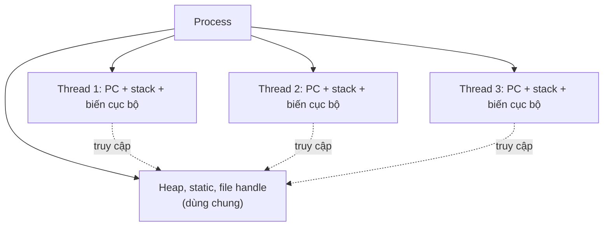
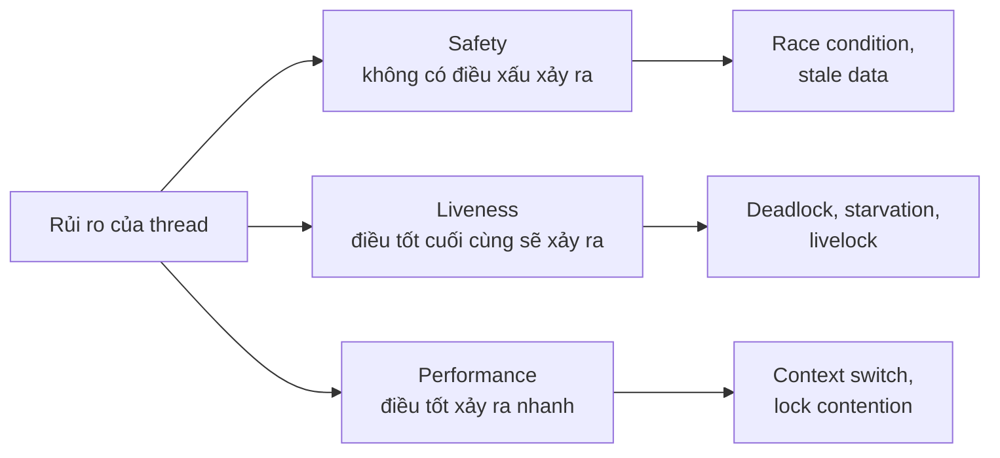
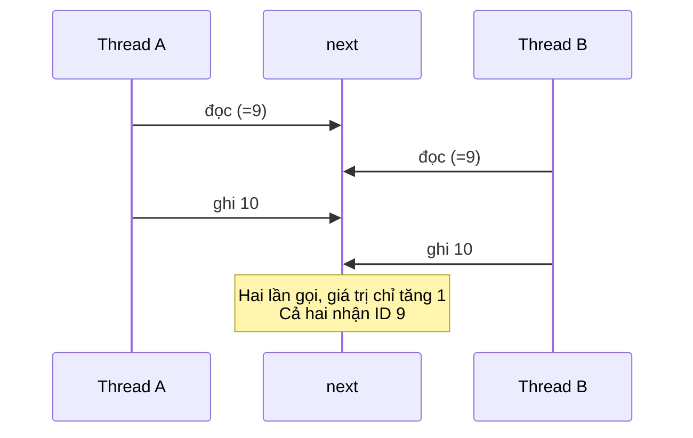
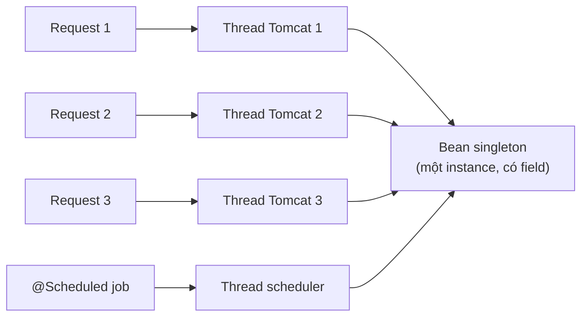

# Lý thuyết 01: Giới thiệu đồng thời: lợi ích và rủi ro

Chương 1 của *Java Concurrency in Practice* không dạy kỹ thuật cụ thể. Nó đặt nền tư duy: **vì sao** phải học đồng thời, **cái gì** có thể hỏng, và **vì sao** không thể né tránh chủ đề này.

**Tóm tắt:**

- Thread cùng process chia sẻ heap nhưng mỗi thread có stack và program counter riêng, nên trao đổi dữ liệu rẻ mà cũng dễ giẫm chân nhau.
- Ba lý do dùng nhiều thread: tận dụng nhiều core, viết luồng việc phức tạp thành code tuần tự dễ đọc, và giữ UI hoặc server luôn phản hồi.
- Ba nhóm rủi ro: safety (kết quả sai), liveness (kẹt vĩnh viễn) và performance (chậm do context switch, đồng bộ).
- `next++` gồm ba bước đọc, cộng, ghi nên hai thread có thể cùng nhận một giá trị; đây là race condition điển hình.
- Lỗi liveness có ba dạng: deadlock, starvation, livelock.
- Không tự tạo thread không có nghĩa là đơn luồng: servlet container, `Timer`, RMI, Swing, `@Scheduled` đều gọi code của bạn từ thread của chúng.
- Vì vậy nhu cầu thread safety lan ra toàn bộ code chạm tới trạng thái chung, và không thể chỉ dựa vào test để tìm lỗi.

## Đồng thời là gì và vì sao bạn phải quan tâm

**Đồng thời (concurrency)** là việc nhiều luồng điều khiển, gọi là **thread**, cùng tồn tại trong một tiến trình. Các thread dùng chung memory và file handle, nhưng mỗi thread có **program counter** (con trỏ cho biết đang chạy đến lệnh nào), **stack** và biến cục bộ riêng. Hãy hình dung một nhà bếp có nhiều đầu bếp: họ dùng chung tủ lạnh và kho nguyên liệu (memory chung), nhưng mỗi người có thớt và công thức đang làm dở của riêng mình. Làm việc song song thì nhanh, nhưng nếu hai người cùng lấy hộp trứng cuối cùng mà không báo nhau thì sẽ có chuyện.

Có ba lý do để dùng nhiều thread. Thứ nhất, tận dụng nhiều CPU/core, vì chương trình một thread chỉ chạy được trên một core. Thứ hai, biến một luồng công việc asynchronous phức tạp thành các đoạn code tuần tự dễ đọc (mỗi request một thread, viết như thể chỉ có một request). Thứ ba, giữ chương trình không bị "đứng" khi chờ I/O hoặc khi giao diện phải phản hồi người dùng.

Đổi lại, ta phải trả giá bằng ba loại rủi ro: **sai kết quả (safety)**, **kẹt vĩnh viễn (liveness)** và **chậm (performance)**. Cách xử lý là hiểu rõ ba nhóm rủi ro này ngay từ đầu, đưa thread safety vào thiết kế thay vì vá sau, và dựa vào các quy tắc ở Chương 2 đến 5 của sách thay vì suy luận cảm tính về thứ tự thực thi.

**Nền tảng:** Thread chia sẻ heap nhưng mỗi thread có stack và program counter riêng. Chia sẻ memory là thứ làm multithreaded vừa mạnh (trao đổi dữ liệu rẻ) vừa nguy hiểm (thao tác đan xen không đoán trước). Mọi quy tắc về đồng bộ ở các bài sau đều sinh ra từ một sự thật này.

**Suy luận:** Cái giá của thread đến từ một thiết kế duy nhất: mọi thread trong process cùng thấy một heap. Vì heap chung nên chuyển dữ liệu giữa các thread chỉ là đọc ghi vào cùng một chỗ, không cần serialize hay copy như giữa các process; đó là lý do thread rẻ và nhanh. Nhưng cũng vì heap chung, hệ điều hành lập lịch thread độc lập với ý đồ của bạn và có thể ngắt một thread ở bất kỳ lệnh nào, nên mọi thao tác gồm nhiều bước đều có thể bị thread khác chen vào giữa. Thứ nhất, chen vào giữa ba bước của `next++` làm mất một lần tăng. Thứ hai, ngay cả khi không bị chen, compiler và CPU được sắp xếp lại lệnh và giữ giá trị trong thanh ghi hay cache của từng core, nên thread khác có thể không bao giờ thấy giá trị mới. Điểm dễ nhầm là nghĩ rằng chỉ cần "đủ nhanh" hoặc "trên máy 1 CPU" thì không sao: máy 1 core vẫn có context switch tại bất kỳ lệnh nào, nên lỗi chỉ hiếm hơn chứ không biến mất. Hệ quả khi thiết kế là coi thread safety như một phần của thiết kế class ngay từ đầu, thay vì chờ test bắt lỗi.

Bạn cần học chủ đề này gần như bất kể công việc là gì. Dù không tự viết `new Thread`, bạn vẫn chạy trong servlet container, Spring MVC, scheduler hay GUI, những nơi framework tự tạo thread rồi gọi code của bạn từ các thread đó. Nếu bỏ qua, hậu quả là lỗi chỉ lộ ra ngẫu nhiên ở production: số liệu lệch, request treo, CPU cao mà không rõ lý do.

### Các khái niệm cần biết

| Khái niệm | Là gì | Vì sao quan trọng |
|---|---|---|
| Process | Một chương trình đang chạy, có không gian memory và file handle riêng | Ranh giới cô lập: process này không tự đụng vào memory process khác |
| Thread | Đơn vị lập lịch nhỏ nhất của hệ điều hành, nằm trong một process, chia sẻ heap với các thread khác | Là đơn vị mà CPU thực sự "chạy" |
| Concurrency và parallelism | Concurrency: nhiều việc cùng tiến triển (có thể xen kẽ trên một core). Parallelism: nhiều việc chạy đúng cùng lúc trên nhiều core | Code đúng với concurrency thì đúng cả khi parallel; chương trình cần được viết cho trường hợp tổng quát |
| Race condition | Kết quả đúng hay sai tùy thuộc thứ tự đan xen thao tác giữa các thread | Nguồn gốc của hầu hết lỗi đồng thời |
| Lập lịch (scheduling) | Hệ điều hành quyết định thread nào chạy trên core nào, bao lâu | Bạn không kiểm soát được, nên không được dựa vào thứ tự chạy |
| Event dispatch thread (EDT) | Thread duy nhất của Swing/AWT xử lý mọi event giao diện | Việc dài chạy trên EDT sẽ làm giao diện đóng băng |

Phần còn lại giải thích từng khái niệm lúc nó xuất hiện, bắt đầu từ việc thread ra đời như thế nào.

## Từ tiến trình đến thread

Ban đầu máy tính chạy một chương trình duy nhất từ đầu đến cuối, độc chiếm mọi tài nguyên. Hệ điều hành ra đời để chạy nhiều chương trình cùng lúc, mỗi chương trình trong một **process**: không gian memory riêng, file handle riêng, quyền riêng. Có ba động cơ thúc đẩy:

| Động cơ | Ý nghĩa |
|---|---|
| Tận dụng tài nguyên | Khi một chương trình chờ I/O thì CPU rảnh; cho chương trình khác chạy để không lãng phí |
| Công bằng | Nhiều người dùng/chương trình có quyền ngang nhau; chia lát thời gian mịn tốt hơn là chạy xong cái này mới tới cái kia |
| Tiện lợi | Viết nhiều chương trình nhỏ, mỗi cái một việc, rồi phối hợp, dễ hơn viết một chương trình khổng lồ |

Chính ba động cơ này lặp lại ở mức thấp hơn và sinh ra **thread**. Thread (đôi khi gọi là "process nhẹ") là đơn vị lập lịch cơ bản của hệ điều hành hiện đại:



Việc chia sẻ heap là con dao hai lưỡi. Nó cho phép trao đổi dữ liệu mịn hơn nhiều so với giữa các process (socket, shared memory...), nhưng nếu không phối hợp, thread này có thể sửa biến đúng lúc thread kia đang dùng, và kết quả không thể đoán trước.

## Lợi ích của thread

### Khai thác nhiều bộ xử lý

Thread là đơn vị lập lịch, nên chương trình chỉ có một thread thì tối đa chỉ chạy trên một CPU tại một thời điểm. Trên máy 2 core, bạn bỏ phí một nửa; trên máy 100 core, bạn bỏ phí 99%. Xu hướng phần cứng là thêm core thay vì tăng xung nhịp, nên khả năng chia việc cho nhiều thread ngày càng quan trọng.

Ngay cả trên máy 1 CPU, multithreaded vẫn có ích: khi một thread chờ I/O đồng bộ, thread khác vẫn chạy. Giống như đọc báo trong lúc chờ nước sôi thay vì đứng nhìn ấm nước.

### Mô hình hóa đơn giản hơn

Một chương trình xử lý một loại việc tuần tự thì đơn giản, ít lỗi, dễ kiểm thử. Gán mỗi loại việc (hoặc mỗi yêu cầu) cho một thread tạo ảo giác "tuần tự", che giấu việc lập lịch, đan xen thao tác, chờ tài nguyên. Một workflow asynchronous phức tạp được tách thành nhiều workflow đồng bộ đơn giản, chỉ gặp nhau ở những điểm đồng bộ cụ thể.

Servlet và RMI khai thác đúng ý này: framework lo tạo thread, phân phối request; lập trình viên viết `doGet` như thể chỉ có một request duy nhất.

### Xử lý event asynchronous

Server nhận kết nối socket từ nhiều client: nếu chỉ có một thread, một lần `read` bị chặn sẽ làm **mọi** request khác đứng theo, nên buộc phải dùng non-blocking I/O vốn phức tạp và dễ sai. Với mô hình mỗi kết nối một thread, I/O đồng bộ chặn thread nào thì chỉ thread đó chờ.

Trước đây hệ điều hành giới hạn số thread rất thấp (vài trăm), nên mới có `select/poll` và `java.nio`. Ngày nay hỗ trợ thread tốt hơn nhiều (NPTL trên Linux xử lý được hàng trăm nghìn thread) nên mô hình thread-per-client khả thi trở lại.

> Ghi chú Java hiện đại: Java 21 có virtual thread, đưa mô hình "mỗi request một thread" lên quy mô hàng triệu mà vẫn viết code đồng bộ. Các rủi ro về trạng thái chia sẻ trong bài này vẫn hoàn toàn đúng.

### Giao diện phản hồi nhanh

GUI cũ chạy một event loop chính. Nếu một handler chạy lâu (kiểm tra chính tả tài liệu lớn, tải tài nguyên mạng), giao diện "đóng băng", và tệ hơn nút Cancel cũng không bấm được vì event thread đang bận. Swing/AWT dùng một **event dispatch thread (EDT)**; việc dài phải đẩy sang thread khác để EDT luôn rảnh xử lý event.

## Rủi ro của thread

Hỗ trợ thread tích hợp trong Java là con dao hai lưỡi: có ngôn ngữ, thư viện và memory model đa nền tảng, nhưng cũng kéo mọi lập trình viên phải biết về thread safety, vì thread không còn là chủ đề "nâng cao".



### Rủi ro về an toàn (safety)

Safety nghĩa là "không bao giờ có điều xấu xảy ra". Khi thiếu đồng bộ, thứ tự thao tác giữa các thread không đoán trước được. Ví dụ kinh điển: bộ sinh ID tăng dần.

```java
// KHÔNG an toàn: hai thread có thể nhận cùng một ID
public class IdGenerator {
    private int next;

    public int nextId() {
        return next++;          // thực chất là ba bước: đọc, cộng 1, ghi
    }
}
```

`next++` trông như một thao tác nhưng là ba bước **đọc giá trị, cộng một, ghi lại**. Nếu hai thread cùng đọc 9, cùng tính ra 10 và cùng ghi 10, thì cả hai nhận ID 9 và một lần tăng bị mất:



Đây là **race condition**: kết quả đúng hay sai phụ thuộc vào "may rủi" của việc đan xen thao tác. Sửa bằng cách lock:

**Phải thuộc:** `i++` không atomic vì gồm ba bước đọc, cộng, ghi. Ba nhóm rủi ro của thread: safety (không có điều xấu: kết quả sai), liveness (điều tốt cuối cùng xảy ra: không bị kẹt), performance (điều tốt xảy ra nhanh). Ba lỗi liveness: deadlock, starvation, livelock.

```java
public class IdGenerator {
    private int next;                       // được bảo vệ bởi lock của this

    public synchronized int nextId() {
        return next++;
    }
}
```

Bên cạnh đó, nếu không có đồng bộ, compiler, CPU và runtime được phép sắp xếp lại thao tác và giữ giá trị trong thanh ghi/cache riêng của từng core, khiến thread khác không thấy giá trị mới. Đây là vấn đề **visibility**, sẽ nói ở bài 03 và 16. Chỉ cần tuân thủ quy tắc ở Chương 2-3 là bạn tránh được các chi tiết mức thấp này.

> Sách dùng các annotation `@ThreadSafe`, `@NotThreadSafe`, `@Immutable`, `@GuardedBy` để ghi tài liệu cho class. Chúng hữu ích cho người dùng (biết có dùng multithreaded được không), người bảo trì (biết phải giữ cam kết) và công cụ phân tích tĩnh.

### Rủi ro về tính sống (liveness)

Safety là "không có điều xấu"; liveness bổ sung cho nó: "cuối cùng điều tốt sẽ xảy ra". Lỗi liveness xảy ra khi hoạt động bị kẹt, không thể tiến tới nữa. Ở chương trình tuần tự, ví dụ là vòng lặp vô hạn. Với multithreaded có thêm:

| Dạng lỗi | Mô tả |
|---|---|
| Deadlock | Các thread giữ lock vòng tròn và chờ nhau mãi |
| Starvation | Một thread không bao giờ được cấp tài nguyên (CPU, lock) vì thread khác chiếm hết |
| Livelock | Các thread vẫn chạy nhưng cứ thử lại và thất bại liên tục, không có tiến triển |

Giống lỗi race, lỗi liveness phụ thuộc thời điểm tương đối giữa các thread nên không phải lần chạy nào cũng lộ ra, và có thể chỉ xuất hiện trên production. Chi tiết ở bài 10.

### Rủi ro về hiệu năng (performance)

"Cuối cùng" thường chưa đủ; ta cần điều tốt xảy ra **nhanh**. Hiệu năng gồm thời gian phục vụ, độ phản hồi, throughput, mức dùng tài nguyên, scalability. Multithreaded thiết kế tốt thì tăng hiệu năng ròng, nhưng vẫn có chi phí:

- **Context switch**: scheduler tạm dừng thread đang chạy để cho thread khác chạy. Phải lưu/khôi phục ngữ cảnh, mất locality (cache nguội), và tốn CPU cho chính việc lập lịch thay vì chạy việc thật.
- **Đồng bộ hóa**: ngăn compiler tối ưu, buộc flush hoặc vô hiệu hóa cache, tạo lưu lượng trên bus memory chung.

Chi tiết cách phân tích và giảm chi phí ở bài 11.

## Thread có ở khắp nơi

Dù chương trình không tự tạo thread, JVM vẫn tạo thread cho GC, finalization và `main`. Hơn nữa, nhiều framework tạo thread rồi **gọi ngược code của bạn** từ các thread đó:

| Cơ chế | Thread nào gọi code của bạn | Hệ quả |
|---|---|---|
| `Timer` | Thread riêng của Timer | Dữ liệu `TimerTask` đụng tới phải an toàn, kể cả với code khác truy cập cùng dữ liệu |
| Servlet/JSP, filter | Thread pool của container | Spec bắt buộc servlet phải chịu được gọi đồng thời; object trong `ServletContext`/`HttpSession` cũng bị chia sẻ |
| RMI | Thread do RMI quản lý, không rõ bao nhiêu | Remote object phải tự bảo vệ trạng thái của mình và trạng thái chia sẻ với object khác |
| Swing/AWT | Event dispatch thread | Component Swing không thread-safe; chỉ được đụng vào từ EDT (qua `invokeLater`) |

Trong thế giới Spring hiện nay, tương đương là: bean singleton được gọi từ nhiều thread của Tomcat, `@Async`, `@Scheduled`, listener Kafka, callback của `CompletableFuture`...

Sơ đồ sau cho thấy vì sao một bean singleton "tưởng single-threaded" thực ra bị nhiều thread gọi cùng lúc:



Đọc sơ đồ: container nhận request, giao mỗi request cho một thread trong pool, và tất cả các thread đó cùng gọi vào đúng một instance bean. Mọi field của bean vì thế là trạng thái chia sẻ. Nếu bean không có field (không trạng thái) thì an toàn; nếu có field đổi được thì bạn phải bảo vệ nó (bài 02).

**Suy luận:** Bean singleton của Spring là ví dụ rõ nhất cho việc "tưởng đơn luồng mà thực ra không". Container chỉ tạo đúng một instance cho mỗi bean để tiết kiệm, trong khi web server dùng một pool thread để phục vụ nhiều request cùng lúc, nên cả pool cùng gọi vào một instance và mọi field của nó trở thành trạng thái chia sẻ. Thứ nhất, bean không có field đổi được thì an toàn, vì không có gì để hai thread tranh nhau. Thứ hai, bean có field như counter, cache `HashMap`, hay `SimpleDateFormat` dùng chung thì hỏng theo cách ngẫu nhiên, vì lỗi chỉ lộ khi hai request trùng thời điểm. Điều dễ nhầm là code chạy đúng trên máy dev với một request tại một thời điểm, nên người viết không thấy lỗi. Khi review, hãy tìm mọi field không `final` trong bean singleton và hỏi ai ghi, ai đọc, bằng thread nào.

> **Nhu cầu thread safety lây lan.** Framework gọi component của bạn từ thread của nó, component lại truy cập trạng thái ứng dụng, nên mọi đường code chạm tới trạng thái đó đều phải thread-safe.

Ví dụ cụ thể: thêm một `TimerTask` lưu snapshot mỗi 10 phút vào chương trình đang chạy single-threaded. Từ giờ dữ liệu được đọc bởi cả main thread và thread của Timer, nên **toàn bộ** code đụng tới dữ liệu đó, ở mọi nơi trong chương trình, phải đồng bộ. Một thay đổi nhỏ kéo theo thay đổi lớn nếu trạng thái được đóng gói kém.

## Bẫy thường gặp

- **"Chương trình của tôi single-threaded."** Nếu nó chạy trong web container, message listener hay có `@Scheduled`, nó đã multithreaded rồi.
- **"Chạy test ổn nên không có lỗi."** Lỗi đồng thời cần "may rủi" về thời điểm mới lộ; test qua không chứng minh đúng.
- **Tưởng `x++` hay `if (x == null) x = ...` là một bước.** Cả hai đều là thao tác phức hợp.
- **Coi thread safety là việc "tối ưu sau".** Thiết kế class thread-safe ngay từ đầu dễ hơn nhiều so với vá sau.
- **Chỉ lo tốc độ.** Safety không bao giờ được hy sinh; hiệu năng chỉ tối ưu sau khi đúng và có số đo.

## Điểm cần nhớ

- Thread chia sẻ heap nhưng có stack/PC riêng: tiện lợi đi kèm nguy cơ can thiệp lẫn nhau.
- Ba lợi ích chính: dùng nhiều CPU, mô hình hóa đơn giản, giữ UI/server phản hồi.
- Ba nhóm rủi ro: safety (kết quả sai), liveness (kẹt), performance (chậm).
- `i++` không atomic; thiếu đồng bộ còn gây vấn đề visibility và reordering.
- Framework tạo thread thay bạn, nên nhu cầu thread safety "lây" ra toàn ứng dụng.
- Lỗi đồng thời khó tái hiện vì phụ thuộc thời điểm; phải thiết kế đúng chứ không thể chỉ dựa vào test.

## Câu hỏi tự kiểm tra

Với mỗi câu, thử trả lời theo các gợi ý trước rồi mới đọc đáp án.

1. Hai thread cùng gọi `return next++;` trên một object dùng chung và đôi khi nhận về cùng một số. Vì sao?
   - *Gợi ý suy luận:* `next++` được dịch thành mấy thao tác? Nếu hai thread chen vào giữa các thao tác đó thì mỗi thread đọc giá trị gì?
   - *Đáp án:* Nó gồm ba bước đọc, cộng, ghi. Vì không có gì ngăn chen ngang, hai thread có thể cùng đọc một giá trị, cùng cộng 1 rồi ghi đè nhau, nên mất một lần tăng (lost update).
2. Chương trình in kết quả sai là một loại lỗi, chương trình đứng im là loại khác. Hai loại đó tên là gì?
   - *Gợi ý suy luận:* Một bên là "điều xấu xảy ra", bên kia là "điều tốt không bao giờ xảy ra".
   - *Đáp án:* Safety là không có điều xấu xảy ra (kết quả sai); liveness là điều tốt cuối cùng sẽ xảy ra (không bị kẹt). Một chương trình có thể sai mà không kẹt, hoặc kẹt mà không sai.
3. Chương trình đứng im vì thread chờ nhau, hoặc vì một thread không bao giờ được chạy, hoặc vì các thread cứ nhường nhau mãi. Ba dạng đó là gì?
   - *Gợi ý suy luận:* Chia theo nguyên nhân: chờ vòng tròn, bị bỏ đói, cùng phản ứng nhưng không tiến lên.
   - *Đáp án:* Deadlock, starvation, livelock.
4. Chương trình của bạn không tự tạo thread nào, vậy có cần thread-safe không?
   - *Gợi ý suy luận:* Ai gọi code của bạn? Servlet container, `Timer`, RMI, Swing, Spring chạy code bạn ở thread nào?
   - *Đáp án:* Vẫn cần. Framework gọi code của bạn từ các thread do chúng quản lý, nên chỗ nào có thể bị gọi đồng thời thì phải an toàn.
5. Thêm thread làm chương trình có thể chậm đi. Hai nguồn chi phí chính là gì?
   - *Gợi ý suy luận:* Chuyện gì xảy ra khi CPU chuyển từ thread này sang thread khác? Và khi nhiều thread phải đồng bộ với nhau?
   - *Đáp án:* Context switch (lưu và khôi phục ngữ cảnh, mất locality) và chi phí đồng bộ (chặn tối ưu, flush cache, tải bus memory).
6. Từng có thời người ta tránh thread-per-client, giờ nó lại khả thi. Vì sao?
   - *Gợi ý suy luận:* Điều gì khiến mô hình đó đắt ngày xưa (số lượng thread)? Điều gì đã đổi về giới hạn đó?
   - *Đáp án:* Hệ điều hành (và với Java 21 là virtual thread) hỗ trợ số thread rất lớn, nên không còn bắt buộc dùng non-blocking I/O phức tạp.

Nguồn: Java Concurrency in Practice, Chương 1.

