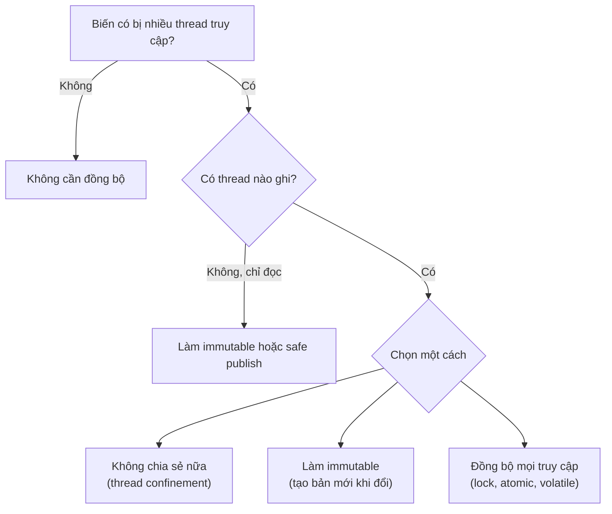
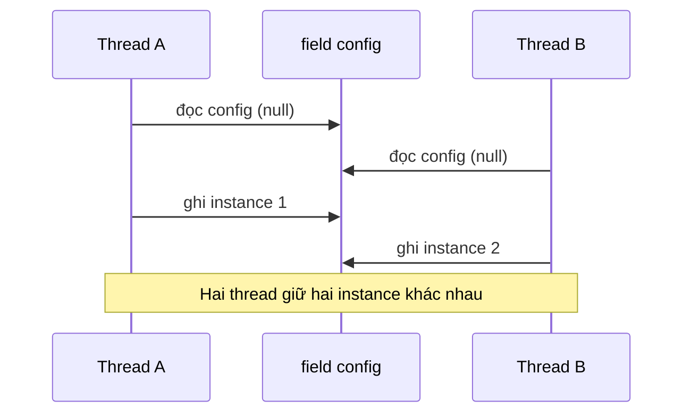
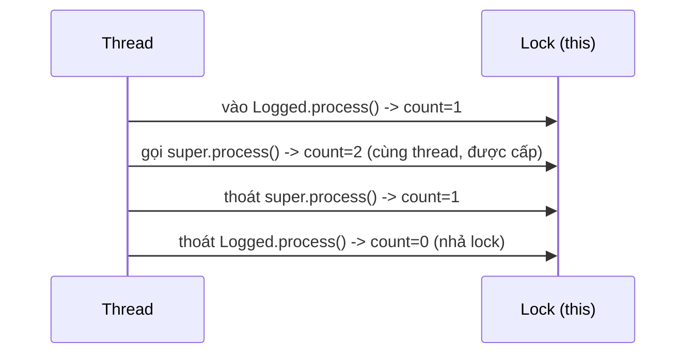
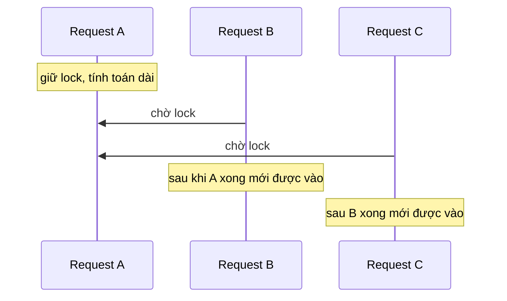

# Lý thuyết 02: Thread Safety

## Thread safety là gì và khi nào cần quan tâm

Nhiều người nghĩ thread safety là chuyện "dùng thread" hay "dùng lock". Thực ra nó là một tính chất của class (hoặc chương trình): class vẫn **đúng** khi được truy cập từ nhiều thread, bất kể runtime lập lịch hay đan xen thao tác thế nào, và người gọi không phải đồng bộ thêm gì. Bản chất của vấn đề là **quản lý truy cập vào trạng thái chia sẻ, có thể thay đổi** (shared mutable state). Không có trạng thái nào vừa chia sẻ vừa đổi được thì không có chuyện gì để bảo vệ.

Vấn đề đặt ra là khi thiếu đồng bộ, ba loại hỏng xảy ra: **lost update** (hai thread cùng cập nhật, một cập nhật bị mất), **dữ liệu cũ (stale)** (thread này không thấy giá trị thread kia vừa ghi), và **vi phạm invariant** (ràng buộc luôn phải đúng của dữ liệu bị phá, ví dụ "tích các thừa số bằng số gốc"). Điều nguy hiểm là chúng chỉ xảy ra khi "xui" về thời điểm, nên chương trình có thể qua mọi bài test rồi hỏng trên production.

Bạn cần nghĩ tới thread safety mỗi khi một biến có thể được truy cập bởi nhiều hơn một thread và ít nhất một thread có thể ghi vào nó. Có ba cách chữa, theo thứ tự ưu tiên: (1) không chia sẻ biến giữa các thread; (2) làm biến immutable; (3) đồng bộ mọi truy cập bằng lock, atomic hoặc volatile. Kèm theo là thiết kế tốt: đóng gói, ưu tiên immutable và ghi rõ invariant. Cách (3) là cách cuối cùng chứ không phải mặc định, vì nó vừa dễ sai vừa tốn hiệu năng.

**Tóm tắt:**

- Thread safety là quản lý truy cập vào shared mutable state: không chia sẻ hoặc không đổi được thì không có gì phải bảo vệ.
- Ba cách sửa theo thứ tự ưu tiên: không chia sẻ biến, làm biến immutable, rồi mới đồng bộ mọi truy cập.
- Class thread-safe là class vẫn đúng khi nhiều thread gọi, mà người gọi không phải đồng bộ thêm; object không trạng thái luôn thread-safe.
- Atomicity: `count++` và check-then-act là compound action gồm nhiều bước, phải thực hiện atomic thì mới hết race condition.
- Nhiều biến atomic riêng lẻ chưa đủ khi chúng cùng nằm trong một invariant; cần một lock chung cho cả thao tác.
- Intrinsic lock (`synchronized`) là reentrant theo thread; mọi truy cập vào cùng một biến mutable phải dùng cùng một lock.
- Không `synchronized` bừa mọi method: phạm vi lock quá rộng làm mất concurrency và dễ gây liveness hazard.

### Các khái niệm cần biết

| Khái niệm | Là gì | Ví dụ ngắn |
|---|---|---|
| Invariant | Điều kiện luôn phải đúng với trạng thái của object | `lastFactors` nhân lại phải ra `lastNumber` |
| Postcondition | Điều phải đúng sau khi một thao tác kết thúc | Sau `push(x)`, `size` tăng 1 |
| Race condition | Tính đúng của kết quả phụ thuộc thứ tự đan xen thao tác của các thread | Hai thread cùng `count++` |
| Compound action | Chuỗi thao tác phải thực hiện như một khối atomic | `if (!contains) add` |
| Atomic | Thao tác mà thread khác thấy hoặc là đã xong hết, hoặc là chưa bắt đầu | `AtomicLong.incrementAndGet()` |
| Intrinsic lock / monitor | Lock tích hợp mà mọi object Java đều có, dùng qua `synchronized` | `synchronized (this) { ... }` |
| Mutex | Lock loại trừ tương hỗ: mỗi lúc chỉ một thread giữ | Thread thứ hai phải chờ |
| Reentrant | Cùng một thread xin lại lock đang giữ thì được cấp | `super.method()` cũng `synchronized` |
| `@GuardedBy` | Annotation ghi chú "biến này được bảo vệ bởi lock nào" (không có tác dụng lúc chạy, chỉ là tài liệu và cho công cụ phân tích) | `@GuardedBy("this")` |

Các mục dưới đi lần lượt qua từng khái niệm, theo mạch: trạng thái, atomic, lock, rồi hiệu năng.

## Thread safety là về trạng thái

**Trạng thái (state)** của object là dữ liệu có thể ảnh hưởng đến hành vi nhìn thấy từ bên ngoài, lưu trong các biến trạng thái (field instance, field static), kể cả field của các object phụ thuộc (trạng thái của `HashMap` còn nằm trong nhiều `Map.Entry`). **Chia sẻ (shared)** là biến có thể bị nhiều thread truy cập. **Thay đổi được (mutable)** là giá trị có thể đổi trong lifecycle.

Vì vậy, nói "code thread-safe" thực ra là nói "dữ liệu được bảo vệ khỏi truy cập đồng thời không kiểm soát". Một object có cần thread-safe hay không phụ thuộc vào **cách nó được dùng** (có nhiều thread truy cập không), chứ không phụ thuộc nó làm gì.

**Nền tảng:** Thread safety không phải là "dùng lock" mà là bảo vệ **trạng thái chia sẻ có thể thay đổi** (shared mutable state). Thiếu một trong hai vế chia sẻ hoặc thay đổi được thì không có gì phải bảo vệ. Mọi kỹ thuật phía sau (confinement, immutable, lock) chỉ là cách loại bỏ hoặc kiểm soát hai vế này.

**Phải thuộc:** Nếu nhiều thread truy cập cùng một biến mutable mà không đồng bộ phù hợp, chương trình **sai**. Ba cách sửa theo thứ tự ưu tiên: (1) không chia sẻ biến giữa các thread; (2) làm biến immutable; (3) đồng bộ mọi truy cập.

Không có "trường hợp đặc biệt" nào được miễn quy tắc này. Chương trình thiếu đồng bộ có thể chạy ổn nhiều năm nhưng vẫn là chương trình hỏng, và có thể hỏng bất cứ lúc nào. Mặt khác, thiết kế class thread-safe ngay từ đầu dễ hơn rất nhiều so với sửa lại sau, vì có thể phải thay đổi thiết kế.



Đóng gói và ẩn dữ liệu giúp cực nhiều: càng ít code truy cập được một biến, càng dễ bảo đảm tất cả đều đồng bộ đúng cách và càng dễ lập luận về các điều kiện truy cập. Java không bắt buộc bạn đóng gói, nhưng khi phá encapsulation thì thread safety trở nên mong manh, tốn kém cả khi phát triển lẫn bảo trì. Nguyên tắc: **làm cho đúng trước, rồi mới làm cho nhanh**, và chỉ tối ưu khi có số đo chứng minh cần và có hiệu quả.

## Định nghĩa thread-safe

Trung tâm của mọi định nghĩa hợp lý là **tính đúng đắn (correctness)**: class tuân theo đặc tả của nó. Đặc tả tốt gồm **invariant** (ràng buộc trên trạng thái) và **postcondition** (hiệu quả của thao tác). Từ đó:

> Một class là thread-safe nếu nó hoạt động đúng khi được truy cập từ nhiều thread, bất kể runtime lập lịch hay đan xen các thread thế nào, và không đòi hỏi code gọi phải đồng bộ hay phối hợp thêm.

Hệ quả: không dãy thao tác nào, tuần tự hay đồng thời, được phép đưa instance vào trạng thái sai. Class thread-safe **tự đóng gói** đồng bộ cần thiết để client khỏi phải làm. Và một class sai ngay cả khi single-threaded thì không thể thread-safe.

### Object không trạng thái luôn thread-safe

Nếu mọi dữ liệu tạm nằm trong biến cục bộ (trên stack của từng thread) thì thread này không thể ảnh hưởng thread kia.

```java
// Không có field nào -> thread-safe
public class PriceCalculator {
    public BigDecimal withTax(BigDecimal price, BigDecimal rate) {
        return price.add(price.multiply(rate));   // chỉ dùng tham số và biến cục bộ
    }
}
```

Phần lớn servlet/controller/service singleton được viết không trạng thái, nên gánh nặng thread safety giảm mạnh. Vấn đề chỉ xuất hiện khi object muốn **nhớ** thứ gì đó giữa các lần gọi.

## Atomicity

Thêm một biến đếm số lần gọi vào class không trạng thái ở trên:

```java
// KHÔNG thread-safe
public class HitCounterService {
    private long hits = 0;

    public void handle(Request req) {
        process(req);
        ++hits;                 // đọc - cộng - ghi: mất cập nhật khi đồng thời
    }

    public long getHits() { return hits; }
}
```

`++hits` là thao tác **đọc-sửa-ghi (read-modify-write)**: trạng thái mới dẫn xuất từ trạng thái cũ. Hai thread cùng đọc 9 rồi cùng ghi 10 sẽ làm mất một lần đếm. Hiện tượng "kết quả đúng hay sai tùy thuộc may rủi về thời điểm" được gọi là **race condition**.

### Race condition: check-then-act và read-modify-write

| Dạng | Ý nghĩa | Ví dụ |
|---|---|---|
| **Check-then-act** | Dùng một quan sát có thể đã lỗi thời để quyết định hành động | "File chưa tồn tại thì tạo", lazy initialization, "chưa có trong list thì thêm" |
| **Read-modify-write** | Tính trạng thái mới từ trạng thái cũ | `count++`, cộng dồn số dư, cập nhật max |

Điểm chung: quan sát "X đang đúng" có thể hết hiệu lực ngay sau khi quan sát xong, vì thread khác chen vào giữa. Giống hẹn bạn ở một trong hai quán cà phê cùng tên: bạn đến quán A, không thấy bạn mình, bèn đi sang quán B; trong lúc đó bạn kia có thể đã tới quán A. Quan sát "không có ở A" mất giá trị ngay khi bạn bước ra cửa.

**Phải thuộc:** Hai dạng race condition kinh điển: check-then-act (kiểm tra rồi hành động, như lazy init, `if (!contains) add`) và read-modify-write (như `count++`). Cả hai là compound action và phải thực hiện atomic. Khác nhau: race condition là tính đúng phụ thuộc thời điểm, data race là truy cập không đồng bộ có ít nhất một bên ghi.

> Ghi chú thuật ngữ: **race condition** (tính đúng phụ thuộc thời điểm) khác với **data race** (truy cập biến chia sẻ không đồng bộ mà ít nhất một bên ghi). Hai khái niệm giao nhau nhưng không trùng nhau; Chương 16 sẽ nói kỹ.

### Ví dụ: race trong lazy initialization

```java
// KHÔNG thread-safe
public class ConfigHolder {
    private ExpensiveConfig config;

    public ExpensiveConfig get() {
        if (config == null) {               // kiểm tra
            config = new ExpensiveConfig();  // rồi mới hành động
        }
        return config;
    }
}
```

Lịch chạy xấu diễn ra như sau:



Đọc sơ đồ: khoảng trống giữa "kiểm tra" và "ghi" là nơi thread kia chen vào. Hai thread cùng thấy `config == null` và cùng tạo hai instance khác nhau, dù `get()` được cam kết trả về một instance duy nhất. Nếu đó là registry của ứng dụng thì các đăng ký bị thất lạc; nếu là bộ sinh ID của framework persistence thì hai entity có thể trùng ID.

### Hành động phức hợp (compound action)

Check-then-act và read-modify-write gọi chung là **compound action**: chuỗi thao tác phải thực thi **atomic** để giữ thread safety. Hai thao tác A và B là atomic đối với nhau nếu, nhìn từ thread đang chạy A, khi thread khác chạy B thì hoặc B đã xong hết, hoặc chưa bắt đầu.

Cách sửa nhanh nhất nếu chỉ có **một** biến trạng thái: dùng class thread-safe sẵn có.

```java
public class HitCounterService {
    private final AtomicLong hits = new AtomicLong();

    public void handle(Request req) {
        process(req);
        hits.incrementAndGet();   // atomic
    }

    public long getHits() { return hits.get(); }
}
```

Nếu thêm **một** biến trạng thái vào class không trạng thái và biến đó do một object thread-safe quản lý hoàn toàn, class vẫn thread-safe. Nhưng từ một lên nhiều biến thì không còn đơn giản như vậy.

> Khi có thể, hãy dùng object thread-safe sẵn có (như `AtomicLong`) để quản lý trạng thái. Việc lập luận về các trạng thái và chuyển trạng thái của chúng dễ hơn nhiều so với biến tùy ý.

## Locking

### Vì sao nhiều biến atomic vẫn chưa đủ

Giả sử cần cache kết quả lần tính gần nhất: lưu `lastNumber` và `lastFactors`.

```java
// KHÔNG thread-safe, dù mỗi biến đều là atomic
public class FactorCache {
    private final AtomicReference<BigInteger> lastNumber = new AtomicReference<>();
    private final AtomicReference<BigInteger[]> lastFactors = new AtomicReference<>();

    public BigInteger[] factorsOf(BigInteger n) {
        if (n.equals(lastNumber.get())) {
            // có thể lấy nhầm cặp (số mới, thừa số cũ)
            return lastFactors.get();
        }
        BigInteger[] f = factor(n);
        lastNumber.set(n);                      // cửa sổ bất nhất giữa hai lệnh set
        lastFactors.set(f);
        return f;
    }
}
```

Invariant: tích các thừa số trong `lastFactors` phải bằng `lastNumber`. Khi nhiều biến tham gia cùng một invariant, chúng **không còn độc lập**: giá trị biến này ràng buộc biến kia. Do đó phải cập nhật tất cả trong **một** thao tác atomic. Hai lệnh `set` riêng lẻ, dù mỗi lệnh atomic, vẫn để hở một khoảng mà thread khác nhìn thấy trạng thái nửa vời. Tương tự khi đọc hai giá trị.

> Để giữ trạng thái nhất quán, hãy cập nhật các biến liên quan trong **một** thao tác atomic.

### Intrinsic lock (monitor lock)

Cơ chế tích hợp của Java là khối `synchronized`: một tham chiếu đến object làm lock và một khối code được lock đó bảo vệ.

```java
synchronized (lock) {
    // truy cập hoặc sửa trạng thái được bảo vệ bởi lock
}
```

- Mọi object Java đều có thể làm lock (intrinsic lock hay monitor lock).
- Lock được tự động lấy khi vào khối và tự động nhả khi ra khối, dù ra bình thường hay do exception.
- Method `synchronized` là viết tắt của khối bao toàn thân method, lock là `this`; method `static synchronized` dùng object `Class`.
- Là **mutex**: tại một thời điểm chỉ một thread giữ lock; thread khác muốn lấy phải chờ (block).

Vì chỉ một thread chạy khối được bảo vệ bởi một lock, các khối `synchronized` cùng lock atomic với nhau. Không thread nào thấy thread khác ở giữa chừng một khối cùng lock.

```java
public class FactorCache {
    private BigInteger lastNumber;          // @GuardedBy("this")
    private BigInteger[] lastFactors;       // @GuardedBy("this")

    public synchronized BigInteger[] factorsOf(BigInteger n) {
        if (n.equals(lastNumber)) return lastFactors.clone();
        BigInteger[] f = factor(n);         // đang giữ lock suốt lúc tính: chậm!
        lastNumber = n;
        lastFactors = f.clone();
        return f;
    }
}
```

Phiên bản này **đúng** nhưng **concurrency kém** (xem mục "Sống còn và hiệu năng" bên dưới). Dùng `synchronized` cả method khi nào cũng đúng nhưng đơn giản nhất, hợp với giai đoạn đầu hoặc khi phần việc trong khối rất ngắn. Không nên dùng khi trong khối có tính toán dài hoặc I/O, vì mọi thread khác sẽ xếp hàng chờ.

### Reentrancy

Nếu thread A đang giữ lock, thread B xin lock đó sẽ bị chặn. Nhưng nếu **chính thread A** xin lại lock mình đang giữ thì được cấp ngay. Lock được cấp theo **thread**, không theo **lần gọi**. Cài đặt: mỗi lock có chủ sở hữu và counter; xin lần đầu đặt count = 1, xin lại tăng count, thoát khối giảm count, về 0 thì nhả.

Tính chất này quan trọng với object-oriented:

```java
public class Base {
    public synchronized void process() { /* ... */ }
}

public class Logged extends Base {
    @Override
    public synchronized void process() {
        log("trước khi xử lý");
        // cần lại đúng lock của this; nếu không reentrant sẽ tự deadlock
        super.process();
    }
}
```



**Suy luận:** Lý do phải có lock cho nhiều biến xuất phát từ việc atomic chỉ bảo đảm trên một biến. Mỗi `AtomicLong` tự nó không thể bị chen vào giữa, nhưng JVM không biết hai biến có liên hệ với nhau, nên giữa hai lần cập nhật riêng lẻ vẫn có khoảng hở mà thread khác thấy trạng thái nửa vời, tức vi phạm invariant. Muốn khép khoảng hở, ta cần một cơ chế biến cả đoạn code thành một khối không ai chen vào được, và đó chính là lock: chỉ một thread giữ lock tại một thời điểm, nên các thread khác xếp hàng ngoài khối. Từ đó suy ra hai điều. Thứ nhất, lock chỉ hiệu quả khi mọi đường truy cập đến biến đều dùng cùng lock, vì chỉ cần một chỗ đọc hoặc ghi bỏ qua lock là khối bảo vệ bị thủng. Thứ hai, intrinsic lock phải reentrant: nếu không, một method `synchronized` gọi method `synchronized` khác của cùng object (hay method của subclass gọi `super`) sẽ tự chờ chính mình và deadlock. Điểm dễ nhầm là tin rằng giữ lock của object nghĩa là cấm thread khác dùng object đó; thật ra nó chỉ cấm lấy cùng lock. Khi review, hãy kiểm tra mỗi biến mutable có đúng một lock bảo vệ và lock đó được ghi tài liệu.

## Bảo vệ trạng thái bằng lock

Lock cho phép xây các **giao thức** truy cập độc quyền. Bọc compound action trong `synchronized` là chưa đủ; cần tuân thủ các quy tắc:

1. **Cùng một lock ở mọi nơi.** Nếu dùng đồng bộ để điều phối truy cập một biến thì phải dùng ở *mọi* chỗ truy cập biến đó, và dùng cùng một lock.
2. **Cả đọc lẫn ghi.** Sai lầm phổ biến là cho rằng chỉ cần đồng bộ khi ghi. Thực tế đọc cũng phải đồng bộ (lý do visibility, xem bài 03).
3. **Mỗi biến mutable dùng chung được bảo vệ bởi đúng một lock**, và cần cho người bảo trì biết lock nào (ghi chú hoặc `@GuardedBy`).
4. **Invariant liên quan nhiều biến thì tất cả biến đó dùng cùng một lock**, để cập nhật atomic và giữ invariant.
5. Chỉ dữ liệu **mutable và dùng chung** mới cần lock.

Cần lưu ý: không có quan hệ tự nhiên giữa intrinsic lock của object và trạng thái của nó. Lấy lock của một object **không** ngăn thread khác truy cập object đó, chỉ ngăn thread khác lấy cùng lock. Quy ước "mọi trạng thái của object được bảo vệ bởi lock của chính nó" (như `Vector`) chỉ là một giao thức mà bạn tự tuân thủ; compiler và runtime không bắt buộc, và dễ vô tình phá bằng cách thêm method mới quên `synchronized`.

**Phải thuộc:** Quy tắc dùng lock: (1) mọi truy cập (cả đọc lẫn ghi) vào một biến mutable dùng chung phải dùng cùng một lock; (2) các biến cùng một invariant dùng chung một lock; (3) intrinsic lock là reentrant theo thread, và lấy lock của object không ngăn thread khác truy cập object đó, chỉ ngăn lấy cùng lock.

### Tại sao không cứ `synchronized` hết mọi method

Đồng bộ từng method (như `Vector`) có thể vừa **thừa** vừa **thiếu**:

```java
// Mỗi lệnh đều atomic, nhưng cả chuỗi thì KHÔNG
if (!vector.contains(element)) {
    // race: thread khác có thể thêm element vào giữa hai lệnh
    vector.add(element);
}
```

Muốn atomic cho chuỗi này cần lock thêm ở mức cao hơn (Chương 4). Ngược lại, `synchronized` bừa bãi dẫn tới vấn đề sống còn và hiệu năng.

## Sống còn và hiệu năng

Bản `synchronized` toàn method ở trên buộc mọi request xếp hàng, dù hầu hết thời gian là tính toán không đụng tới trạng thái dùng chung:



Đây là **concurrency kém**: số lần gọi đồng thời bị giới hạn bởi cấu trúc ứng dụng chứ không phải bởi tài nguyên CPU. Máy nhiều core vẫn rảnh trong khi tải cao, và cả request nhẹ (kết quả đã cache) cũng phải chờ request nặng.

Cách chữa: **thu hẹp phạm vi khối `synchronized`**, tách phần tính toán dài, không đụng trạng thái chia sẻ ra khỏi vùng lock.

```java
public class FactorCache {
    private BigInteger lastNumber;           // @GuardedBy("this")
    private BigInteger[] lastFactors;        // @GuardedBy("this")
    private long hits, cacheHits;            // @GuardedBy("this")

    public BigInteger[] factorsOf(BigInteger n) {
        BigInteger[] result = null;
        synchronized (this) {                // đoạn ngắn 1: check-then-act trên cache
            hits++;
            if (n.equals(lastNumber)) {
                cacheHits++;
                result = lastFactors.clone();
            }
        }
        if (result == null) {
            // tính toán dài, CHỈ dùng biến cục bộ, KHÔNG giữ lock
            result = factor(n);
            // đoạn ngắn 2: cập nhật cả hai biến cùng lúc
            synchronized (this) {
                lastNumber = n;
                lastFactors = result.clone();
            }
        }
        return result;
    }

    public synchronized long getHits() { return hits; }
}
```

Giữ giữa đơn giản (lock cả method) và concurrency (lock đoạn ngắn nhất). Lưu ý:

| Nguyên tắc | Lý do |
|---|---|
| Không chia nhỏ khối quá mức | Mỗi lần lấy/nhả lock có chi phí; và không được tách một thao tác cần atomic thành nhiều khối |
| Đặt `++hits` vào cùng khối kiểm tra | Biến đếm cũng là trạng thái chia sẻ nên cũng phải truy cập dưới cùng lock |
| Không dùng thêm `AtomicLong` cho counter | Đã dùng `synchronized` thì trộn hai cơ chế chỉ gây khó hiểu, không thêm lợi ích |
| Đừng đánh đổi sự đơn giản sớm | Tối ưu non dễ làm hỏng safety, vốn không được thỏa hiệp |

> **Không giữ lock khi thực hiện tính toán dài hoặc thao tác có nguy cơ không hoàn tất nhanh** như I/O mạng hoặc console.

## Bẫy thường gặp

- **Đồng bộ ghi mà quên đồng bộ đọc**: người đọc có thể thấy giá trị cũ.
- **Mỗi biến một lock khác nhau trong khi chúng thuộc cùng một invariant**: cập nhật không còn atomic.
- **Hai atomic variable ≠ một thao tác atomic**: từng biến an toàn nhưng cặp thì không.
- **Dùng collection thread-safe rồi nghĩ chuỗi thao tác cũng an toàn** (ví dụ `contains` rồi `add`).
- **Giữ lock khi gọi I/O hoặc code lạ**: dễ gây chậm, thậm chí deadlock.
- **Lock trên object có thể bị đổi** (field không `final`), hoặc lock trên `String`/`Integer` được cache dùng chung: hai bên tưởng cùng lock nhưng lại khác, hoặc vô tình va chạm với code khác.
- **Tin rằng "chỗ này chắc không ai gọi đồng thời"**: đừng dựa vào lập luận khéo léo để bỏ đồng bộ.

## Điểm cần nhớ

- Thread safety là quản lý truy cập vào **mutable state dùng chung**; ít trạng thái chung hơn thì dễ hơn.
- Nếu nhiều thread truy cập một biến mutable mà không đồng bộ, chương trình sai; ba cách sửa: không chia sẻ, immutable, đồng bộ.
- Object không trạng thái luôn thread-safe.
- Check-then-act và read-modify-write là compound action, phải atomic.
- Dùng class thread-safe có sẵn (`AtomicLong`...) cho một biến; nhiều biến cùng invariant thì cần một lock chung.
- Mỗi biến mutable dùng chung được bảo vệ bởi **đúng một** lock, lock đó phải được dùng ở mọi truy cập (kể cả đọc).
- Giữ lock suốt compound action; nhưng không giữ lock lúc tính toán dài hoặc I/O.
- Intrinsic lock là reentrant (theo thread); lấy lock của object không lock object đó.
- Hãy làm đúng trước, đo đạc rồi mới tối ưu.

## Câu hỏi tự kiểm tra

Với mỗi câu, thử trả lời theo các gợi ý trước rồi mới đọc đáp án.

1. Một class không có field nào có thread-safe không? Vì sao?
   - *Gợi ý suy luận:* Thread-safe là về trạng thái dùng chung. Biến cục bộ nằm ở đâu, ai cùng truy cập được?
   - *Đáp án:* Luôn thread-safe. Mọi dữ liệu nằm trong biến cục bộ trên stack của từng thread, nên không thread nào ảnh hưởng thread khác.
2. Hai `AtomicReference` riêng lẻ có bảo vệ được một invariant liên quan tới cả hai không?
   - *Gợi ý suy luận:* Mỗi lệnh `set`/`get` có atomic không? Còn một cặp hai lệnh liên tiếp? Thread khác có thể chen vào giữa không?
   - *Đáp án:* Không. Mỗi lệnh atomic riêng, nhưng cặp lệnh thì không, nên thread khác có thể thấy trạng thái nửa vời. Cần một lock chung cho cả hai biến.
3. Phân biệt check-then-act và read-modify-write, mỗi loại cho một ví dụ.
   - *Gợi ý suy luận:* Một loại kiểm tra điều kiện rồi hành động dựa trên điều kiện; loại kia đọc giá trị cũ để tính giá trị mới. Giữa hai bước, thread khác làm gì được?
   - *Đáp án:* Check-then-act: lazy init `if (x == null) x = ...`. Read-modify-write: `count++`. Cả hai là compound action và phải atomic.
4. Reentrancy giải quyết tình huống nào?
   - *Gợi ý suy luận:* Class con ghi đè method `synchronized` rồi gọi `super.method()` cũng `synchronized`. Thread phải xin lại lock mà chính nó đang giữ: nếu không cho thì điều gì xảy ra?
   - *Đáp án:* Cùng thread xin lại lock đã giữ thì được cấp (đếm theo thread), nên không tự deadlock.
5. Vì sao phải đồng bộ cả khi **đọc**?
   - *Gợi ý suy luận:* Ghi bên này có chắc hiện ra cho thread đọc bên kia không? Đọc giữa lúc compound action chạy thì thấy gì?
   - *Đáp án:* Để thấy giá trị mới nhất (visibility) và nhất quán với compound action. Đọc không lock có thể thấy giá trị cũ hoặc trạng thái nửa vời.
6. Khi nào nên thu hẹp khối `synchronized`, và giới hạn của việc này là gì?
   - *Gợi ý suy luận:* Giữ lock càng lâu thì thread khác chờ càng lâu. Phần nào trong khối không đụng trạng thái chung? Còn phần nào phải liền mạch?
   - *Đáp án:* Khi khối có tính toán dài hoặc I/O không đụng trạng thái chung thì đưa ra ngoài. Nhưng không được chia nhỏ một compound action cần atomic, và đừng chia quá mức vì lock có chi phí.

Nguồn: Java Concurrency in Practice, Chương 2.

